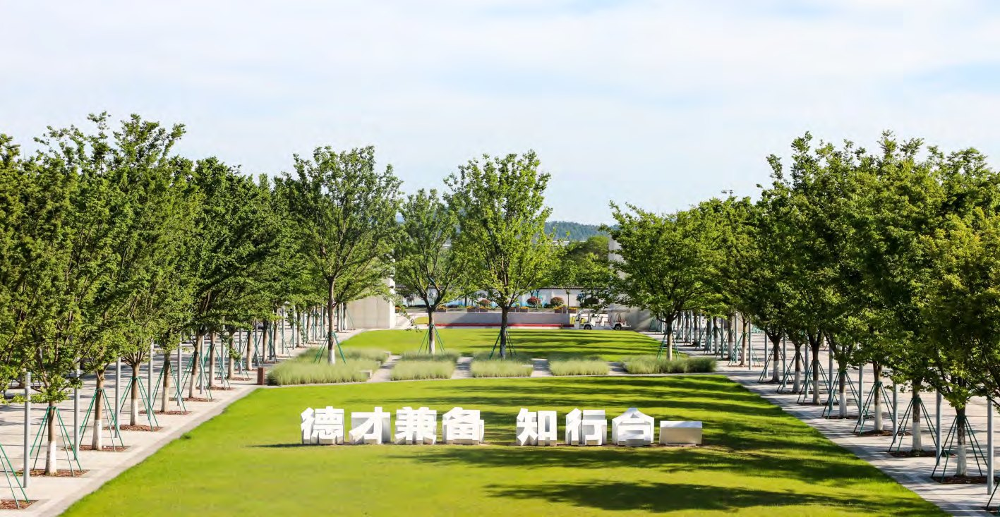

  
  

    01–04 · Campus Services
    <h1 class="guide-hero__title">校园服务</h1>
    
校园卡、网络、报修与楼宇服务——入学最先用到的四件事，按办理顺序整理在这里。

    

      补卡 <b>20 元</b>
      IT 服务 <b>0571-28881074</b>
      维修 <b>152-6708-9300</b>
      安保 <b>0571-28881110</b>
    

  

校园卡是校内消费、门禁与借阅的通用凭证；校园网分为访客与认证用户两套；设施故障统一走钉钉报修；各公共楼宇（实验楼除外）配有专属管家。

  
校园卡补卡20 元 / 张 <small>需保证余额充足</small>

  
IT 服务热线0571-28881074

  
24 小时维修152-6708-9300

  
24 小时安保0571-28881110

## 校园卡 {#card}

### 办理方式

| 人员类型 | 办理方式 |
|----------|----------|
| 本科生、研究生 | 学校统一批量办理，入学时由辅导员下发 |
| 派驻生、交换生 | 扫描派驻单背面二维码，完成支付宝绑定并上传通行照，前往教学 5 号楼（医务中心）负一层 B1017（健身房右侧房间）领取 |

### 支付宝认证绑定

1. 打开支付宝，搜索「智慧易通云」，点击「立即用户认证」。
2. 确认单位为「杭州北航国际创新研究院（学院）」；如不是，在个人中心切换。
3. 登录：新用户使用学工号 + 初始密码（身份证 / 护照后六位，字母以 0 代替）；也可使用手机号 + 验证码（手机号需与钉钉一致）。
4. 核对账户信息，点击「下一步」，显示照片即绑定成功。

!!! warning "注意"

    认证过程中请确保个人信息真实有效，切勿向他人泄露验证码。

### 补卡

| 项目 | 详情 |
|------|------|
| 地点 | 教学 5 号楼（医务中心）负一层 B1017；食堂西南门墙角处自助补卡机（仅限师生） |
| 时间 | 8:00 – 17:00 |
| 费用 | 20 元 / 张，从校园卡账户扣除，请确保卡内余额充足 |

### 补卡后智能门锁权限重置

补卡后需要断电再上电，才能激活新卡的门锁权限：

1. 请室友、宿管或楼宇管家先开门，从顶部扣开门锁盖板。
2. 打开电池盖板。
3. 拆出一节电池，等待 3 秒后装回。
4. 先上后下，安装回电池盖板。
5. 先下往上，安装回门锁盖板。
6. 刷卡验证，指示灯亮起即重置成功。

如仍无法开门，请拍下门锁编号，通过钉钉联系林伟达或李庆华。

### 充值与其他业务

钉钉工作台 → <strong>充值消费</strong>，可办理校园卡充值、账单查询、挂失 / 解挂、账户信息等业务。

## 校园网络 {#network}

| 网络 | 适用人群 | 连接方式 |
|------|----------|----------|
| BHI-guest | 访客 | 选择 BHI-guest，触发登录页，通过手机验证码连接 |
| BHI | 认证用户（师生） | 选择 BHI，触发登录页，使用学工号与密码连接 |

### 网络报修

打开钉钉 → <strong>工作台</strong> → <strong>维小宝</strong> → <strong>故障申报</strong> → 选择「IT 桌面运维」→ 填写并提交。紧急情况可拨打 IT 服务热线 `0571-28881074`。

## 维修报修 {#repair}

| 方式 | 操作 |
|------|------|
| 钉钉报修 | 工作台 → 公共服务 → 综合报修 → 报修上报，填写分类、地址、问题描述并上传照片 / 视频后提交 |
| 扫码报修 | 打开钉钉扫描下方二维码 → 选择「报修上报」→ 填写提交 |
| 电话报修 | 拨打 24 小时维修热线 `152-6708-9300` |

  
  

    
钉钉扫码报修

    
手机打开钉钉扫描二维码，选择「报修上报」，填写设备、地址与故障描述后提交。

  

## 楼宇服务 {#building}

### 楼宇管家

国际校园在各公共楼宇（实验楼除外）都设有管家。打开钉钉，在搜索框输入楼宇名称（例如「科研一楼宇」），系统会自动推送该楼宇管家的联系方式。

  <figure>
    
    <figcaption><b>楼宇管家</b> · 师生咨询、报事报修、协助开门</figcaption>
  </figure>
  <figure>
    
    <figcaption><b>身边的服务点</b> · 值班室与便民借用</figcaption>
  </figure>

管家服务范围：师生咨询、报事报修、卫生反馈、协助开门、资产管理、教室管理、便民借用、失物招领。

### 会务服务与会议室预约

国际校园为各类会议提供会务服务，可通过钉钉发起申请流程：

1. 打开钉钉工作台，点击「会议室预约」，选择会议室。
2. 选择会议时间，填写会议主题、会议人数，勾选参会人员。
3. 勾选会议服务类型。
4. 提交并完成预定。

### 门禁与门锁权限

入学时学校会开通校园门禁与宿舍门锁权限。其他门禁权限需由所在单位教职工提出申请，经审批后开通：

| 权限类型 | 钉钉联系人 |
|----------|-----------|
| 办公室门禁 | 荣融老师 |
| 实验室门禁 | 姚远老师 |
| 会议室门禁 | 林伟达老师 |

### 紧急开门

| 时段 | 服务方式 |
|------|----------|
| 工作日 7:30 – 17:30 | 由楼宇管家提供紧急开门服务，须主动出示校园卡、身份证或护照等有效证件 |
| 每日 17:30 – 次日 7:30 | 拨打 24 小时安保服务热线 `0571-28881110` |
