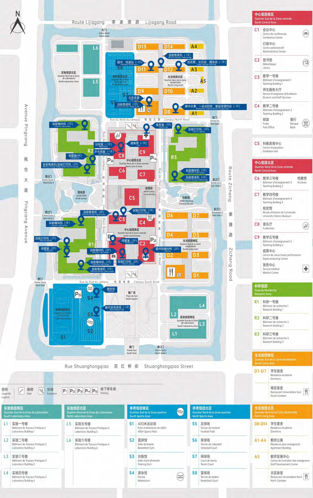

  
  

    14–16 · Common Information
    <h1 class="guide-hero__title">常用信息与地图</h1>
    
把最常用的电话、紧急号码、反馈渠道和一张完整的校园地图放在同一页，需要时直接查。

    

      安保 <b>24h</b>
      物业 <b>24h</b>
      医务 <b>24h</b>
    

  

校园常用电话覆盖食堂、IT、图书馆、健身、安保、物业与医务；紧急电话与校外报警、急救、维权渠道一并列出。页面底部附完整校园地图与楼宇编号索引。

## 校园常用电话 {#phones}

| 服务 | 电话 |
|------|------|
| 北区食堂 | `182-1735-9089` |
| IT 服务 | `0571-28881074` |
| 图书馆 | `0571-28881180` |
| 室内健身场馆 | `190-1120-8691` |
| 校园安保（24 小时） | `0571-28881110` |
| 校园物业（24 小时） | `0571-28881278` |
| 医务中心（24 小时） | `191-5768-8238` / `0571-28881120` |
| 后勤服务监督 | `0571-28881058` |

## 紧急电话 {#emergency}

  
紧急救护120

  
火警119

  
交通事故122

  
报警110

  
消费者维权12315

  
法律援助12348

  
邮政热线11185

  
电话查询114

!!! warning "校园内紧急情况"

    除拨打 120 / 119 / 110 外，请同步联系校园安保 `0571-28881110`（24 小时），便于校门引导与校内联动。

## 咨询与反馈 {#feedback}

如您在校园生活中遇到问题，可通过以下方式反馈：

  
后勤邮箱zfhqyhs@163.com

  
服务监督电话0571-28881058 <small>8:00 – 17:00</small>

## 校园地图 {#map}

<figure class="map-frame">
  
  <figcaption>校园平面地图 · 图源《校园服务手册》（第一版）第 91–92 页</figcaption>
</figure>

<a href="../../assets/images/campus-life/overview/campus-map.png" target="_blank" rel="noopener">查看原尺寸地图 →</a>

校园被四条道路围合：西侧<strong>瓶仓大道</strong>（Avenue Pingcong），东侧<strong>紫藤路</strong>（Route Zicheng），北侧<strong>李家港路</strong>（Route Lijigong），南侧<strong>双红桥街</strong>（Rue Shuanghongqiao）。主要出入口为东门、南门、北门与西门。

## 楼宇编号速查 {#buildings}

### 中心组团

| 编号 | 楼宇 |
|:----:|------|
| C1 | 会议中心 · 行政中心 |
| C2 | 图书馆 |
| C3 | 教学楼一 · 师生服务大厅 |
| C4 | 教学楼二 · 邮政 · 银行 |
| C5 | 科教美育中心 |
| C6 | 教学楼三 · 档案馆 |
| C7 | 教学楼四 · 校史馆 |
| C8 | 音乐厅 |
| C9 | 教学楼五 · 超算中心 · 医务中心 |

### 科研与实验组团

| 编号 | 楼宇 |
|:----:|------|
| R1–R3 | 科研一号楼 — 科研三号楼 |
| L1–L4 | 实验一号楼 — 实验四号楼（实验组团南区） |
| L5–L6 | 实验五号楼、实验六号楼（实验组团北区） |

### 体育组团

| 编号 | 场地 |
|:----:|------|
| S1 | 400 米运动场 |
| S2 | 篮球馆 |
| S3 | 训练馆 |
| S4 | 游泳馆 |
| S5 | 足球场 |
| S6 | 排球场 |
| S7 | 网球场 |
| S8 | 篮球场 |

### 生活组团

| 编号 | 楼宇 |
|:----:|------|
| D1–D7 | 学生宿舍（生活组团南区），附近为南区食堂 |
| D8–D14 | 学生宿舍（生活组团北区），附近为北区食堂 |
| A1–A4 | 教师公寓 |
| A5 | 教师发展中心 |

---

*资料与照片来源：《校园服务手册》（第一版），杭州北航国际创新研究院（学院），2026 年 6 月。*

原版 PDF：[《校园服务手册》（第一版）](https://github.com/Noct-BUAA/Self-Help-Guide-of-BIFAST-BUAA/blob/assets/%E6%A0%A1%E5%9B%AD%E6%9C%8D%E5%8A%A1%E6%89%8B%E5%86%8C-V1.pdf)
