

  
  

    09 · 11 · Shops &amp; Services
    <h1 class="guide-hero__title">商贸与生活服务</h1>
    
超市、便利店、水果、咖啡、奶茶、洗衣、理发与快递都集中在 D8–D12 学生公寓架空层；自助售卖机、咖啡机与打印机分布在各科研楼与教学楼。

    

      <b>9</b> 家校内商铺
      <b>24h</b> 便利店 / 洗衣 / 快递
      充电桩 <b>111</b> 台
    

  

校内商贸围绕学生公寓架空层展开，日常采购、打印、洗衣、理发、取快递基本可以在 D8–D12 之间解决；失物招领柜分布在游泳馆、健身房与教学一号楼。

  
商铺集中区D8 / D11 / D12 架空层

  
24 小时美宜佳 · 佰途洗衣 · 菜鸟驿站自助取件

  
失物招领190-1120-8691

  
充电桩报修152-6708-9300 <small>24h</small>

## 校内商贸 {#shops}

  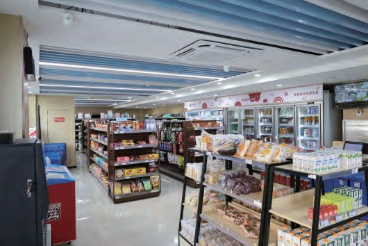
  

    
灵峰超市

    
<b>位置</b> D11 学生公寓架空层 <b>营业</b> 7:30 – 22:00 <b>电话</b> 135-8803-7594

  

  
  

    
美宜佳便利店

    
<b>位置</b> D8 学生公寓架空层 <b>营业</b> 24 小时 <b>电话</b> 189-6959-9199

  

  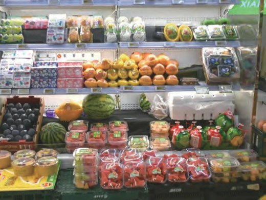
  

    
鲜丰水果

    
<b>位置</b> D8 学生公寓架空层 <b>营业</b> 7:30 – 22:00 <b>电话</b> 155-5698-9271

  

  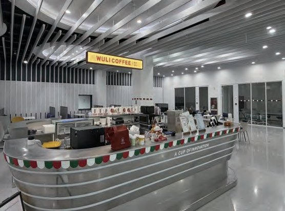
  

    
屋里咖啡

    
<b>位置</b> 图书馆二层 <b>营业</b> 8:00 – 17:00（周一至周六） <b>电话</b> 183-0626-1627

  

  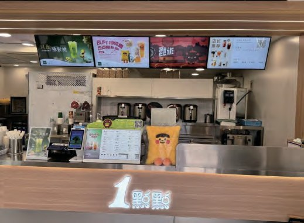
  

    
一点点奶茶

    
<b>位置</b> D8 学生公寓架空层 <b>营业</b> 10:00 – 22:00 <b>电话</b> 135-8880-8584

  

  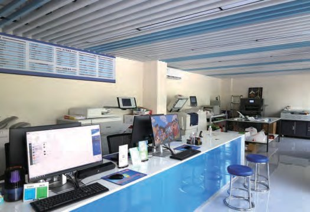
  

    
业雄图文

    
<b>位置</b> D12 学生公寓架空层 <b>营业</b> 9:00 – 20:30 <b>电话</b> 137-5819-1578

  

  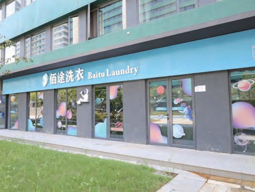
  

    
佰途洗衣

    
<b>位置</b> D12 学生公寓架空层 <b>营业</b> 24 小时（自助） <b>电话</b> 137-5086-1384

  

  
  

    
理发店

    
<b>位置</b> D12 学生公寓架空层 <b>营业</b> 10:30 – 21:00 <b>电话</b> 182-7985-7079

  

  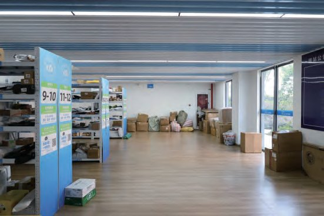
  

    
菜鸟驿站

    
<b>位置</b> D11 学生公寓架空层 <b>自助取件</b> 24 小时 <b>人工服务</b> 9:00 – 19:00 <b>电话</b> 182-0194-7721

  

## 自助设备 {#devices}

  <figure>
    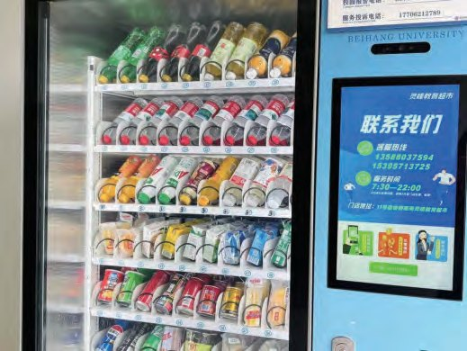
    <figcaption><b>自助售卖机</b> · 饮料与零食</figcaption>
  </figure>
  <figure>
    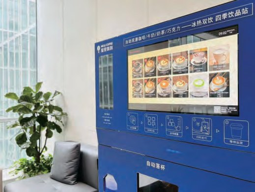
    <figcaption><b>自助咖啡机</b> · 现磨咖啡与饮品</figcaption>
  </figure>
  <figure>
    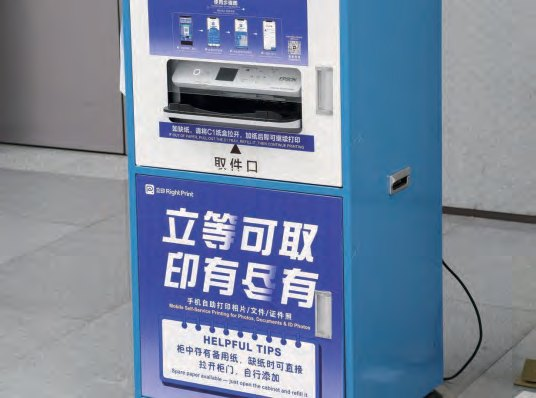
    <figcaption><b>自助打印机</b> · 立等可取，即印即有</figcaption>
  </figure>
  <figure>
    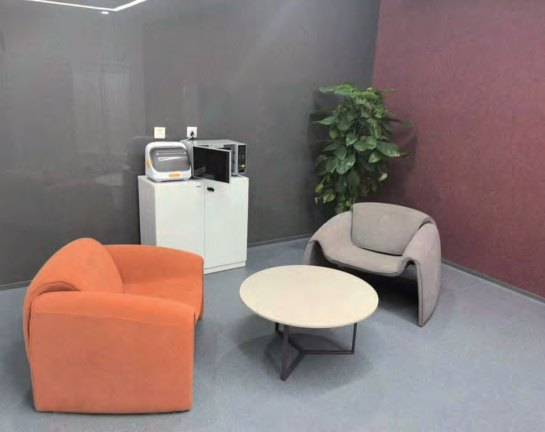
    <figcaption><b>母婴室</b> · 行政会议中心 3028 室</figcaption>
  </figure>

<strong>自助售卖机</strong>：北食堂东门门口；D11 学生公寓架空层灵峰超市门外；科研三南区一楼教师之家；科研二南区一楼大厅；科研一南区一楼教师之家；教学一号楼二楼大厅。

<strong>自助咖啡机</strong>：科研一北区一楼教师之家；科研一南区一楼教师之家；科研二北区一楼教师之家；科研三南区一楼教师之家；会议中心二楼南侧。

<strong>自助打印机</strong>：科研一中区西大厅；科研二南区中庭；科研三北区西大厅；教学一号楼师生服务大厅；图书馆二层大厅。

<strong>母婴室</strong>：行政会议中心 3028 室；科研一 2051 室；科研二 4029 室。

## 失物招领 {#lost}

失物招领柜设在以下三处，服务热线 `190-1120-8691`：

- 游泳馆大厅（体育馆北侧）
- 健身房大厅（中心组团北区 C8 负一层）
- 教学一号楼 2 楼大厅

  <figure>
    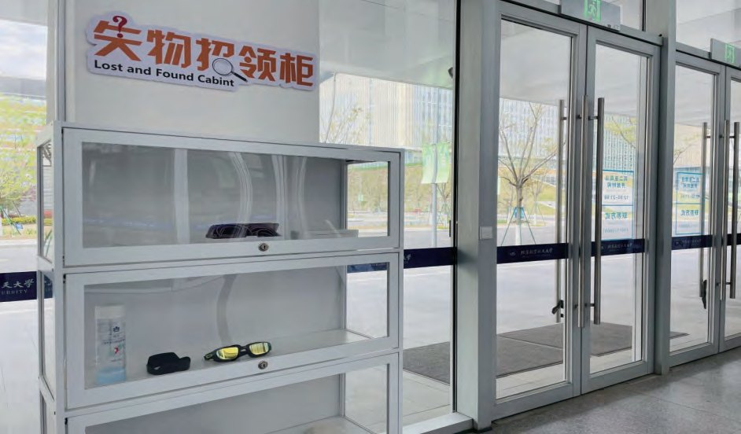
    <figcaption><b>失物招领柜</b> · 教学一号楼 2 楼大厅</figcaption>
  </figure>
  <figure>
    
    <figcaption><b>快递收取</b> · D11 菜鸟驿站，24 小时自助取件</figcaption>
  </figure>

## 电动汽车充电 {#ev}

| 项目 | 详情 |
|------|------|
| 快充桩 | 11 台，单桩功率 30 kW |
| 慢充桩 | 100 台，单桩功率 7 kW |
| 位置 | 中心组团南区：教学一号楼 B2F 13 区、图书馆 B2F 12 区；中心组团北区：教学三号楼 B2F 3 区；体育馆 B1F 2 区 |
| 故障报修 | `152-6708-9300`（24 小时） |

如遇充电设备异常、充电过程中断电或订单无法正常结束，请立即拨打物业 24 小时服务专线。具体操作指引见充电桩上张贴的使用说明，收费标准见学院规定。

  <figure>
    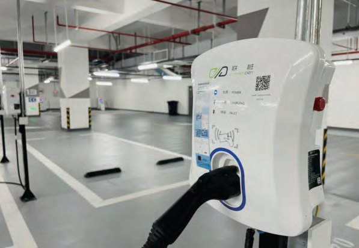
    <figcaption><b>电动汽车充电桩</b> · 地下车库，快充 11 台、慢充 100 台</figcaption>
  </figure>

