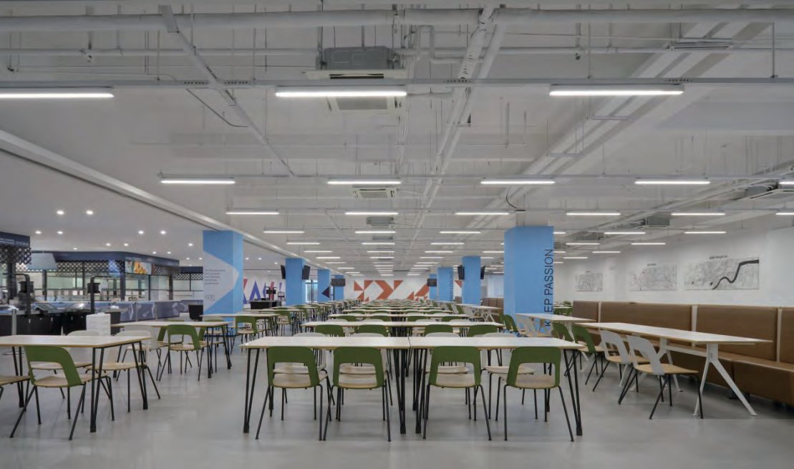
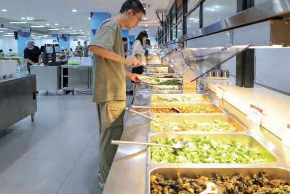
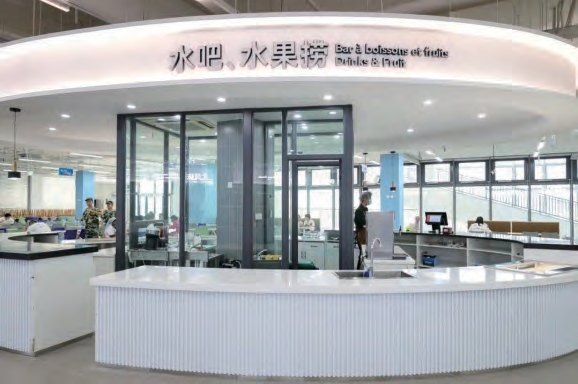

  
  

    05 · Catering
    <h1 class="guide-hero__title">餐饮指南</h1>
    
北区食堂共三层：负一楼自选称重与粤式风味，一楼烘焙与中式自选，二楼风味小吃与铁板系列。

    

      早餐 <b>7:00 – 9:00</b>
      午餐 <b>11:30 – 13:30</b>
      晚餐 <b>17:15 – 19:15</b>
      电话 <b>182-1735-9089</b>
    

  

北区食堂位于北生活组团西南角，采用智能化结算，支持校园卡或微信、支付宝扫码。二楼供应早、午、晚三餐，一楼与负一楼供应午餐和晚餐。

  
位置北生活组团西南角

  
结算方式校园卡 / 微信 / 支付宝

  
服务电话182-1735-9089

## 楼层与档口 {#floors}

### 二楼 · 早 / 午 / 晚

民族风味、羊面小馆、风味小吃、麻辣烫、紫柏羊记、特色饭类、铁板系列、水吧、西餐轻食、炸鸡汉堡。

| 餐次 | 时间 |
|------|------|
| 早餐 | 7:00 – 9:00 |
| 午餐 | 11:30 – 13:30 |
| 晚餐 | 17:15 – 19:15 |

### 一楼 · 午 / 晚

烘焙房、中式自选、馄饨水饺、麦多馅饼、优惠套餐。

| 餐次 | 时间 |
|------|------|
| 午餐 | 11:30 – 13:30 |
| 晚餐 | 17:15 – 19:15 |

### 负一楼 · 午 / 晚

自选称重、粤式风味。

| 餐次 | 时间 |
|------|------|
| 午餐 | 11:30 – 13:30 |
| 晚餐 | 17:15 – 19:15 |

!!! tip "早餐在二楼"

    早餐仅在<strong>二楼</strong>供应（7:00–9:00）。一楼与负一楼只在午餐、晚餐时段开放，去之前留意楼层与时间。

  <figure>
    
    <figcaption><b>自选档口</b> · 热菜、主食与小炒</figcaption>
  </figure>
  <figure>
    
    <figcaption><b>水吧</b> · 饮品与轻食</figcaption>
  </figure>

## 最受欢迎菜品 TOP 10 {#top10}

| 排名 | 菜品 |
|:----:|------|
| 1 | 麻椒鸡腿饭 |
| 2 | 脆皮烤肉饭 |
| 3 | 招牌铁板炒饭 |
| 4 | 奥尔良烤鸡腿 |
| 5 | 川香辣仔鸡 |
| 6 | 羊杂面 |
| 7 | 石锅鸡蛋 |
| 8 | 糖醋排骨 |
| 9 | 蜜制红烧肉 |
| 10 | 土家酱香饼 |
