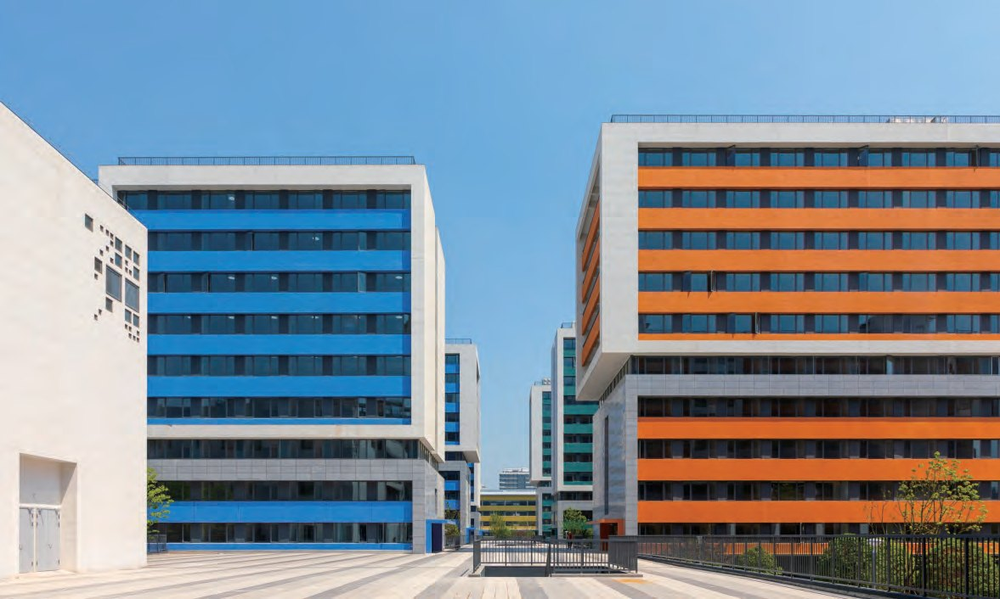
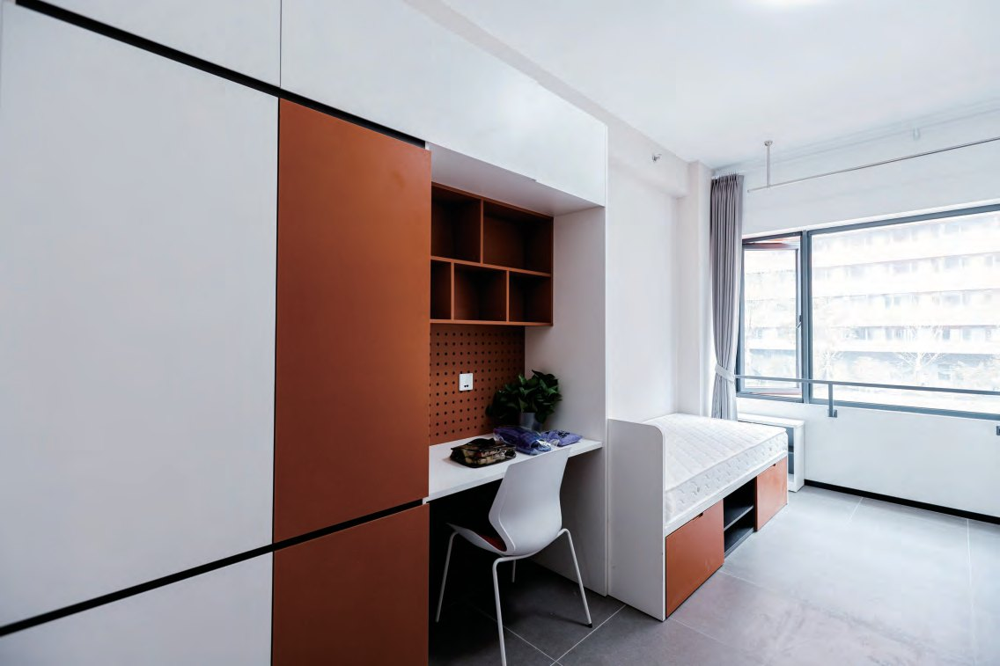
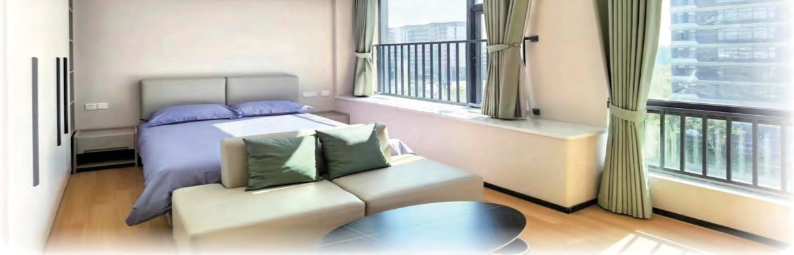
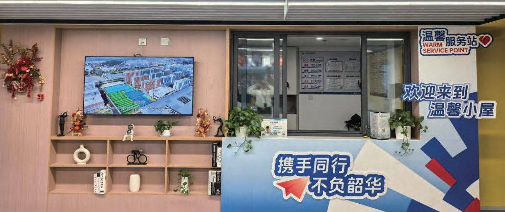
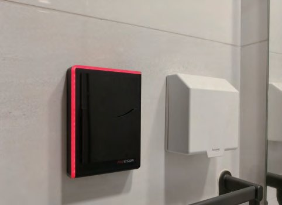
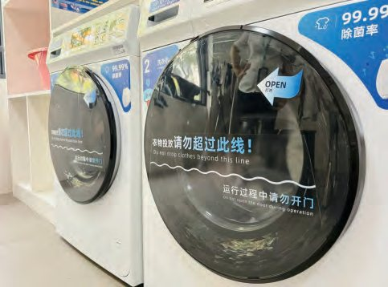
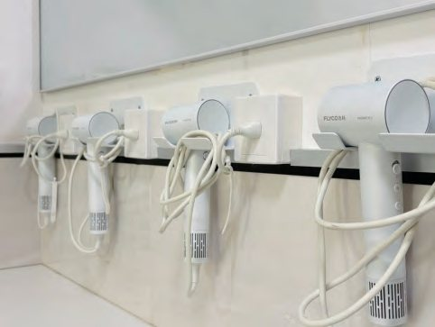
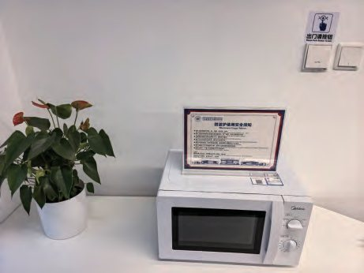
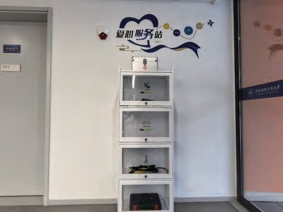

  
  

    06 · Apartment
    <h1 class="guide-hero__title">住宿指南</h1>
    
学生公寓分布在生活组团：北区 D8–D14、南区 D1–D7。开放时间、能耗计费、洗衣热水、冰箱微波炉与住宿规定，都在这一页。

    

      开放 <b>6:30 – 23:00</b>
      24h 紧急 <b>159-8814-7225</b>
      维修 <b>152-6708-9300</b>
    

  

学生公寓分布在生活组团：北区 D8–D14、南区 D1–D7 均为学生宿舍。本页列出的楼栋值班电话为手册中的 D8–D12 幢；每栋楼一楼设有值班室，楼层配有晾晒区、开水器与自助洗衣设备。水电与中央空调按户计量，月初通过钉钉推送账单。

  
开放时间6:30 – 23:00

  
24 小时服务159-8814-7225 <small>紧急事务</small>

  
维修热线152-6708-9300

  
楼栋值班6:00 – 23:00

## 学生公寓 {#basics}

手册列出的 D8–D12 幢值班电话如下（服务时间 6:00–23:00）：

| 楼栋 | 值班电话 |
|------|----------|
| D8 幢 | `0571-28881430` |
| D9 幢 | `0571-28881153` |
| D10 幢 | `0571-28881240` |
| D11 幢 | `0571-28881154` |
| D12 幢 | `0571-28881241` |

  <figure>
    
    <figcaption><b>学生公寓</b> · 生活组团北区 D 区</figcaption>
  </figure>
  <figure>
    
    <figcaption><b>房间布局</b> · 书桌、书架与衣柜一体化</figcaption>
  </figure>
  <figure>
    
    <figcaption><b>床位与采光</b> · 落地窗与收纳空间</figcaption>
  </figure>
  <figure>
    
    <figcaption><b>一楼值班室</b> · 咨询、借用与登记</figcaption>
  </figure>

## 能耗与缴费 {#energy}

### 收费标准

| 项目 | 费率 |
|------|------|
| 电费（含空调用电） | `0.538` 元 / 度 |
| 热水 | `24` 元 / 吨 |

!!! note "热水计量规则"
    脉冲水表远程抄表数据为整数，热水账单仅按 24 的倍数生成（每吨为一个计费单位）。当月热水用量不足 1 吨时，不产生账单。

### 中央空调分摊

中央空调电量通过分户计量系统，实时监测内外机运行工况计算分摊：

- 分摊受开机数量、设定温度、运行时长、风速档位、室内外温差等因素影响
- 外机存在基础功耗，内机开机越少，单台分摊电量越高
- 空调未使用时，系统仍会产生微量待机功耗
- 冬季制热因电辅热和除霜过程，基础功耗可能高于夏季制冷
- 请勿断开配电箱内的空调开关，以保障计量系统正常运行

### 缴费方式

钉钉工作台 → <strong>缴费大厅</strong> → 选择类型（空调 / 水 / 电）→ <strong>查询其他缴费单</strong> → 输入对应户号查询。空调、热水、冷水、电均为单独户号。

每月初，上月账单会推送至钉钉，请注意查收并及时缴费。

## 便捷服务 {#services}

  <figure>
    
    <figcaption><b>热水</b> · 房卡插入水池旁卡槽，绿灯亮起即接通</figcaption>
  </figure>
  <figure>
    
    <figcaption><b>自助洗衣机</b> · 各楼层晾晒区配备</figcaption>
  </figure>
  <figure>
    
    <figcaption><b>自助吹风机</b> · 楼层晾晒区免费使用</figcaption>
  </figure>
  <figure>
    
    <figcaption><b>共享冰箱、微波炉</b> · 一楼值班室登记使用</figcaption>
  </figure>
  <figure>
    
    <figcaption><b>爱心服务站</b> · 五金工具、打气筒、体温计、口罩</figcaption>
  </figure>

- <strong>热水</strong>：将房卡插入水池旁的卡槽内，听到提示音、绿色灯闪亮，表示热水接通；不使用时请及时取出房卡。
- <strong>自助洗衣机</strong>：各楼层晾晒区均配备，按设备说明操作，使用后保持机内清洁。
- <strong>自助吹风机</strong>：楼层晾晒区提供，免费使用；用后请将风嘴归位，保持台面整洁。
- <strong>共享冰箱、微波炉</strong>：每栋楼一楼值班室配备，使用前请咨询宿管并登记。冰箱存放每次不超过一周，每周五集中清理消毒。
- <strong>爱心服务站</strong>：配备五金工具、打气筒、体温计、口罩等日常应急物品，可随时取用。

## 住宿规定 {#rules}

### 电器使用

仅可使用正规厂家生产、经 3C 认证的合格电器。

!!! warning "禁止使用"

    - 私拉电线、网线
    - 电动车充电装置
    - 电热毯、电暖器、电磁炉、电饭锅、热得快、烘干机等发热类炊具
    - 600 瓦以上大功率电器
    - 个人洗衣机（房间无专属空间、上下水接口及电源点位）

    房间内统一配置的电器不得擅自拆卸。

### 宠物

禁止在房间内饲养宠物（宠物龟、观赏鱼除外）。

## 常见问题 {#faq}

### 公寓楼内有冰箱吗？

有。各楼一楼值班室配备两台，集中管理、登记使用。每次存放时间不超过一周，每周五集中清理、消毒；不续存、过期、无标签或变质的物品将统一清理。

### 开水器能提供常温饮用水吗？

不能。每层开水器为校园建设期 EPC 统一配置，功率和容量有限，设两个热水出水口，优先保障楼层高峰期的热水需求。开水免费使用，请遵守使用公约；如需凉水，可提前将开水自然冷却，或就近去食堂开水器打水。烧水壶属大功率违章电器，禁止使用。

### 房间内可以使用哪些电器？

仅限正规厂家生产、经 3C 认证的合格电器。禁止私拉电线网线、使用电动车充电装置、使用或存放电热毯 / 电暖器 / 电磁炉 / 电饭锅 / 热得快 / 烘干机等发热类炊具，禁止个人洗衣机与 600 瓦以上大功率电器。

### 可以养宠物吗？

不可以（宠物龟、观赏鱼除外）。

## 教师公寓（面向教职工） {#faculty}

??? note "教师公寓与临时住宿"

    教师公寓位于校园生活组团北区，地处校园东北角，紧邻学校东门，包含 A1–A4 四栋公寓楼及 A5 教师发展中心。

    - <strong>24 小时值班室</strong>：A2 幢 110 室
    - <strong>服务热线</strong>：`186-5818-7102`
    - <strong>服务内容</strong>：一对一双语管家、一站式入住办理、室内绿植布置、雨伞/应急药品/工具借用、地板与窗帘及空调清洗

    <strong>临时公寓收费标准</strong>（含能耗、日常耗材与物业管理费用）：

    | 类型 | 收费标准 |
    |------|----------|
    | 学生公寓单人间 | 35 元 / 间 · 天 |
    | 学生公寓双人间 | 60 元 / 间 · 天 |
    | 教师公寓一居室 | 100 元 / 套 · 天 |
    | 教师公寓二居室 | 200 元 / 套 · 天 |
    | 教师公寓三居室 | 260 元 / 套 · 天 |

    入住临时公寓产生的能耗费用包含在房费内统一结算，不再单独收取；A1/A2 的中央空调与热水计量规则同学生公寓。固定公寓退租时的水电、空调电费，通过钉钉「缴费大厅」缴纳；燃气费可在支付宝或微信「生活缴费」中选择「杭州余杭港华燃气」，输入户号缴纳。
