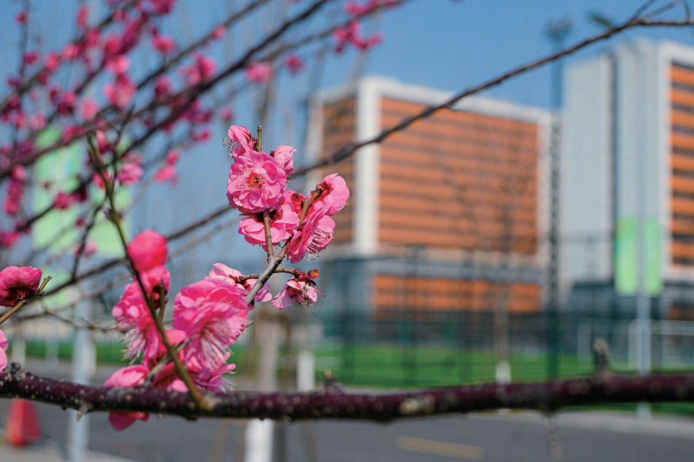

  
  

    Campus Life · 2026
    <h1 class="guide-hero__title">校园生活指南</h1>
    
住宿、餐饮、校园卡、报修、运动、图书馆、医疗与出行——把《校园服务手册》里的 16 个主题重新编排成一张能随时查的网页。

    

      <b>16</b> 个主题章节
      <b>10</b> 个主题页面
      数据截至 <b>2026.06</b>
    

  

本指南的全部文字与照片均来自杭州北航国际创新研究院（学院）印发的《校园服务手册》（第一版，2026 年 6 月）。原手册为 92 页横版画册，这里按使用场景重新拆分为 10 个主题页面，补齐了目录、速查信息与楼宇索引；遇到与原手册不一致之处，以手册原文为准。

  
<b>92</b>原手册页数

  
<b>16</b>主题章节

  
<b>200+</b>校园 AED 设备

  
<b>24h</b>安保 / 医务 / 维修

## 手册目录 {#contents}

<a class="card" href="campus-services/#card">
  
01 · P.01

  <h3>校园卡服务</h3>
  
办理、支付宝认证、补卡与智能门锁重置、充值消费

</a>

<a class="card" href="campus-services/#network">
  
02 · P.08

  <h3>校园网络</h3>
  
BHI / BHI-guest 连接方式与网络报修

</a>

<a class="card" href="campus-services/#repair">
  
03 · P.10

  <h3>维修报修</h3>
  
钉钉报修、扫码报修、24 小时维修热线

</a>

<a class="card" href="campus-services/#building">
  
04 · P.12

  <h3>楼宇服务</h3>
  
楼宇管家、会议室预约、门禁与紧急开门

</a>

<a class="card" href="dining/#floors">
  
05 · P.20

  <h3>餐饮服务</h3>
  
北区食堂三层档口、供餐时间、人气菜品 TOP 10

</a>

<a class="card" href="housing/#basics">
  
06 · P.23

  <h3>公寓住宿</h3>
  
学生公寓、能耗计费、便捷服务、住宿规定与 Q&amp;A

</a>

<a class="card" href="sports/#indoor">
  
07 · P.43

  <h3>体育设施</h3>
  
室内外场馆、开放时间、预约系统操作指南

</a>

<a class="card" href="library/#overview">
  
08 · P.54

  <h3>图书馆</h3>
  
楼层分布、文献资源、借阅续借、空间预约

</a>

<a class="card" href="daily-life/#shops">
  
09 · P.63

  <h3>商贸服务</h3>
  
超市、便利店、洗衣、理发、快递与自助设备

</a>

<a class="card" href="medical/#center">
  
10 · P.69

  <h3>医疗服务</h3>
  
校医务中心、心理咨询、公费医疗报销、AED

</a>

<a class="card" href="daily-life/#lost">
  
11 · P.77

  <h3>生活服务</h3>
  
失物招领、电动汽车充电

</a>

<a class="card" href="transportation/#campus">
  
12 · P.81

  <h3>交通出行</h3>
  
校内交通、420 / 2553M / 313 路公交

</a>

<a class="card" href="neighborhood/">
  
13 · P.85

  <h3>15 分钟生活圈</h3>
  
政务中心、良渚古城、版本馆、瓶窑老街、玉鸟集

</a>

<a class="card" href="contacts/#phones">
  
14 · P.89

  <h3>常用信息</h3>
  
校园常用电话与紧急电话

</a>

<a class="card" href="contacts/#feedback">
  
15 · P.90

  <h3>咨询与反馈</h3>
  
后勤邮箱、服务监督电话

</a>

<a class="card" href="contacts/#map">
  
16 · P.91

  <h3>校园地图</h3>
  
楼宇编号、周边道路与校园平面图

</a>

## 快速入口 {#quick}

<a class="card" href="contacts/#emergency">
  <h3>紧急电话</h3>
  
救护 120 · 火警 119 · 报警 110 · 校园安保 0571-28881110

  立即查看 &rarr;
</a>

<a class="card" href="contacts/#map">
  <h3>校园地图</h3>
  
东门、南门、生活组团、中心组团与科研组团一目了然

  打开地图 &rarr;
</a>

<a class="card" href="campus-services/#repair">
  <h3>报修</h3>
  
钉钉「综合报修」或扫码提交，24 小时热线 152-6708-9300

  去报修 &rarr;
</a>

## 校园一瞥 {#gallery}

  <figure>
    
    <figcaption><b>校园中轴</b> · 「德才兼备，知行合一」</figcaption>
  </figure>
  <figure>
    
    <figcaption><b>校园水系</b> · 教学楼与实验楼沿河展开</figcaption>
  </figure>
  <figure>
    
    <figcaption><b>春日校园</b> · 生活组团旁的樱花</figcaption>
  </figure>
  <figure>
    
    <figcaption><b>校园全景</b> · 生活组团、中心组团与体育组团</figcaption>
  </figure>

!!! info "关于资料与照片"

    - 文字、数据与照片均整理自《校园服务手册》（第一版）2026 年 6 月版，原书由杭州北航国际创新研究院（学院）编制。
    - 图片为原手册内页照片重新导出，仅用于本指南的公益展示；如有版权异议请联系站点维护者删除。
    - 开放时间、电话与收费标准可能随学校安排调整，办理前建议先通过钉钉或电话确认。
