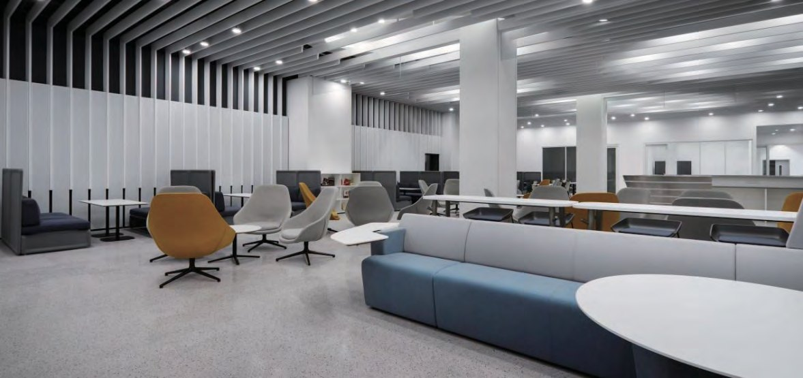
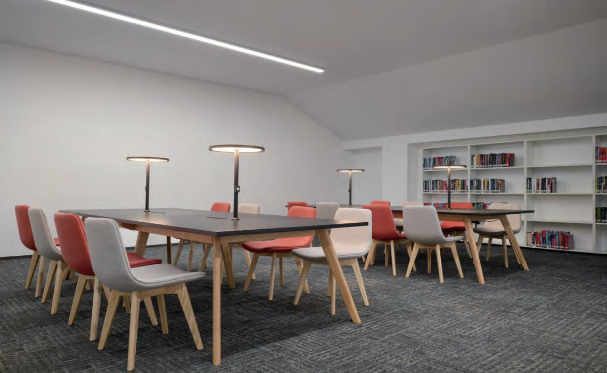

  
  

    08 · Library
    <h1 class="guide-hero__title">图书馆</h1>
    
8 层馆舍目前启用 1–3 层，1,050 个座位，周一至周日 8:00–22:00 开放。

    

      开放 <b>8:00 – 22:00</b>
      <b>1,050</b> 个座位
      启用 <b>1–3 层</b>
      电话 <b>0571-28881180</b>
    

  

图书馆共 8 层，目前启用 1–3 层，总面积约 2.2 万平方米。二层设咨询台与自助借还区，三层为社会科学与自然科学阅览区；讨论室、会议室、法国文化室与二层格子间均可通过校园空间预约平台预订。

  
馆舍8 层 <small>启用 1–3 层</small>

  
座位1,050 个

  
开放时间周一至周日 8:00 – 22:00

  
服务电话0571-28881180

## 基本情况 {#overview}

| 项目 | 详情 |
|------|------|
| 馆舍 | 共 8 层，目前启用 1–3 层，总面积约 2.2 万㎡ |
| 座位 | 总座位 1,050 个（1–3 层） |
| 开放时间 | 周一至周日 8:00 – 22:00 |
| 服务电话 | `0571-28881180` |
| 图书馆网站 | [hz.lib.buaa.edu.cn/space/index](http://hz.lib.buaa.edu.cn/space/index)（校园网访问） |

  <figure>
    
    <figcaption><b>阅览学习区</b> · 二层沙发与自习座位</figcaption>
  </figure>
  <figure>
    
    <figcaption><b>讨论室</b> · 可预约的小组空间</figcaption>
  </figure>
  <figure>
    
    <figcaption><b>中庭楼梯</b> · 连接 1–3 层</figcaption>
  </figure>

## 楼层功能分布 {#floors}

| 楼层 | 功能区 |
|:----:|--------|
| 1 层 | 会议室、报告厅、音视频学习区、机房教室、协同学习区、24 小时还书处 |
| 2 层 | 法国文化室、讨论室、阅览学习区、咖啡吧、自助借还区、咨询台 |
| 3 层 | 社会科学阅览区、共享空间、冥想区、自然科学阅览区 |

## 文献资源 {#resources}

<strong>纸质资源</strong>：馆藏总量三万余册，纸本期刊近两百种、六百余册。

<strong>电子资源</strong>：

- 数据库百余个，含 CNKI、万方、Wiley、Cairn 法语数据库等
- 电子图书一百余万册
- 与北京校区图书馆百余个数据库互联，支持 IP 直接访问
- 数据库访问入口：[hz.lib.buaa.edu.cn/space/database](http://hz.lib.buaa.edu.cn/space/database)（校园网访问）

## 借阅服务 {#borrowing}

### 借阅规则

- <strong>借阅方式</strong>：凭校园卡借阅，册数不限。
- <strong>自助借还</strong>：二楼自助借还机 → 刷校园卡 → 放置图书完成。
- <strong>人工借阅</strong>：二楼咨询台办理。
- <strong>预约</strong>：书目检索系统 → 馆藏信息 → 预约申请 → 取书地选择「二层咨询台」。

### 本地馆际借阅

- <strong>杭州图书馆</strong>：支付宝搜索「一键借阅」→ 检索图书 → 提交订单。
- <strong>浙江图书馆</strong>：支付宝搜索「浙江图书馆」→ 服务 → 信阅 → 检索借阅。

### 北京校区异地借阅

适用于本地（含浙图、杭图）无馆藏、已借出或无电子书，而北京校区可借的图书。

1. 登录「北京校区图书馆系统」→ 检索 → 委托 → 取书地选择「杭州国际校园」。
2. 系统通知后 <strong>5 日内</strong>，到二层咨询台凭一卡通领取。
3. 借期 <strong>1 个月</strong>，期间可续借；被预约则不可续借。

!!! note "限制"

    外文原版、孤本、高价书不支持异地借阅。

## 续借规则 {#renew}

| 项目 | 规则 |
|------|------|
| 渠道 | 钉钉「图书检索」或图书馆官网 |
| 时限 | 到期前 5 天内办理 |
| 次数 | 可续借 4 次，每次 1 个月 |
| 限制 | 已预约 / 逾期图书不可续借 |

## 空间预约 {#spaces}

| 项目 | 详情 |
|------|------|
| 可预约空间 | 讨论室、会议室、法国文化室、二层格子间 |
| 预约时效 | 当日及 5 天内（限当月） |
| 预约方式 | 校园空间预约平台，操作见[体育设施 · 场馆预约](sports.md#booking) |

预约成功后按预约时间到达，向管理员出示「会员码」核销即可使用。
