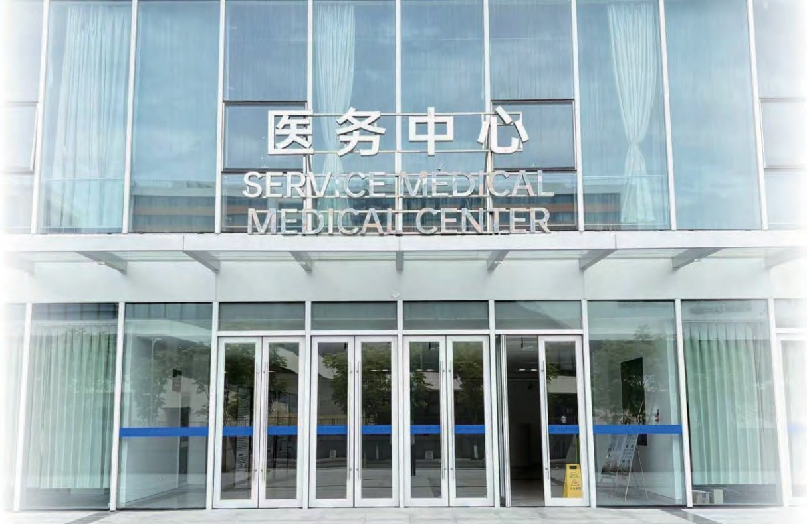
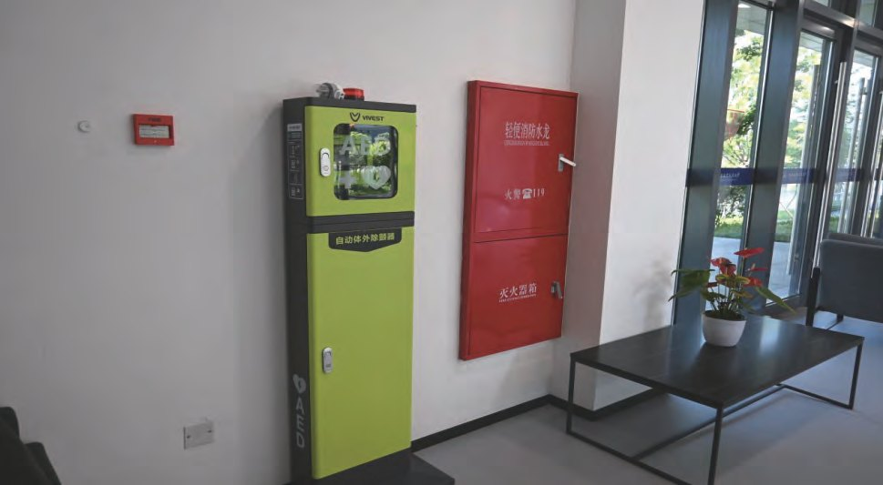

  
  

    10 · Medical
    <h1 class="guide-hero__title">医疗服务</h1>
    
校医务中心 24 小时开放；心理咨询需提前 24 小时预约；校园配置 200 余台 AED。

    

      医务中心 <b>24h</b>
      热线 <b>191-5768-8238</b>
      位置 <b>C9 一楼</b>
      AED <b>200+</b>
    

  

校医务中心位于中心组团北区一楼 C9，提供 24 小时基本医疗服务。心理服务由北航积极心理体验中心面向全体在籍学生开放；北京公费医疗在杭州的合同医院为余杭区第三人民医院与浙江大学医学院附属第一医院。

  
校医务中心中心组团北区 C9 一楼

  
服务热线191-5768-8238 <small>24h</small>

  
备用电话0571-28881120

  
心理预约0571-28881135 <small>工作日</small>

## 校医务中心 {#center}

| 项目 | 详情 |
|------|------|
| 位置 | 中心组团北区一楼 C9 |
| 开放时间 | 24 小时 |
| 服务热线 | `191-5768-8238`（24 小时）/ `0571-28881120` |

## 心理咨询 {#counseling}

北航积极心理体验中心的心理咨询服务面向全体北航在籍在读学生开放。杭州国际校园学生可选择<strong>线下咨询</strong>或<strong>线上视频咨询</strong>两种形式。

咨询需提前至少 <strong>24 小时</strong>预约；若因特殊情况需请假或调整咨询时间，也需提前 24 小时操作。

### 预约方式

| 渠道 | 操作 / 电话 | 预约时间 |
|------|-------------|----------|
| 线上 | 关注公众号「微言航语」或「知心助航」→ 底部菜单【我航有约】或【知心】→ 心理服务预约平台 | 全天 |
| 杭州国际校园 | `0571-28881135` | 周一至周五 8:00–12:00 / 13:30–17:00 |
| 学院路校区 | `010-82317668` | 周一至周日 8:00–12:00 / 14:00–18:00 / 19:00–21:00 |
| 沙河校区 | `010-61716882` | 周一至周日 8:00–12:00 / 13:30–18:00 / 19:00–21:00 |

## 北京公费医疗报销 {#insurance}

学校公费医疗指定单位为北京航空航天大学校医院及定点合同医院。杭州异地合同医院为：

- 杭州市余杭区第三人民医院
- 浙江大学医学院附属第一医院

关注「北京航空航天大学校医院」公众号，可办理校医院挂号、查询公费医疗报销细则及报销进度。

### 报销资料投递

| 方式 | 地点 |
|------|------|
| 窗口投递 | 校医院学院路院区一楼门诊大厅公费医疗报销窗口 |
| 自助投递 | 杭州国际校园行政中心 4008 门口医疗报销箱；校医院学院路院区大厅；校医院沙河院区大厅 |

## 校园 AED 急救 {#aed}

目前校园在各区域、楼栋配置了 <strong>200 余台</strong>自动体外除颤器（AED），分布点位见校园地图。如遇紧急情况，可第一时间就近取用，同时拨打校内应急电话 `0571-28881110` 或 `120`。

  <figure>
    
    <figcaption><b>AED 急救设备</b> · 各区域、楼栋均有配置，点位见校园地图</figcaption>
  </figure>

## 校外医疗 {#hospital}

### 杭州市余杭区第三人民医院

| 项目 | 详情 |
|------|------|
| 营业时间 | 8:00 – 11:30，13:00 – 16:00 |
| 地址 | 杭州市余杭区瓶窑镇羊山湾街 8 号 |
| 电话 | `0571-88549071` |

  <figure>
    
    <figcaption><b>余杭区第三人民医院</b> · 瓶窑镇羊山湾街 8 号</figcaption>
  </figure>

