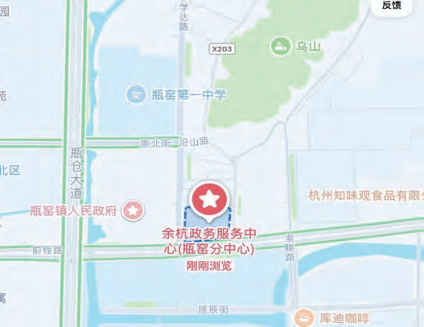

  
  

    13 · Neighbourhood
    <h1 class="guide-hero__title">15 分钟生活圈</h1>
    
校园所在的瓶窑、良渚一带，既有良渚古城遗址与杭州国家版本馆，也有瓶窑老街、玉鸟集这样的日常去处。

    

      <b>6</b> 个周边去处
      瓶窑老街 <b>24h 免费</b>
      玉鸟集 <b>10:00 – 22:00</b>
    

  

以下地点均在校园周边，适合周末半日往返。政务服务中心可办理日常政务事项；良渚古城遗址公园、杭州国家版本馆与瓶窑老街适合散步参观；超盒算 NB 与玉鸟集可满足采购与餐饮需求。

  
  

    
01 · 余杭区政务服务中心（瓶窑分中心）

    
<b>地址</b> 余杭区瓶窑镇前程路 20 号 <b>时间</b> 8:30 – 12:00，13:30 – 17:00 <b>电话</b> 0571-88551088

  

  
  

    
02 · 良渚古城遗址公园

    
<b>地址</b> 余杭区瓶窑镇凤都路与 104 国道辅路交叉口西北 200 米 <b>电话</b> 0571-88530032

  

  
  

    
03 · 杭州国家版本馆

    
<b>地址</b> 杭州市余杭区瓶窑镇文润路 1 号 <b>电话</b> 0571-88079999、0571-88070098

  

  
  

    
04 · 瓶窑老街

    
<b>地址</b> 余杭区外窑街 14 号 <b>时间</b> 24 小时开园，免费开放 <b>电话</b> 0571-88612239

  

  
  

    
05 · 杭州超盒算 NB（瓶窑云溪里店）

    
<b>地址</b> 余杭区羊城路 202 号 <b>营业</b> 7:30 – 21:30 <b>电话</b> 9523988

  

  
  

    
06 · 玉鸟集

    
<b>地址</b> 余杭区良渚文化村良渚街道玉鸟街与荀甫路交叉口向西 300 米 <b>营业</b> 10:00 – 22:00

  

!!! info "出行提示"

    以上地点可使用公交 420 路、2553M 路、313 路接驳，或打车前往；具体公交时刻见[交通出行](transportation.md)。政务服务中心办理业务前，建议先电话确认所需材料与取号方式。
