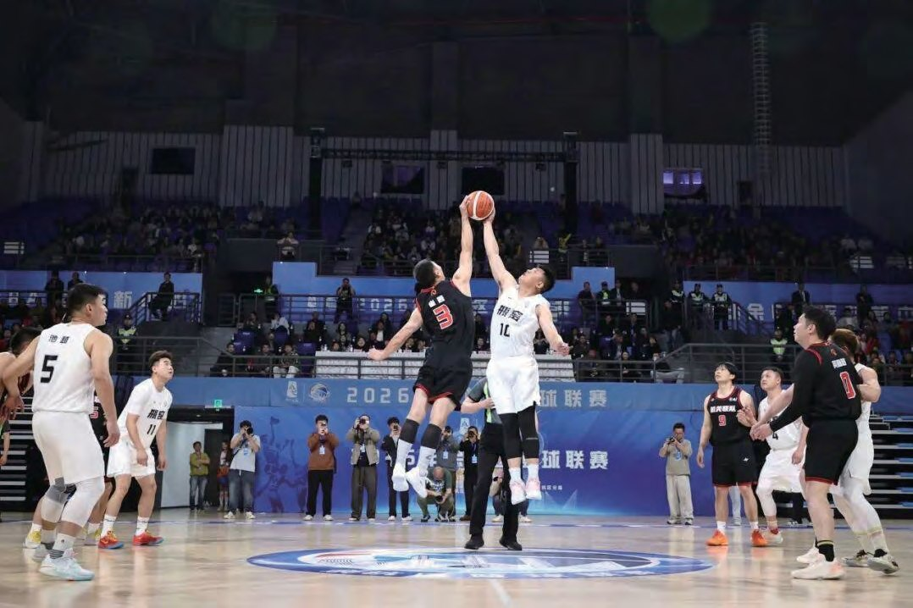
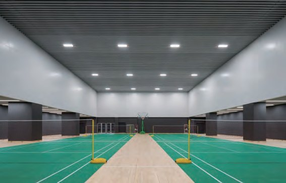
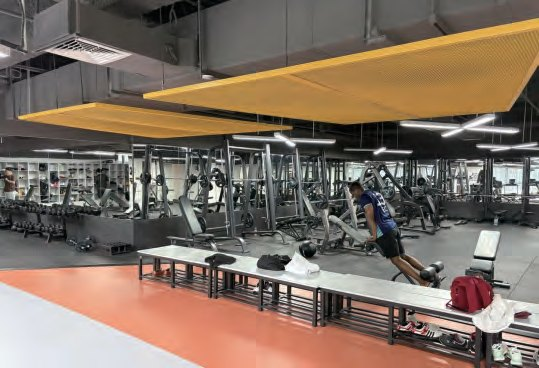
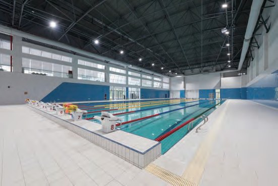
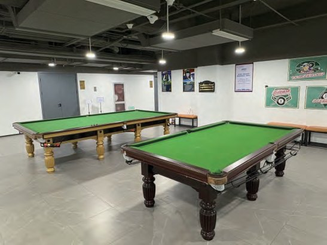
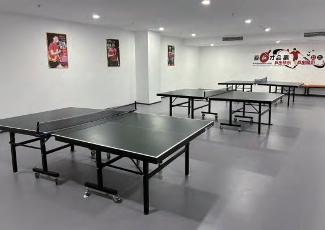
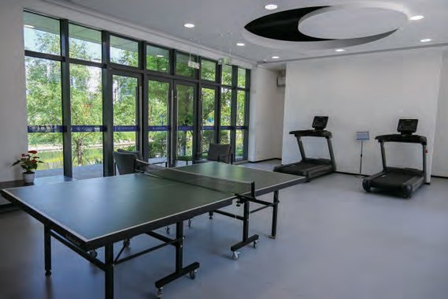
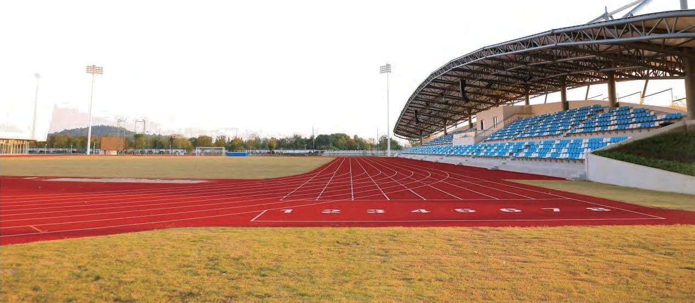
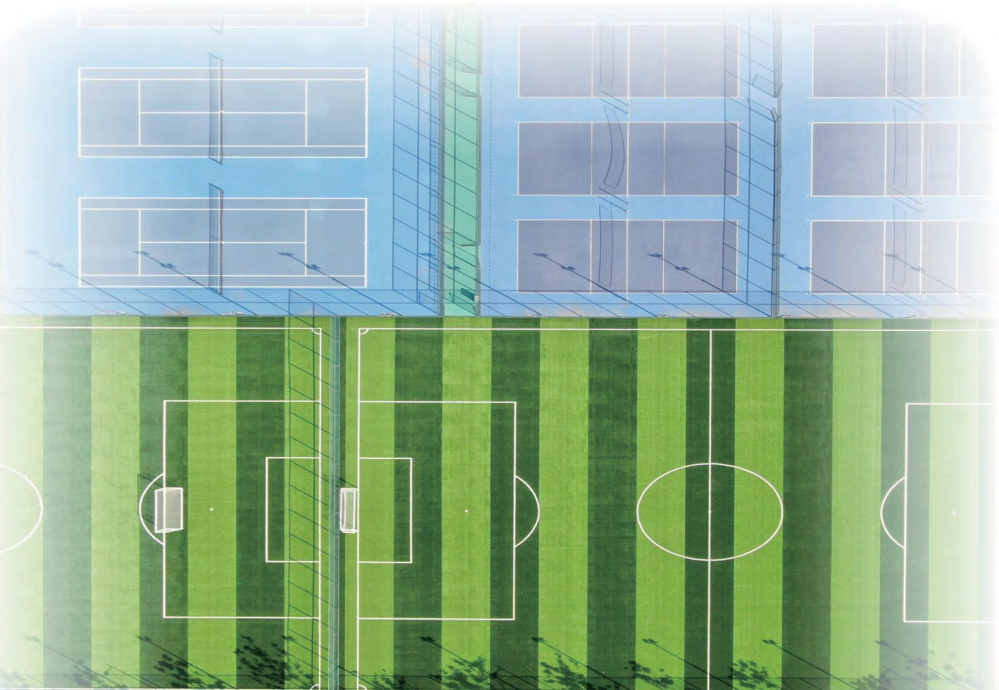

  
  

    07 · Venue
    <h1 class="guide-hero__title">体育设施</h1>
    
羽毛球、游泳、健身、台球、乒乓与室外球场，全部通过「校园空间预约平台」订场。

    

      羽毛球馆 <b>8:00 – 22:00</b>
      健身房 <b>10:00 – 22:00</b>
      游泳馆 <b>12:00 – 21:00</b>
      室外 <b>8:00 – 22:00</b>
    

  

室内场馆集中在体育馆与中心组团北区 C8；室外场地分布在体育组团南北区、教师公寓与宿舍组团之间，并有一条环校园塑胶跑道。除游泳馆外，目前场地预约均为 0 元。

  
羽毛球馆体育馆负一层 <small>8:00 – 22:00</small>

  
健身房 / 台球 / 乒乓C8 负一层 <small>周二至周日</small>

  
游泳馆体育馆北侧 <small>12:00 – 21:00</small>

  
室内健身热线190-1120-8691

## 室内健身场所 {#indoor}

| 场馆 | 位置 | 开放时间 |
|------|------|----------|
| 羽毛球馆 | 体育馆负一层 | 8:00 – 22:00 |
| 健身房 | 中心组团北区 C8 负一层 | 10:00 – 22:00（周二至周日） |
| 游泳馆 | 体育馆北侧 | 12:00 – 21:00（周二至周日） |
| 台球室 | 中心组团北区 C8 负一层 | 10:00 – 22:00（周二至周日） |
| 乒乓球室 | 中心组团北区 C8 负一层 | 10:00 – 22:00（周二至周日） |
| A5 教师发展中心一楼 | A5 一楼 | 8:00 – 21:00 |

  <figure>
    
    <figcaption><b>羽毛球馆</b> · 体育馆负一层</figcaption>
  </figure>
  <figure>
    
    <figcaption><b>健身房</b> · C8 负一层</figcaption>
  </figure>
  <figure>
    
    <figcaption><b>游泳馆</b> · 体育馆北侧</figcaption>
  </figure>
  <figure>
    
    <figcaption><b>台球室</b> · C8 负一层</figcaption>
  </figure>
  <figure>
    
    <figcaption><b>乒乓球室</b> · C8 负一层</figcaption>
  </figure>
  <figure>
    
    <figcaption><b>A5 一楼</b> · 教师发展中心</figcaption>
  </figure>

## 室外运动场地 {#outdoor}

因室外照明不足及安全需要，室外健身场所的开放时间统一为 <strong>8:00 – 22:00</strong>。

| 场地 | 位置 |
|------|------|
| 足球场、排球场、网球场、篮球场 | 体育组团北区 |
| 400 米运动场 | 体育组团南区 |
| 网球场 | 教师公寓 A1–A2、A3–A4 区间 |
| 羽毛球场 | 学生宿舍 D8–D10、D12–D14、D11–D13 区间 |
| 环校园塑胶跑道 | 环绕校园 |

  <figure>
    
    <figcaption><b>400 米运动场</b> · 体育组团南区</figcaption>
  </figure>
  <figure>
    
    <figcaption><b>足球场</b> · 体育组团北区</figcaption>
  </figure>

## 场馆预约 {#booking}

体育场馆与图书馆使用统一的「校园空间预约平台」。

### 预约步骤

1. <strong>统一身份认证</strong>：钉钉搜索「校园空间预约平台」。
2. <strong>登录</strong>：输入账号和密码完成登录。
3. <strong>进入预约页面</strong>：选择「场地预约」。
4. <strong>选择场次与场地</strong>：
    - 绿色区域：可预约的场次
    - 蓝色区域：已勾选的场次（再次点击同一时间段可取消）
    - 依次选择：使用日期 → 几号场地 → 时间段
    - 按规则添加同伴、填写手机号
    - 阅读并勾选「预约须知」，点击「提交」
    - 完成安全验证并支付费用（目前仅游泳馆需付费，其他场地均为 0 元，选择支付后自动完成预约）
    - 出现「您已经成功预约」界面即代表预约成功
5. <strong>查看订单</strong>：进入「个人中心」查看订单详情，可取消订单、修改同伴。
6. <strong>使用订单</strong>：按预约时间到达场地，向场地管理员出示界面下方的「会员码」，核销后方可入场。

!!! warning "预约黑名单"

    因体育场馆需求旺盛，预约羽毛球馆、游泳馆、健身中心后未到场核销累计超过 <strong>3 次</strong>，将被加入黑名单 <strong>30 日</strong>。期间不可预约以上体育场馆，请合理安排时间；若无法及时到场，请尽早取消预约。

### 其他规则

- 羽毛球馆、游泳馆、健身中心最早可于入场前 <strong>3 日 8:00</strong> 购票。
- 仅支持在线购票，不支持线下购票。
- 请仔细阅读并遵守各场地的使用说明。
