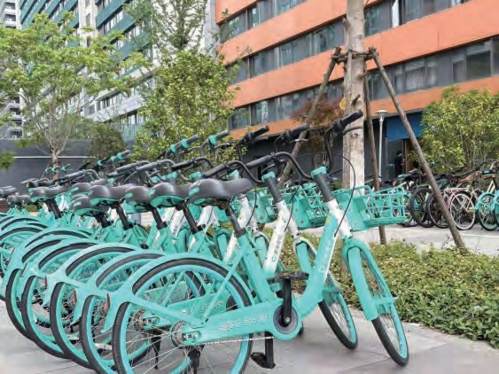
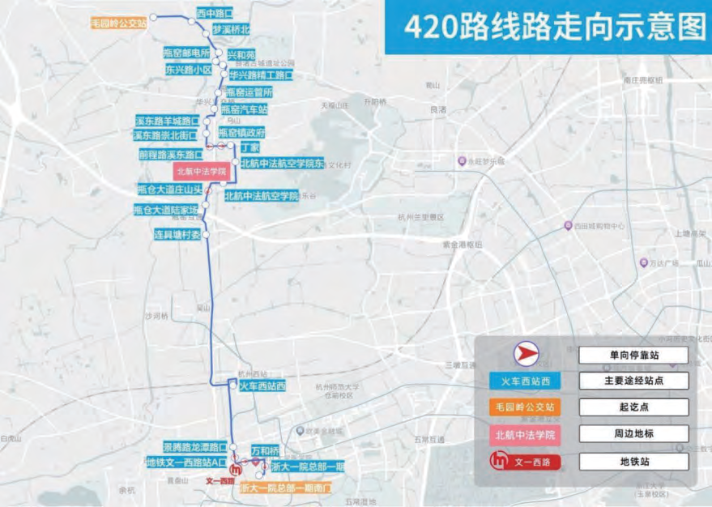
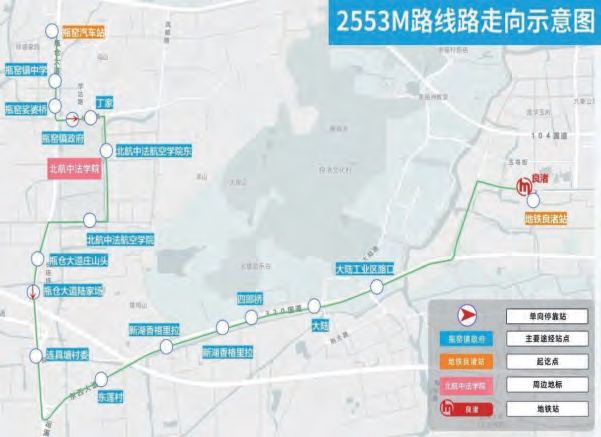

  
  

    12 · Transportation
    <h1 class="guide-hero__title">交通出行</h1>
    
校园位于杭州市余杭区瓶窑镇双红桥街 166 号，东门、南门设有公交站。420 路直达杭州西站，2553M 路接驳地铁 2 号线良渚站。

    

      420 路 <b>6:00 – 18:00</b>
      2553M 路 <b>6:00 – 19:30</b>
      313 路 <b>4:40 – 22:00</b>
    

  

校内以步行与共享单车为主，机动车限速 30 km/h；校外出行主要依靠东门、南门的 420 路与 2553M 路，夜间可到瓶窑社区站乘坐 313 路。

  
校园地址余杭区瓶窑镇双红桥街 166 号

  
公交站东门 · 南门

  
最近高铁站杭州西站 <small>420 路直达</small>

  
最近地铁2 号线良渚站 <small>2553M 路接驳</small>

## 校内交通 {#campus}

- <strong>共享单车</strong>：校内设有共享单车，扫码使用。
- <strong>机动车</strong>：校内违章抓拍，请沿路靠右行驶，时速不得超过 <strong>30 km/h</strong>，主动避让行人、非机动车。路边禁止停车，可停中心组团地下车库；出入地下车库门口或倒车时，时速不得超过 <strong>5 km/h</strong>。
- <strong>电动自行车</strong>：依据学院《交通管理规定（试行）》，原则上不开放电动自行车进入校园。

## 校外公交 {#bus}

### 420 路（毛元岭公交总站 — 浙大一院总部）

| 项目 | 详情 |
|------|------|
| 乘车站点 | 东门、南门公交站 |
| 时间 | 去程 6:00 – 18:00，返程 7:10 – 19:10 |
| 可达 | 杭州西站；可转地铁 19 号线前往杭州东站、萧山机场 |

  <figure class="photo-grid--natural">
    
    <figcaption><b>420 路</b> · 线路走向示意图</figcaption>
  </figure>
  <figure class="photo-grid--natural">
    
    <figcaption><b>2553M 路</b> · 线路走向示意图</figcaption>
  </figure>

### 2553M 路（瓶窑公交总站 — 地铁杜甫村站）

| 项目 | 详情 |
|------|------|
| 乘车站点 | 东门公交站 |
| 时间 | 去程 6:00 – 19:30，返程 6:50 – 20:30 |
| 可达 | 地铁 2 号线良渚站 |

### 313 路（瓶窑窑山总站 — 环北新村总站）

| 项目 | 详情 |
|------|------|
| 乘车站点 | 瓶窑社区站（距校园约 2 千米） |
| 时间 | 去程 4:40 – 22:00，返程 5:00 – 23:10 |
| 用途 | 夜间往返校园 |

## 地铁换乘 {#metro}

| 线路 | 换乘方式 |
|------|----------|
| 19 号线 | 乘 420 路至杭州西站，转 19 号线前往杭州东站、萧山机场 |
| 2 号线 | 乘 2553M 路至地铁良渚站，换乘 2 号线 |

!!! tip "夜间返程"

    420 路去程末班 18:00、返程末班 19:10；2553M 路返程末班 20:30。若晚间返校，可到瓶窑社区站乘坐 313 路（返程末班 23:10），再步行约 2 千米回校。
