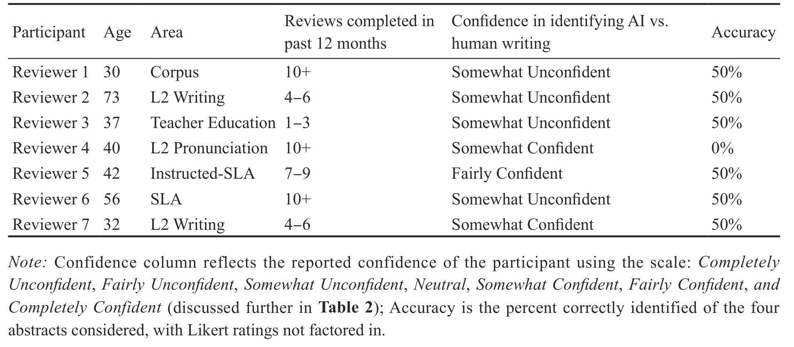
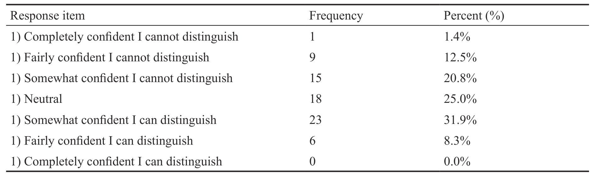
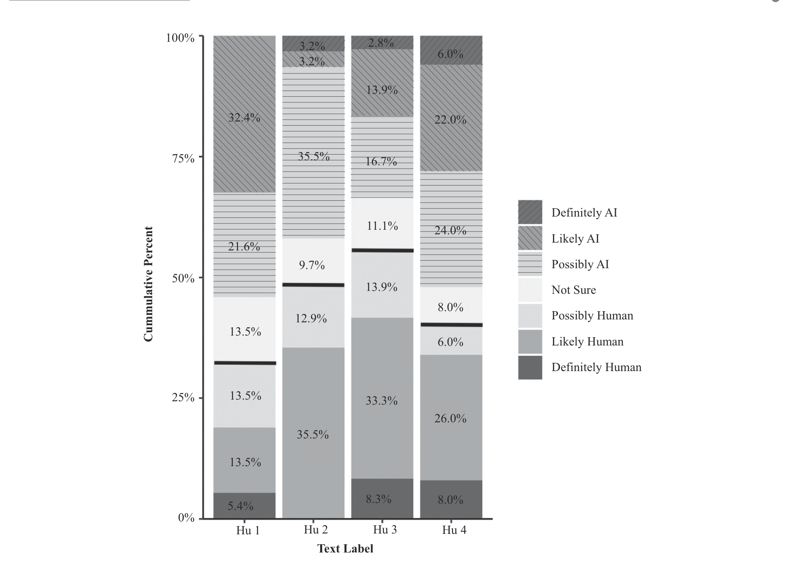
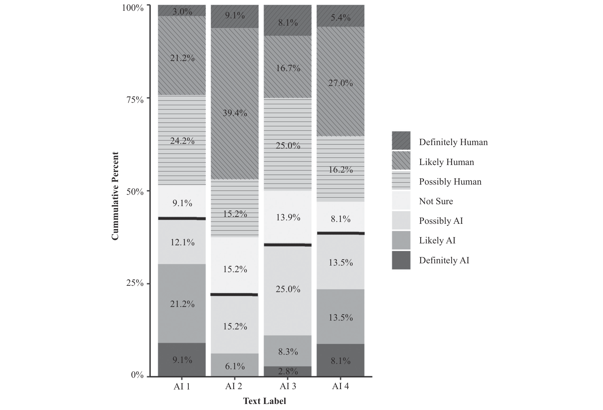
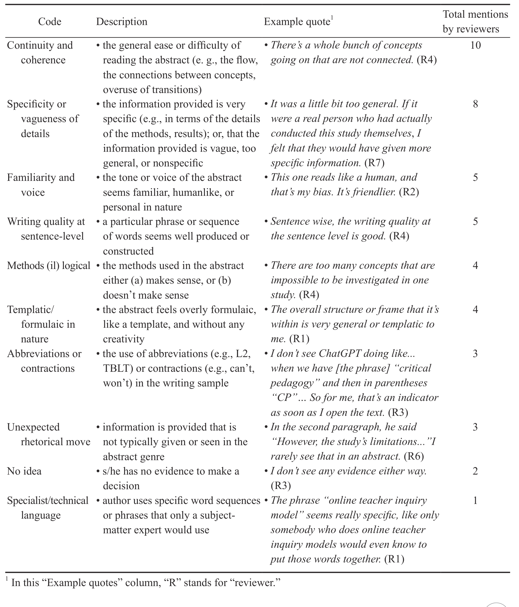
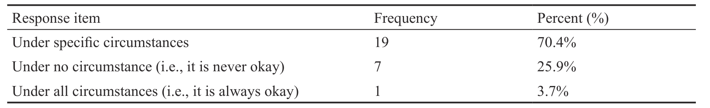
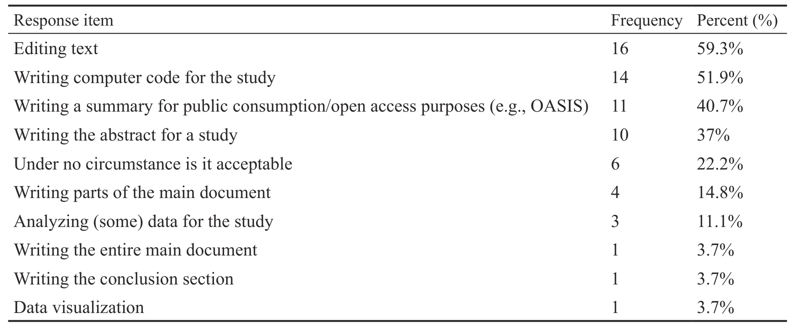

# Can Linguists Distinguish Between ChatGPT/AI and Human Writing?

Reading 2 · A Study of Research Ethics and Academic Publishing

PART 3 · 英中对照

语言学家能否区分 ChatGPT/AI 与人类写作？——一项关于研究伦理与学术出版的研究

!!! info "阅读说明"

    每段先列英文原文（段首方括号为对照编号），其下缩进、带深蓝竖条的小字号段落为中文翻译。原书 Table 1–5 与 Figure 1–2 以图片形式保留，图注译为中文。

    打印版 PDF：[下载《学术英语阅读与写作 · Unit 1 期中复习讲义》PDF](../../../../../assets/files/学术英语阅读与写作_Unit1_期中复习讲义.pdf)

## Abstract　摘要

[1] There has been considerable intrigue surrounding the use of Large Language Model powered AI chatbots such as ChatGPT in research, educational contexts, and beyond. However, most studies have explored such tools' general capabilities and applications for language teaching purposes. The current study advances this discussion to examine issues pertaining to human judgements, accuracy, and research ethics. Specifically, we investigate: (1) the extent to which linguists/reviewers from top journals can distinguish AI-from human-generated writing, (2) what the basis of reviewers' decisions are, and (3) the extent to which editors of top Applied Linguistics journals believe AI tools are ethical for research purposes. In the study, reviewers (N=72) completed a judgement task involving AI-and human-generated research abstracts, and several reviewers participated in follow-up interviews to explain their rationales. Similarly, editors (N=27) completed a survey and interviews to discuss their beliefs. Findings suggest that despite employing multiple rationales to judge texts, reviewers were largely unsuccessful in identifying AI versus human writing, with an overall positive identification rate of only 38.9%. Additionally, many editors believed there are ethical uses of AI tools for facilitating research processes, yet some disagreed. Future research directions are discussed involving AI tools and academic publishing.

围绕 ChatGPT 等由大语言模型驱动的 AI 聊天机器人在研究、教育及其他领域的使用，人们产生了相当大的兴趣。然而，大多数研究探讨的是这些工具的一般能力和语言教学应用。本研究推进这一讨论，考察与人类判断、准确性及研究伦理相关的问题。具体而言，我们调查：（1）顶级期刊的语言学家/审稿人在多大程度上能够区分 AI 生成与人类生成的写作；（2）审稿人作出判断的依据是什么；（3）顶级应用语言学期刊的编辑在多大程度上认为 AI 工具用于研究目的是符合伦理的。研究中，审稿人（N=72）完成了一项涉及 AI 生成和人类生成研究摘要的判断任务，若干审稿人参加了后续访谈以解释其判断理由。同样，编辑（N=27）完成了一项调查和访谈，讨论其看法。研究发现表明，尽管审稿人使用多种理由来判断文本，但他们在识别 AI 写作与人类写作方面总体上并不成功，总体正确识别率仅为 38.9%。此外，许多编辑认为 AI 工具在促进研究过程方面有符合伦理的用途，但也有一些编辑不同意。本文讨论了涉及 AI 工具与学术出版的未来研究方向。
{: .zh }

[2] <strong>Keywords:</strong> Research abstracts, Academic publishing, Artificial Intelligence, ChatGPT, Research ethics

<strong>关键词：</strong>研究摘要；学术出版；人工智能；ChatGPT；研究伦理
{: .zh }

## 1. Introduction　引言

[3] The field of Applied Linguistics is maturing in a time of important ethical discussions in educational and scholarly domains. Applied linguists are celebrating the methodological strides made in recent decades (Gass et al., 2021; Plonsky, 2014) while calling for further commitments to elevate methodological rigor and critically interrogate issues of research ethics (e.g., De Costa et al., 2021; Kubo-nyiova, 2008). At the same time, like other fields, applied linguists are grappling with the emergence of freely available Large Language Model (LLM) powered AI chatbots (e.g., OpenAI's ChatGPT, Microsoft's Bing, Google's Bard), which have the power to quickly generate text that is designed to resemble human-produced language. Scholarly and practical concerns abound, with scholars across disciplines tuning in to language-related ethical concerns and scrambling to find pedagogical applications (e.g., Kasneci et al., 2023; Kohnke et al., 2023; Yang et al., 2022), attempting to understand the potential uses in misinformation campaigns (e.g., Kreps et al., 2022), and investigating the extent to which AI-produced texts differ from human-produced texts (e.g., Ma et al., 2023). The later issue is the basis for the primary focus of the current study. Notably, previous studies have aimed to profile the linguistic differences between AI-and human-produced texts, and to some extent, the more practical concern of whether humans can tell the difference. In the current study, we are interested not only in whether humans—in this case linguists who review for top journals in the field—can reliably distinguish AI- from human-produced texts, but what the basis for the distinction is. Further, and returning to the issue of research ethics, we are also concerned with how editors of these journals view the ethics of using LLM-backed technologies in the production of scholarly research and writing.

应用语言学领域正在教育界和学术界的伦理讨论日益重要之时走向成熟。应用语言学家一方面庆祝近几十年来在方法论上取得的进步（Gass et al., 2021; Plonsky, 2014），另一方面呼吁进一步提升方法论的严谨性，并批判性地审视研究伦理问题（例如 De Costa et al., 2021; Kubo-nyiova, 2008）。与此同时，与其他领域一样，应用语言学家正在应对免费开放的大语言模型（LLM）驱动的 AI 聊天机器人（例如 OpenAI 的 ChatGPT、微软的 Bing、谷歌的 Bard）的出现，这些工具有能力快速生成旨在模仿人类语言的文本。学术和实践层面的担忧比比皆是：各学科学者关注与语言相关的伦理问题，争相寻找教学应用（例如 Kasneci et al., 2023; Kohnke et al., 2023; Yang et al., 2022），试图理解其在虚假信息传播中的潜在用途（例如 Kreps et al., 2022），并研究 AI 生成文本与人类生成文本的差异程度（例如 Ma et al., 2023）。后一问题正是本研究的主要关注点。值得注意的是，以往研究旨在描述 AI 生成文本与人类生成文本之间的语言差异，并在一定程度上关注一个更实际的问题：人类能否分辨二者。在本研究中，我们不仅关注人类——在此即为本领域顶级期刊审稿的语言学家——能否可靠地区分 AI 生成文本与人类生成文本，还关注这种区分的依据是什么。此外，回到研究伦理问题，我们还关注这些期刊的编辑如何看待在研究写作中使用 LLM 支持技术的伦理问题。
{: .zh }

[4] In this study, we focus on research abstracts as the target genre, a decision that is both practical and theoretical. First, LLM-backed technologies such as ChatGPT (GPT4 Plus) have a limited amount of word tokens they can produce, and it is widely known that longer texts are more prone to hallucination (i.e., the tendency to invent content). At the same time, considerable scholarship on research article abstracts and conference abstracts has found that they are rhetorically predictable (e.g., Halleck & Connor, 2006; Samar et al., 2014; Yoon & Casal, 2020) and, perhaps due to their constrained length requirements, characterized by highly formulaic language (e.g., Casal & Yoon, 2023; Omidian et al., 2018). Thus, we have reason to believe that abstracts are a genre that may be particularly vulnerable to AI-generation. Abstracts are also a relevant and critical genre because they play a primary role in editors' initial decision-making processes, reviewers' choices to accept reviews, and in the promotion of one's work. After all, reviewers often receive only the abstract and title before making a decision to accept/decline a review, and the abstract is also part of only a small amount of information available on the free side of scholarly paywalls. For these reasons and more, in the current study, we investigate (a) the extent to which experienced scholars can tell the difference between AI-and human-produced abstracts, (b) what the basis for scholars' decisions are, and (c) the extent to which editors of journals in Applied Linguistics believe the use of AI is ethical for research purposes.

在本研究中，我们聚焦研究摘要这一目标体裁，这一决定既有实践意义，也有理论意义。首先，ChatGPT（GPT4 Plus）等 LLM 支持技术能够生成的词元数量有限，而众所周知，文本越长越容易产生幻觉（即编造内容的倾向）。与此同时，大量关于研究论文摘要和会议摘要的学术研究表明，这类摘要在修辞上具有可预测性（例如 Halleck & Connor, 2006; Samar et al., 2014; Yoon & Casal, 2020），且由于其篇幅限制，往往语言高度程式化（例如 Casal & Yoon, 2023; Omidian et al., 2018）。因此，我们有理由认为，摘要是一种特别容易受到 AI 生成影响的体裁。摘要也是一种相关且关键的体裁，因为它在编辑的初步决策过程、审稿人接受审稿的选择以及成果推广中都发挥主要作用。毕竟，审稿人在决定接受/拒绝审稿时往往只收到摘要和标题，而摘要也是学术付费墙免费一侧所能获得的少量信息之一。基于这些及其他原因，本研究调查：（a）经验丰富的学者在多大程度上能够区分 AI 生成与人类生成的摘要；（b）学者作出判断的依据是什么；（c）应用语言学领域期刊的编辑在多大程度上认为使用 AI 用于研究目的是符合伦理的。
{: .zh }

## 2. Literature Review　文献综述

### 2.1 AI Chatbots in Recent Scholarship　近期学术研究中的 AI 聊天机器人

[5] For detailed discussions of the history of Large Language Models (LLMs) that power modern generative chatbots or the particular workings of specific tools, readers are directed towards the considerable wealth of scholarship from other disciplines on the development, application, and drawbacks of such technologies over time (e.g., Bender et al., 2021), as well as to the websites of current versions of such tools. Nevertheless, in this section, we provide an overview of the topic with an eye towards the first publications on ChatGPT (and similar tools) in Applied Linguistics and fields with related interests.

关于驱动现代生成式聊天机器人的大语言模型（LLM）的历史，或特定工具的具体工作机制，读者可参阅其他学科关于此类技术发展、应用和缺陷的大量文献（例如 Bender et al., 2021），以及这些工具当前版本的网站。不过，本节将概述该主题，并重点关注应用语言学及相关兴趣领域中关于 ChatGPT（及类似工具）的最早一批出版物。
{: .zh }

[6] The potential benefits, ills, and perceived inevitabilities resulting from the existence of freely available AI chatbots powered by LLMs have become pervasive talking points in the public eye and across disciplinary domains, particularly with the 2022 launch of ChatGPT. Despite much recent intrigue, the technology had been gaining enough steam for Bender et al.'s (2021) high profile article to address the “development and deployment of ever larger language models” (p.10) and to consider the consequences of such growth. Generally speaking, AI chatbots are generative tools which are designed based on advances in natural language processing and deep learning models to respond to human inquiries. This is accomplished through algorithms that leverage highly parameterized and massive linguistic datasets. GPT 3, for example, had 175 billion parameters on an undisclosed number of texts from across the Internet, which can be confirmed by asking ChatGPT.

由 LLM 驱动的免费 AI 聊天机器人所带来的潜在益处、危害以及人们所感知的不可避免性，已成为公众和各学科领域中无处不在的话题，尤其是随着 2022 年 ChatGPT 的推出。尽管近来引起极大兴趣，但这项技术此前已积累足够势头，使 Bender 等人（2021）的高关注度文章得以讨论“越来越大语言模型的开发与部署”（第 10 页），并思考这种增长的后果。一般来说，AI 聊天机器人是基于自然语言处理和深度学习模型进展而设计的生成式工具，用于回应人类询问。这是通过利用高度参数化的大规模语言数据集的算法实现的。例如，GPT-3 在数量未披露的互联网文本上拥有 1750 亿个参数，这一点可以通过询问 ChatGPT 得到确认。
{: .zh }

[7] Our widespread anecdotal experience of AI chatbots is that public interest largely targets what the capacities of such technologies are and how this may impact a variety of current practices. Much of what extant scholarship there is aligns with this, as early commentaries in scholarly venues often emphasize the general ubiquity of such novel tools (e.g., Kurian et al., 2023 in Dentistry), or the balance of their potential affordances and dangers (e.g., Kasneci et al., 2023 in Education; Kohnke et al., 2023 in Language Teaching; Shen et al., 2023 in Medicine). A trend in these studies, which is emblematic of their publication in the early stages of these discussions, is that AI chatbots have immense potentials including general productivity, richness in interactivity, and myriad educational affordances. Conversely, discussions highlight fears that they may also carry dire risks including human professional replacement, intellectual offloading, and misinformation. An exception to these discussions of broad affordances and general concerns is Ma et al. (2023), who include a small-scale investigation of how two graduate students in Computer Science differentiated between AI-and human-produced abstracts and wiki item descriptions as part of a broader analysis of formal differences in AI-and human-produced writing. They found that their two human participants identified AI writing by a lack of concreteness in research motivation and methods, but the scope of the analysis was notably small-scale.

我们对 AI 聊天机器人的普遍经验是，公众兴趣主要集中在这类技术的能力是什么，以及这可能如何影响各种当前实践。现有学术研究大多与此一致，因为学术场所的早期评论往往强调这类新工具的普遍性（例如 Kurian et al., 2023，牙医学领域），或强调其潜在可供性与危险的平衡（例如 Kasneci et al., 2023，教育学领域；Kohnke et al., 2023，语言教学领域；Shen et al., 2023，医学领域）。这些研究的一个趋势——也体现了它们发表在这些讨论早期阶段的特点——是 AI 聊天机器人具有巨大潜力，包括总体生产力、丰富的互动性和多种教育可供性。相反，讨论也强调担忧：它们可能带来严重后果，包括取代人类专业工作、智力外包和虚假信息。这些关于广泛可供性和一般担忧的讨论中，有一个例外是 Ma 等人（2023），他们在对 AI 生成与人类生成写作形式差异的更广泛分析中，纳入了一项小规模调查，考察两名计算机科学研究生如何区分 AI 生成与人类生成的摘要和维基条目描述。他们发现，两名人类参与者通过研究动机和方法缺乏具体性来识别 AI 写作，但分析范围明显很小。
{: .zh }

[8] Although scholarly publications on AI chatbots such as ChatGPT in Applied Linguistics and beyond are scarce (but undoubtedly more are on the way), it is important to consider how such tools will impact our productivity as researchers and educators, what affordances and challenges they will offer language learners and language users, and how they may invite some of us to reconsider or recalibrate theoretical concepts and pedagogical practices in the field. And yet, it seems essential that before entering such discussions, there must be ethical discussions surrounding how we, as a field, want to proceed in these matters.

尽管应用语言学及其他领域关于 ChatGPT 等 AI 聊天机器人的学术出版物还很少（但无疑会有更多），但重要的是思考这类工具将如何影响我们作为研究者和教育者的生产力，它们将为语言学习者和语言使用者提供哪些可供性与挑战，以及它们如何促使我们中的一些人重新思考或校准该领域的理论概念与教学实践。然而，在进入这些讨论之前，似乎必须首先进行伦理讨论，探讨我们作为一个领域希望如何处理这些问题。
{: .zh }

### 2.2 Research Ethics in Applied Linguistics and with the Use of AI　应用语言学及 AI 使用中的研究伦理

[9] As discussed, scholarship investigating the affordances of AI chatbots and similar tools in Applied Linguistics is scant, particularly when it comes to understanding their capacity to support various facets of the research process. Simultaneously, there is also a pressing need to explore the use of these tools in conjunction with research ethics. That is, despite much excitement and intrigue surrounding the extent to which AI chatbots can be used, there has been little discussion of ethics and the extent to which these tools should be used for research purposes.

如前所述，应用语言学中调查 AI 聊天机器人及类似工具可供性的学术研究很少，尤其是在理解其支持研究过程各方面能力方面。与此同时，也迫切需要结合研究伦理来探讨这些工具的使用。也就是说，尽管人们对 AI 聊天机器人可用于何种程度充满兴奋和兴趣，但关于伦理以及这些工具应在多大程度上用于研究目的的讨论却很少。
{: .zh }

[10] Within Applied Linguistics in particular, there has been a surge of interest in research ethics during the past decade. In a synthesis and timeline by Yaw et al. (2023), the authors noted that such interest stems from the fact that there is a growing realization that “the entire research cycle—from conceptualization to design and data collection, to analysis, writing, and dissemination—is laden with decisions that can be viewed through the lens of research ethics” (p.1). This has prompted many scholars to attempt to better understand general research practices across the field at-large, in addition to improving their own practices, respectively (e.g., De Costa et al., 2021; Isbell et al., 2022; Sterling & Gass, 2017). Within the scholarship on research ethics, multiple studies such as Isbell et al. (2022) and Larsson et al. (2023) have broadly been interested in what have been deemed Questionable Research Practices (QRPs). These QRPs consist of numerous activities that researchers may engage in, which range from clearly defined, unacceptable instances of misconduct (e.g., data fabrication) to relatively less clear, ethical gray areas (e.g., reporting effect sizes for significant results only). Much recent attention has been paid to the topic of QRPs, and rightfully so. However, comparatively speaking, fewer scholars have formally investigated ethical issues involved with research that leverages digital tools and technologies. As some prior studies in this area have noted (e.g., Kessler et al., in press; Marino et al., in press; Spilioti & Tagg, 2017), when it comes to technology, research ethics are particularly important. This is because both digital tools and online environments are increasingly presenting novel ethical challenges, such as determining what constitutes public vs. private data, whether acquiring informed consent is necessary (or even possible) in certain situations, and more. Relatedly, research ethics with technology are crucial because determining what constitutes ethical behavior often falls on the researchers themselves since university and institutional review boards may lag new developments in technology.

特别是在应用语言学领域，过去十年对研究伦理的兴趣激增。在 Yaw 等人（2023）的综述和时间线中，作者指出，这种兴趣源于人们日益认识到“整个研究周期——从概念化到设计与数据收集，再到分析、写作和传播——都充满可以从研究伦理视角审视的决策”（第 1 页）。这促使许多学者尝试更好地理解整个领域的一般研究实践，同时改进各自的研究实践（例如 De Costa et al., 2021; Isbell et al., 2022; Sterling & Gass, 2017）。在研究伦理的学术研究中，Isbell 等人（2022）和 Larsson 等人（2023）等多项研究广泛关注所谓的“可疑研究实践”（QRPs）。这些 QRP 包括研究者可能从事的众多活动，从明确不可接受的不端行为（例如数据造假）到相对不那么明确的伦理灰色地带（例如只报告显著结果的效应量）。近来对 QRP 主题的关注很多，这是理所当然的。然而，相对而言，正式调查利用数字工具和技术的研究所涉及伦理问题的学者较少。正如该领域一些先前研究指出（例如 Kessler et al., in press; Marino et al., in press; Spilioti & Tagg, 2017），在技术方面，研究伦理尤为重要。这是因为数字工具和在线环境正日益带来新的伦理挑战，例如确定什么构成公共数据与私人数据、在某些情况下是否需要（甚至是否可能）获得知情同意等。与此相关，技术研究伦理至关重要，因为大学和机构审查委员会可能滞后于技术的新发展，确定什么构成伦理行为往往落在研究者自己身上。
{: .zh }

[11] In terms of ethical uses of technology—particularly with AI—most of the (published) dialogues to date have occurred among researchers who work directly with AI's development in areas such as Computer Science and Machine Learning (e.g., Hagendorff, 2020; Jobin et al., 2019; Mittelstadt, 2019; Siau & Wang, 2020). In a study by Hagendorff (2020), the researcher synthesized 22 different sets of guidelines produced on the ethical use of AI tools, highlighting similarities among them. Across guidelines that were produced within governmental, industrial, or academic contexts, Hagendorff identified recurring ethical issues that were discussed, including accountability (i.e., ascertaining the parties responsible when something goes wrong), privacy (i.e., protecting users' data), and fairness (i.e., minimizing bias and promoting inclusion). However, as Hagendorff pointed out, “it is noteworthy that almost all guidelines suggest that technical solutions exist for many of the problems described... [yet few] contain genuinely technical explanations at all” (p.104). In sum, Hagendorff notes that although potential ethical issues are widely acknowledged by AI designers and users, few (if any) concrete solutions are ever provided.

就技术的伦理使用——尤其是 AI——而言，迄今为止（已发表的）对话大多发生在直接从事 AI 开发的研究者之间，领域如计算机科学和机器学习（例如 Hagendorff, 2020; Jobin et al., 2019; Mittelstadt, 2019; Siau & Wang, 2020）。在 Hagendorff（2020）的研究中，研究者综合了 22 套关于 AI 工具伦理使用的不同指南，强调其相似之处。在政府、产业或学术背景下制定的指南中，Hagendorff 识别出反复讨论的伦理问题，包括问责（即确定出错时谁应负责）、隐私（即保护用户数据）和公平（即减少偏见、促进包容）。然而，正如 Hagendorff 指出，“值得注意的是，几乎所有指南都建议许多所述问题存在技术解决方案……[但很少有指南]包含真正的技术解释”（第 104 页）。总之，Hagendorff 指出，尽管 AI 设计者和用户广泛承认潜在伦理问题，但很少有人（如果有的话）提供具体解决方案。
{: .zh }

[12] In returning to the field of Applied Linguistics, as noted, prior studies have tended to focus on exploring AI's general affordances and capabilities rather than engaging in discussions of ethics. One notable exception is Kohnke et al. (2023). In their technological review of ChatGPT for language learning/teaching purposes, the authors provided their views regarding three potential ethical issues.

回到应用语言学领域，如前所述，先前研究倾向于探索 AI 的一般可供性和能力，而不是讨论伦理。一个值得注意的例外是 Kohnke 等人（2023）。在他们关于 ChatGPT 用于语言学习/教学的技术综述中，作者就三个潜在伦理问题提出了看法。
{: .zh }

[13] These issues included general concerns of (1) students' cheating on assessments (e.g., AI producing students' papers), (2) AI producing inaccurate or false information, and (3) AI potentially perpetuating cultural biases (i.e., since many systems, including earlier versions of ChatGPT, rely primarily on English). Apart from Kohnke et al.'s work, empirical research is lacking that investigates the potential ethical issues with AI's use, particularly when it comes to AI's adoption in the research process. Studies are needed that attempt to understand the extent to which gatekeepers of scientific knowledge (such as experienced researchers and journal editors) believe that AI's use is (un)ethical, including what appropriate uses AI may have for research and publishing purposes.

这些问题包括一般性担忧：（1）学生在评估中作弊（例如 AI 代写学生论文）；（2）AI 生成不准确或虚假信息；（3）AI 可能延续文化偏见（因为包括早期版本 ChatGPT 在内的许多系统主要依赖英语）。除 Kohnke 等人的工作外，缺乏实证研究调查 AI 使用的潜在伦理问题，尤其是 AI 在研究过程中的采用。需要研究来理解科学知识的守门人（如经验丰富的研究者和期刊编辑）在多大程度上认为 AI 的使用（不）符合伦理，包括 AI 在研究和新出版目的中可能有哪些适当用途。
{: .zh }

### 2.3 The Current Study　本研究

[14] With these concerns in mind, the current study targets the ability of reviewers of top journals in Applied Linguistics to distinguish between AI-and human-produced research article abstracts, what they report to base their decisions on, and what editors of top journals consider to be ethical and unethical use of AI chatbots in publication practices. The research questions (RQs) guiding the current study are:

基于这些关切，本研究关注应用语言学顶级期刊审稿人区分 AI 生成与人类生成研究论文摘要的能力、他们报告的决定依据，以及顶级期刊编辑认为在出版实践中使用 AI 聊天机器人哪些符合伦理、哪些不符合。指导本研究的研究问题（RQ）如下：
{: .zh }

[15] <strong>RQ1:</strong> To what extent can reviewers tell the difference between written abstracts produced by ChatGPT/AI versus humans?

<strong>RQ1：</strong>审稿人在多大程度上能够区分 ChatGPT/AI 生成的书面摘要与人类撰写的摘要？
{: .zh }

[16] <strong>RQ2:</strong> What is the basis of reviewers' decisions (i.e., their rationales or criteria) for determining whether writing is produced by ChatGPT/AI or by humans?

<strong>RQ2：</strong>审稿人判断写作由 ChatGPT/AI 还是人类生成的依据（即其理由或标准）是什么？
{: .zh }

[17] <strong>RQ3:</strong> What are journal editors' views regarding the acceptable use of ChatGPT and similar AI/LLM tools for academic publishing purposes?

<strong>RQ3：</strong>期刊编辑如何看待 ChatGPT 及类似 AI/LLM 工具用于学术出版目的的可接受性？
{: .zh }

## 3. Method　方法

[18] To address the three RQs, we collected survey and semi-structured interview data. For RQs 1–2, a pool of frequent article reviewers was compiled of the editorial board members for the top 30 journals in Applied Linguistics using SCImago Journal Rank (SJR). Participants from this category are henceforth referred to as reviewers. For RQ3, a pool of editors (including co-editors and assistant editors), was compiled from the top 40 journals in Applied Linguistics using SCImago Journal Rank (SJR). Participants in this category are henceforth referred to as editors. Participants who were listed more than once in either list were only contacted once for each pool. Semi-structured interviews were conducted as follow-ups to the surveys for RQs 2–3.

为回答三个 RQ，我们收集了调查和半结构化访谈数据。对于 RQ1–2，我们使用 SCImago 期刊排名（SJR）编制了应用语言学排名前 30 期刊的编委会成员中频繁审稿人的名单。此类参与者以下称为审稿人。对于 RQ3，我们使用 SJR 编制了应用语言学排名前 40 期刊的编辑（包括共同编辑和助理编辑）名单。此类参与者以下称为编辑。在任一名单中多次出现的人员，每个名单只联系一次。半结构化访谈作为 RQ2–3 调查的后续进行。
{: .zh }

### 3.1 Participants　参与者

[19] For RQ1 (i.e., reviewers' capacity to differentiate between ChatGPT/AI-versus human-produced abstracts), 87 reviewer participants began the survey (described in detail in the next section), but only 72 completed it and are included in this analysis. The 72 reviewers self-reported an average age of 46.3 years (SD=11.7, range 28-75 years). In terms of gender, they identified as female (39), male (31), or other (2). Regarding their professional profile, the majority indicated they currently held various tenure-line professor titles, such as assistant professor (12), associate professor (17), full professor (6), or professor with no rank specified (22). In addition, some held emeritus status (5), lecturer or senior lecturer positions (5), and the remaining indicated a variety of research-oriented positions. The reviewers represent a wide-range of research areas, such as L2 writing (15), second language acquisition, instructed second language acquisition, or TESOL (11), psycholinguistics (7), L2 pronunciation/phonology (7), corpus linguistics (6), CALL (3), L2 vocabulary (3), and a number of other areas listed by one or two reviewers (e.g., conversation analysis, discourse analysis, education, genre studies, identity, literacy studies, pragmatics, teacher education, sociocultural theory, and sociolinguistics). When asked about the number of reviews they had completed for journals within the last 12 months, participants indicated they had completed between 1–3 reviews (19 people), 4–6 reviews (20), 7–9 reviews (11), or 10 or more reviews (22).

对于 RQ1（即审稿人区分 ChatGPT/AI 生成与人类生成摘要的能力），87 名审稿人参与者开始了调查（下一节将详细描述），但只有 72 人完成并纳入本分析。这 72 名审稿人自报平均年龄 46.3 岁（SD=11.7，范围 28–75 岁）。性别方面，39 人为女性，31 人为男性，2 人为其他。关于职业背景，大多数人表示目前拥有各类终身教职头衔，如助理教授（12）、副教授（17）、正教授（6）或未说明职级的教授（22）。此外，一些人拥有荣休身份（5）、讲师或高级讲师职位（5），其余人表示担任各种研究型职位。审稿人代表广泛的研究领域，如二语写作（15）、第二语言习得、受指导的第二语言习得或 TESOL（11）、心理语言学（7）、二语发音/音系学（7）、语料库语言学（6）、计算机辅助语言学习（3）、二语词汇（3），以及一两名审稿人列出的许多其他领域（例如会话分析、话语分析、教育、体裁研究、身份、读写研究、语用学、教师教育、社会文化理论和社会语言学）。当被问及过去 12 个月为期刊完成多少篇审稿时，参与者表示完成了 1–3 篇（19 人）、4–6 篇（20 人）、7–9 篇（11 人）或 10 篇及以上（22 人）。
{: .zh }

[20] Of the 72 survey participants, 28 volunteered to participate in follow-up interviews for RQ2 (i.e., discussing the basis of reviewers' decisions). From this potential pool of 28 reviewers, 10 were contacted because they reflected the diversity in our dataset. Specifically, efforts were made to contact reviewers who broadly represented the field of Applied Linguistics, both in terms of biographical attributes (e.g., different ages, genders) and in terms of research specializations. Of the 10 potential reviewers who were contacted, seven ultimately participated. These seven reviewers (see Table 1) were roughly balanced in gender (four males, three females) and had completed a moderate-to-high number of reviews in the past 12 months. The interview participants were also roughly representative of the sample in terms of their ability to distinguish AI-from human-generated texts, with a majority correctly identifying two of the four texts presented to them (discussed later).

在 72 名调查参与者中，28 人自愿参加 RQ2 的后续访谈（即讨论审稿人决定的依据）。从这 28 名潜在审稿人中，我们联系了 10 人，因为他们反映了数据集的多样性。具体而言，我们努力联系在传记特征（如不同年龄、性别）和研究专长方面广泛代表应用语言学领域的审稿人。在联系的 10 名潜在审稿人中，最终有 7 人参加。这 7 名审稿人（见表 1）性别大致平衡（4 男 3 女），并在过去 12 个月完成了中等偏多的审稿数量。访谈参与者在区分 AI 生成与人类生成文本的能力上也大致代表样本，大多数人正确识别了呈现给他们的四篇文本中的两篇（后文讨论）。
{: .zh }

Table 1. Semi-structured interview participants (i.e., reviewers) for RQ2. 表 1：RQ2 半结构化访谈参与者（即审稿人）

[21] For RQ3 (i.e., editors' views regarding the ethical use of ChatGPT/AI tools), 35 journal editors began the survey, but only 27 completed it and had their responses included in the analysis. The 27 editors self-reported an average age of 49.6 years (SD=9.6, range 36-80 years), with a greater number of males (17) than females (9) and one participant choosing not to disclose. The editors were not asked to be as specific in identifying their subfields as the reviewer population, since the lower number of potential participants might render editor participants identifiable. The average number of years of editorial experience was 7.2 years (SD=7.4 years) with a broad range (1-40 years). Of the 27 editor participants, seven indicated a willingness to participate in follow-up semi-structured interviews. Although all seven were contacted, five ultimately participated. Editor participant information is kept general in what follows, as to not clue in identity given the small pool and general notoriety of individuals.

对于 RQ3（即编辑对 ChatGPT/AI 工具伦理使用的看法），35 名期刊编辑开始调查，但只有 27 人完成并将回答纳入分析。这 27 名编辑自报平均年龄 49.6 岁（SD=9.6，范围 36–80 岁），男性（17）多于女性（9），1 人选择不披露。没有要求编辑像审稿人群体那样具体说明子领域，因为潜在参与者数量较少，可能使编辑参与者身份可识别。平均编辑经验为 7.2 年（SD=7.4 年），范围很广（1–40 年）。在 27 名编辑参与者中，7 人表示愿意参加后续半结构化访谈。尽管联系了全部 7 人，最终有 5 人参加。下文对编辑参与者信息保持概括，以免因人数少且个人知名度高而暴露身份。
{: .zh }

### 3.2 Instruments　研究工具

#### 3.2.1 Reviewer and Editor Surveys　审稿人与编辑调查

[22] Two surveys were designed and used for this study with Qualtrics (Qualtrics, Provo, UT). For RQ1, after reading the instructions, participants from the reviewer pool completed an 11-question survey which took approximately 15 minutes to complete. First, participants were asked a series of general questions pertaining to demographic and professional information. Next, participants were given a brief overview of an AI-and human-produced research abstract identification task and asked to indicate their confidence in distinguishing AI-from human-produced texts of this genre. They were then shown four abstracts (described below) from a pool of eight possible texts and were asked to indicate whether the author was AI, human, or if they were not sure using a 7-point Likert scale (Definitely AI, Likely AI, Possibly AI, Not Sure, Possibly Human, Likely Human, Human). Finally, participants were asked if they would be willing to participate in a semi-structured interview to discuss their responses in greater depth (by providing their email address).

本研究使用 Qualtrics（Qualtrics, Provo, UT）设计并实施了两项调查。对于 RQ1，审稿人池的参与者在阅读说明后完成了一项 11 题调查，约需 15 分钟。首先，参与者回答一系列关于人口统计和职业信息的一般问题。接着，向参与者简要介绍一项 AI 生成与人类生成研究摘要识别任务，并要求他们表明区分该体裁 AI 生成与人类生成文本的信心。然后，从八篇可能文本中抽取四篇摘要（见下文）展示给参与者，要求他们用 7 点李克特量表（绝对是 AI、可能是 AI、也许是 AI、不确定、也许是人类、可能是人类、人类）指出作者是 AI、人类还是不确定。最后，询问参与者是否愿意参加半结构化访谈以更深入讨论其回答（提供电子邮箱）。
{: .zh }

[23] Eight research abstracts were used in this study, including four human-generated abstracts and four AI-generated abstracts that corresponded to the human abstracts. For the human abstracts, four articles were selected from two journals on the basis that they were published in 2021 or 2022 in indexed, peer-reviewed journals of Applied Linguistics with impact factors of approximately 1.0. Recent articles were selected (i.e., 2021–2022) to reduce the likelihood that they had been widely read. Peer-reviewed journals with impact factors of 1.0 were used to ensure a base level of quality with the abstracts (and corresponding articles) yet were also unlikely to be widely read/cited as to influence the results or reduce our reviewer pool. Two qualitative and two quantitative abstracts were selected, but details of the articles will not be shared in order to protect the authors from any undue consequences of reviewers' analyses. Reviewers were told that the articles would not be discussed in depth individually in this article to ensure that their comments regarding writing practices could not be interpreted specifically as feedback or evaluation of their peers.

本研究使用八篇研究摘要，包括四篇人类生成摘要和四篇与人类摘要相对应的 AI 生成摘要。对于人类摘要，从两本期刊中选择四篇文章，依据是它们于 2021 或 2022 年发表在索引的、同行评审的应用语言学期刊上，影响因子约为 1.0。选择近期文章（2021–2022）是为了降低它们已被广泛阅读的可能性。使用影响因子为 1.0 的同行评审期刊是为了确保摘要（及对应文章）具有基本质量，同时也不太可能被广泛阅读/引用，从而影响结果或缩小审稿人池。选择了两篇定性摘要和两篇定量摘要，但不会分享文章细节，以保护作者免受审稿人分析可能带来的不当后果。审稿人被告知，本文不会逐一深入讨论这些文章，以确保其关于写作实践的评论不会被具体解读为对其同行的反馈或评价。
{: .zh }

[24] Since the four human-produced abstracts were published along with four research articles, authors' names were removed. For this reason, reviewers were asked to skip judging an abstract in the event they had encountered the abstract/paper before (i.e., simply by hitting the “next” arrow key and not entering a judgement on that abstract). No reviewers skipped any abstracts. The AI-produced abstracts were generated using ChatGPT (GPT4 Plus, OpenAI, 2023) on March 29, 2023 based on each of the four human-produced research articles. Due to the overall text processing limit for individual queries, the articles were first broken down into part-genres (i.e., Introduction/Literature Review, Methods, Results, Discussion), and ChatGPT was asked to summarize each of the part-genres. Then ChatGPT was prompted to create a research abstract following the journal's guidelines (e.g., length and content; not reproduced for author privacy) based on the part-genre summaries. No edits were made to the human-or AI-produced abstracts.

由于四篇人类生成摘要与四篇研究文章一同发表，作者姓名已被移除。因此，审稿人被要求在之前遇到过该摘要/论文时跳过判断（即按“下一步”箭头，不对该摘要作出判断）。没有审稿人跳过任何摘要。AI 生成摘要使用 ChatGPT（GPT4 Plus, OpenAI, 2023）于 2023 年 3 月 29 日基于四篇人类生成研究文章生成。由于单次查询的总体文本处理限制，文章首先被拆分为部分体裁（即引言/文献综述、方法、结果、讨论），并要求 ChatGPT 总结各部分体裁。然后，提示 ChatGPT 根据部分体裁摘要，按照期刊指南（例如长度和内容；为保护作者隐私不转载）创建研究摘要。对人类或 AI 生成摘要均未作编辑。
{: .zh }

[25] The editor survey for RQ3 was an 8-question instrument that took editors approximately 4 minutes to complete. Participants were asked for information regarding demographics and editorial profiles. Editors were then asked to indicate if they felt, as a journal editor (but not as a representative of their journal), that the use of AI tools such as ChatGPT was ethical in research activity related to a journal article submission (a) under no circumstances, (b) under specific circumstances, or (c) in all circumstances. They were also asked to select which activities they considered to be ethical in research activity and writing for publication in academic journals (i.e., writing the abstract for a study; writing the majority or all the main manuscript; writing specific parts of the main document; writing a public-facing summary of the article; analyzing data for the study; writing computer code of some kind for the study; editing text; as well as “other” uses they could specify). Finally, editors were asked to comment generally on issues of ethics and the use of ChatGPT and similar tools in research activity and publication. Editors were also invited to provide information for a follow-up semi-structured interview.

RQ3 的编辑调查是一份 8 题工具，编辑约需 4 分钟完成。参与者被问及人口统计和编辑履历信息。然后，编辑被要求表明，作为期刊编辑（而非代表其期刊），他们认为使用 ChatGPT 等 AI 工具在与期刊文章投稿相关的研究活动中是否符合伦理：（a）在任何情况下都不符合；（b）在特定情况下符合；（c）在所有情况下都符合。他们还要求选择哪些活动在学术期刊发表的研究活动和写作中符合伦理（即为研究撰写摘要；撰写主要手稿的大部分或全部；撰写主要文件的特定部分；撰写面向公众的文章摘要；为研究分析数据；为研究编写某种计算机代码；编辑文本；以及他们可以具体说明的“其他”用途）。最后，编辑被要求就伦理问题以及 ChatGPT 和类似工具在研究活动和出版中的使用发表一般性评论。编辑还被邀请提供信息以参加后续半结构化访谈。
{: .zh }

#### 3.2.2 Reviewer and Editor Semi-Structured Interviews　审稿人与编辑半结构化访谈

[26] For participants of both reviewer and editor pools who indicated a willingness to participate in semi-structured interviews, those interviews were conducted within one week of completing the survey, or shortly afterwards. The goal of the reviewer interviews was to gain insights into the basis for distinguishing between human-and AI-produced abstracts, and the goal of the editor interviews was to better understand aspects of their responses.

对于表示愿意参加半结构化访谈的审稿人和编辑池参与者，访谈在完成调查后一周内或之后不久进行。审稿人访谈的目标是深入了解区分人类生成与 AI 生成摘要的依据，编辑访谈的目标是更好地理解其回答的各个方面。
{: .zh }

[27] For the reviewer interviews, after consent and procedures were discussed, participants were asked to discuss their prior experiences with ChatGPT or similar tools (e.g., Google's Bard). They were then shown each of the abstracts they had previously viewed in the survey and their previous human/AI author decision on the Likert scale. They were given time to review the abstract and asked to discuss what features of the abstract informed their decision, including any concrete elements and/or vague holistic impressions. Participants were then asked more generally about the basis for distinguishing between AI-and human-produced texts, after which they were shown whether each of the four texts was produced by a human or AI. Participants were given time for a final reflection.

对于审稿人访谈，在讨论知情同意和程序后，参与者被要求讨论他们此前使用 ChatGPT 或类似工具（例如 Google 的 Bard）的经验。然后，向他们展示此前在调查中看过的每篇摘要及其在李克特量表上的人类/AI 作者判断。给他们时间审阅摘要，并要求讨论摘要的哪些特征影响了他们的决定，包括任何具体要素和/或模糊的整体印象。随后，更一般地询问参与者区分 AI 生成与人类生成文本的依据，之后告知他们四篇文本各自由人类还是 AI 生成。参与者有时间进行最后反思。
{: .zh }

[28] For the editor interviews, participants were asked about their previous experience with ChatGPT and similar tools. They were also asked probing questions about their survey responses, including their rationales for why the items they had identified in the survey were (un)ethical, principles they would use to guide decisions of ethicality, and a general reflection on how they foresee (or currently experience) changes in their editorial role brought about from ChatGPT and AI-based technologies.

对于编辑访谈，参与者被问及此前使用 ChatGPT 和类似工具的经验。还就调查回答提出追问，包括他们认为调查中所选项目为何（不）符合伦理的理由、他们将用来指导伦理性判断的原则，以及对他们预见（或目前经历）ChatGPT 和 AI 技术给编辑角色带来变化的总体反思。
{: .zh }

[29] The first author conducted all interviews using synchronous video communication tools. Each interview was audio recorded and lasted approximately 30 minutes for reviewers and 15 minutes for editors.

第一作者使用同步视频通信工具进行了所有访谈。每次访谈均录音，审稿人访谈约 30 分钟，编辑访谈约 15 分钟。
{: .zh }

### 3.3 Analysis　分析

[30] For RQ1, reviewers' responses from the survey were aggregated and presented numerically using simple descriptive statistics, as this allowed for reflections on accuracy of author identification and other patterns. For RQs 2–3, the second author transcribed all audio interviews using verbatim transcription in order to enable qualitative thematic analysis (see Polio & Friedman, 2017), which was guided by a two-cycle coding model (e.g., Miles et al., 2018). In the first cycle of coding, the second author created descriptive and in-vivo codes to reflect the topics of individual sentences discussed by reviewers (in RQ2) or editors (in RQ3). In the second round of coding, similar codes were then grouped together with similar themes. To ensure the reliability of the coding, inter-coder reliability was obtained. Using the thematic codes developed by the second author, the first author then double-coded 54.5% of the interview data, achieving high reliability (86.1%). Any/all discrepancies were resolved via discussions. In the results section for RQ2, we showcase all codes that were developed, including illustrative examples for each code. For RQ3 involving editors' comments, we present several codes and interview excerpts in a supporting role to the survey data as a means of interrogating and accounting for the observed patterns.

对于 RQ1，审稿人的调查回答被汇总，并使用简单描述性统计以数字呈现，以便反思作者识别的准确性及其他模式。对于 RQ2–3，第二作者对所有音频访谈进行逐字转录，以便进行定性主题分析（见 Polio & Friedman, 2017），并以两轮编码模型为指导（例如 Miles et al., 2018）。在第一轮编码中，第二作者创建描述性和活语编码，以反映审稿人（RQ2）或编辑（RQ3）讨论的个别句子主题。在第二轮编码中，相似编码被归入相似主题。为确保编码可靠性，获得了编码者间信度。使用第二作者开发的主题编码，第一作者对 54.5% 的访谈数据进行了双重编码，达到高信度（86.1%）。任何/所有分歧均通过讨论解决。在 RQ2 的结果部分，我们展示所有开发的编码，包括每个编码的示例。对于涉及编辑评论的 RQ3，我们展示若干编码和访谈摘录，以支持调查数据，作为审视和解释观察模式的手段。
{: .zh }

## 4. Results　结果

### 4.1 RQ1: Reviewers' Ability to Identify ChatGPT/AI Versus Human Writing　RQ1：审稿人识别 ChatGPT/AI 与人类写作的能力

[31] The first aim was to identify the extent to which reviewers from top journals in Applied Linguistics were able to distinguish between AI-produced research abstracts and human-produced research abstracts. Before asking participants to identify the origin of the abstracts, they were asked to rate their confidence in successfully completing the task on a 7-point Likert scale. As can be seen in Table 2, 77.7% of respondents took a neutral position or the lowest level of confidence in either direction (neutral or somewhat confident/somewhat unconfident), though slightly more participants tended to believe in their ability to distinguish (n=29) than not (n=25). Overall, this paints a picture of general uncertainty among even highly trained linguists, echoing broader cultural anxieties.

第一个目标是确定应用语言学顶级期刊的审稿人在多大程度上能够区分 AI 生成的研究摘要和人类生成的研究摘要。在要求参与者识别摘要来源之前，先要求他们用 7 点李克特量表评价成功完成任务的信心。如表 2 所示，77.7% 的受访者持中立立场或两个方向上的最低信心（中立或有些信心/有些没信心），尽管略多参与者倾向于相信自己有能力区分（n=29），而非没有能力区分（n=25）。总体而言，这描绘出即使是训练有素的语言学家也普遍存在不确定性的图景，这与更广泛的文化忧虑相呼应。
{: .zh }

Table 2. Reviewers' (N = 72) confidence in their ability to distinguish ChatGPT/AI from human writing. 表 2：审稿人（N = 72）对区分 ChatGPT/AI 与人类写作能力的信心

[32] Next, reviewers completed the identification task, in which they were shown a random sample of four total abstracts, one at a time. Reviewers' identification accuracy and confidence levels for this task are presented in Figure 1 (human-produced abstracts) and Figure 2 (AI-generated abstracts). In each figure, the X-axis (called “Text Label”) represents the individual text that was shown to participants (i.e., human abstract #1, #2, etc.). The colored bars spanning the Y-axis (called “Cumulative Percent”) show the percentage of participants who assigned specific ratings (i.e., human or AI), with a black bar separating those who correctly or incorrectly identified the origin of the text, regardless of confidence level, with “not sure” responses counted as incorrect identification. Human-and AI-produced texts are separated into two figures to avoid inversion of color schemes and to reduce the complexity of interpretations.

接下来，审稿人完成识别任务，随机抽取四篇摘要逐一展示。审稿人在该任务中的识别准确性和信心水平见图 1（人类生成摘要）和图 2（AI 生成摘要）。在每个图中，X 轴（称为“Text Label”）表示展示给参与者的个别文本（即人类摘要 #1、#2 等）。Y 轴上的彩色条（称为“Cumulative Percent”）显示给出特定评分（即人类或 AI）的参与者百分比，黑色条区分正确或错误识别文本来源者，不论信心水平如何，“不确定”回答计为错误识别。人类生成和 AI 生成文本分为两图，以避免颜色方案反转并降低解释复杂性。
{: .zh }

Figure 1. Reviewers' author identifications and confidence levels on human-produced texts by percent. 图 1：审稿人对人类生成文本的作者识别与信心水平（按百分比）

Figure 2. Reviewers' author identifications and confidence levels on AI-produced texts by percent. 图 2：审稿人对 AI 生成文本的作者识别与信心水平（按百分比）

[33] As can be seen, overall, the reviewers were not particularly effective, with an average total positive identification rate of only 38.9%. Notably, the reviewers were more effective at identifying human authors of research abstracts (44.1%) than AI authors of abstracts (33.7%). The raters only reached 50% accuracy when rating one abstract, which was Human Abstract 3. Thus, it is readily observable that experienced reviewers of Applied Linguistics research article manuscripts are not particularly effective at identifying AI-produced texts under these circumstances. Further, they are less likely to correctly identify AI-produced texts as AI than they are to identify human-produced texts as human.

可以看出，总体而言，审稿人并不特别有效，平均总正确识别率仅为 38.9%。值得注意的是，审稿人识别研究摘要的人类作者（44.1%）比识别 AI 作者（33.7%）更有效。评分者仅在一篇摘要上达到 50% 准确率，即人类摘要 3。因此，可以明显看出，在这些情况下，经验丰富的应用语言学研究论文审稿人并不特别擅长识别 AI 生成文本。此外，他们正确识别 AI 生成文本为 AI 的可能性，低于正确识别人类生成文本为人类的可能性。
{: .zh }

[34] It is also noteworthy that there is a pronounced difference in reviewer identification abilities and accuracy on a text-to-text basis. Resonating with the overall low rates of correct AI/human author identification, none of the 72 reviewers properly identified all four abstracts, 18.1% properly identified three of the four, 34.7% properly identified two of the four, 34.7% properly identified only one of the four, and 12.5% did not identify any properly. On a text-to-text basis, the most difficult text was AI-2, which only 22.6% of all respondents correctly identified. As mentioned, the most consistently identified was Human-3, which 55.6% of all respondents correctly identified, with the rest following in a narrower band.

还值得注意的是，审稿人的识别能力和准确性在文本之间差异显著。与总体较低的 AI/人类作者正确识别率相呼应，72 名审稿人中没有人正确识别全部四篇摘要，18.1% 正确识别四篇中的三篇，34.7% 正确识别四篇中的两篇，34.7% 仅正确识别四篇中的一篇，12.5% 一篇也没有正确识别。就文本而言，最难的是 AI-2，仅 22.6% 的受访者正确识别。如前所述，最一致被识别的是人类-3，55.6% 的受访者正确识别，其余文本在较窄范围内。
{: .zh }

### 4.2 RQ2: Basis of Reviewers' Decisions for Determining ChatGPT/AI vs. Human Writing　RQ2：审稿人判断 ChatGPT/AI 与人类写作的依据

[35] After participating in the identification task for RQ1, several reviewers (n=7) engaged in follow-up interviews, in which they discussed the basis of their decisions. We identified a total of 10 different rationales that reviewers gave for determining whether a writing sample was produced by ChatGPT/AI or humans. Due to space limitations, we do not explicitly discuss all 10 rationales in this section. Instead, we highlight the top four recurring criteria that reviewers relied upon. However, all 10 rationales are shown in Table 3 with example quotes to illustrate these themes. Notably, none of the reviewers we interviewed relied exclusively on only one rationale. Instead, when discussing their decision-making processes, each reviewer relied on a range of criteria to sort the abstracts they read, which ranged from as few as three criteria (Reviewer 3) to as many as five criteria (Reviewers 1 and 2).

在参与 RQ1 的识别任务后，若干审稿人（n=7）参加了后续访谈，讨论其决定依据。我们共识别出审稿人用于判断写作样本由 ChatGPT/AI 还是人类生成的 10 种不同理由。由于篇幅限制，本节不逐一明确讨论全部 10 种理由，而是重点介绍审稿人最常依赖的前四项标准。不过，表 3 展示了全部 10 种理由及示例引文，以说明这些主题。值得注意的是，我们访谈的审稿人都不是只依赖一种理由；相反，在讨论决策过程时，每位审稿人都依赖一系列标准来分类所读摘要，少则三种（审稿人 3），多则五种（审稿人 1 和 2）。
{: .zh }

[36] The top four rationales provided by reviewers pertained to a text's (1) continuity and coherence, (2) specificity or vagueness of details, (3) familiarity and voice, and (4) writing quality at the sentence-level. The first of these criteria, continuity and coherence, was the most frequently used, with five of seven reviewers mentioning it at least once. This rationale was used to describe the general ease or difficulty of reading an abstract. Reviewers attributed any writing flow or continuity issues to AI-produced writing, whereas they considered fluid, connected, and coherent compositions to humans. For instance, reviewers often made direct reference to textual coherence “I found that there was a certain level of coherence here” (Reviewer 5) in their evaluations. Human texts were identified as “easier to read” (Reviewer 2) due to connections in writing and ideas, while cohesion issues such as “the connections between the sentences are not always natural” (Reviewer 6) motivated AI classifications. However, this did not appear to be a reliable criterion, as reviewers who based their decisions on continuity and coherence correctly identified an author's identity only 22.2% of the time (2 of 9 instances).

审稿人提供的前四项理由涉及文本的（1）连贯性与衔接，（2）细节的具体性或模糊性，（3）熟悉感和声音，（4）句子层面的写作质量。第一项标准，连贯性与衔接，使用最频繁，7 位审稿人中有 5 位至少提到一次。该理由用于描述摘要阅读的一般难易程度。审稿人把任何写作流畅性或连续性问题归因于 AI 生成写作，而把流畅、连贯、衔接良好的作品归因于人类。例如，审稿人在评价中常直接提到文本连贯性：“我发现这里有一定程度的连贯性”（审稿人 5）。人类文本被认为“更易读”（审稿人 2），因为写作和思想之间有联系；而“句子之间的联系并不总是自然”（审稿人 6）等衔接问题则促使他们判定为 AI。然而，这似乎并不是可靠标准，因为以连贯性和衔接为依据的审稿人正确识别作者身份的比例仅为 22.2%（9 次中 2 次）。
{: .zh }

[37] The second frequent rationale reviewers provided was specificity or vagueness of details, with three of seven reviewers discussing it at least once. With this rationale, when reviewers found an abstract to contain considerable detail or specific information about different aspects of the study such as the methods or findings, they attributed the text to being human-generated. Conversely, if the writing sample was vague or thin on details regarding the study, reviewers assumed that the text was AI-produced. For example, after reading an abstract, Reviewer 7 commented: “It talks about this specific university [in the abstract]. I thought that's another fact AI might not have mentioned.” Specificity or vagueness of details also did not seem to be reliable in making determinations. With this rationale, reviewers correctly identified an abstract's origins 28.6% of the time (2 of 7).

审稿人提供的第二项常见理由是细节的具体性或模糊性，7 位中有 3 位至少讨论一次。根据这一理由，当审稿人发现摘要包含关于研究不同方面（如方法或发现）的相当多细节或具体信息时，他们将其归因于人类生成。相反，如果写作样本在研究细节上模糊或单薄，审稿人则假定为 AI 生成。例如，读完一篇摘要后，审稿人 7 评论道：“它谈到了这所具体的大学[在摘要中]。我认为这是 AI 可能不会提到的另一个事实。”细节的具体性或模糊性似乎也不是可靠的判断依据。使用该理由时，审稿人正确识别摘要来源的比例为 28.6%（7 次中 2 次）。
{: .zh }

[38] The third criterion reviewers adopted was familiarity and voice. Three of seven reviewers discussed it. In all instances, reviewers discussed this theme in terms of a writing sample feeling generally familiar or human-like, oftentimes referring to the tone or voice within the text. For instance, after reading an abstract and judging it as “likely human” (which it was not), Reviewer 5 stated “It seems like this author's style is coming through... It felt more unique... I would call this what is commonly referred to as voice, which I would describe as some unpredictability or some uniqueness.” Similar to the previous two rationales, familiarity and voice did not appear to be a reliable indicator, as reviewers judged abstracts correctly only 20% of the time (1 of 5).

审稿人采用的第三项标准是熟悉感和声音，7 位中有 3 位讨论。在所有情况下，审稿人都以写作样本是否让人感到熟悉或像人类来讨论这一主题，往往提到文本中的语气或声音。例如，在读完一篇摘要并判断为“可能是人类”（实际不是）后，审稿人 5 表示：“似乎这位作者的风格显现出来了……感觉更独特……我会称之为大家常说的‘声音’，我会把它描述为某种不可预测性或独特性。”与前两项理由类似，熟悉感和声音似乎也不是可靠指标，因为审稿人判断正确的比例仅为 20%（5 次中 1 次）。
{: .zh }

[39] The fourth and final rationale highlighted here is writing quality at the sentence-level. Four of seven reviewers discussed it at least once. This consisted of reviewers commenting that, when the composition of phrases or sentences appeared generally well constructed, they attributed this to humans. Conversely, if individual phrases or sentences were not well written and judged to be of poor quality, reviewers attributed it to AI. An example is shown in Table 3, in which Reviewer 4 commented positively on the “writing quality at the sentence level”, thereby believing the sample to be human. However, in another instance, Reviewer 6 felt the writing quality was poor and thus attributed the abstract to AI, stating: “The last sentence in the first paragraph... That's something weird to say, like, the way they present the methodology,” which they later connected to phrasing. When using this criterion, reviewers tended to be somewhat more successful, correctly identifying the origins of the abstract 60% of the time (3 of 5).

这里强调的第四项也是最后一项理由是句子层面的写作质量，7 位中有 4 位至少讨论一次。这包括审稿人评论说，当短语或句子的构成总体良好时，他们将其归因于人类；相反，如果个别短语或句子写得不好、质量差，他们则归因于 AI。表 3 给出了一个例子，审稿人 4 正面评价“句子层面的写作质量”，因而认为样本是人类所写。然而，在另一个例子中，审稿人 6 认为写作质量差，因而将摘要归因于 AI，称：“第一段的最后一句……那样说很奇怪，比如他们呈现方法的方式。”后来他把这一点与措辞联系起来。使用该标准时，审稿人往往稍微更成功，正确识别摘要来源的比例为 60%（5 次中 3 次）。
{: .zh }

[40] As discussed earlier, there were other criteria reviewers leveraged when attempting to identify ChatGPT/AI-versus human-produced writing. However, these rationales tended to occur less frequently in the dataset. They also tended to be more idiosyncratic in nature, typically being discussed by only one reviewer (e.g., Reviewer 4's rationale of methods [il]logical) or by two reviewers (e.g., Reviewer 3 and 7's discussion of abbreviations or contractions). Due to the idiosyncratic nature of these items, we do not discuss them in-depth here and instead refer readers to Table 3. Interestingly, most of these points informed AI identification if negative and human identification if positive.

如前所述，审稿人在试图识别 ChatGPT/AI 生成与人类生成写作时还使用了其他标准。然而，这些理由在数据集中出现频率较低，也往往更具个人特异性，通常只有一位审稿人讨论（例如审稿人 4 关于方法（不）合逻辑的理由），或两位审稿人讨论（例如审稿人 3 和 7 关于缩写或缩略词的讨论）。由于这些项目的特异性，我们不在此深入讨论，而请读者参阅表 3。有趣的是，这些观点大多在负面时支持 AI 识别，在正面时支持人类识别。
{: .zh }

Table 3. Rationales provided by reviewers for determining ChatGPT/AI vs. human-produced writing. 表 3：审稿人用于判断 ChatGPT/AI 与人类生成写作的理由

### 4.3 RQ3: Journal Editors' Beliefs about the Ethicality of Using ChatGPT/AI Tools for Publishing　RQ3：期刊编辑对使用 ChatGPT/AI 工具进行出版的伦理看法

[41] The final RQ examined the extent to which editors of Applied Linguistics journals believe the use of ChatGPT and AI tools are ethical for academic research and publishing purposes. The first survey question asked editors about their general approval/disapproval of researchers' use of such tools when submitting work to their journals. Editors' responses to this question are displayed in Table 4. As shown, a large majority believe that AI tools are acceptable under specific circumstances, while a smaller (yet not insignificant) sample stated that such tools were not acceptable under any circumstance. Notably, one editor believed that the use of AI tools was always okay for authors, regardless of the situation.

最后一个 RQ 考察应用语言学期刊编辑在多大程度上认为 ChatGPT 和 AI 工具用于学术研究和出版目的是符合伦理的。第一个调查问题询问编辑对研究者向其期刊投稿时使用此类工具的总体赞成/反对程度。编辑对该问题的回答见表 4。如表所示，绝大多数认为 AI 工具在特定情况下可接受，而较小（但并非不重要）的样本表示此类工具在任何情况下都不可接受。值得注意的是，一位编辑认为，无论情况如何，作者使用 AI 工具总是可以的。
{: .zh }

Table 4. Editors' (N = 27) general approval of authors' use of ChatGPT/AI tools for publishing. 表 4：编辑（N = 27）对作者在出版中使用 ChatGPT/AI 工具的总体态度

[42] The next survey question asked editors to select and provide specific examples of instances in which ChatGPT/AI tools might be appropriate for researchers to use. Table 5 lists editors' responses. As shown, journal editors identified nine different ethical uses of such tools, not including one additional option, which enabled editors to select “under no circumstance is it acceptable” (25.9%). Of the 27 editors, over 50% felt that using ChatGPT/AI tools was acceptable for two purposes, which included editing text or writing computer code (e.g., R scripts) for one's study. Following these two uses, approximately 40% believed it was also acceptable to use ChatGPT/AI tools for writing a summary for public consumption or for writing an abstract for a study. Additional uses were also identified (e.g., analyzing [some] data for the study), yet fewer editors agreed on the acceptability of such uses.

下一个调查问题要求编辑选择并提供 ChatGPT/AI 工具可能适合研究者使用的具体情况示例。表 5 列出编辑的回答。如表所示，期刊编辑识别出九种不同的伦理用途，不包括另一个附加选项，即“在任何情况下都不可接受”（25.9%）。在 27 位编辑中，超过 50% 认为 ChatGPT/AI 工具在两种用途上可接受，包括编辑文本或为研究编写计算机代码（例如 R 脚本）。在这两种用途之后，约 40% 认为使用 ChatGPT/AI 工具撰写面向公众的摘要或为研究撰写摘要也可接受。还识别出其他用途（例如为研究分析[部分]数据），但同意这些用途可接受的编辑较少。
{: .zh }

Table 5. Editors' (N = 27) responses regarding ethical uses of ChatGPT/AI tools for publishing. 表 5：编辑（N = 27）对 ChatGPT/AI 工具伦理用途的回答

[43] Following the survey, five editors participated in follow-up interviews to elaborate on what they felt was (un)ethical, why they felt that way, and, what some of their uncertainties and fears were with ChatGPT/AI tools. One of the first comments made by multiple editors pertained to the realization that such tools were unlikely to be stopped now or in the future. As Editor 2 simply stated: “With AI...it's inevitable.” Echoing this sentiment, Editor 1 stated: “I don't think we can stop technological advancement. We never can... So instead of avoiding it, using it for benefits is a better direction.” Thus, among the editors that participated in the interviews, there was a general sense of agreement that it was better to proactively figure out the positives and negatives of AI tools, rather than trying to avoid their use entirely.

调查后，五位编辑参加了后续访谈，详细说明他们认为什么（不）符合伦理、为什么这样认为，以及他们对 ChatGPT/AI 工具的一些不确定和恐惧。多位编辑首先提到的评论之一是意识到此类工具现在或将来都不太可能被阻止。正如编辑 2 简单所说：“有了 AI……这是不可避免的。”编辑 1 呼应这一观点：“我认为我们无法阻止技术进步。我们从来不能……所以与其回避，不如利用它获益，这是更好的方向。”因此，参加访谈的编辑普遍同意，与其试图完全避免使用 AI 工具，不如主动弄清楚其利弊。
{: .zh }

[44] As one example of this, as mentioned, over 50% of the editors who were surveyed agreed that AI tools were acceptable for either editing text (discussed in the next section) or for writing computer code for the study (e.g., R scripts). In terms of the latter, some of the editors we interviewed commented on this. Editor 5, for instance, noted that he views AI tools as very similar to researchers' current use of other statistical tools and software (e.g., SPSS), stating: “In the case of R or writing script, we all use tools, especially for statistical analysis.” Thus, some of the editors believed that AI tools have the capacity to help researchers process and analyze data they have already collected in ways that resonate with current tool usage in the field.

作为一个例子，如前所述，超过 50% 的受访编辑同意 AI 工具可用于编辑文本（下一节讨论）或为研究编写计算机代码（例如 R 脚本）。关于后者，我们访谈的一些编辑发表了评论。例如，编辑 5 指出，他认为 AI 工具与研究者目前使用其他统计工具和软件（例如 SPSS）非常相似，称：“在 R 或编写脚本的情况下，我们都使用工具，尤其是统计分析。”因此，一些编辑认为 AI 工具有能力帮助研究者处理和分析已收集的数据，这与该领域当前的工具使用情况相呼应。
{: .zh }

[45] Apart from such comments, there were three primary themes that were discussed by the editors we interviewed. In what follows, we discuss these three themes, which included: (1) using AI as an editing tool, (2) using AI for summarizing completed work, and also some of the editors' fears about (3) perpetuating biases and data fabrication.

除这些评论外，我们访谈的编辑还讨论了三个主要主题。下文讨论这三个主题：（1）使用 AI 作为编辑工具；（2）使用 AI 总结已完成的工作；以及一些编辑对（3）延续偏见和数据造假的恐惧。
{: .zh }

#### 4.3.1 Using AI as an Editing Tool　将 AI 用作编辑工具

[46] One emergent theme from the interviews pertained to editors discussing AI as a new tool that could generally assist humans in editing their work. Three editors discussed this theme. For instance, Editors 3 and 4 commented on how, to some extent, humans have already been using AI tools for academic writing purposes:

访谈中出现的一个主题是编辑将 AI 视为一种通常可帮助人类编辑作品的新工具。三位编辑讨论了这一主题。例如，编辑 3 和 4 评论说，在某种程度上，人类已经将 AI 工具用于学术写作：
{: .zh }

> [With] editing... You know, people use Grammarly. It's not any different. You don't say “I have used Grammarly” [when you go to publish], right? (Editor 3)

（编辑 3）[关于]编辑……你知道，人们用 Grammarly。这没什么不同。你不会[投稿时]说“我用了 Grammarly”，对吧？
{: .zh }

> I just see it as a more advanced version of Microsoft Word's autocorrect or autocomplete. We've actually been using AI tools for a number of years likely without realizing that we're using them. (Editor 4)

（编辑 4）我只是把它看作 Microsoft Word 自动更正或自动补全的更高级版本。实际上，我们多年来一直在使用 AI 工具，很可能没有意识到自己在用。
{: .zh }

[47] As these editors noted, when writing a manuscript, authors typically rely on AI tools within Microsoft Word, Grammarly, and those embedded in similar software to help them write faster and more accurately. Of course, we acknowledge (and many of the editors did, too), that ChatGPT is different from such tools in important ways. In another interview, Editor 2 agreed, extending the point by discussing how people's opinions of AI might evolve in the future:

正如这些编辑指出，撰写手稿时，作者通常依赖 Microsoft Word、Grammarly 及类似软件中嵌入的 AI 工具来帮助更快、更准确地写作。当然，我们承认（许多编辑也承认），ChatGPT 在重要方面不同于此类工具。在另一次访谈中，编辑 2 同意，并进一步讨论人们对 AI 的看法未来可能如何演变：
{: .zh }

> Our understanding of ethics and our standards may change, as... different technologies, change. Like, for example, with calculators. It may be that when calculators were first invented, that people thought, “No. That's cheating. You need to do your own hand calculations.” But I think now we feel like, “No. It's a tool to help us make our work faster and more accurate.” (Editor 2)

（编辑 2）我们对伦理的理解和标准可能会随着……不同技术的变化而变化。比如计算器。也许计算器刚发明时，人们会想：“不，那是作弊。你得自己手算。”但我觉得现在我们会想：“不，这是一个帮助我们更快、更准确完成工作的工具。”
{: .zh }

[48] Thus, multiple editors framed ChatGPT use through previous tool use, emphasizing the general usefulness in assisting researchers with editing or revising their writing.

因此，多位编辑通过以往工具使用来框定 ChatGPT 的使用，强调其在帮助研究者编辑或修改写作方面的一般实用性。
{: .zh }

#### 4.3.2 Using AI for Summarizing Completed Work　使用 AI 总结已完成的工作

[49] The second theme that emerged from the editors was how researchers might ethically leverage AI tools for research purposes. Four editors mentioned that they believed using ChatGPT/AI tools to do different types of summary writing were acceptable. This included using AI tools to write abstracts and to write summaries intended for public consumption/open access (e.g., OASIS). As some editors explained:

编辑提出的第二个主题是研究者如何以符合伦理的方式利用 AI 工具进行研究。四位编辑提到，他们认为使用 ChatGPT/AI 工具进行不同类型的摘要写作是可接受的。这包括使用 AI 工具撰写摘要和面向公众/开放获取的摘要（例如 OASIS）。正如一些编辑解释：
{: .zh }

> Abstracts are basically stylized passages that fit very well-defined structures, and these tools are absolutely fantastic at knowing those structures and able to summarize that based on the text that that people tend to write. Because it's just summarizing your own text, I don't see any issue... Similarly, executive summaries for like OASIS or LinkedIn posts, Twitter, things like that. It just saves so much time to feed what you've done into the software and have it spit that out... I mean, you've already produced the study. The abstracts are one of the last things. (Editor 4)

（编辑 4）摘要基本上是风格化的段落，符合非常明确的结构，而这些工具非常擅长了解这些结构，并能根据人们通常写的文本进行总结。因为这只是总结你自己的文本，我看不出有任何问题……同样，OASIS 或 LinkedIn 帖子、Twitter 之类的执行摘要也是如此。把你已完成的内容输入软件，让它输出，能节省大量时间……我的意思是，你已经完成了研究。摘要几乎是最后的事情之一。
{: .zh }

> Those are the areas of the writing process... [where] the tools are doing something with something you've already done as an author, which feels to me more okay than actually producing something from scratch. (Editor 5)

（编辑 5）这些是写作过程的领域……[在那里]工具是在处理你作为作者已经完成的东西，这对我来说比从零开始生产东西更可以接受。
{: .zh }

[50] In these passages, Editors 4 and 5 both point to summarizing as an acceptable use of AI tools. This is primarily because they believe it saves time, but more importantly, because authors often write abstracts or open-access summaries once the research has already been completed. Thus, rather than being used to produce new knowledge, editors believed AI tools were ethical for aiding researchers in the final stages of writing.

在这些段落中，编辑 4 和 5 都指出总结是 AI 工具的可接受用途。这主要是因为他们认为这节省时间，但更重要的是，因为作者通常在研究完成后才撰写摘要或开放获取摘要。因此，编辑认为 AI 工具在帮助研究者完成写作最后阶段方面符合伦理，而不是用于产生新知识。
{: .zh }

#### 4.3.3 Fears: Perpetuating Biases and Data Fabrication　恐惧：延续偏见与数据造假

[51] Although many editors agreed that ChatGPT/AI tools could be used in ethical ways that involved editing or summary writing, they also voiced fears about possible misuses. For example, Editor 5 feared how large publishing houses might try to use AI tools to replace human labor, along with the potential of AI tools to perpetuate human biases:

尽管许多编辑同意 ChatGPT/AI 工具可通过编辑或摘要写作等方式符合伦理地使用，但他们也表达了对可能误用的恐惧。例如，编辑 5 担心大型出版机构可能试图用 AI 工具取代人力，以及 AI 工具可能延续人类偏见：
{: .zh }

> From the reviewer and editorial standpoint, I worry about... reviewers and journals making decisions based on AI models that are built on unjust human practices... If models are based on biased human practices, they will be consistent, but they will be consistently biased. (Editor 5)

（编辑 5）从审稿人和编辑的角度，我担心……审稿人和期刊基于建立在非正义人类实践之上的 AI 模型作出决定……如果模型基于有偏见的人类实践，它们会保持一致，但会一致地有偏见。
{: .zh }

[52] Specifically, Editor 5 feared that publishing houses might try to use AI tools to make recommendations to editors about which manuscripts to desk reject or to send out for review based on the actions of previous (or current) editors. However, as Editor 5 noted, such AI tools might use data that is based on a select few individuals' preferences, which may be biased. Editor 5 feared that such uses of AI might perpetuate inequities in publishing by unfairly discriminating against specific research topics, methods, or authors from certain regions, while also not prioritizing innovation.

具体而言，编辑 5 担心出版机构可能试图使用 AI 工具，根据以往（或当前）编辑的行为，就哪些手稿应被直接拒稿或送审向编辑提出建议。然而，正如编辑 5 指出，此类 AI 工具可能使用基于少数个人偏好的数据，因而可能有偏见。编辑 5 担心，这种 AI 使用可能通过不公平地歧视特定研究主题、方法或来自某些地区的作者，同时不优先考虑创新，从而延续出版中的不平等。
{: .zh }

[53] Apart from perpetuating biases, Editors 1 and 4 were particularly worried about researchers who might misuse AI for data fabrication. As Editor 4 explained:

除延续偏见外，编辑 1 和 4 尤其担心研究者可能滥用 AI 进行数据造假。正如编辑 4 解释：
{: .zh }

> What I'm terrified of from an editorial point-of-view is someone who has gone to ChatGPT and said, “Give me 20 people's survey data randomized in an Excel file.” And then they've come along and said, “This is my survey data.” So where people are now using ChatGPT for data fabrication as well as using AI image generation to make things like charts that aren't based on real data. I think data fabrication is going to be [a] massive [issue] for editors. (Editor 4)

（编辑 4）从编辑角度看，我害怕的是有人去 ChatGPT 说：“给我 20 个人的调查数据，随机化后放在 Excel 文件里。”然后他们过来说：“这是我的调查数据。”所以现在人们不仅用 ChatGPT 伪造数据，还用 AI 图像生成制作并非基于真实数据的图表。我认为数据造假将成为编辑面临的巨大[问题]。
{: .zh }

[54] Clearly, although many of the editors we interviewed agreed that AI tools could be ethically used, they also feared that such tools would be used in unethical ways either unintentionally (e.g., by publishing houses) or intentionally (e.g., by authors fabricating data). In terms of the general use of AI in academic publishing, Editor 4 closed by saying:

显然，尽管我们访谈的许多编辑同意 AI 工具可符合伦理地使用，但他们也担心此类工具会以非故意（例如出版机构）或故意（例如作者伪造数据）的方式被不道德地使用。关于 AI 在学术出版中的一般使用，编辑 4 最后说：
{: .zh }

> It's gonna help good researchers, but who are bad writers do very well. But then there's bad researchers out there who now have the tools to help them get noticed and to do things. (Editor 4)

（编辑 4）它会帮助优秀的研究者，但写作水平差的人也能做得很好。但外面也有糟糕的研究者，现在有了工具帮助他们获得关注、做成事情。
{: .zh }

## 5. Discussion and Conclusions　讨论与结论

[55] The findings of the current study suggest that experienced reviewers' and linguists' have limited capacity to distinguish ChatGPT/AI from human-produced abstracts (RQ1). In fact, none of our 72 participants were able to correctly identify all four abstracts they viewed. Of the reviewers, only 18.1% correctly identified 3/4 abstracts, 34.7% identified 2/4, 34.7% identified 1/4, and 12.5% misidentified all four. This resulted in an overall positive identification rate of only 38.9%. Notably, the reviewers in our study were better at identifying human writers than AI writers. This was reflected in the fact that reviewers correctly identified human texts 44.1% of the time versus ChatGPT/AI texts 33.7% of the time.

本研究结果表明，经验丰富的审稿人和语言学家区分 ChatGPT/AI 生成与人类生成摘要的能力有限（RQ1）。事实上，我们的 72 名参与者中没有人能正确识别他们看过的全部四篇摘要。审稿人中，仅 18.1% 正确识别 3/4 篇摘要，34.7% 识别 2/4，34.7% 识别 1/4，12.5% 四篇全部识别错误。这导致总体正确识别率仅为 38.9%。值得注意的是，我们研究中的审稿人识别人类作者比识别 AI 作者更准确。这体现在审稿人正确识别人类文本的比例为 44.1%，而 ChatGPT/AI 文本为 33.7%。
{: .zh }

[56] Regarding reviewers' decision-making processes and rationales for distinguishing between human-and AI-generated texts (RQ2), multiple and diverse rationales and principles emerged for navigating the task (between three and five justifications, depending on the reviewer). Some of these rationales were employed by multiple reviewers, while some justifications were more idiosyncratic in nature. Although there is limited scholarship in this area to date, we do note that one of the rationales adopted by three of seven reviewers in our study pertained to a specificity or vagueness of details, which resonates with Ma et al.'s (2023) findings. Similar to the two participants in Ma et al., our participants attributed considerable detail/information to human writers, while attributing vagueness and a lack of details to AI. Despite this similarity, we note that our participants were generally unsuccessful when adopting this criterion (correct only 28.6% of the time). Importantly, the use of positive criteria for describing human writing and negative criteria for describing ChatGPT/AI writing underscores that reviewers viewed human-produced writing as superior.

关于审稿人区分人类生成与 AI 生成文本的决策过程和理由（RQ2），出现了多种多样的理由和原则来应对任务（视审稿人而定，3 至 5 种依据）。其中一些理由被多位审稿人使用，另一些则更具个人特异性。尽管该领域迄今学术研究有限，但我们注意到，本研究中 7 位审稿人中有 3 位采用的理由之一涉及细节的具体性或模糊性，这与 Ma 等人（2023）的发现相呼应。与 Ma 等人的两名参与者类似，我们的参与者将大量细节/信息归因于人类作者，而将模糊和缺乏细节归因于 AI。尽管有这一相似性，我们注意到我们的参与者在采用该标准时总体并不成功（仅 28.6% 正确）。重要的是，使用积极标准描述人类写作、消极标准描述 ChatGPT/AI 写作，凸显了审稿人认为人类写作更优越。
{: .zh }

[57] Humans' general inability to correctly identify human or AI writing may have negative consequences, including the potential for humans (e.g., teachers, professors) to accidentally accuse people of “plagiarism,” when in fact, the writer was actually human—(consider the numerous recent stories appearing in the news). This particularly may be the case with shorter, more formulaic genres such as research abstracts, which as noted earlier, have been found to be both rhetorically predictable (e.g., Halleck & Connor, 2006; Samar et al., 2014; Yoon & Casal, 2020) and characterized by highly formulaic language (e.g., Casal & Yoon, 2023; Omidian et al., 2018). This is further complicated by reviewers' greater ability to identify human authors (44.1%) than AI authors (33.7%).

人类普遍无法正确识别人类或 AI 写作可能带来负面后果，包括人类（例如教师、教授）可能错误指控他人“抄袭”，而实际上作者是人类——想想近来新闻中出现的众多故事。对于较短、更程式化的体裁（如研究摘要）尤其如此，如前所述，这些摘要具有修辞可预测性（例如 Halleck & Connor, 2006; Samar et al., 2014; Yoon & Casal, 2020），且语言高度程式化（例如 Casal & Yoon, 2023; Omidian et al., 2018）。审稿人识别人类作者（44.1%）的能力强于识别 AI 作者（33.7%），使问题更加复杂。
{: .zh }

[58] Yet, regarding the ethicality of ChatGPT/AI's use for research and academic publishing purposes (RQ3), many journal editors feel that abstract writing constitutes an acceptable usage of AI, along with other tasks such as summary writing, writing computer code, and editing text, among others. Thus, in terms of implications, it seems that there may be many existing applications for ChatGPT and similar AI tools for research activity and publishing. Such tools may be particularly useful for (a) serving as a facilitative tool to help researchers analyze or process their data, and (b) aiding in the final writing/editing stages of the research process. Thus, we encourage researchers to experiment with such uses, both informally (on their own) and formally (in a research capacity), but we also highlight the importance of disclosing AI use as is customary for any methodological procedure or tool. Of course, additional research is also needed to further investigate those uses described in the current study, since our study does not report on ChatGPT/AI's capacity to accurately perform these tasks.

然而，关于 ChatGPT/AI 用于研究和学术出版的伦理性（RQ3），许多期刊编辑认为摘要写作构成 AI 的可接受用途，其他任务如摘要写作、编写计算机代码和编辑文本等也可接受。因此，就启示而言，ChatGPT 和类似 AI 工具在研究活动和出版中似乎已有许多应用。此类工具可能特别有助于（a）作为辅助工具帮助研究者分析或处理数据，以及（b）协助研究过程的最终写作/编辑阶段。因此，我们鼓励研究者尝试这些用途，无论是非正式地（自行）还是正式地（以研究身份），但我们也强调披露 AI 使用的重要性，如同任何方法程序或工具一样。当然，还需要更多研究进一步调查本研究中描述的这些用途，因为我们的研究并未报告 ChatGPT/AI 准确执行这些任务的能力。
{: .zh }

[59] However, it is also important to note here that numerous journal editors disagreed (25.9%), stating that AI's use is never acceptable for academic research and publishing in any way. Unfortunately, none of these editors volunteered to participate in follow-up interviews, so we were unable to learn more about their opinions. That being said, the fact that so many editors believe that AI's use should never be permitted leads to many potential issues and questions. For instance, this raises questions as to how—as a community and discipline—we might move forward when a sizable portion of influential gatekeepers are strongly against AI's use. That is, when it comes to research ethics and understanding the nature of QRPs (i.e., Questionable Research Practices, see Isbell et al. (2022), and Larsson et al. (2023), in the future, will academic journals vary in what they consider to be (un)acceptable or instances of misconduct with AI? The findings of this study suggest that such discussions need to take place, particularly among the editor community and academic publishing houses.

然而，这里也必须指出，许多期刊编辑不同意（25.9%），表示 AI 的使用在任何情况下都不适用于学术研究和出版。遗憾的是，这些编辑都没有自愿参加后续访谈，因此我们无法进一步了解他们的观点。话虽如此，如此多编辑认为 AI 的使用绝不应被允许，这带来了许多潜在问题和疑问。例如，这提出了这样的问题：当一个相当大比例的有影响力守门人强烈反对 AI 使用时，我们作为一个共同体和学科该如何前进？也就是说，在研究伦理和理解 QRP（即可疑研究实践，见 Isbell et al. (2022) 和 Larsson et al. (2023)）性质方面，未来学术期刊对 AI 的（不）可接受或不当行为的认定是否会有所不同？本研究的发现表明，此类讨论需要发生，尤其是在编辑共同体和学术出版机构中。
{: .zh }

[60] Given the novelty of this research space and these questions within Applied Linguistics, we close this study by turning to a brief discussion of future research directions. In particular, more studies are needed that investigate humans' capacity to differentiate between human-and AI-produced writing, particularly regarding how humans reach or justify their decisions. Since we leveraged a relatively short, formulaic genre for the current study, we encourage future studies to adopt similar methods and to explore other genres beyond abstracts, such as research article part-genres (e.g., introductions, literature reviews), which are typically longer and thus may be more prone to hallucination. Importantly, such studies have the capacity to help our field learn more about the emergent systematicity of human judgements, the (in)consistent application of emergent principles, and the accuracy and of such judgements. Relatedly, as mentioned, studies are also needed that investigate those summary-oriented genres that were identified by the editors in our study as being acceptable for AI-generation (e.g., creating OASIS, executive, or LinkedIn summaries). That is, to what extent can ChatGPT/AI tools accurately perform such tasks, and to what extent do AI-produced texts mirror the typical rhetorical moves and lexicogrammatical features employed by human writers?

鉴于这一研究领域和应用语言学中这些问题的创新性，我们在结束本研究时简要讨论未来研究方向。特别是，需要更多研究调查人类区分人类生成与 AI 生成写作的能力，尤其是人类如何得出或证明其决定。由于本研究采用了相对较短、程式化的体裁，我们鼓励未来研究采用类似方法，并探索摘要之外的其他体裁，如研究论文的部分体裁（例如引言、文献综述），这些通常更长，因而可能更容易产生幻觉。重要的是，此类研究有能力帮助本领域更多地了解人类判断的新兴系统性、新兴原则的（不）一致应用以及此类判断的准确性。与此相关，如前所述，还需要研究调查编辑在本研究中认为适合 AI 生成的摘要导向体裁（例如创建 OASIS、执行摘要或 LinkedIn 摘要）。也就是说，ChatGPT/AI 工具在多大程度上能够准确执行此类任务，AI 生成文本在多大程度上反映人类作者常用的典型修辞步骤和词汇语法特征？
{: .zh }

[61] Finally, as is evidenced by the current study (and by broader, informal discussions across academic and professional contexts), more research is needed that investigates the ethicality of AI's use for research and publishing purposes. Our findings point to many similarities among editors' openness to AI as a facilitative tool. However, our findings also point to potential fears and conflicts, all of which must be explored in greater depth.

最后，正如本研究（以及学术界和专业领域更广泛的非正式讨论）所表明，需要更多研究调查 AI 用于研究和出版的伦理性。我们的发现表明，编辑们对 AI 作为辅助工具的开放态度有许多相似之处。然而，我们的发现也指出了潜在的恐惧和冲突，所有这些都需要更深入探讨。
{: .zh }

!!! note "教材说明"

    Reading 2 的 References 与 Words and Expressions 以教材页面二维码/在线平台提供；本讲义保留正文中的文内引用，未另列参考文献表。
