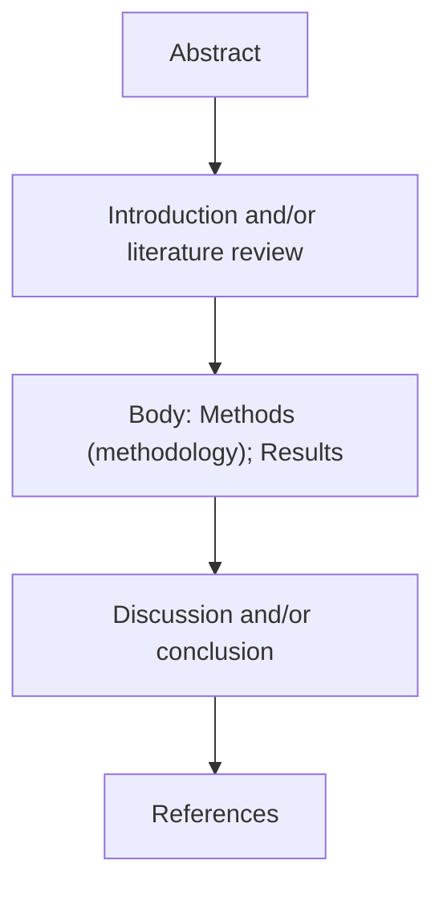
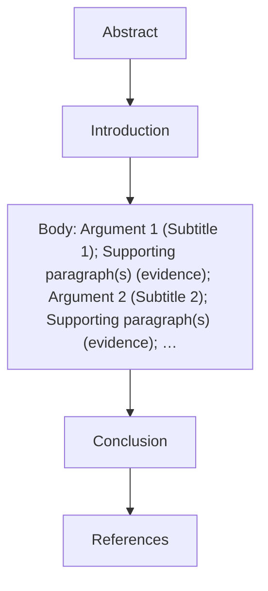

# Unit 1 Section C：学术写作

Academic Writing: Writing Skills, Research Paper Project, Writing Tasks

PART 4 · 原文对照

教材 Section C（pp.39–46）· 中英对照

!!! info "阅读说明"

    每段先列英文原文，其下缩进、带深蓝竖条的小字号段落为中文翻译。引用格式示例中的文献条目保留英文原样。

    打印版 PDF：[下载《学术英语阅读与写作 · Unit 1 期中复习讲义》PDF](../../../../../assets/files/学术英语阅读与写作_Unit1_期中复习讲义.pdf)

## 1. Writing Skills: Avoiding Plagiarism　写作技能：避免抄袭

Plagiarism is the act of using someone else's work, words, or ideas and presenting them as one's own without giving appropriate credit to the original source. It can occur in various forms, such as copying text, failing to cite sources, or even rephrasing someone else's work without attribution. In academic and professional settings, plagiarism undermines integrity and can lead to serious consequences, such as loss of credibility, academic penalties, or legal issues. To avoid plagiarism, it's crucial to master citation skills to cite sources properly.

抄袭是指使用他人的成果、文字或观点，并将其作为自己的内容呈现，而不给予原始来源适当署名。抄袭有多种形式，例如复制文本、不标注来源，甚至改写他人成果而不注明出处。在学术和职业环境中，抄袭损害诚信，可能导致严重后果，如失去信誉、学术处罚或法律问题。要避免抄袭，掌握引用技能、正确标注来源至关重要。
{: .zh }

### 1.1 Citation　引用

#### What is citation?　什么是引用？

Citation is a way of using some else's ideas and formally acknowledging the sources in your own writing.

引用是在自己的写作中使用他人观点并正式注明来源的一种方式。
{: .zh }

#### Why do you have to cite?　为什么必须引用？

- to support your arguments
- to acknowledge the ideas of the original authors and give them credit
- to avoid plagiarism
- to help readers to locate the original sources for further research

- 支持你的论点；
- 承认原创作者的观点并给予其应有的认可；
- 避免抄袭；
- 帮助读者找到原始文献，以便进一步研究。
{: .zh }

#### What is citation used for?　引用有什么用途？

- giving definitions
- introducing theories and models
- describing previous studies
- giving examples
- synthesizing sources
- establishing links between sources
- borrowing research methods
- comparing one's own findings or interpretations with those from other sources

- 给出定义；
- 介绍理论和模型；
- 描述以往研究；
- 举例；
- 综合多个来源；
- 建立来源之间的联系；
- 借用研究方法；
- 将自己的发现或解释与其他来源进行比较。
{: .zh }

#### Where does citation appear in a research paper?　引用出现在论文的哪些位置？

- introduction and/or literature review section(s)
- the methods and discussion sections of a research paper based on the collection of empirical data or the body part of a research paper based on critical analysis and reasoning

- 引言和/或文献综述部分；
- 基于实证数据收集的研究论文的方法与讨论部分，或基于批判性分析与推理的研究论文的正文部分。
{: .zh }

#### Citation Methods　引用方法

- <strong>direct quotation</strong>: taking the exact words from the original source and enclosing them within quotation marks
- <strong>paraphrasing</strong>: expressing others' ideas in your own words
- <strong>summarizing</strong>: using your own words to express the main idea of a long text

- <strong>直接引用</strong>：照录原始来源的确切文字，并用引号括起来；
- <strong>释义</strong>：用自己的话表达他人的观点；
- <strong>概括</strong>：用自己的话表达长文本的主要意思。
{: .zh }

### 1.2 Citation Styles　引用格式

As a way of formally acknowledging cited sources, citation is generally composed of two elements: in-text citation and end-of-text references. There are different citation styles like APA style, MLA style, Chicago style, Harvard style, Vancouver style, and CSE style. In a way, citation can be divided into parenthetical references and numbered references.

作为正式注明引用来源的方式，引用通常由两个要素组成：文内引用和文末参考文献。存在不同的引用格式，如 APA、MLA、Chicago、Harvard、Vancouver 和 CSE 格式。从某种意义上说，引用可分为括号引用和编号引用。
{: .zh }

As for parenthetical references, the last name(s) of the author(s) and the year of publication are included in the in-text citation, and the bibliographic entries are listed according to the alphabetical order of the initial letter of the last name of the (first) author and the year of publication. The in-text citation generally has two formats: parenthetical and narrative. As for parenthetical citation, the last name(s) of the author(s) and the publication year appear in parentheses while in narrative citation, the last name(s) of the author(s) is/are incorporated into the text as part of the sentence and the year follows in parentheses.

对于括号引用，文内引用中包含作者的姓氏和出版年份，文献条目按（第一）作者姓氏首字母的字母顺序及出版年份排列。文内引用通常有两种形式：括号式和叙述式。括号式引用中，作者姓氏和出版年份出现在括号内；叙述式引用中，作者姓氏作为句子的一部分融入正文，年份紧随其后放在括号中。
{: .zh }

As for numbered references, a number is put at the end of each cited information sequentially, then the complete information of the source is listed at the bottom of the page (footnote) or at the end of the paper (endnote or reference) according to the sequence it appears in the text. You can also arrange the bibliographic entries according to the alphabetical order of the initial letter of the last name of the (first) author and the year of publication, and at the same time, put a number in front of each bibliographic entry sequentially, while as for in-text citation, just put the bibliographic entry number at the end of each cited information. If the cited information comes from different sources, you need to put several numbers after the cited information.

对于编号引用，按顺序在每条被引信息末尾标注一个编号，然后按其在正文中出现的顺序，在页面底部（脚注）或论文末尾（尾注或参考文献）列出该来源的完整信息。也可以按（第一）作者姓氏首字母的字母顺序及出版年份排列文献条目，同时在每条文献条目前依次编号；文内引用时，只需在每条被引信息末尾标注该文献条目的编号。如果被引信息来自不同来源，则需在被引信息后标注多个编号。
{: .zh }

#### Examples　示例

<strong>1. Parenthetical References　括号引用</strong>

*In-text citation:* The laws of motion were first given by Newton a long time ago (Newton, 1687), while the extension to high speeds was first proposed by Einstein (1905).

*References:*

Einstein, A (1905). Ann. Phys. (Germany), 17, 891-921.

Newton, I (1687). Philosophiae Naturalis Principia Mathematica, 1st ed. (Streater, London); see also the modern English translation, A Motte (later revised by A Cajori), Sir Isaac Newton's Mathematical Principles of Natural Philosophy (Univ of California Press, Berkeley and Los Angeles, 1934; paperback 1962).

<strong>2. Numbered References　编号引用</strong>

(1) *In-text citation:* The laws of motion were first given by Newton [1], while the extension to high speeds was first proposed by Einstein [2].

*References:*

[1] Newton, I (1687). Philosophiae Naturalis Principia Mathematica, 1st ed. (Streater, London); see also the modern English translation, A Motte (later revised by A Cajori), Sir Isaac Newton's Mathematical Principles of Natural Philosophy (Univ of California Press, Berkeley and Los Angeles, 1934; paperback 1962).

[2] Einstein, A (1905). Ann. Phys. (Germany), 17, 891–921.

(2) *In-text citation:* Renowned AI ethicist Mark Coeckelbergh proposes “AI for Climate” suggesting that we use AI “for dealing with environmental and climate problems” [8, 5].

*References:*

… [5] Basiago, A.D.: Economic, social, and environmental sustainability in development theory and urban planning practice: the environmentalist. Klauwer Academic Publishers, Boston (1999). [6] Bostrom N., Yudkowsky E. The Ethics of Artificial Intelligence. The Cambridge Handbook of Artificial Intelligence, 316–334 (2014). [7] Buolamwini, Joy, and Timnit Gebru. 2018. “Gender Shades: Inter-sectional Accuracy Disparities in Commercial Gender Classification.” In Conference on Fairness, Accountability and Transparency, 77–91. PMLR. <http://proceedings.mlr.press/v81/buolamwini18a.html>. [8] Coeckelbergh, M.: AI for climate: freedom, justice, and other ethical and political challenges. AI Ethics (2020). <https://doi.org/10.1007/s43681-020-00007-2>. …

#### Comments　说明

1. If there are several co-authors in a source, list the last names of all the authors in in-text citation;
2. If there are more than three co-authors in a single source, name only the first and cite the others as “et al.”, Latin for “and others” in in-text citation;
3. If several sources from the same author and the same year are cited, they are distinguished by a, b, c…;
4. If the cited information comes from different sources, list all the sources;
5. If you are citing a source that you find in another source, use “(as) cited in” in in-text citation to indicate this.

> <strong>中文对照：</strong> ① 如果来源有多位合著者，在文内引用中列出所有作者的姓氏；② 如果单一来源的作者超过三位，文内引用只写第一作者，其余用 “et al.”（拉丁语，意为“等人”）；③ 如果引用同一作者同一年份的多个来源，用 a、b、c…… 区分；④ 如果被引信息来自不同来源，列出所有来源；⑤ 如果引用的是在另一来源中发现的文献，在文内引用中使用 “(as) cited in” 表示这一点。

#### Examples　示例

1. Nucleosynthesis was studied more than 50 years ago (Alpher, Bethe and Gamow, 1948).
2. The hypothesis was further studied by a large collaboration (Alpher et al., 1950).
3. Einstein published three important papers in one year: on relativity (Einstein, 1905a), brownian motion (Einstein, 1905b) and the photoelectric effect (Einstein, 1905c).
4. Applied linguists are celebrating the methodological strides made in recent decades (Gass et al., 2021; Plonsky, 2014) while calling for further commitments to elevate methodological rigor and critically interrogate issues of research ethics (De Costa et al., 2021; Kubonyiova, 2008).
5. According to a report by Anderson (as cited in Thompson, 2023), the accelerated melting of ice in the Arctic region is contributing significantly to rising sea levels.

!!! note "平台说明"

    Academic Reading 3 and the exercises of this part can be accessed by logging onto the platform: <https://ketang.51learning.com.cn/>

## 2. Research Paper Project　研究论文项目

### 2.1 Understanding English Language Teaching　理解英语教学

The field of English Language Teaching (ELT) is vast and encompasses a variety of subdisciplines and areas of specialization. Here are some of the key fields within ELT:

英语教学（ELT）领域广阔，涵盖多种子学科和专业方向。以下是 ELT 中的一些关键领域：
{: .zh }

English for General Purposes (EGP) refers to teaching English for everyday use, focusing on general language skills like listening, speaking, reading, writing, translation, as well as mastering some basic universal vocabulary that are applicable in a wide range of contexts.

通用英语（EGP）指为日常使用而教授英语，侧重听、说、读、写、译等一般语言技能，以及掌握一些适用于广泛语境的基本通用词汇。
{: .zh }

English for Specific Purposes (ESP) involves teaching English tailored to specific fields or professions, such as business, medicine, or engineering. It addresses the specialized language and terminology used in these areas.

专门用途英语（ESP）指针对特定领域或职业（如商务、医学或工程）量身定制英语教学，处理这些领域使用的专门语言和术语。
{: .zh }

English for Academic Purposes (EAP) is designed for students who need English skills for academic study. It focuses on academic writing, reading, listening, and speaking skills required for success in higher education.

学术用途英语（EAP）为需要英语技能进行学术学习的学生设计，侧重在高等教育中取得成功所需的学术写作、阅读、听力和口语技能。
{: .zh }

### 2.2 Understanding Research and Research Paper　理解研究与研究论文

Research is a rigorous, systematic, and methodical process of inquiry aimed at discovering, interpreting, and understanding phenomena, problems, or issues. It involves identifying a question, gathering and analyzing data and information, and drawing conclusions based on evidence. It allows us to test the validity of existing theories, explore the unknown, and ask and answer questions about the world around us. It is a critical tool for advancing knowledge, making informed policy decisions, and solving complex problems. The nature of research can be theoretic and academic, or it can be practical and applied. It can be conducted in various fields, including but not limited to science, social science, arts and humanities, and engineering.

研究是一种严谨、系统、有方法的研究过程，旨在发现、解释和理解现象、问题或议题。它包括确定问题、收集和分析数据与信息，并基于证据得出结论。研究使我们能够检验现有理论的有效性、探索未知，并就周围世界提出问题并作出回答。它是推进知识、作出知情政策决策和解决复杂问题的关键工具。研究的性质可以是理论的、学术的，也可以是实践的、应用的；可以在多个领域进行，包括但不限于科学、社会科学、艺术与人文学科以及工程学。
{: .zh }

Research paper is a detailed academic document that presents the results of a thorough investigation into a specific topic or question. It is a fundamental component of academic and scholarly work. It follows a structured format and aims to contribute new insights, data, or perspectives to a particular field.

研究论文是一份详细的学术文件，呈现对特定主题或问题进行深入调查的结果。它是学术工作的基本组成部分，遵循结构化格式，旨在为特定领域贡献新见解、数据或视角。
{: .zh }

When it comes to genre, a research paper—such as a graduation thesis or dissertation—is a form of argumentative writing. In writing an argumentative essay, the author typically follows a logical progression of identifying a problem, analyzing it, and proposing solutions. This thought process is mirrored in the essay's structure, which is divided into three main sections: introduction, body, and conclusion. This structure is equally applicable to research paper composition. Hence, a standard research paper typically encompasses five key components: abstract, introduction, body, conclusion, and references.

就体裁而言，研究论文——如毕业论文或学位论文——是议论文写作的一种形式。撰写议论文时，作者通常遵循识别问题、分析问题、提出解决方案的逻辑进程。这一思维过程反映在文章结构中，即分为引言、正文和结论三个主要部分。这一结构同样适用于研究论文写作。因此，标准研究论文通常包含五个关键组成部分：摘要、引言、正文、结论和参考文献。
{: .zh }

### 2.3 Two Types of Research Paper　研究论文的两种类型

In a sense, research paper can be divided into two types: research paper based on the collection of empirical data and research paper based on critical analysis and reasoning.

从某种意义上说，研究论文可分为两类：基于实证数据收集的研究论文，以及基于批判性分析与推理的研究论文。
{: .zh }

A research paper based on the collection of empirical data is a research document that presents and analyzes information (data) obtained through empirical research like observation, questionnaire, interview and experimentation. It focuses on using actual data gathered from real world sources to address research questions, test hypotheses, or explore phenomena.

基于实证数据收集的研究论文，是呈现和分析通过观察、问卷、访谈和实验等实证研究获得的信息（数据）的研究文件。它侧重使用从现实世界来源收集的实际数据来回答研究问题、检验假设或探索现象。
{: .zh }

A research paper based on critical analysis and reasoning refers to a scholarly document that evaluates, interprets, and critiques a particular topic or issue using logical arguments and evidence so as to propose solutions more systematically and pertinently.

基于批判性分析与推理的研究论文，指使用逻辑论证和证据来评价、解释和批判特定主题或议题的学术文件，以便更系统、更有针对性地提出解决方案。
{: .zh }

With regard to structure, while the body part of a research paper based on the collection of empirical data usually consists of relatively fixed sections like methods (methodology) and results, the body part of a research paper based on critical analysis and reasoning is often represented by flexible subtitles summarizing the different arguments of the part.

就结构而言，基于实证数据收集的研究论文正文通常由方法（方法论）和结果等相对固定的部分组成；而基于批判性分析与推理的研究论文正文，常用灵活的副标题概括该部分的不同论点。
{: .zh }

| 类型 | 证据来源 | 正文结构 | 典型小标题 |
|---|---|---|---|
| Based on empirical data | observation、questionnaire、interview、experiment 等真实数据 | 相对固定 | Introduction/Literature Review; Methods; Results; Discussion/Conclusion |
| Based on critical analysis and reasoning | 逻辑论证与证据 | 灵活 | Introduction; Argument 1 + evidence; Argument 2 + evidence; Conclusion |

### 2.4 Sample Research Paper Structures　研究论文结构示例

基于实证数据收集的研究论文结构

基于批判性分析与推理的研究论文结构

!!! note "平台说明"

    Academic Reading 4 and the exercises of this part can be accessed by logging onto the platform: <https://ketang.51learning.com.cn/>

## 3. Writing Tasks　写作任务

Write a 250-word argumentative essay on “The Advantages and Disadvantages of Artificial Intelligence”. Ensure your essay includes a structured introduction, a body that presents your main arguments, and a conclusion that summarizes your key points.

就“人工智能的利与弊”写一篇 250 词的议论文。确保文章包含结构清晰的引言、呈现主要论点的正文，以及总结关键观点的结论。
{: .zh }

### 3.1 Tips　提示

<strong>1. The advantages of Artificial Intelligence (AI)　人工智能的优点</strong>

- <strong>Increased Efficiency:</strong> AI can automate repetitive tasks, improving efficiency and productivity in various industries.
- <strong>Data Analysis and Insights:</strong> AI algorithms can analyze large data quickly, providing valuable insights for decision-making.
- <strong>24/7 Availability:</strong> AI-powered systems can operate continuously, offering round-the-clock services and support.
- <strong>Improved Accuracy:</strong> AI can perform tasks with high precision, reducing errors and improving overall accuracy.
- <strong>Personalization:</strong> AI enables personalized experiences and recommendations based on individual preferences and behavior.
- <strong>Safety and Risk Reduction:</strong> AI can be used for tasks that are hazardous to humans, reducing risks and ensuring safety.

- <strong>提高效率：</strong>AI 可以自动化重复性任务，提高各行业效率与生产力。
- <strong>数据分析与洞察：</strong>AI 算法可以快速分析大量数据，为决策提供有价值的洞察。
- <strong>全天候可用：</strong>AI 系统可以持续运行，提供 24 小时服务与支持。
- <strong>提高准确性：</strong>AI 可以高精度执行任务，减少错误，提高整体准确性。
- <strong>个性化：</strong>AI 可以根据个人偏好和行为提供个性化体验与推荐。
- <strong>安全与降低风险：</strong>AI 可用于对人类有危险的任务，降低风险并保障安全。
{: .zh }

<strong>2. The disadvantages of Artificial Intelligence (AI)　人工智能的缺点</strong>

- <strong>Job Displacement:</strong> AI automation may lead to job losses in certain industries, affecting the job market and workforce.
- <strong>Ethical Concerns:</strong> AI raises ethical issues, including data privacy, algorithm bias, and potential misuse of AI technologies.
- <strong>Lack of Creativity and Empathy:</strong> AI lacks human qualities like creativity and empathy, limiting its ability to understand emotions or produce original ideas.
- <strong>Cost and Complexity:</strong> Developing and implementing AI systems can be expensive, require specialized knowledge and resources.
- <strong>Reliability and Trust:</strong> AI systems may not always be fully reliable, leading to distrust in their decision-making capabilities.
- <strong>Dependency on Technology:</strong> Over-reliance on AI can make humans dependent on technology and reduce critical thinking skills.

- <strong>岗位替代：</strong>AI 自动化可能导致某些行业失业，影响就业市场与劳动力。
- <strong>伦理问题：</strong>AI 带来数据隐私、算法偏见和 AI 技术潜在滥用等伦理问题。
- <strong>缺乏创造力与同理心：</strong>AI 缺乏创造力和同理心等人类特质，限制其理解情感或产生原创想法的能力。
- <strong>成本与复杂性：</strong>开发和实施 AI 系统可能成本高昂，需要专业知识和资源。
- <strong>可靠性与信任：</strong>AI 系统未必始终完全可靠，可能导致人们不信任其决策能力。
- <strong>技术依赖：</strong>过度依赖 AI 会使人依赖技术，削弱批判性思维能力。
{: .zh }

## 4. Follow-up Work　后续工作

Your work can be improved by self-editing. It may also be useful to have a partner evaluate your work. So do the following work after finishing writing your draft.

自我编辑可以改进你的作品。让同伴评价你的作品也可能有用。因此，在完成初稿后请做以下工作。
{: .zh }

1. Read through your work carefully and answer the questions on the checklist below. Write yes or no on the checklist.
2. Compare notes with your partner and check each other's work. Write yes or no on your partner's checklist.

> <strong>中文对照：</strong> ① 仔细通读你的作品，回答下面检查表中的问题，在检查表上写“是”或“否”；② 与同伴交换意见，互相检查作品，在同伴的检查表上写“是”或“否”。

### 4.1 Checklist　检查表

| Questions | 中文对照 | My Answer | Partner's Answer |
|---|---|---|---|
| 1. Is the essay started with a concise introduction? | 文章是否以简洁的引言开头？ | | |
| 2. Is the topic clearly presented in the introduction? | 引言是否清晰呈现了主题？ | | |
| 3. Is any background information written to introduce the topic? | 是否写了介绍主题的背景信息？ | | |
| 4. Are the pros and cons presented clearly? | 正反两方面是否呈现清楚？ | | |
| 5. Is evidence provided to support the arguments? | 是否提供了支持论点的证据？ | | |
| 6. Is logic and reasoning used to build a rock-solid argument? | 是否运用逻辑与推理构建了坚实的论证？ | | |
| 7. Is a powerful and rational conclusion made? | 是否作出了有力而理性的结论？ | | |
| 8. Are the words precisely chosen and the sentences well organized? | 用词是否准确、句子组织是否良好？ | | |
| 9. Are the sentences logically and reasonably connected? | 句子之间是否逻辑合理、衔接自然？ | | |
| 10. Are the paragraphs logically and reasonably separated? | 段落划分是否逻辑合理？ | | |
| 11. Are there any mistakes in spelling and grammar? | 是否有拼写和语法错误？ | | |

!!! tip "作文骨架"

    <strong>Introduction：</strong>背景（AI 已进入多个领域）+ thesis（AI 提高效率与决策能力，但也带来就业、伦理、成本与依赖问题）。

    <strong>Body 1（优点）：</strong>increased efficiency；data analysis and insights；24/7 availability；improved accuracy；personalization；safety and risk reduction。

    <strong>Body 2（缺点）：</strong>job displacement；ethical concerns（privacy / bias / misuse）；lack of creativity and empathy；cost and complexity；reliability and trust；dependency on technology。

    <strong>Conclusion：</strong>总结 pros/cons，提出平衡观点：AI 应在责任、透明和人类监督下使用。
