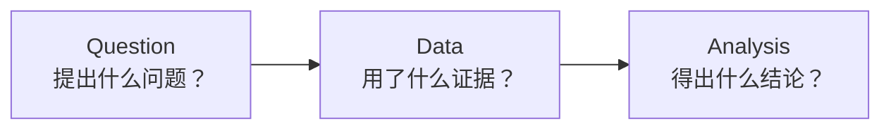
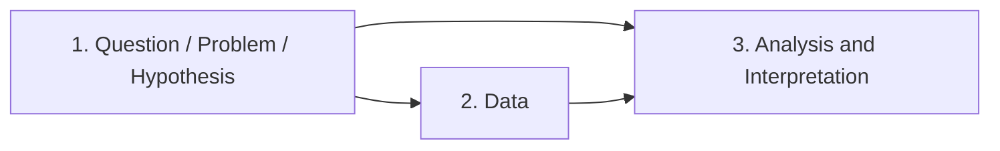
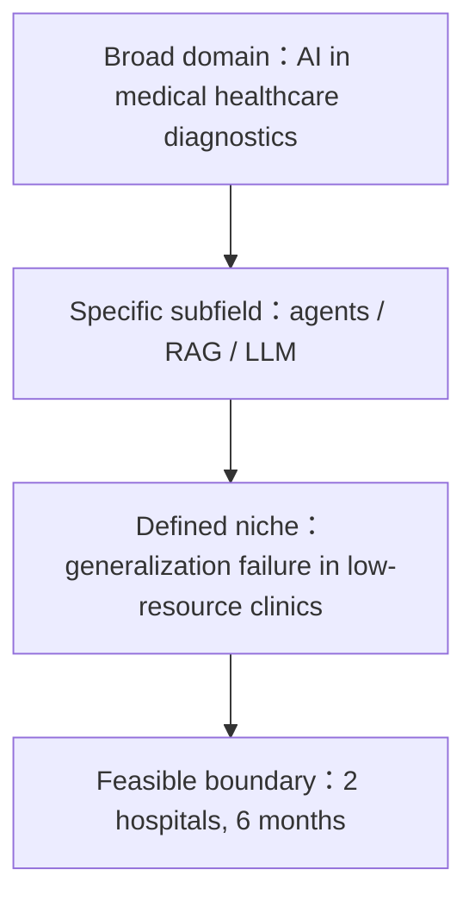
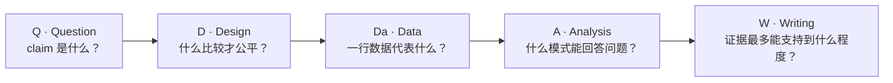

# 学术英语阅读与写作　Unit 1 期中复习讲义

Academic English Writing · Unit 1 — Midterm Review

REVIEW · 教材 Unit 1 + 研究方法补充

学术英语阅读与写作 · 大二上学期 · 2026-11 · 中英对照

!!! info "资料与使用说明"

    - <strong>核心依据：</strong>《学术英语阅读与写作》Unit 1，教材印刷页 1–46。
    - <strong>补充材料：</strong>Lecture 0 中的研究概念与研究方法框架。
    - <strong>使用方式：</strong>先看每节「核心考点」，再完成末尾自测；英文术语和句型需能<strong>认读、释义、辨析、迁移</strong>。

    整理自课程材料；中文解释用于复习，英文表述用于考试识别与作答。

    打印版 PDF：[下载《学术英语阅读与写作 · Unit 1 期中复习讲义》PDF](../../../../assets/files/学术英语阅读与写作_Unit1_期中复习讲义.pdf)

!!! warning "考试时间提示"

    预计 2026 年 11 月 16 日所在周。中文解释用于复习，英文表述用于考试识别与作答。

## 第一部分　教材核心复习：课文、词汇、句型、语法与作文

### 1　教材核心：Unit 1 Artificial Intelligence

#### 1.1　单元地图与学习目标

这部分以教材为主线。Unit 1 的主题不是单独讨论“AI 好不好”，而是训练学生用学术英语阅读、分析和写作来讨论人工智能的治理、可持续性、研究伦理与学术发表。

| 教材板块 | 核心材料 | 期中需要掌握的能力 |
|---|---|---|
| Cultural Awareness | Artificial Intelligence Governance | 听/读懂 AI 治理的关键议题，能说明 human-oriented principle 与 responsible use。 |
| Section A: Academic Reading 1 | <em>Sustainable AI: AI for Sustainability and the Sustainability of AI</em> | 概括综述类文章的中心论点、概念分支、论据与政策建议。 |
| Section B: Academic Reading 2 | <em>Can Linguists Distinguish Between ChatGPT/AI and Human Writing?</em> | 识别实证论文的 RQs、participants、instruments、analysis、findings 与 ethical implications。 |
| Section C: Academic Writing | Avoiding Plagiarism; Citation; Research Paper Project; Writing Task | 正确引用、区分 empirical / critical-analysis paper，并完成 250 词议论文结构。 |

!!! abstract "核心考点"

    教材主线：AI 的应用价值必须与环境、社会、公平、隐私和学术诚信一起讨论。阅读时始终追踪四件事：<strong>作者提出了什么问题？用了什么证据？得出了什么结论？结论有什么限制或伦理后果？</strong>

#### 1.2　Cultural Awareness：Artificial Intelligence Governance

- AI 正快速渗透个人生活、经济和文化发展，因此 AI governance 已成为国际共同关切。
- 治理的目标不是阻止技术，而是通过政策和法律引导 AI <strong>responsible and beneficial use</strong>，让 AI 的收益服务于人类。
- 课本强调 <strong>human-oriented principle</strong>：AI 不能只追求技术效率而忽视人的需要、尊严、安全、公平和权利。
- 全球治理的难点包括 moral and ethical issues、legal challenges、privacy、bias、cyber crime 以及不同国家之间的协调。

| 课本表达 | 复习理解 |
|---|---|
| governance of AI | 通过政策、法律、制度和责任机制引导 AI 的开发与使用。 |
| human-oriented principle | 以人的需要、权利和福祉为中心，而不是技术至上。 |
| responsible and beneficial use | 负责任且有益的使用；要考虑风险、后果和公共利益。 |
| moral and ethical issues | 道德与伦理问题，例如公平、隐私、偏见和责任归属。 |
| legal challenges | 法律层面的挑战，例如责任认定、数据保护和跨境监管。 |

!!! example "考试表达"

    <em>AI governance should be human-oriented. Governments and institutions need to design policies and laws that promote responsible and beneficial use of AI while protecting privacy, fairness, safety and human dignity.</em>

### 2　Academic Reading 1：Sustainable AI

#### 2.1　文章信息与中心论点

| 项目 | 内容 |
|---|---|
| 作者与来源 | Aimee van Wynsberghe；<em>AI and Ethics</em>，2021，1，213–218。 |
| 文章类型 | 综述/概念论证类文章：提出定义、区分概念、回顾相关研究并提出治理方向。 |
| 关键词 | Sustainable AI; AI ethics; sustainability; responsible AI; sustainable development。 |
| 中心论点 | Sustainable AI 不只关心“用 AI 解决可持续发展问题”，还必须关注 AI 从设计、训练到治理整个生命周期的环境与社会代价。 |

!!! abstract "核心考点：可背中心句"

    <em>Sustainable AI is a movement to foster change in the entire lifecycle of AI products towards greater ecological integrity and social justice.</em>

    中文：可持续人工智能是一项推动 AI 产品整个生命周期发生改变的运动，目标是实现更大的生态完整性和社会正义。

#### 2.2　文章结构：六个部分

1. <strong>Introduction</strong>：AI 带来积极变化，也带来环境与社会风险；AI ethics 进入第三次浪潮。
2. <strong>What is Sustainable AI?</strong>：给出定义，强调 AI 的整个生命周期，并区分两个分支。
3. <strong>What is the Sustainable in “Sustainable AI”?</strong>：解释 sustainable development 的三大支柱与代际公平。
4. <strong>Environmental Sustainability of AI</strong>：说明训练、调参和计算基础设施的碳排放与能源代价。
5. <strong>Towards Sustainable AI</strong>：提出政府、机构、研究者和企业可以采取的措施。
6. <strong>Conclusion</strong>：重申定义、两个分支与三组张力，呼吁透明测量和治理。

#### 2.3　最重要的概念辨析：两个分支

| 分支 | 主要问题 | 课本例子 |
|---|---|---|
| AI for Sustainability | 如何用 AI/ML 促进可持续发展目标？ | 用 AI 改善清洁能源、气候治理、医疗或可持续银行。 |
| Sustainability of AI | AI 的设计、训练、调参和使用本身是否可持续？ | 测量计算量、能源消耗、碳足迹、数据来源和基础设施。 |

!!! warning "易错提醒"

    二者不是二选一。课本的关键判断是：<strong>AI for sustainability cannot be achieved without simultaneously addressing the sustainability of AI.</strong> 不能一边用 AI 解决气候问题，一边忽略训练该模型造成的环境代价。

#### 2.4　Sustainable development：三大支柱与三组张力

- 定义：development that meets the needs of the present without compromising the ability of future generations to meet their own needs。
- 三大支柱：<strong>economic sustainability</strong>、<strong>social sustainability</strong>、<strong>environmental sustainability</strong>。
- 三组张力：AI innovation 与 equitable resource distribution；inter- and intra-generational justice；environment、society 与 economy 之间的平衡。
- 价值判断：社会使用 AI 是一种选择，并非 technology determinism；需要保护 privacy、dignity、fairness 和 justice。

#### 2.5　论据与政策建议

| 课本论据/工具 | 记忆点 |
|---|---|
| 约 600,000 lb CO2 | 训练一个大型 NLP 深度学习模型可能产生的碳排放量，约相当于五辆汽车生命周期的排放。 |
| AlphaGo Zero | 40 天训练产生 96 tonnes CO2，约等于 1,000 小时航空旅行或 23 个美国家庭的碳足迹。 |
| Training vs. tuning | 调参/重新利用模型可能比首次训练更昂贵，因此应用价值必须与环境代价比较。 |
| Machine Learning Emissions Calculator | 根据硬件、时长、云服务商和地区估算 GPU 计算的碳足迹。 |
| experiment-impact-tracker | 跟踪实时能源消耗与碳排放，并生成标准化附录。 |
| carbontracker | 追踪并预测深度学习训练的能源/碳排放，超过责任阈值时可停止训练。 |

1. 把 AI 视为在社会中进行的 <strong>social experiment</strong>，设置伦理 safeguards。
2. 政府建立 sustainable AI task forces，要求公司和公共机构报告训练、调参的碳排放。
3. 建立 <strong>proportionality framework</strong>，比较某项 AI 任务的社会收益与训练/调参的碳足迹。

#### 2.6　Academic Terms：Reading 1

| 词汇 | 中文 | 课文语境 |
|---|---|---|
| sustainability | 可持续性 | the sustainability of developing and using AI |
| carbon footprint | 碳足迹 | measure the carbon footprint of training |
| carbon-neutral | 碳中和的 | energy is not always derived from carbon-neutral sources |
| intergenerational / intragenerational | 代际间的 / 同代内的 | intergenerational and intragenerational equity |
| re-tune | 重新调参/微调 | re-tune an AI model for a particular task |
| hyperparameter | 超参数 | sensitivity to hyperparameters |
| umbrella term | 总括性术语 | Sustainable AI as an umbrella term |
| resilience | 韧性、恢复力 | environmental resilience |
| ethicist | 伦理学家 | AI ethicist |
| literal translation | 字面翻译 | the literal translation of sustainability |

#### 2.7　Reading 1 课后题型与答案抓手

!!! abstract "核心考点：Overview 填空的逻辑"

    先记住 “AI is as pervasive as the Internet or smartphones”；左栏是 AI for Sustainability（SDGs、AI for Climate），右栏是 sustainability of AI（environmental costs、AlphaGo、CO2、tuning）；结尾落到 emissions calculators、carbontracker 与 policy makers 的 proportionality framework。

!!! question "自测：Points for Discussion 参考方向"

    1. Carbon footprint 是某项活动直接或间接产生的温室气体排放总量，通常以 CO2 equivalent 表示。
    2. 碳排放会增强温室效应，加剧全球变暖和气候变化；AI 训练和数据中心的能源来源会影响其环境代价。
    3. 选择更高效的模型与硬件、使用可再生能源、记录并报告训练排放、设置停止阈值，并比较任务收益与碳成本。

### 3　Academic Reading 2：AI 与人类写作的辨别

#### 3.1　文章信息、研究目标与三条 RQ

| 项目 | 内容 |
|---|---|
| 作者与来源 | J. Elliott Casal、Matt Kessler；<em>Research Methods in Applied Linguistics</em>，2023。 |
| 研究对象 | 顶尖应用语言学期刊的 reviewers 与 journal editors。 |
| 研究材料 | 4 篇人类摘要 + 4 篇 AI 摘要；问卷、7 点 Likert 判断、半结构式访谈。 |
| 研究结论 | 评审者区分 AI/人类摘要的能力有限；编辑普遍认为 AI 在特定条件下可用于研究流程，但对偏见和数据伪造有担忧。 |

1. <strong>RQ1：</strong> <em>To what extent can reviewers tell the difference between written abstracts produced by ChatGPT/AI versus humans?</em>
2. <strong>RQ2：</strong> <em>What is the basis of reviewers’ decisions for determining whether writing is produced by ChatGPT/AI or by humans?</em>
3. <strong>RQ3：</strong> <em>What are journal editors’ views regarding the acceptable use of ChatGPT and similar AI/LLM tools for academic publishing purposes?</em>

!!! abstract "核心考点：摘要为什么被选为 genre？"

    摘要篇幅受限、修辞结构相对可预测，容易受到 AI 生成影响；同时它影响编辑是否送审、评审是否接受审稿以及读者是否继续阅读，因此具有现实重要性。

#### 3.2　实证论文结构：从方法到结果

| 结构 / 环节 | 内容 |
|---|---|
| Introduction / Literature Review | 回顾 LLM/ChatGPT 的能力与风险，说明应用语言学中研究伦理讨论不足，提出当前研究空白。 |
| Participants | RQ1–2：72 名完成调查的 reviewers（87 人开始）；RQ2 访谈 7 名 reviewers。RQ3：27 名完成调查的 editors（35 人开始）；5 名参加访谈。 |
| Instruments | reviewers 完成 11-question survey，判断 4 篇摘要并报告信心；使用 7-point Likert scale。AI 摘要由 ChatGPT 根据对应人类论文的分体裁摘要生成。 |
| Interviews | reviewers 解释判断依据；editors 解释哪些 AI 使用合乎伦理及其理由。访谈通过同步视频进行并录音。 |
| Analysis | RQ1 用 descriptive statistics；RQ2–3 对访谈进行 two-cycle coding，第一作者对 54.5% 数据复编码，inter-coder reliability 为 86.1%。 |

#### 3.3　核心结果：数字必须会认

| 结果 | 含义 |
|---|---|
| overall positive identification rate = 38.9% | 经验丰富的 reviewers 总体上并不擅长判断 AI/人类作者。 |
| human texts correctly identified = 44.1% | 识别人类摘要的准确率高于识别 AI 摘要。 |
| AI texts correctly identified = 33.7% | AI 摘要更容易被误判。 |
| none identified all four abstracts | 72 名参与者没有人全部判断正确。 |
| 18.1% identified 3/4；34.7% identified 2/4；34.7% identified 1/4；12.5% identified 0/4 | 说明单靠直觉或语言感觉很不可靠。 |

#### 3.4　Reviewers 的判断依据

| criterion | mentions | 研究发现 |
|---|---|---|
| continuity and coherence | 10 | 最常见，但正确率只有 22.2%；流畅不等于人类，衔接不自然也不等于 AI。 |
| specificity / vagueness of details | 8 | 具体细节常被判断为人类，模糊被判断为 AI；正确率 28.6%。 |
| familiarity and voice | 5 | “像不像人”或语气熟悉感；正确率 20%，不可靠。 |
| writing quality at sentence-level | 5 | 句子构造是否自然；此标准相对较高但仍不稳定，正确率 60%。 |
| 其他 | — | methods (il)logical、templatic、abbreviations/contractions、unexpected rhetorical move 等。 |

!!! warning "易错提醒"

    作者不是在教读者寻找“AI 句子特征”，而是在证明这些凭感觉的特征并不足以可靠判断作者身份。学术上不能因为文本“听起来像 AI”就指控 plagiarism。

#### 3.5　编辑对 AI 学术使用的看法

| 调查结果 | 复习结论 |
|---|---|
| 70.4%：under specific circumstances | 多数编辑接受特定条件下的使用。 |
| 25.9%：under no circumstance | 仍有相当比例编辑完全不接受。 |
| 3.7%：under all circumstances | 无条件接受者极少。 |
| 较常被接受 | editing text（59.3%）、writing computer code（51.9%）、public summary（40.7%）、abstract writing（37%）。 |
| 主要担忧 | perpetuating biases、data fabrication、用 AI 替代人工判断或不透明地生成新知识。 |

!!! example "考试表达"

    <strong>文章的伦理立场：</strong>AI 是否合乎伦理取决于用途、透明度和责任。编辑较能接受对已完成研究进行 editing 或 summarizing；但作者必须核查事实、披露 AI 使用，并不能让 AI 伪造数据或替代研究者的判断。

#### 3.6　Academic Terms：Reading 2

| 词汇 | 中文 | 词义辨析 |
|---|---|---|
| pertaining to | 关于、涉及 | issues pertaining to research ethics |
| synchronous | 同步的 | synchronous video communication |
| rationale | 理由、依据 | the rationale behind a decision |
| fabrication | 伪造 | data fabrication |
| holistic | 整体的 | a holistic approach |
| resonate with | 与……产生共鸣/相呼应 | findings resonate with previous work |
| idiosyncratic | 特殊的、个别的 | idiosyncratic rationale |
| differentiate | 区分 | differentiate AI from human writing |
| perpetuate | 使持续、使长期存在 | perpetuate human biases |
| ethics | 伦理 | research ethics |
| manuscript | 学术论文手稿 | submit a manuscript |
| pronounced | 明显的 | a pronounced difference |
| aggregate | 汇总、聚合 | responses were aggregated |
| vagueness | 模糊性 | specificity or vagueness |
| leverage | 利用 | leverage AI tools |

#### 3.7　Reading 2 课后题型与答案

!!! abstract "核心考点：Structural Understanding 判断题答案"

    (1) T；(2) F；(3) T；(4) T；(5) T；(6) T；(7) F；(8) F；(9) T；(10) F；(11) T；(12) F；(13) T；(14) T；(15) T。重点纠错：reviewers 识别人类文本（44.1%）高于 AI 文本（33.7%）；编辑多数接受的是“特定条件下”，不是“任何情况下”。

| Summary 空格 | 答案 |
|---|---|
| (1)–(5) | resemble; Previous; rationale; abstracts; Similarly。 |
| (6)–(10) | limited; vagueness; ethically; fabricating; directions。 |

!!! question "自测：Critical Thinking 作答框架"

    1. 先写研究目标和 RQ，再写 participants/instruments/analysis，最后写 finding 与 implication。
    2. 回答“如何判断”时，必须出现 <em>four abstracts, survey, Likert scale, follow-up interviews</em>。
    3. 回答伦理问题时，至少提到 <em>editing, summarizing, coding</em> 的潜在用途，以及 <em>bias, data fabrication, disclosure and human responsibility</em>。
    4. 回答未来方向时，提到更长、更复杂的 genre（如 introduction、literature review）、更大样本以及对 AI 任务准确性和伦理性的进一步研究。

### 4　作文与学术写作：引用、论文结构与议论文

#### 4.1　Avoiding Plagiarism：避免抄袭

!!! abstract "核心考点"

    <strong>Plagiarism</strong> 是使用他人的 work、words 或 ideas，却没有给出适当 credit，并把它们呈现为自己的成果。直接复制、漏引来源、甚至只改写措辞却不归因，都可能构成 plagiarism。

| 问题 | 内容 |
|---|---|
| 为什么引用 | 支持论点；承认原作者并给予 credit；避免 plagiarism；帮助读者定位原始来源。 |
| 引用可以做什么 | 给出定义、介绍理论模型、描述前人研究、举例、综合来源、建立来源间联系、借鉴研究方法、比较自己的结果。 |
| 论文哪里需要引用 | introduction/literature review；基于实证数据的 methods 和 discussion；基于批判性分析的 body。 |

#### 4.2　三种引用方式

| 方法 | 定义 | 使用提示 |
|---|---|---|
| direct quotation | 原文逐字引用并加引号。 | 只保留与论点直接相关的原话；不可把引号内内容当自己的措辞。 |
| paraphrasing | 用自己的句子表达他人的具体观点。 | 不能只做同义词替换；结构和表达也应重组，并保留来源。 |
| summarizing | 用自己的话概括长文本的中心意思。 | 信息更少、更概括，仍然必须标注来源。 |

#### 4.3　Citation styles：文内引用与文末参考文献

- <strong>Parenthetical citation</strong>：作者姓氏和年份放在括号中，如 <em>(Newton, 1687)</em>。
- <strong>Narrative citation</strong>：作者名融入句子，年份放在括号中，如 <em>Newton (1687) proposed...</em>。
- <strong>Numbered references</strong>：按出现顺序编号，如 <em>[1]</em>、<em>[2]</em>，文末列出完整条目。
- 同一来源有多位作者时按教材要求列出作者；超过三位可用 <em>et al.</em>；同一作者同一年用 a、b、c 区分；多个来源可并列；从二手来源引用时用 <em>as cited in</em>。

!!! example "考试表达：最容易丢分的三点"

    引用不是只在 introduction 出现；paraphrase 也要引用；“我改了几个词”不等于改写完成，来源归因仍不可省略。

#### 4.4　Research Paper Project：研究与论文结构

| 缩写 | 含义 |
|---|---|
| EGP | English for General Purposes：日常听说读写、翻译和通用词汇。 |
| ESP | English for Specific Purposes：面向商务、医学、工程等专业领域的英语。 |
| EAP | English for Academic Purposes：为高等教育中的学术阅读、写作、听说服务。 |

研究是 rigorous、systematic、methodical 的 inquiry：确定问题，搜集并分析数据/信息，再根据证据得出结论。Research paper 是围绕具体问题展开调查、呈现结果并贡献新见解的学术文档；其本质属于 argumentative writing。

| 论文类型 | 证据与正文结构 | 典型小标题 |
|---|---|---|
| Based on empirical data | 通过 observation、questionnaire、interview、experiment 等取得真实数据；body 相对固定。 | Introduction/Literature Review; Methods; Results; Discussion/Conclusion。 |
| Based on critical analysis and reasoning | 用逻辑论证和证据评价、解释并批判主题；body 小标题可灵活。 | Introduction; Argument 1 + evidence; Argument 2 + evidence; Conclusion。 |

!!! abstract "核心考点：标准研究论文五部分"

    Abstract → Introduction → Body → Conclusion → References。实证论文的 body 通常包含 Methods 和 Results；批判性分析论文的 body 通常由不同论点及其证据组成。

#### 4.5　Writing Task：250 词 AI 利弊议论文

<strong>题目：</strong> <em>The Advantages and Disadvantages of Artificial Intelligence</em>

| 部分 | 内容要点 |
|---|---|
| Introduction | 背景（AI 已进入多个领域）+ 明确 thesis：AI 提高效率和决策能力，但也带来就业、伦理、成本和依赖问题。 |
| Body paragraph 1 | 优点：increased efficiency；data analysis and insights；24/7 availability；improved accuracy；personalization；safety and risk reduction。 |
| Body paragraph 2 | 缺点：job displacement；ethical concerns（privacy/bias/misuse）；lack of creativity and empathy；cost and complexity；reliability and trust；dependency on technology。 |
| Conclusion | 总结 pros/cons，提出平衡观点：AI 应在责任、透明和人类监督下使用。 |

!!! example "考试表达：可套用的 thesis"

    <em>Artificial Intelligence can improve efficiency, accuracy and safety in many fields; however, its ethical risks, economic costs and potential to weaken human agency mean that it should be developed and used with transparency and human oversight.</em>

!!! question "自测：教材 Follow-up checklist"

    检查 introduction 是否简洁且清楚呈现主题；pros/cons 是否明确；每个主要论点是否有 evidence；论证是否有逻辑；结论是否有力且理性；词语和句子是否准确；段落之间是否有合理衔接；是否存在拼写、语法和格式错误；再请同伴使用同一清单复核。

### 5　Unit 1 词汇、句型与语法总复习

本节把前三个教材板块中反复出现、最适合直接迁移到考试答案里的语言集中整理。复习顺序建议为：先按主题认词，再背句型骨架，最后用语法检查自己的句子是否准确、客观、连贯。

#### 5.1　核心词汇按主题归纳

| 主题 | 核心词汇 | 复习重点 |
|---|---|---|
| AI 治理 | governance; human-oriented; responsible; beneficial; privacy; fairness; dignity | 说明治理目标、风险与公共责任 |
| 可持续 AI | sustainability; carbon footprint; carbon-neutral; resilience; intergenerational; intragenerational | 区分 AI for sustainability 与 sustainability of AI |
| 研究与实证 | research question; participants; instruments; Likert scale; interview; coding; findings | 能从研究问题一路追踪到方法与结果 |
| 学术诚信 | plagiarism; citation; paraphrase; summary; quotation; reference | 改写时保留原意、改变句法并注明来源 |
| 论文写作 | claim; evidence; limitation; implication; counterargument; transition | 用证据支撑论点，不把可能性写成确定事实 |

#### 5.2　考试高频句型

1. <strong>下定义：</strong> <em>Sustainable AI is a movement to foster change in the entire lifecycle of AI products towards greater ecological integrity and social justice.</em>
2. <strong>作区分：</strong> <em>AI for sustainability asks how AI can support sustainable development, whereas the sustainability of AI examines the environmental and social costs of AI itself.</em>
3. <strong>概括研究目的：</strong> <em>The purpose of this study is to examine whether reviewers can distinguish AI-generated abstracts from human-written abstracts.</em>
4. <strong>报告结果：</strong> <em>The findings suggest that reviewers’ overall identification accuracy was limited, especially when they relied on intuition alone.</em>
5. <strong>表达限制：</strong> <em>The evidence supports this interpretation, but it does not establish a causal relationship.</em>
6. <strong>提出建议：</strong> <em>Future research could examine the issue across larger samples and different disciplinary contexts.</em>
7. <strong>议论文让步：</strong> <em>Although AI can improve efficiency, its use should remain transparent, accountable and subject to human judgment.</em>

#### 5.3　语法与学术表达

| 结构 | 形式 | 在本单元中的作用 |
|---|---|---|
| 被动语态 | <em>be + past participle</em> | 突出研究对象、过程或结果，而不是突出研究者；如 <em>The abstracts were evaluated by reviewers.</em> |
| 名词化 | <em>identify</em> → <em>identification</em>; <em>ethical</em> → <em>ethics</em> | 使学术表达更紧凑，但不要连续堆叠名词导致句子难读 |
| 模糊限制语 | <em>may, might, can, suggest, appear to, to some extent</em> | 表示证据的边界，避免把相关性、推测写成绝对结论 |
| 让步与对比 | <em>although/even though...; however; whereas; while</em> | 同时呈现 AI 的收益与风险，形成清晰论证链 |
| 报告动词 | <em>argue, suggest, report, find, demonstrate, acknowledge</em> | 引用文献时区分作者主张、研究发现和本文判断 |
| 定语从句与分词短语 | <em>the tools that researchers use</em>; <em>designed to reduce emissions</em> | 压缩信息、连接术语与解释，避免短句机械罗列 |

!!! warning "易错提醒"

    语法检查的底线：主语和谓语一致；时态与语境一致（介绍普遍事实常用一般现在时，报告已完成研究可用一般过去时）；数据后面写清比较对象；引用他人观点时使用报告动词并给出来源。

## 第二部分　研究方法补充（次要）

### 6　研究方法基础

!!! abstract "核心考点：补充定位"

    下面内容来自课程课件 Lecture 0，用于帮助理解教材中的 research、research question、sources 和 method；考试复习时以本讲义前面的教材板块为优先。

| 模块 | 必背英文关键词 | 一句话记忆 |
|---|---|---|
| 1.1 What is research? | inquiry; structured investigation; scientific methods; question–data–analysis | 研究 = 系统探究，不是随意搜集信息。 |
| 1.2 Purposes | get a result; prove/disprove ideas; demystify a phenomenon | 研究要产生可检验、可解释的结果。 |
| 1.3 Types | secondary research; primary research; empirical investigation | 二手研究读别人，一手研究做自己的数据。 |
| 1.4 Steps | literature review; RQ; method; collect/analyze; interpret | 研究论文记录完整的五步链条。 |
| 1.5 Qualities | curiosity; common sense; critical thinking; ethics; communication; self-discipline | 好研究者既会追问，也会自我约束。 |
| 1.6 Sources and scope | peer-reviewed; systematic review; citation chaining; FINER; research gap | 先广后窄，用可行且有价值的问题收束范围。 |

!!! example "考试表达：高频判断句"

    <em>Research is a systematic process of inquiry consisting of a question/problem/hypothesis, data, and analysis and interpretation of data.</em>

    中文：研究是一个系统的探究过程，由问题（或假设）、数据以及对数据的分析和解释构成。

### 7　What is research? 研究是什么

#### 7.1　定义拆解

课件将 research 描述为：

- <strong>inquiry</strong>：探究、追问；不是接受“大家都这么说”作为结论。
- <strong>structured investigation</strong>：有结构的调查/研究；研究步骤和证据链要能被说明。
- <strong>problematizing a phenomenon</strong>：把看似理所当然的现象转化为可研究的问题。
- <strong>gathering information, evaluation and analysis</strong>：搜集信息，并进行评价、分析，而不是只做资料堆积。

!!! abstract "核心考点：完整定义（建议背诵）"

    Research is a systematic process of inquiry. It involves problematizing a phenomenon, gathering information, and evaluating and analyzing evidence with scientific methods.

#### 7.2　研究的三个组成部分

| 组成部分 | 要问什么 | 常见失分点 |
|---|---|---|
| Question / problem / hypothesis | 研究对象、变量、比较关系或可检验预测是什么？ | 只有大主题，没有具体问题；把观点当作结论。 |
| Data | 哪些观察、文本、测量或记录能支撑回答？ | 只引用观点，不说明证据来源。 |
| Analysis and interpretation | 采用什么方法寻找模式？结果意味着什么？ | 把“结果”直接等同于“解释”；忽略限制条件。 |

#### 7.3　研究要达到什么目的

课件给出的三个目的可按“结果—检验—解释”记忆：

1. <strong>To get a result with scientific methods objectively.</strong> 用科学方法客观地得到结果。
2. <strong>To prove or disprove existing ideas.</strong> 证明或否定已有观点（更严谨地说，是提供支持或反驳证据）。
3. <strong>To demystify a phenomenon.</strong> 揭开/澄清一个现象背后的机制，去除神秘化。

!!! warning "易错提醒"

    不要把 research 写成“证明自己原先是对的”。研究可以支持、修正或否定原有观点；关键是方法客观、证据透明、结论与证据匹配。

### 8　Types and steps 研究类型与五步流程

#### 8.1　Primary research vs. secondary research

| 比较项 | Secondary research（二手研究） | Primary research（一手研究） |
|---|---|---|
| 核心定义 | 研究别人已经说过什么；常见于 library research、conceptual research。 | 自己开展 data-based / empirical investigation，再据此得出结论。 |
| 证据来源 | 已发表论文、书籍、报告、数据库资料。 | 自己收集的问卷、实验、访谈、语料、观察或测量数据。 |
| 典型动作 | 找文献、比较观点、综合理论、发现研究空白。 | 设计研究、招募样本、收集数据、分析并解释。 |
| 易混点 | “二手”不等于不重要；它是提出好问题的基础。 | “一手”不等于一定更可靠；设计和分析仍需严格。 |

#### 8.2　Conducting research：五个步骤

1. <strong>Literature review</strong>：了解已有知识、争议与空白。
2. <strong>Identify research questions (RQs)</strong>：将主题收束为可回答的问题。
3. <strong>Select suitable methods</strong>：让方法匹配问题和结果类型。
4. <strong>Collect and analyze data</strong>：按设计收集证据并寻找模式。
5. <strong>Interpret findings</strong>：说明结果支持什么、不能支持什么，以及研究限制。

!!! abstract "核心考点"

    A research paper is the documentation of all the five steps of conducting research.

    研究论文不是只写“结果”，而是记录上述五步如何连接起来。

!!! question "自测：快速辨析"

    某同学先读了 30 篇论文，再提出“主动发消息和被动刷视频是否会影响大学新生入睡时间”，随后设计问卷并分析数据。这段描述中，literature review、RQs、method、data、interpretation 分别在哪里？

    参考：读论文 = literature review；提出问题 = RQs；设计问卷 = method；问卷回答 = data；根据结果讨论含义 = interpretation。

### 9　Qualities of a good student-researcher 研究者素质

课件用“Successful thesis writing”作为中心，周围列出七组能力。考试可能以匹配、释义或开放题出现。

| 英文表达 | 复习含义 |
|---|---|
| Strong curiosity | 对现象有持续、具体的追问，而不是满足于第一印象。 |
| Common sense | 能识别明显不合理的解释、数据或研究设计。 |
| Good ideas | 能把兴趣转成有价值、可研究的方向。 |
| Critical thinking | 检查假设、证据、推理和替代解释。 |
| Ethical communication | 诚实呈现证据，尊重参与者和读者，不夸大结论。 |
| Communication | 能清楚说明问题、方法、证据和限制。 |
| Self-discipline / time-management | 规划阅读、收集、分析和写作进度，持续完成长期任务。 |

!!! example "考试表达"

    <em>A good student-researcher needs strong curiosity and critical thinking. Curiosity helps the researcher identify meaningful questions, while critical thinking helps evaluate evidence and alternative explanations. Ethical communication and self-discipline are also essential for trustworthy and feasible research.</em>

### 10　Sources and scope 文献来源与研究范围

#### 10.1　优先读什么

学术文献不只等于教材摘要。课件建议按以下路径建立 reading list：

1. 先找近 <strong>3–5 年的 systematic reviews / meta-analyses</strong>，快速了解领域共识、争议和方法差异。
2. 再回溯 <strong>seminal / foundational studies</strong>，理解理论范式和经典概念。
3. 使用 <strong>forward citation chaining</strong>（看谁引用了它）和 <strong>backward citation chaining / snowballing</strong>（看它引用了谁）。
4. 优先选择有严格编辑流程、被数据库收录、处于 Q1 或较高分区的 <strong>peer-reviewed outlets</strong>，警惕 predatory publications。

| 术语 | 含义 |
|---|---|
| peer-reviewed journal | 论文经过同行评审；不能简单等同于“绝对正确”。 |
| systematic review | 按明确标准系统汇总多个研究，呈现共识、争议和方法差异。 |
| meta-analysis | 对多个研究的结果进行统计整合，估计总体效应。 |
| seminal / foundational study | 奠基性研究，定义理论或方法的重要起点。 |
| Google Scholar / Web of Science / Scopus / PubMed | 常用学术检索入口；按学科、覆盖范围和数据类型选择。 |

#### 10.2　Scope funnel：从宽到窄

#### 10.3　四类 research gaps

| 类型 | 含义 |
|---|---|
| Empirical gap | 现有研究结果矛盾，或某类参与者/数据尚未被检验。 |
| Methodological gap | 测量工具过时、方法不充分或样本存在限制。 |
| Contextual gap | 理论只在一个场景得到验证，换到新场景仍未知。 |
| Theoretical gap | 新现象出现，但还缺少解释模型。 |

#### 10.4　FINER：强研究问题的五个标准

| 字母 | 标准 | 自问 |
|---|---|---|
| F | Feasible 可行 | 在时间、参与者、技能、设备和预算内能完成吗？ |
| I | Interesting 有趣 | 研究者和学界真的关心结果吗？ |
| N | Novel 新颖 | 能确认、反驳、扩展或重新解释已有知识吗？ |
| E | Ethical 合乎伦理 | 是否保护参与者、隐私、数据完整性和公平性？ |
| R | Relevant 有关 | 对理论、政策或实践有什么意义？ |

### 11　Research questions 如何提出好问题

#### 11.1　从主题到可研究问题

课件强调：不要停留在简单二元问题 “Does X affect Y?”，应加入机制、比较和边界条件。

!!! example "考试表达：推荐模板"

    <em>Through what mechanisms does X moderate Y under boundary condition Z?</em>

    中文理解：在什么边界条件下，X 通过什么机制调节 Y？

    另一个常用模板：<em>How does A vs. B affect Y among population P?</em>

| 问题版本 | 判断 | 原因 |
|---|---|---|
| “How does social media affect mental health?” | Under-scoped | 主题过大，population、指标、机制均不清楚，难以操作化。 |
| “Did GPT-4o identify one semicolon in line 42 at 3:15 PM yesterday?” | Over-scoped | 过窄、几乎没有有意义的变异，缺乏可推广性。 |
| “How does passive scrolling vs. active messaging on TikTok moderate sleep latency among first-year undergraduates?” | Rigorous and impactful | 比较对象、结果变量、群体和机制关系更明确，可检验。 |

#### 11.2　Unit 1 中的范围判断题

| 序号 | 题目（节选） | 判断 | 判断依据 |
|---|---|---|---|
| 1 | How do Large Language Models think and mimic human consciousness? | Under-scoped | “ultimate impact/思维”过于宽泛，变量和证据不清。 |
| 2 | Did Llama-3-8B output an extra trailing space after token #15 on one prompt yesterday? | Over-scoped | 情境、时间、样本极端受限，难以推广。 |
| 3 | How does LoRA on domain-specific corpora affect syntactic parsing accuracy and MDD across typologically distinct languages? | Rigorous | 有方法、变量、指标和跨语言边界。 |
| 4 | What is the ultimate impact of instruction fine-tuning on AI? | Under-scoped | “ultimate impact”没有限定对象、任务和指标。 |
| 5 | Does fine-tuning Mistral-7B on 50 medical QA items make it answer Q4 correctly on one laptop? | Over-scoped | 数据过少、单一设备和单题结果不具代表性。 |
| 6 | To what extent does intermediate-layer attention correlate with eye-tracking fixation duration in garden-path disambiguation? | Rigorous | 有明确模型层、行为指标和语言现象。 |

### 12　Reading widely and working with AI 广泛阅读与 AI

#### 12.1　为什么不要过早把阅读范围缩得太窄

课件讨论的核心观点是：自动化工具和表面相似度算法可能漏掉跨学科的深层概念对应。不同领域表面不同，但可能共享同一种结构性难题；广泛阅读有助于研究者发现非显而易见的连接。

!!! abstract "核心考点"

    课件中的例子：研究团队从 human microbiome research 与 computational cognitive neuroscience 之间共同的方法和分析难题出发，形成了发表在 <em>Science Advances</em> 的研究。重点不是记刊名，而是理解“跨领域类比可以产生新问题”。

#### 12.2　从 primary paper 生成新问题

不要只做摘要式复述。回到核心论文，主动寻找：

- alternative explanations（替代解释）；
- unaddressed variables（未处理变量）；
- experimental or analytical gaps（实验或分析空白）。

最重要的反事实提示语是：

!!! tip "反事实提示"

    <strong>What if they had done [some other thing] instead of what they actually did?</strong>

可替换的“other thing”包括：另一种分析/计算方法、不同控制条件、不同刺激材料、不同数据收集流程、不同目标群体或不同实验任务。

#### 12.3　当别人先发表了相近问题：三种 pivot

1. <strong>Methodological / analytical pivot</strong>：换控制条件、模型结构或分析方法，检查对方未控制的混淆因素。
2. <strong>Boundary-condition pivot</strong>：换到边界情境、不同群体或不同数据分布，寻找效应何时失效。
3. <strong>Mechanistic pivot</strong>：如果对方只说明“有没有效应”，就进一步追问“为什么/如何发生”。

#### 12.4　AI 不能替代的提问能力

| 能力 | 含义 |
|---|---|
| Genuine epistemic drive | 持续的好奇、不适感和多年项目所需的内在动力。 |
| Subjective cross-domain analogies | 将不同生活经验和学科中的抽象“形状”联系起来的主观直觉。 |
| Embodied self-correction | 面对失败时放下沉没成本、反复自省并接受同行脆弱性的能力。 |

!!! warning "易错提醒"

    AI 可以快速生成“clear, focused, tractable, novel”式的问题清单，但这些形容词本身不等于真正的新问题。评价问题仍需要人的知识、动机、经验和批判性判断。

### 13　A research project as a chain of decisions 研究决策链与方法匹配

#### 13.1　五个决策点

- Question：claim 是什么？
- Design：什么比较才公平？
- Data：一行数据代表什么？
- Analysis：什么模式能回答问题？
- Writing：证据最多能支持到什么程度？

每一步都问：<strong>What could go wrong here?</strong> 这就是 quality control 的起点。

#### 13.2　让方法匹配结果类型

| 问题形状 | 结果类型 | 典型方法 | 它回答什么 |
|---|---|---|---|
| How much does X predict Y? | Continuous | Regression | Y 的预期变化量 |
| Which class does this case belong to? | Categorical label | Classification | 决策边界或类别概率 |
| What groups emerge without labels? | Unlabeled cases | Clustering | 相似性结构和自然分组 |
| Do groups differ after controls? | Continuous / categorical | ANOVA / mixed model | 在设计和控制条件下比较差异 |

!!! warning "易错提醒"

    没有标签（label）时，不能直接叫 classification；此时若目标是发现自然分组，通常考虑 clustering。不要因为“机器学习”这个大词就把所有问题都用同一个模型。

#### 13.3　阅读时间例子：同一份数据，不同问题对应不同方法

假设数据一行代表一个 sentence 或 word，并记录 reading time：

| 研究目标 | 合适方法 |
|---|---|
| 预测阅读时间（毫秒） | Regression |
| 预测 skip 还是 fixation | Classification |
| 发现读者或句子自然类型 | Clustering |
| 比较不同读者的 observed vs. predicted times | Mixed-effects model |

### 14　研究方法词汇与高频句型

| 词/短语 | 中文义 | 可直接使用的英文表达 |
|---|---|---|
| systematic process of inquiry | 系统的探究过程 | Research is a systematic process of inquiry. |
| problematize a phenomenon | 将现象问题化 | We need to problematize the phenomenon before collecting data. |
| gather information | 搜集信息 | The study gathers information from multiple sources. |
| prove or disprove | 证明或否定 | The evidence may support or disprove the existing idea. |
| demystify a phenomenon | 澄清现象 | The analysis helps demystify the phenomenon. |
| empirical investigation | 实证调查 | Primary research involves an empirical investigation. |
| research question (RQ) | 研究问题 | The RQ should be specific and testable. |
| research gap | 研究空白 | The paper identifies a methodological gap. |
| boundary condition | 边界条件 | The effect may depend on a boundary condition. |
| alternative explanation | 替代解释 | We should consider alternative explanations. |
| forward/backward citation chaining | 前向/后向引文追踪 | Use citation chaining to expand the reading list. |
| feasible / novel / ethical / relevant | 可行/新颖/合乎伦理/有关 | The question should satisfy the FINER criteria. |

!!! example "考试表达：写作连接句"

    <em>The purpose of this study is to...</em>

    <em>This question is feasible because...</em>

    <em>The evidence can support..., but it cannot establish...</em>

    <em>A possible alternative explanation is...</em>

    <em>Future research could examine...</em>

### 15　研究方法自测

!!! question "A. 填空（每空一个英文术语）"

    1. The three components of research are a question/problem/hypothesis, ________, and __________.
    2. A study that examines what other people have said is called ________ research.
    3. The five-step process begins with ________ and ends with ________.
    4. In FINER, F stands for ________, while N stands for ________.

!!! question "B. 判断并说明理由"

    1. “What is the ultimate impact of social media on society?” 是一个合适的研究问题。
    2. 没有 label 的样本也可以直接做 classification。
    3. Systematic review 能帮助研究者了解共识、争议和方法差异。
    4. 研究者发现别人先发表相近问题后，只能放弃原项目。

!!! question "C. 改写与方法匹配"

    1. 把 “Does TikTok affect students?” 改写成一个包含比较对象、结果变量和目标群体的问题。
    2. 如果结果变量是“每位参与者的阅读时间（毫秒）”，首选 regression 还是 classification？为什么？
    3. 如果目标是“在没有预先标签时发现读者的自然分组”，首选 classification 还是 clustering？为什么？

#### 参考答案与评分点

1. A：data；analysis and interpretation of data；secondary；literature review；interpret findings；feasible；novel。
2. B：
    1. 错。under-scoped；需限定群体、变量、场景和指标。
    2. 错。无标签且目标是找自然分组时应考虑 clustering。
    3. 对。这正是 systematic review 的价值之一。
    4. 错。可做 methodological、boundary-condition 或 mechanistic pivot。
3. C：示例答案：<em>How does passive scrolling versus active messaging on TikTok affect sleep latency among first-year undergraduates?</em>；阅读时间是连续结果，选 regression；没有预先标签、目标是发现自然分组，选 clustering。

### 16　研究方法考前速记

!!! abstract "核心考点"

    1. 能用一句英文定义 research，并写出 question–data–analysis 三要素。
    2. 能区分 primary / secondary research，并按顺序写出五步流程。
    3. 能说出至少五项 good student-researcher qualities，并解释其中两项。
    4. 能解释 systematic review、meta-analysis、peer-reviewed、citation chaining。
    5. 能用 Scope funnel 和 FINER 检查一个 research question。
    6. 能判断 under-scoped、over-scoped、rigorous，并给出具体理由。
    7. 记住反事实句：<em>What if they had done [some other thing] instead of what they actually did?</em>
    8. 能把 regression、classification、clustering、ANOVA/mixed model 与问题类型匹配。
    9. 写任何结论前都问：<em>What could go wrong here?</em>

---

<strong>先背结构，再背术语；先会判断，再写长答案。</strong>

