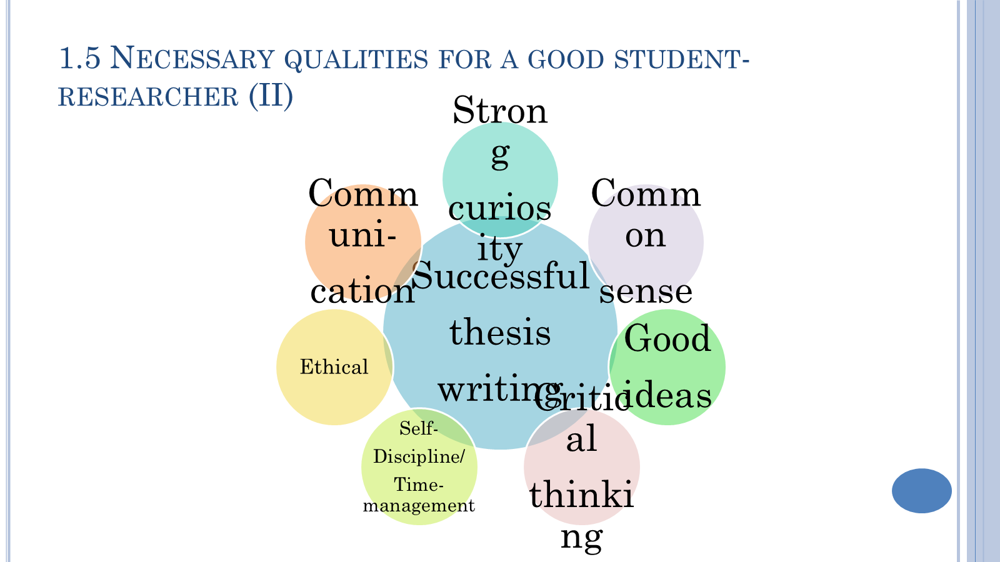
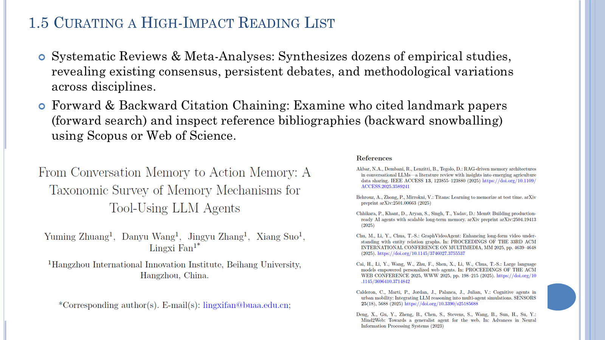
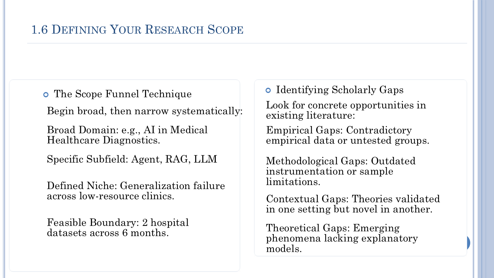
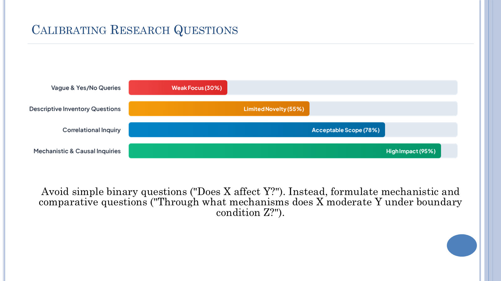
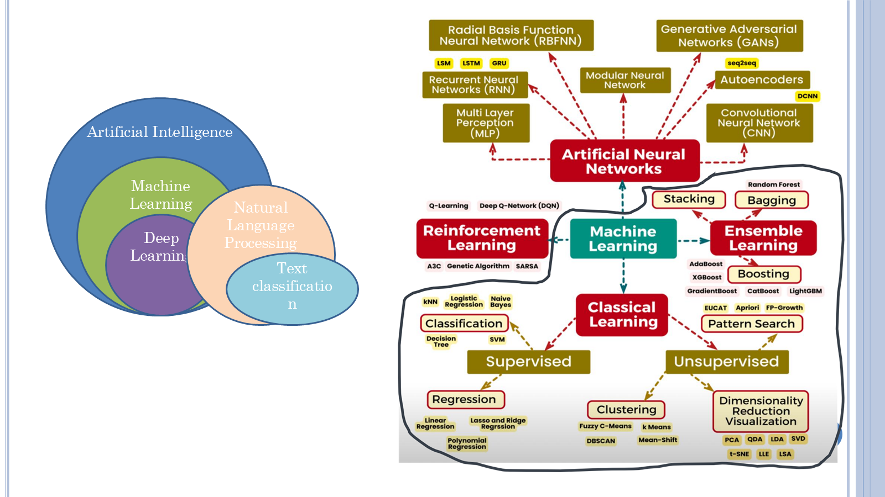
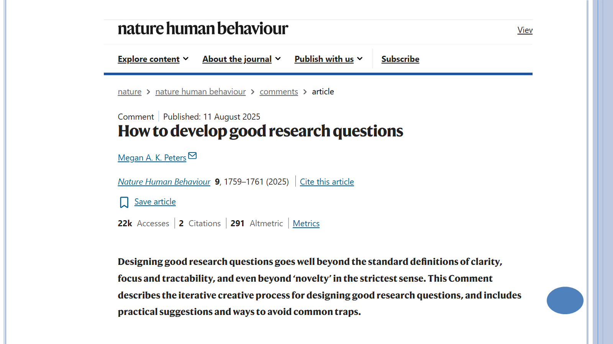

# Lecture 0 · Academic English Writing

A Practical Guide to Novice Students

LECTURE 0 · 研究与写作

学术英语阅读与写作 · 课件来源：Lecture0 Academic English Writing.pptx（35 页，本讲义收录第 7–35 页）

!!! info "阅读说明"

    本讲义按原课件逐页整理：英文条目为课件原文，其下附中文对照；图表、示意图与截图页附原课件整页图片。课件第 1–6 页为课程封面、教师介绍与个人研究简介，与 Unit 1 复习内容无关，未收录。文末附本讲<strong>重点词汇表</strong>。

## 1. Research and research questions　研究与研究问题

### Slide 7 · Research is not the special preserve for academics

- Doing research has everything to do with your critical thinking abilities and the capability to glean useful information from massive data that you obtain every day.

做研究与你的批判性思维能力密切相关，也与从每天获得的海量数据中提炼有用信息的能力密切相关。
{: .zh }

### Slide 8 · What is research? (II)

<strong>Research is…</strong>

- about inquiry
- a process which involves problematizing a phenomenon and gathering information
- structured investigation
- evaluation and analysis

<strong>Research is carried out in order to…</strong>

- get a result with scientific methods objectively
- solve problems, verify a theory, and lead to new insights
- prove/disprove new or existing ideas
- demystify a phenomenon…

<strong>研究是……</strong>① 关于追问；② 一个把现象问题化并收集信息的过程；③ 有结构的调查；④ 评估与分析。 
<strong>开展研究是为了……</strong>① 用科学方法客观地得到结果；② 解决问题、验证理论并带来新见解；③ 证明或否定新的或现有观点；④ 揭开现象之谜……
{: .zh }

### Slide 9 · What is research? (III)

Research is a systematic process of inquiry consisting of three elements or components:

1. a question, problem, or hypothesis
2. data
3. analysis and interpretation of data

研究是一个系统的探究过程，由三个要素或组成部分构成：① 一个问题、难题或假设；② 数据；③ 对数据的分析与解释。
{: .zh }

!!! note "出处"

    Nunan, D. (1992). *Research methods in language learning*, p. 3.

### Slide 10 · What are the purposes of doing research?

To conduct a systematic structured investigation needs to:

| A question | Have data | Interpret |
|---|---|---|
| 一个问题 | 有数据 | 进行解释 |

The purpose is to answer a question or solve a problem through data and interpretation.

开展系统的结构化调查需要三样东西——一个问题、有数据、进行解释；其目的是通过数据与解释回答一个问题或解决一个问题。
{: .zh }

### Slide 11 · Basic types of research

- <strong>Secondary research:</strong> by looking at what other people have said about a particular issue, and it is an essential form of inquiry. (library research, conceptual research)
- <strong>Primary research:</strong> by conducting one's own data-based (or empirical) investigation and then drawing some conclusion from it.

<strong>Questions:</strong>

- Which type of research is more related to your life?
- To your study?

<strong>二手研究：</strong>查看他人对某一问题的论述，是探究的一种基本形式（图书馆研究、概念研究）。 
<strong>一手研究：</strong>自己开展基于数据（实证）的调查，并从中得出结论。 
思考：哪一种研究与你的生活更相关？与你的学习更相关？
{: .zh }

### Slide 12 · Steps to conduct research

1. Literature review
2. Identify a question
3. Design
4. Collect data
5. Interpret and report

A research paper is the documentation of all the five steps of conducting research.

① 文献综述；② 确定一个问题；③ 研究设计；④ 收集数据；⑤ 解释与报告。研究论文就是对开展研究这五个步骤的完整记录。
{: .zh }

### Slide 13 · Discussion: What are the necessary qualities for a good student-researcher? (I)

Write down three qualities on a piece of paper, and then share your answer with your teammates.

在纸上写下三项素质，然后与同伴分享你的答案。
{: .zh }

### Slide 14 · Necessary qualities for a good student-researcher (II)

讨论提示：头脑风暴一位优秀学生研究者应具备的素质。该页把素质整理为好奇心、开放心态、沟通能力、批判性思维、良好写作、伦理意识、自律、耐心、诚实、专注、意愿与坚持。

原课件第 14 页：优秀学生研究者应具备的素质

## 2. Sources　文献来源

### Slide 15 · What to Read: Sources — Navigating the Scholarly Corpus

- Academic literature extends beyond standard textbook summaries. High-yield researchers prioritize peer-reviewed journals, seminal foundational studies, systematic reviews, and meta-analyses to establish scholarly authority.
- Begin by mapping review papers published within the last 3–5 years to grasp current state-of-the-art developments, then trace backward to citation classics that define theoretical paradigms.
- Audience Poll: What database is your default first stop (Google Scholar, Web of Science, Scopus, or PubMed)—and why?

① 学术文献不止于标准教材摘要。高产出的研究者优先关注同行评审期刊、奠基性研究、系统综述与元分析，以建立学术权威性。② 先梳理近 3–5 年发表的综述论文，把握当前最新进展，再回溯定义理论范式的引文经典。③ 观众投票：你默认首先使用哪个数据库（Google Scholar、Web of Science、Scopus 或 PubMed）？为什么？
{: .zh }

### Slide 16 · Scholarly database example

本页展示学术数据库的检索界面，用来说明如何在数据库中按主题、作者或关键词查找文献。

原课件第 16 页：学术数据库检索界面示例

### Slide 17 · What to Read: Sources（图示页）

本页为图书馆书架照片，用来说明学术专著与期刊的阅读场景；无额外文字内容。

### Slide 18 · Curating a High-Impact Reading List

- <strong>Systematic Reviews & Meta-Analyses:</strong> Synthesize dozens of empirical studies, revealing existing consensus, persistent debates, and methodological variations across disciplines.
- <strong>Forward & Backward Citation Chaining:</strong> Examine who cited landmark papers (forward search) and inspect reference bibliographies (backward snowballing) using Scopus or Web of Science.

原课件第 18 页：前向引文追踪（forward citation chaining）与后向引文追踪（backward snowballing）

① <strong>系统综述与元分析：</strong>综合数十项实证研究，揭示现有共识、持续争议与跨学科方法差异。② <strong>前向与后向引文追踪：</strong>用 Scopus 或 Web of Science 查看谁引用了里程碑论文（前向检索），并检查参考文献目录（后向滚雪球）。
{: .zh }

### Slide 19 · Top-Tier Peer-Reviewed Outlets

- Prioritize journals with rigorous editorial boards and indexed in Q1/top quartiles to avoid predatory publications and unverified findings.
- The slide illustrates the point with covers of *Nature*, *Science*, *Cell* and *The Lancet*.

优先选择拥有严格编辑委员会、被 Q1/顶级分区收录的期刊，以避免掠夺性出版物和未经核实的发现。该页用 *Nature*、*Science*、*Cell* 与 *The Lancet* 的封面来说明这一点。
{: .zh }

### Slide 20 · Defining Your Research Scope: The Scope Funnel Technique

- Begin broad, then narrow systematically:
    - Broad Domain: e.g., AI in Medical Healthcare Diagnostics.
    - Specific Subfield: Agent, RAG, LLM.
    - Defined Niche: Generalization failure across low-resource clinics.
    - Feasible Boundary: 2 hospital datasets across 6 months.
- <strong>Identifying Scholarly Gaps:</strong> look for concrete opportunities in existing literature:
    - Empirical Gaps: Contradictory empirical data or untested groups.
    - Methodological Gaps: Outdated instrumentation or sample limitations.
    - Contextual Gaps: Theories validated in one setting but novel in another.
    - Theoretical Gaps: Emerging phenomena lacking explanatory models.

原课件第 20 页：研究范围的“漏斗”与四类研究空白

先宽后窄，系统收束研究范围：① 宽泛领域，如医学医疗诊断中的 AI；② 具体子领域，如 Agent、RAG、LLM；③ 明确细分问题，如低资源诊所中的泛化失败；④ 可行边界，如 6 个月内使用 2 家医院的数据集。 
<strong>识别学术空白：</strong>在现有文献中寻找具体机会：① 实证空白——实证数据矛盾或某些群体尚未被检验；② 方法空白——测量工具过时或样本存在局限；③ 情境空白——理论只在一个场景得到验证，换到另一场景仍属新问题；④ 理论空白——新现象缺少解释模型。
{: .zh }

## 3. Research questions　研究问题

### Slide 21 · The FINER Criteria for Strong RQs

| Criterion | Academic Benchmark | Self-Interrogation Question |
|---|---|---|
| Feasible | Adequate participants, time, expertise, equipment, and budget. | Can I execute this within degree timelines and grant funds? |
| Interesting | Commands intellectual curiosity of the researcher and discipline. | Will journal editors and peer reviewers care about the outcome? |
| Novel | Confirms, refutes, extends, or reimagines prior scholarship. | Does this provide an authentic new perspective or insight? |
| Ethical | Complies with IRB protocols, data integrity, and privacy standards. | Does this protect human subjects, algorithmic fairness, and data? |
| Relevant | Advances scientific theory, institutional policy, or practical clinical action. | So what? How does answering this advance the current field? |

FINER 五项标准：① <strong>Feasible 可行</strong>——参与者、时间、专业知识、设备与预算是否充足；② <strong>Interesting 有趣</strong>——研究者与学科是否真正关心；③ <strong>Novel 新颖</strong>——能否确认、反驳、扩展或重新想象已有研究；④ <strong>Ethical 合乎伦理</strong>——是否符合 IRB 规范、数据完整性与隐私标准；⑤ <strong>Relevant 有关</strong>——能否推进科学理论、机构政策或实践行动。
{: .zh }

### Slide 22 · Calibrating Research Questions

- Avoid simple binary questions (“Does X affect Y?”). Instead, formulate mechanistic and comparative questions (“Through what mechanisms does X moderate Y under boundary condition Z?”).

原课件第 22 页：从描述性问题到机制性、比较性问题

避免简单的二元问题（“X 是否影响 Y？”），而应提出机制性与比较性问题（“在边界条件 Z 下，X 通过什么机制调节 Y？”）。
{: .zh }

### Slide 23 · Interactive Clinic: Refactor the Question

- <strong>Draft 1: Under-Scoped</strong> “How does social media affect mental health?”
    - Critique: Overwhelmingly broad. Unclear population, ill-defined metrics, impossible to empirically operationalize.
- <strong>Draft 2: Over-scoped / Too narrow</strong> “Did GPT-4o correctly identify the missing semicolon in line 42 of user John's Python script when prompted at 3:15 PM yesterday?”
    - Critique: Research inquiry restricts its context, sample, or variables so excessively that it eliminates meaningful variance and lacks academic generalizability.
- <strong>Draft 3: Rigorous & Impactful</strong> “How does passive scrolling vs. active messaging on TikTok moderate sleep latency among first-year undergraduates?”
    - Strengths: Specific variables, comparative mechanism, testable.

<strong>草稿 1：范围过宽</strong>“社交媒体如何影响心理健康？”——批评：过于宽泛，人群不明确、指标定义不清，无法进行实证操作化。 
<strong>草稿 2：范围过窄</strong>“GPT-4o 昨天下午 3:15 被提示时，是否正确识别了用户 John 的 Python 脚本第 42 行中缺失的分号？”——批评：研究情境、样本或变量限制得过分，消除了有意义的变异，缺乏学术可推广性。 
<strong>草稿 3：严谨且有影响</strong>“在 TikTok 上被动刷视频与主动发消息，如何调节大一学生的入睡潜伏期？”——优点：变量具体、有比较机制、可检验。
{: .zh }

### Slide 24 · AI → Machine Learning → Deep Learning → NLP → Text classification

本页用层级图说明人工智能、机器学习、深度学习、自然语言处理与文本分类之间的包含关系。

原课件第 24 页：AI、机器学习、深度学习、NLP 与文本分类的层级关系

### Slide 25–26 · Classification Exercise: Scope Evaluation

| 序号 | 研究问题（节选） | 判断 |
|---|---|---|
| 1 | How do Large Language Models think and mimic human consciousness? | Under-scoped |
| 2 | Did Llama-3-8B output an extra trailing space after token #15 when parsing line 3 of the developer's test prompt on a local RTX 4090 GPU yesterday afternoon? | Over-scoped |
| 3 | How does parameter-efficient fine-tuning (LoRA) on domain-specific corpora affect syntactic parsing accuracy and mean dependency distance (MDD) across typologically distinct languages? | Rigorous & Feasible |
| 4 | What is the ultimate impact of instruction fine-tuning on artificial intelligence? | Under-scoped |
| 5 | Does fine-tuning Mistral-7B on a 50-sentence medical QA dataset make it answer question #4 correctly on Dr. Lee's laptop? | Over-scoped |
| 6 | To what extent does intermediate-layer attention weight allocation in transformer models correlate with human eye-tracking fixation duration during garden-path sentence disambiguation? | Rigorous & Feasible |

判断题的抓手：是否有明确的人群/对象、变量/指标、比较关系与可操作的边界。① 第 1 题问大语言模型如何“思考”并模仿人类意识，范围过宽；② 第 2 题限定到某天下午、某个模型、某一行提示的单个空格，范围过窄；③ 第 3 题有明确方法（LoRA）、指标（句法分析准确率、平均依存距离）与跨语言边界，严谨可行；④ 第 4 题问“终极影响”，范围过宽；⑤ 第 5 题只用一个 50 句数据集、某台笔记本和单题结果，范围过窄；⑥ 第 6 题有明确的模型层、眼动指标与语言现象，严谨可行。
{: .zh }

### Slide 27 · How to develop good research questions

本页展示 *Nature Human Behaviour* 关于如何提出好的研究问题的文章，作为后续阅读与讨论的入口。

原课件第 27 页：*Nature Human Behaviour* 关于“如何提出好的研究问题”的文章截图

## 4. Reading widely and working with AI　广泛阅读与 AI

### Slide 28 · Phase 2: Reading widely

In Phase 2, the author warns against relying too heavily on automated tools (e.g., ResearchRabbit, Connected Papers, LLMs) and overly narrowing one's reading list too early. What is her rationale for reading outside one's immediate field, and what concrete example does she provide from her own research to support this?

- <strong>Rationale for Reading Widely:</strong> Automated tools and superficial algorithms miss deep conceptual parallels that require human synthesis. Problems in seemingly distant fields often share the same fundamental, underlying “shape” or structural challenge despite differing surface details. Reading outside one's core domain (e.g., philosophy of mind, philosophy of science) allows a researcher to spot non-obvious connections and devise innovative solutions that specialized peers overlook.
- <strong>Concrete Example:</strong> The author's own laboratory published a paper in *Science Advances* that originated from identifying common methodological and analytical hurdles shared between human microbiome research and computational cognitive neuroscience, despite their apparent disciplinary divide.

在第二阶段，作者提醒不要过度依赖自动化工具（如 ResearchRabbit、Connected Papers、LLM），也不要过早把阅读清单缩得太窄。她为什么主张阅读本领域之外的文献？她用自己的研究给出了什么具体例子？ 
① <strong>广泛阅读的理由：</strong>自动化工具和表面化算法会错过需要人类综合的深层概念对应。看似遥远的领域，其问题往往共享同一种根本的“形状”或结构性难题，只是表面细节不同。阅读核心领域之外（如心灵哲学、科学哲学）的文献，能让研究者发现不明显的联系，并提出专业同行容易忽略的创新方案。 
② <strong>具体例子：</strong>作者自己的实验室在 *Science Advances* 发表过一篇论文，其起点正是发现人类微生物组研究与计算认知神经科学之间共同的方法与分析难题，尽管二者表面上分属不同学科。
{: .zh }

### Slide 29 · Phase 3: Distilling to the essence

In Phase 3 (“Distilling to the essence”), how does the author suggest transforming a primary paper into a new, unique research question? What specific counterfactual prompt does she advise readers to ask?

- <strong>How to Refine the Question:</strong> Return to core papers tagged as “primary” and re-read them through an active, critical lens rather than merely summarizing them. Systematically seek out alternative explanations, unaddressed variables, and experimental gaps to generate a diverse pool of potential departures from existing literature.
- <strong>The Exact Counterfactual Prompt:</strong> Actively ask: “What if they had done [some other thing] instead of what they actually did?”
- This “other thing” can target:
    - Alternative analytical or computational techniques
    - Different control conditions or baseline checks
    - Modified stimulus sets, data collection protocols, target populations, or experimental tasks

① <strong>如何细化问题：</strong>回到标记为“primary”的核心论文，以主动、批判的眼光重读，而不是仅仅做摘要。系统寻找替代解释、未处理的变量与实验空白，从而产生一组多样的、可能偏离现有文献的研究方向。 
② <strong>准确的反事实提示：</strong>主动问：“如果他们当时做了[另一件事]，而不是实际做的事，会怎样？” 
③ 这个“另一件事”可以针对：替代的分析或计算方法；不同的控制条件或基线检查；修改后的刺激材料、数据收集流程、目标人群或实验任务。
{: .zh }

### Slide 30 · Traps in question formulation

The author highlights that good research questions are an “iterative, creative process” requiring patience, humility, and being comfortable with being wrong, while noting that AI tools often generate bland, standardized characteristics (“clear, focused, tractable, novel”).

- Consider Trap 2 (Excessive attachment to your question) and Trap 3 (“Oh no, someone already had my idea!”):
    - When you discover that another lab just published a paper addressing almost the exact question you were formulating, what are three concrete steps you can take to pivot your question without completely abandoning your sunk intellectual investment?
    - In an era where Generative AI can instantly brainstorm 50 well-scoped research questions, what essential human elements of question formulation (as described in the article) can AI not replicate?

作者强调，好的研究问题是一个“迭代、创造性的过程”，需要耐心、谦逊，并能坦然接受自己可能出错；同时指出，AI 工具往往生成平淡、标准化的特征（“清晰、聚焦、可处理、新颖”）。 
思考第 2 个陷阱（过度执着于自己的问题）与第 3 个陷阱（“糟糕，别人已经想到我的点子了！”）：① 当你发现另一个实验室刚发表了一篇几乎完全解决你正在构思的问题的论文时，你可以采取哪三个具体步骤来转向，而不必完全放弃已经投入的智力成本？② 在生成式 AI 能瞬间头脑风暴出 50 个范围得当的研究问题的时代，问题构思中有哪些关键的人类要素（如文章所述）是 AI 无法复制的？
{: .zh }

### Slide 31 · Three Concrete Pivots When Scooped

- <strong>Methodological & Analytical Pivot:</strong> Re-examine their dataset or experimental design using the Phase 3 prompt (“What if they had used a different control or modeling architecture?”). Identify methodological confounds they failed to control for.
- <strong>Boundary Conditions & Scope Modification:</strong> Test the reported phenomenon under edge cases, distinct populations, or typologically different data distributions to see where their model breaks down.
- <strong>Mechanistic vs. Descriptive Expansion:</strong> If the competing paper merely established that an effect exists, pivot toward investigating why or how it occurs computationally/mechanistically.

被“抢先发表”后的三种具体转向： 
① <strong>方法与分析转向：</strong>用第三阶段的反事实提示重新审视他们的数据集或实验设计（“如果他们用了不同的控制或建模架构会怎样？”），找出他们未能控制的方法学混淆因素。 
② <strong>边界条件与范围调整：</strong>在边缘案例、不同人群或类型学上不同的数据分布下检验所报告的现象，看他们的模型在哪里失效。 
③ <strong>机制与描述性扩展：</strong>如果竞争论文只确立了效应存在，就转向研究它在计算/机制上为什么或如何发生。
{: .zh }

### Slide 32 · What AI Cannot Replicate in Question Formulation

- <strong>Genuine Epistemic Drive:</strong> AI does not experience the persistent, “itchy” intellectual discomfort, obsessive curiosity, or intrinsic motivation that fuels a multi-year project.
- <strong>Subjective Cross-Domain Analogies:</strong> Large language models synthesize statistical co-occurrences, but they do not intuitively map abstract conceptual “shapes” across disparate lived experiences (e.g., drawing parallels between walking, self-talk, and abstract computational modeling).
- <strong>Embodied Self-Correction:</strong> The willingness to embrace failure, discard sunk costs, and identify an intuitive hunch through iterative self-dialogue and critical peer vulnerability.

AI 无法复制的问题构思要素： 
① <strong>真正的求知驱动力：</strong>AI 不会体验到那种持续的、“发痒的”智力不适、执着的求知欲或支撑多年项目的内在动机。 
② <strong>主观的跨领域类比：</strong>大语言模型综合统计共现，但不能凭直觉把抽象概念的“形状”映射到截然不同的生活经验之间（如在行走、自我对话与抽象计算建模之间建立平行）。 
③ <strong>具身的自我修正：</strong>愿意拥抱失败、放下沉没成本，并通过反复自我对话与对同行批评的开放态度来识别直觉性猜想。
{: .zh }

## 5. A research project as a chain of decisions　研究决策链

### Slide 33 · A research project is a chain of decisions

1. <strong>Question:</strong> What is the claim?
2. <strong>Design:</strong> What comparison is fair?
3. <strong>Data:</strong> What is one row?
4. <strong>Analysis:</strong> What pattern answers the question?
5. <strong>Writing:</strong> What can the evidence support?

At every step ask: “What could go wrong here?” That question is the beginning of quality control.

① <strong>问题：</strong>主张是什么？② <strong>设计：</strong>什么比较才公平？③ <strong>数据：</strong>一行数据代表什么？④ <strong>分析：</strong>什么模式能回答问题？⑤ <strong>写作：</strong>证据最多能支持到什么程度？ 
每一步都要问：“这里可能出什么问题？”这个问题是质量控制的起点。
{: .zh }

### Slide 34 · Match the method to the outcome

| Question shape | Outcome type | Typical method | What it answers |
|---|---|---|---|
| How much does X predict Y? | Continuous | Regression | Expected change in Y |
| Which class does this case belong to? | Categorical label | Classification | Decision boundary / probability |
| What groups emerge without labels? | Unlabeled cases | Clustering | Similarity structure |
| Do groups differ after controls? | Continuous or categorical | ANOVA / mixed model | Difference with design accounted for |

Quick test: if you have no label, “classification” is not yet available.

让方法与结果类型匹配：① “X 能在多大程度上预测 Y？”——连续结果——回归——回答 Y 的预期变化量；② “这个案例属于哪一类？”——分类标签——分类——回答决策边界/概率；③ “在没有标签的情况下会出现哪些组？”——无标签案例——聚类——回答相似性结构；④ “控制之后组间是否有差异？”——连续或分类结果——方差分析/混合模型——回答在考虑设计后的差异。 
快速检验：如果没有标签，就还不能做“分类”。
{: .zh }

### Slide 35 · Your article as a method-choice puzzle

Suppose the dataset contains one row per sentence or word, plus observed reading time.

- Predict reading time in milliseconds → Regression
- Predict skip vs. fixation → Classification
- Discover reader or sentence profiles → Clustering
- Compare observed and predicted times across readers → Mixed-effects model

Why not use one model for everything? Because each outcome asks a different question of the data.

假设数据集每一行是一个句子或单词，并记录了观察到的阅读时间：① 预测以毫秒计的阅读时间 → 回归；② 预测跳读还是注视 → 分类；③ 发现读者或句子的类型 → 聚类；④ 比较不同读者的观察时间与预测时间 → 混合效应模型。 
为什么不对所有问题都用同一个模型？因为每种结果都在向数据提出不同的问题。
{: .zh }

## 重点词汇 · Key Vocabulary

| English | 中文 | 说明 / 搭配 |
|---|---|---|
| research | 研究 | 系统的探究过程：问题/假设 + 数据 + 分析解释 |
| primary research | 一手研究 | 自己收集数据（实证研究） |
| secondary research | 二手研究 | 基于他人研究（图书馆/概念研究） |
| research question | 研究问题 | 可检验、可操作的问题 |
| hypothesis | 假设 | 待检验的命题 |
| literature review | 文献综述 | 系统梳理并批判性综合文献 |
| peer-reviewed | 同行评审的 | 经过同行专家评审的期刊论文 |
| systematic review | 系统综述 | 按明确方法综合多项研究 |
| meta-analysis | 元分析 | 对多项研究结果进行统计合并 |
| citation chaining | 引文追踪 | 前向查引用、后向查参考文献 |
| scope funnel | 范围漏斗 | 宽领域 → 子领域 → 细分 → 可行边界 |
| FINER | FINER 标准 | Feasible, Interesting, Novel, Ethical, Relevant |
| regression | 回归 | 连续结果与预测变量的关系 |
| classification | 分类 | 预测离散标签 |
| clustering | 聚类 | 发现无标签数据中的自然分组 |
| supervised learning | 有监督学习 | 同时提供特征与结果 |
| unsupervised learning | 无监督学习 | 只提供特征，无 ground truth |
