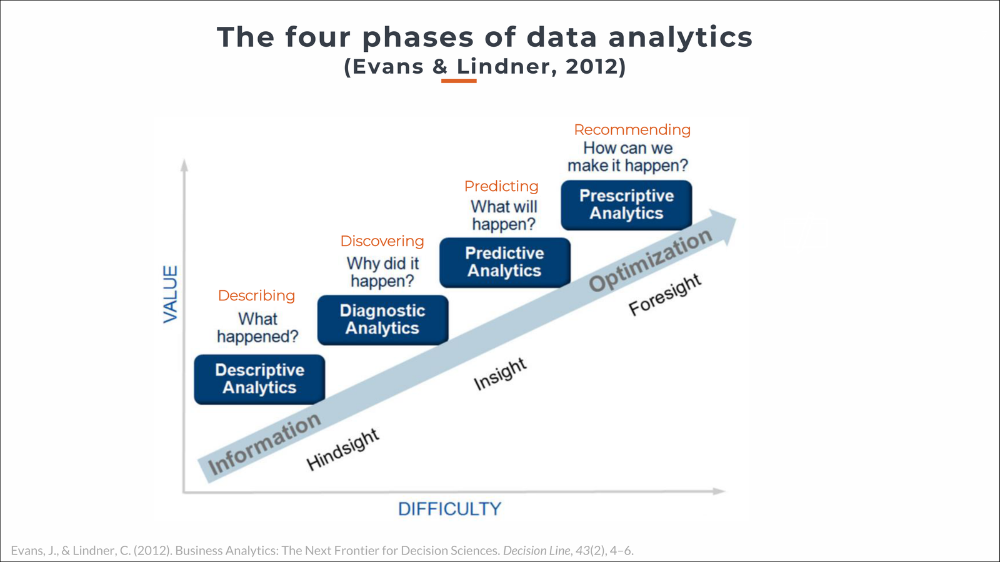
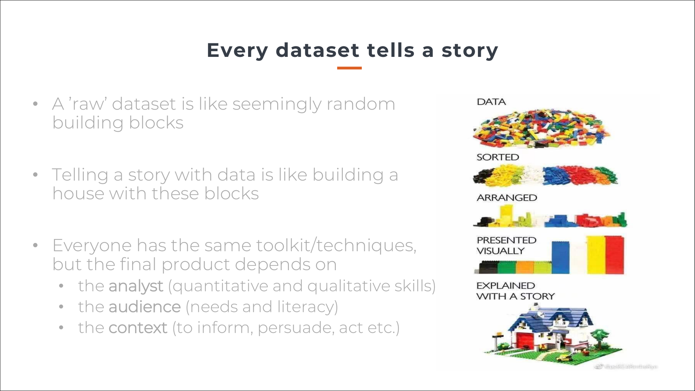
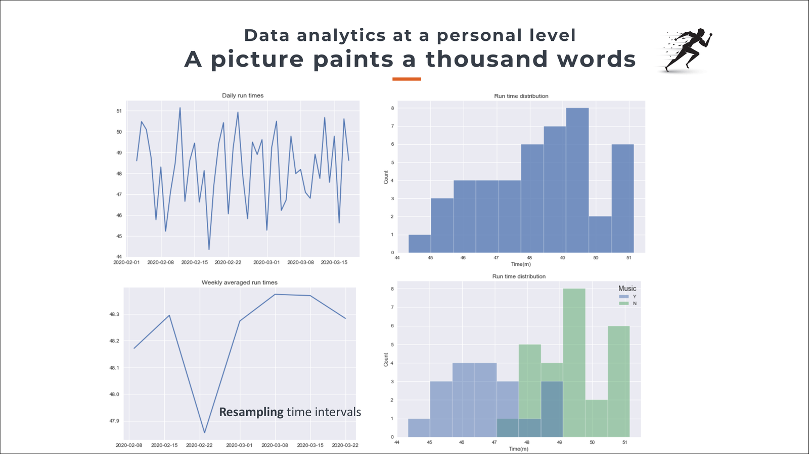
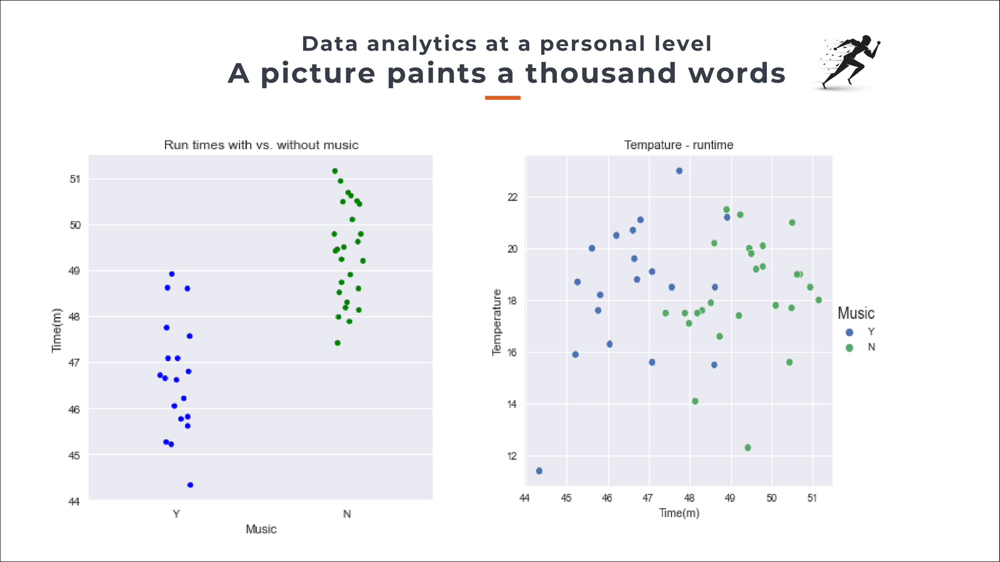

# Lecture 1 · What is data? Data analytics

What is data? · Data analytics

LECTURE 1 · 数据基础

学术英语阅读与写作 · 课件来源：Lecture1.pdf（原课件第 4–23 页，本讲义收录 18 页）

!!! info "阅读说明"

    本讲义按原课件逐页整理：英文条目为课件原文，其下附中文对照；图表与示意图页附原课件整页图片。文末附本讲<strong>重点词汇表</strong>。

## 1. What is data?　什么是数据

### Slide 1 · Some informal definitions

- The world's most valuable resource (*The Economist*)
- The new oil (Clive Humby)
- The new currency (Antonio Neri)
- A commodity like gold (Matt Sheperd)
- The lifeblood of the digital economy (WEF)

世界上最有价值的资源（《经济学人》）；新石油（Clive Humby）；新货币（Antonio Neri）；像黄金一样的大宗商品（Matt Sheperd）；数字经济的命脉（世界经济论坛）。
{: .zh }

### Slide 2 · Data analytics: A more formal definition

- Processing and analyzing data to extract information for enhancing knowledge and decision-making
- Commonly refers to financial and scientific data. However, almost every aspect of social life can be quantified and turned into data
- What kinds of data in language-related professions?
- Data in other social contexts? (e.g., <https://www.kaggle.com>)

处理和分析数据，以提取信息、增进知识并支持决策。它通常指金融和科学数据；然而，社会生活的几乎每个方面都可以被量化并转化为数据。 
思考：语言相关职业中会出现哪些数据？其他社会语境中的数据？（例如 Kaggle）
{: .zh }

### Slide 3 · “The role of a data scientist is to tell people that their baby is ugly”

- What are some metaphorical “babies”?
- myths: X is true because everyone says so…
- biases: X is better because I am more comfortable with it…
- stereotypes: X always behaves this way because…

有哪些比喻意义上的“丑孩子”（人们不愿承认的问题）？ 
<strong>迷思：</strong>X 是真的，因为大家都这么说…… 
<strong>偏见：</strong>X 更好，因为我对它更熟悉、更自在…… 
<strong>刻板印象：</strong>X 总是这样表现，因为……
{: .zh }

## 2. The four phases and storytelling　四个阶段与数据叙事

### Slide 4 · The four phases of data analytics (Evans & Lindner, 2012)

- <strong>Describing → Discovering → Predicting → Recommending</strong>
- The model plots value against difficulty: descriptive analytics looks backward (hindsight); predictive analytics looks forward (foresight); prescription/optimization sits at the top right.

原课件第 4 页：数据分析的四个阶段（Evans & Lindner, 2012）

<strong>描述 → 发现 → 预测 → 建议。</strong>该模型以“价值”对“难度”作图：描述性分析回顾过去（后见之明），预测性分析面向未来（先见之明），处方/优化位于右上方（价值与难度都最高）。
{: .zh }

### Slide 5 · Every dataset tells a story

- A “raw” dataset is like seemingly random building blocks
- Telling a story with data is like building a house with these blocks
- Everyone has the same toolkit/techniques, but the final product depends on
    - the analyst (quantitative and qualitative skills)
    - the audience (needs and literacy)
    - the context (to inform, persuade, act etc.)

原课件第 5 页：用乐高积木比喻从原始数据到完整叙事

“原始”数据集就像看似随机的积木块；用数据讲故事，就像用这些积木搭一座房子。每个人拿到的工具/技术都一样，但最终成品取决于：① 分析者（定量与定性能力）；② 受众（需求与素养）；③ 语境（告知、说服、促成行动等）。
{: .zh }

### Slide 6 · Every dataset tells a story（图示页）

本页用同一组乐高积木图重述第 5 页的比喻：原始数据像散乱的积木，分析师把它们排列、组合并呈现为一个有说服力的故事。图示见上页。

## 3. Types of data and personal analytics　数据类型与个人分析

### Slide 7 · Language and social data analytics: Types of data we will encounter

- <strong>Social data</strong>
    - social, political, economic measures and rankings
- <strong>Education data</strong>
    - demographics, assessments, surveys
- <strong>Language and discourse data</strong>
    - news articles, speeches, product reviews

<strong>社会数据：</strong>社会、政治、经济的测量指标与排名。 
<strong>教育数据：</strong>人口统计、测评、问卷。 
<strong>语言与话语数据：</strong>新闻报道、演讲、产品评论。
{: .zh }

### Slide 8 · Data analytics at a personal level: Use DA to understand yourself

- We can collect data and know ourselves better (finance, lifestyle, habits etc.) with basic DA
- How do temperature and music affect my pace?
- Quantitative thinking: feature(s), outcome(s) and the link between them
- A more formal definition of this link? (ys and xs)

我们可以收集数据，用基础数据分析更好地了解自己（财务、生活方式、习惯等）。温度和音乐如何影响我的配速？ 
定量思维：特征（feature）、结果（outcome）以及二者之间的联系。这种联系更正式的定义是什么？（y 与 x）
{: .zh }

### Slide 9 · Data analytics at a personal level: A picture paints a thousand words

- Resampling time intervals
- The same running data can be viewed as a time series, a distribution, and a group comparison.

原课件第 9 页：跑步时间数据的重采样与多种图表

对时间区间进行重采样。同一组跑步数据可以呈现为时间序列、分布图或组间比较。
{: .zh }

### Slide 10 · Scatterplots and strip plots

- Scatterplots and strip plots reveal how temperature and music relate to running pace.

原课件第 10 页：温度、音乐与跑步配速的关系

散点图与条带图揭示了温度、音乐与跑步配速之间的关系。
{: .zh }

## 4. Examples and the course map　案例与课程地图

### Slide 11 · An education example: Demographics, assessments, surveys

- Have students improved over tests?
- Do scores vary significantly by gender, income, background?
- Can we predict signups based on interest?
- Do students form natural groups based on the available information?

学生在多次测试中是否有所提高？成绩是否因性别、收入、背景而显著不同？我们能否根据兴趣预测报名？学生是否会根据现有信息形成自然分组？
{: .zh }

### Slide 12 · A news example: Natural Language Processing

- Can we classify news sources based on word choices in news headlines?
- Can we predict news source from word choices?
- What are the most significant topics discussed by each source?

我们能否根据新闻标题中的用词对新闻来源进行分类？能否根据用词预测新闻来源？每个来源讨论的最重要议题是什么？
{: .zh }

### Slide 13 · Group activity: What does your story look like?

- Choose the education or news example
- What is the likely audience (needs, literacy) and context (inform, persuade, act etc.) for this dataset?
- Based on the above, and your current data analytics knowledge, discuss how the four data analytic phases could be applied to the dataset

选择教育或新闻案例：该数据集可能的受众（需求、素养）与语境（告知、说服、促成行动等）是什么？基于以上内容和你目前的数据分析知识，讨论四个数据分析阶段可以如何应用到这个数据集。
{: .zh }

### Slide 14 · Online data analytic courses

- <strong>Pros</strong>
    - accredited by top institutions and firms
    - effective at developing basic proficiency
- <strong>Cons</strong>
    - not tailored for social researchers
    - expensive
- Our content will be similar
    - data analytics
    - machine learning
    - implementation in Python

<strong>优点：</strong>由顶尖院校和企业认证；能有效培养基础能力。 
<strong>缺点：</strong>并非为社会研究者量身定制；价格昂贵。 
本课程内容与之类似：数据分析、机器学习、用 Python 实现。
{: .zh }

### Slide 15 · Data analytic techniques we will learn

- Data visualization
- Classification
- Regression
- Clustering
- NLP

数据可视化、分类、回归、聚类、自然语言处理（NLP）。
{: .zh }

### Slide 16 · Data analytic techniques we will learn: Emphasis on machine learning

| Technique | Typical question | 中文 |
|---|---|---|
| Data visualization | Easy-to-understand graphical summaries of patterns and relationships | 用易于理解的图表概括模式与关系 |
| Regression | Can COVID-19 rates be predicted from area, population etc.? | 能否根据面积、人口等预测 COVID-19 发病率？ |
| Classification | Do countries with similar standards of living fall under similar political systems? | 生活水平相似的国家是否属于相似的政治体制？ |
| Clustering | Do consumers fall into natural groups based on their preferences, habits etc.? | 消费者是否会根据偏好、习惯等形成自然分组？ |
| NLP | Can emails be predicted as spam based on their linguistic properties? | 能否根据语言特征预测邮件是否为垃圾邮件？ |

### Slide 17 · A thematic approach

- Conceptual intuition
- Practical application
- Math and equations

1. Data management and visualization
2. Analyzing numerical data: regression, classification, clustering
3. Analyzing language data: NLP basics

三个学习层次：概念直觉、实际应用、数学与公式。 
三条主线：① 数据管理与可视化；② 分析数值数据——回归、分类、聚类；③ 分析语言数据——NLP 基础。
{: .zh }

### Slide 18 · Python: The world's fastest growing programming language

- An open-source, general-purpose, high-level programming language
- Web development, software development, machine learning, finance, gaming etc.
- Dual objective: we will learn basic programming code to implement data analytics for problem-solving
- Great learning resources
    - datacamp.com (accessible from PolyU library)
    - coursera.org
    - medium.com

Python 是一种开源、通用、高级编程语言，用于 Web 开发、软件开发、机器学习、金融、游戏等。 
本课程的双重目标：学习基础编程代码，用数据分析解决问题。 
优质学习资源：datacamp.com（可通过 PolyU 图书馆访问）、coursera.org、medium.com。
{: .zh }

## 重点词汇 · Key Vocabulary

| English | 中文 | 说明 / 搭配 |
|---|---|---|
| data analytics | 数据分析 | 处理分析数据以提取信息、支持决策 |
| descriptive analytics | 描述性分析 | 描述已经发生什么 |
| diagnostic analytics | 诊断性分析 | 解释为什么发生 |
| predictive analytics | 预测性分析 | 预测可能发生什么 |
| prescriptive analytics | 规范性分析 | 推荐应该怎么做/优化 |
| data visualization | 数据可视化 | 用图形总结模式与关系 |
| regression | 回归 | 连续结果与预测变量的关系 |
| classification | 分类 | 预测离散标签 |
| clustering | 聚类 | 发现无标签数据中的自然分组 |
| NLP | 自然语言处理 | 分析语言/文本数据 |
| dataset | 数据集 | 一行一个观测单位 |
| feature | 特征 | 可能影响结果的变量 |
| outcome | 结果变量 | 研究关注的效应/结果 |
| resampling | 重采样 | 按不同时间区间重新汇总数据 |
| correlation | 相关 | 两个变量共同变化的程度 |
