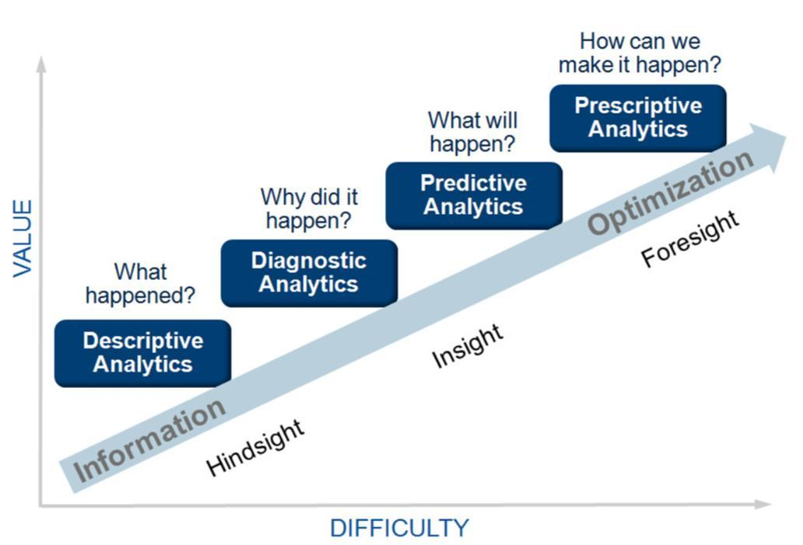
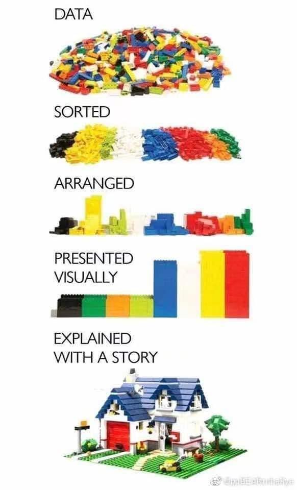
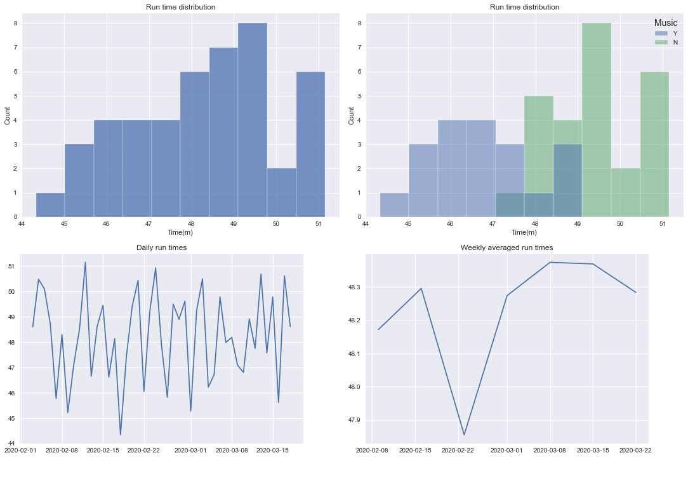
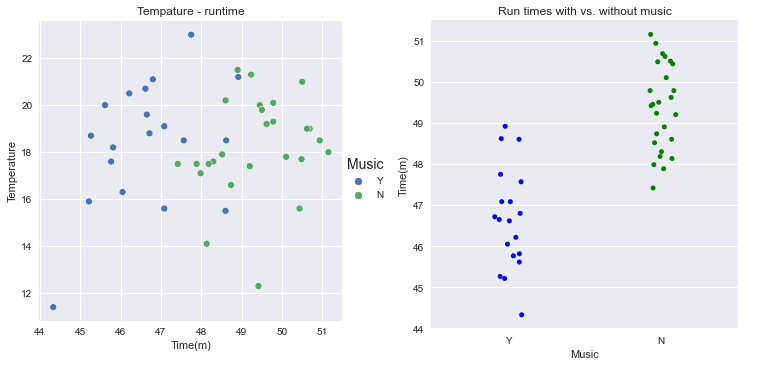

# Lecture 1 · What is data? Data analytics

What is data? · Data analytics

LECTURE 1 · 数据基础

学术英语阅读与写作 · 课件来源：Lecture1.pdf（原课件第 4–23 页）

!!! info "阅读说明"

    英文条目为课件原文，其下为中文对照翻译。课件中的示意图保留原图。

## 1. What is data?　什么是数据

### Slide 1 · Some informal definitions

- The world's most valuable resource (*The Economist*)
- The new oil (Clive Humby)
- The new currency (Antonio Neri)
- A commodity like gold (Matt Sheperd)
- The lifeblood of the digital economy (WEF)

<strong>中文对照：</strong>

- 世界上最有价值的资源（*The Economist*）
- 新石油（Clive Humby）
- 新货币（Antonio Neri）
- 像黄金一样的大宗商品（Matt Sheperd）
- 数字经济的命脉（世界经济论坛）

### Slide 2 · Data analytics: A more formal definition

- Processing and analyzing data to extract information for enhancing knowledge and decision-making
- Commonly refers to financial and scientific data. However, almost every aspect of social life can be quantified and turned into data
- What kinds of data in language-related professions?
- Data in other social contexts? (e.g., <https://www.kaggle.com>)

<strong>中文对照：</strong>

- 处理和分析数据以提取信息，从而增进知识并支持决策
- 通常指金融和科学数据；然而，社会生活的几乎每个方面都可以被量化并转化为数据
- 语言相关职业中会出现哪些数据？
- 其他社会语境中的数据？（例如 <https://www.kaggle.com>）

### Slide 3 · “The role of a data scientist is to tell people that their baby is ugly”

- What are some metaphorical “babies”?
- myths: X is true because everyone says so…
- biases: X is better because I am more comfortable with it…
- stereotypes: X always behaves this way because…

<strong>中文对照：</strong>

- 有哪些比喻意义上的“丑孩子”（人们不愿承认的问题）？
- 迷思：X 是真的，因为大家都这么说……
- 偏见：X 更好，因为我对它更熟悉、更自在……
- 刻板印象：X 总是这样表现，因为……

### Slide 4 · The four phases of data analytics (Evans & Lindner, 2012)

- <strong>Describing → Discovering → Predicting → Recommending</strong>
- The model plots value against difficulty: descriptive analytics looks backward (hindsight); predictive analytics looks forward (foresight); prescription/optimization sits at the top right.

原课件第 4 页：数据分析的四个阶段（Evans & Lindner, 2012）

- <strong>描述 → 发现 → 预测 → 建议</strong>
- 该模型以“价值”对“难度”作图：描述性分析回顾过去（后见之明），预测性分析面向未来（先见之明），处方/优化位于右上方（价值与难度都最高）。

### Slide 5–6 · Every dataset tells a story

- A “raw” dataset is like seemingly random building blocks
- Telling a story with data is like building a house with these blocks
- Everyone has the same toolkit/techniques, but the final product depends on
    - the analyst (quantitative and qualitative skills)
    - the audience (needs and literacy)
    - the context (to inform, persuade, act etc.)

原课件第 5 页：用乐高积木比喻从原始数据到完整叙事

- “原始”数据集就像看似随机的积木块
- 用数据讲故事，就像用这些积木搭一座房子
- 每个人拿到的工具/技术都一样，但最终成品取决于：
    - 分析者（定量与定性能力）
    - 受众（需求与素养）
    - 语境（告知、说服、促成行动等）

### Slide 7 · Language and social data analytics: Types of data we will encounter

- <strong>Social data</strong>
    - social, political, economic measures and rankings
- <strong>Education data</strong>
    - demographics, assessments, surveys
- <strong>Language and discourse data</strong>
    - news articles, speeches, product reviews

<strong>中文对照：</strong>

- <strong>社会数据</strong>
    - 社会、政治、经济的测量指标与排名
- <strong>教育数据</strong>
    - 人口统计、测评、问卷
- <strong>语言与话语数据</strong>
    - 新闻报道、演讲、产品评论

### Slide 8 · Data analytics at a personal level: Use DA to understand yourself

- We can collect data and know ourselves better (finance, lifestyle, habits etc.) with basic DA
- How do temperature and music affect my pace?
- Quantitative thinking: feature(s), outcome(s) and the link between them
- A more formal definition of this link? (ys and xs)

<strong>中文对照：</strong>

- 我们可以收集数据，用基础数据分析更好地了解自己（财务、生活方式、习惯等）
- 温度和音乐如何影响我的配速？
- 定量思维：特征（feature）、结果（outcome）以及二者之间的联系
- 这种联系更正式的定义是什么？（y 与 x）

### Slide 9 · A picture paints a thousand words

- Resampling time intervals
- The same running data can be viewed as a time series, a distribution, and a group comparison.

原课件第 9 页：跑步时间数据的重采样与多种图表

- 对时间区间进行重采样
- 同一组跑步数据可以呈现为时间序列、分布图或组间比较。

### Slide 10 · Scatterplots and strip plots

- Scatterplots and strip plots reveal how temperature and music relate to running pace.

原课件第 10 页：温度、音乐与跑步配速的关系

散点图与条带图揭示了温度、音乐与跑步配速之间的关系。
{: .zh }

### Slide 11 · An education example: Demographics, assessments, surveys

- Have students improved over tests?
- Do scores vary significantly by gender, income, background?
- Can we predict signups based on interest?
- Do students form natural groups based on the available information?

<strong>中文对照：</strong>

- 学生在多次测试中是否有所提高？
- 成绩是否因性别、收入、背景而显著不同？
- 我们能否根据兴趣预测报名？
- 学生是否会根据现有信息形成自然分组？

### Slide 12 · A news example: Natural Language Processing

- Can we classify news sources based on word choices in news headlines?
- Can we predict news source from word choices?
- What are the most significant topics discussed by each source?

<strong>中文对照：</strong>

- 我们能否根据新闻标题中的用词对新闻来源进行分类？
- 我们能否根据用词预测新闻来源？
- 每个来源讨论的最重要议题是什么？

### Slide 13 · Group activity: What does your story look like?

- Choose the education or news example
- What is the likely audience (needs, literacy) and context (inform, persuade, act etc.) for this dataset?
- Based on the above, and your current data analytics knowledge, discuss how the four data analytic phases could be applied to the dataset

<strong>中文对照：</strong>

- 选择教育或新闻案例
- 该数据集可能的受众（需求、素养）与语境（告知、说服、促成行动等）是什么？
- 基于以上内容和你目前的数据分析知识，讨论四个数据分析阶段可以如何应用到这个数据集

### Slide 14 · Online data analytic courses

- <strong>Pros</strong>
    - accredited by top institutions and firms
    - effective at developing basic proficiency
- <strong>Cons</strong>
    - not tailored for social researchers
    - expensive
- Our content will be similar
    - data analytics
    - machine learning
    - implementation in Python

<strong>中文对照：</strong>

- <strong>优点</strong>
    - 由顶尖院校和企业认证
    - 能有效培养基础能力
- <strong>缺点</strong>
    - 并非为社会研究者量身定制
    - 价格昂贵
- 本课程内容与之类似
    - 数据分析
    - 机器学习
    - 用 Python 实现

### Slide 15 · Data analytic techniques we will learn

- Data visualization
- Classification
- Regression
- Clustering
- NLP

<strong>中文对照：</strong>

- 数据可视化
- 分类
- 回归
- 聚类
- 自然语言处理（NLP）

### Slide 16 · Emphasis on machine learning

| Technique | Typical question |
|---|---|
| Data visualization | Easy-to-understand graphical summaries of patterns and relationships |
| Regression | Can COVID-19 rates be predicted from area, population etc.? |
| Classification | Do countries with similar standards of living fall under similar political systems? |
| Clustering | Do consumers fall into natural groups based on their preferences, habits etc.? |
| NLP | Can emails be predicted as spam based on their linguistic properties? |

<strong>中文对照：</strong>

| 技术 | 典型问题 |
|---|---|
| 数据可视化 | 用易于理解的图表概括模式与关系 |
| 回归 | 能否根据面积、人口等预测 COVID-19 发病率？ |
| 分类 | 生活水平相似的国家是否属于相似的政治体制？ |
| 聚类 | 消费者是否会根据偏好、习惯等形成自然分组？ |
| NLP | 能否根据语言特征预测邮件是否为垃圾邮件？ |

### Slide 17 · A thematic approach

- Conceptual intuition
- Practical application
- Math and equations

1. Data management and visualization
2. Analyzing numerical data: regression, classification, clustering
3. Analyzing language data: NLP basics

- 概念直觉
- 实际应用
- 数学与公式

1. 数据管理与可视化
2. 分析数值数据：回归、分类、聚类
3. 分析语言数据：NLP 基础
{: .zh }

### Slide 18 · Python: The world's fastest growing programming language

- An open-source, general-purpose, high-level programming language
- Web development, software development, machine learning, finance, gaming etc.
- Dual objective: we will learn basic programming code to implement data analytics for problem-solving
- Great learning resources
    - datacamp.com (accessible from PolyU library)
    - coursera.org
    - medium.com

<strong>中文对照：</strong>

- 一种开源、通用、高级编程语言
- 用于 Web 开发、软件开发、机器学习、金融、游戏等
- 双重目标：学习基础编程代码，用数据分析解决问题
- 优质学习资源
    - datacamp.com（可通过 PolyU 图书馆访问）
    - coursera.org
    - medium.com
