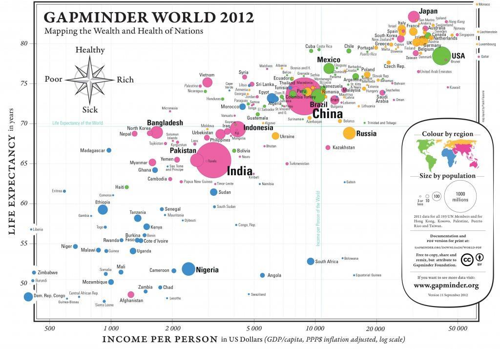
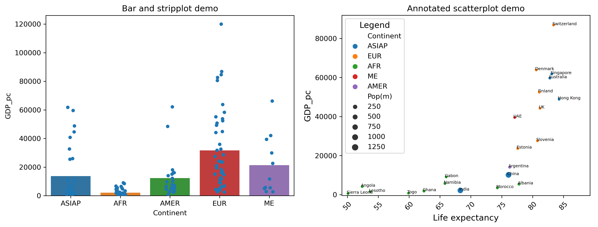
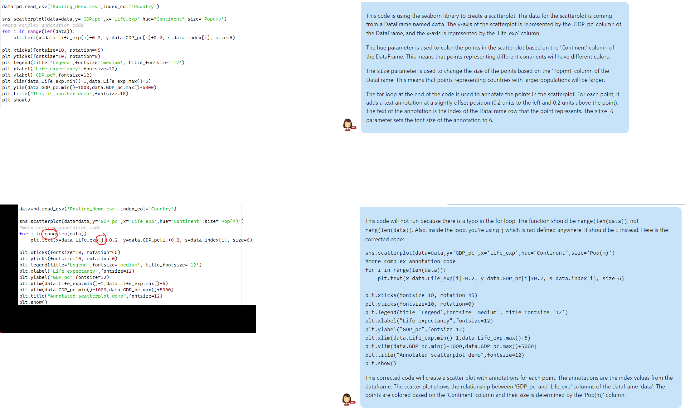

# Lecture 2 · Python dataframes

Python orientation · Managing data · Practice with pandas

LECTURE 2 · pandas

学术英语阅读与写作 · 课件来源：Lecture2.pdf（11 页）

!!! info "阅读说明"

    英文条目为课件原文，其下为中文对照翻译。代码与库名保留原样。

## Outline　本讲结构

1. Python orientation
2. Managing data with Excel and Python
3. Practice with pandas

<strong>中文对照：</strong>

1. Python 入门
2. 用 Excel 与 Python 管理数据
3. pandas 练习
{: .zh }

## 1. Python orientation　Python 入门

### Slide 3 · Running Python on Spyder IDE

- Introduction to the Spyder interface
- Setting directories of data files
- Loading and saving code files (*.py files)
- Taking notes (“""” and #)
- Running code (F9, Function+F9)

<strong>中文对照：</strong>

- Spyder 界面介绍
- 设置数据文件所在目录
- 加载与保存代码文件（*.py 文件）
- 做笔记（“""” 与 #）
- 运行代码（F9、Function+F9）

## 2. Managing data with Excel and Python　用 Excel 与 Python 管理数据

### Slide 4 · “Large” and “small” datasets

- Datasets often come in the form of Excel spreadsheets, which we will import into Python
- Their size and complexity may vary significantly as seen in the following examples
- “Size doesn't matter”
    - large datasets may be more insightful, but also “messier” and challenging for slow computers. However, Python can easily handle most messes
    - small datasets (or “toy data”) can be better for learning. Most academic research datasets are also more likely to be small

| Dataset | No. of cases | Filesize |
|---|---|---|
| Bicycle rental company data (Q4, 2019) | > 700,000 | 95 MB |
| Human Freedom Index | > 3,000 | 5 MB |
| Hans Rosling global development data | > 150 | 7 KB |

- 数据集通常以 Excel 表格的形式出现，我们会把它导入 Python
- 数据集的大小与复杂度可能差异很大，如下例所示
- “大小并不重要”
    - 大数据集可能更有洞见，但也更“脏”，对运行慢的电脑更具挑战性；不过 Python 可以轻松处理大多数混乱数据
    - 小数据集（或“玩具数据”）更适合学习。大多数学术研究数据集也往往较小

| 数据集 | 案例数 | 文件大小 |
|---|---|---|
| 自行车租赁公司数据（2019 年第四季度） | > 700,000 | 95 MB |
| 人类自由指数 | > 3,000 | 5 MB |
| Hans Rosling 全球发展数据 | > 150 | 7 KB |

### Slide 5 · Examples of “mess”

- Formatting inconsistencies and errors
- Language incompatibility / encoding issues
- Missing data*
    - in some situations, can be very problematic if unnoticed
    - handled by dropping or estimating missing values
- Missing data can range from “not very problematic” to “very problematic”; the key question is why the data are missing.

<strong>中文对照：</strong>

- 格式不一致与错误
- 语言不兼容/编码问题
- 缺失数据*
    - 在某些情况下，如果没有被发现，会非常成问题
    - 可通过删除或估计缺失值来处理
- 缺失数据的严重程度从“不太成问题”到“非常成问题”不等；关键问题是数据为什么缺失。

!!! note "参考"

    Graham, J. W. (2009). Missing Data Analysis: Making It Work in the Real World. *Annual Review of Psychology*, 60(1), 549–576.

### Slide 6 · The pandas library

- Pandas (<https://pandas.pydata.org/>) is the most popular Python library for data manipulation and analysis
- To use Python libraries, we need to import them. Once we import Pandas, we can then load our Excel files as a dataframe
- We will also import and use other key libraries for data visualization and analysis like numpy, matplotlib, seaborn, statsmodels, and scikit-learn

<strong>中文对照：</strong>

- pandas（<https://pandas.pydata.org/>）是最受欢迎的 Python 数据操作与分析库
- 使用 Python 库需要先导入。导入 pandas 后，就可以把 Excel 文件加载为 dataframe
- 我们还会导入并使用其他关键的可视化与分析库，如 numpy、matplotlib、seaborn、statsmodels 与 scikit-learn

### Slide 7 · Example: Hans Rosling's global development research

- What information does this chart convey?
- What are the visualization techniques?

原课件第 7 页：Hans Rosling 的全球发展数据可视化（Gapminder）

- 这张图传达了哪些信息？
- 它使用了哪些可视化技术？

### Slide 8 · Python dataframes: Visualization demonstration

- A bar/strip plot and an annotated scatterplot show how pandas and seaborn display categorical and continuous relationships.

原课件第 8 页：pandas/seaborn 可视化演示（柱状图、条带图与带注释散点图）

柱状图/条带图与带注释的散点图，展示了 pandas 和 seaborn 如何呈现分类变量与连续变量的关系。
{: .zh }

### Slide 9 · Confused by code? Use GenAI to explain and troubleshoot

- Use GenAI to explain and troubleshoot code: <https://genai.polyu.edu.hk>
- Example prompts and model explanations are shown below.

原课件第 9 页：用 GenAI 解释 pandas 代码的示例

- 用 GenAI 来解释代码、排查问题：<https://genai.polyu.edu.hk>
- 下方展示了示例提示词与模型解释。

## 3. Practice with pandas　pandas 练习

### Slide 10 · Practice with pandas: Lecture2.py

- Key learning points
    - Dataframe overview
    - Dataframe management
    - Dataframe manipulation

<strong>中文对照：</strong>

- 关键学习点
    - dataframe 总览
    - dataframe 管理
    - dataframe 操作

### Slide 11 · Summary

- Pandas is the most important data management library for Python, and is best used alongside Excel
- There is no need to “memorize” code
- While it might seem difficult at first, practice makes (almost) perfect!

<strong>中文对照：</strong>

- pandas 是 Python 最重要的数据管理库，最好与 Excel 配合使用
- 没有必要“死记”代码
- 一开始可能觉得困难，但熟能生巧（几乎完美）！
