# Lecture 3 · Data visualization

matplotlib · seaborn · Distribution plots · Relationship plots

LECTURE 3 · 可视化

学术英语阅读与写作 · 课件来源：Lecture3.pdf（20 页）+ Lecture3 Prompt for reporting figure.docx

!!! info "阅读说明"

    英文条目为课件原文，其下为中文对照翻译。图表截图保留原课件图片，附录收录六个图表报告提示词。

## 1. The importance of data visualization　数据可视化的重要性

### Slide 3 · “A picture paints a thousand words”

- Visual representation and communication of data
- A key component of descriptive analytics and exploratory data analysis (EDA)
- Allows quick identification and understanding of key patterns
    - distribution of features and outcomes
    - differences between groups
    - correlations between factors
    - trends across time

<strong>中文对照：</strong>

- 用可视化呈现并传达数据
- 描述性分析与探索性数据分析（EDA）的关键组成部分
- 能快速识别并理解关键模式
    - 特征与结果的分布
    - 组间差异
    - 因素之间的相关关系
    - 随时间变化的趋势

### Slide 4 · Back to last week's dataset (with new HDI data): Lecture3.csv

- Some questions for data analysts
    - What is the distribution of HDI categories? Happiness? GDP? Life expectancy? Population … by countries/continents?
    - How are the above related to one another?
- Descriptive analytics, with a “foot in the door” of diagnostic analytics
- Sometimes, initial visual communication may already be sufficient for non-technical purposes

<strong>中文对照：</strong>

- 给数据分析师的一些问题
    - HDI 类别、幸福度、GDP、预期寿命、人口……按国家/大洲看，分布如何？
    - 上述变量之间如何相互关联？
- 这属于描述性分析，同时“伸了一只脚”进诊断性分析
- 有时，初步的可视化沟通已经足以满足非技术目的

### Slide 5 · Data visualization with Python: matplotlib and seaborn

- <https://matplotlib.org/>
- <https://seaborn.pydata.org/index.html>
- Other Python visualization libraries: bokeh, plotly, yellowbrick

- <https://matplotlib.org/>
- <https://seaborn.pydata.org/index.html>

<strong>中文对照：</strong>

- 其他 Python 可视化库：bokeh、plotly、yellowbrick

### Slide 6 · We will produce the following

| Variable type | Distribution plots | Relationship plots |
|---|---|---|
| Numerical variables | Histograms; Cumulative distribution curves | Scatterplots; Time series plots |
| Categorical (+ numerical variables) | Count plots; Bar plots | Strip plots; Box plots |

<strong>中文对照：</strong>

| 变量类型 | 分布图 | 关系图 |
|---|---|---|
| 数值变量 | 直方图；累积分布曲线 | 散点图；时间序列图 |
| 分类变量（+ 数值变量） | 频数图；柱状图 | 条带图；箱线图 |

### Slide 7 · Examples

- A gallery of distribution and relationship plots produced with matplotlib/seaborn.

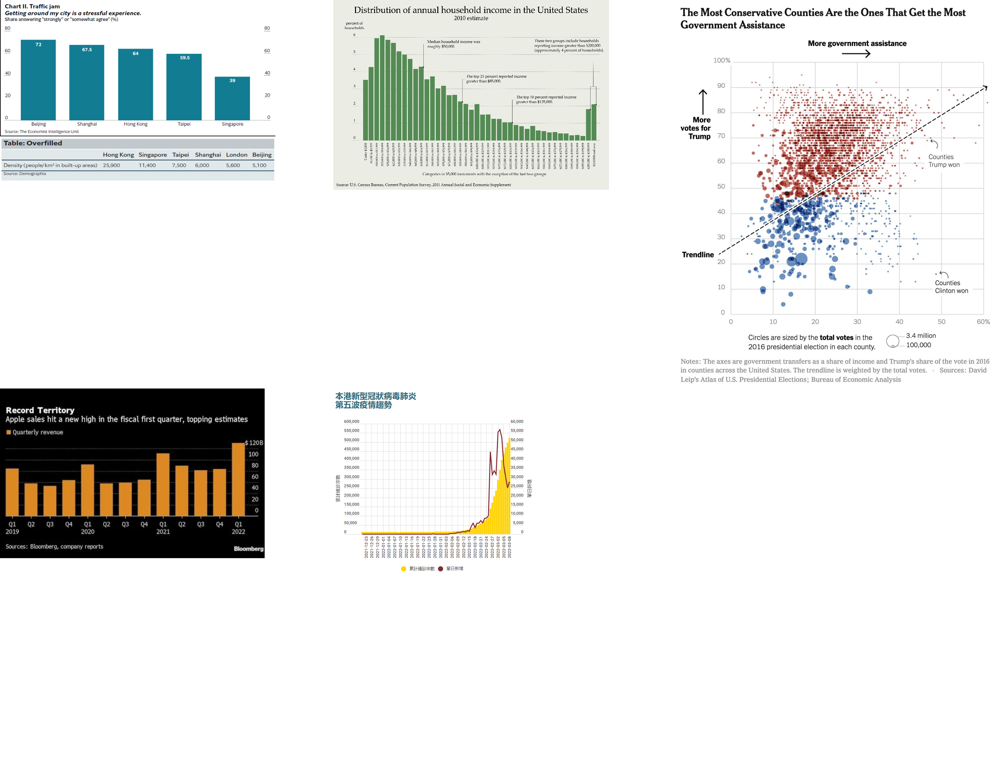

原课件第 7 页：分布图与关系图示例（直方图、ECDF、散点图、柱状图等）

- 一组用 matplotlib/seaborn 制作的分布图与关系图示例。

### Slide 8 · Setting image properties and visual themes

- Image size and resolution (dpi)
- Seaborn customizations
- Numerous other possibilities

<strong>中文对照：</strong>

- 图像尺寸与分辨率（dpi）
- seaborn 自定义
- 还有许多其他可能性

## 2. Distribution plots　分布图

### Slide 9 · Histogram

- Distribution of GDP_pc globally
- A right-skewed distribution (long right “tail”). What does this suggest?
- Compare the mean and median
- Try modifying title, color, number of bins
    - Too few bins → oversimplify reality, lose nuance
    - Too many bins → overcomplicate reality, lose big picture
    - Rice's rule
- Try plotting other continuous variables (e.g., happiness and life expectancy)

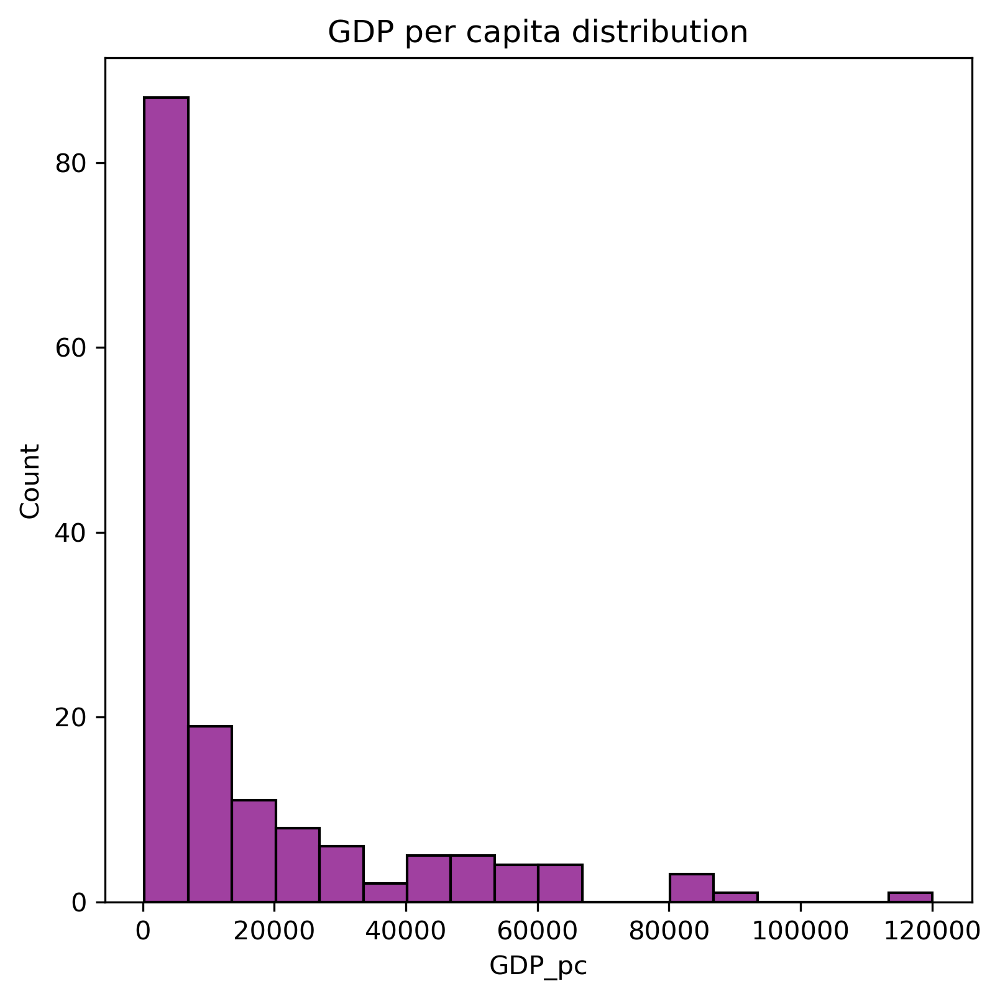

原课件第 9 页：全球人均 GDP 的直方图

- 全球人均 GDP（GDP_pc）的分布
- 右偏分布（右侧有长“尾”）。这说明什么？
- 比较均值与中位数
- 尝试修改标题、颜色、分箱数量
    - 分箱太少 → 过度简化现实，丢失细节
    - 分箱太多 → 过度复杂化现实，失去大局
    - Rice 规则
- 尝试绘制其他连续变量（例如幸福度与预期寿命）

### Slide 10 · Empirical cumulative distribution curve (ECDF)

- An alternative visualization of distribution
- Histogram vs. ECDF
    - each point is visualized directly, no need to consider bins
    - easier to compare different groups (different lines vs. overlapping histograms)
    - less intuitive than histogram
- Doing it the hardcore way: writing and calling a function in Python
- Approx. 80% of the world have GDP_pc less than 30000
- Verify with the np.percentile function

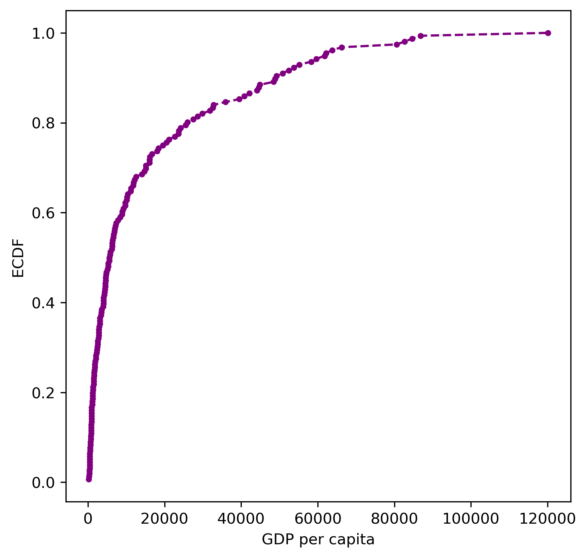

原课件第 10 页：GDP_pc 的经验累积分布曲线（ECDF）

- 分布的另一种可视化方式
- 直方图与 ECDF 的对比
    - 每个点都被直接呈现，不需要考虑分箱
    - 更容易比较不同组（不同曲线 vs. 重叠的直方图）
    - 不如直方图直观
- “硬核”做法：在 Python 中编写并调用函数
- 全球约 80% 的人 GDP_pc 低于 30000
- 用 np.percentile 函数验证

### Slide 11 · How does our ECDF function work?

- Original data (unsorted) → sorted (using np.sort) → cumulative percentage 1, 2, …, 12 divided by 12.

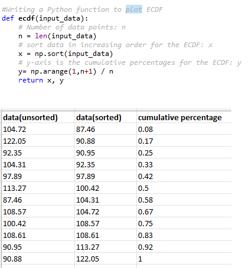

原课件第 11 页：ECDF 函数的排序、累积百分比表与曲线

ECDF 函数的计算流程：原始数据（未排序）→ 排序（使用 np.sort）→ 计算累积百分比 1、2、……、12，再除以 12。
{: .zh }

### Slide 12 · A more complex ECDF

- We use loc to split the dataset into Asia and Africa
- The two ECDFs clearly contrast GDP per capita between the two continents
- In general, ECDFs are very useful to contrast distributions between groups

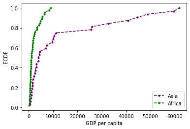

原课件第 12 页：亚洲与非洲 GDP 的 ECDF 对比

- 我们用 loc 把数据集拆分为亚洲与非洲
- 两条 ECDF 清楚对比了两个大洲的人均 GDP
- 一般来说，ECDF 非常适合对比不同组的分布

### Slide 13 · Count plot

- Shows distribution of categorical variables by frequency counts
- Try varying the palette, title, and axis labels
- Try plotting the bars on the y-axis instead

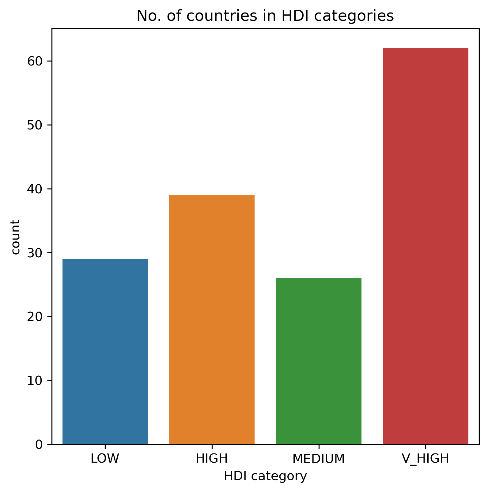

原课件第 13 页：HDI 类别的频数图

- 用频数展示分类变量的分布
- 尝试改变配色、标题与坐标轴标签
- 尝试把柱子画在 y 轴上

### Slide 14 · A more complex count plot

- Use the “hue” parameter to distinguish sub-categories
- Breakdown of HDI categories by continent

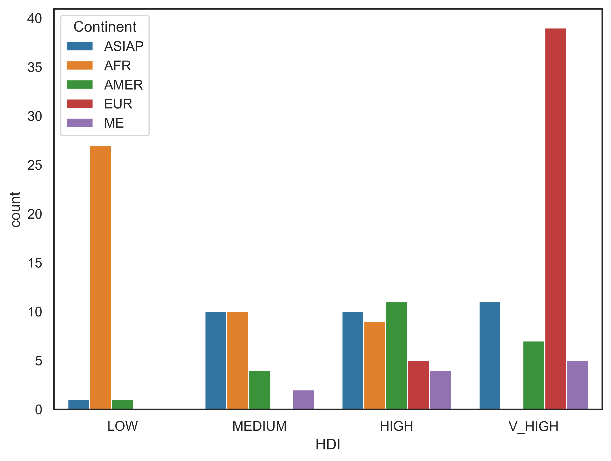

原课件第 14 页：按大洲分组的 HDI 类别频数图

- 用 “hue” 参数区分子类别
- 按大洲拆分 HDI 类别

## 3. Relationship plots　关系图

### Slide 15 · Bar plot

- Shows the relationship between categorical and numerical variables: Continent and (mean) Happiness
- The first plot has confidence intervals, the second one does not
- Confidence intervals are relevant when you are using sample means to estimate the true population mean
- Longer CIs = less confident estimate

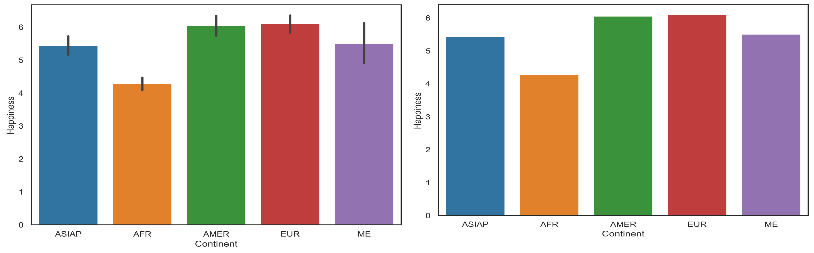

原课件第 15 页：带/不带置信区间的大洲—幸福度柱状图

- 展示分类变量与数值变量之间的关系：大洲与（平均）幸福度
- 第一张图有置信区间，第二张没有
- 当你用样本均值估计真实总体均值时，置信区间才有意义
- 置信区间越长 = 估计越不确定

### Slide 16 · A more complex bar plot

- Use the “hue” parameter to include further categories
- Having too many categories can make bar plots unclear
- Order of categories on x-axis can be changed if preferred (like in this case, low → v_high)
- *sns.catplot can be used to plot categories along rows and columns instead

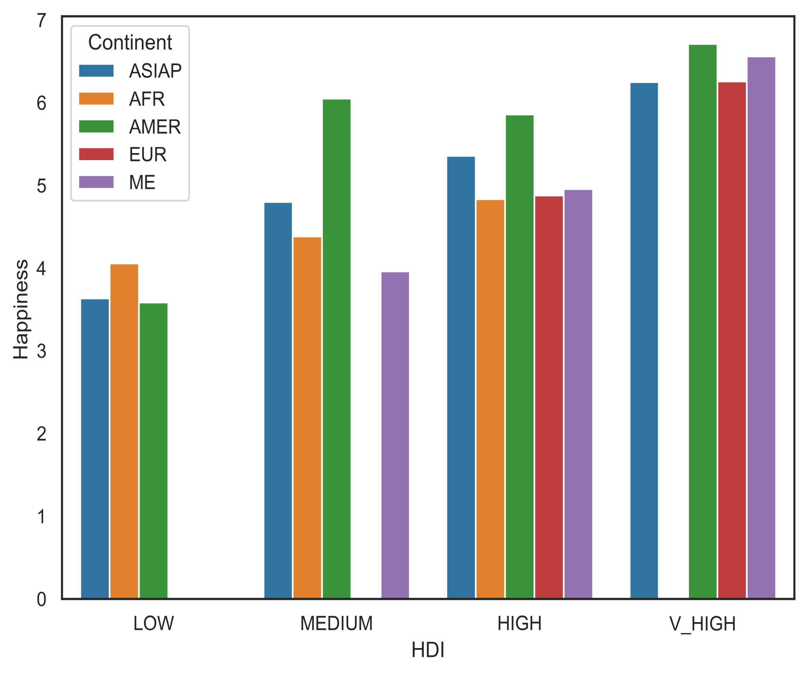

原课件第 16 页：加入更多分类变量的柱状图

- 用 “hue” 参数加入更多分类变量
- 类别太多会让柱状图不清楚
- 如有需要，可以调整 x 轴类别的顺序（如本例中从 low 到 v_high）
- *sns.catplot 可以把类别分行分列绘制

### Slide 17 · Strip plots and box plots

- Strip plots and box plots are useful variants to show relationships between categorical and numerical variables
- Relative (dis)advantages?
- Bar plot + strip plot (superimposed) is often useful

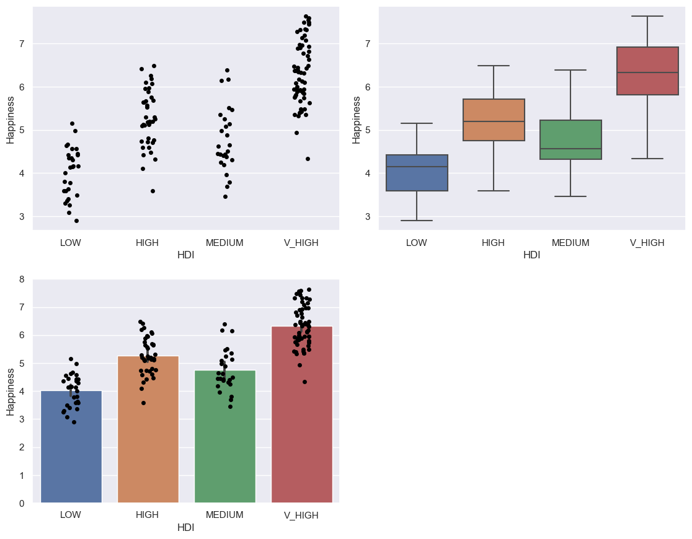

原课件第 17 页：条带图与箱线图

- 条带图与箱线图是展示分类变量与数值变量关系的有用变体
- 它们各自的（不）优势是什么？
- 柱状图 + 条带图（叠加）通常很有用

### Slide 18 · Scatterplot

- Key difference between a bar plot and scatterplot?
- Implies a positive relationship between happiness and GDP per capita. Does this make sense?
- Check actual correlations with data.corr()
- Try other continuous variables and discuss their relationships
- Experiment with the “hue” and “size” parameters
- *sns.relplot can be used to plot categories along rows and columns instead

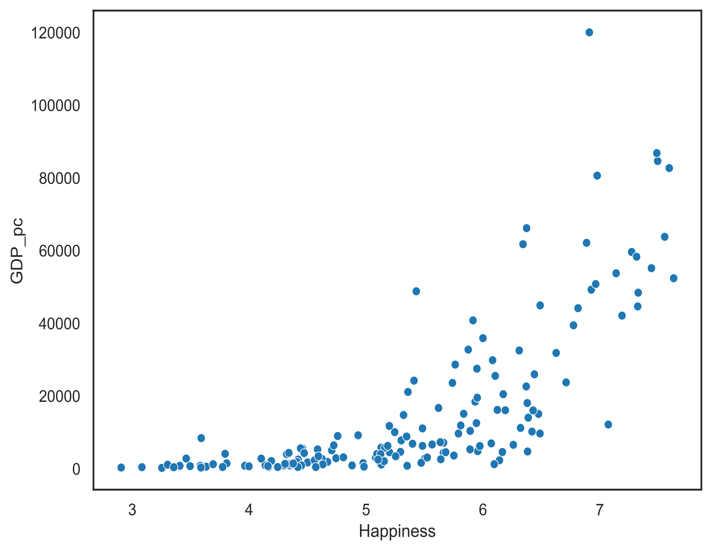

原课件第 18 页：幸福度与人均 GDP 的散点图

- 柱状图与散点图的关键区别是什么？
- 图中暗示幸福度与人均 GDP 之间存在正相关。这合理吗？
- 用 data.corr() 检查实际相关系数
- 尝试其他连续变量并讨论它们的关系
- 试验 “hue” 与 “size” 参数
- *sns.relplot 可以把类别分行分列绘制

### Slide 19 · A scatterplot with a regression line

- lmplot() estimates a regression line, or “line of best fit”, to predict y from x
- *Does this linear model look satisfactory? Why (not)?
- We will learn regression later in the course

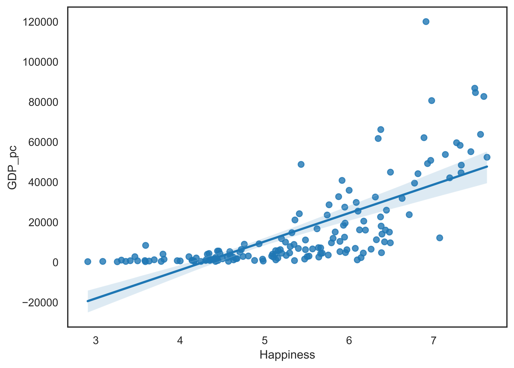

原课件第 19 页：带回归线的散点图

- lmplot() 估计一条回归线，即“最佳拟合线”，用 x 预测 y
- *这个线性模型看起来令人满意吗？为什么（不）？
- 我们将在课程后面学习回归

### Slide 20 · A more complex scatterplot

- Set HDI as the “hue” parameter
- What interesting story does this suggest?
- Try to communicate this story in simple language
- Further enhancements: axis lines to demarcate quadrants

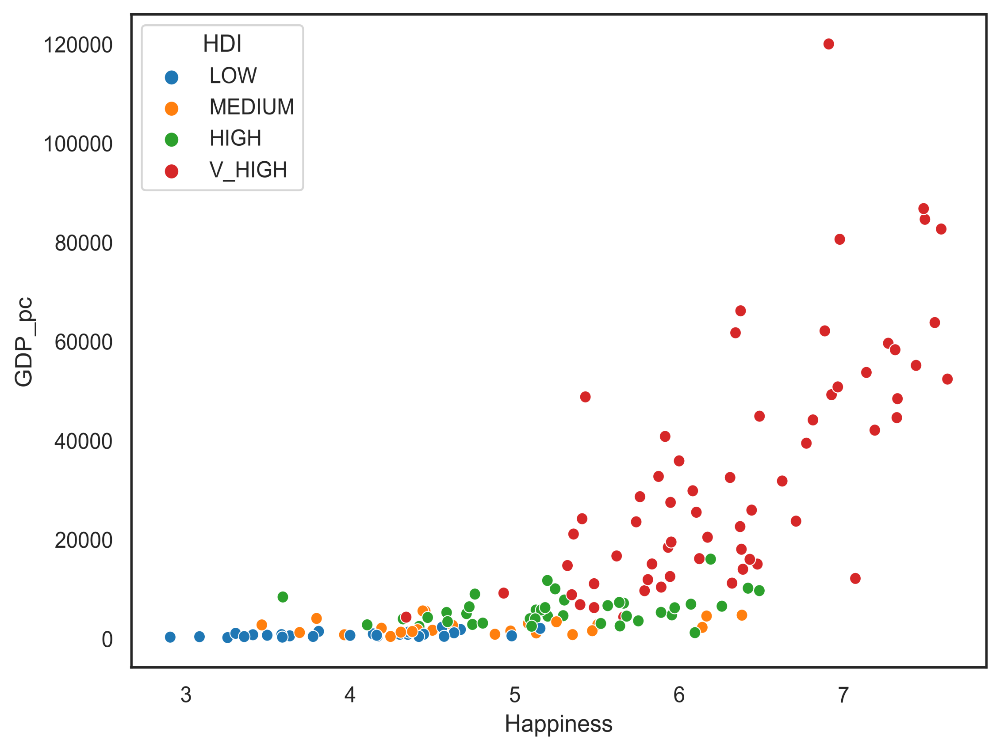

原课件第 20 页：以 HDI 着色的复杂散点图

- 把 HDI 设为 “hue” 参数
- 这暗示了什么有趣的故事？
- 尝试用简单语言把这个故事讲清楚
- 进一步改进：用坐标轴线划分象限

## 附录　Prompt for Reporting Figures　图表报告提示词

### Prompt 1: Histogram (Continuous Variable Distribution)

You are an expert data analyst and visualization specialist. Please analyze and describe the provided Histogram following a structured report format.

- <strong>Chart Mechanics and Mapping:</strong> Identify the continuous numerical variable being visualized, what the bins on the horizontal axis represent, and what the vertical axis indicates (frequency count, probability density, or proportion).
- <strong>Distribution Characteristics:</strong> Detail the statistical shape of the distribution, specifying skewness (positive/right-skewed, negative/left-skewed, or symmetric), modality (unimodal, bimodal, multimodal), spread/variance, central tendency, and the presence of notable gaps or extreme outliers.
- <strong>Binning Evaluation:</strong> Discuss the apparent bin width and resolution. Evaluate whether the chosen number of bins appropriately captures the underlying data pattern without oversimplifying nuances or creating excessive noise (referencing principles like Rice's or Sturges' rule where relevant).
- <strong>Analytical Insights:</strong> Summarize what this distribution reveals about the underlying real-world phenomenon and state any recommendations for data transformation (such as log transformation if heavily skewed).

你是一名数据分析与可视化专家。请按照结构化报告格式分析并描述所提供的直方图。 
① <strong>图表机制与映射：</strong>指出正在可视化的连续数值变量、横轴的分箱代表什么，以及纵轴表示什么（频数、概率密度或比例）。 
② <strong>分布特征：</strong>详述分布的统计形状，说明偏度（正偏/右偏、负偏/左偏或对称）、峰态（单峰、双峰、多峰）、离散程度/方差、集中趋势，以及是否存在明显缺口或极端离群值。 
③ <strong>分箱评价：</strong>讨论可见的分箱宽度与分辨率。评价所选分箱数量是否恰当地捕捉了潜在数据模式，既不过度简化细节，也不产生过多噪声（可参考 Rice 或 Sturges 规则）。 
④ <strong>分析洞见：</strong>总结该分布揭示了现实世界现象的什么，并说明是否建议进行数据变换（例如严重偏态时做对数变换）。
{: .zh }

### Prompt 2: Empirical Cumulative Distribution Curve (ECDF)

You are an expert data analyst and visualization specialist. Please analyze and describe the provided Empirical Cumulative Distribution Curve (ECDF) following a structured report format.

- <strong>Chart Mechanics and Axis Definition:</strong> Explain what the horizontal axis (ordered metric values) and vertical axis (empirical cumulative probability from 0.0 to 1.0) represent, describing how percentiles are read directly from the curve.
- <strong>Curve Trajectory and Quantile Benchmarks:</strong> Identify key benchmark percentiles (such as the median at 0.5 and the 80th percentile), noting where the curve rises most steeply (indicating high data density) and where it flattens (indicating sparse or extreme values).
- <strong>Comparative Dynamics (if multiple curves are present):</strong> If multiple groups or categories are shown, contrast the curves by assessing their horizontal separation, stochastic dominance, and differences in dispersion across groups.
- <strong>Analytical Value:</strong> Highlight the advantages of this ECDF over a binned histogram for this dataset, particularly regarding precision, bin-free representation, and suitability for group comparison.

你是一名数据分析与可视化专家。请按照结构化报告格式分析并描述所提供的经验累积分布曲线（ECDF）。 
① <strong>图表机制与坐标轴定义：</strong>解释横轴（有序的度量值）与纵轴（0.0 到 1.0 的经验累积概率）分别代表什么，并说明如何直接从曲线上读取百分位数。 
② <strong>曲线轨迹与分位基准：</strong>指出关键基准百分位（如中位数 0.5 与第 80 百分位），注意曲线在哪里上升最陡（表示数据密度高）、在哪里变平（表示数据稀疏或存在极端值）。 
③ <strong>比较动态（若有多条曲线）：</strong>如果展示了多个组或类别，通过评估水平间隔、随机占优与组间离散差异来对比曲线。 
④ <strong>分析价值：</strong>强调对于该数据集，ECDF 相对于分箱直方图的优势，尤其是精确性、无需分箱以及与组间比较的适配性。
{: .zh }

### Prompt 3: Count Plot (Categorical Frequency Distribution)

You are an expert data analyst and visualization specialist. Please analyze and describe the provided Count Plot following a structured report format.

- <strong>Chart Mechanics and Variable Types:</strong> Identify the categorical variable plotted along the primary axis, verify that the opposing axis reflects absolute observation counts, and describe the ordering logic of the categories (e.g., nominal, ordinal, or frequency-sorted).
- <strong>Frequency Patterns and Class Balance:</strong> Report the relative and absolute frequencies across all visible categories, identifying dominant classes (mode), underrepresented groups, and any extreme class imbalances.
- <strong>Subgroup Interactions (if hue/grouping is used):</strong> If sub-categories are encoded using color or clustered bars, analyze the within-group composition and cross-tabulation patterns, noting any prominent demographic or segment skews.
- <strong>Visual Layout Assessment:</strong> Evaluate whether the orientation (vertical vs. horizontal) and color encoding effectively communicate category differences without clutter or ambiguity.

你是一名数据分析与可视化专家。请按照结构化报告格式分析并描述所提供的频数图。 
① <strong>图表机制与变量类型：</strong>指出主轴上绘制的分类变量，确认另一轴反映绝对观测计数，并描述类别的排序逻辑（如名义、有序或按频数排序）。 
② <strong>频数模式与类别平衡：</strong>报告所有可见类别的相对与绝对频数，指出主导类别（众数）、代表性不足的组，以及任何极端的类别不平衡。 
③ <strong>子组交互（若使用 hue/分组）：</strong>如果子类别通过颜色或分组柱编码，分析组内构成与交叉表模式，指出显著的人口或细分偏差。 
④ <strong>视觉布局评估：</strong>评价方向（垂直 vs. 水平）与颜色编码是否能在不杂乱、不模糊的情况下有效传达类别差异。
{: .zh }

### Prompt 4: Bar Plot (Categorical vs. Continuous Aggregation)

You are an expert data analyst and visualization specialist. Please analyze and describe the provided Bar Plot following a structured report format.

- <strong>Aggregation Mechanics:</strong> Identify the categorical grouping variable on one axis and the aggregated continuous variable on the other, specifying the summary statistic displayed (mean, median, or sum).
- <strong>Statistical Uncertainty and Error Bars:</strong> If error bars or confidence intervals are present, interpret their length and overlap. State what they indicate regarding sample variance, estimation certainty, and whether between-group differences appear statistically meaningful.
- <strong>Multivariate Comparison (if hue/clustered bars are present):</strong> Analyze differences across secondary groups, identifying interaction effects, consistent rank orders, or notable anomalies across subgroups.
- <strong>Visual Limitations and Context:</strong> Note any limitations of using aggregate bars for this metric (such as hiding underlying distributions, skewness, or sample size disparities) and mention suitable companion visualizations.

你是一名数据分析与可视化专家。请按照结构化报告格式分析并描述所提供的柱状图。 
① <strong>聚合机制：</strong>指出一个轴上的分类分组变量与另一个轴上的聚合连续变量，并说明展示的汇总统计量（均值、中位数或总和）。 
② <strong>统计不确定性与误差条：</strong>如果存在误差条或置信区间，解释其长度与重叠情况；说明它们对样本方差、估计确定性以及组间差异是否具有统计意义的指示。 
③ <strong>多变量比较（若使用 hue/分组柱）：</strong>分析次级组之间的差异，识别交互效应、一致的排序或子组中的显著异常。 
④ <strong>视觉局限与语境：</strong>指出用聚合柱表示该指标的局限（如掩盖潜在分布、偏态或样本量差异），并提及合适的补充可视化。
{: .zh }

### Prompt 5: Strip Plot and Box Plot (Distribution Across Categories)

You are an expert data analyst and visualization specialist. Please analyze and describe the provided Strip Plot, Box Plot, or composite visual following a structured report format.

- <strong>Summary Statistics Breakdown (Box Plot components):</strong> For each category, evaluate the five-number summary: minimum whisker boundary, first quartile (Q1), median (Q2), third quartile (Q3), maximum whisker boundary, interquartile range (IQR), and explicitly flagged outlier points.
- <strong>Individual Observation Density (Strip Plot components):</strong> Examine the distribution of raw data points, noting clusters, local density variations, sample sizes per category, and any signs of severe overplotting.
- <strong>Cross-Category Comparative Analysis:</strong> Contrast the groups in terms of central tendency shifts, variance differences (box height and whisker span), and distributional symmetry.
- <strong>Methodological Assessment:</strong> Evaluate the effectiveness of this representation compared to simple aggregate bars, explaining how displaying the spread and individual points enhances diagnostic understanding.

你是一名数据分析与可视化专家。请按照结构化报告格式分析并描述所提供的条带图、箱线图或复合图。 
① <strong>汇总统计拆解（箱线图部分）：</strong>对每个类别评估五数概括：下须边界、第一四分位数（Q1）、中位数（Q2）、第三四分位数（Q3）、上须边界、四分位距（IQR），以及明确标记的离群点。 
② <strong>个体观测密度（条带图部分）：</strong>考察原始数据点的分布，注意聚集、局部密度变化、每类样本量，以及是否存在严重的重叠绘制。 
③ <strong>跨类别比较分析：</strong>从集中趋势偏移、方差差异（箱体高度与须跨度）与分布对称性方面对比各组。 
④ <strong>方法学评估：</strong>评价这种表示相对于简单聚合柱的有效性，说明展示离散程度与个体点如何增强诊断理解。
{: .zh }

### Prompt 6: Scatterplot and Regression Fit (Bivariate Continuous Relationship)

You are an expert data analyst and visualization specialist. Please analyze and describe the provided Scatterplot and any fitted trendlines following a structured report format.

- <strong>Bivariate Dynamics:</strong> Identify the continuous independent variable (x-axis) and dependent variable (y-axis). Describe the overall association in terms of direction (positive, negative, null), strength (dispersion around the trend), and functional form (linear, monotonic, polynomial, exponential).
- <strong>Trendline and Residual Assessment:</strong> If a linear or non-linear regression line is fitted, evaluate its goodness of fit. Note whether the relationship shows heteroscedasticity (expanding or contracting variance), non-linear curvature, or high-leverage outliers that pull the regression slope.
- <strong>Additional Dimensionality (Hue, Size, Style):</strong> If additional variables are mapped via color, point size, or marker shape, interpret how these sub-segments cluster within the 2D space and whether Simpson's paradox or distinct group regimes emerge.
- <strong>Diagnostic and Modeling Takeaways:</strong> Summarize the primary takeaways from this plot, indicating whether variables should undergo transformation (e.g., logarithmic) or be prioritized for predictive modeling.

你是一名数据分析与可视化专家。请按照结构化报告格式分析并描述所提供的散点图及任何拟合趋势线。 
① <strong>双变量动态：</strong>指出连续自变量（x 轴）与因变量（y 轴）。从方向（正、负、无）、强度（围绕趋势的离散程度）与函数形式（线性、单调、多项式、指数）描述总体关联。 
② <strong>趋势线与残差评估：</strong>如果拟合了线性或非线性回归线，评价其拟合优度。注意关系是否呈现异方差（方差扩大或收缩）、非线性弯曲，或拉动回归斜率的高杠杆离群点。 
③ <strong>额外维度（颜色、大小、样式）：</strong>如果额外变量通过颜色、点大小或标记形状映射，解释这些子段如何在二维空间中聚集，以及是否出现辛普森悖论或不同的组别模式。 
④ <strong>诊断与建模要点：</strong>总结该图的主要结论，说明变量是否应进行变换（如对数变换），或是否应优先用于预测建模。
{: .zh }
