# Lecture 3 · Data visualization

matplotlib and seaborn · Distributions and relationships

LECTURE 3 · 可视化

学术英语阅读与写作 · 课件来源：Lecture3.pdf（20 页）+ Prompt for reporting figure.docx

!!! info "阅读说明"

    本讲义按原课件逐页整理：英文条目为课件原文，其下附中文对照；所有图表页附原课件整页图片。课件第 1 页为课程封面，未收录。文末附六个<strong>图表报告提示词</strong>与<strong>重点词汇表</strong>。

## 1. The importance of data visualization　数据可视化的重要性

### Slide 2 · Outline

- The importance of data visualization
- The matplotlib and seaborn libraries
- Practice: distribution plots and relationship plots

数据可视化的重要性；matplotlib 和 seaborn 库；实践——分布图与关系图。
{: .zh }

### Slide 3 · “A picture paints a thousand words”

- Visual representation and communication of data
- A key component of descriptive analytics and exploratory data analysis (EDA)
- Allows quick identification and understanding of key patterns
    - distribution of features and outcomes
    - differences between groups
    - correlations between factors
    - trends across time

数据的视觉呈现与沟通；描述性分析与探索性数据分析（EDA）的关键组成部分。它让人快速识别和理解关键模式：① 特征与结果的分布；② 组间差异；③ 因素之间的相关；④ 随时间变化的趋势。
{: .zh }

### Slide 4 · Back to last week's dataset (with new HDI data): Lecture3.csv

- Some questions for data analysts
    - What is the distribution of HDI categories? Happiness? GDP? Life expectancy? Population … by countries/continents?
    - How are the above related to one another?
- Descriptive analytics, with a “foot in the door” of diagnostic analytics
- Sometimes, initial visual communication may already be sufficient for non-technical purposes

数据分析师的问题：① HDI 类别、幸福感、GDP、预期寿命、人口……按国家/大洲的分布如何？② 上述变量之间如何相关？ 
本页属于描述性分析，同时“踏进”诊断性分析的门槛。有时，初步的视觉沟通对非技术目的已经足够。
{: .zh }

### Slide 5 · Data visualization with Python: The matplotlib and seaborn libraries

- <https://matplotlib.org/>
- <https://seaborn.pydata.org/index.html>
- Other Python visualization libraries: bokeh, plotly, yellowbrick

matplotlib 与 seaborn 的官方文档见上；其他 Python 可视化库还有 bokeh、plotly、yellowbrick。
{: .zh }

### Slide 6 · We will produce the following

本页用一张示意图总览本讲将制作的图表类型：数值变量用直方图与累积分布曲线；分类变量（+数值变量）用计数图与柱状图；关系图用散点图、时间序列图、条带图与箱线图。

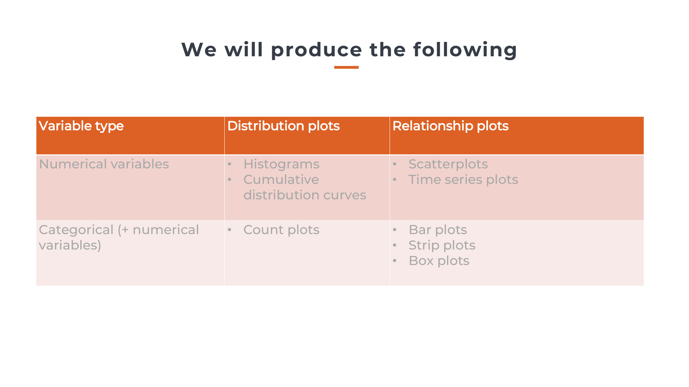

原课件第 6 页：本讲将制作的图表总览

### Slide 7 · Examples

本页展示用 matplotlib/seaborn 绘制的分布图与关系图示例集。

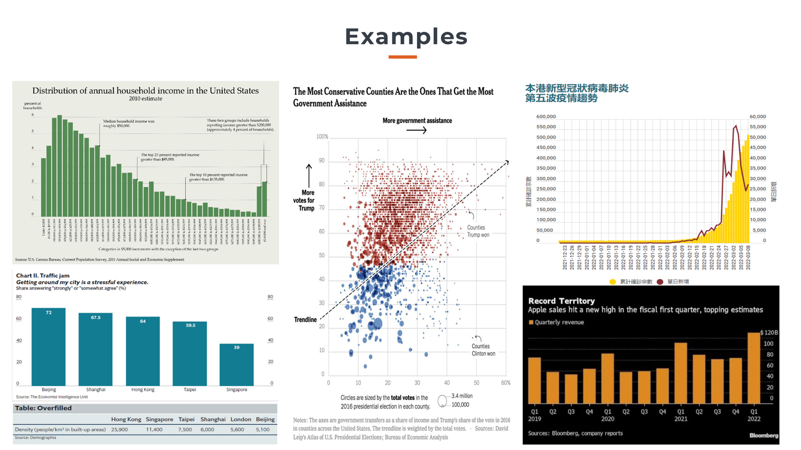

原课件第 7 页：分布图与关系图示例（直方图、ECDF、散点图、柱状图等）

### Slide 8 · Setting image properties and visual themes

- Image size and resolution (dpi)
- Seaborn customizations
- Numerous other possibilities

图像大小和分辨率（dpi）；seaborn 自定义；还有许多其他可能性。
{: .zh }

## 2. Distribution plots　分布图

### Slide 9 · Distribution plot #1: Histogram

- Distribution of GDP_pc globally
- A right-skewed distribution (long right “tail”). What does this suggest?
- Compare the mean and median
- Try modifying title, color, number of bins
    - Too few bins → oversimplify reality, lose nuance
    - Too many bins → overcomplicate reality, lose big picture
    - Rice's rule
- Try plotting other continuous variables (e.g., happiness and life expectancy)

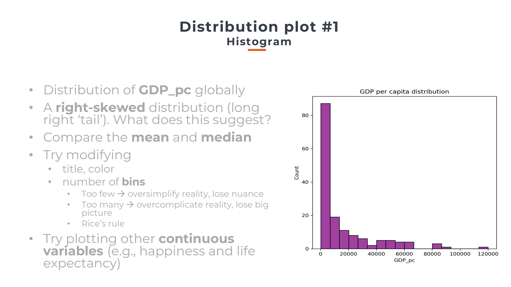

原课件第 9 页：全球人均 GDP 的直方图

全球 GDP_pc 的分布呈右偏（长右“尾”）。这说明什么？比较均值和中位数。尝试修改标题、颜色、箱数：箱太少 → 过度简化现实、失去细节；箱太多 → 过度复杂化现实、失去大局；可参考 Rice 规则。也可绘制其他连续变量（如幸福度和预期寿命）。
{: .zh }

### Slide 10 · Distribution plot #2: Empirical cumulative distribution curve (ECDF)

- An alternative visualization of distribution
- Histogram vs. ECDF
    - each point is visualized directly, no need to consider bins
    - easier to compare different groups (different lines vs. overlapping histograms)
    - less intuitive than histogram
- Doing it the hardcore way: writing and calling a function in Python
- Approx. 80% of the world have GDP_pc less than 30000
- Verify with the np.percentile function

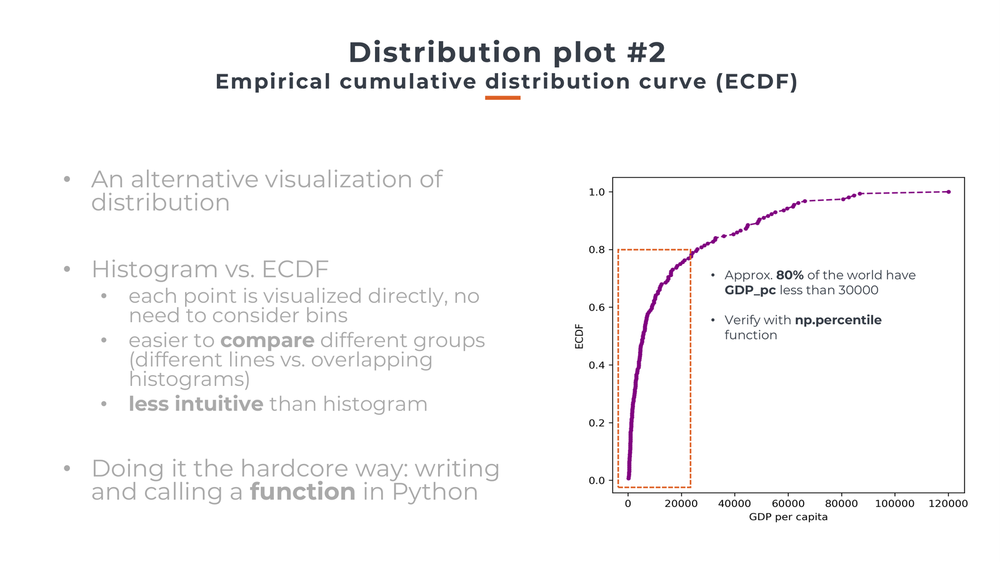

原课件第 10 页：GDP_pc 的经验累积分布曲线（ECDF）

ECDF 是另一种分布可视化方式。与直方图相比：每个点直接呈现，无需考虑分箱；更易比较不同组（不同曲线 vs 重叠直方图）；但不如直方图直观。 
“硬核”做法：在 Python 中编写并调用函数。全球约 80% 的人 GDP_pc 低于 30000，可用 `np.percentile` 验证。
{: .zh }

### Slide 11 · Distribution plot #2: How does our ECDF function work?

- Original data (unsorted) → sorted (using np.sort) → cumulative percentage 1, 2, …, 12 divided by 12.

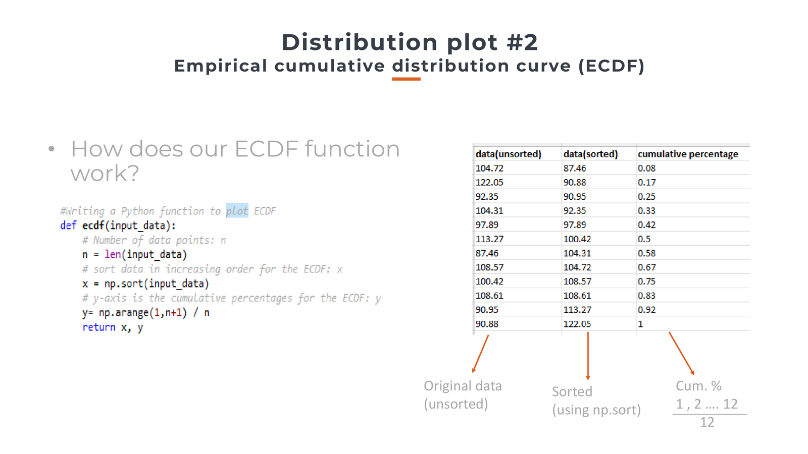

原课件第 11 页：ECDF 函数的排序、累积百分比表与曲线

原始数据（未排序）→ 排序（使用 `np.sort`）→ 累积百分比 1, 2, …, 12 除以 12。
{: .zh }

### Slide 12 · Distribution plot #2: A more complex ECDF

- We use loc to split the dataset into Asia and Africa
- The two ECDFs clearly contrast GDP per capita between the two continents
- In general, ECDFs are very useful to contrast distributions between groups

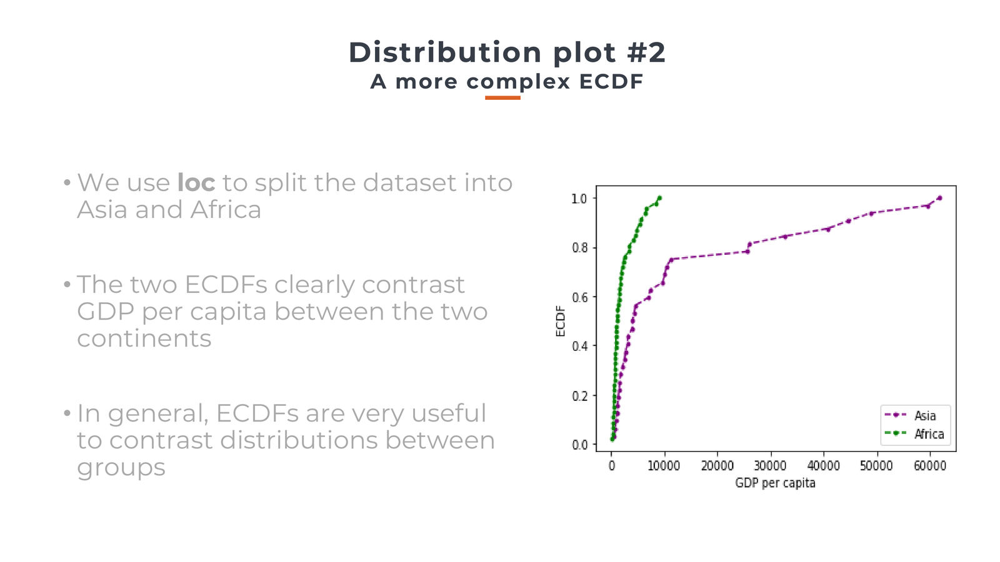

原课件第 12 页：亚洲与非洲 GDP 的 ECDF 对比

用 `loc` 把数据集分为亚洲和非洲；两条 ECDF 清楚对比两个大洲的人均 GDP。一般来说，ECDF 非常适合对比组间分布。
{: .zh }

### Slide 13 · Distribution plot #3: Count plot

- Shows distribution of categorical variables by frequency counts
- Try varying the palette, title, and axis labels
- Try plotting the bars on the y-axis instead

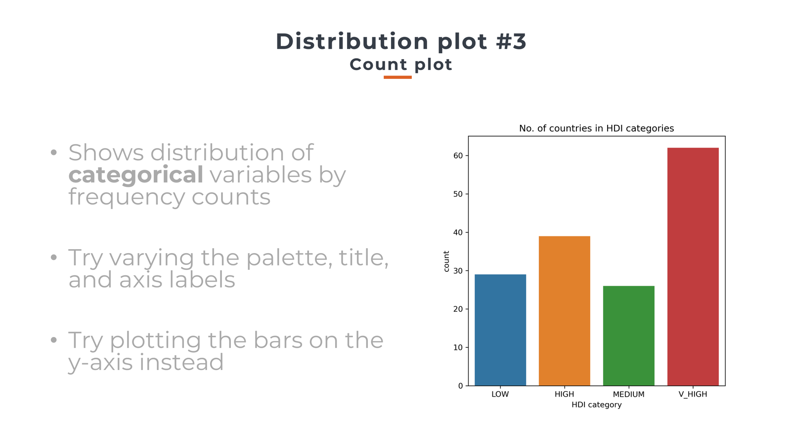

原课件第 13 页：HDI 类别的计数图

按频数展示分类变量的分布；尝试改变调色板、标题和轴标签；尝试把柱子绘制在 y 轴上。
{: .zh }

### Slide 14 · Distribution plot #3: A more complex count plot

- Use the “hue” parameter to distinguish sub-categories
- Breakdown of HDI categories by continent

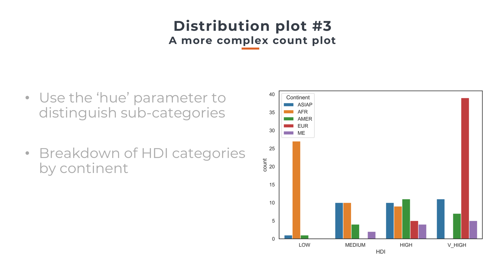

原课件第 14 页：按大洲分组的 HDI 类别计数图

用 “hue” 参数区分子类别；本图按大洲拆分 HDI 类别。
{: .zh }

## 3. Relationship plots　关系图

### Slide 15 · Relationship plot #1: Bar plot

- Shows the relationship between categorical and numerical variables: Continent and (mean) Happiness
- The first plot has confidence intervals, the second one does not
- Confidence intervals are relevant when you are using sample means to estimate the true population mean
- Longer CIs = less confident estimate

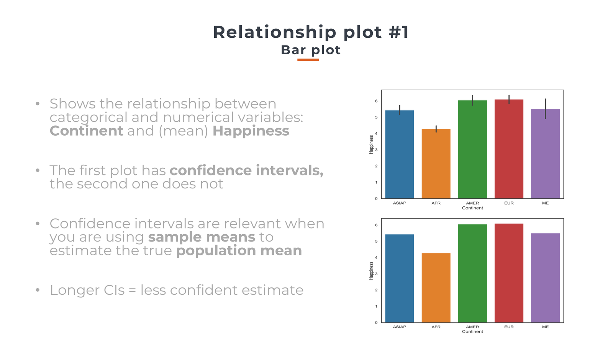

原课件第 15 页：带/不带置信区间的大洲—幸福度柱状图

展示分类变量与数值变量之间的关系：大洲与（平均）幸福度。第一张图有置信区间，第二张没有；当你用样本均值估计真实总体均值时，置信区间才有意义。置信区间越长 = 估计越不确定。
{: .zh }

### Slide 16 · Relationship plot #1: A more complex bar plot

- Use the “hue” parameter to include further categories
- Having too many categories can make bar plots unclear
- Order of categories on x-axis can be changed if preferred (like in this case, low → v_high)
- *sns.catplot can be used to plot categories along rows and columns instead

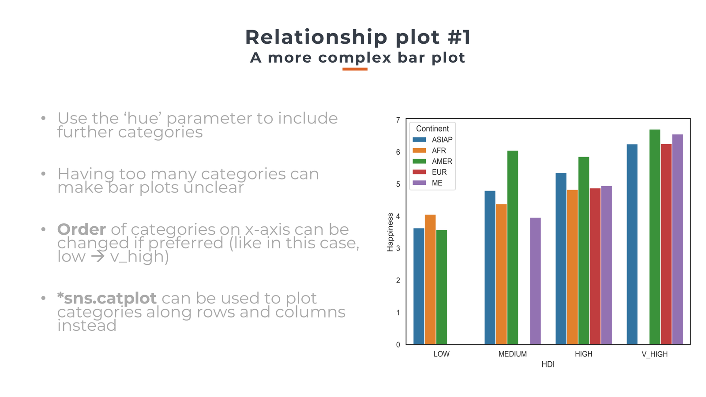

原课件第 16 页：加入更多分类变量的柱状图

用 “hue” 参数加入更多类别；类别太多会让柱状图不清楚。如有需要，可以改变 x 轴类别的顺序（如本例 low → v_high）。也可用 `sns.catplot` 把类别分到行和列上。
{: .zh }

### Slide 17 · Relationship plot #2: Useful variants to bar plots: strip plots and box plots

- Strip plots and box plots are useful variants to show relationships between categorical and numerical variables
- Relative (dis)advantages?
- Bar plot + strip plot (superimposed) is often useful

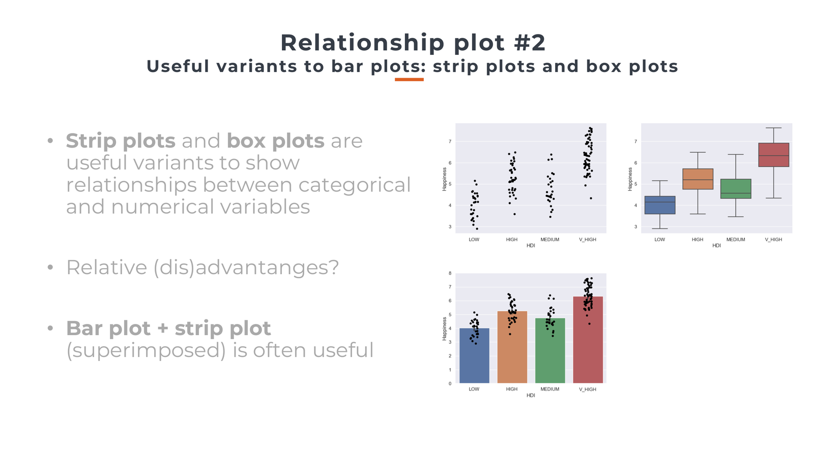

原课件第 17 页：条带图与箱线图

条带图和箱线图是展示分类与数值变量关系的有用变体。它们相对的优势（和缺点）是什么？柱状图 + 条带图（叠加）通常很有用。
{: .zh }

### Slide 18 · Relationship plot #3: Scatterplot

- Key difference between a bar plot and scatterplot?
- Implies a positive relationship between happiness and GDP per capita. Does this make sense?
- Check actual correlations with data.corr()
- Try other continuous variables and discuss their relationships
- Experiment with the “hue” and “size” parameters
- *sns.relplot can be used to plot categories along rows and columns instead

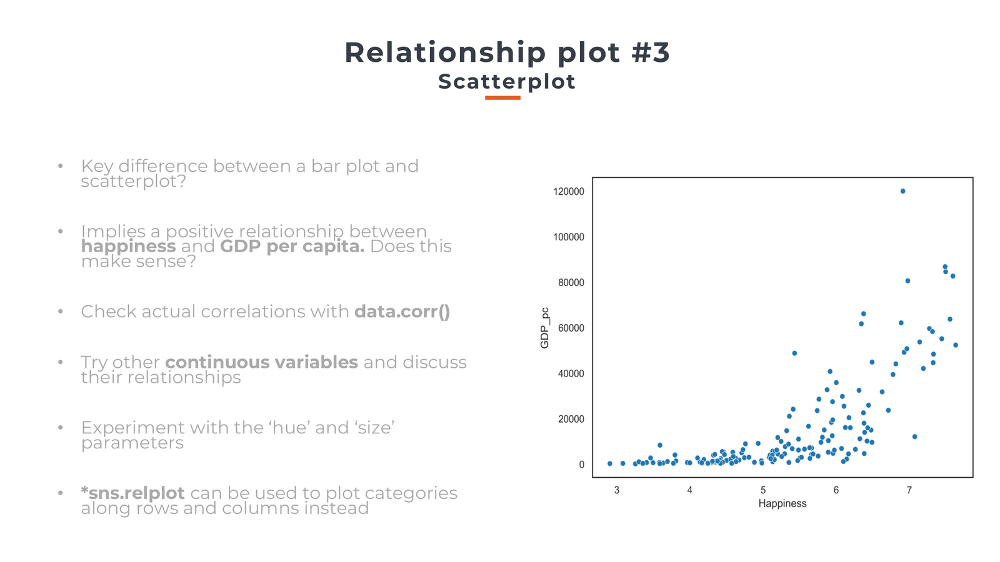

原课件第 18 页：幸福度与人均 GDP 的散点图

柱状图与散点图的关键区别是什么？散点图暗示幸福度与人均 GDP 之间存在正相关，这合理吗？用 `data.corr()` 检查实际相关性；尝试其他连续变量并讨论其关系；试验 “hue” 和 “size” 参数。也可用 `sns.relplot` 把类别分到行和列上。
{: .zh }

### Slide 19 · Relationship plot #3: A scatterplot with a regression line

- lmplot() estimates a regression line, or “line of best fit”, to predict y from x
- *Does this linear model look satisfactory? Why (not)?
- We will learn regression later in the course

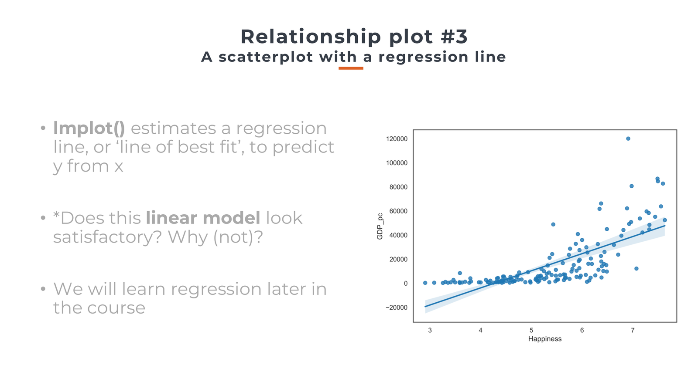

原课件第 19 页：带回归线的散点图

`lmplot()` 估计一条回归线（“最佳拟合线”），用 x 预测 y。这个线性模型看起来令人满意吗？为什么（不）？我们将在课程后面学习回归。
{: .zh }

### Slide 20 · Relationship plot #3: A more complex scatterplot

- Set HDI as the “hue” parameter
- What interesting story does this suggest?
- Try to communicate this story in simple language
- Further enhancements: axis lines to demarcate quadrants

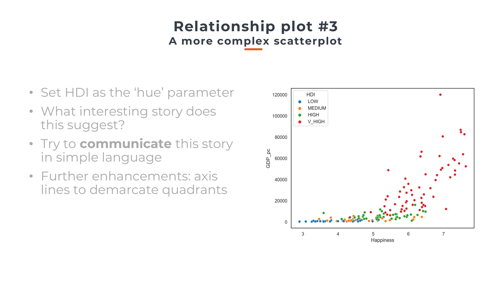

原课件第 20 页：以 HDI 着色的复杂散点图

把 HDI 设为 “hue” 参数。这暗示了什么有趣的故事？尝试用简单语言讲述这个故事。进一步增强：用轴线划分象限。
{: .zh }

## 附录　图表报告提示词

以下六段提示词来自 Lecture 3 配套 docx 文件，英文原文完整保留，下方给出中文翻译；英文是提示词原文，中文仅供理解与使用。

### Prompt 1: Histogram (Continuous Variable Distribution)

<strong>English original.</strong> You are an expert data analyst and visualization specialist. Please analyze and describe the provided Histogram following a structured report format.

- <strong>Chart Mechanics and Mapping:</strong> Identify the continuous numerical variable being visualized, what the bins on the horizontal axis represent, and what the vertical axis indicates (frequency count, probability density, or proportion).
- <strong>Distribution Characteristics:</strong> Detail the statistical shape of the distribution, specifying skewness (positive/right-skewed, negative/left-skewed, or symmetric), modality (unimodal, bimodal, multimodal), spread/variance, central tendency, and the presence of notable gaps or extreme outliers.
- <strong>Binning Evaluation:</strong> Discuss the apparent bin width and resolution. Evaluate whether the chosen number of bins appropriately captures the underlying data pattern without oversimplifying nuances or creating excessive noise (referencing principles like Rice's or Sturges' rule where relevant).
- <strong>Analytical Insights:</strong> Summarize what this distribution reveals about the underlying real-world phenomenon and state any recommendations for data transformation (such as log transformation if heavily skewed).

<strong>中文翻译.</strong> 你是一名数据分析与可视化专家。请按照结构化报告格式分析并描述所给直方图。 
① <strong>图表机制与映射：</strong>指出被可视化的连续数值变量、横轴上的箱代表什么、纵轴表示什么（频数、概率密度或比例）。 
② <strong>分布特征：</strong>说明分布的统计形状，包括偏态（右偏/左偏/对称）、峰态（单峰/双峰/多峰）、离散度/方差、集中趋势，以及是否存在明显缺口或极端离群值。 
③ <strong>分箱评估：</strong>讨论箱宽和分辨率，评估箱数是否恰当捕捉了数据模式，既不过度简化细节，也不制造过多噪声（可参考 Rice 或 Sturges 规则）。 
④ <strong>分析洞察：</strong>总结该分布揭示了什么现实现象，并说明是否建议做数据变换（如严重偏态时做对数变换）。
{: .zh }

### Prompt 2: Empirical Cumulative Distribution Curve (ECDF)

<strong>English original.</strong> You are an expert data analyst and visualization specialist. Please analyze and describe the provided Empirical Cumulative Distribution Curve (ECDF) following a structured report format.

- <strong>Chart Mechanics and Axis Definition:</strong> Explain what the horizontal axis (ordered metric values) and vertical axis (empirical cumulative probability from 0.0 to 1.0) represent, describing how percentiles are read directly from the curve.
- <strong>Curve Trajectory and Quantile Benchmarks:</strong> Identify key benchmark percentiles (such as the median at 0.5 and the 80th percentile), noting where the curve rises most steeply (indicating high data density) and where it flattens (indicating sparse or extreme values).
- <strong>Comparative Dynamics (if multiple curves are present):</strong> If multiple groups or categories are shown, contrast the curves by assessing their horizontal separation, stochastic dominance, and differences in dispersion across groups.
- <strong>Analytical Value:</strong> Highlight the advantages of this ECDF over a binned histogram for this dataset, particularly regarding precision, bin-free representation, and suitability for group comparison.

<strong>中文翻译.</strong> 你是一名数据分析与可视化专家。请按照结构化报告格式分析并描述所给经验累积分布曲线（ECDF）。 
① <strong>图表机制与轴定义：</strong>解释横轴（有序指标值）和纵轴（0.0 到 1.0 的经验累积概率）代表什么，并说明如何从曲线直接读取百分位数。 
② <strong>曲线轨迹与分位基准：</strong>指出关键分位点（如中位数 0.5、第 80 百分位），注意曲线在哪里上升最陡（数据密度高）、在哪里变平（稀疏或极端值）。 
③ <strong>比较动态（多曲线时）：</strong>如果有多组/多类别，比较曲线的水平间距、随机占优以及组间离散度差异。 
④ <strong>分析价值：</strong>强调该 ECDF 相对分箱直方图的优势，尤其是精度、无需分箱以及适合组间比较。
{: .zh }

### Prompt 3: Count Plot (Categorical Frequency Distribution)

<strong>English original.</strong> You are an expert data analyst and visualization specialist. Please analyze and describe the provided Count Plot following a structured report format.

- <strong>Chart Mechanics and Variable Types:</strong> Identify the categorical variable plotted along the primary axis, verify that the opposing axis reflects absolute observation counts, and describe the ordering logic of the categories (e.g., nominal, ordinal, or frequency-sorted).
- <strong>Frequency Patterns and Class Balance:</strong> Report the relative and absolute frequencies across all visible categories, identifying dominant classes (mode), underrepresented groups, and any extreme class imbalances.
- <strong>Subgroup Interactions (if hue/grouping is used):</strong> If sub-categories are encoded using color or clustered bars, analyze the within-group composition and cross-tabulation patterns, noting any prominent demographic or segment skews.
- <strong>Visual Layout Assessment:</strong> Evaluate whether the orientation (vertical vs. horizontal) and color encoding effectively communicate category differences without clutter or ambiguity.

<strong>中文翻译.</strong> 你是一名数据分析与可视化专家。请按照结构化报告格式分析并描述所给计数图。 
① <strong>图表机制与变量类型：</strong>指出主轴上绘制的分类变量，确认另一轴表示绝对观测数，并说明类别的排序逻辑（名义、有序或按频数排序）。 
② <strong>频数模式与类别平衡：</strong>报告所有可见类别的相对和绝对频数，指出主导类别（众数）、代表性不足的群体以及任何极端类别失衡。 
③ <strong>子组交互（使用 hue/分组时）：</strong>如果子类别用颜色或分组柱表示，分析组内构成和交叉表模式，指出明显的人口统计或细分偏差。 
④ <strong>视觉布局评估：</strong>评估方向（垂直/水平）和颜色编码是否有效传达类别差异，且不杂乱、不产生歧义。
{: .zh }

### Prompt 4: Bar Plot (Categorical vs. Continuous Aggregation)

<strong>English original.</strong> You are an expert data analyst and visualization specialist. Please analyze and describe the provided Bar Plot following a structured report format.

- <strong>Aggregation Mechanics:</strong> Identify the categorical grouping variable on one axis and the aggregated continuous variable on the other, specifying the summary statistic displayed (mean, median, or sum).
- <strong>Statistical Uncertainty and Error Bars:</strong> If error bars or confidence intervals are present, interpret their length and overlap. State what they indicate regarding sample variance, estimation certainty, and whether between-group differences appear statistically meaningful.
- <strong>Multivariate Comparison (if hue/clustered bars are present):</strong> Analyze differences across secondary groups, identifying interaction effects, consistent rank orders, or notable anomalies across subgroups.
- <strong>Visual Limitations and Context:</strong> Note any limitations of using aggregate bars for this metric (such as hiding underlying distributions, skewness, or sample size disparities) and mention suitable companion visualizations.

<strong>中文翻译.</strong> 你是一名数据分析与可视化专家。请按照结构化报告格式分析并描述所给柱状图。 
① <strong>聚合机制：</strong>指出一个轴上的分类分组变量和另一个轴上的聚合连续变量，说明显示的是哪种汇总统计量（均值、中位数或总和）。 
② <strong>统计不确定性与误差棒：</strong>如果存在误差棒或置信区间，解释其长度和重叠情况，说明它们对样本方差、估计确定性以及组间差异是否具有统计意义的含义。 
③ <strong>多变量比较（使用 hue/分组柱时）：</strong>分析次级组之间的差异，指出交互效应、一致的排名顺序或子组中的明显异常。 
④ <strong>视觉局限与语境：</strong>指出用聚合柱表示该指标的局限（如掩盖底层分布、偏态或样本量差异），并提及合适的补充可视化。
{: .zh }

### Prompt 5: Strip Plot and Box Plot (Distribution Across Categories)

<strong>English original.</strong> You are an expert data analyst and visualization specialist. Please analyze and describe the provided Strip Plot, Box Plot, or composite visual following a structured report format.

- <strong>Summary Statistics Breakdown (Box Plot components):</strong> For each category, evaluate the five-number summary: minimum whisker boundary, first quartile (Q1), median (Q2), third quartile (Q3), maximum whisker boundary, interquartile range (IQR), and explicitly flagged outlier points.
- <strong>Individual Observation Density (Strip Plot components):</strong> Examine the distribution of raw data points, noting clusters, local density variations, sample sizes per category, and any signs of severe overplotting.
- <strong>Cross-Category Comparative Analysis:</strong> Contrast the groups in terms of central tendency shifts, variance differences (box height and whisker span), and distributional symmetry.
- <strong>Methodological Assessment:</strong> Evaluate the effectiveness of this representation compared to simple aggregate bars, explaining how displaying the spread and individual points enhances diagnostic understanding.

<strong>中文翻译.</strong> 你是一名数据分析与可视化专家。请按照结构化报告格式分析并描述所给条带图、箱线图或组合图。 
① <strong>汇总统计拆解（箱线图部分）：</strong>对每个类别评估五数概括：最小须边界、第一四分位数（Q1）、中位数（Q2）、第三四分位数（Q3）、最大须边界、四分位距（IQR），以及明确标记的离群点。 
② <strong>个体观测密度（条带图部分）：</strong>检查原始数据点的分布，注意聚集、局部密度变化、每类样本量以及严重重叠的迹象。 
③ <strong>跨类别比较分析：</strong>对比各组在集中趋势偏移、方差差异（箱高和须跨度）以及分布对称性方面的差异。 
④ <strong>方法学评估：</strong>评估这种表示相对简单聚合柱的有效性，解释展示离散度和个体点如何增强诊断理解。
{: .zh }

### Prompt 6: Scatterplot and Regression Fit (Bivariate Continuous Relationship)

<strong>English original.</strong> You are an expert data analyst and visualization specialist. Please analyze and describe the provided Scatterplot and any fitted trendlines following a structured report format.

- <strong>Bivariate Dynamics:</strong> Identify the continuous independent variable (x-axis) and dependent variable (y-axis). Describe the overall association in terms of direction (positive, negative, null), strength (dispersion around the trend), and functional form (linear, monotonic, polynomial, exponential).
- <strong>Trendline and Residual Assessment:</strong> If a linear or non-linear regression line is fitted, evaluate its goodness of fit. Note whether the relationship shows heteroscedasticity (expanding or contracting variance), non-linear curvature, or high-leverage outliers that pull the regression slope.
- <strong>Additional Dimensionality (Hue, Size, Style):</strong> If additional variables are mapped via color, point size, or marker shape, interpret how these sub-segments cluster within the 2D space and whether Simpson's paradox or distinct group regimes emerge.
- <strong>Diagnostic and Modeling Takeaways:</strong> Summarize the primary takeaways from this plot, indicating whether variables should undergo transformation (e.g., logarithmic) or be prioritized for predictive modeling.

<strong>中文翻译.</strong> 你是一名数据分析与可视化专家。请按照结构化报告格式分析并描述所给散点图及任何拟合趋势线。 
① <strong>双变量动态：</strong>指出连续自变量（x 轴）和因变量（y 轴），从方向（正/负/无）、强度（围绕趋势的离散度）和函数形式（线性、单调、多项式、指数）描述总体关联。 
② <strong>趋势线与残差评估：</strong>如果拟合了线性或非线性回归线，评估其拟合优度；注意是否存在异方差（方差扩大或收缩）、非线性弯曲或拉动回归斜率的高杠杆离群点。 
③ <strong>附加维度（颜色、大小、样式）：</strong>如果附加变量通过颜色、点大小或标记形状映射，解释这些子段在二维空间中如何聚集，以及是否出现辛普森悖论或不同的组别模式。 
④ <strong>诊断与建模要点：</strong>总结该图的主要结论，说明变量是否应做变换（如对数变换），或是否应优先用于预测建模。
{: .zh }

## 重点词汇 · Key Vocabulary

| English | 中文 | 说明 / 搭配 |
|---|---|---|
| histogram | 直方图 | 用箱展示数值变量分布 |
| bins | 箱 | 直方图的区间；过多/过少都有问题 |
| skewness | 偏态 | 分布不对称；右偏有长右尾 |
| ECDF | 经验累积分布曲线 | 无需分箱，便于比较组间分布 |
| count plot | 计数图 | 分类变量的频数分布 |
| bar plot | 柱状图 | 分类与数值变量的汇总关系 |
| confidence interval | 置信区间 | 估计的不确定性；越长越不确定 |
| strip plot | 条带图 | 展示每个观测点 |
| box plot | 箱线图 | 五数概括与离群值 |
| scatterplot | 散点图 | 两个连续变量的关系 |
| regression line | 回归线 | 最佳拟合线 |
| log transformation | 对数变换 | 压缩范围、减小偏态、弱化离群值 |
| EDA | 探索性数据分析 | 用可视化探索数据 |
| hue | 颜色分组 | 按子类别着色 |
| dpi | 分辨率 | 图像每英寸点数 |
