# Lecture 4 · Basic data analytic techniques

Regression · Classification · Clustering · Supervised vs. unsupervised

LECTURE 4 · 方法地图

学术英语阅读与写作 · 课件来源：Lecture4.pdf（22 页）

!!! info "阅读说明"

    本讲义按原课件逐页整理：英文条目为课件原文，其下附中文对照；图表、数据表截图与示意图页附原课件整页图片。课件中的红/蓝字课堂批注整理为「课堂批注」引用框。课件第 1 页为课程封面，未收录。文末附本讲<strong>重点词汇表</strong>。

## 1. Warm-up　课堂判断

### Slide 2 · True or False?

Each group should agree on one set of answers.

1. Data visualizations are aimed at technical/scientific audiences rather than laypersons.
2. Besides distributions and relationships, data visualizations can alert us to the potential need to transform our data before further analysis.
3. Histograms and ECDFs convey distributional information that complement each other.
4. A scatterplot can visualize comparisons of COVID cases between countries.
5. A barplot can visualize the link between COVID cases and GDP per capita across countries.

每组应商定一套答案：① 数据可视化面向技术/科学受众，而不是普通人；② 除分布和关系外，数据可视化还能提醒我们在进一步分析前可能需要变换数据；③ 直方图和 ECDF 传达的分布信息相互补充；④ 散点图可以可视化国家间 COVID 病例的比较；⑤ 柱状图可以可视化各国 COVID 病例与人均 GDP 之间的联系。
{: .zh }

!!! quote "课堂批注"

    答案依次为 False, True, True, False, False。

### Slide 3 · Outline

- Real life scenarios of DA and machine learning
- Overview of machine learning
- The continuum of supervised to unsupervised learning: regression, classification, clustering

数据分析与机器学习的真实场景；机器学习概览；从有监督到无监督的连续谱——回归、分类、聚类。
{: .zh }

## 2. Real-life scenarios　真实场景

### Slide 4 · Scenario #1: Education

- Outcome(s): effect, result etc. of interest
- Factor(s)/feature(s): things that (may) influence outcome(s)
- Potential features and outcomes?
- How to quickly gauge?
- Why are they interesting from an education point of view?

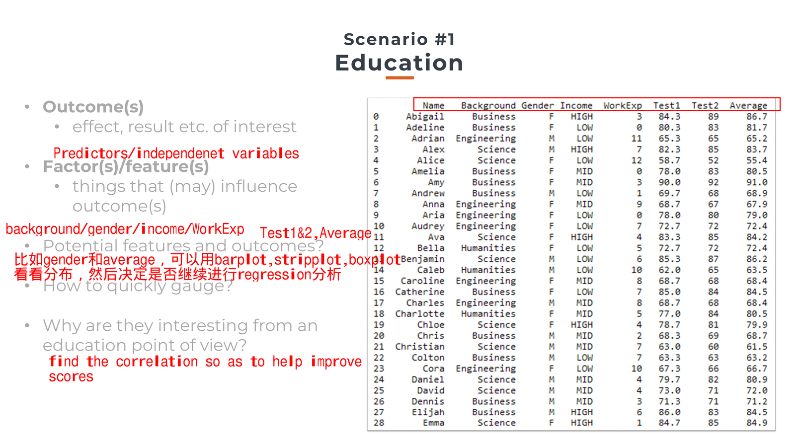

原课件第 4 页：教育场景的数据表与红字批注

结果（outcome）：关注的效应、结果等。因素/特征（factor/feature）：可能影响结果的东西。可能的特征和结果是什么？如何快速把握？从教育角度看，它们为什么有趣？
{: .zh }

!!! quote "课堂批注"

    Outcome＝Test1 & 2, Average；Features＝background / gender / income / WorkExp；这些也是 predictors / independent variables。可以先用 barplot、stripplot、boxplot 看分布，再决定是否继续做 regression；目的是找出相关以帮助提高成绩。

### Slide 5 · Scenario #2: Society and politics

- Potential features and outcomes?
- How to quickly gauge?
- Why are they interesting from a social/political/economic point of view?

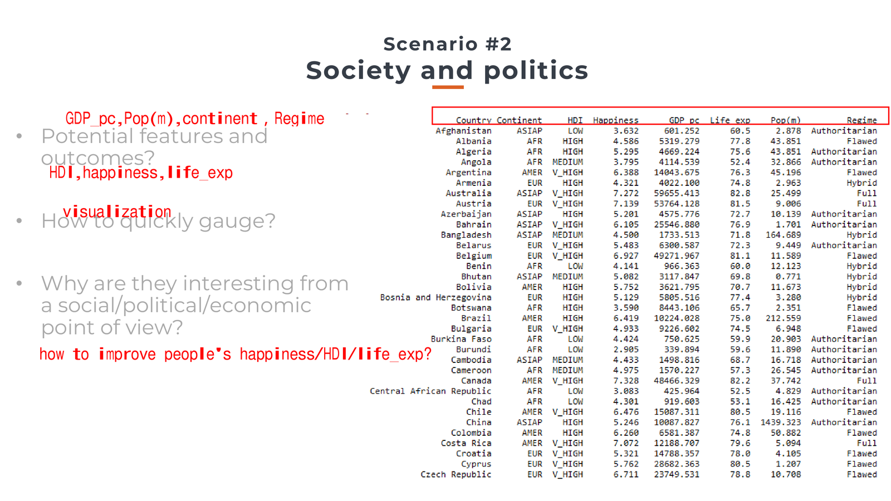

原课件第 5 页：社会与政治场景的数据表与红字批注

可能的特征和结果是什么？如何快速把握？从社会/政治/经济角度看，它们为什么有趣？
{: .zh }

!!! quote "课堂批注"

    Features / outcomes：HDI, happiness, life_exp；GDP_pc, Pop(m), continent, Regime。核心问题是 how to improve people's happiness / HDI / life_exp；可以先用可视化。

### Slide 6 · Scenario #3: COVID-19

- We now consider a different objective
- Instead of focusing on features/outcomes, we want to group countries based on COVID (dis)similarities
- For what?
- Similar applications in education, society, linguistics?

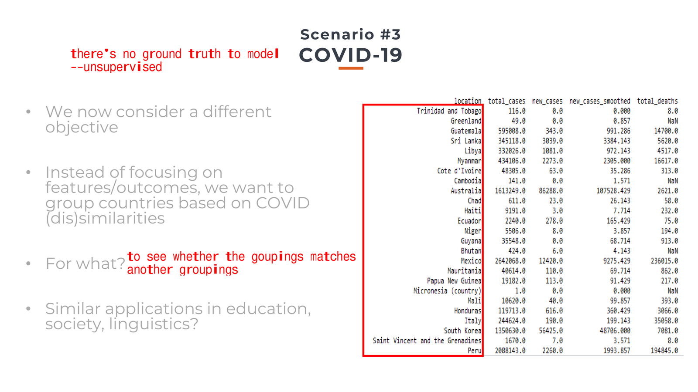

原课件第 6 页：COVID-19 场景的数据表与红字批注

现在考虑一个不同的目标：不关注特征/结果，而是根据 COVID 的（不）相似性给国家分组。为了什么？教育、社会、语言学中有类似应用吗？
{: .zh }

!!! quote "课堂批注"

    看分组是否与另一套分组吻合；没有 ground truth 可建模 → 无监督。也可思考：能否按写作（语料库）聚类？

### Slide 7 · Beyond descriptive analytics

- In these scenarios, the main objectives were
    - to diagnose relationships between factors and outcomes
    - to predict new outcomes based on these relationships
    - to discover natural groups in our data
    - … to act upon the above insights
- We can gain a quick overview with data visualizations
- We can then use data analytic (mostly machine learning) techniques to address the objectives

这些场景的主要目标：① 诊断因素与结果之间的关系；② 基于这些关系预测新结果；③ 发现数据中的自然分组；④ 据此采取行动。 
可以先用可视化快速概览，再用数据分析（多为机器学习）技术实现目标。
{: .zh }

!!! quote "课堂批注"

    回顾数据分析四阶段：descriptive, diagnostic, predictive, prescriptive；本页目标属于诊断性分析。

## 3. Overview of machine learning　机器学习总览

### Slide 8 · A roadmap of machine learning

- Machine learning is itself a key branch of AI
- Branches → general tasks (e.g. regression) → specific algorithms (e.g. linear, lasso)
- We will cover the circled portion
- This will give you a solid foundation to pursue advanced courses

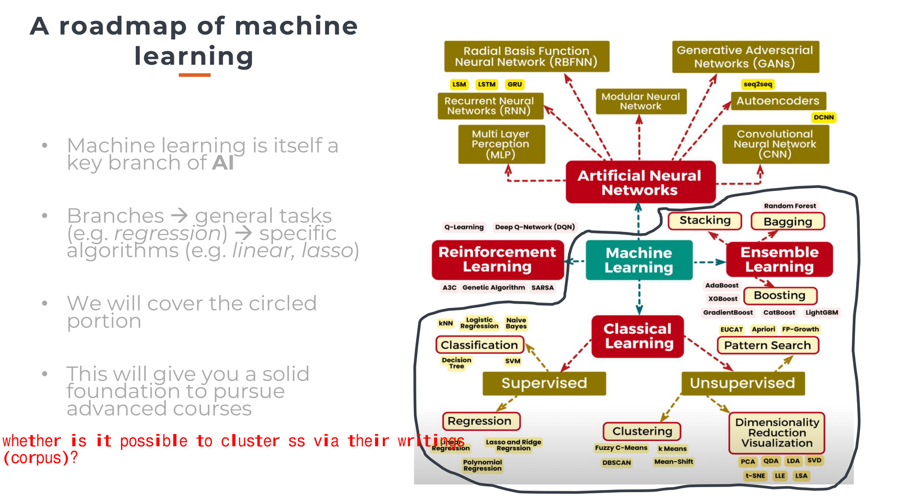

原课件第 8 页：机器学习路线图（本课程覆盖圈出的部分）

机器学习本身是 AI 的关键分支；分支 → 一般任务（如回归）→ 具体算法（如 linear、lasso）。本课程覆盖图中圈出的部分，为进阶课程打下基础。
{: .zh }

!!! quote "课堂批注"

    思考：能否按写作（语料库）对 SS 聚类？

### Slide 9 · A basic data analytic workflow

- Applies across regression, classification, and clustering
- <strong>Explore:</strong> prepare the dataset and explore it
- <strong>Apply:</strong> apply an algorithm to train a ML model
- <strong>Evaluate:</strong> evaluate/test the resulting model
- <strong>Interpret:</strong> interpret and use model critically (e.g., for theorization and/or predictions)

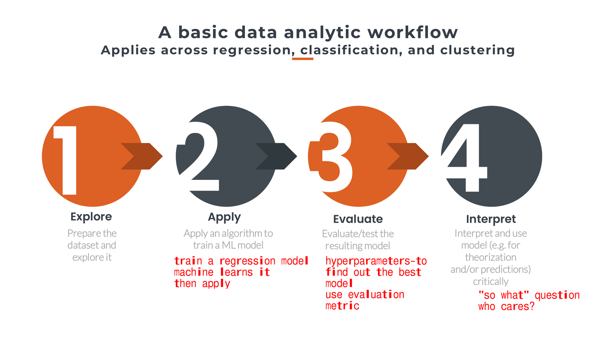

原课件第 9 页：基本数据分析流程（Explore → Apply → Evaluate → Interpret）

该流程适用于回归、分类和聚类：<strong>探索</strong>——准备数据集并探索；<strong>应用</strong>——应用算法训练机器学习模型；<strong>评估</strong>——评估/测试得到的模型；<strong>解释</strong>——批判性地解释和使用模型（如理论化/预测）。
{: .zh }

!!! quote "课堂批注"

    训练回归模型；机器学会后应用；用超参数找最佳模型；使用评估指标；最后问 “so what”：谁在乎？

## 4. Regression, classification, clustering　回归、分类与聚类

### Slide 10 · Regression

- To investigate whether outcome(s) systematically vary along with feature(s)
- Features are also called predictors (or more narrowly, independent variables)
- Different algorithms: linear, ridge, lasso, elastic net, polynomial etc.
- Linear regression models are collectively known as the General Linear Model
- $y = \beta x + \varepsilon$ (outcome = coefficient × predictor + error)
- If the feature(s) change by this much, do the outcome(s) systematically change by that much?
- How accurately can we predict new outcomes based on the above?

研究结果是否随特征系统变化。特征也叫预测变量（更狭义地叫自变量）。不同算法：linear、ridge、lasso、elastic net、polynomial 等；线性回归模型统称一般线性模型。 
$y = \beta x + \varepsilon$（结果 = 系数 × 预测变量 + 误差）。特征变化这么多，结果是否也系统变化这么多？基于上述关系预测新结果有多准确？
{: .zh }

!!! quote "课堂批注"

    x 轴、y 轴；通常用于控制实验研究，也用于观察性研究；捕捉不同类型的关系。

### Slide 11 · Regression: Simple regression, one predictor at a time

- A simple regression with one predictor is often not a very good model.
- $R^2$ is an evaluation metric for linear regression models.
- One categorical predictor with two levels is also a regression—actually a one-way ANOVA.

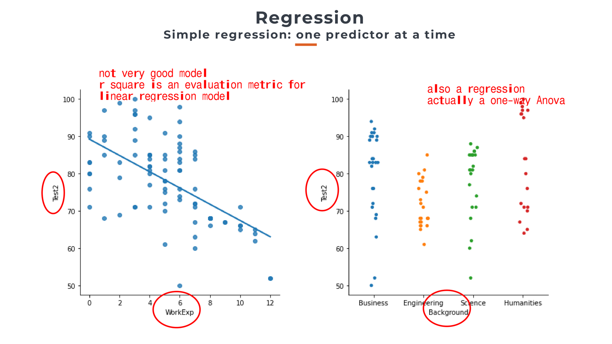

原课件第 11 页：简单线性回归与单分类预测变量回归

只有一个预测变量的简单回归往往不是很好的模型。$R^2$ 是线性回归模型的评估指标。一个有两个水平的分类预测变量也是回归——实际上是单因素方差分析（one-way ANOVA）。
{: .zh }

!!! quote "课堂批注"

    单预测变量模型往往不够好；$R^2$ 是线性回归的评估指标；二水平分类预测变量的回归实际上是 one-way ANOVA。

### Slide 12 · Regression: Multiple regression, >1 (interacting) predictors

- A different slope for each background
- Interaction effect of background and WorkExp, on Test
- The effect of WorkExp on Test differs across backgrounds
- Interaction effect looks weak in this case. How do we know?

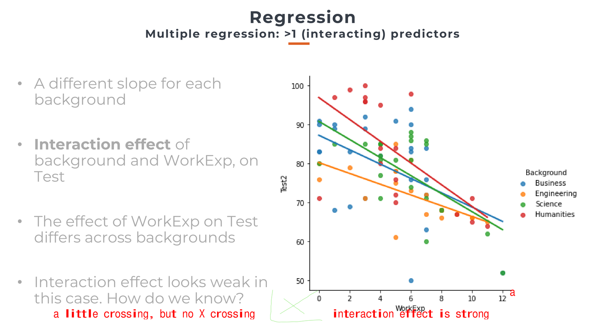

原课件第 12 页：多预测变量与交互效应

每个背景有不同的斜率；背景与 WorkExp 对 Test 存在交互效应；WorkExp 对 Test 的效应因背景而异。本例中交互效应看起来较弱——我们怎么知道？
{: .zh }

!!! quote "课堂批注"

    图中线条略有交叉，但没有明显的 X 形交叉；交互效应强时会出现明显的 X 形交叉。

### Slide 13 · Classification

- When the outcome is discrete rather than continuous (i.e. a label rather than a numerical value)
- If the feature(s) change by this much, (how likely) does the outcome label change?
- How accurately can we predict new labels based on the above?
- Different algorithms: k-nearest-neighbours (k-NN), logistic regression, support vector machine (SVM), naïve Bayes, decision trees etc.
- Some algorithms can be used for both regression and classification (e.g. decision trees, random forests, k-NN, SVM), though seldom in practice

当结果是离散的而非连续的（即标签而非数值）。特征变化这么多，结果标签（多大概率）会变化？基于上述关系预测新标签有多准确？ 
不同算法：k 近邻（k-NN）、逻辑回归、支持向量机（SVM）、朴素贝叶斯、决策树等。有些算法既可用于回归也可用于分类（决策树、随机森林、k-NN、SVM），但实践中很少两用。
{: .zh }

### Slide 14 · Classification: One predictor at a time

- Outcome: 0 = Not democratic; 1 = democratic
- Predictor: happiness
- Predicted probability of democracy between 0 and 1, using a logistic curve
- Effect looks weak in this case. How do we know?
- Logistic regression as a probability-based algorithm

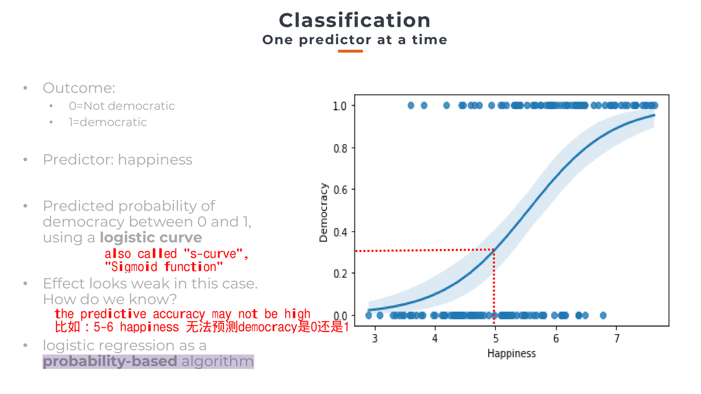

原课件第 14 页：以幸福度预测民主政体的 logistic 曲线

结果：0 = 非民主，1 = 民主。预测变量：幸福度。用逻辑曲线给出 0 到 1 之间的民主概率。本例效应看起来较弱——我们怎么知道？逻辑回归是一种基于概率的算法。
{: .zh }

!!! quote "课堂批注"

    也叫 “s-curve”、“Sigmoid function”；预测准确率可能不高；比如幸福度 5–6 时无法判断民主是 0 还是 1。

### Slide 15 · Classification: Multiple features

- Using both happiness and GDP_pc to predict if a country is democratic
- k-nearest-neighbours as a spatial algorithm

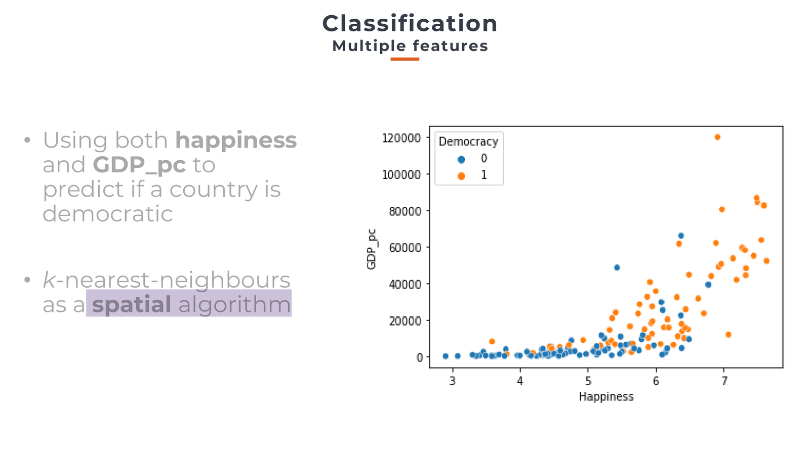

原课件第 15 页：以 happiness 与 GDP_pc 进行 k-NN 分类

同时用幸福度和 GDP_pc 预测一个国家是否民主。k 近邻是一种空间算法。
{: .zh }

### Slide 16 · Clustering (or cluster analysis)

- Used to discover latent categories/groups based on available information (i.e., features)
- These created groups are called clusters
- Members within each cluster are maximally similar to one another
- Clusters are maximally distinct from one another
- Different algorithms: k-means, hierarchical (agglomerative vs. divisive), DBSCAN, spectral etc.

用于根据现有信息（特征）发现潜在类别/分组；生成的组称为簇（clusters）。同一簇内成员彼此最大化相似，不同簇之间最大化不同。 
不同算法：k-means、层次聚类（凝聚式 vs 分裂式）、DBSCAN、谱聚类等。
{: .zh }

!!! quote "课堂批注"

    hidden / implicit；用欧氏距离计算距离；不同组不应重叠；层次聚类分 bottom-up / top-down。

### Slide 17 · Clustering: K-means

- Features: GDP per capita; life expectancy; cases per million; deaths per million, reduced to two dimensions
- Outcomes: three natural groups/clusters

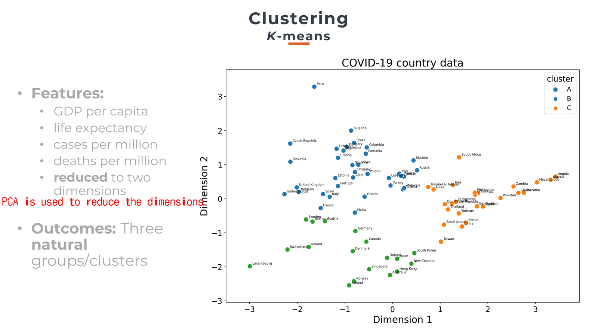

原课件第 17 页：K-means 聚类结果

特征：人均 GDP、预期寿命、每百万病例、每百万死亡，降到二维。结果：三个自然分组/簇。
{: .zh }

!!! quote "课堂批注"

    用 PCA 降维。

### Slide 18 · Clustering: Hierarchical

- A different algorithm
- Outcome presented in a dendrogram
- Key research area:
    - How similar are the results of different algorithms?
    - Which algorithm is objectively “best”?

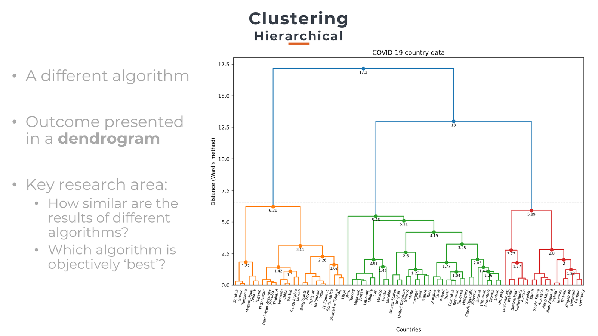

原课件第 18 页：层次聚类的树状图（dendrogram）

一种不同的算法，结果用树状图（dendrogram）呈现。关键研究领域：不同算法的结果有多相似？哪个算法客观地“最好”？
{: .zh }

### Slide 19 · Supervised vs. unsupervised machine learning

- Regression and classification are supervised learning techniques
    - we provide both features and outcomes to the machine
    - predictions can be evaluated as right/wrong
- Clustering is an unsupervised learning technique
    - we only provide features
    - no ground truth to evaluate the solution; optimality rather than correctness

回归和分类是有监督学习：同时向机器提供特征和结果，预测可以判断对/错。 
聚类是无监督学习：只提供特征，没有 ground truth 评估解，追求最优而非正确。
{: .zh }

!!! quote "课堂批注"

    Z-score；数据已被缩放。

### Slide 20 · Supervised ↔ unsupervised learning

- Supervised vs. unsupervised is often treated as distinct, but it is more accurate to posit a continuum between fully human-guided and fully machine-guided data analysis
- Examples of mid-points along the continuum
    - Applying both in a single study, for different related purposes
    - Intrinsically blending supervised and unsupervised learning; e.g. semi-supervised learning

有监督与无监督常被当作二分，但更准确的是把它们看作从完全人工引导到完全机器引导的连续谱。连续谱中间点的例子：① 同一研究中使用两者，服务于不同但相关的目的；② 内在融合有监督与无监督学习，如半监督学习。
{: .zh }

!!! note "文献"

    El Aissaoui, O., El Alami El Madani, Y., Oughdir, L., & El Allioui, Y. (2019). Combining supervised and unsupervised machine learning algorithms to predict the learners' learning styles. *Procedia Computer Science*, 148, 87–96.

    van Engelen, J. E., & Hoos, H. H. (2020). A survey on semi-supervised learning. *Machine Learning*, 109(2), 373–440.

### Slide 21 · The next three weeks

- L5: Regression
- L6: Classification
- L7: Clustering
- Basic theory, code, examples, and practice

L5：回归；L6：分类；L7：聚类。内容包括基础理论、代码、例子和练习。
{: .zh }

### Slide 22 · Summary

- Machine learning is used in the real world to gain insights and solve practical problems
- Techniques lie along a continuum from supervised to unsupervised learning
- Regression, classification, and clustering are the three key techniques we will learn (with some dimensionality reduction and ensemble learning)
- For each of these, we will learn one key algorithm

机器学习在现实世界中用于获得洞察和解决实际问题；技术位于从有监督到无监督的连续谱上；回归、分类和聚类是我们将学习的三大关键技术（还包括一些降维和集成学习）；对每种技术，我们将学习一个关键算法。
{: .zh }

!!! quote "课堂批注"

    集成学习——在多个模型中选择最好的一个。

## 重点词汇 · Key Vocabulary

| English | 中文 | 说明 / 搭配 |
|---|---|---|
| regression | 回归 | 连续结果变量与预测变量的关系 |
| classification | 分类 | 离散/类别结果的预测 |
| clustering | 聚类 | 发现潜在自然分组 |
| supervised learning | 有监督学习 | 特征 + 结果 |
| unsupervised learning | 无监督学习 | 只有特征 |
| feature | 特征 | 可能影响结果的变量 |
| outcome | 结果变量 | 研究关注的效应/结果 |
| interaction effect | 交互效应 | 一个预测变量的效应随另一个变量水平而变 |
| logistic regression | 逻辑回归 | 基于概率的分类算法 |
| k-NN | k 近邻 | 按最近邻居多数投票分类 |
| k-means | K 均值聚类 | 按距离把样本分到 k 个簇 |
| hierarchical clustering | 层次聚类 | 用树状图呈现聚类 |
| PCA | 主成分分析 | 降维方法 |
| hyperparameter | 超参数 | 训练前设定的参数（如 k） |
| workflow | 工作流程 | 探索 → 应用 → 评估 → 解释 |
