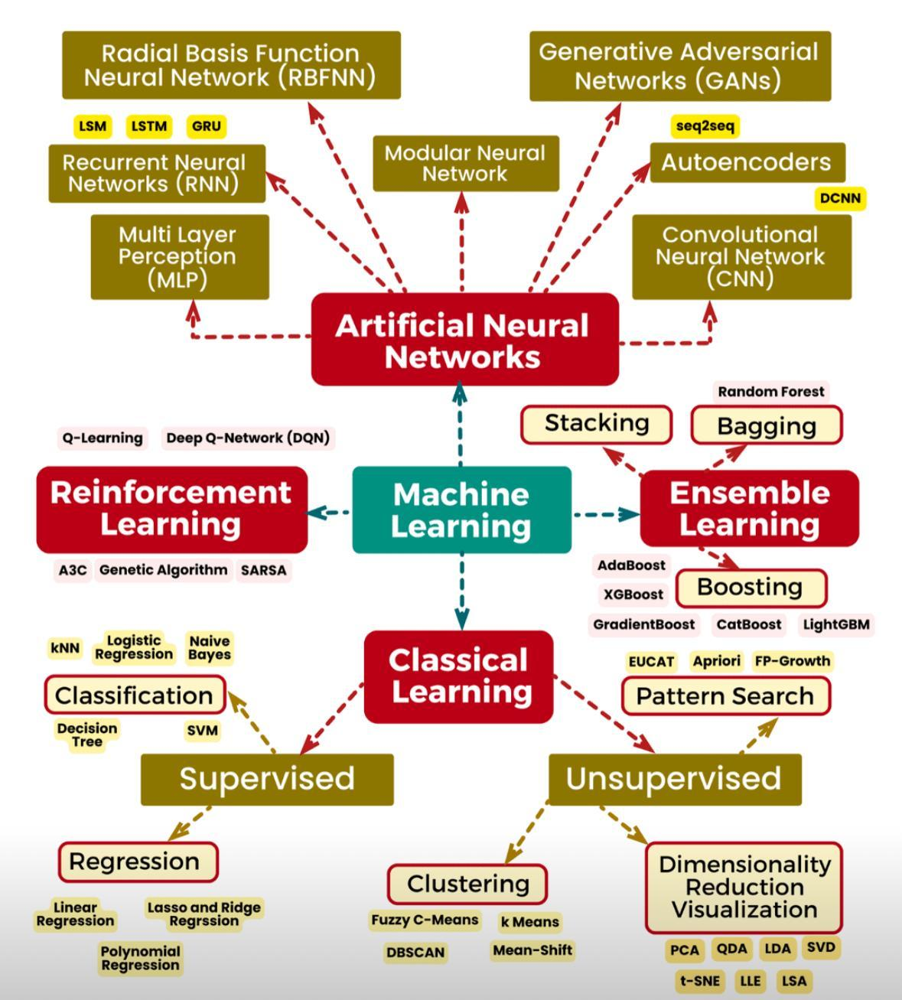
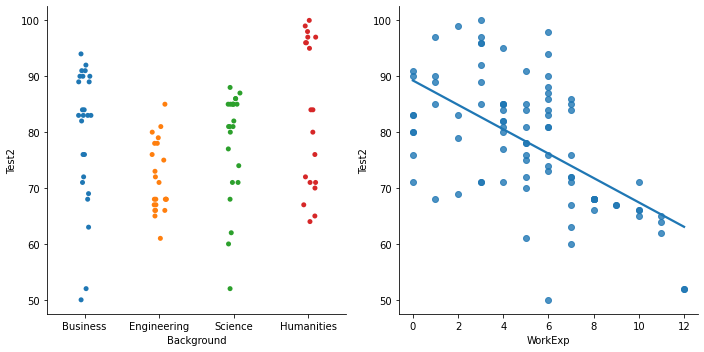
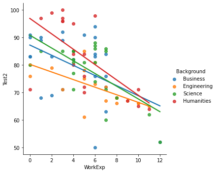
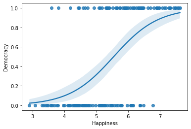
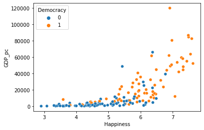
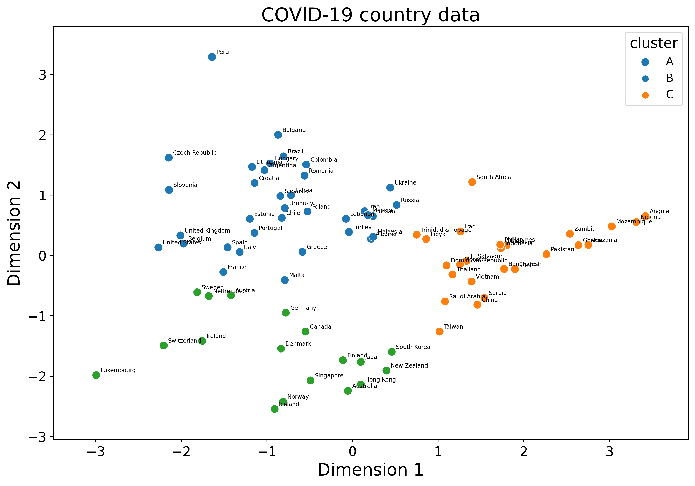
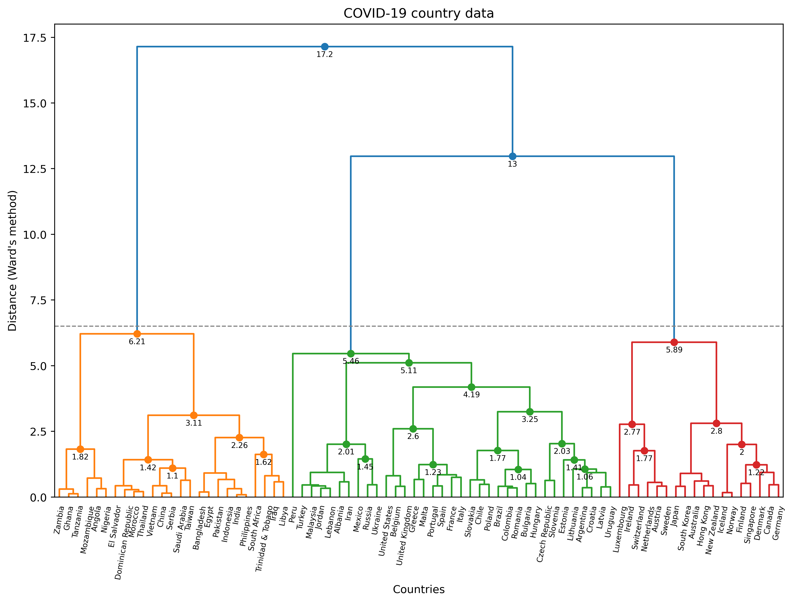

# Lecture 4 · Basic data analytic techniques

Regression · Classification · Clustering · Supervised vs. unsupervised

LECTURE 4 · 方法地图

学术英语阅读与写作 · 课件来源：Lecture4.pdf（22 页）

!!! info "阅读说明"

    英文条目为课件原文，其下为中文对照翻译；课件中的课堂批注整理为引用框，批注本身为中文补充。

## 1. Warm-up　课堂判断

### Slide 2 · True or False?

1. Data visualizations are aimed at technical/scientific audiences rather than laypersons.
2. Besides distributions and relationships, data visualizations can alert us to the potential need to transform our data before further analysis.
3. Histograms and ECDFs convey distributional information that complement each other.
4. A scatterplot can visualize comparisons of COVID cases between countries.
5. A barplot can visualize the link between COVID cases and GDP per capita across countries.

<strong>中文对照：</strong>

1. 数据可视化面向的是技术/科学受众，而不是普通大众。
2. 除了分布与关系，数据可视化还能提示我们在进一步分析前可能需要对数据做变换。
3. 直方图与 ECDF 传达的分布信息可以相互补充。
4. 散点图可以用来可视化国家之间 COVID 病例的比较。
5. 柱状图可以用来可视化各国 COVID 病例与人均 GDP 之间的联系。
{: .zh }

!!! quote "课堂批注"

    答案依次为 False, True, True, False, False。

### Slide 3 · Outline

1. Real life scenarios of DA and machine learning
2. Overview of machine learning
3. The continuum of supervised to unsupervised learning: regression, classification, clustering

<strong>中文对照：</strong>

1. 数据分析与机器学习的真实场景
2. 机器学习总览
3. 从监督学习到无监督学习的连续谱：回归、分类、聚类
{: .zh }

## 2. Real-life scenarios　真实场景

### Slide 4 · Scenario #1: Education

- Outcome(s): effect, result etc. of interest
- Factor(s)/feature(s): things that (may) influence outcome(s)
- Potential features and outcomes?
- How to quickly gauge?
- Why are they interesting from an education point of view?

<strong>中文对照：</strong>

- 结果（outcome）：所关注的效应、结果等
- 因素/特征（factor/feature）：可能影响结果的因素
- 潜在的特征与结果有哪些？
- 如何快速判断？
- 从教育角度看，它们为什么值得关注？

!!! quote "课堂批注"

    Outcome：Test1 & 2, Average；Features：background / gender / income / WorkExp；这些也是 predictors / independent variables。可以先用 barplot、stripplot、boxplot 看分布，再决定是否继续做 regression；目的是找出相关性以帮助提高成绩。

### Slide 5 · Scenario #2: Society and politics

- Potential features and outcomes?
- How to quickly gauge?
- Why are they interesting from a social/political/economic point of view?

<strong>中文对照：</strong>

- 潜在的特征与结果有哪些？
- 如何快速判断？
- 从社会/政治/经济角度看，它们为什么值得关注？

!!! quote "课堂批注"

    Features / outcomes：HDI, happiness, life_exp；GDP_pc, Pop(m), continent, Regime。核心问题是 how to improve people's happiness / HDI / life_exp；可以先用 visualization。

### Slide 6 · Scenario #3: COVID-19

- We now consider a different objective
- Instead of focusing on features/outcomes, we want to group countries based on COVID (dis)similarities
- For what?
- Similar applications in education, society, linguistics?

<strong>中文对照：</strong>

- 现在我们考虑一个不同的目标
- 不再聚焦特征/结果，而是根据 COVID 的（不）相似性对国家进行分组
- 为了什么？
- 教育、社会、语言学中是否有类似应用？

!!! quote "课堂批注"

    目标是看分组是否与另一种分组吻合；这里没有 ground truth 可供建模，因此属于 unsupervised。也可思考：能否根据写作（语料）对 SS 进行聚类？

### Slide 7 · Beyond descriptive analytics

- In these scenarios, the main objectives were
    - to diagnose relationships between factors and outcomes
    - to predict new outcomes based on these relationships
    - to discover natural groups in our data
    - … to act upon the above insights
- We can gain a quick overview with data visualizations
- We can then use data analytic (mostly machine learning) techniques to address the objectives

<strong>中文对照：</strong>

- 在这些场景中，主要目标是：
    - 诊断因素与结果之间的关系
    - 基于这些关系预测新的结果
    - 发现数据中的自然分组
    - …… 并根据上述洞见采取行动
- 我们可以用数据可视化获得快速总览
- 然后使用数据分析（主要是机器学习）技术来实现这些目标

!!! quote "课堂批注"

    回顾数据分析四阶段：descriptive、diagnostic、predictive、prescriptive；本页目标大致属于 diagnostic。

## 3. Overview of machine learning　机器学习总览

### Slide 8 · A roadmap of machine learning

- Machine learning is itself a key branch of AI
- Branches → general tasks (e.g., regression) → specific algorithms (e.g., linear, lasso)
- We will cover the circled portion
- This will give you a solid foundation to pursue advanced courses

<strong>中文对照：</strong>

- 机器学习本身就是 AI 的一个关键分支
- 分支 → 一般任务（如回归）→ 具体算法（如 linear、lasso）
- 我们将覆盖图中圈出的部分
- 这将为你后续学习进阶课程打下坚实基础

原课件第 8 页：机器学习路线图（本课程覆盖圈出的部分）

### Slide 9 · A basic data analytic workflow

- Applies across regression, classification, and clustering
- <strong>Explore:</strong> prepare the dataset and explore it
- <strong>Apply:</strong> apply an algorithm to train a ML model
- <strong>Evaluate:</strong> evaluate/test the resulting model
- <strong>Interpret:</strong> interpret and use model critically (e.g., for theorization and/or predictions)

<strong>中文对照：</strong>

- 适用于回归、分类与聚类
- <strong>探索：</strong>准备数据集并对其进行探索
- <strong>应用：</strong>应用算法训练机器学习模型
- <strong>评估：</strong>评估/检验所得模型
- <strong>解释：</strong>批判性地解释并使用模型（例如用于理论化与/或预测）

!!! quote "课堂批注"

    训练回归模型后，机器学到的模型再用于应用；hyperparameters 用来寻找最佳模型；用 evaluation metric 评估；最后问 “so what” question：who cares?

## 4. Regression, classification, clustering　回归、分类与聚类

### Slide 10 · Regression

- To investigate whether outcome(s) systematically vary along with feature(s)
- Features are also called predictors (or more narrowly, independent variables)
- Different algorithms: linear, ridge, lasso, elastic net, polynomial etc.
- Linear regression models are collectively known as the General Linear Model
- $y = \beta x + \varepsilon$ (outcome = coefficient × predictor + error)
- If the feature(s) change by this much, do the outcome(s) systematically change by that much?
- How accurately can we predict new outcomes based on the above?

<strong>中文对照：</strong>

- 研究结果是否会随特征系统地变化
- 特征也称为预测变量（更狭义地说，自变量）
- 不同算法：linear、ridge、lasso、elastic net、polynomial 等
- 线性回归模型统称为一般线性模型
- $y = \beta x + \varepsilon$（结果 = 系数 × 预测变量 + 误差）
- 如果特征变化这么多，结果是否也会系统地变化那么多？
- 基于上述关系，我们能多准确地预测新的结果？

!!! quote "课堂批注"

    x 轴 / y 轴；常用于控制实验研究，也用于观察性研究；可捕捉不同类型的关系。

### Slide 11 · Simple regression, one predictor at a time

- A simple regression with one predictor is often not a very good model.
- $R^2$ is an evaluation metric for linear regression models.
- One categorical predictor with two levels is also a regression—actually a one-way ANOVA.

<strong>中文对照：</strong>

- 只有一个预测变量的简单回归往往不是一个很好的模型。
- $R^2$ 是线性回归模型的一个评估指标。
- 一个二水平分类预测变量也属于回归——实际上就是单因素方差分析（one-way ANOVA）。

原课件第 11 页：简单线性回归与单分类预测变量回归

!!! quote "课堂批注"

    单预测变量模型往往不够好；$R^2$ 是线性回归的评估指标；一个二水平分类预测变量的回归实际上就是 one-way ANOVA。

### Slide 12 · Multiple regression, >1 (interacting) predictors

- A different slope for each background
- Interaction effect of background and WorkExp, on Test
- The effect of WorkExp on Test differs across backgrounds
- Interaction effect looks weak in this case. How do we know?

<strong>中文对照：</strong>

- 每个背景对应不同的斜率
- background 与 WorkExp 对 Test 的交互效应
- WorkExp 对 Test 的效应因背景而异
- 本例中交互效应看起来较弱。我们怎么看出来？

原课件第 12 页：多预测变量与交互效应

!!! quote "课堂批注"

    图中线条略有交叉，但没有明显的 X 形交叉；交互效应强时会出现明显交叉。

### Slide 13 · Classification

- When the outcome is discrete rather than continuous (i.e., a label rather than a numerical value)
- If the feature(s) change by this much, (how likely) does the outcome label change?
- How accurately can we predict new labels based on the above?
- Different algorithms: k-nearest-neighbours (k-NN), logistic regression, support vector machine (SVM), naïve Bayes, decision trees etc.
- Some algorithms can be used for both regression and classification (e.g., decision trees, random forests, k-NN, SVM), though seldom in practice

<strong>中文对照：</strong>

- 当结果是离散的而非连续的（即标签而非数值）
- 如果特征变化这么多，结果标签（有多大可能）会改变？
- 基于上述关系，我们能多准确地预测新的标签？
- 不同算法：k 近邻（k-NN）、逻辑回归、支持向量机（SVM）、朴素贝叶斯、决策树等
- 有些算法既可用于回归也可用于分类（如决策树、随机森林、k-NN、SVM），但实践中很少这样用

### Slide 14 · Classification: One predictor at a time

- Outcome: 0 = Not democratic; 1 = democratic
- Predictor: happiness
- Predicted probability of democracy between 0 and 1, using a logistic curve
- Effect looks weak in this case. How do we know?
- Logistic regression as a probability-based algorithm

<strong>中文对照：</strong>

- 结果：0 = 非民主；1 = 民主
- 预测变量：幸福度
- 用 logistic 曲线得到 0 到 1 之间的民主预测概率
- 本例中效应看起来较弱。我们怎么看出来？
- 逻辑回归是一种基于概率的算法

原课件第 14 页：以幸福度预测民主政体的 logistic 曲线

!!! quote "课堂批注"

    logistic 曲线也称 “s-curve” 或 “Sigmoid function”；预测准确率未必高；例如 happiness 在 5–6 时，很难判断 democracy 是 0 还是 1。

### Slide 15 · Classification: Multiple features

- Using both happiness and GDP_pc to predict if a country is democratic
- k-nearest-neighbours as a spatial algorithm

<strong>中文对照：</strong>

- 同时使用幸福度与人均 GDP（GDP_pc）预测一个国家是否民主
- k 近邻是一种基于空间距离的算法

原课件第 15 页：以 happiness 与 GDP_pc 进行 k-NN 分类

### Slide 16 · Clustering

- Used to discover latent categories/groups based on available information (i.e., features)
- These created groups are called clusters
- Members within each cluster are maximally similar to one another
- Clusters are maximally distinct from one another
- Different algorithms: k-means, hierarchical (agglomerative vs. divisive), DBSCAN, spectral etc.

<strong>中文对照：</strong>

- 用于根据现有信息（即特征）发现潜在类别/分组
- 这些创建出的组称为簇（cluster）
- 每个簇内的成员彼此尽可能相似
- 簇与簇之间尽可能不同
- 不同算法：k-means、层次聚类（凝聚式 vs. 分裂式）、DBSCAN、谱聚类等

!!! quote "课堂批注"

    latent / implicit；常用欧氏距离计算距离；各组不应重叠；层次聚类分 bottom-up 与 top-down。

### Slide 17 · Clustering: K-means

- Features: GDP per capita; life expectancy; cases per million; deaths per million, reduced to two dimensions
- Outcomes: three natural groups/clusters

<strong>中文对照：</strong>

- 特征：人均 GDP、预期寿命、每百万病例数、每百万死亡数，降维到二维
- 结果：三个自然分组/簇

原课件第 17 页：K-means 聚类结果

!!! quote "课堂批注"

    使用 PCA 降维到二维后再聚类。

### Slide 18 · Clustering: Hierarchical

- A different algorithm
- Outcome presented in a dendrogram
- Key research area:
    - How similar are the results of different algorithms?
    - Which algorithm is objectively “best”?

<strong>中文对照：</strong>

- 另一种算法
- 结果用树状图（dendrogram）呈现
- 关键研究问题：
    - 不同算法的结果有多相似？
    - 哪个算法客观上“最好”？

原课件第 18 页：层次聚类的树状图（dendrogram）

### Slide 19 · Supervised vs. unsupervised machine learning

- <strong>Regression and classification</strong> are supervised learning techniques
    - we provide both features and outcomes to the machine
    - predictions can be evaluated as right/wrong
- <strong>Clustering</strong> is an unsupervised learning technique
    - we only provide features
    - no ground truth to evaluate the solution; optimality rather than correctness

<strong>中文对照：</strong>

- <strong>回归与分类</strong>是监督学习技术
    - 我们同时向机器提供特征与结果
    - 预测可以按对/错来评估
- <strong>聚类</strong>是无监督学习技术
    - 我们只提供特征
    - 没有 ground truth 来评估解；追求的是最优性而非正确性

!!! quote "课堂批注"

    使用 Z-score；数据已经标准化。

### Slide 20 · Supervised ↔ unsupervised learning

- Supervised vs. unsupervised is often treated as distinct, but it is more accurate to posit a continuum between fully human-guided and fully machine-guided data analysis
- Examples of mid-points along the continuum
    - Applying both in a single study, for different related purposes
    - Intrinsically blending supervised and unsupervised learning; e.g., semi-supervised learning

<strong>中文对照：</strong>

- 监督与无监督常被视为截然不同，但更准确的说法是：在完全由人引导与完全由机器引导的数据分析之间存在一个连续谱
- 连续谱中间点的例子：
    - 在同一研究中为不同的相关目的同时使用两类方法
    - 本质上混合监督与无监督学习，例如半监督学习

### Slide 21 · The next three weeks

- L5: Regression
- L6: Classification
- L7: Clustering
- Basic theory, code, examples, and practice

<strong>中文对照：</strong>

- 第 5 讲：回归
- 第 6 讲：分类
- 第 7 讲：聚类
- 基础理论、代码、示例与练习

### Slide 22 · Summary

- Machine learning is used in the real world to gain insights and solve practical problems
- Techniques lie along a continuum from supervised to unsupervised learning
- Regression, classification, and clustering are the three key techniques we will learn (with some dimensionality reduction and ensemble learning)
- For each of these, we will learn one key algorithm

<strong>中文对照：</strong>

- 机器学习在现实世界中用于获得洞见、解决实际问题
- 各类技术位于从监督学习到无监督学习的连续谱上
- 回归、分类与聚类是我们要学习的三种关键技术（另有一些降维与集成学习）
- 对每种技术，我们将学习一个关键算法

!!! quote "课堂批注"

    集成学习（ensemble learning）：在多个模型中选择最好的一个。
