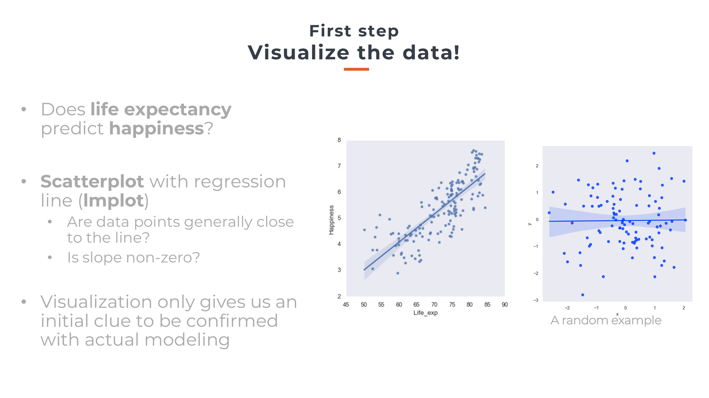
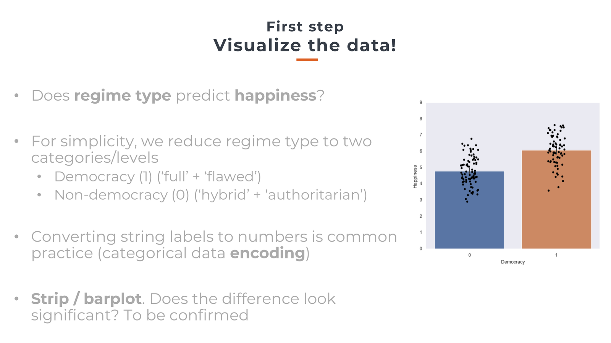
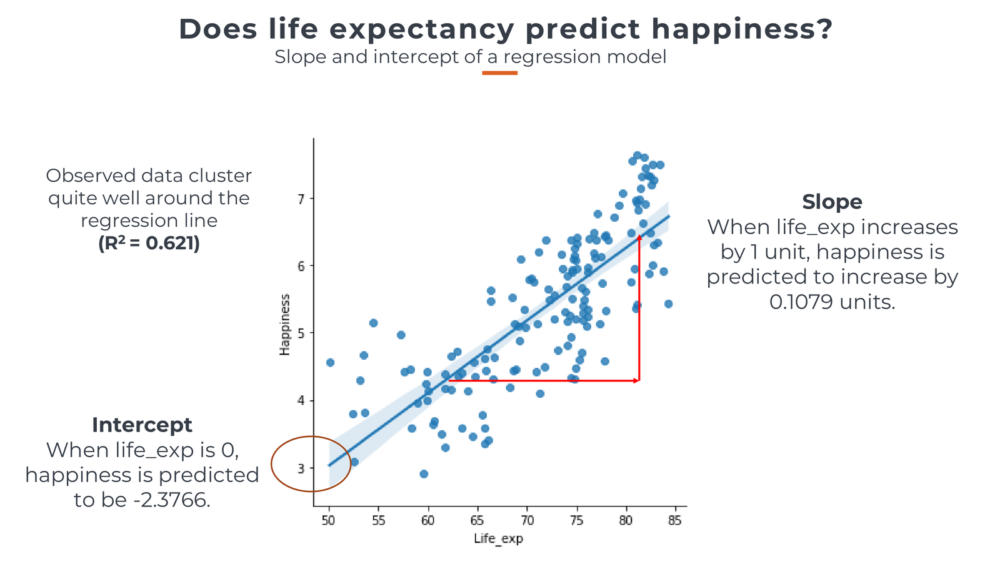
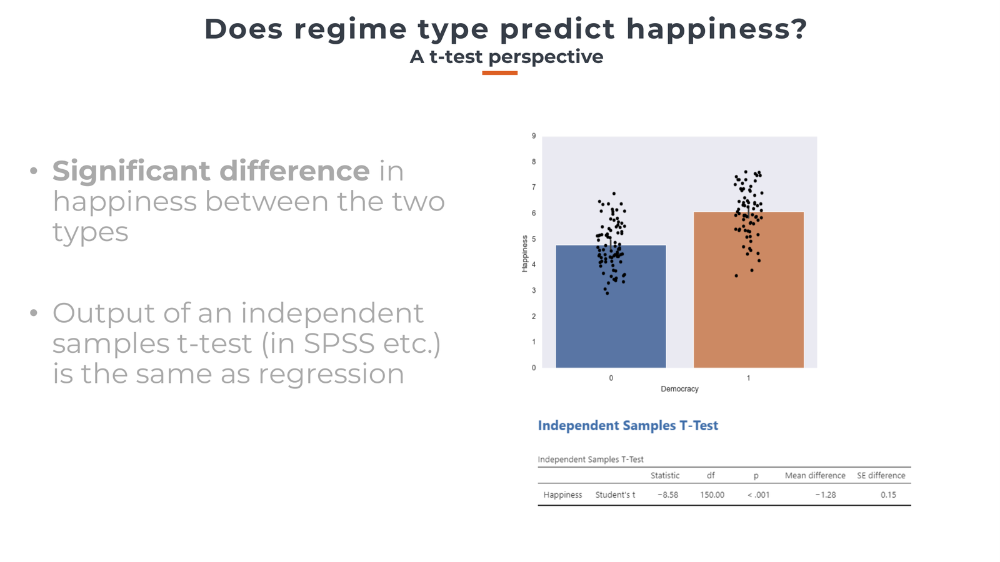
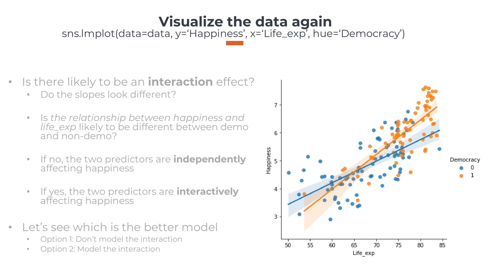
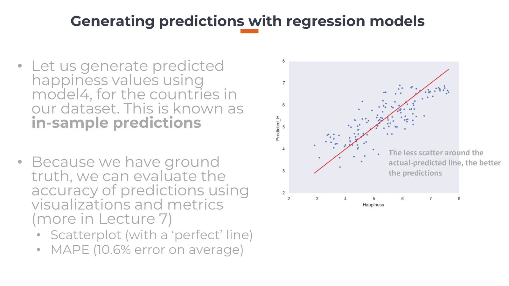
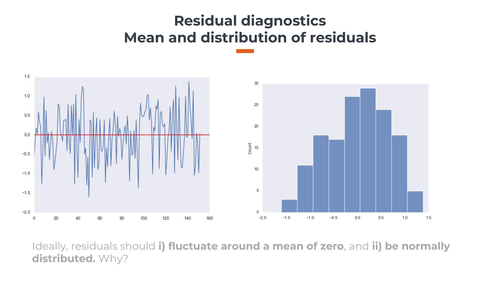

# Lecture 5 · Regression

<div class="lecture-hero">
<p class="lecture-hero__fr">Simple regression · Multiple regression · Evaluation · Prediction</p>
<p class="lecture-badge">LECTURE 5 · 回归</p>
<p class="lecture-hero__meta">学术英语阅读与写作 · 课件来源：Lecture5.pdf（24 页）</p>
</div>

!!! info "阅读说明"

    本讲义按原课件逐页整理：英文条目为课件原文，其下附中文对照；公式与 Python 代码保留原样，图表与输出截图页附原课件整页图片。课件第 1 页为课程封面，未收录。文末附本讲<strong>重点词汇表</strong>。

## 1. Warm-up　课堂判断

### Slide 2 · True or False?

Each group should agree on one set of answers.

1. There is an objectively best algorithm for every machine learning task.
2. Since algorithms have distinct logics, only one can be applied to analyze each dataset.
3. An example of regression is to predict starting salaries of PolyU grads by their majors.
4. An example of classification is to predict whether an individual will migrate based on demographic information.
5. An example of clustering is to use customer survey data to identify target customer groups.

每组应商定一套答案：① 每个机器学习任务都存在客观上最好的算法；② 由于算法逻辑不同，每个数据集只能应用一种算法；③ 回归的一个例子是根据专业预测 PolyU 毕业生的起薪；④ 分类的一个例子是根据人口统计信息预测个人是否会迁移；⑤ 聚类的一个例子是用顾客调查数据识别目标顾客群。
{: .zh }

参考答案：False, False, True, True, True。
{: .zh }

### Slide 3 · Outline

- Regression: simple (1 continuous predictor; 1 categorical predictor); multiple (2 or more predictors combined)
- Evaluating regression models
- Using regression models

回归：简单回归（1 个连续预测变量；1 个分类预测变量）；多元回归（2 个及以上预测变量组合）。评估回归模型；使用回归模型。
{: .zh }

## 2. What is regression?　什么是回归

### Slide 4 · Regression

- The outcome must be continuous
- The feature(s) can be continuous or categorical
- We use training data to train a regression model to learn the relationship between feature(s) and outcome
- We regress the feature(s) on the outcome
- Two general aims
    - Theoretical: to understand the nature and strength of feature-outcome relationships
    - Practical: to make predictions on new data as accurately as possible

结果变量必须是连续的；特征可以是连续的或分类的。我们用训练数据训练回归模型，学习特征与结果之间的关系；我们对特征做回归，以解释结果。<br>
两个总体目标：<strong>理论</strong>——理解特征—结果关系的性质和强度；<strong>实践</strong>——尽可能准确地预测新数据的结果。
{: .zh }

### Slide 5 · Recall the data analytic workflow

- Explore: explore the dataset by visualizations
- Apply: apply the appropriate technique
- Evaluate: evaluate the resulting model
- Interpret: interpret and use model critically

探索：用可视化探索数据集；应用：应用合适的技术；评估：评估得到的模型；解释：批判性地解释和使用模型。
{: .zh }

## 3. Simple regression　简单回归

### Slide 6 · First step: Visualize the data! Does life expectancy predict happiness?

- Scatterplot with regression line (lmplot)
- Are data points generally close to the line?
- Is slope non-zero?
- Visualization only gives us an initial clue to be confirmed with actual modeling

<span class="lecture-figure lecture-figure--wide"></span>

<p class="lecture-caption">原课件第 6 页：预期寿命与幸福度的散点图与回归线</p>

带回归线的散点图（lmplot）：数据点是否大体靠近直线？斜率是否非零？可视化只提供初步线索，需要用实际建模确认。
{: .zh }

### Slide 7 · Does regime type predict happiness?

- For simplicity, we reduce regime type to two categories/levels
    - Democracy (1) (“full” + “flawed”)
    - Non-democracy (0) (“hybrid” + “authoritarian”)
- Converting string labels to numbers is common practice (categorical data encoding)
- Strip/barplot. Does the difference look significant? To be confirmed

<span class="lecture-figure lecture-figure--wide"></span>

<p class="lecture-caption">原课件第 7 页：民主/非民主国家的幸福度柱状图</p>

为简化，把政体类型降为两个类别/水平：民主（1）（“完全”+“有缺陷”）；非民主（0）（“混合”+“威权”）。把字符串标签转换为数字是常见做法（分类数据编码）。条带图/柱状图显示差异——看起来显著吗？待确认。
{: .zh }

### Slide 8 · Libraries for regression analysis: Statsmodels and Scikit-learn

- Statsmodels: classical statistical inference and model summaries
- Scikit-learn: a machine-learning library with a consistent API for regression, classification and clustering

Statsmodels：经典统计推断和模型摘要。Scikit-learn：机器学习库，为回归、分类、聚类提供一致的 API。
{: .zh }

### Slide 9 · Does life expectancy predict happiness?

```python
model1 = ols('Happiness ~ Life_exp', data).fit()
```

- $R^2$: A model-fit measure (0 to 1)
    - square of Pearson's R
    - a common evaluation metric
    - how much variation in the outcome is explained by the predictors
    - how well the overall model fits the training data
    - for social data, $R^2 > 0.6$ is reasonably good
- Other evaluation metrics: adjusted R-squared; Mean squared error (MSE); Root mean squared error (RMSE); Mean absolute error (MAE); Mean absolute percentage error (MAPE)

$R^2$：模型拟合度量（0 到 1），是 Pearson's R 的平方，也是常用评估指标——预测变量解释了多少结果变异、整体模型对训练数据的拟合程度。对社会数据，$R^2 > 0.6$ 算相当不错。<br>
其他评估指标：调整 $R^2$、均方误差（MSE）、均方根误差（RMSE）、平均绝对误差（MAE）、平均绝对百分比误差（MAPE）。
{: .zh }

### Slide 10 · Does life expectancy predict happiness? Intercept and slope

- Intercept ($\beta_0$) = $-2.3766$: the predicted value of happiness ($y$) when life expectancy ($x$) = 0. Often not interpreted.
- Slope ($\beta_1$) = $0.1079$: when life expectancy increases by 1 unit (i.e., 1 year), happiness is predicted to increase by 0.1079 units.
- The slope (0.1079) is significantly different from 0 ($p<0.05$).
- Life_exp ($x_1$) is a significant predictor.

$$ y = \beta_0 + \beta_1 x_1 + \varepsilon $$

截距（$\beta_0$）＝ $-2.3766$：当预期寿命（$x$）＝ 0 时幸福度（$y$）的预测值，通常不解释。斜率（$\beta_1$）＝ $0.1079$：预期寿命每增加 1 个单位（1 年），幸福度预测增加 0.1079 个单位。斜率显著不等于 0（$p<0.05$），Life_exp（$x_1$）是显著预测变量。
{: .zh }

### Slide 11 · Slope and intercept of a regression model

- Observed data cluster quite well around the regression line ($R^2 = 0.621$).
- Intercept: when life_exp is 0, happiness is predicted to be $-2.3766$.
- Slope: when life_exp increases by 1 unit, happiness is predicted to increase by 0.1079 units.

<span class="lecture-figure lecture-figure--wide"></span>

<p class="lecture-caption">原课件第 11 页：回归直线的截距与斜率</p>

观测数据相当好地围绕回归线分布（$R^2 = 0.621$）。截距：当 life_exp 为 0 时，幸福度预测为 $-2.3766$。斜率：life_exp 每增加 1 个单位，幸福度预测增加 0.1079 个单位。
{: .zh }

### Slide 12 · Does regime type predict happiness?

```python
model2 = ols('Happiness ~ Democracy', data).fit()
```

- $R^2 = 0.329$. Poorer fit compared to model1.
- Intercept = 4.7955: the predicted value of happiness when democracy = 0 (non-democracies). This is the mean happiness in non-democracies.
- Slope = 1.2837: when democracy “increases by 1 unit”, happiness is predicted to increase by 1.2837 units. This is the difference in means between democracies and non-democracies.
- The slope is significantly different from 0 ($p<0.05$); Democracy is a significant predictor.

$R^2 = 0.329$，比 model1 拟合更差。截距 = 4.7955：democracy = 0（非民主）时幸福度的预测值，也就是非民主国家的平均幸福度。斜率 = 1.2837：democracy“增加 1 个单位”时，幸福度预测增加 1.2837 个单位；这就是民主与非民主的均值差。斜率显著不等于 0（$p<0.05$），Democracy 是显著预测变量。
{: .zh }

### Slide 13 · Does regime type predict happiness? A t-test perspective

- Significant difference in happiness between the two types
- Output of an independent samples t-test (in SPSS etc.) is the same as regression

<span class="lecture-figure lecture-figure--wide"></span>

<p class="lecture-caption">原课件第 13 页：独立样本 t 检验的输出与回归等价</p>

两类国家的幸福度存在显著差异。独立样本 t 检验（如 SPSS）的输出与回归相同。
{: .zh }

### Slide 14 · Interpreting what we have so far

- From model 1 (Happiness ~ Life_exp):
    - Life expectancy is a significant predictor of happiness.
    - A 1-unit change in life_exp is predicted to increase happiness by 0.1079 units.
    - $R^2 = 0.621$.
- From model 2 (Happiness ~ Democracy):
    - Regime is a significant predictor of happiness.
    - Democracies are predicted to have higher happiness by 1.284 units on average.
    - $R^2 = 0.329$.
- Model 1 explains more variation / is a better fit than model 2.
- Multiple regression: Combined effect of both predictors?

<strong>model 1（Happiness ~ Life_exp）：</strong>预期寿命是幸福度的显著预测变量；life_exp 每变化 1 个单位，幸福度预测增加 0.1079 个单位；$R^2 = 0.621$。<br>
<strong>model 2（Happiness ~ Democracy）：</strong>政体是幸福度的显著预测变量；民主国家平均幸福度高 1.284 个单位；$R^2 = 0.329$。<br>
Model 1 解释更多变异/拟合更好。多元回归：两个预测变量的共同效应？
{: .zh }

## 4. Multiple regression　多元回归

### Slide 15 · Visualize the data again

```python
sns.lmplot(data=data, y='Happiness', x='Life_exp', hue='Democracy')
```

- Is there likely to be an interaction effect?
- Do the slopes look different?
- Is the relationship between happiness and life_exp likely to be different between democracies and non-democracies?
- If no, the two predictors are independently affecting happiness.
- If yes, the two predictors are interactively affecting happiness.
- Option 1: Don't model the interaction; Option 2: Model the interaction.

<span class="lecture-figure lecture-figure--wide"></span>

<p class="lecture-caption">原课件第 15 页：按民主类型分组的回归线</p>

可能存在交互效应吗？斜率看起来不同吗？幸福度与 life_exp 的关系在民主/非民主之间可能不同吗？<br>
如果否，两个预测变量独立影响幸福度；如果是，两个预测变量交互影响幸福度。选项 1：不建模交互；选项 2：建模交互。
{: .zh }

### Slide 16 · Option 1: Don't model the interaction

```python
model3 = ols('Happiness ~ Life_exp + Democracy', data=data).fit()
```

- $R^2 = 0.644$. The best fit so far.
- For multiple regression, the coefficients are the effects of the predictor when other predictors are held constant.
- Effect of Democracy (hold Life_exp constant): among countries with similar life_exp, democracies are predicted to be 0.4149 units happier than non-democracies. This is much lower than 1.2837 in model 2. Why?
- Effect of Life_exp (hold Democracy constant): among countries with the same regime type, when life_exp increases by 1 unit, happiness is predicted to increase by 0.0935 units. This is only slightly lower than 0.1079 in model 1.

$$ y = \beta_0 + \beta_1 x_1 + \beta_2 x_2 + \varepsilon $$

$R^2 = 0.644$，目前最佳拟合。多元回归中，系数是在其他预测变量保持不变时该预测变量的效应。<br>
<strong>Democracy 的效应</strong>（保持 Life_exp 不变）：在 life_exp 相近的国家中，民主国家比非民主国家预测幸福度高 0.4149 个单位。这比 model 2 的 1.2837 低很多，为什么？<br>
<strong>Life_exp 的效应</strong>（保持 Democracy 不变）：在政体类型相同的国家中，life_exp 每增加 1 个单位，幸福度预测增加 0.0935 个单位，仅比 model 1 的 0.1079 略低。
{: .zh }

### Slide 17 · Option 2: Model the interaction

```python
model4 = ols('Happiness ~ Life_exp * Democracy', data=data).fit()
```

- $R^2 = 0.662$. The best model. Our visual inspection of an interaction is confirmed.
- Focus on the interaction term (Life_exp:Democracy): coefficient = 0.0466.
    - 0.0466 = difference in the slopes between democracies and non-democracies.
    - The “democracy slope” is steeper by 0.0466.
    - When life_exp increases by 1 unit, happiness is predicted to increase in democracies by 0.0466 units more than in non-democracies.

$$ y = \beta_0 + \beta_1 x_1 + \beta_2 x_2 + \beta_3 x_1 x_2 + \varepsilon $$

$R^2 = 0.662$，最佳模型，视觉上观察到的交互得到确认。关注交互项（Life_exp:Democracy），系数 = 0.0466，即民主与非民主斜率之差；“民主斜率”陡 0.0466。life_exp 每增加 1 个单位，民主国家的幸福度预测比非民主国家多增加 0.0466 个单位。
{: .zh }

## 5. Using regression models　使用回归模型

### Slide 18 · Recall the data analytic workflow

- We have almost completed all the steps: Explore → Apply → Evaluate → Interpret.
- The final step: how do we interpret and use the model?

我们几乎完成了所有步骤：探索 → 应用 → 评估 → 解释。最后一步：如何解释和使用模型？
{: .zh }

### Slide 19 · What does “using the model” mean?

- We now know that happiness is influenced by both life expectancy and democracy, based on the data used to train the regression model.
- In most practical contexts, using the model means predicting outcome values for new or “unseen” data; e.g.
    - for countries with known predictor but unknown outcome values; e.g. if country X is a democracy and has a life_exp of 65, what is the predicted happiness value?
    - for new predictor values
    - for new countries(?)
    - for countries not used to train the model (more in Lecture 7)

基于训练回归模型的数据，我们知道幸福度受预期寿命和民主程度共同影响。<br>
在多数实践情境中，使用模型意味着为新数据或“未见过的”数据预测结果值：① 已知预测变量但结果值未知的国家——如国家 X 是民主国家且 life_exp 为 65，预测幸福度是多少？② 新的预测变量值；③ 新国家（？）；④ 未用于训练模型的国家（更多见 Lecture 7）。
{: .zh }

### Slide 20 · Generating predictions with regression models

- Generate predicted happiness values using model4 for the countries in the dataset. This is known as in-sample predictions.
- Because we have ground truth, we can evaluate the accuracy of predictions using visualizations and metrics (more in Lecture 7).
- Scatterplot (with a “perfect” line)
- MAPE (10.6% error on average)
- The less scatter around the actual-predicted line, the better the predictions.

<span class="lecture-figure lecture-figure--wide"></span>

<p class="lecture-caption">原课件第 20 页：实际值与预测值的散点图</p>

用 model4 为数据集中的国家生成预测幸福度，这称为样本内预测。因为有 ground truth，可以用可视化和指标评估预测准确性（更多见 Lecture 7）。<br>
散点图（带“完美”线）；MAPE（平均误差 10.6%）。实际—预测线周围的散点越少，预测越好。
{: .zh }

### Slide 21 · Optional: Residual diagnostics for regression models

- Residuals = the differences between the observed and predicted values by the model (observed − predicted)
- They represent the unexplained variation or error in the data that the regression model could not capture.
- Residual diagnostics means to analyze the properties of the residuals (e.g., their mean and distribution).
- This can help determine if the model has indeed captured all useful information in the data.

残差 = 模型预测值与观测值之差（观测 − 预测），代表回归模型未能捕捉的未解释变异或误差。残差诊断指分析残差的性质（如均值和分布），有助于判断模型是否捕捉了数据中的所有有用信息。
{: .zh }

### Slide 22 · Residual diagnostics: Mean and distribution of residuals

- Ideally, residuals should (i) fluctuate around a mean of zero, and (ii) be normally distributed. Why?

<span class="lecture-figure lecture-figure--wide"></span>

<p class="lecture-caption">原课件第 22 页：残差序列与残差分布</p>

理想情况下，残差应（i）围绕零均值波动，（ii）呈正态分布。为什么？
{: .zh }

### Slide 23 · Optional: Use scikit-learn for regression

- Scikit-learn is a powerful Python machine learning library. We will be using it a lot for classification and clustering.
- It can also be used for regression.
- Use the provided code to refit Model 1 (one predictor), Model 3 (two predictors without interaction), and Model 4 (two predictors with interaction).
- Check that the slope coefficients and intercepts are identical to statsmodels.

$$ y = \beta_0 + \beta_1 x_1 + \varepsilon \qquad y = \beta_0 + \beta_1 x_1 + \beta_2 x_2 + \varepsilon \qquad y = \beta_0 + \beta_1 x_1 + \beta_2 x_2 + \beta_3 x_1 x_2 + \varepsilon $$

Scikit-learn 是强大的 Python 机器学习库，我们将在分类和聚类中大量使用；它也可用于回归。用提供的代码重新拟合 Model 1（一个预测变量）、Model 3（两个预测变量、无交互）、Model 4（两个预测变量、有交互），检查斜率系数和截距是否与 statsmodels 相同。
{: .zh }

### Slide 24 · Summary

- We use regression models to investigate if, and how, a continuous numerical outcome varies along continuous/categorical predictors.
- Regression models are useful in empirical linguistic and social contexts by informing/interrogating theory and making predictions.
- Key evaluation metrics include $R^2$ and MAPE.

我们用回归模型研究连续数值结果是否以及如何随连续/分类预测变量变化。回归模型在实证语言学和社会情境中有用：检验/质询理论并作出预测。关键评估指标包括 $R^2$ 和 MAPE。
{: .zh }

## 重点词汇 · Key Vocabulary

| English | 中文 | 说明 / 搭配 |
|---|---|---|
| regression | 回归 | 研究连续结果如何随预测变量变化 |
| OLS | 普通最小二乘 | ordinary least squares |
| intercept | 截距 | x=0 时 y 的预测值 |
| slope | 斜率 | x 每增加 1 单位，y 的预测变化 |
| R-squared | R² | 模型解释的结果变异比例 |
| MSE | 均方误差 | mean squared error |
| RMSE | 均方根误差 | root mean squared error |
| MAE | 平均绝对误差 | mean absolute error |
| MAPE | 平均绝对百分比误差 | mean absolute percentage error |
| multiple regression | 多元回归 | 多个预测变量 |
| interaction term | 交互项 | 一个预测变量对另一个变量效应的影响 |
| in-sample prediction | 样本内预测 | 对训练数据的预测 |
| out-of-sample prediction | 样本外预测 | 对新数据的预测 |
| residual | 残差 | 观测值 − 预测值 |
| p-value | p 值 | 显著性；p<0.05 通常视为显著 |
