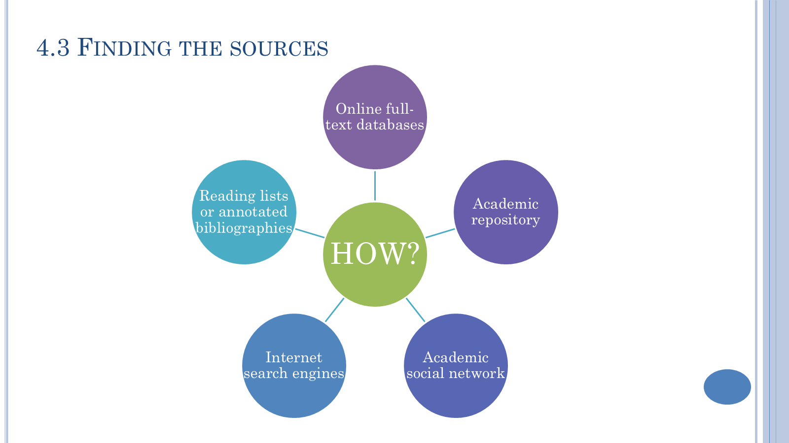
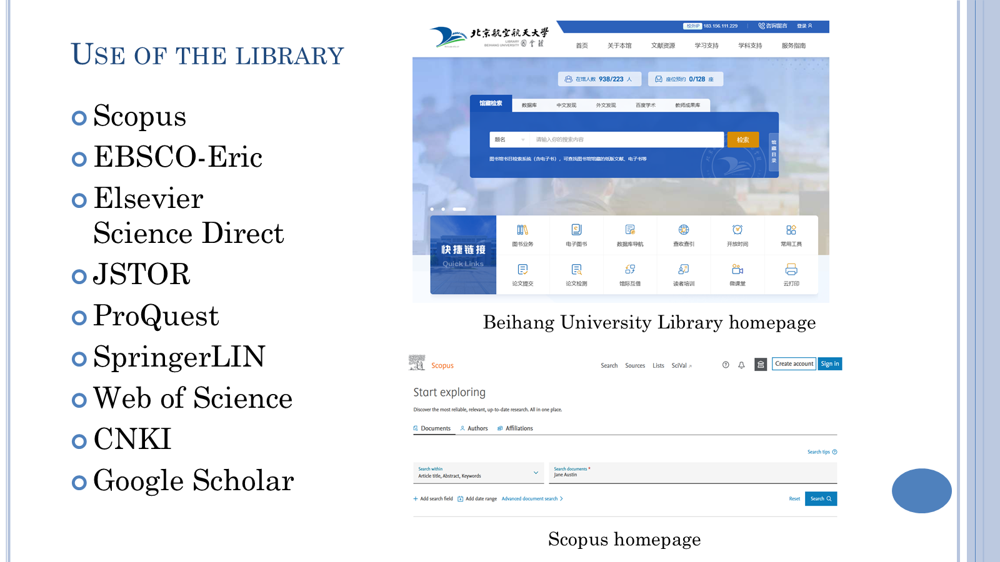
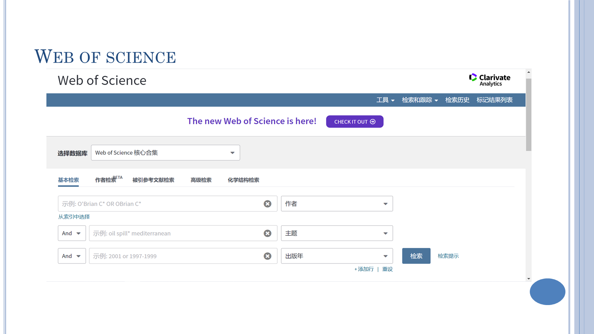
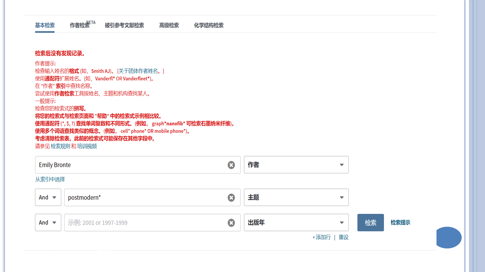
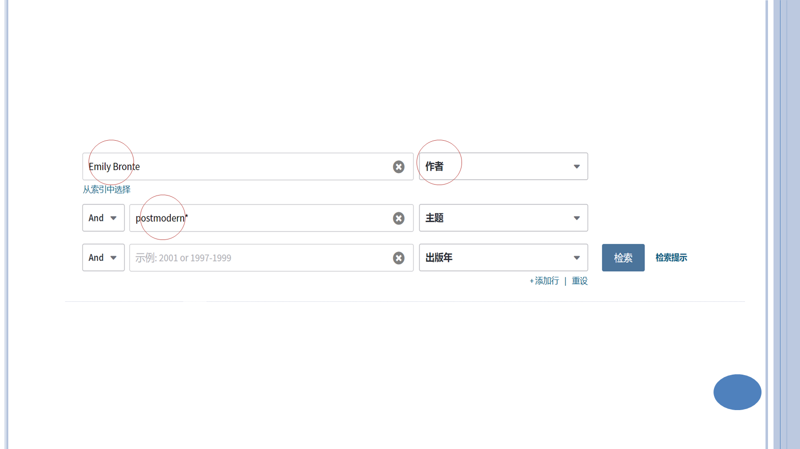
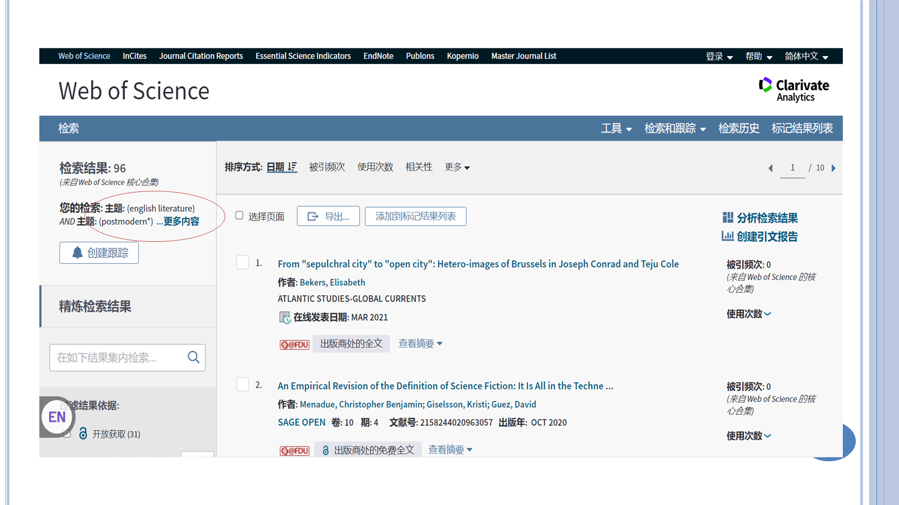
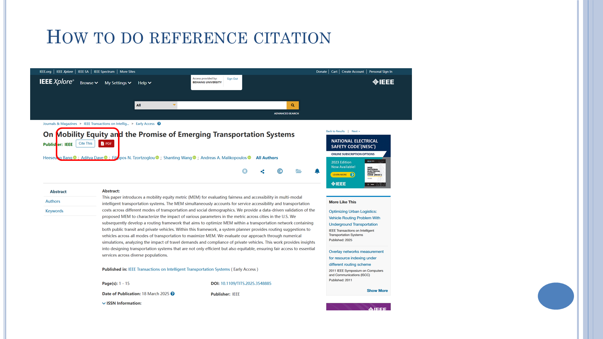

# Lecture 6 · Finding and using sources

Source types · Evaluating sources · Databases · Citation

LECTURE 6 · 文献与引用

学术英语阅读与写作 · 课件来源：Lecture6 Finding and using sources.pptx（25 页）

!!! info "阅读说明"

    本讲义按原课件逐页整理：英文条目为课件原文，其下附中文对照；检索界面与数据库截图页附原课件整页图片。课件第 1 页为课程封面，未收录。文末附本讲<strong>重点词汇表</strong>。

## 1. Learning objectives　学习目标

### Slide 2 · Learning Objectives

- Identify and evaluate different types of sources
- Search the library or commercial databases for useful information
- Select appropriate sources relevant to your topic
- Draft an annotated bibliography on a selected topic

识别并评价不同类型的文献来源；在图书馆或商业数据库中检索有用信息；选择与主题相关的合适文献；就选定主题撰写一份带注释的参考书目。
{: .zh }

## 2. Types of sources　文献类型

### Slide 3 · Types of sources (I)

- Books: established source of knowledge; less updated—suitable for literary studies
- On-line database (journal articles): state-of-the-art articles; more updated; may not be reputable—suitable for linguistic studies
- Newspapers and magazines
- Public policy reports
- Wikipedia
- Unpublished manuscripts
- Encyclopedia
- What about unpublished master/doctoral thesis?

图书：成熟的知识来源，更新较慢，适合文学研究。 
在线数据库（期刊论文）：前沿文章，更新较快，但可能不够权威，适合语言学研究。 
其他：报纸和杂志、公共政策报告、维基百科、未发表手稿、百科全书。未发表的硕士/博士学位论文呢？
{: .zh }

### Slide 4 · Types of sources (II)

Remember to distinguish reliable vs. unreliable, authoritative vs. unauthoritative sources.

| Source | Reliability |
|---|---|
| google.com or other websites | semi-reliable |
| academic journals | reliable |
| magazines | semi-reliable |
| Wikipedia | unreliable |
| books | reliable |
| personal communication | semi-reliable |

要区分可靠 vs 不可靠、权威 vs 非权威的来源：Google 或其他网站为半可靠；学术期刊可靠；杂志半可靠；维基百科不可靠；图书可靠；个人交流半可靠。
{: .zh }

## 3. Evaluating Internet sources　评价网络来源

### Slide 5 · Who hosts the websites?

- Check the “domain” of the site is in, identified as a series of abbreviations (e.g. .gov, .edu vs. .com)
- Personal websites of famous scholars

检查网站的“域名”，即一系列缩写（如 .gov、.edu vs .com）。此外也要留意著名学者的个人网站。
{: .zh }

### Slide 6 · Who wrote the document?

- Author is a recognized authority
- Unknown authorship can be very tricky.
    - For one thing, you can't cite the source properly with unknown authorship.
    - For another, you can't verify the trustworthiness of the source, which makes it difficult to cite again.

作者是否是公认权威？作者不明会非常棘手：一方面，作者不明无法正确引用；另一方面，无法验证来源可信度，难以再次引用。
{: .zh }

### Slide 7 · Is the hyperlink or URL stable?

- Stick to sources with stable hyperlinks or URLs.
- An Internet source that can't be traced can't be verified, so it's risky to cite an Internet source with unstable hyperlink.
- As a matter of fact, the “404 error” sometimes is considered a covert form of plagiarism.

坚持使用链接稳定的来源。无法追踪的网络来源无法验证，引用不稳定的链接有风险。事实上，“404 错误”有时被视为一种隐蔽的抄袭。
{: .zh }

### Slide 8 · Is the version current?

- Check the date of release.
- Some subjects, mainly in humanities, may not be very sensitive to context (19th century philosophy).
- Some other subjects are sensitive to time (e.g. COVID-19).
- If you can't verify a source, just don't use it in your writing!

检查发布日期。某些学科（主要是人文学科）对语境不太敏感（如 19 世纪哲学）；另一些学科对时间敏感（如 COVID-19）。如果无法验证来源，就不要在写作中使用它！
{: .zh }

## 4. Finding the sources　查找文献

### Slide 9 · Finding the sources

- Main routes: online full-text databases; academic repository; academic social network; internet search engines; reading lists or annotated bibliographies.

原课件第 9 页：查找文献的五种主要途径（HOW?）

主要途径：在线全文数据库；学术仓储；学术社交网络；互联网搜索引擎；阅读清单或带注释的参考书目。
{: .zh }

### Slide 10 · Other strategies

- It's also a good strategy to check with your supervisor to see if he/she can give you some reading materials to start with.
- Also think about it: What are the alternative ways to find a source other than the ways I have listed above?

与导师确认，看是否能提供一些起步阅读材料，这也是好策略。想一想：除上述方式外，还有哪些替代途径？
{: .zh }

### Slide 11 · Use of the library

- Scopus
- EBSCO-Eric
- Elsevier Science Direct
- JSTOR
- ProQuest
- SpringerLINK
- Web of Science
- CNKI
- Google Scholar

原课件第 11 页：北京航空航天大学图书馆主页与 Scopus 主页

常用数据库与检索入口：Scopus、EBSCO-Eric、Elsevier Science Direct、JSTOR、ProQuest、SpringerLINK、Web of Science、CNKI、Google Scholar。
{: .zh }

### Slide 12 · How to use on-line databases (III)

- The use of international databases
    - Web of Science
    - Scopus

国际数据库的使用：Web of Science、Scopus。
{: .zh }

### Slide 13 · Web of Science

本页展示 Web of Science 的检索界面与结果页，具体见下图。

原课件第 13 页：Web of Science 检索界面

### Slide 14–15 · Database search: CNKI example

课件第 14–15 页为 CNKI 检索界面截图：第 14 页展示作者、主题、出版年等检索条件与无结果提示；第 15 页放大展示 CNKI 的检索字段（作者、主题、出版年）以及布尔逻辑 And 的用法。

原课件第 14 页：CNKI 高级检索界面示例

原课件第 15 页：CNKI 检索字段（作者、主题、出版年）与布尔逻辑 And 的用法

### Slide 16 · Web of Science: search results

- 检索结果：96 条；主题：(english literature) AND 主题：(postmodern*)
- 可按被引次数排序，并可查看摘要、引文网络等。

原课件第 16 页：Web of Science 检索结果页

## 5. An annotated bibliography　带注释的参考书目

### Slide 17 · Annotated bibliography

- Decide on a specific topic
- Try to find references on the topic
- Record the bibliographic information
- Write a summary and comment
- Let's examine a good example of an annotated bibliography. (Please refer to the textbook.)

确定一个具体主题；尝试找到该主题的参考文献；记录书目信息；写摘要和评论。让我们看一个优秀的带注释参考书目示例（请参阅教材）。
{: .zh }

## 6. Citation　引用

### Slide 18 · How to do reference citation

- Find the citation information from the database record (author, title, source, year, volume, issue, pages, DOI).

原课件第 18 页：从 IEEE Xplore 记录中获取引用信息

从数据库记录中获取引用信息（作者、标题、来源、年份、卷、期、页码、DOI）。
{: .zh }

### Slide 19 · How to do in-text citation

- Type A (Less than three authors): (Surname, Year)
- Type B (More than three authors): (First Surname et al., Year)

F.-Y. Wang, “Parallel Control and Management for Intelligent Transportation Systems: Concepts, Architectures, and Applications,” in *IEEE Transactions on Intelligent Transportation Systems*, vol. 11, no. 3, pp. 630–638, Sept. 2010, doi: 10.1109/TITS.2010.2060218.

L. Li, X. Li, C. Cheng, C. Chen, G. Ke, D. D. Zeng, and W. T. Scherer, “Research Collaboration and ITS Topic Evolution: 10 Years at T-ITS,” in *IEEE Transactions on Intelligent Transportation Systems*, vol. 11, no. 3, pp. 517–523, Sept. 2010, doi: 10.1109/TITS.2010.2059070.

文内引用分两类：类型 A（少于三位作者）——(Surname, Year)；类型 B（三位以上作者）——(First Surname et al., Year)。上方两条为对应的文献条目示例。
{: .zh }

### Slide 20 · Type C: Last word or keyword with superscript/[ ]

[1] F.-Y. Wang, “Parallel Control and Management for Intelligent Transportation Systems: Concepts, Architectures, and Applications,” in *IEEE Transactions on Intelligent Transportation Systems*, vol. 11, no. 3, pp. 630–638, Sept. 2010, doi: 10.1109/TITS.2010.2060218.

类型 C 在句末词或关键词后加编号/上标，如 [1]，并在文末给出完整条目。
{: .zh }

### Slide 21 · Exercise 1: APA Style In-Text Citations

[1] L. Li, X. Li, Z. Li, D. D. Zeng, and W. T. Scherer, “A bibliographic analysis of the IEEE TRANSACTIONS ON INTELLIGENT TRANSPORTATION SYSTEMS literature,” *IEEE Trans. Intell. Transp. Syst.*, vol. 11, no. 2, pp. 251–255, Jun. 2010.

[2] L. Li, X. Li, C. Cheng, C. Chen, G. Ke, D. D. Zeng, and W. T. Scherer, “Research collaboration and ITS topic evolution: 10 Years at T-ITS,” *IEEE Trans. Intell. Transp. Syst.*, vol. 11, no. 3, pp. 517–523, Sep. 2010.

[3] F.-Y. Wang, A. Broggi, and C. C. White, “Road to transactions on intelligent transportation systems: A decade's success,” *IEEE Trans. Intell. Transp. Syst.*, vol. 10, no. 4, pp. 553–556, Dec. 2009.

[4] F.-Y. Wang, “Publication and impact: A bibliographic analysis,” *IEEE Trans. Intell. Transp. Syst.*, vol. 11, no. 2, p. 250, Jun. 2010.

对应文内引用：[1] Li et al. (2010)；[2] Li et al. (2010)；[3] Wang et al. (2009)；[4] Wang (2010)。
{: .zh }

### Slide 22 · Exercise 1: Original sentence vs. APA in-text citations

<strong>Original sentence:</strong> As indicated by recent analysis [1]–[4], of the four most active research topics that has emerged in T-ITS over the last decade, the two traffic-related topics (i.e., management and surveillance) led the trend before 2005 and were subsequently taken over by the two vehicle- and vision-related topics.

<strong>Revised:</strong> As indicated by recent analysis (Wang et al., 2009; Li et al., 2010a; Li et al., 2010b; Wang, 2010), of the four most active research topics that have emerged in T-ITS over the last decade, the two traffic-related topics (i.e., management and surveillance) led the trend before 2005 and were subsequently taken over by the two vehicle- and vision-related topics.

原句使用编号 [1]–[4]；改写后使用作者—年份。注意：同一作者同年用 a/b 区分；三位以上作者用 et al.
{: .zh }

### Slide 23 · Exercise 2: Paraphrasing with Reference Retention

Recent R&amp;D advancements in complexity, complex systems, and the intelligence sciences have provided us an opportunity to look into new methods of conducting intelligent traffic control and management from new perspectives, at the system level with new tools, and an integrated approach. Actually, many efforts have already been made in this direction over the past two decades, ranging from the use of cellular automata in traffic flow modeling [5], [6], wide applications of data-mining techniques for traffic behavioral analysis [7]–[11], agent-based technology for traffic control [12], AI methods for assessing real-time highway traffic conditions, and transportation security [13]–[18]. Still, we need to coordinate our research and systematic effort with those emerging methods and techniques and hopefully they will eventually lead to a satisfactory answer to the long-standing question “Where is the Intelligence in ITS?”

阅读一段关于智能交通系统的原文，原文含编号引用 [5]–[18]。任务是改写时保留引用信息，避免抄袭。
{: .zh }

### Slide 24 · Exercise 2: A paraphrased version with references retained

Advancements in complexity, complex systems, and intelligence sciences have opened up new avenues for exploring intelligent traffic control and management. These new approaches focus on system-level solutions, leveraging innovative tools and an integrated methodology. Over the past twenty years, significant progress has been made in this area. This includes the application of cellular automata for traffic flow modeling (Sanchez-Medina et al., 2010; Wei et al., 2005), the extensive use of data-mining techniques for analyzing traffic behavior (Kumar et al., 2005; Panwai &amp; Dia, 2005; Ma &amp; Andreasson, 2007; Yao et al., 2009; Zhao et al., 2009), the implementation of agent-based technology for traffic control (Chen &amp; Cheng, 2010), and the use of AI methods for real-time assessment of highway traffic conditions and transportation security (Ma et al., 2009; Chen et al., 2004; Kaza et al., 2009; Burgoon et al., 2009; Zografos et al., 2009; Candamo et al., 2010). However, further coordination of research and systematic efforts with these emerging methods and techniques is needed to address the long-standing question: “Where is the Intelligence in ITS?”

改写版本把编号引用转换为作者—年份引用，例如：(Sanchez-Medina et al., 2010; Wei et al., 2005), (Kumar et al., 2005; Panwai & Dia, 2005; Ma & Andreasson, 2007; Yao et al., 2009; Zhao et al., 2009), (Chen & Cheng, 2010), (Ma et al., 2009; Chen et al., 2004; Kaza et al., 2009; Burgoon et al., 2009; Zografos et al., 2009; Candamo et al., 2010)。
{: .zh }

### Slide 25 · Question

- If you write a literature review of this related topic, how to improve your paraphrase to avoid the plagiarism?

如果你要写这一相关主题的文献综述，如何改进你的改写以避免抄袭？
{: .zh }

## 重点词汇 · Key Vocabulary

| English | 中文 | 说明 / 搭配 |
|---|---|---|
| source | 文献来源 | 图书、期刊、报纸、报告等 |
| peer-reviewed | 同行评审的 | 经过同行专家评审 |
| authoritative | 权威的 | 作者/机构可信 |
| domain | 域名 | 如 .gov、.edu、.com |
| URL stability | URL 稳定性 | 链接是否可长期访问 |
| annotated bibliography | 带注释的参考书目 | 书目信息 + 摘要/评论 |
| citation | 引用 | 正式注明来源 |
| in-text citation | 文内引用 | 正文中的作者—年份或编号 |
| reference | 参考文献 | 文末的完整书目信息 |
| paraphrasing | 改写 | 用自己的话表达他人观点 |
| quotation | 直接引用 | 照录并加引号 |
| et al. | 等人 | 三位以上作者时使用 |
| plagiarism | 抄袭 | 使用他人成果而不注明 |
| database | 数据库 | Scopus、Web of Science 等 |
| citation chaining | 引文追踪 | 前向/后向追踪文献 |
