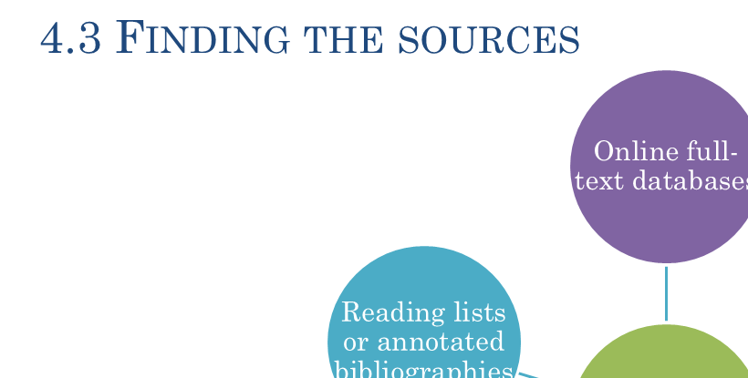
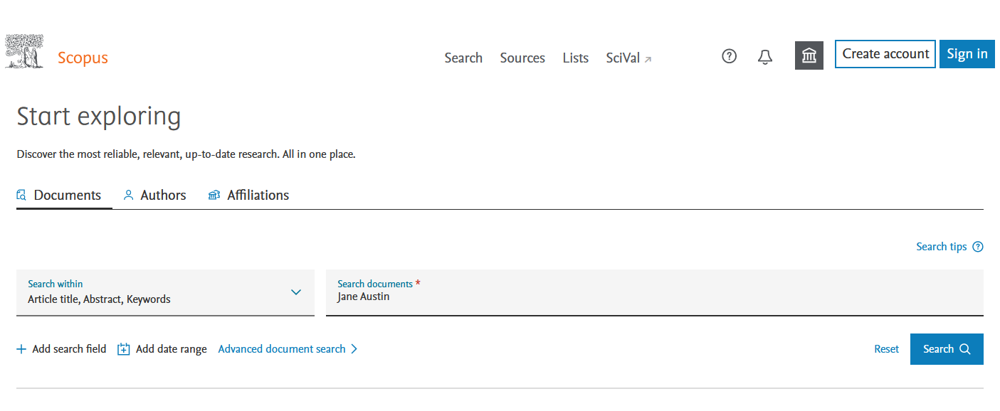
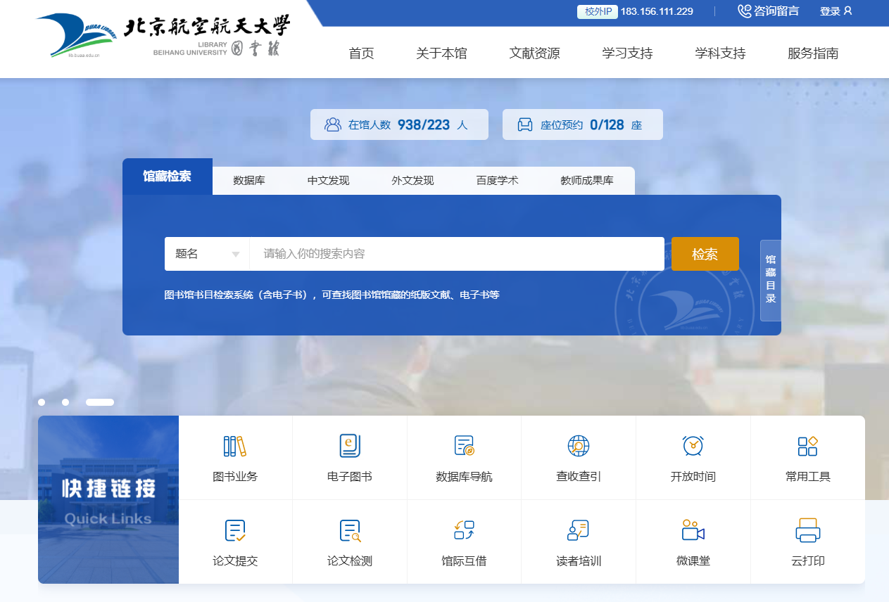
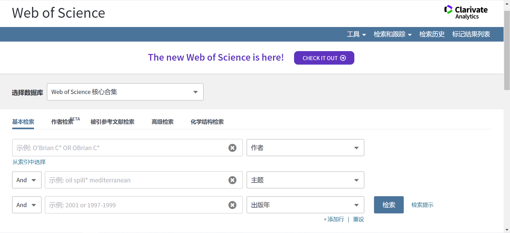
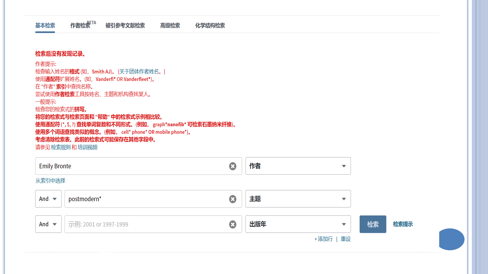
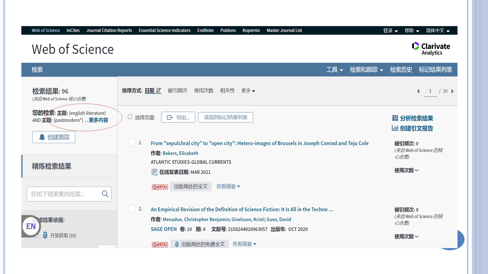
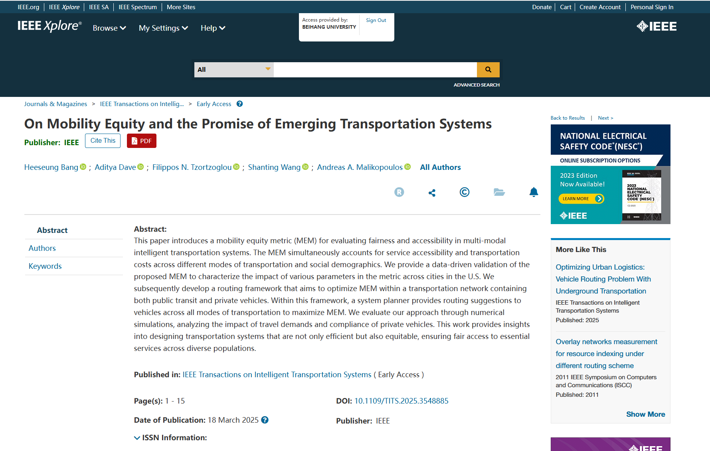

# Lecture 6 · Finding and using sources

Types of sources · Evaluating Internet sources · Databases · Annotated bibliography · Citation

LECTURE 6 · 文献

学术英语阅读与写作 · 课件来源：Lecture6 Finding and using sources.pptx（25 页）

!!! info "阅读说明"

    英文条目为课件原文，其下为中文对照翻译。数据库截图保留原课件图片。

## 1. Learning objectives　学习目标

### Slide 2 · Learning Objectives

- Identify and evaluate different types of sources
- Search the library or commercial databases for useful information
- Select appropriate sources relevant to your topic
- Draft an annotated bibliography on a selected topic

<strong>中文对照：</strong>

- 识别并评价不同类型的来源
- 在图书馆或商业数据库中检索有用信息
- 选择与你的题目相关的合适来源
- 就选定主题起草一份带注释的参考文献目录

## 2. Types of sources　文献类型

### Slide 3 · Types of sources (I)

- Books: established source of knowledge; less updated—suitable for literary studies
- Online database (journal articles): state-of-the-art articles; more updated; may not be reputable—suitable for linguistic studies
- Newspapers and magazines
- Public policy reports
- Wikipedia
- Unpublished manuscripts
- Encyclopedia
- What about unpublished master/doctoral thesis?

<strong>中文对照：</strong>

- 书籍：成熟的知识来源；更新较慢——适合文学研究
- 在线数据库（期刊论文）：最前沿的论文；更新较快；可能不够权威——适合语言学研究
- 报纸与杂志
- 公共政策报告
- 维基百科
- 未发表的手稿
- 百科全书
- 未发表的硕士/博士学位论文呢？

### Slide 4 · Types of sources (II)

Remember to distinguish reliable vs. unreliable, authoritative vs. unauthoritative sources.

| Source | Reliability |
|---|---|
| google.com or other websites | semi-reliable |
| academic journals | reliable |
| magazines | semi-reliable |
| Wikipedia | unreliable |
| books | reliable |
| personal communication | semi-reliable |

要记住区分可靠与不可靠、权威与非权威的来源。

| 来源 | 可靠性 |
|---|---|
| google.com 或其他网站 | 半可靠 |
| 学术期刊 | 可靠 |
| 杂志 | 半可靠 |
| 维基百科 | 不可靠 |
| 书籍 | 可靠 |
| 个人交流 | 半可靠 |

## 3. Evaluating Internet sources　评价网络来源

### Slide 5 · Who hosts the websites?

- Check the “domain” of the site is in, identified as a series of abbreviations (e.g. .gov, .edu vs. .com)
- Personal websites of famous scholars

<strong>中文对照：</strong>

- 检查网站所在的“域名”，域名由一串缩写标识（例如 .gov、.edu 与 .com）
- 知名学者的个人网站

### Slide 6 · Who wrote the document?

- Author is a recognized authority
- Unknown authorship can be very tricky.
    - For one thing, you can't cite the source properly with unknown authorship.
    - For another, you can't verify the trustworthiness of the source, which makes it difficult to cite again.

<strong>中文对照：</strong>

- 作者是否为公认权威
- 作者不明会非常棘手。
    - 一方面，作者不明时无法规范引用来源。
    - 另一方面，无法核实来源的可信度，这使再次引用变得困难。

### Slide 7 · Is the hyperlink or URL stable?

- Stick to sources with stable hyperlinks or URLs.
- An Internet source that can't be traced can't be verified, so it's risky to cite an Internet source with unstable hyperlink.
- As a matter of fact, the “404 error” sometimes is considered a covert form of plagiarism.

<strong>中文对照：</strong>

- 坚持使用超链接或 URL 稳定的来源。
- 无法追溯的网络来源无法核实，因此引用链接不稳定的网络来源是有风险的。
- 事实上，“404 错误”有时被视为一种隐蔽的抄袭形式。

### Slide 8 · Is the version current?

- Check the date of release.
- Some subjects, mainly in humanities, may not be very sensitive to context (19th century philosophy).
- Some other subjects are sensitive to time (e.g. COVID-19).
- If you can't verify a source, just don't use it in your writing!

<strong>中文对照：</strong>

- 检查发布日期。
- 有些学科（主要是人文学科）对时效不太敏感（例如 19 世纪哲学）。
- 另一些学科对时间敏感（例如 COVID-19）。
- 如果无法核实某个来源，就不要在写作中使用它！

## 4. Finding the sources　查找文献

### Slide 9 · Finding the sources

- Main routes: online full-text databases; academic repository; academic social network; internet search engines; reading lists or annotated bibliographies.

原课件第 9 页：查找文献的五种主要途径（HOW?）

主要途径：在线全文数据库；学术仓储；学术社交网络；互联网搜索引擎；阅读清单或带注释的参考文献目录。
{: .zh }

### Slide 10 · Other strategies

- It's also a good strategy to check with your supervisor to see if he/she can give you some reading materials to start with.
- Also think about it: What are the alternative ways to find a source other than the ways I have listed above?

<strong>中文对照：</strong>

- 与导师确认他/她能否提供一些起步阅读材料，也是一个好策略。
- 也请思考：除了上面列出的方式，还有哪些查找来源的替代方法？

### Slide 11 · Use of the library

- Scopus
- EBSCO-Eric
- Elsevier Science Direct
- JSTOR
- ProQuest
- SpringerLINK
- Web of Science
- CNKI
- Google Scholar

原课件第 11 页：北京航空航天大学图书馆主页与 Scopus 主页

常用数据库：Scopus、EBSCO-Eric、Elsevier Science Direct、JSTOR、ProQuest、SpringerLINK、Web of Science、CNKI、Google Scholar。
{: .zh }

### Slide 12 · How to use online databases (III)

- The use of international databases
    - Web of Science
    - Scopus

<strong>中文对照：</strong>

- 国际数据库的使用
    - Web of Science
    - Scopus

### Slide 13 · Web of Science

- Example search interface and result page.

原课件第 13 页：Web of Science 检索界面

- 检索界面与结果页示例。

### Slide 14–15 · Database search: CNKI example

本页为 CNKI 检索界面截图，展示作者、主题、出版年等检索条件与无结果提示。

原课件第 14 页：CNKI 高级检索界面示例（作者、主题、出版年，以及布尔逻辑 And 的用法）

本页为 CNKI 检索界面截图，展示作者、主题、出版年等检索条件与无结果提示；第 15 页放大展示检索字段与布尔逻辑 And 的用法。
{: .zh }

### Slide 16 · Web of Science: search results

- 检索结果：96 条；主题：(english literature) AND 主题：(postmodern*)
- 可按被引次数排序，并可查看摘要、引文网络等。

原课件第 16 页：Web of Science 检索结果页

- 检索结果：96 条；主题：(english literature) AND 主题：(postmodern*)
- 可按被引次数排序，并可查看摘要、引文网络等。

## 5. Annotated bibliography　带注释的参考文献目录

### Slide 17 · Annotated bibliography

- Decide on a specific topic
- Try to find references on the topic
- Record the bibliographic information
- Write a summary and comment
- Let's examine a good example of an annotated bibliography. (Please refer to the textbook.)

<strong>中文对照：</strong>

- 确定一个具体主题
- 尝试查找该主题的参考文献
- 记录书目信息
- 撰写摘要与评论
- 让我们看一个带注释参考文献目录的好例子。（请参考教材。）

## 6. Citation　引用

### Slide 18 · How to do reference citation

- Find the citation information from the database record (author, title, source, year, volume, issue, pages, DOI).

原课件第 18 页：从 IEEE Xplore 记录中获取引用信息

- 从数据库记录中查找引用信息（作者、标题、来源、年份、卷、期、页码、DOI）。

### Slide 19 · How to do in-text citation

- Type A (Less than three authors): (Surname, Year)
- Type B (More than three authors): (First Surname et al., Year)

> F.-Y. Wang, “Parallel Control and Management for Intelligent Transportation Systems: Concepts, Architectures, and Applications,” in *IEEE Transactions on Intelligent Transportation Systems*, vol. 11, no. 3, pp. 630–638, Sept. 2010, doi: 10.1109/TITS.2010.2060218.
>
> L. Li, X. Li, C. Cheng, C. Chen, G. Ke, D. D. Zeng, and W. T. Scherer, “Research Collaboration and ITS Topic Evolution: 10 Years at T-ITS,” in *IEEE Transactions on Intelligent Transportation Systems*, vol. 11, no. 3, pp. 517–523, Sept. 2010, doi: 10.1109/TITS.2010.2059070.

- A 型（作者少于三位）：（姓氏，年份）
- B 型（作者超过三位）：（第一作者姓氏 et al.，年份）

### Slide 20 · Type C: Last word or keyword with superscript/[ ]

> [1] F.-Y. Wang, “Parallel Control and Management for Intelligent Transportation Systems: Concepts, Architectures, and Applications,” in *IEEE Transactions on Intelligent Transportation Systems*, vol. 11, no. 3, pp. 630–638, Sept. 2010, doi: 10.1109/TITS.2010.2060218.

C 型：在末尾词或关键词后加上标/[ ] 形式的编号，文末按编号列出完整文献。
{: .zh }

### Slide 21 · Exercise 1: APA Style In-Text Citations

> [1] L. Li, X. Li, Z. Li, D. D. Zeng, and W. T. Scherer, “A bibliographic analysis of the IEEE TRANSACTIONS ON INTELLIGENT TRANSPORTATION SYSTEMS literature,” *IEEE Trans. Intell. Transp. Syst.*, vol. 11, no. 2, pp. 251–255, Jun. 2010.
>
> [2] L. Li, X. Li, C. Cheng, C. Chen, G. Ke, D. D. Zeng, and W. T. Scherer, “Research collaboration and ITS topic evolution: 10 Years at T-ITS,” *IEEE Trans. Intell. Transp. Syst.*, vol. 11, no. 3, pp. 517–523, Sep. 2010.
>
> [3] F.-Y. Wang, A. Broggi, and C. C. White, “Road to transactions on intelligent transportation systems: A decade's success,” *IEEE Trans. Intell. Transp. Syst.*, vol. 10, no. 4, pp. 553–556, Dec. 2009.
>
> [4] F.-Y. Wang, “Publication and impact: A bibliographic analysis,” *IEEE Trans. Intell. Transp. Syst.*, vol. 11, no. 2, p. 250, Jun. 2010.

- [1] Li et al. (2010)
- [2] Li et al. (2010)
- [3] Wang et al. (2009)
- [4] Wang (2010)

练习 1：把编号引用转换为 APA 文内引用。注意作者数量与年份的对应关系。
{: .zh }

### Slide 22 · Exercise 1: Original sentence vs. APA in-text citations

<strong>Original sentence:</strong> As indicated by recent analysis [1]–[4], of the four most active research topics that has emerged in T-ITS over the last decade, the two traffic-related topics (i.e., management and surveillance) led the trend before 2005 and were subsequently taken over by the two vehicle- and vision-related topics.

<strong>Revised:</strong> As indicated by recent analysis (Wang et al., 2009; Li et al., 2010a; Li et al., 2010b; Wang, 2010), of the four most active research topics that have emerged in T-ITS over the last decade, the two traffic-related topics (i.e., management and surveillance) led the trend before 2005 and were subsequently taken over by the two vehicle- and vision-related topics.

<strong>原句：</strong>正如近期分析 [1]–[4] 所示，在过去十年 T-ITS 出现的四个最活跃研究主题中，两个与交通相关的主题（即管理与监控）在 2005 年前引领趋势，随后被两个与车辆和视觉相关的主题取代。 
<strong>修改后：</strong>正如近期分析（Wang et al., 2009; Li et al., 2010a; Li et al., 2010b; Wang, 2010）所示，在过去十年 T-ITS 出现的四个最活跃研究主题中，两个与交通相关的主题（即管理与监控）在 2005 年前引领趋势，随后被两个与车辆和视觉相关的主题取代。
{: .zh }

### Slide 23–24 · Exercise 2: Paraphrasing with Reference Retention

<strong>Original:</strong>

> Recent R&D advancements in complexity, complex systems, and the intelligence sciences have provided us an opportunity to look into new methods of conducting intelligent traffic control and management from new perspectives, at the system level with new tools, and an integrated approach. Actually, many efforts have already been made in this direction over the past two decades, ranging from the use of cellular automata in traffic flow modeling [5], [6], wide applications of data-mining techniques for traffic behavioral analysis [7]–[11], agent-based technology for traffic control [12], AI methods for assessing real-time highway traffic conditions, and transportation security [13]–[18]. Still, we need to coordinate our research and systematic effort with those emerging methods and techniques and hopefully they will eventually lead to a satisfactory answer to the long-standing question “Where is the Intelligence in ITS?”

<strong>Paraphrased with references retained:</strong>

> Advancements in complexity, complex systems, and intelligence sciences have opened up new avenues for exploring intelligent traffic control and management. These new approaches focus on system-level solutions, leveraging innovative tools and an integrated methodology. Over the past twenty years, significant progress has been made in this area. This includes the application of cellular automata for traffic flow modeling (Sanchez-Medina et al., 2010; Wei et al., 2005), the extensive use of data-mining techniques for analyzing traffic behavior (Kumar et al., 2005; Panwai & Dia, 2005; Ma & Andreasson, 2007; Yao et al., 2009; Zhao et al., 2009), the implementation of agent-based technology for traffic control (Chen & Cheng, 2010), and the use of AI methods for real-time assessment of highway traffic conditions and transportation security (Ma et al., 2009; Chen et al., 2004; Kaza et al., 2009; Burgoon et al., 2009; Zografos et al., 2009; Candamo et al., 2010). However, further coordination of research and systematic efforts with these emerging methods and techniques is needed to address the long-standing question: “Where is the Intelligence in ITS?”

<strong>原文：</strong>近年来，复杂性、复杂系统与智能科学领域的研发进展，为我们提供了从新视角、在系统层面运用新工具与集成方法开展智能交通控制与管理的机会。事实上，过去二十年已经有许多努力，从将元胞自动机用于交通流建模 [5], [6]，到数据挖掘技术在交通行为分析中的广泛应用 [7]–[11]、基于代理的交通控制技术 [12]、用于评估实时公路交通状况与交通安全的 AI 方法 [13]–[18]。尽管如此，我们仍需让研究与系统性工作同这些新兴方法和技术协调起来，希望它们最终能为“智能交通中的智能在哪里？”这一长期问题给出满意答案。 
<strong>保留引用的改写：</strong>复杂性、复杂系统与智能科学的进展，为探索智能交通控制与管理开辟了新途径。这些新方法聚焦系统层面的解决方案，利用创新工具与集成方法。过去二十年，该领域已取得显著进展，包括将元胞自动机用于交通流建模（Sanchez-Medina et al., 2010; Wei et al., 2005）、广泛使用数据挖掘技术分析交通行为（Kumar et al., 2005; Panwai & Dia, 2005; Ma & Andreasson, 2007; Yao et al., 2009; Zhao et al., 2009）、实施基于代理的交通控制技术（Chen & Cheng, 2010），以及使用 AI 方法实时评估公路交通状况与交通安全（Ma et al., 2009; Chen et al., 2004; Kaza et al., 2009; Burgoon et al., 2009; Zografos et al., 2009; Candamo et al., 2010）。然而，仍需进一步协调研究与系统性工作，以应对这一长期问题：“智能交通中的智能在哪里？”
{: .zh }

### Slide 25 · Question

- If you write a literature review of this related topic, how to improve your paraphrase to avoid the plagiarism?

<strong>中文对照：</strong>

- 如果你要就这个相关主题写一篇文献综述，如何改进你的改写以避免抄袭？

提示：改变句法结构、重组信息顺序、保留来源标注，不要只替换同义词。
{: .zh }
