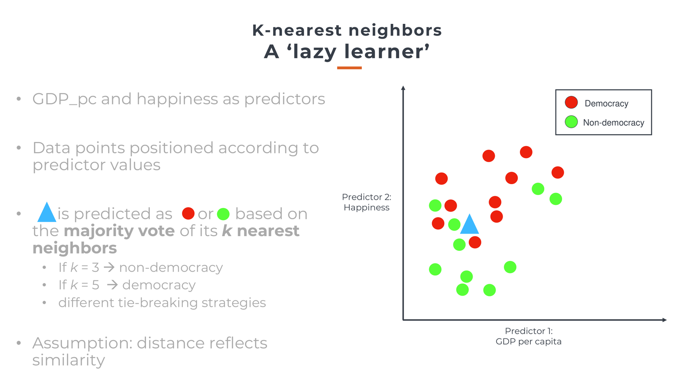
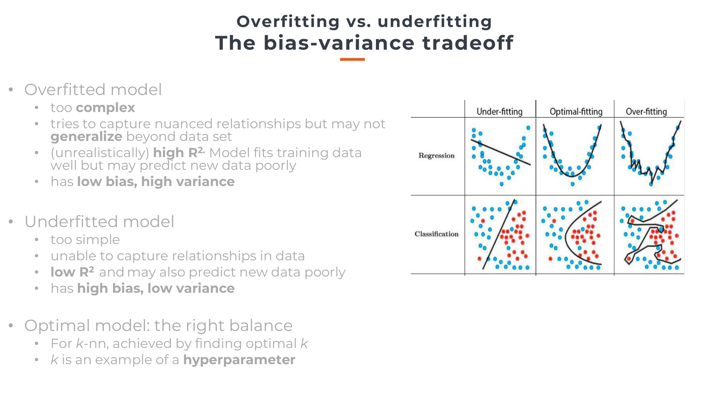
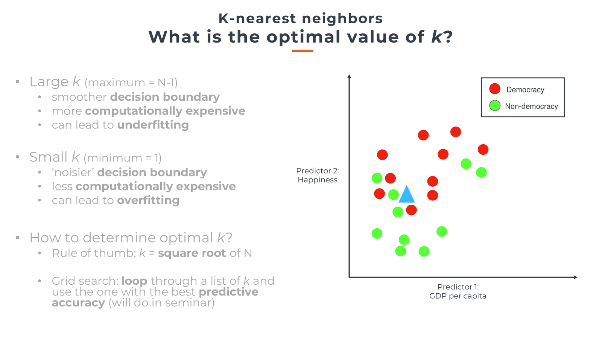
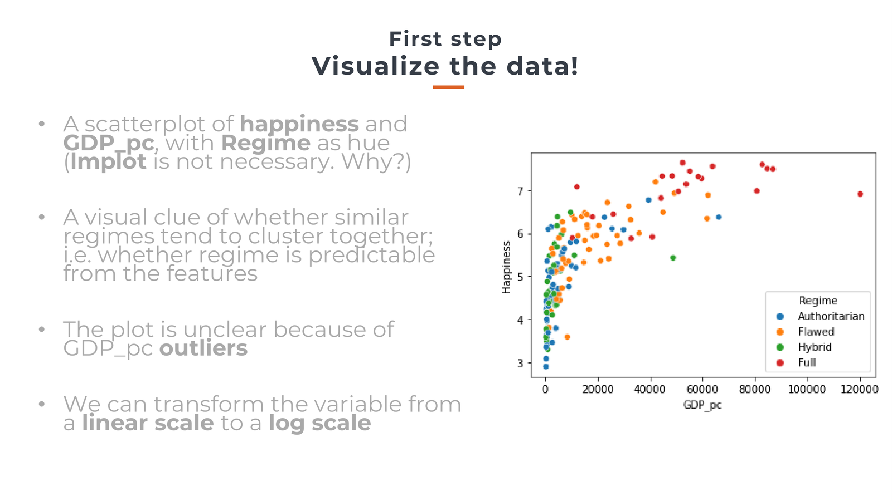
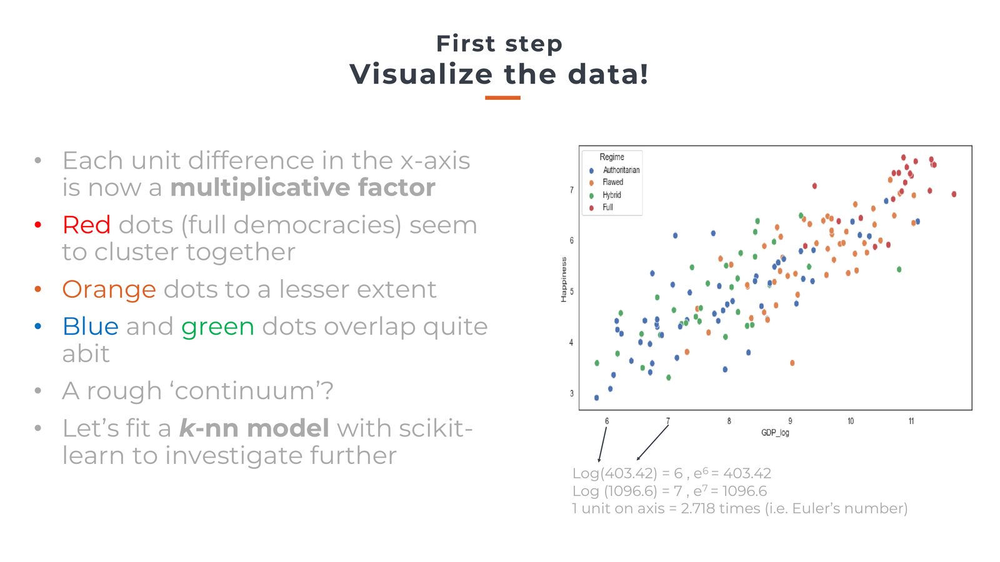
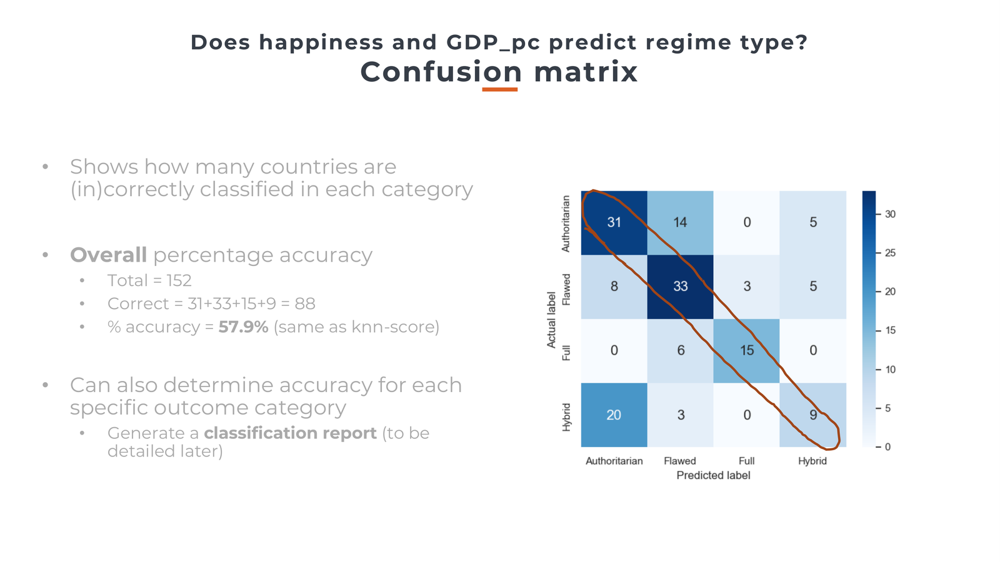
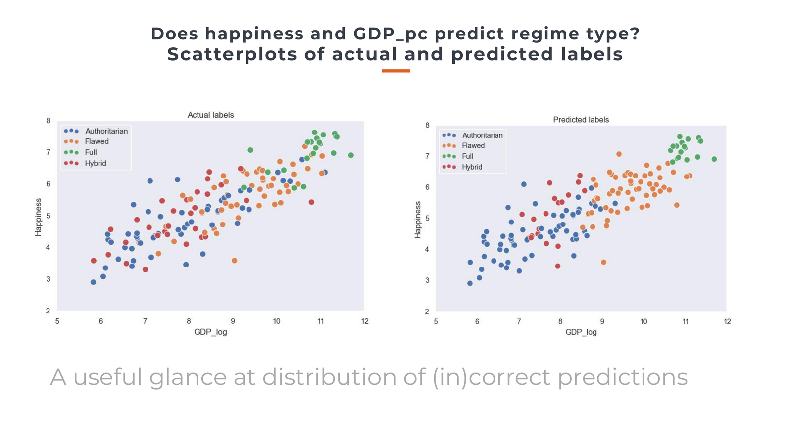

# Lecture 7 · Classification

k-NN · Bias–variance tradeoff · Confusion matrix · Critical interpretation

LECTURE 7 · 分类

学术英语阅读与写作 · 课件来源：Lecture7.pdf（22 页，课件标注为 Lecture 6）

!!! info "阅读说明"

    本讲义按原课件逐页整理：英文条目为课件原文，其下附中文对照；代码、图表与输出截图页附原课件整页图片。课件第 1 页为课程封面（标注为 Lecture 6），未收录。文末附本讲<strong>重点词汇表</strong>。

## 1. Warm-up　课堂判断

### Slide 2 · True or False?

Each group should agree on one set of answers.

1. A regression model with an interaction effect is always preferable to one without.
2. Outcomes of linear regression models are categorical.
3. The $R^2$ of a regression model measures how many percent of predictions are correct.
4. A predictor coefficient of $p>.05$ implies that the outcome does not vary much with that predictor.
5. A regression model with good in-sample predictions will also have good out-of-sample predictions.

每组应商定一套答案：① 有交互效应的回归模型总是优于没有交互效应的模型；② 线性回归模型的结果是分类的；③ 回归模型的 $R^2$ 衡量预测正确的百分比；④ 预测变量系数 $p>.05$ 意味着结果几乎不随该预测变量变化；⑤ 样本内预测好的回归模型，样本外预测也一定好。
{: .zh }

## 2. Recap and dataset　回顾与数据

### Slide 3 · Outline

- Classification
- Evaluating classification models: k-nearest neighbors algorithm; bias-variance tradeoff
- Using classification models

分类；评估分类模型——k 近邻算法与偏差—方差权衡；使用分类模型。
{: .zh }

### Slide 4 · Recap: Classification

- When the outcome is discrete/categorical rather than continuous (i.e., a label rather than a numerical value)
- If the feature(s) change by this much, (how likely) does the outcome label change?
- How accurately can we predict new labels based on the above?
- Different algorithms: k-nearest-neighbours (k-NN), logistic regression, support vector machine (SVM), naïve Bayes, decision trees etc.
- Some algorithms can be used for both regression and classification (e.g. decision trees, random forests, k-NN, SVM)

当结果是离散/分类的而非连续的（即标签而非数值）。特征变化这么多，结果标签（多大概率）会变化？基于上述关系预测新标签有多准确？ 
不同算法：k 近邻（k-NN）、逻辑回归、支持向量机（SVM）、朴素贝叶斯、决策树等。有些算法既可用于回归也可用于分类（决策树、随机森林、k-NN、SVM）。
{: .zh }

### Slide 5 · Recall last week's dataset

- Countries are defined/classified into regime categories by certain political criteria.
- But do countries in the same regime category share similar socio-economic characteristics?
- In other words, can SE data predict the regime category?
- We use training data to train a classification model to learn the relationship between feature(s) and outcome.
- What is the conceptual difference between
    - SE data ~ Regime (last week)
    - Regime ~ SE data (today)?

国家按某些政治标准被定义/分类为政体类别。但同一政体类别的国家是否具有相似的社会经济特征？换言之，社会经济数据能预测政体类别吗？ 
我们用训练数据训练分类模型，学习特征与结果之间的关系。概念区别：SE data ~ Regime（上周）与 Regime ~ SE data（今天）。
{: .zh }

## 3. k-NN and bias–variance　k 近邻与偏差—方差

### Slide 6 · K-nearest neighbors: A “lazy learner”

- GDP_pc and happiness as predictors
- Data points positioned according to predictor values
- The triangle is predicted as a red dot (Democracy) or green dot (Non-democracy) based on the majority vote of its $k$ nearest neighbors
    - If $k=3$ → non-democracy
    - If $k=5$ → democracy
    - different tie-breaking strategies
- Assumption: distance reflects similarity

原课件第 6 页：k-NN 的多数投票示意（红色 = Democracy，绿色 = Non-democracy）

用 GDP_pc 和幸福度作为预测变量，数据点按预测变量值定位。三角形根据其 $k$ 个最近邻居的多数投票，被预测为红点（民主）或绿点（非民主）：如果 $k=3$ → 非民主；如果 $k=5$ → 民主；还有不同的平局处理策略。假设：距离反映相似性。
{: .zh }

### Slide 7 · Overfitting vs. underfitting: The bias–variance tradeoff

- Overfitted model
    - too complex
    - tries to capture nuanced relationships but may not generalize beyond data set
    - (unrealistically) high $R^2$. Model fits training data well but may predict new data poorly
    - has low bias, high variance
- Underfitted model
    - too simple
    - unable to capture relationships in data
    - low $R^2$ and may also predict new data poorly
    - has high bias, low variance
- Optimal model: the right balance
    - For k-NN, achieved by finding optimal $k$
    - $k$ is an example of a hyperparameter

原课件第 7 页：欠拟合、最优拟合与过拟合

<strong>过拟合：</strong>模型过于复杂，试图捕捉细微关系，但可能无法泛化到数据集之外；$R^2$（不现实地）高，对训练数据拟合好，但新数据预测可能差；低偏差、高方差。 
<strong>欠拟合：</strong>模型过于简单，无法捕捉数据中的关系；$R^2$ 低，新数据预测也可能差；高偏差、低方差。 
<strong>最优模型：</strong>恰当平衡。对 k-NN，通过寻找最优 $k$ 实现；$k$ 是超参数的一个例子。
{: .zh }

### Slide 8 · What is the optimal value of $k$?

- Large $k$ (maximum = $N-1$)
    - smoother decision boundary
    - more computationally expensive
    - can lead to underfitting
- Small $k$ (minimum = 1)
    - “noisier” decision boundary
    - less computationally expensive
    - can lead to overfitting
- How to determine optimal $k$?
    - Rule of thumb: $k$ = square root of $N$
    - Grid search: loop through a list of $k$ and use the one with the best predictive accuracy (will do in seminar)

原课件第 8 页：不同 k 值下的决策边界

<strong>大 $k$</strong>（最大 = $N-1$）：决策边界更平滑，计算成本更高，可能导致欠拟合。 
<strong>小 $k$</strong>（最小 = 1）：决策边界更“嘈杂”，计算成本更低，可能导致过拟合。 
如何确定最优 $k$？经验法则：$k$ = $N$ 的平方根；或网格搜索——遍历 $k$ 列表，选择预测准确率最高的（将在研讨课中做）。
{: .zh }

### Slide 9 · k-nearest neighbors

- Just like regression, we can have $>1$ predictor, either continuous or categorical
- For categorical predictors, convert string labels into numbers first (categorical data encoding)
- Let's use two continuous predictors: happiness and GDP_pc, to predict regime
- Try others for yourself later

与回归一样，可以有多个预测变量，连续或分类均可。对分类预测变量，先把字符串标签转换为数字（分类数据编码）。本讲用两个连续预测变量——幸福度和 GDP_pc——预测政体；其他变量可自行尝试。
{: .zh }

## 4. Applying classification　应用分类

### Slide 10 · First step: Visualize the data!

- A scatterplot of happiness and GDP_pc, with Regime as hue (lmplot is not necessary. Why?)
- A visual clue of whether similar regimes tend to cluster together; i.e. whether regime is predictable from the features
- The plot is unclear because of GDP_pc outliers
- We can transform the variable from a linear scale to a log scale

原课件第 10 页：幸福度与人均 GDP 的散点图（按政体着色）

幸福度与 GDP_pc 的散点图，以 Regime 为 hue（不需要 lmplot，为什么？）。它提供视觉线索：相似政体是否倾向于聚在一起，即政体是否可由特征预测。由于 GDP_pc 离群值，图不清楚；可以把变量从线性尺度变换为对数尺度。
{: .zh }

### Slide 11 · A common data transformation technique: Logarithmic transformation

- converts a linear scale to a log scale
- compresses a wide range of values and makes it more compact
- reduces skew and de-emphasizes outliers
- Raw GDP_pc: Luxembourg = 120061, Burundi = 340; a 353$\times$ difference
- Log-transformed GDP_pc: np.log(120061) = 11.696, np.log(340) = 5.829; a 2$\times$ difference
- will not work if data value = 0 (log of 0 = undefined). An alternative is square root transformation (np.sqrt)

对数变换把线性尺度转换为对数尺度，压缩大范围数值使其更紧凑，减小偏态并弱化离群值。 
原始 GDP_pc：Luxembourg = 120061，Burundi = 340，相差 353 倍；对数变换后：np.log(120061) = 11.696，np.log(340) = 5.829，相差 2 倍。 
数据值为 0 时不可用（log(0) 未定义）；替代方案是平方根变换（np.sqrt）。
{: .zh }

### Slide 12 · First step: Visualize the data!（对数尺度）

- Each unit difference in the x-axis is now a multiplicative factor
- Red dots (full democracies) seem to cluster together
- Orange dots to a lesser extent
- Blue and green dots overlap quite a bit
- A rough “continuum”?
- Let's fit a k-NN model with scikit-learn to investigate further
- Log(403.42) = 6, $e^6$ = 403.42; Log(1096.6) = 7, $e^7$ = 1096.6; 1 unit on axis = 2.718 times (i.e. Euler's number)

原课件第 12 页：对数变换后的幸福度—GDP 散点图

x 轴每 1 个单位的差异现在是一个乘数因子。红点（完全民主）似乎聚在一起；橙点程度稍弱；蓝点和绿点重叠较多——是否呈现粗略的“连续谱”？ 
用 scikit-learn 拟合 k-NN 模型进一步研究。Log(403.42) = 6，$e^6$ = 403.42；Log(1096.6) = 7，$e^7$ = 1096.6；轴上 1 个单位 = 2.718 倍（欧拉数）。
{: .zh }

### Slide 13 · Recall the data analytic workflow

- We just completed the first step: Explore → Apply → Evaluate → Interpret.

我们刚完成第一步：探索 → 应用 → 评估 → 解释。
{: .zh }

### Slide 14 · Do happiness and GDP_log predict regime type?

- Define $y$ (outcome) and $x$ (predictors):
    - `y = data['Regime']`
    - `x = data[['Happiness','GDP_log']]`
- Then decide $k$ (no. of neighbors). We use the simple rule of thumb first (we will learn a more principled approach in the seminar).
    - Optimal $k = \sqrt{152} \approx 12$
- Finally, create the classifier and fit it onto the data:
    - `knn = KNeighborsClassifier(n_neighbors=best_k)`
    - `knn.fit(x,y)`

定义 $y$（结果）与 $x$（预测变量）：`y = data['Regime']`、`x = data[['Happiness','GDP_log']]`。然后决定 $k$（邻居数）——先用简单经验法则，更规范的方法在研讨课学习：最优 $k = \sqrt{152} \approx 12$。最后创建分类器并拟合：`knn = KNeighborsClassifier(n_neighbors=best_k)`、`knn.fit(x, y)`。
{: .zh }

### Slide 15 · Do happiness and GDP_log predict regime type?（预测与评估）

- We now use the model to predict the regimes for our dataset: `knn.predict(x)`
- `data['predicted'] = knn.predict(x)`; `data[['Regime','predicted']]`
- We then evaluate its accuracy by comparing predicted labels to actual labels.
- Percentage accuracy is the simplest metric; i.e. how many % of predictions are correct. We will learn others like precision, recall, F1 score later.
- `knn.score(x, y)`
- Minimum acceptable accuracy depends on context and objectives (e.g. 60% for social research vs. medical diagnosis).

用模型为数据集预测政体：`data['predicted'] = knn.predict(x)`，然后查看 `data[['Regime', 'predicted']]`。通过比较预测标签与实际标签评估准确率。百分比准确率是最简单的指标，即预测正确的百分比；之后会学 precision、recall、F1。`knn.score(x, y)` 给出准确率。最低可接受准确率取决于情境和目标（如社会研究 60% vs 医学诊断）。
{: .zh }

### Slide 16 · Confusion matrix

- Shows how many countries are (in)correctly classified in each category.
- Overall percentage accuracy: Total = 152; Correct = 31 + 33 + 15 + 9 = 88; % accuracy = 57.9% (same as knn.score).
- Can also determine accuracy for each specific outcome category.
- Generate a classification report (to be detailed later).

原课件第 16 页：混淆矩阵

显示每个类别中有多少国家被正确/错误分类。总体百分比准确率：总数 = 152；正确 = 31 + 33 + 15 + 9 = 88；准确率 = 57.9%（与 knn.score 相同）。也可计算每个具体结果类别的准确率，并生成分类报告（之后详述）。
{: .zh }

### Slide 17 · Scatterplots of actual and predicted labels

- A useful glance at distribution of (in)correct predictions.

原课件第 17 页：实际标签与预测标签的散点图

快速查看（不）正确预测分布的有用方式。
{: .zh }

### Slide 18 · Interpreting what we have so far

- Happiness and GDP_pc data give us 57.9% accuracy in predicting regime type. Not very high. Could this be improved (e.g., by using a different value for $k$?)
- Democracies tend to have high happiness and GDP_pc, non-democracies the opposite.
- There seems to be a “continuum” from full democracies to authoritarian regimes.

幸福度和 GDP_pc 数据预测政体类型的准确率为 57.9%，不算高。能否改进（如换一个 $k$ 值）？民主国家往往幸福度和 GDP_pc 较高，非民主国家相反。似乎存在从完全民主到威权政体的“连续谱”。
{: .zh }

## 5. Critical interpretation　批判性解释

### Slide 19 · Where data analytics meets humanistic thinking

- Data analytics help us establish (mathematical) relationships between happiness, GDP per capita, and regime type.
- Critical (humanistic) thinking and interpretation means to explain this relationship, by moving from what to how/why.
- For example:
    - which, and why, are some countries incorrectly predicted? a case study approach
    - the boundary between “flawed democracies” and “hybrid regimes” may be particularly interesting. Why?
    - Let's extract flawed-predicted as hybrid, and hybrid-predicted as flawed:
    - `data.loc[(data['Regime'] == 'Flawed') & (data['predicted'] =='Hybrid')]`
    - `data.loc[(data['Regime'] == 'Hybrid') & (data['predicted'] =='Flawed')]`

数据分析帮助建立幸福度、人均 GDP 与政体类型之间的（数学）关系。批判性（人文）思维与解释意味着从“是什么”走向“如何/为什么”，解释这种关系。例如：① 哪些国家被错误预测，为什么？案例研究法。② “有缺陷民主”与“混合政体”的边界可能特别有趣，为什么？③ 提取被预测为混合的有缺陷民主：`data.loc[(data['Regime'] == 'Flawed') & (data['predicted'] == 'Hybrid')]`；以及被预测为有缺陷民主的混合政体：`data.loc[(data['Regime'] == 'Hybrid') & (data['predicted'] == 'Flawed')]`。
{: .zh }

### Slide 20 · Recall the data analytic workflow

- We have almost completed all the steps: Explore → Apply → Evaluate → Interpret.
- The final step: how do we interpret and use the model?

我们几乎完成所有步骤：探索 → 应用 → 评估 → 解释。最后一步：如何解释和使用模型？
{: .zh }

### Slide 21 · What does “using the model” mean?

- We now know that regime type is (weakly) predictable from happiness and GDP_pc, based on the data we used to train the classification model.
- In most practical contexts, using the model means predicting outcome labels for new or “unseen” data; e.g.
    - for countries with known predictor but unknown outcome values
    - e.g. if country X has happiness = 6.5 and GDP_pc = 20000, what is the predicted regime?
    - for new predictor values
    - for new countries(?)
    - for countries not used to train the model (more in Lecture 7)
- Our example, however, is more likely to be academic than “practical”. Why?

基于训练分类模型的数据，政体类型（弱）可由幸福度和 GDP_pc 预测。在多数实践情境中，使用模型意味着为新数据或“未见过的”数据预测结果标签：① 已知预测变量但结果值未知的国家——如国家 X 幸福度 = 6.5、GDP_pc = 20000，预测政体是什么？② 新的预测变量值；③ 新国家（？）；④ 未用于训练模型的国家（更多见 Lecture 7）。 
但我们的例子更可能是学术性的而非“实践性的”。为什么？
{: .zh }

### Slide 22 · Summary

- We use classification models (e.g., k-NN) to investigate if, and how, a categorical outcome is linked to continuous/categorical predictors.
- The optimal $k$ value is a hyperparameter that needs to be decided upon beforehand.
- Just like regression, classification models are useful in empirical linguistic and social contexts by informing/interrogating theory and making predictions.
- Key evaluation metrics include % accuracy, precision, recall, and F1 score.

我们用分类模型（如 k-NN）研究分类结果是否以及如何与连续/分类预测变量相关。最优 $k$ 是超参数，需要事先决定。与回归一样，分类模型在实证语言学和社会情境中有用：检验/质询理论并作出预测。关键评估指标包括百分比准确率、precision、recall 和 F1。
{: .zh }

## 重点词汇 · Key Vocabulary

| English | 中文 | 说明 / 搭配 |
|---|---|---|
| classification | 分类 | 预测离散标签 |
| k-NN | k 近邻 | 按最近邻居多数投票 |
| majority vote | 多数投票 | 邻居中多数类别获胜 |
| hyperparameter | 超参数 | 如 k，需事先设定 |
| overfitting | 过拟合 | 模型过复杂，方差高 |
| underfitting | 欠拟合 | 模型过简单，偏差高 |
| bias-variance tradeoff | 偏差—方差权衡 | 复杂度与泛化的平衡 |
| decision boundary | 决策边界 | 分类器划分类别的边界 |
| log transformation | 对数变换 | 压缩范围、减小偏态 |
| confusion matrix | 混淆矩阵 | 行=实际，列=预测 |
| accuracy | 准确率 | 正确预测/总数 |
| precision | 精确率 | 预测为正且实际为正的比例 |
| recall | 召回率 | 实际为正且被预测为正的比例 |
| F1 score | F1 分数 | precision 与 recall 的调和平均 |
| supervised learning | 有监督学习 | 特征 + 标签 |
