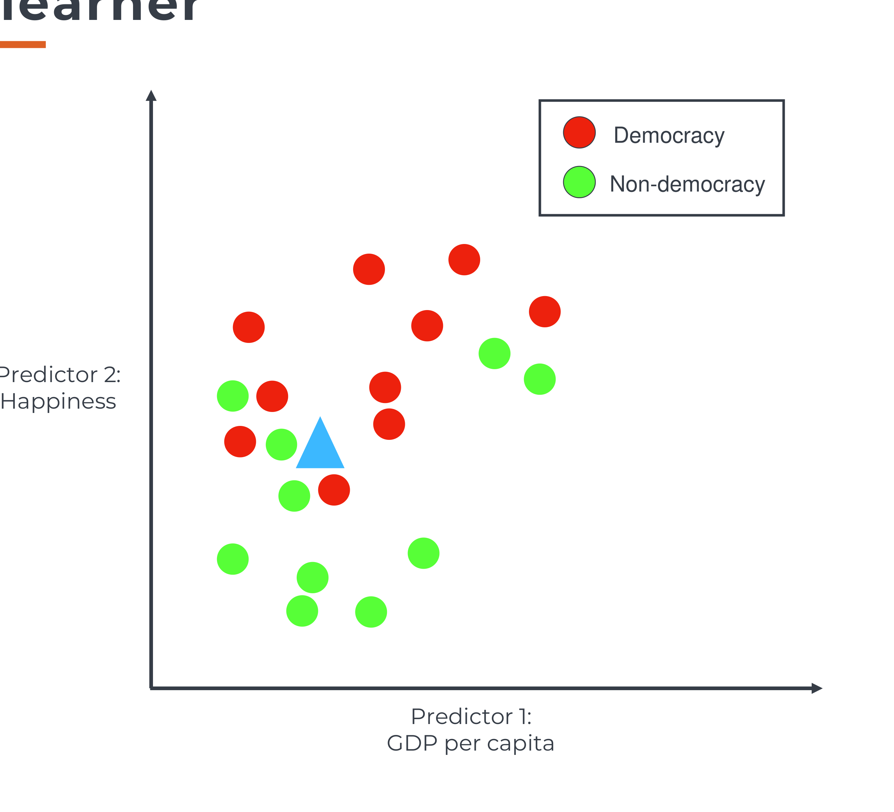
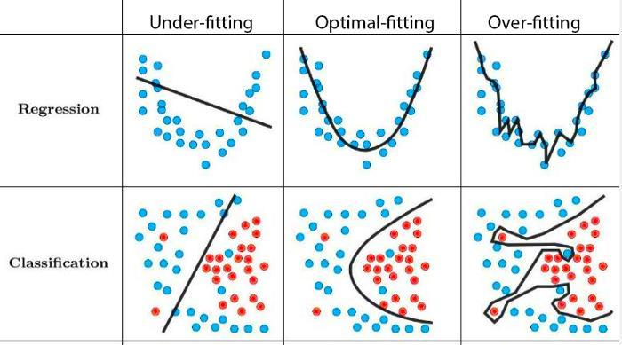
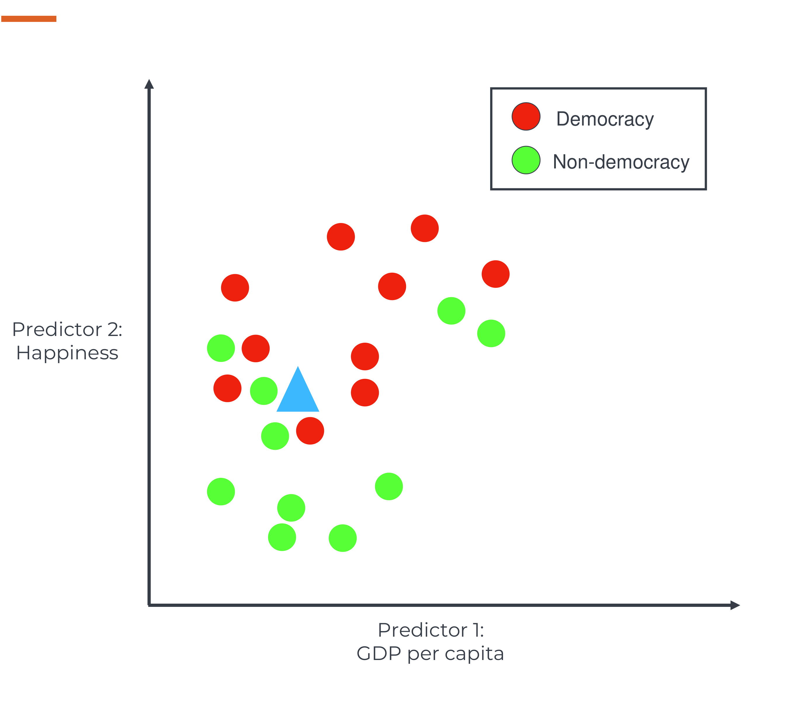
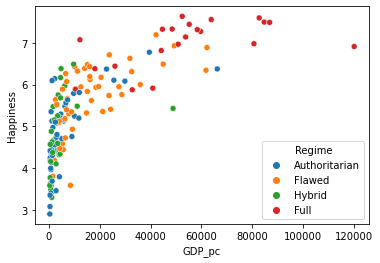
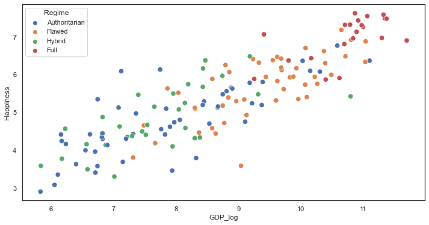
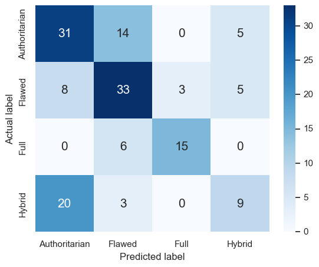
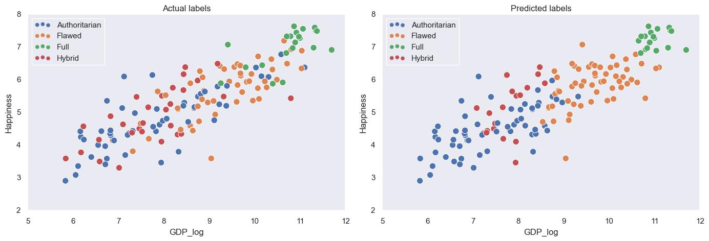

# Lecture 7 · Classification

k-NN · Bias–variance tradeoff · Confusion matrix · Critical interpretation

LECTURE 7 · 分类

学术英语阅读与写作 · 课件来源：Lecture7.pdf（22 页，课件标注为 Lecture 6）

!!! info "阅读说明"

    英文条目为课件原文，其下为中文对照翻译。公式与 Python 代码保留原样。

## 1. Warm-up　课堂判断

### Slide 2 · True or False?

1. A regression model with an interaction effect is always preferable to one without.
2. Outcomes of linear regression models are categorical.
3. The $R^2$ of a regression model measures how many percent of predictions are correct.
4. A predictor coefficient of $p>.05$ implies that the outcome does not vary much with that predictor.
5. A regression model with good in-sample predictions will also have good out-of-sample predictions.

<strong>中文对照：</strong>

1. 带交互效应的回归模型总是优于不带交互效应的模型。
2. 线性回归模型的结果是分类变量。
3. 回归模型的 $R^2$ 衡量预测正确的百分比。
4. 预测变量系数 $p>.05$ 意味着结果几乎不随该预测变量变化。
5. 样本内预测良好的回归模型，其样本外预测也会良好。
{: .zh }

参考答案：False, False, False, False, False。
{: .zh }

### Slide 3 · Outline

1. Classification
2. Evaluating classification models: k-nearest neighbors algorithm; bias-variance tradeoff
3. Using classification models

<strong>中文对照：</strong>

1. 分类
2. 评估分类模型：k 近邻算法；偏差—方差权衡
3. 使用分类模型
{: .zh }

## 2. Recap and dataset　回顾与数据

### Slide 4 · Recap: Classification

- When the outcome is discrete/categorical rather than continuous (i.e., a label rather than a numerical value)
- If the feature(s) change by this much, (how likely) does the outcome label change?
- How accurately can we predict new labels based on the above?
- Different algorithms: k-nearest-neighbours (k-NN), logistic regression, support vector machine (SVM), naïve Bayes, decision trees etc.
- Some algorithms can be used for both regression and classification (e.g. decision trees, random forests, k-NN, SVM)

<strong>中文对照：</strong>

- 当结果是离散/分类的而非连续的（即标签而非数值）
- 如果特征变化这么多，结果标签（有多大可能）会改变？
- 基于上述关系，我们能多准确地预测新的标签？
- 不同算法：k 近邻（k-NN）、逻辑回归、支持向量机（SVM）、朴素贝叶斯、决策树等
- 有些算法既可用于回归也可用于分类（如决策树、随机森林、k-NN、SVM）

### Slide 5 · Recall last week's dataset

- Countries are defined/classified into regime categories by certain political criteria.
- But do countries in the same regime category share similar socio-economic characteristics?
- In other words, can SE data predict the regime category?
- We use training data to train a classification model to learn the relationship between feature(s) and outcome.
- What is the conceptual difference between
    - SE data ~ Regime (last week)
    - Regime ~ SE data (today)?

<strong>中文对照：</strong>

- 国家根据某些政治标准被定义/分类为不同的政体类别。
- 但同一政体类别中的国家是否具有相似的社会经济特征？
- 换言之，社会经济数据能否预测政体类别？
- 我们用训练数据训练分类模型，学习特征与结果之间的关系。
- 以下两者在概念上有什么区别：
    - 社会经济数据 ~ 政体（上周）
    - 政体 ~ 社会经济数据（今天）？

## 3. k-NN and bias–variance　k-NN 与偏差—方差

### Slide 6 · K-nearest neighbors: A “lazy learner”

- GDP_pc and happiness as predictors
- Data points positioned according to predictor values
- △ is predicted as ● or ● based on the majority vote of its $k$ nearest neighbors
    - If $k=3$ → non-democracy
    - If $k=5$ → democracy
    - different tie-breaking strategies
- Assumption: distance reflects similarity

<strong>中文对照：</strong>

- 以人均 GDP（GDP_pc）与幸福度作为预测变量
- 数据点根据预测变量值定位
- △ 根据其 $k$ 个最近邻居的多数投票，被预测为 ● 或 ●
    - 若 $k=3$ → 非民主
    - 若 $k=5$ → 民主
    - 不同的平局处理策略
- 假设：距离反映相似性

原课件第 6 页：k-NN 的多数投票示意（红色 = Democracy，绿色 = Non-democracy）

### Slide 7 · Overfitting vs. underfitting: The bias–variance tradeoff

- <strong>Overfitted model</strong>
    - too complex
    - tries to capture nuanced relationships but may not generalize beyond data set
    - (unrealistically) high $R^2$. Model fits training data well but may predict new data poorly
    - has low bias, high variance
- <strong>Underfitted model</strong>
    - too simple
    - unable to capture relationships in data
    - low $R^2$ and may also predict new data poorly
    - has high bias, low variance
- <strong>Optimal model:</strong> the right balance
    - For k-NN, achieved by finding optimal $k$
    - $k$ is an example of a hyperparameter

<strong>中文对照：</strong>

- <strong>过拟合模型</strong>
    - 过于复杂
    - 试图捕捉细微关系，但可能无法泛化到数据集之外
    - $R^2$（不切实际地）很高。模型对训练数据拟合很好，但预测新数据可能很差
    - 低偏差、高方差
- <strong>欠拟合模型</strong>
    - 过于简单
    - 无法捕捉数据中的关系
    - $R^2$ 低，预测新数据也可能很差
    - 高偏差、低方差
- <strong>最优模型：</strong>恰当的平衡
    - 对 k-NN 而言，通过找到最优 $k$ 实现
    - $k$ 是超参数的一个例子

原课件第 7 页：欠拟合、最优拟合与过拟合

### Slide 8 · What is the optimal value of $k$?

- Large $k$ (maximum = $N-1$)
    - smoother decision boundary
    - more computationally expensive
    - can lead to underfitting
- Small $k$ (minimum = 1)
    - “noisier” decision boundary
    - less computationally expensive
    - can lead to overfitting
- How to determine optimal $k$?
    - Rule of thumb: $k$ = square root of $N$
    - Grid search: loop through a list of $k$ and use the one with the best predictive accuracy (will do in seminar)

<strong>中文对照：</strong>

- 较大的 $k$（最大 = $N-1$）
    - 决策边界更平滑
    - 计算成本更高
    - 可能导致欠拟合
- 较小的 $k$（最小 = 1）
    - 决策边界“噪声”更大
    - 计算成本更低
    - 可能导致过拟合
- 如何确定最优 $k$？
    - 经验法则：$k$ = $N$ 的平方根
    - 网格搜索：遍历一组 $k$，选用预测准确率最高的那个（将在研讨课中实践）

原课件第 8 页：不同 $k$ 值下的决策边界（示意）

### Slide 9 · k-nearest neighbors

- Just like regression, we can have $>1$ predictor, either continuous or categorical
- For categorical predictors, convert string labels into numbers first (categorical data encoding)
- Let's use two continuous predictors: happiness and GDP_pc, to predict regime
- Try others for yourself later

<strong>中文对照：</strong>

- 与回归一样，我们可以有多个预测变量，连续或分类均可
- 对于分类预测变量，先把字符串标签转换为数字（分类数据编码）
- 我们使用两个连续预测变量：幸福度与 GDP_pc，来预测政体
- 之后可以自己尝试其他变量

## 4. Applying classification　应用分类

### Slide 10 · First step: Visualize the data!

- A scatterplot of happiness and GDP_pc, with Regime as hue (lmplot is not necessary. Why?)
- A visual clue of whether similar regimes tend to cluster together; i.e. whether regime is predictable from the features
- The plot is unclear because of GDP_pc outliers
- We can transform the variable from a linear scale to a log scale

原课件第 10 页：幸福度与人均 GDP 的散点图（按政体着色）

- 幸福度与 GDP_pc 的散点图，以 Regime 作为 hue（不需要 lmplot。为什么？）
- 用视觉线索判断相似政体是否倾向于聚在一起，即政体是否可由特征预测
- 由于 GDP_pc 的离群值，图不清楚
- 我们可以把该变量从线性尺度变换为对数尺度

### Slide 11 · Logarithmic transformation

- converts a linear scale to a log scale
- compresses a wide range of values and makes it more compact
- reduces skew and de-emphasizes outliers
- Raw GDP_pc: Luxembourg = 120061, Burundi = 340; a 353× difference
- Log-transformed GDP_pc: np.log(120061) = 11.696, np.log(340) = 5.829; a 2× difference
- will not work if data value = 0 (log of 0 = undefined). An alternative is square root transformation (np.sqrt)

<strong>中文对照：</strong>

- 把线性尺度转换为对数尺度
- 压缩大范围数值，使其更紧凑
- 降低偏态，弱化离群值
- 原始 GDP_pc：卢森堡 = 120061，布隆迪 = 340；相差 353 倍
- 对数变换后的 GDP_pc：np.log(120061) = 11.696，np.log(340) = 5.829；相差约 2 倍
- 若数据值为 0 则不可用（0 的对数无定义）。替代方案是平方根变换（np.sqrt）

### Slide 12 · Visualize the data again

- Each unit difference in the x-axis is now a multiplicative factor
- Red dots (full democracies) seem to cluster together
- Orange dots to a lesser extent
- Blue and green dots overlap quite a bit
- A rough “continuum”?
- Let's fit a k-NN model with scikit-learn to investigate further
- Log(403.42) = 6, $e^6$ = 403.42; Log(1096.6) = 7, $e^7$ = 1096.6; 1 unit on axis = 2.718 times (i.e. Euler's number)

原课件第 12 页：对数变换后的幸福度—GDP 散点图

- x 轴上每 1 个单位的差异，现在代表一个乘数因子
- 红点（完全民主国家）似乎聚集在一起
- 橙点聚集程度稍弱
- 蓝点与绿点重叠较多
- 是否存在一个粗略的“连续谱”？
- 我们用 scikit-learn 拟合一个 k-NN 模型进一步研究
- Log(403.42) = 6，$e^6$ = 403.42；Log(1096.6) = 7，$e^7$ = 1096.6；轴上 1 个单位 = 2.718 倍（即欧拉数）

### Slide 13 · Recall the data analytic workflow

- We just completed the first step: Explore → Apply → Evaluate → Interpret.

我们刚刚完成了第一步：探索 → 应用 → 评估 → 解释。
{: .zh }

### Slide 14 · Do happiness and GDP_log predict regime type?

- Define $y$ (outcome) and $x$ (predictors): `y = data['Regime']`; `x = data[['Happiness','GDP_log']]`
- Then decide $k$ (no. of neighbors). We use the simple rule of thumb first (we will learn a more principled approach in the seminar).
    - Optimal $k = \sqrt{152} \approx 12$
- Finally, create the classifier and fit it onto the data:
    - `knn = KNeighborsClassifier(n_neighbors=best_k)`
    - `knn.fit(x,y)`

<strong>中文对照：</strong>

- 定义 $y$（结果）与 $x$（预测变量）：`y = data['Regime']`；`x = data[['Happiness','GDP_log']]`
- 然后确定 $k$（邻居数）。我们先用简单的经验法则（研讨课会学习更有原则的方法）。
    - 最优 $k = \sqrt{152} \approx 12$
- 最后，创建分类器并拟合数据：
    - `knn = KNeighborsClassifier(n_neighbors=best_k)`
    - `knn.fit(x,y)`

### Slide 15 · Predict and evaluate

- We now use the model to predict the regimes for our dataset: `knn.predict(x)`
- `data['predicted'] = knn.predict(x)`; `data[['Regime','predicted']]`
- We then evaluate its accuracy by comparing predicted labels to actual labels.
- Percentage accuracy is the simplest metric; i.e. how many % of predictions are correct. We will learn others like precision, recall, F1 score later.
- `knn.score(x, y)`
- Minimum acceptable accuracy depends on context and objectives (e.g. 60% for social research vs. medical diagnosis).

<strong>中文对照：</strong>

- 现在我们用模型预测数据集中各国的政体：`knn.predict(x)`
- `data['predicted'] = knn.predict(x)`；`data[['Regime','predicted']]`

<strong>中文对照：</strong>

- 然后通过比较预测标签与实际标签来评估准确率。
- 百分比准确率是最简单的指标，即预测正确的百分比。之后我们会学习精确率、召回率、F1 分数等指标。
- `knn.score(x, y)`

<strong>中文对照：</strong>

- 可接受的最低准确率取决于语境与目标（例如社会研究 60% 与医学诊断不同）。

### Slide 16 · Confusion matrix

- Shows how many countries are (in)correctly classified in each category.
- Overall percentage accuracy: Total = 152; Correct = 31 + 33 + 15 + 9 = 88; % accuracy = 57.9% (same as knn.score).
- Can also determine accuracy for each specific outcome category.
- Generate a classification report (to be detailed later).

原课件第 16 页：混淆矩阵

- 显示每个类别中有多少国家被正确/错误分类。
- 总体百分比准确率：总数 = 152；正确 = 31 + 33 + 15 + 9 = 88；准确率 = 57.9%（与 knn.score 相同）。
- 也可以确定每个具体结果类别的准确率。
- 生成分类报告（稍后详述）。

### Slide 17 · Scatterplots of actual and predicted labels

- A useful glance at distribution of (in)correct predictions.

原课件第 17 页：实际标签与预测标签的散点图

- 有助于快速查看正确/错误预测的分布。

### Slide 18 · Interpreting what we have so far

- Happiness and GDP_pc data give us 57.9% accuracy in predicting regime type. Not very high. Could this be improved (e.g., by using a different value for $k$?)
- Democracies tend to have high happiness and GDP_pc, non-democracies the opposite.
- There seems to be a “continuum” from full democracies to authoritarian regimes.

<strong>中文对照：</strong>

- 幸福度与 GDP_pc 数据在预测政体类型上给出 57.9% 的准确率，不算很高。能否改进（例如使用不同的 $k$ 值？）
- 民主国家往往幸福度与 GDP_pc 较高，非民主国家则相反。
- 从完全民主到威权政体似乎存在一个“连续谱”。

## 5. Critical interpretation　批判性解释

### Slide 19 · Where data analytics meets humanistic thinking

- Data analytics help us establish (mathematical) relationships between happiness, GDP per capita, and regime type.
- Critical (humanistic) thinking and interpretation means to explain this relationship, by moving from what to how/why.
- For example:
    - which, and why, are some countries incorrectly predicted? a case study approach
    - the boundary between “flawed democracies” and “hybrid regimes” may be particularly interesting. Why?
    - Let's extract flawed-predicted as hybrid, and hybrid-predicted as flawed:
        - `data.loc[(data['Regime'] == 'Flawed') & (data['predicted'] =='Hybrid')]`
        - `data.loc[(data['Regime'] == 'Hybrid') & (data['predicted'] =='Flawed')]`

<strong>中文对照：</strong>

- 数据分析帮助我们在幸福度、人均 GDP 与政体类型之间建立（数学）关系。
- 批判性（人文）思考与解释意味着解释这种关系，从“是什么”转向“如何/为什么”。
- 例如：
    - 哪些国家被错误预测，为什么？采用案例研究法
    - “有缺陷民主”与“混合政体”之间的边界可能特别有趣。为什么？
    - 让我们提取“有缺陷民主被预测为混合政体”与“混合政体被预测为有缺陷民主”的案例：
        - `data.loc[(data['Regime'] == 'Flawed') & (data['predicted'] =='Hybrid')]`
        - `data.loc[(data['Regime'] == 'Hybrid') & (data['predicted'] =='Flawed')]`

### Slide 20 · Recall the data analytic workflow

- We have almost completed all the steps: Explore → Apply → Evaluate → Interpret.
- The final step: how do we interpret and use the model?

<strong>中文对照：</strong>

- 我们几乎完成了所有步骤：探索 → 应用 → 评估 → 解释。
- 最后一步：我们如何解释并使用模型？

### Slide 21 · What does “using the model” mean?

- We now know that regime type is (weakly) predictable from happiness and GDP_pc, based on the data we used to train the classification model.
- In most practical contexts, using the model means predicting outcome labels for new or “unseen” data; e.g.
    - for countries with known predictor but unknown outcome values
    - e.g. if country X has happiness = 6.5 and GDP_pc = 20000, what is the predicted regime?
    - for new predictor values
    - for new countries(?)
    - for countries not used to train the model (more in Lecture 7)
- Our example, however, is more likely to be academic than “practical”. Why?

<strong>中文对照：</strong>

- 基于训练分类模型所用的数据，我们现在知道政体类型可以（较弱地）由幸福度与 GDP_pc 预测。
- 在大多数实际语境中，使用模型意味着对新的或“未见过的”数据预测结果标签；例如：
    - 对预测变量已知但结果值未知的国家
    - 例如，如果国家 X 的幸福度为 6.5、GDP_pc 为 20000，预测的政体是什么？
    - 对新的预测变量值
    - 对新的国家（？）
    - 对未用于训练模型的国家（第 7 讲会进一步讨论）
- 不过，我们的例子更可能是学术性的，而非“实践性”的。为什么？

### Slide 22 · Summary

- We use classification models (e.g., k-NN) to investigate if, and how, a categorical outcome is linked to continuous/categorical predictors.
- The optimal $k$ value is a hyperparameter that needs to be decided upon beforehand.
- Just like regression, classification models are useful in empirical linguistic and social contexts by informing/interrogating theory and making predictions.
- Key evaluation metrics include % accuracy, precision, recall, and F1 score.

<strong>中文对照：</strong>

- 我们用分类模型（如 k-NN）研究分类结果是否以及如何与连续/分类预测变量相关联。
- 最优 $k$ 值是一个需要预先确定的超参数。
- 与回归一样，分类模型在实证语言学与社会语境中很有用，可用于支持/检验理论并做出预测。
- 关键评估指标包括百分比准确率、精确率、召回率与 F1 分数。
