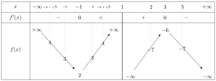
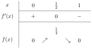

# 第 1 次习题课　\(\mathbb{R}\) 的拓扑

TD n°1 — Topologie de ℝ

CORRIGÉ · 参考解答

中法对照讲义 · 由 LaTeX 源文件渲染

!!! info "阅读说明"

    每段先列法语原文；其下缩进、带深蓝竖条的小字号段落为中文翻译。<strong>加粗</strong>为关键词，括号内为中文释义。

## Exercices à préparer

课前准备练习

### Exercice 1.

borne supérieure

练习 1.（上确界 borne supérieure）

Soit \(A \subset \mathbb{R}\) qu'on suppose non vide.
{: .fr-exo }

设 \(A \subset \mathbb{R}\)，并假设 \(A\) 非空。
{: .zh }

<strong>1.</strong> Soit \(M \in \mathbb{R}\). Montrer que \(M\) est la borne supérieure de \(A\) si et seulement si :
{: .fr-exo }

\[
\color{#0046AA}
\begin{cases}
\forall a \in A,\ a \leqslant M,\\[2pt]
\forall \varepsilon > 0,\ \exists a \in A,\ M - \varepsilon < a.
\end{cases}
\]

设 \(M \in \mathbb{R}\)。证明：\(M\) 是 \(A\) 的上确界当且仅当：
{: .zh }

!!! sol ""

    <strong>Solution.</strong> On raisonne par double implication.

    <strong>解.</strong> 我们按双向蕴含（double implication）进行推理。
    {: .zh }

    \(\Rightarrow\) On suppose que \(M = \sup(A)\), donc \(M\) est le plus petit majorant de \(A\). Puisque \(M\) est un majorant de \(A\), on a :

    \(\Rightarrow\) 假设 \(M = \sup(A)\)，因此 \(M\) 是 \(A\) 的最小上界（plus petit majorant）。由于 \(M\) 是 \(A\) 的上界，我们有：
    {: .zh }

    \[
    \forall a \in A,\ a \leqslant M.
    \]

    Soit \(\varepsilon > 0\). Puisque \(M - \varepsilon < M\) et que \(M\) est le plus petit majorant de \(A\), \(M - \varepsilon\) n'est pas un majorant de \(A\), donc la proposition «\(\forall a \in A,\ a \leqslant M - \varepsilon\)» est fausse. On en déduit que :

    设 \(\varepsilon > 0\)。由于 \(M - \varepsilon < M\) 且 \(M\) 是 \(A\) 的最小上界，\(M - \varepsilon\) 不是 \(A\) 的上界，因此命题「\(\forall a \in A,\ a \leqslant M - \varepsilon\)」为假。由此推出：
    {: .zh }

    \[
    \exists a \in A,\ a > M - \varepsilon.
    \]

    Ainsi, on a bien montré que :

    于是我们确实证明了：
    {: .zh }

    \[
    M = \sup(A) \implies
    \begin{cases}
    \forall a \in A,\ a \leqslant M,\\[2pt]
    \forall \varepsilon > 0,\ \exists a \in A,\ M - \varepsilon < a.
    \end{cases}
    \]

    \(\Leftarrow\) Réciproquement, on suppose que :

    \(\Leftarrow\) 反之，假设：
    {: .zh }

    \[
    \begin{cases}
    \forall a \in A,\ a \leqslant M,\\[2pt]
    \forall \varepsilon > 0,\ \exists a \in A,\ M - \varepsilon < a.
    \end{cases}
    \]

    D'après la première condition, \(M\) est un majorant de \(A\). Par l'absurde, on suppose que \(M\) n'est pas le plus petit majorant de \(A\), donc il existe un majorant \(M'\) de \(A\) tel que \(M' < M\). D'après la deuxième condition pour \(\varepsilon = M - M' > 0\), on sait qu'il existe \(a \in A\) tel que :

    由第一个条件，\(M\) 是 \(A\) 的上界。用反证法（par l'absurde），假设 \(M\) 不是 \(A\) 的最小上界，则存在 \(A\) 的一个上界 \(M'\)，满足 \(M' < M\)。根据第二个条件，取 \(\varepsilon = M - M' > 0\)，可知存在 \(a \in A\) 使得：
    {: .zh }

    \[
    M' = M - (M - M') = M - \varepsilon < a
    \]

    ce qui est absurde car \(M'\) est un majorant de \(A\). Par conséquent, \(M\) est le plus petit majorant de \(A\). On a bien montré que :

    这与 \(M'\) 是 \(A\) 的上界矛盾。因此，\(M\) 是 \(A\) 的最小上界。我们确实证明了：
    {: .zh }

    \[
    \begin{cases}
    \forall a \in A,\ a \leqslant M,\\[2pt]
    \forall \varepsilon > 0,\ \exists a \in A,\ M - \varepsilon < a.
    \end{cases}
    \implies M = \sup(A).
    \]

    Finalement, on a montré par double implication que :

    最后，我们通过双向蕴含证明了：
    {: .zh }

    \[
    \boxed{
    M = \sup(A) \iff
    \begin{cases}
    \forall a \in A,\ a \leqslant M,\\[2pt]
    \forall \varepsilon > 0,\ \exists a \in A,\ M - \varepsilon < a.
    \end{cases}}
    \]

<strong>2.</strong> Trouver une caractérisation similaire de la borne inférieure de \(A\).
{: .fr-exo }

找出 \(A\) 的下确界（borne inférieure）的类似刻画。
{: .zh }

!!! sol ""

    <strong>Solution.</strong> Soit \(m \in \mathbb{R}\). En raisonnant comme à la question précédente, on a :

    <strong>解.</strong> 设 \(m \in \mathbb{R}\)。仿照上一问的推理，我们有：
    {: .zh }

    \[
    \boxed{
    m = \inf(A) \iff
    \begin{cases}
    \forall a \in A,\ a \geqslant m,\\[2pt]
    \forall \varepsilon > 0,\ \exists a \in A,\ m + \varepsilon > a.
    \end{cases}}
    \]

<strong>3.</strong> À l'aide de la question 1, déterminer \(\sup\left\{\frac{n}{n+1}\ \middle|\ n \in \mathbb{N}\right\}\).
{: .fr-exo }

利用第 1 问，求 \(\sup\left\{\frac{n}{n+1}\ \middle|\ n \in \mathbb{N}\right\}\)。
{: .zh }

!!! sol ""

    <strong>Solution.</strong> On pose \(A = \left\{\frac{n}{n+1}\ \middle|\ n \in \mathbb{N}\right\}\). On a :

    <strong>解.</strong> 令 \(A = \left\{\frac{n}{n+1}\ \middle|\ n \in \mathbb{N}\right\}\)。我们有：
    {: .zh }

    \[
    \forall n \in \mathbb{N},\quad
    \frac{n}{n+1} = \frac{n+1-1}{n} = 1 - \underbrace{\frac{1}{n+1}}_{>0} < 1
    \quad\text{donc}\quad \forall a \in A,\ a \leqslant 1.
    \]

    Soit \(\varepsilon > 0\). Pour tout \(n \in \mathbb{N}\), on a :

    设 \(\varepsilon > 0\)。对任意 \(n \in \mathbb{N}\)，我们有：
    {: .zh }

    \[
    1 - \varepsilon < \underbrace{\frac{n}{n+1}}_{=1-\frac{1}{n+1}}
    \iff \varepsilon > \frac{1}{n+1}
    \iff n > \frac{1}{\varepsilon} - 1.
    \]

    Ainsi, en posant par exemple \(n = \left\lfloor \frac{1}{\varepsilon} - 1 \right\rfloor + 1 \in \mathbb{N}\), on a trouvé \(a = \frac{n}{n+1} \in A\) tel que \(1 - \varepsilon < a\). Finalement, on a montré que :

    于是，例如取 \(n = \left\lfloor \frac{1}{\varepsilon} - 1 \right\rfloor + 1 \in \mathbb{N}\)，我们就找到了 \(a = \frac{n}{n+1} \in A\)，使得 \(1 - \varepsilon < a\)。最后，我们证明了：
    {: .zh }

    \[
    \begin{cases}
    \forall a \in A,\ a \leqslant 1,\\[2pt]
    \forall \varepsilon > 0,\ \exists a \in A,\ 1 - \varepsilon < a.
    \end{cases}
    \]

    D'après la question 1, on en déduit que \(\boxed{\sup(A) = 1}\).

    根据第 1 问，我们推出 \(\boxed{\sup(A) = 1}\)。
    {: .zh }

### Exercice 2.

sup, max, inf, min

练习 2.（上确界、最大值、下确界、最小值）

Donner, s'ils existent, la borne inférieure, la borne supérieure, le plus petit élément et le plus grand élément pour chacun des ensembles suivants :
{: .fr-exo }

对下列每个集合，若存在，给出其下确界、上确界、最小元与最大元：
{: .zh }

\[
\color{#0046AA}
\begin{aligned}
A &= [0,1]\cup\,]2,+\infty[,\\
B &= \,]-1,0[\,\cup\{1\},\\
C &= \left\{\frac{1}{n},\ n \in \mathbb{N}^*\right\},\\
D &= \left\{(-1)^n + \frac{1}{n+1},\ n \in \mathbb{N}^*\right\},\\
E &= \{x \in \mathbb{R} \mid x^2 \leqslant 2\},\\
F &= \left\{\frac{1}{n} - \frac{1}{p},\ (n,p) \in \mathbb{N}^{*2}\right\}.
\end{aligned}
\]

!!! sol ""

    <strong>Solution.</strong>

    <strong>解.</strong>
    {: .zh }

    \(A = [0,1]\cup\,]2,+\infty[\)

    On a \(\forall x \in A,\ x \geqslant 0\) et \(0 \in A\), donc \(\min A = \inf A = 0\).

    对任意 \(x \in A\) 有 \(x \geqslant 0\)，且 \(0 \in A\)，因此 \(\min A = \inf A = 0\)。
    {: .zh }

    L'ensemble \(A\) n'est pas majoré donc n'a pas de borne supérieure et encore moins de maximum.

    集合 \(A\) 无上界，因此没有上确界，更没有最大值。
    {: .zh }

    \(B = \,]-1,0[\,\cup\{1\}\)

    On a \(\forall x \in B,\ x \leqslant 1\) et \(1 \in B\), donc \(\max B = \sup B = 1\).

    对任意 \(x \in B\) 有 \(x \leqslant 1\)，且 \(1 \in B\)，因此 \(\max B = \sup B = 1\)。
    {: .zh }

    Par ailleurs, \(-1 \notin B\) mais \(\forall \varepsilon > 0\), \(\exists \eta \in ]0,\varepsilon[\) tel que \(-1+\eta \in B\), par exemple \(\eta = \min\{1/2,\varepsilon\}\), donc \(\inf B = -1\) mais \(\min B\) n'existe pas.

    此外，\(-1 \notin B\)，但对任意 \(\varepsilon > 0\)，存在 \(\eta \in ]0,\varepsilon[\) 使得 \(-1+\eta \in B\)，例如取 \(\eta = \min\{1/2,\varepsilon\}\)，所以 \(\inf B = -1\)，但 \(\min B\) 不存在。
    {: .zh }

    \(\displaystyle C = \left\{\frac{1}{n},\ n \in \mathbb{N}^*\right\}\)

    On a \(1 \in C\) et \(\forall n \in \mathbb{N}^*,\ \frac{1}{n} \leqslant 1\) donc \(\max C = \sup C = 1\).

    \(1 \in C\)，且对任意 \(n \in \mathbb{N}^*\) 有 \(\frac{1}{n} \leqslant 1\)，因此 \(\max C = \sup C = 1\)。
    {: .zh }

    Par ailleurs \(\forall n \in \mathbb{N}^*,\ \frac{1}{n} > 0\). Soit \(\varepsilon > 0\), alors \(\exists n > \frac{1}{\varepsilon}\), par exemple \(n = \lfloor \frac{1}{\varepsilon} \rfloor + 1\). Pour un tel \(n\), on a \(\frac{1}{n} \in C\) et \(0 < \frac{1}{n} < \varepsilon\).

    此外，对任意 \(n \in \mathbb{N}^*\)，\(\frac{1}{n} > 0\)。设 \(\varepsilon > 0\)，则存在 \(n > \frac{1}{\varepsilon}\)，例如 \(n = \lfloor \frac{1}{\varepsilon} \rfloor + 1\)。对这样的 \(n\)，有 \(\frac{1}{n} \in C\) 且 \(0 < \frac{1}{n} < \varepsilon\)。
    {: .zh }

    Donc \(\inf C = 0\) mais \(\min C\) n'existe pas.

    因此 \(\inf C = 0\)，但 \(\min C\) 不存在。
    {: .zh }

    \(\displaystyle D = \left\{(-1)^n + \frac{1}{n+1},\ n \in \mathbb{N}^*\right\}\)

    On a \(\forall n \in \mathbb{N}^*,\ (-1)^n + \frac{1}{n+1} \leqslant \frac{4}{3}\) avec égalité pour \(n = 2\), donc \(\max D = \sup D = \frac{4}{3}\).

    对任意 \(n \in \mathbb{N}^*\)，\((-1)^n + \frac{1}{n+1} \leqslant \frac{4}{3}\)，且当 \(n = 2\) 时取等号，因此 \(\max D = \sup D = \frac{4}{3}\)。
    {: .zh }

    Par ailleurs \(\forall n \in \mathbb{N},\ (-1)^n + \frac{1}{n+1} > -1\) car \(\frac{1}{n+1} > 0\). Comme \(\lim\limits_{n \to +\infty} \frac{1}{n+1} = 0\) et \(\forall n \in \mathbb{N},\ (-1)^{2n+1} = -1\), on a \(\inf D = -1\) mais \(-1 \notin D\) et donc \(D\) n'a pas de minimum.

    此外，对任意 \(n \in \mathbb{N}\)，\((-1)^n + \frac{1}{n+1} > -1\)，因为 \(\frac{1}{n+1} > 0\)。由于 \(\lim\limits_{n \to +\infty} \frac{1}{n+1} = 0\) 且 \(\forall n \in \mathbb{N},\ (-1)^{2n+1} = -1\)，所以 \(\inf D = -1\)，但 \(-1 \notin D\)，因此 \(D\) 没有最小值。
    {: .zh }

    \(E = \{x \in \mathbb{R} \mid x^2 \leqslant 2\}\)

    On a les équivalences

    我们有如下等价关系：
    {: .zh }

    \[
    x^2 \leqslant 2
    \iff (x-\sqrt{2})(x+\sqrt{2}) \leqslant 0
    \iff x \in \left[-\sqrt{2},\sqrt{2}\right].
    \]

    Donc \(G = \left[-\sqrt{2},\sqrt{2}\right]\), \(\max G = \sup G = \sqrt{2}\) et \(\min G = \inf G = \sqrt{2}\).

    因此 \(G = \left[-\sqrt{2},\sqrt{2}\right]\)，\(\max G = \sup G = \sqrt{2}\)，且 \(\min G = \inf G = \sqrt{2}\)。
    {: .zh }

    \(\displaystyle F = \left\{\frac{1}{n} - \frac{1}{p},\ (n,p) \in \mathbb{N}^{*2}\right\}\)

    On a \(\forall (n,p) \in \mathbb{N}^*\), \(0 < \frac{1}{n} \leqslant 1\) et \(0 < \frac{1}{p} \leqslant 1\) ce qui donne \(-1 \leqslant -\frac{1}{p} < 0\).

    对任意 \((n,p) \in \mathbb{N}^*\)，\(0 < \frac{1}{n} \leqslant 1\) 且 \(0 < \frac{1}{p} \leqslant 1\)，从而得到 \(-1 \leqslant -\frac{1}{p} < 0\)。
    {: .zh }

    En ajoutant les inégalités sur \(1/n\) et \(-1/p\) on obtient

    把关于 \(1/n\) 与 \(-1/p\) 的不等式相加，得到
    {: .zh }

    \[
    -1 < \frac{1}{n} - \frac{1}{p} < 1.
    \]

    De plus pour \(n = 1\), \(1 - \frac{1}{p} \longrightarrow_{p \to \infty} 1\) et pour \(p = 1\), \(\frac{1}{n} - 1 \longrightarrow_{n \to \infty} -1\).

    此外，当 \(n = 1\) 时，\(1 - \frac{1}{p} \longrightarrow_{p \to \infty} 1\)；当 \(p = 1\) 时，\(\frac{1}{n} - 1 \longrightarrow_{n \to \infty} -1\)。
    {: .zh }

    Donc \(\inf F = -1\), \(\sup F = 1\) mais ni \(\min F\) ni \(\max F\) n'existent.

    因此 \(\inf F = -1\)，\(\sup F = 1\)，但 \(\min F\) 与 \(\max F\) 都不存在。
    {: .zh }

### Exercice 3.

parties entières

练习 3.（整数部分 parties entières）

Déterminer, sans l'aide de la calculatrice, les parties entières des réels suivants
{: .fr-exo }

不使用计算器，求下列实数的整数部分（partie entière）：
{: .zh }

\[
\color{#0046AA}
a = \sqrt{42}, \qquad
b = \sqrt{11} + \sqrt{13}, \qquad
c = \sqrt{5} + \sqrt{6} + \sqrt{7}, \qquad
d = 3\sqrt{2} - \sqrt{5}.
\]

!!! sol ""

    <strong>Solution.</strong> \(a = \sqrt{42}\)

    On a \(36 < 42 < 49\) donc \(6 < \sqrt{42} < 7\), ce qui donne \(\boxed{\lfloor a \rfloor = 6}\).

    有 \(36 < 42 < 49\)，因此 \(6 < \sqrt{42} < 7\)，从而 \(\boxed{\lfloor a \rfloor = 6}\)。
    {: .zh }

    \(b = \sqrt{11} + \sqrt{13}\)

    On a \(9 < 11 < 16\) et \(9 < 13 < 16\) donc \(6 < \sqrt{11} + \sqrt{13} < 8\). Reste à déterminer la position de \(b\) par rapport à \(7\).

    有 \(9 < 11 < 16\) 且 \(9 < 13 < 16\)，因此 \(6 < \sqrt{11} + \sqrt{13} < 8\)。还需确定 \(b\) 相对于 \(7\) 的位置。
    {: .zh }

    On a

    我们有
    {: .zh }

    \[
    b < 7
    \iff 11 + 2\sqrt{143} + 13 < 49
    \iff 4 \times 143 < 25^2
    \iff 572 < 625
    \quad\text{vrai}.
    \]

    Donc \(\boxed{\lfloor b \rfloor = 6}\).

    因此 \(\boxed{\lfloor b \rfloor = 6}\)。
    {: .zh }

    \(c = \sqrt{5} + \sqrt{6} + \sqrt{7}\)

    On a \(2 < \sqrt{5}, \sqrt{6}, \sqrt{7} < 3\) donc \(6 < c < 9\).

    有 \(2 < \sqrt{5}, \sqrt{6}, \sqrt{7} < 3\)，因此 \(6 < c < 9\)。
    {: .zh }

    En multipliant par 4 les carrés, on a

    把平方不等式乘以 \(4\)，得到
    {: .zh }

    \[
    \begin{aligned}
    16 < 4 \times 5 < 25 \quad &\text{donc} \quad 2 < \sqrt{5} < \frac{5}{2}\\
    16 < 4 \times 6 < 25 \quad &\text{donc} \quad 2 < \sqrt{6} < \frac{5}{2}\\
    25 < 4 \times 7 < 36 \quad &\text{donc} \quad \frac{5}{2} < \sqrt{7} < 3.
    \end{aligned}
    \]

    On obtient alors \(6 + \frac{1}{2} < \sqrt{5} + \sqrt{6} + \sqrt{7} < 8\).

    于是得到 \(6 + \frac{1}{2} < \sqrt{5} + \sqrt{6} + \sqrt{7} < 8\)。
    {: .zh }

    Reste à déterminer la position de \(c\) par rapport à \(7\) :

    还需确定 \(c\) 相对于 \(7\) 的位置：
    {: .zh }

    \[
    \begin{aligned}
    c < 7
    &\iff \sqrt{5} + \sqrt{6} < \sqrt{7}(\sqrt{7}-1)\\
    &\iff 5 + 2\sqrt{30} + 6 < 7(7 - 2\sqrt{7} + 1)\\
    &\iff 2(\sqrt{30} + 7\sqrt{7}) < 45\\
    &\iff 4(30 + 14\sqrt{210} + 343) < 2025\\
    &\iff 56\sqrt{210} < 2025 - 1492 = 533\\
    &\implies \sqrt{210} < 10
    \quad\text{ce qui est faux}.
    \end{aligned}
    \]

    Donc \(\boxed{\lfloor c \rfloor = 7}\).

    因此 \(\boxed{\lfloor c \rfloor = 7}\)。
    {: .zh }

    \(d = 3\sqrt{2} - \sqrt{5}\)

    On a \(16 < 18 < 25\) donc \(4 < 3\sqrt{2} < 5\) et \(4 < 5 < 9\) donc \(2 < \sqrt{5} < 3\) ou encore \(-3 < -\sqrt{5} < -2\).

    有 \(16 < 18 < 25\)，因此 \(4 < 3\sqrt{2} < 5\)；又有 \(4 < 5 < 9\)，因此 \(2 < \sqrt{5} < 3\)，即 \(-3 < -\sqrt{5} < -2\)。
    {: .zh }

    En ajoutant les inégalités sur \(3\sqrt{2}\) et \(-\sqrt{5}\) on obtient \(1 < 3\sqrt{2} - \sqrt{5} < 3\).

    把关于 \(3\sqrt{2}\) 与 \(-\sqrt{5}\) 的不等式相加，得到 \(1 < 3\sqrt{2} - \sqrt{5} < 3\)。
    {: .zh }

    Reste à déterminer la position de \(d\) par rapport à \(2\).

    还需确定 \(d\) 相对于 \(2\) 的位置。
    {: .zh }

    \[
    \begin{aligned}
    3\sqrt{2} - \sqrt{5} < 2
    &\iff 18 - 6\sqrt{10} + 5 < 4\\
    &\iff 6\sqrt{10} > 19\\
    &\iff 360 > 19^2 = (20-1)^2 = 400 - 40 + 1 = 361
    \quad\text{ce qui est faux}.
    \end{aligned}
    \]

    Donc \(\boxed{\lfloor d \rfloor = 2}\).

    因此 \(\boxed{\lfloor d \rfloor = 2}\)。
    {: .zh }

### Exercice 4.

image directe et image réciproque

练习 4.（像与原像 image directe et image réciproque）

On considère la fonction \(f : \mathbb{R} \setminus \{1\} \to \mathbb{R}\), \(x \mapsto \dfrac{x^2+3}{1-x}\). Déterminer les ensembles suivants :
{: .fr-exo }

考虑函数 \(f : \mathbb{R} \setminus \{1\} \to \mathbb{R}\)，\(x \mapsto \dfrac{x^2+3}{1-x}\)。求下列集合：
{: .zh }

\[
\color{#0046AA}
\begin{aligned}
\mathcal{A} &= \{f(x) \mid x \in \,]2,5[\},\\
\mathcal{B} &= \{x \in \mathbb{R} \mid f(x) \in \,]3,4]\}.
\end{aligned}
\]

!!! sol ""

    <strong>Solution.</strong> La fonction \(f\) est définie et dérivable sur \(\mathbb{R} \setminus \{1\}\) comme quotient de fonctions polynomiales dont le dénominateur ne s'annule pas. On a :

    <strong>解.</strong> 函数 \(f\) 在 \(\mathbb{R} \setminus \{1\}\) 上有定义且可导，因为它是两个多项式函数之商，且分母不为零。我们有：
    {: .zh }

    \[
    \forall x \in \mathbb{R} \setminus \{1\},\quad
    f'(x) = \frac{2x(1-x) - (x^2+3)(-1)}{(1-x)^2}
    = \frac{-x^2 + 2x + 3}{(1-x)^2}.
    \]

    On reconnaît au numérateur un polynôme de degré 2 dont le discriminant est égal à \(\Delta = 2^2 - 4(-1)3 = 16 > 0\). Donc le numérateur s'annule en \((-2+\sqrt{16})/(-2) = -1\) et en \((-2-\sqrt{16})/(-2) = 3\). De plus, il est strictement positif sur \(]-1,3[\) et strictement négatif sur \(]-\infty,-1[\,\cup\,]3,+\infty[\). Puisque \((1-x)^2 > 0\) pour tout \(x \neq 1\), on en déduit le tableau des variations de \(f\).

    可辨认出分子是一个二次多项式，其判别式 \(\Delta = 2^2 - 4(-1)3 = 16 > 0\)。因此分子在 \((-2+\sqrt{16})/(-2) = -1\) 和 \((-2-\sqrt{16})/(-2) = 3\) 处为零。此外，它在 \(]-1,3[\) 上严格为正，在 \(]-\infty,-1[\,\cup\,]3,+\infty[\) 上严格为负。由于对任意 \(x \neq 1\) 都有 \((1-x)^2 > 0\)，我们由此得到 \(f\) 的变化表。
    {: .zh }

    

    <em>car</em> :

    <em>因为</em>：
    {: .zh }

    \[
    \begin{aligned}
    \lim_{x \to -\infty} f(x) &= \lim_{x \to -\infty} \frac{x + \frac{3}{x}}{\frac{1}{x} - 1} = +\infty
    &\quad \lim_{x \to -1^+} f(x) &= \lim_{x \to -1^+} \frac{x^2+3}{1-x} = -\infty\\
    f(-1) &= \frac{(-1)^2+3}{1-(-1)} = 2
    &\quad f(3) &= \frac{3^2+3}{1-3} = -6\\
    \lim_{x \to -1^-} f(x) &= \lim_{x \to -1^-} \frac{x^2+3}{1-x} = +\infty
    &\quad \lim_{x \to +\infty} f(x) &= \lim_{x \to -\infty} \frac{x + \frac{3}{x}}{\frac{1}{x} - 1} = -\infty
    \end{aligned}
    \]

    On a \(f(2) = \frac{2^2+3}{1-2} = -7\) et \(f(5) = \frac{5^2+3}{5-1} = -7\). D'après le tableau des variations, on en déduit que :

    有 \(f(2) = \frac{2^2+3}{1-2} = -7\)，且 \(f(5) = \frac{5^2+3}{5-1} = -7\)。根据变化表，我们推出：
    {: .zh }

    \[
    \boxed{\mathcal{A} = \{f(x) \mid x \in \,]2,5[\} = \left]-7,-6\right].}
    \]

    !!! warn ""

        Soyez précis avec les bornes des intervalles : \(-7\) est exclus car \(]2,5[\) est ouvert, mais \(-6\) est inclus car \(3 \in \,]2,5[\).

        注意区间端点的精确性：\(-7\) 不包含，因为 \(]2,5[\) 是开区间；而 \(-6\) 包含，因为 \(3 \in \,]2,5[\)。
        {: .zh }

    Pour déterminer \(\mathcal{B}\), on résout les deux équations suivantes :

    为了确定 \(\mathcal{B}\)，我们解以下两个方程：
    {: .zh }

    - \(f(x) = 3 \iff \dfrac{x^2+3}{1-x} = 3 \iff x^2+3 = 3(1-x) \iff x(x+3) = 0\).

        \(f(x) = 3 \iff \dfrac{x^2+3}{1-x} = 3 \iff x^2+3 = 3(1-x) \iff x(x+3) = 0\)。
        {: .zh }

        On obtient comme solutions \(x = 0\) ou \(x = -3\).

        得到解 \(x = 0\) 或 \(x = -3\)。
        {: .zh }

    - \(f(x) = 4 \iff \dfrac{x^2+3}{1-x} = 4 \iff x^2+3 = 4(1-x) \iff x^2+4x-1 = 0\).

        \(f(x) = 4 \iff \dfrac{x^2+3}{1-x} = 4 \iff x^2+3 = 4(1-x) \iff x^2+4x-1 = 0\)。
        {: .zh }

        On reconnaît une équation de degré 2 de discriminant \(\Delta = 4^2 - 4(-1) = 20 > 0\). On obtient donc comme solutions \(x = (-4+\sqrt{20})/2 = -2+\sqrt{5}\) ou \(x = -2-\sqrt{5}\).

        可辨认出一个二次方程，判别式 \(\Delta = 4^2 - 4(-1) = 20 > 0\)。因此得到解 \(x = (-4+\sqrt{20})/2 = -2+\sqrt{5}\) 或 \(x = -2-\sqrt{5}\)。
        {: .zh }

    De plus, \(\sqrt{5} > 2\) (car \(5 > 4\)), donc \(-2-\sqrt{5} < -4 < -3 < 0 < -2+\sqrt{5}\). D'après le tableau des variations, on en déduit que :

    此外，\(\sqrt{5} > 2\)（因为 \(5 > 4\)），所以 \(-2-\sqrt{5} < -4 < -3 < 0 < -2+\sqrt{5}\)。根据变化表，我们推出：
    {: .zh }

    \[
    \boxed{\mathcal{B} = \{x \in \mathbb{R} \mid f(x) \in \,]3,4]\} = \left[-2-\sqrt{5},-3\right[\,\cup\,\left]0,-2+\sqrt{5}\right].}
    \]

### Exercice 5.

练习 5.

On veut démontrer l'existence de nombres réels \(x\) tels que \(\forall n \in \mathbb{N}\quad x^n + \frac{1}{x^n} \in \mathbb{Z}\).
{: .fr-exo }

我们要证明存在实数 \(x\)，使得对任意 \(n \in \mathbb{N}\)，\(x^n + \frac{1}{x^n} \in \mathbb{Z}\)。
{: .zh }

<strong>1.</strong> Soit \(x \in \mathbb{R}^*\). On suppose que \(x + \frac{1}{x} \in \mathbb{Z}\).
{: .fr-exo }

设 \(x \in \mathbb{R}^*\)。假设 \(x + \frac{1}{x} \in \mathbb{Z}\)。
{: .zh }

<strong>(a)</strong> Soit \(n \in \mathbb{N}\). Montrer que
{: .fr-exo }

\[
\color{#0046AA}
\left(x^{n+1} + \frac{1}{x^{n+1}}\right)\left(x + \frac{1}{x}\right)
= \left(x^n + \frac{1}{x^n}\right) + \left(x^{n+2} + \frac{1}{x^{n+2}}\right).
\]

设 \(n \in \mathbb{N}\)。证明：
{: .zh }

!!! sol ""

    <strong>Solution.</strong> On fait le calcul en développant le produit :

    <strong>解.</strong> 我们展开乘积进行计算：
    {: .zh }

    \[
    \begin{aligned}
    \left(x^{n+1} + \frac{1}{x^{n+1}}\right)\left(x + \frac{1}{x}\right)
    &= x^{n+2} + \frac{1}{x^n} + x^n + \frac{1}{x^{n+2}}\\
    &= \left(x^n + \frac{1}{x^n}\right) + \left(x^{n+2} + \frac{1}{x^{n+2}}\right).
    \end{aligned}
    \]

<strong>(b)</strong> En déduire que \(\forall n \in \mathbb{N}\), \(\quad x^n + \frac{1}{x^n} \in \mathbb{Z}\).
{: .fr-exo }

由此推出：对任意 \(n \in \mathbb{N}\)，\(x^n + \frac{1}{x^n} \in \mathbb{Z}\)。
{: .zh }

!!! sol ""

    <strong>Solution.</strong> On définit la suite \(u\) de terme \(u_n = x^n + \frac{1}{x^n}\), \(n \in \mathbb{N}\). Montrons par récurrence sur \(n \in \mathbb{N}\) que \(\forall n \in \mathbb{N}\), \(u_n \in \mathbb{Z}\) :

    <strong>解.</strong> 定义数列 \(u\)，其通项为 \(u_n = x^n + \frac{1}{x^n}\)，\(n \in \mathbb{N}\)。我们对 \(n \in \mathbb{N}\) 用数学归纳法证明 \(\forall n \in \mathbb{N},\ u_n \in \mathbb{Z}\)：
    {: .zh }

    - <strong>Initialisation</strong>

        <strong>初始步骤（Initialisation）</strong>
        {: .zh }

        Dans le cas \(n = 0\), \(u_0 = 2 \in \mathbb{Z}\) est vérifié.

        当 \(n = 0\) 时，\(u_0 = 2 \in \mathbb{Z}\)，成立。
        {: .zh }

        Dans le cas \(n = 1\), \(u_1 = x + \frac{1}{x} \in \mathbb{Z}\) est vrai par hypothèse.

        当 \(n = 1\) 时，\(u_1 = x + \frac{1}{x} \in \mathbb{Z}\)，由假设成立。
        {: .zh }

    - <strong>Hérédité</strong>

        <strong>递推步骤（Hérédité）</strong>
        {: .zh }

        Montrons que \(\forall n \in \mathbb{N}\), \((u_n \in \mathbb{Z})\) et \((u_{n+1} \in \mathbb{Z}) \implies u_{n+2} \in \mathbb{Z}\).

        证明：对任意 \(n \in \mathbb{N}\)，\((u_n \in \mathbb{Z})\) 且 \((u_{n+1} \in \mathbb{Z}) \implies u_{n+2} \in \mathbb{Z}\)。
        {: .zh }

        Soit \(n \in \mathbb{N}\). Supposons \(u_n, u_{n+1} \in \mathbb{Z}\). Alors, d'après la question précédente, on a

        设 \(n \in \mathbb{N}\)。假设 \(u_n, u_{n+1} \in \mathbb{Z}\)。那么根据上一问，有
        {: .zh }

        \[
        u_{n+2} = u_{n+1}\left(x + \frac{1}{x}\right) - u_n \in \mathbb{Z}.
        \]

    <strong>Conclusion :</strong> On conclut par récurrence \(\forall n \in \mathbb{N}\), \(u_n \in \mathbb{Z}\).

    <strong>结论：</strong>由数学归纳法，对任意 \(n \in \mathbb{N}\)，\(u_n \in \mathbb{Z}\)。
    {: .zh }

<strong>2.</strong> Soit \(m \in \mathbb{Z}\), résoudre l'équation d'inconnue réelle \(x\), \(x + \frac{1}{x} = m\).
{: .fr-exo }

设 \(m \in \mathbb{Z}\)，解以实数为未知数 \(x\) 的方程 \(x + \frac{1}{x} = m\)。
{: .zh }

!!! sol ""

    <strong>Solution.</strong> On a

    <strong>解.</strong> 我们有
    {: .zh }

    \[
    x + \frac{1}{x} = m
    \iff x \neq 0 \ \text{et}\ x^2 - mx + 1 = 0.
    \]

    On calcule le discriminant : \(\Delta = m^2 - 4\). Il est positif si et seulement \(|m| \geqslant 2\).

    计算判别式：\(\Delta = m^2 - 4\)。它非负当且仅当 \(|m| \geqslant 2\)。
    {: .zh }

    Alors \(x = \frac{m \pm \sqrt{m^2-4}}{2}\) sont solutions réelles.

    此时 \(x = \frac{m \pm \sqrt{m^2-4}}{2}\) 为实数解。
    {: .zh }

<strong>3.</strong> Conclure.
{: .fr-exo }

结论。
{: .zh }

!!! sol ""

    <strong>Solution.</strong> On conclut en l'existence d'une infinité de tels nombres.

    <strong>解.</strong> 由此可知，这样的数有无穷多个。
    {: .zh }

!!! warning "Vocabulaire clé &nbsp;&nbsp; 重点词汇 第一部分（Exercices à préparer）核心术语"

    - <strong>borne supérieure (sup)</strong>：上确界；集合的最小上界
    - <strong>borne inférieure (inf)</strong>：下确界；集合的最大下界
    - <strong>majorant / minorant</strong>：上界 / 下界
    - <strong>plus petit majorant</strong>：最小上界
    - <strong>plus grand minorant</strong>：最大下界
    - <strong>ensemble majoré / minoré</strong>：有上界 / 有下界的集合
    - <strong>maximum (max) / minimum (min)</strong>：最大值 / 最小值
    - <strong>plus petit élément / plus grand élément</strong>：最小元 / 最大元
    - <strong>partie entière</strong>：整数部分（取整）
    - <strong>image directe / image réciproque</strong>：像 / 原像
    - <strong>quotient de fonctions polynomiales</strong>：多项式函数之商
    - <strong>dénominateur / numérateur</strong>：分母 / 分子
    - <strong>tableau des variations</strong>：单调性表（变化表）
    - <strong>discriminant</strong>：判别式
    - <strong>récurrence</strong>：数学归纳法
    - <strong>initialisation / hérédité</strong>：初始步骤 / 递推步骤
    - <strong>par l'absurde</strong>：用反证法
    - <strong>double implication</strong>：双向蕴含
    - <strong>réciproquement</strong>：反之
    - <strong>inconnue réelle</strong>：实未知数

## Exercices supplémentaires

补充练习

### Exercice 6.

équations, inéquations

练习 6.（方程与不等式）

Résoudre les équations et les inéquations d'inconnue \(x\) réelle suivantes :
{: .fr-exo }

解下列以实数 \(x\) 为未知数的方程与不等式：
{: .zh }

<strong>1.</strong> \(|x^2+3x+1| \geqslant |2x+3|\),
{: .fr-exo }

<strong>1.</strong> \(|x^2+3x+1| \geqslant |2x+3|\)，
{: .zh }

!!! sol ""

    <strong>Solution.</strong> On utilise la factorisation \(a^2 - b^2 = (a+b)(a-b)\).

    <strong>解.</strong> 利用因式分解 \(a^2 - b^2 = (a+b)(a-b)\)。
    {: .zh }

    \[
    \begin{aligned}
    |x^2+3x+1| \geqslant |2x+3|
    &\iff (x^2+3x+1)^2 \geqslant (2x+3)^2\\
    &\iff (x^2+3x+1)^2 - (2x+3)^2 \geqslant 0\\
    &\iff (x^2+5x+4)(x^2+x-2) \geqslant 0\\
    &\iff (x+1)(x+4)(x-1)(x+2) \geqslant 0.
    \end{aligned}
    \]

    On regarde les variations de signe

    考察符号变化
    {: .zh }

    | \(x\) | \(-\infty\) |  | \(-4\) |  | \(-2\) |  | \(-1\) |  | \(1\) |  | \(+\infty\) |
    |---|---|---|---|---|---|---|---|---|---|---|---|
    | \((x+1)(x+4)(x-1)(x+2)\) |  | \(+\) | \(0\) | \(-\) | \(0\) | \(+\) | \(0\) | \(-\) | \(0\) | \(+\) |  |

    Donc \(|x^2+3x+1| \geqslant |2x+3| \iff \boxed{x \in \,]-\infty,-4] \cup [-2,-1] \cup [1,+\infty[}\).

    因此 \(|x^2+3x+1| \geqslant |2x+3| \iff \boxed{x \in \,]-\infty,-4] \cup [-2,-1] \cup [1,+\infty[}\)。
    {: .zh }

<strong>2.</strong> \(x^{(x^3)} \leqslant x^{4x}\) et \(x > 0\),
{: .fr-exo }

<strong>2.</strong> \(x^{(x^3)} \leqslant x^{4x}\) 且 \(x > 0\)，
{: .zh }

!!! sol ""

    <strong>Solution.</strong> Pour \(x > 0\), on a \(x^{(x^3)} \leqslant x^{4x} \iff e^{x^3 \ln x} \leqslant e^{4x \ln x} \iff x^3 \ln x \leqslant 4x \ln x\) car la fonction \(x \mapsto e^x\) est strictement croissante. Puis on a

    <strong>解.</strong> 当 \(x > 0\) 时，\(x^{(x^3)} \leqslant x^{4x} \iff e^{x^3 \ln x} \leqslant e^{4x \ln x} \iff x^3 \ln x \leqslant 4x \ln x\)，因为函数 \(x \mapsto e^x\) 严格递增。接着有
    {: .zh }

    \[
    \begin{aligned}
    x^3 \ln x \leqslant 4x \ln x
    &\iff (x^3 - 4x)\ln x \leqslant 0\\
    &\iff (\ln x)\,x\,(x-2)(x+2) \leqslant 0.
    \end{aligned}
    \]

    On regarde le signe de cette expression

    考察该表达式的符号
    {: .zh }

    | \(x\) | \(0\) |  | \(1\) |  | \(2\) |  | \(+\infty\) |
    |---|---|---|---|---|---|---|---|
    | \((\ln x)\,x\,(x-2)(x+2)\) |  | \(+\) | \(0\) | \(-\) | \(0\) | \(+\) |  |

    D'où, si \(x > 0\),

    因此，当 \(x > 0\) 时，
    {: .zh }

    \[
    \boxed{x^{(x^3)} \leqslant x^{4x} \iff x \in [1,2].}
    \]

<strong>3.</strong> \(\left\lfloor x + \sqrt{2x+3} \right\rfloor = 4\),
{: .fr-exo }

<strong>3.</strong> \(\left\lfloor x + \sqrt{2x+3} \right\rfloor = 4\)，
{: .zh }

!!! sol ""

    <strong>Solution.</strong> On a \(\left\lfloor x + \sqrt{2x+3} \right\rfloor = 4 \iff 4 \leqslant x + \sqrt{2x+3} < 5\).

    <strong>解.</strong> 有 \(\left\lfloor x + \sqrt{2x+3} \right\rfloor = 4 \iff 4 \leqslant x + \sqrt{2x+3} < 5\)。
    {: .zh }

    On étudie la fonction \(f : x \mapsto x + \sqrt{2x+3}\) définie sur \([-3/2,+\infty[\). C'est une fonction continue, strictement croissante sur son domaine de définition. De plus

    研究函数 \(f : x \mapsto x + \sqrt{2x+3}\)，其定义域为 \([-3/2,+\infty[\)。这是一个连续函数，在其定义域上严格递增。此外
    {: .zh }

    \[
    \begin{aligned}
    f(x) = 4
    &\iff 4 - x \geqslant 0\ \text{et}\ 2x+3 = (4-x)^2\\
    &\iff 4 - x \geqslant 0\ \text{et}\ x^2 - 10x + 13 = 0.
    \end{aligned}
    \]

    Discriminant \(\Delta' = 5^2 - 13 = 12\), donc \(x_0 = 5 \pm 2\sqrt{3}\) avec \(5 + 2\sqrt{3} > 4\) exclu. Donc \(f^{-1}(4) = \{5 - 2\sqrt{3}\}\).

    判别式 \(\Delta' = 5^2 - 13 = 12\)，因此 \(x_0 = 5 \pm 2\sqrt{3}\)，其中 \(5 + 2\sqrt{3} > 4\) 被排除。所以 \(f^{-1}(4) = \{5 - 2\sqrt{3}\}\)。
    {: .zh }

    De même

    同理
    {: .zh }

    \[
    \begin{aligned}
    f(x) = 5
    &\iff 5 - x \geqslant 0\ \text{et}\ 2x+3 = (5-x)^2\\
    &\iff 5 - x \geqslant 0\ \text{et}\ x^2 - 12x + 22 = 0.
    \end{aligned}
    \]

    Discriminant \(\Delta' = 6^2 - 22 = 14\), donc \(x_0 = 6 \pm \sqrt{14}\) avec \(6 + \sqrt{14} > 5\) exclu. Donc \(f^{-1}(5) = \{6 - \sqrt{14}\}\).

    判别式 \(\Delta' = 6^2 - 22 = 14\)，因此 \(x_0 = 6 \pm \sqrt{14}\)，其中 \(6 + \sqrt{14} > 5\) 被排除。所以 \(f^{-1}(5) = \{6 - \sqrt{14}\}\)。
    {: .zh }

    Au final, on a

    最终有
    {: .zh }

    \[
    \boxed{\left\lfloor x + \sqrt{2x+3} \right\rfloor = 4 \iff x \in \left[5 - 2\sqrt{3},\, 6 - \sqrt{14}\right].}
    \]

<strong>4.</strong> pour \(m \in \mathbb{R}\) fixé, \(\frac{2x+m}{x+3} \leqslant 1\),
{: .fr-exo }

<strong>4.</strong> 对固定的 \(m \in \mathbb{R}\)，\(\frac{2x+m}{x+3} \leqslant 1\)，
{: .zh }

!!! sol ""

    <strong>Solution.</strong> On veut \(\frac{2x+m}{x+3} - 1 = \frac{x+m-3}{x+3} \geqslant 0\).

    <strong>解.</strong> 我们要求 \(\frac{2x+m}{x+3} - 1 = \frac{x+m-3}{x+3} \geqslant 0\)。
    {: .zh }

    En fonction de la position de \(m\) par rapport à \(6\) on les cas suivants

    根据 \(m\) 相对于 \(6\) 的位置，分以下几种情况：
    {: .zh }

    - si \(m < 6\) &nbsp;&nbsp; \(\frac{2x+m}{x+3} \leqslant 1 \iff x \in \,]-\infty,-3[\,\cup\,[3-m,+\infty[\),

        若 \(m < 6\)，则 \(\frac{2x+m}{x+3} \leqslant 1 \iff x \in \,]-\infty,-3[\,\cup\,[3-m,+\infty[\)，
        {: .zh }

    - si \(m = 6\) &nbsp;&nbsp; \(\frac{2x+m}{x+3} \leqslant 1 \iff x \neq -3\),

        若 \(m = 6\)，则 \(\frac{2x+m}{x+3} \leqslant 1 \iff x \neq -3\)，
        {: .zh }

    - si \(m > 6\) &nbsp;&nbsp; \(\frac{2x+m}{x+3} \leqslant 1 \iff x \in \,]-\infty,3-m[\,\cup\,[-3,+\infty[\).

        若 \(m > 6\)，则 \(\frac{2x+m}{x+3} \leqslant 1 \iff x \in \,]-\infty,3-m[\,\cup\,[-3,+\infty[\)。
        {: .zh }

<strong>5.</strong> \(\ln(x-2) + \ln(x+2) = \ln(3x)\),
{: .fr-exo }

<strong>5.</strong> \(\ln(x-2) + \ln(x+2) = \ln(3x)\)，
{: .zh }

!!! sol ""

    <strong>Solution.</strong> Pour que cette expression soit définie il faut \(x > 2\). Dans ce cas, comme \(x \mapsto \ln x\) est strictement croissante, on a

    <strong>解.</strong> 要使该表达式有定义，必须 \(x > 2\)。在这种情况下，由于 \(x \mapsto \ln x\) 严格递增，有
    {: .zh }

    \[
    \begin{aligned}
    \ln(x-2) + \ln(x+2) = \ln(3x)
    &\iff \ln\bigl((x-2)(x+2)\bigr) = \ln(3x)\\
    &\iff (x-2)(x+2) = 3x\\
    &\iff x^2 - 3x - 4 = 0\\
    &\iff (x-4)(x+1) = 0\\
    &\iff \boxed{x = 4}.
    \end{aligned}
    \]

<strong>6.</strong> \(2e^{-x} - 6e^x = 1\).
{: .fr-exo }

<strong>6.</strong> \(2e^{-x} - 6e^x = 1\)。
{: .zh }

!!! sol ""

    <strong>Solution.</strong> On pose la variable \(y = e^{-x} > 0\), alors \(2e^{-x} - 6e^x = 1 \iff 2y^2 - y - 6 = 0\).

    <strong>解.</strong> 令变量 \(y = e^{-x} > 0\)，则 \(2e^{-x} - 6e^x = 1 \iff 2y^2 - y - 6 = 0\)。
    {: .zh }

    On calcule le discriminant \(\Delta = 1 + 4 \times 2 \times 6 = 49\), donc \(y_0 = \frac{1 \pm 7}{4} = 2\) ou \(-\frac{3}{2}\), ce dernier étant exclu car négatif. Alors \(e^{-x} = 2\) équivaut à \(x = -\ln 2\).

    计算判别式 \(\Delta = 1 + 4 \times 2 \times 6 = 49\)，因此 \(y_0 = \frac{1 \pm 7}{4} = 2\) 或 \(-\frac{3}{2}\)，后者为负被排除。于是 \(e^{-x} = 2\) 等价于 \(x = -\ln 2\)。
    {: .zh }

    D'où \(2e^{-x} - 6e^x = 1 \iff \boxed{x = -\ln 2}\).

    因此 \(2e^{-x} - 6e^x = 1 \iff \boxed{x = -\ln 2}\)。
    {: .zh }

### Exercice 7.

équation sur les parties entières

练习 7.（含整数部分的方程）

On veut résoudre l'équation \((E)\) \(\left\lfloor \sqrt{x} \right\rfloor = \left\lfloor \frac{x}{2} \right\rfloor\) d'inconnue \(x \geqslant 0\).
{: .fr-exo }

我们要解方程 \((E)\)：\(\left\lfloor \sqrt{x} \right\rfloor = \left\lfloor \frac{x}{2} \right\rfloor\)，未知数 \(x \geqslant 0\)。
{: .zh }

<strong>1.</strong> Montrer que si \(x\) est solution de \((E)\) alors \(x\) vérifie \((S)\) \(\begin{cases}
\sqrt{x} < \frac{x}{2} + 1\\
\frac{x}{2} - 1 < \sqrt{x}
\end{cases}\).
{: .fr-exo }

<strong>1.</strong> 证明：若 \(x\) 是 \((E)\) 的解，则 \(x\) 满足 \((S)\)：
{: .zh }

!!! sol ""

    <strong>Solution.</strong> Dans le cas où \(x\) est solution, on note \(\alpha = \lfloor \sqrt{x} \rfloor = \lfloor \frac{x}{2} \rfloor\), alors

    <strong>解.</strong> 当 \(x\) 是解时，记 \(\alpha = \lfloor \sqrt{x} \rfloor = \lfloor \frac{x}{2} \rfloor\)，则
    {: .zh }

    \[
    \sqrt{x} < \alpha + 1 \leqslant \frac{x}{2} + 1
    \]

    et de même

    同理
    {: .zh }

    \[
    \frac{x}{2} < \alpha + 1 \leqslant \sqrt{x} + 1.
    \]

    Donc \(x\) vérifie bien \((S)\).

    因此 \(x\) 确实满足 \((S)\)。
    {: .zh }

<strong>2.</strong> Déterminer l'ensemble des solutions du système \((S)\).
{: .fr-exo }

<strong>2.</strong> 求方程组 \((S)\) 的解集。
{: .zh }

!!! sol ""

    <strong>Solution.</strong> On pose \(y = \sqrt{x} \geqslant 0\), alors \(y\) vérifie \(y < y^2/2 + 1\) et \(y^2/2 - 1 < y\).

    <strong>解.</strong> 令 \(y = \sqrt{x} \geqslant 0\)，则 \(y\) 满足 \(y < y^2/2 + 1\) 且 \(y^2/2 - 1 < y\)。
    {: .zh }

    Cela équivaut à \(y^2 - 2y + 2 = (y-1)^2 + 1 > 0\) qui est toujours vrai, pour le premier, et \(y^2 - 2y - 2 < 0\) pour le second.

    这等价于：第一个不等式化为 \(y^2 - 2y + 2 = (y-1)^2 + 1 > 0\)，恒成立；第二个化为 \(y^2 - 2y - 2 < 0\)。
    {: .zh }

    On a le discriminant \(\Delta' = 1 + 2 = 3\) donc \(y_0 = 1 \pm \sqrt{3}\). Le cas \(y_0 = 1 + \sqrt{3}\) donne \(x_0 = (1+\sqrt{3})^2 = 4 + 2\sqrt{3}\).

    判别式 \(\Delta' = 1 + 2 = 3\)，因此 \(y_0 = 1 \pm \sqrt{3}\)。取 \(y_0 = 1 + \sqrt{3}\) 时，\(x_0 = (1+\sqrt{3})^2 = 4 + 2\sqrt{3}\)。
    {: .zh }

    D'où \((S) \iff x \in \left[0, 4+2\sqrt{3}\right[\).

    因此 \((S) \iff x \in \left[0, 4+2\sqrt{3}\right[\)。
    {: .zh }

<strong>3.</strong> Faire un tableau donnant les valeurs de \(\lfloor \sqrt{x} \rfloor\) et de \(\left\lfloor \frac{x}{2} \right\rfloor\) pour \(x \in [0,8]\).
{: .fr-exo }

<strong>3.</strong> 列表给出当 \(x \in [0,8]\) 时 \(\lfloor \sqrt{x} \rfloor\) 与 \(\left\lfloor \frac{x}{2} \right\rfloor\) 的取值。
{: .zh }

!!! sol ""

    <strong>Solution.</strong>

    <strong>解.</strong>
    {: .zh }

    | \(x\) | \(0\) | \(1\) | \(2\) | \(4\) | \(6\) | \(8\) |
    |---|---|---|---|---|---|---|
    | \(\sqrt{x}\) | \(0\) | \(1\) | \(\sqrt{2}\) | \(2\) | \(\sqrt{6}\) | \(\sqrt{8}\) |
    | \(\lfloor \sqrt{x} \rfloor\) | \(0\) | \(1\) | \(1\) | \(2\) | \(2\) | \(2\) |
    | \(\left\lfloor \frac{x}{2} \right\rfloor\) | \(0\) | \(0\) | \(1\) | \(2\) | \(3\) | \(4\) |

<strong>4.</strong> Conclure.
{: .fr-exo }

<strong>4.</strong> 结论。
{: .zh }

!!! sol ""

    <strong>Solution.</strong> On a \(9 < 4 \times 3 < 16\) donc \(7 < 4 + 2\sqrt{3} < 8\), donc pour \(x \geqslant 8\), \((S)\) n'est pas vérifié et \(x\) n'est pas solution de \((E)\).

    <strong>解.</strong> 有 \(9 < 4 \times 3 < 16\)，因此 \(7 < 4 + 2\sqrt{3} < 8\)，所以当 \(x \geqslant 8\) 时，\((S)\) 不成立，\(x\) 不是 \((E)\) 的解。
    {: .zh }

    En lisant le tableau on a donc

    读取表格，即有
    {: .zh }

    \[
    \boxed{(E) \iff x \in [0,1[\,\cup\,[2,6[.}
    \]

### Exercice 8.

inégalités et raisonnement

练习 8.（不等式与推理）

Soient \(a, b, c \geqslant 0\). Montrer que l'un au moins des produits \(a(1-b)\), \(b(1-c)\) ou \(c(1-a)\) est inférieur ou égal à \(\frac{1}{4}\).
{: .fr-exo }

设 \(a, b, c \geqslant 0\)。证明：乘积 \(a(1-b)\)、\(b(1-c)\)、\(c(1-a)\) 中至少有一个小于或等于 \(\frac{1}{4}\)。
{: .zh }

!!! sol ""

    <strong>Solution.</strong> On a \(P = a(1-b)b(1-c)c(1-a) = a(1-a)b(1-b)c(1-c)\).

    <strong>解.</strong> 有 \(P = a(1-b)b(1-c)c(1-a) = a(1-a)b(1-b)c(1-c)\)。
    {: .zh }

    Si \(a, b\) ou \(c \notin [0,1]\), alors \(1-a\) ou \(1-b\) ou \(1-c \leqslant 0\), et la propriété recherchée est vérifiée.

    若 \(a, b\) 或 \(c \notin [0,1]\)，则 \(1-a\) 或 \(1-b\) 或 \(1-c \leqslant 0\)，所要证明的性质成立。
    {: .zh }

    Dans le cas contraire, où \(a, b, c \in [0,1]\), on étudie la fonction \(f : x \mapsto x(1-x)\) qui apparait trois fois dans \(P\).

    在相反的情形，即 \(a, b, c \in [0,1]\)，我们研究函数 \(f : x \mapsto x(1-x)\)，它在 \(P\) 中出现三次。
    {: .zh }

    On a \(f\) continue dérivable sur \([0,1]\) et

    已知 \(f\) 在 \([0,1]\) 上连续可导，且
    {: .zh }

    \[
    f'(x) = 1 - 2x
    \]

    On obtient le tableau de variations

    得到变化表
    {: .zh }

    

    On a donc \(\forall x \in [0,1]\), \(0 \leqslant f(x) \leqslant \frac{1}{4}\) et \(P \leqslant \left(\frac{1}{4}\right)^3\).

    因此对任意 \(x \in [0,1]\)，\(0 \leqslant f(x) \leqslant \frac{1}{4}\)，且 \(P \leqslant \left(\frac{1}{4}\right)^3\)。
    {: .zh }

    Si bien qu'un au moins des trois termes \(a(1-b)\), \(b(1-c)\) ou \(c(1-a)\) du produit \(P\) est inférieur ou égal à \(\frac{1}{4}\).

    于是乘积 \(P\) 的三个因子 \(a(1-b)\)、\(b(1-c)\)、\(c(1-a)\) 中至少有一个小于或等于 \(\frac{1}{4}\)。
    {: .zh }

!!! warning "Vocabulaire clé &nbsp;&nbsp; 重点词汇 第二部分（Exercices supplémentaires）核心术语"

    - <strong>équation / inéquation</strong>：方程 / 不等式
    - <strong>valeur absolue</strong>：绝对值
    - <strong>factorisation</strong>：因式分解
    - <strong>tableau de signes</strong>：符号表
    - <strong>signe d'une expression</strong>：表达式的符号
    - <strong>fonction strictement croissante</strong>：严格递增函数
    - <strong>logarithme népérien (\(\ln\))</strong>：自然对数
    - <strong>exponentielle (\(e^x\))</strong>：指数函数
    - <strong>ensemble des solutions</strong>：解集
    - <strong>borne d'un intervalle</strong>：区间端点
    - <strong>intervalle ouvert / fermé</strong>：开区间 / 闭区间
    - <strong>produit</strong>：乘积
    - <strong>inégalité</strong>：不等式
    - <strong>l'un au moins</strong>：至少一个
    - <strong>inférieur ou égal</strong>：小于或等于
    - <strong>raisonnement par l'absurde</strong>：反证法
    - <strong>discriminant réduit (\(\Delta'\))</strong>：简化判别式
