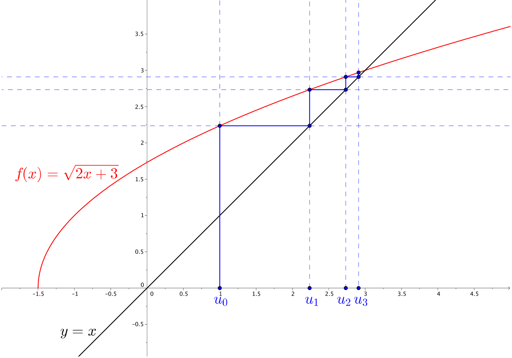
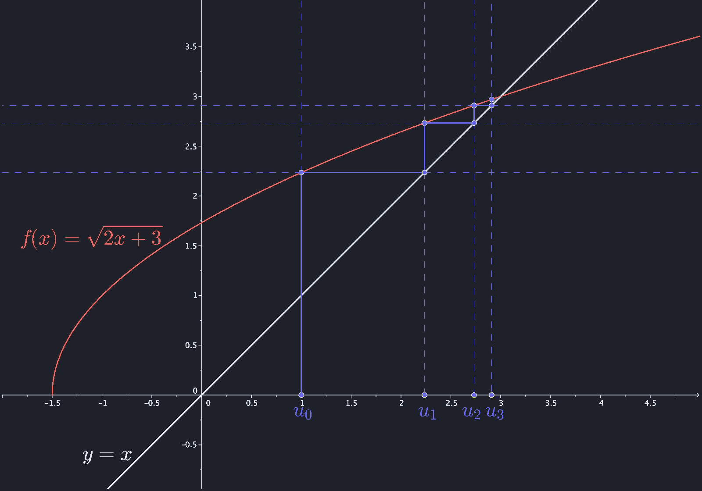
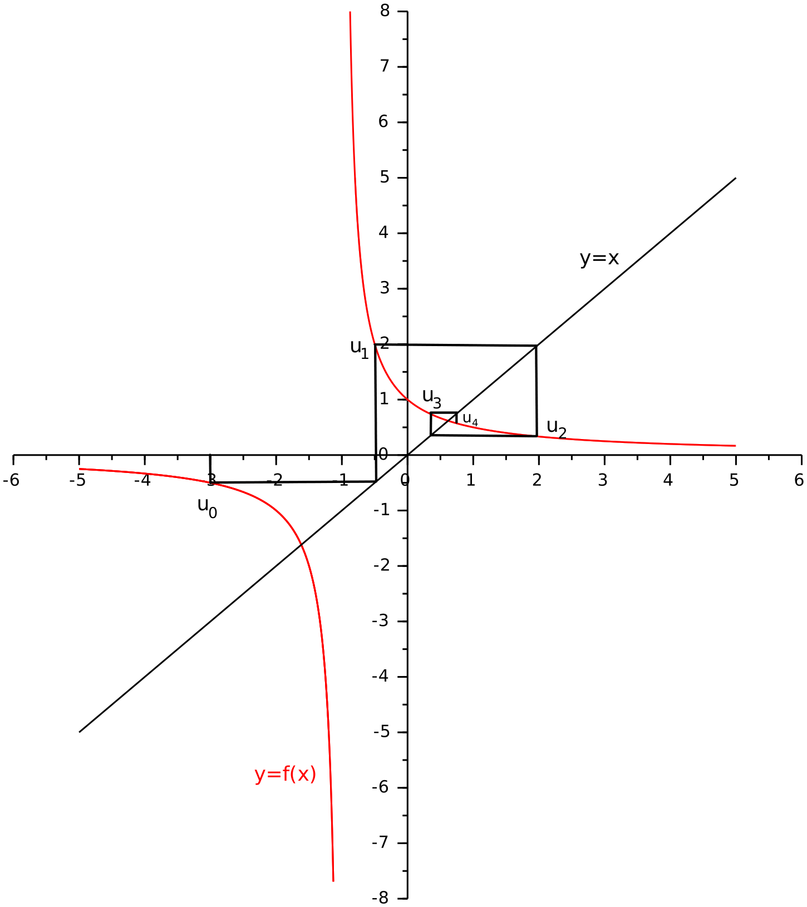
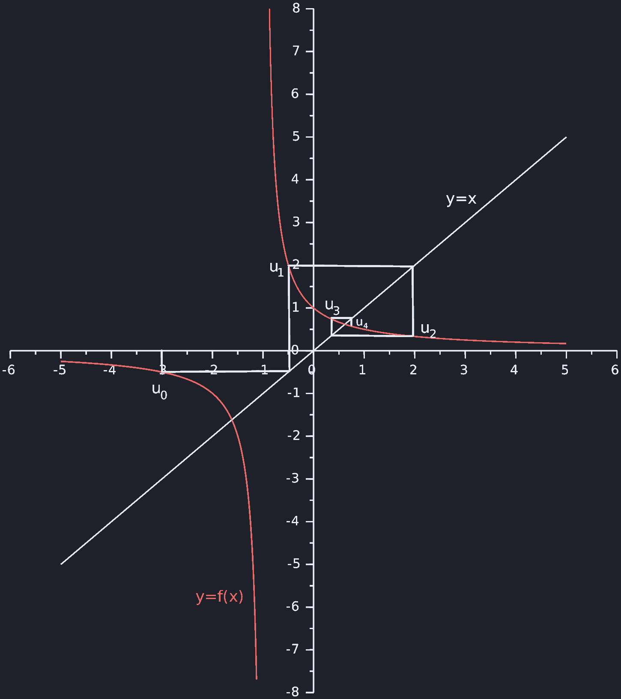

# 第 2 次习题课　数列

TD n°2 — Suites numériques

CORRIGÉ · 参考解答

中法对照讲义 · 由 LaTeX 源文件渲染

!!! info "阅读说明"

    每段先列法语原文；其下缩进、带深蓝竖条的小字号段落为中文翻译。<strong>加粗</strong>为关键词，括号内为中文释义。

## Exercices à préparer

课前准备练习

### Exercice 1.

suite arithmétique

练习 1.（等差数列 suite arithmétique）

Soit \((u_n)_{n\in\mathbb{N}}\) une suite arithmétique telle que \(u_7=7^2\) et \(u_{11}=11^2\).
{: .fr-exo }

设 \((u_n)_{n\in\mathbb{N}}\) 为<strong>等差数列</strong>（suite arithmétique），满足 \(u_7=7^2\) 且 \(u_{11}=11^2\)。
{: .zh }

Calculer \(u_n\) pour tout \(n\).
{: .fr-exo }

求对任意 \(n\) 的 \(u_n\)。
{: .zh }

!!! sol ""

    <strong>Solution.</strong> En tant que suite arithmétique, \((u_n)\) vérifie \(\exists(a,b)\in\mathbb{R}^2,\ \forall n\in\mathbb{N},\ u_n=an+b\).

    <strong>解.</strong> 作为等差数列，\((u_n)\) 满足 \(\exists(a,b)\in\mathbb{R}^2,\ \forall n\in\mathbb{N},\ u_n=an+b\)。
    {: .zh }

    D'où le système

    由此得到方程组
    {: .zh }

    \[
    \begin{cases}
    u_7=7a+b=7^2\\[2pt]
    u_{11}=11a+b=11^2
    \end{cases}
    \]

    En faisant la différence entre ces deux lignes, on en déduit

    将这两行相减，可得
    {: .zh }

    \[
    4a=11^2-7^2=(11-7)(11+7)=4\times 18
    \qquad\text{d'où}\qquad a=18.
    \]

    Puis

    于是
    {: .zh }

    \[
    b=7^2-7\times 18=7(7-18)=-77.
    \]

    Finalement

    \[
    \forall n\in\mathbb{N},\qquad \boxed{u_n=18n-77}.
    \]

    最终，对任意 \(n\in\mathbb{N}\)，\(u_n=18n-77\)。
    {: .zh }

### Exercice 2.

suite auxiliaire

练习 2.（辅助数列 suite auxiliaire）

Soit \((u_n)_{n\in\mathbb{N}}\) une suite définie par \(u_0=3\) et \(\forall n\geqslant 0,\ u_{n+1}=u_n^2\).
{: .fr-exo }

设 \((u_n)_{n\in\mathbb{N}}\) 是由 \(u_0=3\) 及 \(\forall n\geqslant 0,\ u_{n+1}=u_n^2\) 定义的数列。
{: .zh }

<strong>1.</strong> Montrer que \(\forall n\in\mathbb{N},\ u_n>0\).
{: .fr-exo }

证明：\(\forall n\in\mathbb{N},\ u_n>0\)。
{: .zh }

!!! sol ""

    <strong>Solution.</strong> Montrons par récurrence sur \(n\in\mathbb{N}\) que \(\forall n\in\mathbb{N},\ u_n>0\) :

    <strong>解.</strong> 我们对 \(n\in\mathbb{N}\) 用<strong>数学归纳法</strong>（récurrence）证明 \(\forall n\in\mathbb{N},\ u_n>0\)：
    {: .zh }

    - C'est vrai pour \(n=0\), \(u_0=3>0\).

        当 \(n=0\) 时成立，\(u_0=3>0\)。
        {: .zh }

    - Supposons que pour un entier \(n\) donné, on ait \(u_n>0\), alors \(u_{n+1}=u_n^2>0\).

        假设对某个给定的整数 \(n\) 有 \(u_n>0\)，则 \(u_{n+1}=u_n^2>0\)。
        {: .zh }

    On conclut par récurrence \(\forall n\in\mathbb{N},\ u_n>0\).

    由归纳法可得 \(\forall n\in\mathbb{N},\ u_n>0\)。
    {: .zh }

<strong>2.</strong> Calculer \(u_n\) pour tout \(n\) en utilisant la suite \((v_n)\) définie par \(\forall n\geqslant 0,\ v_n=\ln(u_n)\).
{: .fr-exo }

利用由 \(\forall n\geqslant 0,\ v_n=\ln(u_n)\) 定义的数列 \((v_n)\)，计算对任意 \(n\) 的 \(u_n\)。
{: .zh }

!!! sol ""

    <strong>Solution.</strong> Comme \(\forall n\in\mathbb{N},\ u_n>0\), la suite \((v_n)\) telle que \(\forall n\geqslant 0,\ v_n=\ln(u_n)\) est bien définie. De plus elle vérifie

    <strong>解.</strong> 由于 \(\forall n\in\mathbb{N},\ u_n>0\)，满足 \(\forall n\geqslant 0,\ v_n=\ln(u_n)\) 的数列 \((v_n)\) 有良好定义。此外它满足
    {: .zh }

    \[
    \forall n\in\mathbb{N},\qquad
    v_{n+1}=\ln(u_{n+1})=\ln(u_n^2)=2\ln(u_n)=2v_n.
    \]

    On reconnaît une suite géométrique et on a

    可辨认出这是一个<strong>等比数列</strong>（suite géométrique），于是
    {: .zh }

    \[
    \forall n\in\mathbb{N},\qquad v_n=2^n v_0=2^n\ln 3.
    \]

    D'où finalement, avec \(\forall n\in\mathbb{N}\) \(u_n=e^{v_n}=\left(e^{\ln 3}\right)^{2^n}\),

    \[
    \forall n\in\mathbb{N},\qquad \boxed{u_n=3^{2^n}}.
    \]

    最终，由 \(\forall n\in\mathbb{N}\) \(u_n=e^{v_n}=\left(e^{\ln 3}\right)^{2^n}\) 可得上式，即对任意 \(n\in\mathbb{N}\)，\(u_n=3^{2^n}\)。
    {: .zh }

### Exercice 3.

suite arithmético-géométrique

练习 3.（算术-几何数列 suite arithmético-géométrique）

Soit \(\lambda\in\mathbb{R}\).
{: .fr-exo }

设 \(\lambda\in\mathbb{R}\)。
{: .zh }

On définit la suite \((u_n)_{n\in\mathbb{N}}\) par \(u_0=1\) et \(\forall n\geqslant 0,\ u_{n+1}-u_n=\lambda u_n+1\).
{: .fr-exo }

定义数列 \((u_n)_{n\in\mathbb{N}}\) 为 \(u_0=1\)，且 \(\forall n\geqslant 0,\ u_{n+1}-u_n=\lambda u_n+1\)。
{: .zh }

Calculer \(u_n\) pour tout \(n\).
{: .fr-exo }

求对任意 \(n\) 的 \(u_n\)。
{: .zh }

!!! sol ""

    <strong>Solution.</strong> La suite stationnaire \(\forall n\in\mathbb{N},\ u_n=\ell\) vérifie \(\lambda\ell+1=0\).

    <strong>解.</strong> <strong>常数数列</strong>（suite stationnaire）\(\forall n\in\mathbb{N},\ u_n=\ell\) 满足 \(\lambda\ell+1=0\)。
    {: .zh }

    Donc si \(\lambda\neq 0\), on a \(\ell=-1/\lambda\).

    因此若 \(\lambda\neq 0\)，则 \(\ell=-1/\lambda\)。
    {: .zh }

    Alors \(\forall n\in\mathbb{N}\), en soustrayant \(\ell=(1+\lambda)\ell+1\) à \(u_{n+1}=(1+\lambda)u_n+1\), on a

    于是 \(\forall n\in\mathbb{N}\)，从 \(u_{n+1}=(1+\lambda)u_n+1\) 中减去 \(\ell=(1+\lambda)\ell+1\)，得到
    {: .zh }

    \[
    \forall n\in\mathbb{N},\qquad u_{n+1}-\ell=(1+\lambda)(u_n-\ell).
    \]

    C'est une suite géométrique, d'où

    这是一个等比数列，因此
    {: .zh }

    \[
    \forall n\in\mathbb{N},\qquad u_n-\ell=(1+\lambda)^n(u_0-\ell).
    \]

    Et en remplaçant \(u_0\) et \(\ell\) par leur valeur

    再代入 \(u_0\) 与 \(\ell\) 的值
    {: .zh }

    \[
    \forall n\in\mathbb{N},\qquad
    u_n=(1+\lambda)^n\left(1+\frac{1}{\lambda}\right)-\frac{1}{\lambda}
    =\frac{(1+\lambda)^{n+1}-1}{\lambda}.
    \]

    Finalement

    \[
    \forall n\in\mathbb{N},\qquad
    \boxed{u_n=\frac{(1+\lambda)^{n+1}-1}{\lambda}}.
    \]

    最终，对任意 \(n\in\mathbb{N}\)，\(u_n=\dfrac{(1+\lambda)^{n+1}-1}{\lambda}\)。
    {: .zh }

    Si \(\lambda=0\), alors \((u_n)\) est une suite arithmétique de raison 1 et

    若 \(\lambda=0\)，则 \((u_n)\) 是公差为 1 的等差数列，且
    {: .zh }

    \[
    \forall n\in\mathbb{N},\qquad u_n=n+1.
    \]

### Exercice 4.

suites couplées

练习 4.（耦合数列 suites couplées）

Soient les suites \((a_n)_{n\in\mathbb{N}}\) et \((b_n)_{n\in\mathbb{N}}\) telles que
{: .fr-exo }

设数列 \((a_n)_{n\in\mathbb{N}}\) 与 \((b_n)_{n\in\mathbb{N}}\) 满足
{: .zh }

\[
{\color{#0046AA}
\left\{\begin{aligned}
a_0&=1\\
b_0&=0
\end{aligned}\right.
\qquad
\forall n\geqslant 0
\qquad
\left\{\begin{aligned}
a_{n+1}&=4a_n-b_n\\
b_{n+1}&=2a_n+b_n
\end{aligned}\right.}
\]

即 \(a_0=1\)、\(b_0=0\)，且 \(\forall n\geqslant 0\)，\(a_{n+1}=4a_n-b_n\)、\(b_{n+1}=2a_n+b_n\)。
{: .zh }

<strong>1.</strong> Montrer que \((a_n)\) et \((b_n)\) sont des suites récurrentes linéaires d'ordre 2.
{: .fr-exo }

证明 \((a_n)\) 与 \((b_n)\) 都是<strong>二阶线性递推数列</strong>（suites récurrentes linéaires d'ordre 2）。
{: .zh }

!!! sol ""

    <strong>Solution.</strong> En utilisant \(\forall n\geqslant 0,\ b_n=4a_n-a_{n+1}\), on a \(\forall n\geqslant 0\),

    <strong>解.</strong> 利用 \(\forall n\geqslant 0,\ b_n=4a_n-a_{n+1}\)，对 \(\forall n\geqslant 0\) 有
    {: .zh }

    \[
    a_{n+2}=4a_{n+1}-b_{n+1}
    =4a_{n+1}-(2a_n+b_n)
    =4a_{n+1}-2a_n-(4a_n-a_{n+1})
    =5a_{n+1}-6a_n.
    \]

    De même, \(\forall n\geqslant 0\),

    同理，\(\forall n\geqslant 0\)，
    {: .zh }

    \[
    b_{n+2}=2a_{n+1}+b_{n+1}
    =2(4a_n-b_n)+b_{n+1}
    =4(b_{n+1}-b_n)-2b_n+b_{n+1}
    =5b_{n+1}-6b_n.
    \]

    Les suites \((a_n)\) et \((b_n)\) sont donc bien des suites récurrentes linéaires d'ordre 2.

    因此 \((a_n)\) 与 \((b_n)\) 确实是二阶线性递推数列。
    {: .zh }

<strong>2.</strong> Calculer \(a_n\) et \(b_n\) pour tout \(n\).
{: .fr-exo }

求对任意 \(n\) 的 \(a_n\) 与 \(b_n\)。
{: .zh }

!!! sol ""

    <strong>Solution.</strong> On cherche les solutions de \(\forall n\in\mathbb{N},\ u_{n+2}=5u_{n+1}-6u_n\) sous la forme \((A\,r^n)\) avec \(A,r\in\mathbb{C}\). On veut donc \(r\in\mathbb{C}\) vérifiant l'équation

    <strong>解.</strong> 我们寻找 \(\forall n\in\mathbb{N},\ u_{n+2}=5u_{n+1}-6u_n\) 的形如 \((A\,r^n)\) 的解，其中 \(A,r\in\mathbb{C}\)。因此要求 \(r\in\mathbb{C}\) 满足方程
    {: .zh }

    \[
    r^2-5r+6=0
    \]

    de discriminant \(\Delta=25-24=1\), d'où \(r=\dfrac{5\pm 1}{2}=2\) ou \(3\). Ainsi on obtient pour \((a_n)\) et \((b_n)\) une forme générale commune

    其<strong>判别式</strong> \(\Delta=25-24=1\)，故 \(r=\dfrac{5\pm 1}{2}=2\) 或 \(3\)。于是 \((a_n)\) 与 \((b_n)\) 具有共同的通解形式
    {: .zh }

    \[
    \left\{\begin{aligned}
    a_n&=A2^n+B3^n\\
    b_n&=A'2^n+B'3^n
    \end{aligned}\right.
    \]

    avec \(A,B,A',B'\in\mathbb{R}\) déterminés par les deux premiers termes de chaque suite.

    其中 \(A,B,A',B'\in\mathbb{R}\) 由每个数列的前两项确定。
    {: .zh }

    On a \(a_0=1\), \(b_0=0\) d'où \(a_1=4\), \(b_1=2\) et les équations linéaires

    由 \(a_0=1\)、\(b_0=0\) 得 \(a_1=4\)、\(b_1=2\)，并得到线性方程组
    {: .zh }

    \[
    \left\{\begin{aligned}
    A+B&=1\\
    2A+3B&=4
    \end{aligned}\right.
    \qquad\text{et}\qquad
    \left\{\begin{aligned}
    A'+B'&=0\\
    2A'+3B'&=2
    \end{aligned}\right..
    \]

    D'où on obtient \(A=-1\), \(B=2\) d'une part et \(A'=-2\), \(B'=2\) d'autre part.

    由此一方面得到 \(A=-1\)、\(B=2\)，另一方面得到 \(A'=-2\)、\(B'=2\)。
    {: .zh }

    Finalement \(\forall n\geqslant 0\),

    \[
    \boxed{
    \left\{\begin{aligned}
    a_n&=-2^n+2\times 3^n\\
    b_n&=-2^{n+1}+2\times 3^n
    \end{aligned}\right.}
    \]

    最终，对任意 \(n\geqslant 0\)，\(a_n=-2^n+2\times 3^n\)，\(b_n=-2^{n+1}+2\times 3^n\)。
    {: .zh }

### Exercice 5.

suite récurrente

练习 5.（递推数列 suite récurrente）

On considère la suite \((u_n)_{n\in\mathbb{N}}\) définie par \(u_0=1\) et \(\forall n\geqslant 0,\ u_{n+1}=\sqrt{2u_n+3}\).
{: .fr-exo }

考虑由 \(u_0=1\) 及 \(\forall n\geqslant 0,\ u_{n+1}=\sqrt{2u_n+3}\) 定义的数列 \((u_n)_{n\in\mathbb{N}}\)。
{: .zh }

<strong>1.</strong> Déterminer l'ensemble de définition de la fonction \(f:x\mapsto\sqrt{2x+3}\) et étudier ses variations sur cet ensemble.
{: .fr-exo }

确定函数 \(f:x\mapsto\sqrt{2x+3}\) 的<strong>定义域</strong>，并研究它在该定义域上的单调性。
{: .zh }

!!! sol ""

    <strong>Solution.</strong> La fonction \(f\) est définie si et seulement si \(2x+3\geqslant 0\) c'est-à-dire \(x\geqslant -\dfrac{3}{2}\). Donc \(\mathcal{D}_f=\left[-\dfrac{3}{2},+\infty\right[\).

    <strong>解.</strong> 函数 \(f\) 有定义当且仅当 \(2x+3\geqslant 0\)，即 \(x\geqslant -\dfrac{3}{2}\)。因此 \(\mathcal{D}_f=\left[-\dfrac{3}{2},+\infty\right[\)。
    {: .zh }

    Comme \(x\mapsto\sqrt{x}\) est croissante sur \([0,+\infty[\), \(f\) est croissante sur \(\mathcal{D}_f\).

    由于 \(x\mapsto\sqrt{x}\) 在 \([0,+\infty[\) 上递增，\(f\) 在 \(\mathcal{D}_f\) 上递增。
    {: .zh }

<strong>2.</strong> Dresser le tableau de signe de la fonction \(x\mapsto f(x)-x\).
{: .fr-exo }

作出函数 \(x\mapsto f(x)-x\) 的<strong>符号表</strong>（tableau de signe）。
{: .zh }

!!! sol ""

    <strong>Solution.</strong> On a les équivalences suivantes

    <strong>解.</strong> 有如下等价关系
    {: .zh }

    \[
    \left\{\begin{aligned}
    f(x)&\geqslant x\\
    x&\in\mathcal{D}_f
    \end{aligned}\right.
    \iff
    \left\{\begin{aligned}
    x\leqslant 0\leqslant f(x)\ &\text{ou}\ 2x+3\geqslant x^2\\
    x&\geqslant-\tfrac{3}{2}
    \end{aligned}\right.
    \]

    \[
    \iff
    \left\{\begin{aligned}
    x\leqslant 0\ &\text{ou}\ 0\geqslant x^2-2x-3=(x+1)(x-3)\\
    x&\geqslant-\tfrac{3}{2}
    \end{aligned}\right.
    \]

    \[
    \iff
    \left\{\begin{aligned}
    x\leqslant 0\ &\text{ou}\ 0\geqslant x\in[-1,3]\\
    x&\geqslant-\tfrac{3}{2}
    \end{aligned}\right.
    \iff
    x\in\left[-\frac{3}{2},3\right].
    \]

    D'où le tableau

    由此得下表
    {: .zh }

    \[
    \begin{array}{c|ccc}
    x & -\frac{3}{2} & 3 & +\infty\\ \hline
    f(x)-x & + & 0 & -
    \end{array}
    \]

<strong>3.</strong> Sur un graphique, tracer la courbe représentative de \(f\), la droite d'équation \(y=x\) et les premiers termes de la suite \((u_n)\).
{: .fr-exo }

在图上画出 \(f\) 的<strong>图象</strong>、直线 \(y=x\) 以及数列 \((u_n)\) 的前几项。
{: .zh }

!!! sol ""

    
<strong>Solution.</strong>　<strong>解.</strong>

    

<strong>4.</strong> À l'aide du graphique de la question précédente conjecturer les propriétés de la suite \((u_n)\) et démontrer ces propriétés par récurrence.
{: .fr-exo }

借助上一问的图象<strong>猜想</strong>（conjecturer）数列 \((u_n)\) 的性质，并用数学归纳法证明这些性质。
{: .zh }

!!! sol ""

    <strong>Solution.</strong> On conjecture : la suite \((u_n)\) est croissante majorée par 3.

    <strong>解.</strong> 我们猜想：数列 \((u_n)\) 递增，且以 3 为上界。
    {: .zh }

    Montrons par récurrence sur \(n\in\mathbb{N}\) que \(\forall n\in\mathbb{N},\ 1=u_0\leqslant u_n\leqslant u_{n+1}\leqslant 3\) :

    我们对 \(n\in\mathbb{N}\) 用归纳法证明 \(\forall n\in\mathbb{N},\ 1=u_0\leqslant u_n\leqslant u_{n+1}\leqslant 3\)：
    {: .zh }

    - C'est vrai pour \(n=0\) car \(u_1=\sqrt{5}\geqslant 1=u_0\) et \(u_1=\sqrt{5}\leqslant 3\).

        当 \(n=0\) 时成立，因为 \(u_1=\sqrt{5}\geqslant 1=u_0\) 且 \(u_1=\sqrt{5}\leqslant 3\)。
        {: .zh }

    - Supposons que pour un \(n\in\mathbb{N}\) donné, \(u_0\leqslant u_n\leqslant u_{n+1}\leqslant 3\), alors, comme \(f\) est définie croissante sur \(\mathcal{D}_f\) on a

        — 假设对给定的 \(n\in\mathbb{N}\) 有 \(u_0\leqslant u_n\leqslant u_{n+1}\leqslant 3\)，则由于 \(f\) 在 \(\mathcal{D}_f\) 上有定义且递增，有
        {: .zh }

        \[
        f(u_0)\leqslant f(u_n)\leqslant f(u_{n+1})\leqslant f(3).
        \]

        Or \(f(u_0)=u_1\), \(f(u_n)=u_{n+1}\), \(f(u_{n+1})=u_{n+2}\) et \(f(3)=\sqrt{6+3}=3\), d'où, comme par ailleurs \(u_0\leqslant u_1\),

        而 \(f(u_0)=u_1\)，\(f(u_n)=u_{n+1}\)，\(f(u_{n+1})=u_{n+2}\)，且 \(f(3)=\sqrt{6+3}=3\)；又因 \(u_0\leqslant u_1\)，故
        {: .zh }

        \[
        u_0\leqslant u_1\leqslant u_{n+1}\leqslant u_{n+2}\leqslant 3.
        \]

        On conclut par récurrence

        由归纳法可得
        {: .zh }

        \[
        \forall n\in\mathbb{N},\qquad 1=u_0\leqslant u_n\leqslant u_{n+1}\leqslant 3.
        \]

!!! warning "Vocabulaire clé &nbsp;&nbsp; 重点词汇 第一部分（Exercices à préparer）核心术语"

    - <strong>suite arithmétique</strong>：等差数列
    - <strong>raison</strong>：公差（等比数列中为公比）
    - <strong>suite auxiliaire</strong>：辅助数列
    - <strong>suite géométrique</strong>：等比数列
    - <strong>suite arithmético-géométrique</strong>：算术-几何数列（\(u_{n+1}=au_n+b\) 型）
    - <strong>suite stationnaire</strong>：常数数列
    - <strong>suite récurrente linéaire d'ordre 2</strong>：二阶线性递推数列
    - <strong>suites couplées</strong>：耦合数列
    - <strong>équation caractéristique</strong>：特征方程
    - <strong>discriminant</strong>：判别式
    - <strong>on reconnaît…</strong>：可辨认出……
    - <strong>vérifier</strong>：满足；验证
    - <strong>suite croissante majorée</strong>：递增且有上界的数列
    - <strong>récurrence</strong>：数学归纳法
    - <strong>initialisation / hérédité</strong>：初始步骤 / 递推步骤
    - <strong>ensemble de définition</strong>：定义域
    - <strong>tableau de signe</strong>：符号表
    - <strong>courbe représentative</strong>：函数图象
    - <strong>conjecturer</strong>：猜想
    - <strong>premiers termes</strong>：前几项
    - <strong>calculer \(u_n\) pour tout \(n\)</strong>：求通项 \(u_n\)

## Exercices supplémentaires

补充练习

### Exercice 6.

suite récurrente linéaire d'ordre deux

练习 6.（二阶线性递推数列 suite récurrente linéaire d'ordre deux）

Soit \((u_n)_{n\in\mathbb{N}^*}\) une suite récurrente linéaire d'ordre deux telle que \(u_1=-4\), \(u_2=5\), \(u_3=10\) et \(u_4=7\).
{: .fr-exo }

设 \((u_n)_{n\in\mathbb{N}^*}\) 是二阶线性递推数列，满足 \(u_1=-4\)、\(u_2=5\)、\(u_3=10\)、\(u_4=7\)。
{: .zh }

Calculer \(u_n\) pour tout \(n\).
{: .fr-exo }

求对任意 \(n\) 的 \(u_n\)。
{: .zh }

!!! sol ""

    <strong>Solution.</strong> La suite \((u_n)\) en tant que suite récurrente linéaire d'ordre vérifie

    <strong>解.</strong> 数列 \((u_n)\) 作为线性递推数列，满足
    {: .zh }

    \[
    \exists(a,b)\in\mathbb{R},\ \forall n\in\mathbb{N}^*,\qquad u_{n+2}=a u_{n+1}+b u_n.
    \]

    Ce qui pour \(n=1\) et \(2\) nous donne le système d'équation sur \(a,b\)

    令 \(n=1\) 与 \(2\)，得到关于 \(a,b\) 的方程组
    {: .zh }

    \[
    \left\{\begin{aligned}
    5a-4b&=10\\
    10a+5b&=7
    \end{aligned}\right.
    \]

    dont la solution est \(a=\dfrac{6}{5}\), \(b=-1\).

    其解为 \(a=\dfrac{6}{5}\)，\(b=-1\)。
    {: .zh }

    La suite \((u_n)\) vérifie donc \(\forall n\in\mathbb{N}^*,\ u_{n+2}=\dfrac{6}{5}u_{n+1}-u_n\).

    因此数列 \((u_n)\) 满足 \(\forall n\in\mathbb{N}^*,\ u_{n+2}=\dfrac{6}{5}u_{n+1}-u_n\)。
    {: .zh }

    L'équation caractéristique associée, donnant les solutions de la forme \((A\,r^n)\) avec \(A,r\in\mathbb{C}\), est

    相应的<strong>特征方程</strong>（其解给出形如 \((A\,r^n)\) 的解，\(A,r\in\mathbb{C}\)）为
    {: .zh }

    \[
    r^2=\frac{6}{5}r-1
    \qquad\text{ou encore}\qquad
    r^2-\frac{6}{5}r+1=0.
    \]

    Son discriminant réduit vaut

    \[
    \Delta'=\left(\frac{3}{5}\right)^2-1
    =\left(\frac{3}{5}-1\right)\left(\frac{3}{5}+1\right)
    =\frac{-2\times 8}{25}
    =-\frac{16}{25}
    =\left(i\frac{4}{5}\right)^2
    \]

    其<strong>简化判别式</strong>（discriminant réduit）为上式。
    {: .zh }

    d'où \(r_\pm=\dfrac{3}{5}\pm i\dfrac{4}{5}\) c'est-à-dire un nombre complexe \(r_+\) de module \(|r_+|=1\) et son conjugué \(r_-=\overline{r_+}\). Par la suite on note \(r=r_+\).

    由此 \(r_\pm=\dfrac{3}{5}\pm i\dfrac{4}{5}\)，即一个模为 \(|r_+|=1\) 的复数 \(r_+\) 及其共轭 \(r_-=\overline{r_+}\)。下文记 \(r=r_+\)。
    {: .zh }

    La suite \((u_n)\) vérifie alors

    \[
    u_n=A r^n+\overline{A}\,\overline{r}^{\,n}=2\operatorname{Re}\left(A r^n\right).
    \]

    于是数列 \((u_n)\) 满足上式。
    {: .zh }

    Étant donnés les premiers termes et le fait que \(\arccos(3/5)\) n'est pas une valeur remarquable, on cherche \((u_n)\) sous la forme

    给定前几项，且注意到 \(\arccos(3/5)\) 不是<strong>特殊角</strong>（valeur remarquable），我们把 \((u_n)\) 设为如下形式
    {: .zh }

    \[
    \forall n\in\mathbb{N}^*,\qquad
    u_n=\operatorname{Re}\left((\alpha+i\beta)\left(\frac{3}{5}+i\frac{4}{5}\right)^{n-2}\right)
    \]

    avec \(\alpha,\beta\in\mathbb{R}\).

    其中 \(\alpha,\beta\in\mathbb{R}\)。
    {: .zh }

    <strong>Remarque :</strong> en prenant la forme exponentielle \(r=\rho e^{i\theta}\), on a \(\forall n\in\mathbb{N}^*\),

    <strong>注：</strong> 取<strong>指数形式</strong>（forme exponentielle）\(r=\rho e^{i\theta}\)，则 \(\forall n\in\mathbb{N}^*\)，
    {: .zh }

    \[
    u_n=A\rho^n e^{in\theta}+\overline{A}\rho^n e^{-in\theta}
    =\rho^n\left(\operatorname{Re}(A)\times 2\cos(n\theta)-\operatorname{Im}(A)\times 2\sin(n\theta)\right).
    \]

    Les quatre premiers termes de la suites donnent

    \[
    \begin{aligned}
    -4&=\operatorname{Re}\left((\alpha+i\beta)\left(\frac{3}{5}-i\frac{4}{5}\right)\right)\\
    5&=\operatorname{Re}(\alpha+i\beta)\\
    10&=\operatorname{Re}\left((\alpha+i\beta)\left(\frac{3}{5}+i\frac{4}{5}\right)\right)\\
    7&=\operatorname{Re}\left((\alpha+i\beta)\left(\frac{3}{5}+i\frac{4}{5}\right)^2\right)
    \end{aligned}
    \]

    数列的前四项给出上述等式。
    {: .zh }

    On trouve alors grâce à la deuxième ligne \(\alpha=5\) et grâce à la première ligne \(\dfrac{3}{5}\alpha+\dfrac{4}{5}\beta=-4\), \(\beta=-\dfrac{35}{4}\).

    于是由第二行得 \(\alpha=5\)，由第一行得 \(\dfrac{3}{5}\alpha+\dfrac{4}{5}\beta=-4\)，即 \(\beta=-\dfrac{35}{4}\)。
    {: .zh }

    On vérifie que les deux lignes suivantes donne le bon résultat :

    \[
    \frac{3}{5}\alpha-\frac{4}{5}\beta=3+7=10
    \]

    验证后两行确实给出正确结果：
    {: .zh }

    et

    \[
    \begin{aligned}
    \operatorname{Re}\left((\alpha+i\beta)\left(\frac{3}{5}+i\frac{4}{5}\right)^2\right)
    &=\operatorname{Re}\left((\alpha+i\beta)\left(-\frac{7}{25}+i\frac{24}{25}\right)\right)\\
    &=-\frac{7}{25}\alpha-\frac{24}{25}\beta\\
    &=-\frac{7}{5}+\frac{6\times 7}{5}\\
    &=7.
    \end{aligned}
    \]

    以及
    {: .zh }

    Donc \(\forall n\in\mathbb{N}^*\),

    \[
    \boxed{
    u_n=\operatorname{Re}\left(\left(5-i\frac{35}{4}\right)\left(\frac{3}{5}+i\frac{4}{5}\right)^{n-2}\right).
    }
    \]

    因此对任意 \(n\in\mathbb{N}^*\)，\(u_n\) 由上式给出。
    {: .zh }

### Exercice 7.

suite récurrente

练习 7.（递推数列 suite récurrente）

Soit \((u_n)_{n\in\mathbb{N}}\) la suite récurrente définie par \(u_0=-3\) et \(\forall n\geqslant 0,\ u_{n+1}=\dfrac{1}{1+u_n}\).
{: .fr-exo }

设 \((u_n)_{n\in\mathbb{N}}\) 是由 \(u_0=-3\) 及 \(\forall n\geqslant 0,\ u_{n+1}=\dfrac{1}{1+u_n}\) 定义的递推数列。
{: .zh }

<strong>1.</strong> Soit la fonction \(g:x\mapsto\dfrac{1}{1+x}\).
{: .fr-exo }

设函数 \(g:x\mapsto\dfrac{1}{1+x}\)。
{: .zh }

Étudier cette fonction : donner son domaine de définition, dresser son tableau de variation.
{: .fr-exo }

研究该函数：给出其定义域，作出其<strong>单调性表</strong>（tableau de variation）。
{: .zh }

!!! sol ""

    <strong>Solution.</strong> La fonction \(g\) est définie pour \(x\neq 1\), donc \(\mathcal{D}_g=\mathbb{R}\setminus\{-1\}\).

    <strong>解.</strong> 函数 \(g\) 在 \(x\neq 1\) 时有定义，因此 \(\mathcal{D}_g=\mathbb{R}\setminus\{-1\}\)。（原文如此；应为 \(x\neq -1\)。）
    {: .zh }

    La fonction \(g\) est continue dérivable sur son domaine de définition car composée de fonctions continues dérivables sur leur domaine de définition. De plus \(\forall x\in\mathcal{D}_g\)

    函数 \(g\) 在其定义域上连续可导，因为它是几个在各自定义域上连续可导的函数的复合。此外 \(\forall x\in\mathcal{D}_g\)，有
    {: .zh }

    \[
    g'(x)=-\frac{1}{(1+x)^2}<0.
    \]

    D'où le tableau de variation

    \[
    \begin{array}{c|ccc||ccc}
    x & -\infty & & -1^- & -1^+ & & +\infty\\ \hline
    g'(x) & & - & & & + &\\ \hline
    g(x) & +\infty & \searrow & -\infty & +\infty & \searrow & -\infty
    \end{array}
    \]

    由此得单调性表
    {: .zh }

<strong>2.</strong> Sur un graphique, tracer la courbe représentative de \(g\), la droite d'équation \(y=x\) et les premiers termes de la suite \((u_n)\).
{: .fr-exo }

在图上画出 \(g\) 的图象、直线 \(y=x\) 以及数列 \((u_n)\) 的前几项。
{: .zh }

!!! sol ""

    
<strong>Solution.</strong>　<strong>解.</strong>

    

<strong>3.</strong> Montrer que \((u_n)\) est bien définie.
{: .fr-exo }

证明 \((u_n)\) <strong>有良好定义</strong>（bien définie）。
{: .zh }

!!! sol ""

    <strong>Solution.</strong> Les premiers termes de la suite \((u_n)\) sont \(u_0=-3\), \(u_1=-1/2\) et \(u_2=2\).

    <strong>解.</strong> 数列 \((u_n)\) 的前几项为 \(u_0=-3\)、\(u_1=-1/2\)、\(u_2=2\)。
    {: .zh }

    Montrons par récurrence sur \(n\in\mathbb{N}\setminus\{0,1\}\) que \(\forall n\geqslant 2,\ u_n>0\) :

    我们对 \(n\in\mathbb{N}\setminus\{0,1\}\) 用归纳法证明 \(\forall n\geqslant 2,\ u_n>0\)：
    {: .zh }

    - C'est vrai pour \(n=2\), \(u_2=2>0\).

        当 \(n=2\) 时成立，\(u_2=2>0\)。
        {: .zh }

    - Supposons pour un \(n\geqslant 2\) donné, \(u_n>0\), alors \(u_{n+1}=\dfrac{1}{1+u_n}>0\).

        — 假设对给定的 \(n\geqslant 2\) 有 \(u_n>0\)，则 \(u_{n+1}=\dfrac{1}{1+u_n}>0\)。
        {: .zh }

    On conclut par récurrence \(\forall n\geqslant 2,\ u_n>0\), donc \(\forall n\geqslant 2,\ u_n\in\mathcal{D}_g\) et \((u_n)\) est bien définie.

    由归纳法得 \(\forall n\geqslant 2,\ u_n>0\)，因此 \(\forall n\geqslant 2,\ u_n\in\mathcal{D}_g\)，即 \((u_n)\) 有良好定义。
    {: .zh }

<strong>4.</strong> Étudier les suites \((u_{2n})\) et \((u_{2n+1})\).
{: .fr-exo }

研究数列 \((u_{2n})\) 与 \((u_{2n+1})\)。
{: .zh }

!!! sol ""

    <strong>Solution.</strong> Soit \(\ell\) tel que \(\ell>0\) et \(\ell=\dfrac{1}{1+\ell}\) alors \(\ell=\dfrac{-1+\sqrt{5}}{2}\). On a alors \(\forall n\geqslant 2\)

    <strong>解.</strong> 设 \(\ell\) 满足 \(\ell>0\) 且 \(\ell=\dfrac{1}{1+\ell}\)，则 \(\ell=\dfrac{-1+\sqrt{5}}{2}\)。于是 \(\forall n\geqslant 2\) 有
    {: .zh }

    \[
    u_{n+1}-\ell=-\frac{u_n-\ell}{(1+\ell)(1+u_n)}.
    \]

    Donc la suite \((v_n)_{n\geqslant 2}\) telle que \(v_n=u_n-\ell\) est de signe alternant et de norme décroissante.

    因此由 \(v_n=u_n-\ell\) 定义的数列 \((v_n)_{n\geqslant 2}\) <strong>符号交替</strong>且绝对值递减。
    {: .zh }

    Ainsi la suite \((u_{2n})_{n\geqslant 1}\) est décroissante minorée par \(\ell\) et \((u_{2n+1})_{n\geqslant 1}\) est croissante majorée par \(\ell\).

    于是数列 \((u_{2n})_{n\geqslant 1}\) 递减且以 \(\ell\) 为下界，而 \((u_{2n+1})_{n\geqslant 1}\) 递增且以 \(\ell\) 为上界。
    {: .zh }

### Exercice 8.

suite intermédiaire

练习 8.（中间数列 suite intermédiaire）

Soit \(\lambda>0\).
{: .fr-exo }

设 \(\lambda>0\)。
{: .zh }

Soit \((u_n)_{n\in\mathbb{N}}\) la suite définie par \(u_0>0\), \(u_1>0\) et \(\forall n\geqslant 0,\ u_{n+2}=\lambda\sqrt{u_{n+1}u_n}\).
{: .fr-exo }

设数列 \((u_n)_{n\in\mathbb{N}}\) 由 \(u_0>0\)、\(u_1>0\) 及 \(\forall n\geqslant 0,\ u_{n+2}=\lambda\sqrt{u_{n+1}u_n}\) 定义。
{: .zh }

Calculer \(u_n\) en fonction de \(n\).
{: .fr-exo }

用 \(n\) 表示 \(u_n\)。
{: .zh }

<strong>(Indication :</strong> Introduire la suite auxiliaire \((v_n)\) définie par \(\forall n\geqslant 0,\ v_n=\ln(u_n)+\alpha n\ln\lambda\) avec \(\alpha\) un réel judicieusement choisi.<strong>)</strong>
{: .fr-exo }

（<strong>提示：</strong> 引入<strong>辅助数列</strong>（suite auxiliaire）\((v_n)\)，其中 \(\forall n\geqslant 0,\ v_n=\ln(u_n)+\alpha n\ln\lambda\)，\(\alpha\) 为适当选取的实数。）
{: .zh }

!!! sol ""

    <strong>Solution.</strong> On montre par récurrence que \(\forall n\in\mathbb{N},\ u_n>0\).

    <strong>解.</strong> 用归纳法证明 \(\forall n\in\mathbb{N},\ u_n>0\)。
    {: .zh }

    On définit \(\forall n\in\mathbb{N},\ v_n=\ln(u_n)\). Alors \(\forall n\in\mathbb{N}\)

    定义 \(\forall n\in\mathbb{N},\ v_n=\ln(u_n)\)。则 \(\forall n\in\mathbb{N}\)
    {: .zh }

    \[
    v_{n+2}=\ln\lambda+\frac{\ln u_{n+1}+\ln u_n}{2}
    =\frac{v_{n+1}+v_n}{2}+\ell
    \]

    où on a posé \(\ell=\ln\lambda\).

    其中记 \(\ell=\ln\lambda\)。
    {: .zh }

    On pose alors \(\forall n\in\mathbb{N},\ w_n=v_n+\alpha n\ell\), et on a \(\forall n\in\mathbb{N}\)

    再令 \(\forall n\in\mathbb{N},\ w_n=v_n+\alpha n\ell\)，则 \(\forall n\in\mathbb{N}\)
    {: .zh }

    \[
    w_{n+2}=\frac{w_{n+1}+w_n}{2}+\left(\frac{3}{2}\alpha+1\right)\ell.
    \]

    On pose donc \(\alpha=-\dfrac{2}{3}\) pour que \((w_n)\) soit une suite récurrente linéaire.

    于是取 \(\alpha=-\dfrac{2}{3}\)，使 \((w_n)\) 成为线性递推数列。
    {: .zh }

    Son équation caractéristique est alors

    其特征方程为
    {: .zh }

    \[
    r^2=\frac{r+1}{2}
    \]

    donc \(r=1\) ou \(-\dfrac{1}{2}\).

    故 \(r=1\) 或 \(-\dfrac{1}{2}\)。
    {: .zh }

    Il existe \(A,B\in\mathbb{R}\) tels que

    存在 \(A,B\in\mathbb{R}\) 使得
    {: .zh }

    \[
    w_n=A+B\left(-\frac{1}{2}\right)^n.
    \]

    On trouve

    \[
    A=\frac{\ln(u_0)+2\left(\ln(u_1)-\frac{2}{3}\ln\lambda\right)}{3}
    \qquad
    B=\frac{2}{3}\left(\ln(u_0)-\ln(u_1)+\frac{2}{3}\ln\lambda\right)
    \]

    解得 \(A\) 与 \(B\) 如上。
    {: .zh }

    Et finalement \(\forall n\in\mathbb{N}\),

    \[
    \boxed{
    u_n=\lambda^{\frac{2}{3}n-\frac{4}{9}+\frac{4}{9}\left(-\frac{1}{2}\right)^n}\,
    u_0^{1/3}\,u_1^{2/3}\,
    \left(\frac{u_0}{u_1}\right)^{\frac{2}{3}\left(-\frac{1}{2}\right)^n}
    }
    \]

    最终，对任意 \(n\in\mathbb{N}\)，\(u_n\) 由上式给出。
    {: .zh }

!!! warning "Vocabulaire clé &nbsp;&nbsp; 重点词汇 第二部分（Exercices supplémentaires）核心术语"

    - <strong>suite récurrente linéaire d'ordre deux</strong>：二阶线性递推数列
    - <strong>équation caractéristique</strong>：特征方程
    - <strong>discriminant réduit (\(\Delta'\))</strong>：简化判别式
    - <strong>nombre complexe</strong>：复数
    - <strong>conjugué</strong>：共轭
    - <strong>module</strong>：模
    - <strong>forme exponentielle</strong>：指数形式
    - <strong>partie réelle / partie imaginaire</strong>：实部 / 虚部
    - <strong>valeur remarquable</strong>：特殊值（特殊角）
    - <strong>signe alternant</strong>：符号交替
    - <strong>norme décroissante</strong>：绝对值递减
    - <strong>suite minorée / majorée</strong>：有下界 / 有上界的数列
    - <strong>suite intermédiaire</strong>：中间数列
    - <strong>logarithme népérien</strong>：自然对数
    - <strong>judicieusement choisi</strong>：适当选取的
    - <strong>en fonction de \(n\)</strong>：用 \(n\) 表示
    - <strong>tableau de variation</strong>：单调性表
    - <strong>étudier une fonction</strong>：研究一个函数
    - <strong>dresser un tableau</strong>：列出（作出）表格
    - <strong>on pose</strong>：令
    - <strong>d'où</strong>：由此
    - <strong>être bien définie</strong>：有良好定义
