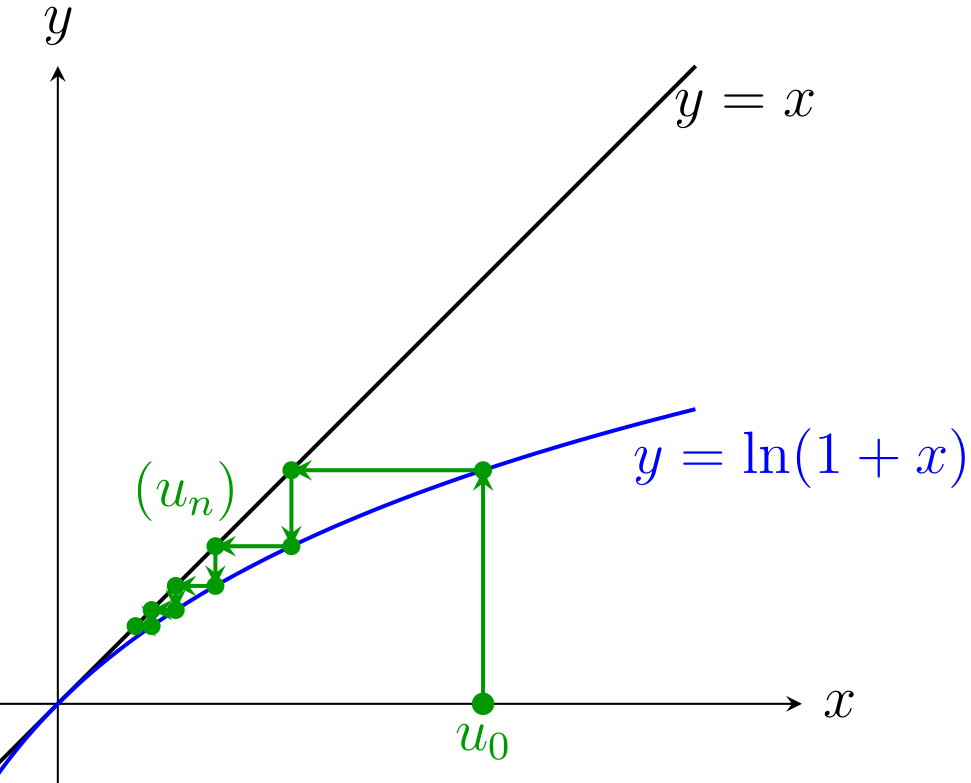
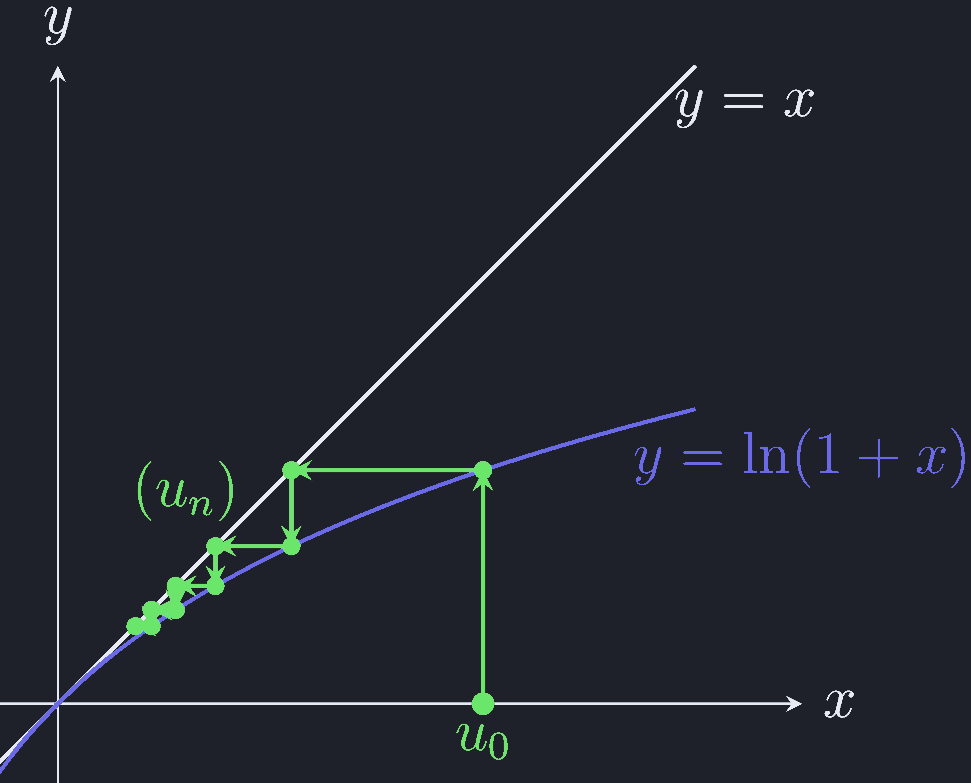

# 第 3 次习题课　数列极限

TD n°3 — Limites de suites

CORRIGÉ · 参考解答

中法对照讲义 · 由 LaTeX 源文件渲染

!!! info "阅读说明"

    每段先列法语原文；其下缩进、带深蓝竖条的小字号段落为中文翻译。<strong>加粗</strong>为关键词，括号内为中文释义。

## Exercices à préparer

课前准备练习

### Exercice 1.

encadrement

练习 1.（夹逼 encadrement）

Soit \(x\in\mathbb{R}\). Déterminer la limite de la suite \((u_n)_{n\in\mathbb{N}^*}\) définie par
{: .fr-exo }

设 \(x\in\mathbb{R}\)。求由下式定义的数列 \((u_n)_{n\in\mathbb{N}^*}\) 的极限：
{: .zh }

\[
\forall n\in\mathbb{N}^*,\qquad
u_n=\frac{1}{n^2}\sum_{k=1}^{n}\lfloor kx\rfloor .
\]

!!! sol ""

    <strong>Solution.</strong> <em>Solution.</em>&nbsp;&nbsp; Soit \(n\in\mathbb{N}^*\), on a \(\forall k\in[\![1,n]\!]\), \(\lfloor kx\rfloor\leqslant kx<\lfloor kx\rfloor-1\), ou encore \(kx-1<\lfloor kx\rfloor\leqslant kx\). Donc

    <strong>解.</strong> 解。设 \(n\in\mathbb{N}^*\)，则对任意 \(k\in[\![1,n]\!]\)，有 \(\lfloor kx\rfloor\leqslant kx<\lfloor kx\rfloor-1\)（原文如此；应为 \(\lfloor kx\rfloor+1\)），亦即 \(kx-1<\lfloor kx\rfloor\leqslant kx\)。因此
    {: .zh }

    \[
    \frac{1}{n^2}\sum_{k=1}^{n}(kx-1)\leqslant u_n\leqslant \frac{1}{n^2}\sum_{k=1}^{n}kx
    \]

    \[
    \frac{x}{n^2}\,\frac{n(n+1)}{2}-\frac{1}{n}\leqslant u_n\leqslant \frac{x}{n^2}\,\frac{n(n+1)}{2}
    \]

    Or

    \[
    \lim_{n\to\infty}\frac{x}{n^2}\,\frac{n(n+1)}{2}-\frac{1}{n}
    =\lim_{n\to\infty}\frac{x}{n^2}\,\frac{n(n+1)}{2}=\frac{x}{2}.
    \]

    而
    {: .zh }

    Donc, d'après le théorème de limite par encadrement,

    因此，由夹逼定理（théorème de limite par encadrement），
    {: .zh }

    \[
    \lim_{n\to\infty}u_n=\frac{x}{2}.
    \]

### Exercice 2.

suites liées

练习 2.（关联数列 suites liées）

Soit \((a_n)_{n\in\mathbb{N}}\) une suite de nombres positifs. Pour tout \(n\in\mathbb{N}\), on pose \(b_n=\dfrac{a_n}{1+a_n}\).
{: .fr-exo }

设 \((a_n)_{n\in\mathbb{N}}\) 为非负数列。对任意 \(n\in\mathbb{N}\)，令 \(b_n=\dfrac{a_n}{1+a_n}\)。
{: .zh }

<strong>1.</strong> Vérifier les implications suivantes :
{: .fr-exo }

验证下列蕴含关系：
{: .zh }

- Si \(\lim\limits_{n\to+\infty}a_n=+\infty\) alors \(b_n\xrightarrow[n\to+\infty]{}1\).
    {: .fr-exo }

    若 \(\lim\limits_{n\to+\infty}a_n=+\infty\)，则 \(b_n\to1\)。
    {: .zh }

- Si \((a_n)_{n\in\mathbb{N}}\) converge alors \((b_n)_{n\in\mathbb{N}}\) converge et sa limite est dans \([0,1[\).
    {: .fr-exo }

    若 \((a_n)_{n\in\mathbb{N}}\) 收敛，则 \((b_n)_{n\in\mathbb{N}}\) 收敛，且其极限属于 \([0,1[\)。
    {: .zh }

!!! sol ""

    <strong>Solution.</strong>

    <strong>解.</strong>
    {: .zh }

    - Si \(a_n\xrightarrow[n\to+\infty]{}+\infty\), alors \(\exists N\in\mathbb{N}\) tel que \(\forall n\geqslant N\), \(a_n\neq 0\) et

        若 \(a_n\to+\infty\)，则存在 \(N\in\mathbb{N}\)，使得对任意 \(n\geqslant N\) 有 \(a_n\neq 0\)，并且
        {: .zh }

        \[
        \forall n\geqslant N,\qquad
        b_n=\frac{a_n}{1+a_n}=\frac{1}{1+\dfrac{1}{a_n}}\xrightarrow[n\to+\infty]{}1
        \]

        car \(\dfrac{1}{a_n}\xrightarrow[n\to+\infty]{}0\).

        因为 \(\dfrac{1}{a_n}\to0\)。
        {: .zh }

    - Si \(a_n\xrightarrow[n\to+\infty]{}\alpha\in\mathbb{R}\) alors \(\alpha\geqslant 0\) car \(\forall n\in\mathbb{N}\), \(a_n\geqslant 0\). Alors

        若 \(a_n\to\alpha\in\mathbb{R}\)，则 \(\alpha\geqslant0\)，因为 \(\forall n\in\mathbb{N}\)，\(a_n\geqslant0\)。于是
        {: .zh }

        \[
        b_n=\frac{a_n}{1+a_n}\xrightarrow[n\to+\infty]{}
        \ell=\frac{\alpha}{1+\alpha}=1-\frac{1}{1+\alpha}\in[0,1[.
        \]

        Donc \(\ell\in[0,1[\).

        因此 \(\ell\in[0,1[\)。
        {: .zh }

<strong>2.</strong> Étudier les implications réciproques.
{: .fr-exo }

研究反向蕴含。
{: .zh }

!!! sol ""

    Soit \(n\in\mathbb{N}\). On a, si \(b_n=\dfrac{a_n}{1+a_n}\), \(a_n\geqslant 0\iff b_n\in[0,1[\). D'où

    设 \(n\in\mathbb{N}\)。若 \(b_n=\dfrac{a_n}{1+a_n}\)，则 \(a_n\geqslant0\iff b_n\in[0,1[\)。由此
    {: .zh }

    \[
    b_n=\frac{a_n}{1+a_n}\quad\text{avec}\quad a_n\geqslant 0
    \qquad\Longleftrightarrow\qquad
    a_n=\frac{b_n}{1-b_n}\quad\text{avec}\quad b_n\in[0,1[ .
    \]

    Donc, si \(b_n\xrightarrow[n\to+\infty]{}1^-\) alors \(a_n\xrightarrow[n\to+\infty]{}+\infty\).

    因此，若 \(b_n\to1^-\)，则 \(a_n\to+\infty\)。
    {: .zh }

    Et si \(b_n\xrightarrow[n\to+\infty]{}\ell\in[0,1[\) alors \(a_n\xrightarrow[n\to+\infty]{}\alpha=\dfrac{\ell}{1-\ell}\).

    而若 \(b_n\to\ell\in[0,1[\)，则 \(a_n\to\alpha=\dfrac{\ell}{1-\ell}\)。
    {: .zh }

### Exercice 3.

étude de suite

练习 3.（数列研究 étude de suite）

Soit \((u_n)\) la suite définie par \(u_0>0\) et pour tout \(n\in\mathbb{N}\),
{: .fr-exo }

设 \((u_n)\) 是由 \(u_0>0\) 以及 \(\forall n\in\mathbb{N}\) 下式定义的数列：
{: .zh }

\[
u_{n+1}=\frac{u_n}{1+nu_n^2}.
\]

<strong>1.</strong> Étudier la convergence de \((u_n)\).
{: .fr-exo }

研究 \((u_n)\) 的收敛性。
{: .zh }

!!! sol ""

    Montrons par récurrence sur \(n\in\mathbb{N}\), \(\forall n\in\mathbb{N}\), \(u_n>0\) :

    我们对 \(n\in\mathbb{N}\) 用归纳法证明 \(\forall n\in\mathbb{N}\)，\(u_n>0\)：
    {: .zh }

    - c'est vrai pour \(n=0\) car \(u_0>0\),

        当 \(n=0\) 时成立，因为 \(u_0>0\)；
        {: .zh }

    - supposons pour un \(n\in\mathbb{N}\) donné, \(u_n>0\) alors \(u_{n+1}=\dfrac{u_n}{1+nu_n^2}>0\).

        假设对给定的 \(n\in\mathbb{N}\) 有 \(u_n>0\)，则 \(u_{n+1}=\dfrac{u_n}{1+nu_n^2}>0\)。
        {: .zh }

    On conclut par récurrence.

    由归纳法得证。
    {: .zh }

    De plus, on a \(\forall n\in\mathbb{N}\), \(u_{n+1}=\dfrac{u_n}{1+nu_n^2}<u_n\) donc la suite \((u_n)\) décroissante minorée par \(0\) converge.

    此外，对任意 \(n\in\mathbb{N}\)，\(u_{n+1}=\dfrac{u_n}{1+nu_n^2}<u_n\)，因此数列 \((u_n)\) 递减且以 \(0\) 为下界，故收敛。
    {: .zh }

<strong>2.</strong> Montrer que pour tout \(n\geqslant 2\), on a \(0<u_n\leqslant\dfrac{1}{n}\).
{: .fr-exo }

证明对任意 \(n\geqslant2\)，有 \(0<u_n\leqslant\dfrac{1}{n}\)。
{: .zh }

!!! sol ""

    On a déjà montré \(\forall n\in\mathbb{N}\), \(u_n>0\).

    我们已经证明了 \(\forall n\in\mathbb{N}\)，\(u_n>0\)。
    {: .zh }

    Montrons par récurrence sur \(n\geqslant 2\), \(\forall n\geqslant 2\), \(u_n\leqslant\dfrac{1}{n}\) :

    我们对 \(n\geqslant2\) 用归纳法证明 \(\forall n\geqslant2\)，\(u_n\leqslant\dfrac{1}{n}\)：
    {: .zh }

    - \(u_1=u_0>0\), \(u_2=\dfrac{u_1}{1+2u_1^2}\)

        \[
        u_2\leqslant\frac{1}{2}\quad\Longleftrightarrow\quad 2u_0\leqslant 1+2u_0^2
        \quad\Longleftrightarrow\quad u_0^2+(u_0-1)^2\geqslant 0.
        \]

        \(u_1=u_0>0\)，\(u_2=\dfrac{u_1}{1+2u_1^2}\)。因此当 \(n=2\) 时成立。
        {: .zh }

    - supposons pour un \(n\geqslant 2\) donné, \(u_n\leqslant\dfrac{1}{n}\), alors

        假设对给定的 \(n\geqslant2\) 有 \(u_n\leqslant\dfrac{1}{n}\)，则
        {: .zh }

        \[
        u_{n+1}\leqslant\frac{1}{n+1}\quad\Longleftrightarrow\quad (n+1)u_n\leqslant 1+nu_n^2
        \quad\Longleftrightarrow\quad nu_n^2-(n+1)u_n+1\geqslant 0.
        \]

    Soit la fonction \(f_n(x)=nx^2-(n+1)x+1\). On a

    令函数 \(f_n(x)=nx^2-(n+1)x+1\)。有
    {: .zh }

    \[
    f_n(x)=n(x-1)\left(x-\frac{1}{n}\right)
    \]

    Donc comme \(u_n\leqslant\dfrac{1}{n}\), \(f_n(u_n)\geqslant 0\). D'où \(u_{n+1}\leqslant\dfrac{1}{n+1}\).

    因此由于 \(u_n\leqslant\dfrac{1}{n}\)，\(f_n(u_n)\geqslant0\)。从而 \(u_{n+1}\leqslant\dfrac{1}{n+1}\)。
    {: .zh }

    On conclut par récurrence.

    由归纳法得证。
    {: .zh }

<strong>3.</strong> En considérant la suite \(\left(\dfrac{1}{u_{n+1}}-\dfrac{1}{u_n}\right)\) montrer que \(u_n\) est équivalent à \(1/n\) quand \(n\) tend vers \(+\infty\) c'est-à-dire que \(\lim\limits_{n\to+\infty}nu_n=1\).
{: .fr-exo }

通过考虑数列 \(\left(\dfrac{1}{u_{n+1}}-\dfrac{1}{u_n}\right)\)，证明当 \(n\) 趋于 \(+\infty\) 时 \(u_n\) 与 \(1/n\) 等价，即 \(\lim\limits_{n\to+\infty}nu_n=1\)。
{: .zh }

!!! sol ""

    On pose \(\forall n\in\mathbb{N}\), \(w_n=\dfrac{1}{u_{n+1}}-\dfrac{1}{u_n}\) qui définit bien une suite \((w_n)\) telle que \(\forall n\geqslant 2\)

    令 \(\forall n\in\mathbb{N}\)，\(w_n=\dfrac{1}{u_{n+1}}-\dfrac{1}{u_n}\)，它确实定义了一个 数列 \((w_n)\)，使得 \(\forall n\geqslant2\)
    {: .zh }

    \[
    w_n=\frac{1+nu_n^2}{u_n}-\frac{1}{u_n}=nu_n\leqslant 1.
    \]

    Donc \(\forall n\geqslant 2\), \(\dfrac{1}{u_{n+1}}\leqslant\dfrac{1}{u_n}+1\) et \(\forall n\geqslant 2\), \(\dfrac{1}{u_n}\leqslant\dfrac{1}{u_2}+(n-2)\). D'où

    因此 \(\forall n\geqslant2\)，\(\dfrac{1}{u_{n+1}}\leqslant\dfrac{1}{u_n}+1\)，且 \(\forall n\geqslant2\)，\(\dfrac{1}{u_n}\leqslant\dfrac{1}{u_2}+(n-2)\)。由此
    {: .zh }

    \[
    \frac{1}{\dfrac{1}{u_2}+(n-2)}\leqslant u_n\leqslant\frac{1}{n}
    \]

    \[
    \frac{1}{\dfrac{n}{u_2}+(n-2)}\leqslant nu_n\leqslant 1
    \]

    d'après le théorème de la limite par encadrement \(\lim\limits_{n\to+\infty}nu_n=1\) et finalement

    （原文第二行下界如此；按上一行应写作 \(\dfrac{n}{\frac{1}{u_2}+(n-2)}\)。）由夹逼定理 \(\lim\limits_{n\to+\infty}nu_n=1\)，最终
    {: .zh }

    \[
    \boxed{u_n\sim\frac{1}{n}}.
    \]

### Exercice 4.

suites extraites

练习 4.（子列 suites extraites）

Soit \((x_n)\) une suite réelle. On suppose que les suites \((x_{2n})\), \((x_{2n+1})\) et \((x_{3n})\) convergent. Démontrer que la suite \((x_n)\) converge.
{: .fr-exo }

设 \((x_n)\) 为实数列。假设数列 \((x_{2n})\)、\((x_{2n+1})\) 与 \((x_{3n})\) 均收敛。 证明数列 \((x_n)\) 收敛。
{: .zh }

!!! sol ""

    Notons \(\ell_1,\ell_2,\ell_3\in\mathbb{R}\) les limites respectives de \((x_{2n})\), \((x_{2n+1})\) et \((x_{3n})\).

    记 \(\ell_1,\ell_2,\ell_3\in\mathbb{R}\) 分别为 \((x_{2n})\)、\((x_{2n+1})\) 与 \((x_{3n})\) 的极限。
    {: .zh }

    Soit \(\varepsilon>0\).

    设 \(\varepsilon>0\)。
    {: .zh }

    Comme \((x_{2n})\) converge vers \(\ell_1\), il existe \(N\in\mathbb{N}\) tel que pour tout \(n\geqslant N\), \(|x_{2n}-\ell_1|<\varepsilon\).

    由于 \((x_{2n})\) 收敛于 \(\ell_1\)，存在 \(N\in\mathbb{N}\)，使得对任意 \(n\geqslant N\)， \(|x_{2n}-\ell_1|<\varepsilon\)。
    {: .zh }

    Comme \((x_{2n+1})\) converge vers \(\ell_2\), il existe \(N'\geqslant N\) tel que pour tout \(n\geqslant N'\), \(|x_{2n+1}-\ell_2|<\varepsilon\).

    由于 \((x_{2n+1})\) 收敛于 \(\ell_2\)，存在 \(N'\geqslant N\)，使得对任意 \(n\geqslant N'\)， \(|x_{2n+1}-\ell_2|<\varepsilon\)。
    {: .zh }

    Comme \((x_{3n})\) converge vers \(\ell_3\), il existe \(N''\geqslant N'\) tel que pour tout \(n\geqslant N''\), \(|x_{3n}-\ell_3|<\varepsilon\).

    由于 \((x_{3n})\) 收敛于 \(\ell_3\)，存在 \(N''\geqslant N'\)，使得对任意 \(n\geqslant N''\)，\(|x_{3n}-\ell_3|<\varepsilon\)。
    {: .zh }

    Comme \(2N''\geqslant N''\) et \(3N''\geqslant N\), le terme \(x_{6N''}\) vérifie \(|x_{3(2N'')}-\ell_3|<\varepsilon\) et \(|x_{2(3N'')}-\ell_1|<\varepsilon\), d'où

    由于 \(2N''\geqslant N''\) 且 \(3N''\geqslant N\)，项 \(x_{6N''}\) 满足 \(|x_{3(2N'')}-\ell_3|<\varepsilon\) 与 \(|x_{2(3N'')}-\ell_1|<\varepsilon\)，由此
    {: .zh }

    \[
    |\ell_3-\ell_1|=|\ell_3-x_{6N''}+x_{6N''}-\ell_1|
    \leqslant|\ell_3-x_{6N''}|+|x_{6N''}-\ell_1|<2\varepsilon.
    \]

    De plus, comme \(2N''+1\geqslant N''\) et \(3N''+1\geqslant N'\), le terme \(x_{6N''+3}\) vérifie \(|x_{3(2N''+1)}-\ell_3|<\varepsilon\) et \(|x_{2(3N''+1)+1}-\ell_2|<\varepsilon\), d'où

    此外，由于 \(2N''+1\geqslant N''\) 且 \(3N''+1\geqslant N'\)，项 \(x_{6N''+3}\) 满足 \(|x_{3(2N''+1)}-\ell_3|<\varepsilon\) 与 \(|x_{2(3N''+1)+1}-\ell_2|<\varepsilon\)，由此
    {: .zh }

    \[
    |\ell_3-\ell_2|=|\ell_3-x_{6N''+3}+x_{6N''+3}-\ell_2|
    \leqslant|\ell_3-x_{6N''+3}|+|x_{6N''+3}-\ell_2|<2\varepsilon.
    \]

    Finalement \(|\ell_2-\ell_1|\leqslant|\ell_2-\ell_3|+|\ell_3-\ell_1|<4\varepsilon\).

    最终 \(|\ell_2-\ell_1|\leqslant|\ell_2-\ell_3|+|\ell_3-\ell_1|<4\varepsilon\)。
    {: .zh }

    Cela étant valable pour tout \(\varepsilon>0\), on en conclut que \(\ell_2=\ell_1\).

    这对任意 \(\varepsilon>0\) 都成立，故可推得 \(\ell_2=\ell_1\)。
    {: .zh }

    Les deux suites \((x_{2n})\) et \((x_{2n+1})\) convergent et tendent vers la même limite \(\ell_1\) donc \((x_n)\) converge.

    数列 \((x_{2n})\) 与 \((x_{2n+1})\) 均收敛且趋于同一极限 \(\ell_1\)，因此 \((x_n)\) 收敛。
    {: .zh }

### Exercice 5.

suite définie implicitement

练习 5.（隐式定义的数列 suite définie implicitement）

Pour tout entier \(n\) strictement positif, on considère le polynôme :
{: .fr-exo }

对任意正整数 \(n\)，考虑多项式：
{: .zh }

\[
P_n(x)=x^n+x^{n-1}+\cdots+x-1.
\]

<strong>1.</strong> Montrer que le polynôme \(P_n\) admet une unique racine positive \(\alpha_n\).
{: .fr-exo }

证明多项式 \(P_n\) 有唯一的正根 \(\alpha_n\)。
{: .zh }

!!! sol ""

    Soit \(n\in\mathbb{N}^*\).

    设 \(n\in\mathbb{N}^*\)。
    {: .zh }

    On a \(P_n(0)=-1<0\) et \(P_n\) continue strictement croissante sur \([0,+\infty[\) avec \(P_n(1)=n-1\geqslant 0\).

    有 \(P_n(0)=-1<0\)，且 \(P_n\) 在 \([0,+\infty[\) 上连续且严格递增，并有 \(P_n(1)=n-1\geqslant0\)。
    {: .zh }

    D'après le théorème des valeurs intermédiaires, il existe donc une unique racine positive. On la note \(\alpha_n\) et \(\alpha_n\in\,]0,1]\).

    由介值定理（théorème des valeurs intermédiaires），存在唯一的正根。记之为 \(\alpha_n\)， 且 \(\alpha_n\in\,]0,1]\)。
    {: .zh }

<strong>2.</strong> Montrer que \(\forall n\in\mathbb{N}^*\), \(P_n(\alpha_{n+1})<0\). En déduire le sens de variation de la suite \((\alpha_n)\) et démontrer qu'elle converge.
{: .fr-exo }

证明 \(\forall n\in\mathbb{N}^*\)，\(P_n(\alpha_{n+1})<0\)。由此推出数列 \((\alpha_n)\) 的 单调性，并证明它收敛。
{: .zh }

!!! sol ""

    Soit \(n\in\mathbb{N}^*\).

    设 \(n\in\mathbb{N}^*\)。
    {: .zh }

    \[
    P_n(\alpha_{n+1})=P_{n+1}(\alpha_{n+1})-\alpha_{n+1}^{\,n+1}
    =-\alpha_{n+1}^{\,n+1}<0.
    \]

    Comme \(P_n\) est croissante et \(P_n(\alpha_n)=0\), on a \(\alpha_{n+1}<\alpha_n\).

    由于 \(P_n\) 递增且 \(P_n(\alpha_n)=0\)，有 \(\alpha_{n+1}<\alpha_n\)。
    {: .zh }

    La suite \((\alpha_n)\) est décroissante, minorée par \(0\) donc elle converge d'après le théorème de la limite monotone.

    数列 \((\alpha_n)\) 递减，且以 \(0\) 为下界，因此由单调极限定理它收敛。
    {: .zh }

<strong>3.</strong> Simplifier l'expression de \(P_n(x)\) pour \(x\neq 1\) et en déduire la limite de la suite \((\alpha_n)\).
{: .fr-exo }

化简 \(P_n(x)\) 在 \(x\neq1\) 时的表达式，并由此推出数列 \((\alpha_n)\) 的极限。
{: .zh }

!!! sol ""

    Pour \(x\neq 0\), on a

    当 \(x\neq0\) 时，有（原文如此；应为 \(x\neq1\)。）
    {: .zh }

    \[
    P_n(x)=x^n+x^{n-1}+\cdots+x+1-2=\frac{x^{n+1}-1}{x-1}-2
    \]

    Donc, comme \(\forall n\geqslant 2\), \(0<\alpha_n<\alpha_2<1\), on a \(\lim\limits_{n\to+\infty}\alpha_n^{\,n+1}=0\).

    因此，由于 \(\forall n\geqslant2\)，\(0<\alpha_n<\alpha_2<1\)，有 \(\lim\limits_{n\to+\infty}\alpha_n^{\,n+1}=0\)。
    {: .zh }

    Quand on passe l'égalité \(\dfrac{\alpha_n^{\,n+1}-1}{\alpha_n-1}-2=0\) à la limite, en notant \(\ell=\lim\limits_{n\to+\infty}\alpha_n\) on obtient \(-\dfrac{1}{\ell-1}-2=0\), d'où

    当把等式 \(\dfrac{\alpha_n^{\,n+1}-1}{\alpha_n-1}-2=0\) 取极限时，记 \(\ell=\lim\limits_{n\to+\infty}\alpha_n\)，得到 \(-\dfrac{1}{\ell-1}-2=0\)，由此
    {: .zh }

    \[
    \boxed{\ell=\frac{1}{2}}
    \]

!!! warning "Vocabulaire clé &nbsp;&nbsp; 重点词汇 第一部分（Exercices à préparer）核心术语"

    - <strong>encadrement</strong>：夹逼，框定
    - <strong>théorème de limite par encadrement</strong>：夹逼定理
    - <strong>suite liée</strong>：关联数列
    - <strong>implication</strong>：蕴含关系
    - <strong>implication réciproque</strong>：反向蕴含
    - <strong>convergence</strong>：收敛性
    - <strong>suite croissante / décroissante</strong>：递增 / 递减数列
    - <strong>suite minorée / majorée</strong>：有下界 / 有上界的数列
    - <strong>minorée par \(0\)</strong>：以 \(0\) 为下界
    - <strong>récurrence</strong>：数学归纳法
    - <strong>on conclut par récurrence</strong>：由归纳法得证
    - <strong>suite extraite</strong>：子列
    - <strong>racine positive</strong>：正根
    - <strong>unique racine</strong>：唯一的根
    - <strong>théorème des valeurs intermédiaires</strong>：介值定理
    - <strong>théorème de la limite monotone</strong>：单调极限定理
    - <strong>sens de variation</strong>：单调性
    - <strong>polynôme</strong>：多项式
    - <strong>suite définie implicitement</strong>：隐式定义的数列
    - <strong>équivalent à</strong>：与……等价
    - <strong>quand \(n\) tend vers \(+\infty\)</strong>：当 \(n\) 趋于 \(+\infty\) 时
    - <strong>on pose</strong>：令
    - <strong>d'où</strong>：由此，因此
    - <strong>pour tout entier \(n\) strictement positif</strong>：对任意正整数 \(n\)

## Exercices supplémentaires

补充练习

### Exercice 6.

norme

练习 6.（范数 norme）

Soit \((u_n)\) et \((v_n)\) deux suites réelles telles que \((u_n^2+u_nv_n+v_n^2)\) tend vers \(0\) quand \(n\) tend vers \(+\infty\). Montrer que les deux suites \((u_n)\) et \((v_n)\) convergent vers \(0\).
{: .fr-exo }

设 \((u_n)\) 与 \((v_n)\) 为两个实数列，使得当 \(n\) 趋于 \(+\infty\) 时 \((u_n^2+u_nv_n+v_n^2)\) 趋于 \(0\)。证明数列 \((u_n)\) 与 \((v_n)\) 都收敛于 \(0\)。
{: .zh }

!!! sol ""

    On pose pour tout \(n\in\mathbb{N}\),

    对任意 \(n\in\mathbb{N}\)，令
    {: .zh }

    \[
    w_n=u_n^2+u_nv_n+v_n^2=\frac{1}{2}\left(u_n^2+v_n^2+(u_n+v_n)^2\right)
    \]

    On a pour tout \(n\in\mathbb{N}\)

    对任意 \(n\in\mathbb{N}\) 有
    {: .zh }

    \[
    \begin{cases}
    0\leqslant u_n^2\leqslant 2w_n\xrightarrow[n\to+\infty]{}0\\[4pt]
    0\leqslant v_n^2\leqslant 2w_n\xrightarrow[n\to+\infty]{}0
    \end{cases}
    \]

    Donc d'après le théorème de limite par encadrement \(\lim\limits_{n\to+\infty}u_n^2=\lim\limits_{n\to+\infty}v_n^2=0\).

    因此由夹逼定理 \(\lim\limits_{n\to+\infty}u_n^2=\lim\limits_{n\to+\infty}v_n^2=0\)。
    {: .zh }

    Cela implique \(\lim\limits_{n\to+\infty}u_n=\lim\limits_{n\to+\infty}v_n=0\)

    这意味着 \(\lim\limits_{n\to+\infty}u_n=\lim\limits_{n\to+\infty}v_n=0\)。
    {: .zh }

### Exercice 7.

équivalents

练习 7.（等价 équivalents）

<strong>1.</strong> On définit la suite \((x_n)\) par \(x_0>0\) et pour tout entier \(n\), \(x_{n+1}=x_n+\dfrac{1}{x_n}\).
{: .fr-exo }

<strong>1.</strong> 定义数列 \((x_n)\) 如下：\(x_0>0\)，且对任意整数 \(n\)， \(x_{n+1}=x_n+\dfrac{1}{x_n}\)。
{: .zh }

<strong>(a)</strong> Déterminer la limite de \((x_n)\).
{: .fr-exo }

（a）求 \((x_n)\) 的极限。
{: .zh }

!!! sol ""

    Montrons par récurrence sur \(n\in\mathbb{N}\) que \(\forall n\in\mathbb{N}\), \(x_n>0\) :

    我们对 \(n\in\mathbb{N}\) 用归纳法证明 \(\forall n\in\mathbb{N}\)，\(x_n>0\)：
    {: .zh }

    - c'est vrai pour \(n=0\) car \(x_0>0\)

        当 \(n=0\) 时成立，因为 \(x_0>0\)；
        {: .zh }

    - supposons, pour un \(n\in\mathbb{N}\) donné, \(x_n>0\), alors \(x_{n+1}=x_n+\dfrac{1}{x_n}>0\).

        假设对给定的 \(n\in\mathbb{N}\) 有 \(x_n>0\)，则 \(x_{n+1}=x_n+\dfrac{1}{x_n}>0\)。
        {: .zh }

    On conclut par récurrence \(\forall n\in\mathbb{N}\), \(x_n>0\).

    由归纳法得证 \(\forall n\in\mathbb{N}\)，\(x_n>0\)。
    {: .zh }

    \(\forall n\in\mathbb{N}\), \(x_{n+1}=x_n+\dfrac{1}{x_n}>x_n\) donc la suite \((x_n)\) est croissante.

    \(\forall n\in\mathbb{N}\)，\(x_{n+1}=x_n+\dfrac{1}{x_n}>x_n\)，因此数列 \((x_n)\) 递增。
    {: .zh }

    Si \(x_n\xrightarrow[n\to+\infty]{}\ell\in\,]0,+\infty[\) alors \(\ell\) vérifie \(\ell=\ell+\dfrac{1}{\ell}\) ce qui est impossible.

    若 \(x_n\to\ell\in\,]0,+\infty[\)，则 \(\ell\) 满足 \(\ell=\ell+\dfrac{1}{\ell}\)，这是不可能的。
    {: .zh }

    Donc \(x_n\xrightarrow[n\to+\infty]{}+\infty\).

    因此 \(x_n\to+\infty\)。
    {: .zh }

<strong>(b)</strong> Vérifier que la suite \((x_{n+1}^2-x_n^2)\) tend vers une limite finie que l'on déterminera.
{: .fr-exo }

（b）验证数列 \((x_{n+1}^2-x_n^2)\) 趋于一个有限极限，并求出它。
{: .zh }

!!! sol ""

    Soit \(n\in\mathbb{N}\). On a

    设 \(n\in\mathbb{N}\)。有
    {: .zh }

    \[
    x_{n+1}^2-x_n^2=x_n^2+2+\frac{1}{x_n^2}-x_n^2
    =2+\frac{1}{x_n^2}\xrightarrow[n\to+\infty]{}2
    \]

    Donc la suite \((x_{n+1}^2-x_n^2)\) tend vers \(2\).

    因此数列 \((x_{n+1}^2-x_n^2)\) 趋于 \(2\)。
    {: .zh }

<strong>(c)</strong> En exprimant \(x_n^2-x_0^2\) comme une somme de \(x_{k+1}^2-x_k^2\), en déduire un équivalent de \(x_n\).
{: .fr-exo }

（c）将 \(x_n^2-x_0^2\) 表示为 \(x_{k+1}^2-x_k^2\) 之和，由此推出 \(x_n\) 的等价量。
{: .zh }

!!! sol ""

    Soit \(n\in\mathbb{N}\). On a, pour \(k\in\mathbb{N}\), \(x_{k+1}^2-x_k^2=2+\dfrac{1}{x_k^2}>2\), d'où

    设 \(n\in\mathbb{N}\)。对 \(k\in\mathbb{N}\)，有 \(x_{k+1}^2-x_k^2=2+\dfrac{1}{x_k^2}>2\)，由此
    {: .zh }

    \[
    x_n^2-x_0^2=\sum_{k=0}^{n-1}\left(x_{k+1}^2-x_k^2\right)\geqslant 2n
    \]

    Soit \(\varepsilon>0\).

    设 \(\varepsilon>0\)。
    {: .zh }

    Comme \(\dfrac{1}{x_n^2}\xrightarrow[n\to+\infty]{}0\), on a

    由于 \(\dfrac{1}{x_n^2}\to0\)，有
    {: .zh }

    \[
    \exists N\in\mathbb{N}\quad\text{tel que}\quad\forall n\geqslant N,\quad
    \frac{1}{x_n^2}<\varepsilon
    \]

    Alors pour \(n\geqslant N\),

    于是对 \(n\geqslant N\)，
    {: .zh }

    \[
    x_n^2-x_0^2=\sum_{k=0}^{N-1}\left(2+\frac{1}{x_k^2}\right)
    +\sum_{k=N}^{n-1}\left(2+\frac{1}{x_k^2}\right)
    <2n+\sum_{k=0}^{N-1}\frac{1}{x_k^2}+(n-N)\varepsilon
    \]

    D'où

    由此
    {: .zh }

    \[
    \frac{x_n^2}{n}\leqslant 2+\frac{1}{n}\left(x_0^2+\sum_{k=0}^{N-1}\frac{1}{x_k^2}\right)+\varepsilon
    \]

    On a \(\dfrac{1}{n}\left(x_0^2+\sum\limits_{k=0}^{N-1}\dfrac{1}{x_k^2}\right)
     \xrightarrow[n\to+\infty]{}0\) donc \(\exists N'>N\) tel que

    有 \(\dfrac{1}{n}\left(x_0^2+\sum\limits_{k=0}^{N-1}\dfrac{1}{x_k^2}\right)\to0\)， 因此存在 \(N'>N\)，使得
    {: .zh }

    \[
    \forall n\geqslant N',\qquad
    \frac{1}{n}\left(x_0^2+\sum_{k=0}^{N-1}\frac{1}{x_k^2}\right)<\varepsilon .
    \]

    Alors, pour tout \(n\geqslant N'\)

    于是对任意 \(n\geqslant N'\)
    {: .zh }

    \[
    2\leqslant\frac{x_n^2}{n}\leqslant 2+2\varepsilon
    \]

    D'où \(\dfrac{x_n^2}{n}\xrightarrow[n\to+\infty]{}2\).

    由此 \(\dfrac{x_n^2}{n}\to2\)。
    {: .zh }

    En prenant la racine carrée de cette suite on obtient \(\dfrac{x_n}{\sqrt{n}}\xrightarrow[n\to+\infty]{}\sqrt{2}\), c'est-à-dire

    对该数列取平方根，得到 \(\dfrac{x_n}{\sqrt{n}}\to\sqrt{2}\)，即
    {: .zh }

    \[
    \boxed{x_n\sim\sqrt{2n}}.
    \]

<strong>2.</strong> Soit \((u_n)\) la suite définie par \(u_0>0\) et \(\forall n\in\mathbb{N}\), \(u_{n+1}=\ln(1+u_n)\).
{: .fr-exo }

<strong>2.</strong> 设 \((u_n)\) 是由 \(u_0>0\) 及 \(\forall n\in\mathbb{N}\)， \(u_{n+1}=\ln(1+u_n)\) 定义的数列。
{: .zh }

<strong>(a)</strong> Montrer que \(u_n\) converge et donner sa limite.
{: .fr-exo }

（a）证明 \(u_n\) 收敛并给出其极限。
{: .zh }

!!! sol ""

    On pose \(f:x\mapsto\ln(1+x)-x\) définie continue dérivable sur \(]-1,+\infty[\), de plus

    令 \(f:x\mapsto\ln(1+x)-x\)，它在 \(]-1,+\infty[\) 上连续可导，并且
    {: .zh }

    \[
    f'(x)=\frac{1}{1+x}-1=-\frac{x}{1+x}
    \]

    d'où le tableau de variation

    由此得单调性表
    {: .zh }

    \[
    \begin{array}{c||ccccc}
    x & -1 & & 0 & & +\infty\\ \hline
    f'(x) & & + & 0 & - & \\ \hline
    f(x) & -\infty & \nearrow & 0 & \searrow & -\infty
    \end{array}
    \]

    On trace les fonctions \(x\mapsto\ln(1+x)\) et \(x\mapsto x\) et on représente les premiers termes de la suite \((u_n)\) ci-dessous

    我们画出函数 \(x\mapsto\ln(1+x)\) 与 \(x\mapsto x\)，并在下图中表示数列 \((u_n)\) 的前几项
    {: .zh }

    

    On conjecture que la suite \((u_n)\) est décroissante, minorée par \(0\) et converge vers \(0\).

    我们猜测数列 \((u_n)\) 递减、以 \(0\) 为下界，并收敛于 \(0\)。
    {: .zh }

    Montrons par récurrence sur \(n\in\mathbb{N}\) que \(\forall n\in\mathbb{N}\), \(u_n>0\)

    我们对 \(n\in\mathbb{N}\) 用归纳法证明 \(\forall n\in\mathbb{N}\)，\(u_n>0\)：
    {: .zh }

    - c'est vrai pour \(n=0\), \(u_0>0\)

        当 \(n=0\) 时成立，\(u_0>0\)；
        {: .zh }

    - supposons \(u_n>0\) pour un \(n\in\mathbb{N}\) donné, alors \(u_{n+1}=\ln(1+u_n)>0\)

        假设对给定的 \(n\in\mathbb{N}\) 有 \(u_n>0\)，则 \(u_{n+1}=\ln(1+u_n)>0\)；
        {: .zh }

    On conclut par récurrence \(\forall n\in\mathbb{N}\), \(u_n>0\).

    由归纳法得证 \(\forall n\in\mathbb{N}\)，\(u_n>0\)。
    {: .zh }

    D'après l'étude de la fonction \(f\), on a \(\forall x>0\), \(\ln(1+x)<x\).

    由对函数 \(f\) 的研究，有 \(\forall x>0\)，\(\ln(1+x)<x\)。
    {: .zh }

    Donc \(\forall n\in\mathbb{N}\), \(u_{n+1}=\ln(1+u_n)<u_n\). La suite \((u_n)\) est décroissante.

    因此 \(\forall n\in\mathbb{N}\)，\(u_{n+1}=\ln(1+u_n)<u_n\)。数列 \((u_n)\) 递减。
    {: .zh }

    Par le théorème de convergence monotone, la suite \((u_n)\) décroissante minorée converge vers \(\mu\geqslant 0\) solution de \(\mu=\ln(1+\mu)\) c'est-à-dire \(\mu=0\).

    由单调收敛定理，递减且有下界的数列 \((u_n)\) 收敛于 \(\mu\geqslant0\)，其中 \(\mu\) 是 \(\mu=\ln(1+\mu)\) 的解，即 \(\mu=0\)。
    {: .zh }

<strong>(b)</strong> Déterminer le réel \(\alpha\) tel que la suite \((u_{n+1}^{\alpha}-u_n^{\alpha})\) converge vers \(\ell\in\mathbb{R}^*\). (On rappelle que \(\lim\limits_{x\to 0}\dfrac{\ln(1+x)-x}{x^2}=-\dfrac{1}{2}\).)
{: .fr-exo }

（b）求实数 \(\alpha\)，使得数列 \((u_{n+1}^{\alpha}-u_n^{\alpha})\) 收敛于 \(\ell\in\mathbb{R}^*\)。（回忆 \(\lim\limits_{x\to0}\dfrac{\ln(1+x)-x}{x^2}=-\dfrac{1}{2}\)。）
{: .zh }

!!! sol ""

    Soit \(\alpha\in\mathbb{R}\), on fait le développement limité de \(x\mapsto(\ln(1+x))^{\alpha}\) à l'ordre deux en \(0\) :

    设 \(\alpha\in\mathbb{R}\)，我们对 \(x\mapsto(\ln(1+x))^{\alpha}\) 在 \(0\) 处作二阶展开：
    {: .zh }

    \[
    (\ln(1+x))^{\alpha}
    =\left(x-\frac{x^2}{2}+o(x^2)\right)^{\alpha}
    =x^{\alpha}\left(1-\frac{x}{2}+o(x)\right)^{\alpha}
    =x^{\alpha}\left(1-\alpha\frac{x}{2}+o(x)\right)
    \]

    D'où

    由此
    {: .zh }

    \[
    (\ln(1+x))^{\alpha}-x^{\alpha}
    =-\frac{\alpha}{2}x^{1+\alpha}+o(x^{1+\alpha})
    \]

    Pour avoir \((\ln(1+x))^{\alpha}-x^{\alpha}\xrightarrow[x\to 0]{}\ell\in\mathbb{R}^*\) on prend \(\alpha=-1\).

    要使 \((\ln(1+x))^{\alpha}-x^{\alpha}\to\ell\in\mathbb{R}^*\)，取 \(\alpha=-1\)。
    {: .zh }

    Alors, comme \(u_n\xrightarrow[n\to+\infty]{}0\), \(\forall n\in\mathbb{N}\),

    于是，由于 \(u_n\to0\)，\(\forall n\in\mathbb{N}\)，
    {: .zh }

    \[
    u_{n+1}^{-1}-u_n^{-1}=(\ln(1+u_n))^{-1}-u_n^{-1}
    \xrightarrow[n\to+\infty]{}\frac{1}{2}.
    \]

<strong>(c)</strong> Montrer alors que \(u_n\sim\dfrac{2}{n}\).
{: .fr-exo }

（c）然后证明 \(u_n\sim\dfrac{2}{n}\)。
{: .zh }

!!! sol ""

    Soit \(\varepsilon>0\).

    设 \(\varepsilon>0\)。
    {: .zh }

    D'après la question précédente, \(\exists N\in\mathbb{N}\) tel que \(\forall n\geqslant N\), \(\left|u_{n+1}^{-1}-u_n^{-1}-\dfrac{1}{2}\right|<\varepsilon\)

    由上一问，存在 \(N\in\mathbb{N}\)，使得 \(\forall n\geqslant N\)， \(\left|u_{n+1}^{-1}-u_n^{-1}-\dfrac{1}{2}\right|<\varepsilon\)。
    {: .zh }

    On écrit alors pour \(n\geqslant N\)

    于是对 \(n\geqslant N\) 写出
    {: .zh }

    \[
    u_n^{-1}=u_0^{-1}
    +\sum_{k=0}^{N-1}\left(u_{k+1}^{-1}-u_k^{-1}-\frac{1}{2}\right)
    +\sum_{k=N}^{n-1}\left(u_{k+1}^{-1}-u_k^{-1}-\frac{1}{2}\right)
    +\frac{n}{2}
    \]

    d'où

    由此
    {: .zh }

    \[
    \left|\frac{u_n^{-1}}{n}-\frac{1}{2}\right|
    \leqslant\frac{1}{n}\left|u_0^{-1}
    +\sum_{k=0}^{N-1}\left(u_{k+1}^{-1}-u_k^{-1}-\frac{1}{2}\right)\right|+\varepsilon
    \]

    \(\exists N'\geqslant N\) tel que \(\forall n\geqslant N'\)

    存在 \(N'\geqslant N\)，使得 \(\forall n\geqslant N'\)
    {: .zh }

    \[
    \frac{1}{n}\left|u_0^{-1}
    +\sum_{k=0}^{N-1}\left(u_{k+1}^{-1}-u_k^{-1}-\frac{1}{2}\right)\right|<\varepsilon
    \]

    Alors \(\forall n\geqslant N'\)

    于是 \(\forall n\geqslant N'\)
    {: .zh }

    \[
    \left|\frac{u_n^{-1}}{n}-\frac{1}{2}\right|\leqslant 2\varepsilon
    \]

    d'où \(\lim\limits_{n\to+\infty}\dfrac{u_n^{-1}}{n}=\dfrac{1}{2}\).

    由此 \(\lim\limits_{n\to+\infty}\dfrac{u_n^{-1}}{n}=\dfrac{1}{2}\)。
    {: .zh }

    Or si une suite \((v_n)\) vérifie \(v_n\xrightarrow[n\to+\infty]{}\nu\in\mathbb{R}^*\) alors \(v_n^{-1}\xrightarrow[n\to+\infty]{}\nu^{-1}\).

    而若数列 \((v_n)\) 满足 \(v_n\to\nu\in\mathbb{R}^*\)，则 \(v_n^{-1}\to\nu^{-1}\)。
    {: .zh }

    Donc \(\lim\limits_{n\to+\infty}nu_n=2\) et

    因此 \(\lim\limits_{n\to+\infty}nu_n=2\)，且
    {: .zh }

    \[
    \boxed{u_n\sim\frac{2}{n}}.
    \]

!!! warning "Vocabulaire clé &nbsp;&nbsp; 重点词汇 第二部分（Exercices supplémentaires）核心术语"

    - <strong>norme</strong>：范数
    - <strong>équivalents</strong>：等价关系
    - <strong>équivalent à</strong>：与……等价
    - <strong>développement limité (DL)</strong>：渐近展开（泰勒展开）
    - <strong>à l'ordre deux en \(0\)</strong>：在 \(0\) 处展开到二阶
    - <strong>\(o(x^2)\)</strong>：高阶无穷小
    - <strong>racine carrée</strong>：平方根
    - <strong>suite réelle</strong>：实数列
    - <strong>tendre vers \(0\)</strong>：趋于 \(0\)
    - <strong>converger vers</strong>：收敛于
    - <strong>théorème de convergence monotone</strong>：单调收敛定理
    - <strong>suite décroissante minorée</strong>：递减且有下界的数列
    - <strong>on conjecture</strong>：我们猜测
    - <strong>on trace</strong>：我们画出
    - <strong>premiers termes</strong>：前几项
    - <strong>ci-dessous</strong>：如下
    - <strong>on écrit alors</strong>：于是写出
    - <strong>somme</strong>：和
    - <strong>on prend la racine carrée</strong>：取平方根
    - <strong>c'est-à-dire</strong>：即
    - <strong>limite finie</strong>：有限极限
    - <strong>être bien définie</strong>：有良好定义
