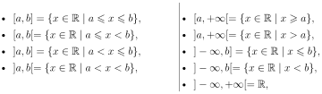

# 实分析 · 定义、性质、定理合集

Analyse réelle — Définitions, propriétés et théorèmes

期中考试课程知识题 · 按章节汇总

!!! info "使用说明"

    本页按章节汇总讲义中的 **定义、性质、定理与推论**，共 50 条（定义 21、性质 17、定理/推论 12）。法文为考试作答依据，其下中文为对照理解；证明、例题与备注请回到对应章节讲义。

    课程知识题只需准确陈述所要求的内容，不需要证明或解释。建议先遮住中文，尝试用法语复述，再对照检查。

## 内容概览

| 章节 | 定义 | 性质 | 定理/推论 |
|------|:----:|:----:|:--------:|
| 第 1 章 ℝ 的拓扑 | 9 | 6 | 2 |
| 第 2 章 数列 | 12 | 11 | 10 |
| **合计** | **21** | **17** | **12** |

## 第 1 章　ℝ 的拓扑

### 定义

!!! success "Définition 1.1 : la droite réelle 定义 1.1：实数轴（droite réelle）"

    L'ensemble des nombres réels, noté \(\mathbb{R}\), peut être vu comme l'ensemble des positions possibles sur une droite orientée. Autrement dit, on peut représenter géométriquement \(\mathbb{R}\) par une droite munie d'un repère \((O,\vec{e})\) : à chaque nombre réel \(x\in\mathbb{R}\), on associe le point \(M\) de <strong>coordonnée</strong> \(x\), c'est-à-dire tel que \(\overrightarrow{OM}=x\vec{e}\). Cette représentation de \(\mathbb{R}\) est appelée la <strong>droite réelle</strong>.

    实数集记作 \(\mathbb{R}\)，可以看作一条<strong>有向直线</strong>（droite orientée）上所有可能位置的集合。换言之， 可以把 \(\mathbb{R}\) 几何地表示为一条带有<strong>标架</strong>（repère）\((O,\vec{e})\) 的直线：对每个实数 \(x\in\mathbb{R}\)，对应直线上的点 \(M\)，其<strong>坐标</strong>（coordonnée）为 \(x\)，即满足 \(\overrightarrow{OM}=x\vec{e}\)。\(\mathbb{R}\) 的这种表示称为<strong>实数轴</strong>（droite réelle）。
    {: .zh }

    \[
    \overrightarrow{OM}=x\vec{e}.
    \]

!!! success "Définition 2.1 : partie entière 定义 2.1：整数部分（partie entière）"

    La <strong>partie entière</strong> d'un nombre réel \(x\in\mathbb{R}\) est l'unique entier \(\lfloor x\rfloor\in\mathbb{Z}\) tel que :

    实数 \(x\in\mathbb{R}\) 的<strong>整数部分</strong>（partie entière）是唯一满足下式的整数 \(\lfloor x\rfloor\in\mathbb{Z}\)：
    {: .zh }

    \[
    \lfloor x\rfloor\leqslant x<\lfloor x\rfloor+1.
    \]

    Autrement dit, la partie entière de \(x\) est le plus grand entier inférieur ou égal à \(x\).

    换言之，\(x\) 的整数部分就是<strong>不超过 \(x\) 的最大整数</strong>。
    {: .zh }

!!! success "Définition 3.1 : valeur absolue 定义 3.1：绝对值（valeur absolue）"

    La <strong>valeur absolue</strong> d'un nombre réel \(x\in\mathbb{R}\) est le nombre réel positif :

    实数 \(x\in\mathbb{R}\) 的<strong>绝对值</strong>（valeur absolue）是如下非负实数：
    {: .zh }

    \[
    |x|=\max\{-x,x\}=
    \begin{cases}
    x & \text{si } x\geqslant 0\\[2pt]
    -x & \text{si } x\leqslant 0
    \end{cases}
    .
    \]

    Sur la droite réelle, \(|x|\) est la distance entre l'origine \(O\) et le point de coordonnée \(x\).

    在实数轴上，\(|x|\) 是原点 \(O\) 与坐标为 \(x\) 的点之间的<strong>距离</strong>。
    {: .zh }

!!! success "Définition 4.1 : intervalle 定义 4.1：区间（intervalle）"

    Un <strong>intervalle</strong> est un sous-ensemble \(I\subset\mathbb{R}\) qui vérifie la propriété suivante :

    <strong>区间</strong>（intervalle）是满足下述性质的子集 \(I\subset\mathbb{R}\)：
    {: .zh }

    \[
    \forall(a,b)\in I^2,\ \forall x\in\mathbb{R},\ a<x<b\Longrightarrow x\in I.
    \]

!!! success "Définition 5.1 : voisinage 定义 5.1：邻域（voisinage）"

    Soient \(V\subset\mathbb{R}\) et \(a\in\mathbb{R}\). On dit que \(V\) est un <strong>voisinage</strong> de \(a\) lorsque :

    设 \(V\subset\mathbb{R}\)，\(a\in\mathbb{R}\)。当下式成立时，称 \(V\) 是 \(a\) 的一个<strong>邻域</strong>（voisinage）：
    {: .zh }

    \[
    \exists\varepsilon>0,\ ]a-\varepsilon,a+\varepsilon[\subset V.
    \]

!!! success "Définition 5.3 : ouvert et fermé 定义 5.3：开集与闭集（ouvert et fermé）"

    Soit \(A\subset\mathbb{R}\).

    设 \(A\subset\mathbb{R}\)。
    {: .zh }

    - On dit que \(A\) est <strong>ouvert</strong> lorsque \(A\) est un voisinage de chacun de ses points, c'est-à-dire lorsque :

        当 \(A\) 是它<strong>每一点</strong>的邻域时，称 \(A\) 是<strong>开集</strong>（ouvert），也就是说：
        {: .zh }

        \[
        \forall a\in A,\ \exists\varepsilon>0,\ ]a-\varepsilon,a+\varepsilon[\subset A.
        \]

    - On dit que \(A\) est <strong>fermé</strong> lorsque son <strong>complémentaire</strong> \(\mathbb{R}\setminus A=\{x\in\mathbb{R}\mid x\notin A\}\) est ouvert.

        当 \(A\) 的<strong>补集</strong>（complémentaire）\(\mathbb{R}\setminus A=\{x\in\mathbb{R}\mid x\notin A\}\) 是开集时，称 \(A\) 是<strong>闭集</strong>（fermé）。
        {: .zh }

!!! success "Définition 7.1 : majorant et minorant 定义 7.1：上界与下界（majorant et minorant）"

    Soit \(A\subset\mathbb{R}\).

    设 \(A\subset\mathbb{R}\)。
    {: .zh }

    - On dit qu'un nombre réel \(M\in\mathbb{R}\) est un <strong>majorant</strong> de \(A\) lorsque :

        当实数 \(M\in\mathbb{R}\) 满足下式时，称它是 \(A\) 的一个<strong>上界</strong>（majorant）：
        {: .zh }

        \[
        \forall a\in A,\ a\leqslant M.
        \]

        Si \(A\) admet au moins un majorant, on dit que \(A\) est <strong>majorée</strong>.

        若 \(A\) 至少有一个上界，则称 \(A\) 是<strong>有上界的</strong>（majorée）。
        {: .zh }

    - On dit qu'un nombre réel \(m\in\mathbb{R}\) est un <strong>minorant</strong> de \(A\) lorsque :

        当实数 \(m\in\mathbb{R}\) 满足下式时，称它是 \(A\) 的一个<strong>下界</strong>（minorant）：
        {: .zh }

        \[
        \forall a\in A,\ a\geqslant m.
        \]

        Si \(A\) admet au moins un minorant, on dit que \(A\) est <strong>minorée</strong>.

        若 \(A\) 至少有一个下界，则称 \(A\) 是<strong>有下界的</strong>（minorée）。
        {: .zh }

    - On dit que \(A\) est <strong>bornée</strong> lorsque \(A\) est majorée et minorée, c'est-à-dire :

        当 \(A\) 既有上界又有下界时，称 \(A\) 是<strong>有界的</strong>（bornée），也就是说：
        {: .zh }

        \[
        \exists(m,M)\in\mathbb{R}^2,\ \forall a\in A,\ m\leqslant a\leqslant M.
        \]

!!! success "Définition 7.3 : plus grand élément et plus petit élément 定义 7.3：最大元与最小元"

    Soit \(A\subset\mathbb{R}\).

    设 \(A\subset\mathbb{R}\)。
    {: .zh }

    - Si \(A\) admet un majorant qui appartient à \(A\), alors ce majorant est unique et est appelé le <strong>plus grand élément</strong> de \(A\). On le note \(\max(A)\).

        若 \(A\) 有一个属于 \(A\) 本身的上界，则该上界唯一，称为 \(A\) 的<strong>最大元</strong>（plus grand élément）， 记作 \(\max(A)\)。
        {: .zh }

    - Si \(A\) admet un minorant qui appartient à \(A\), alors ce minorant est unique et est appelé le <strong>plus petit élément</strong> de \(A\). On le note \(\min(A)\).

        若 \(A\) 有一个属于 \(A\) 本身的下界，则该下界唯一，称为 \(A\) 的<strong>最小元</strong>（plus petit élément）， 记作 \(\min(A)\)。
        {: .zh }

!!! success "Définition 7.4 : borne supérieure et borne inférieure 定义 7.4：上确界与下确界"

    Soit \(A\subset\mathbb{R}\).

    设 \(A\subset\mathbb{R}\)。
    {: .zh }

    - Si l'ensemble des majorants de \(A\) admet un plus petit élément, alors ce plus petit élément est appelé la <strong>borne supérieure</strong> de \(A\). On la note \(\sup(A)\).

        若 \(A\) 的上界集合有最小元，则该最小元称为 \(A\) 的<strong>上确界</strong>（borne supérieure）， 记作 \(\sup(A)\)。
        {: .zh }

    - Si l'ensemble des minorants de \(A\) admet un plus grand élément, alors ce plus grand élément est appelé la <strong>borne inférieure</strong> de \(A\). On la note \(\inf(A)\).

        若 \(A\) 的下界集合有最大元，则该最大元称为 \(A\) 的<strong>下确界</strong>（borne inférieure）， 记作 \(\inf(A)\)。
        {: .zh }

### 性质

!!! danger "Propriété 1.2 : opérations avec les nombres réels 性质 1.2：实数的运算"

    L'ensemble \(\mathbb{R}\) est muni d'une <strong>addition</strong> et d'une <strong>multiplication</strong> qui vérifient les propriétés usuelles, en particulier :

    集合 \(\mathbb{R}\) 上带有<strong>加法</strong>（addition）与<strong>乘法</strong>（multiplication），它们满足通常的 性质，特别地：
    {: .zh }

    - <strong>associativité</strong>（结合律）：\(\forall(x_1,x_2,x_3)\in\mathbb{R}^3\), \(\begin{cases}(x_1+x_2)+x_3=x_1+(x_2+x_3)\\[2pt](x_1x_2)x_3=x_1(x_2x_3)\end{cases}\),
    - <strong>commutativité</strong>（交换律）：\(\forall(x_1,x_2)\in\mathbb{R}^2\), \(\begin{cases}x_1+x_2=x_2+x_1\\[2pt]x_1x_2=x_2x_1\end{cases}\),
    - <strong>distributivité</strong>（分配律）：\(\forall(x_1,x_2,x_3)\in\mathbb{R}^3\), \(x_1(x_2+x_3)=x_1x_2+x_1x_3\),
    - <strong>intégrité</strong>（整性，即无零因子）：\(\forall(x,y)\in\mathbb{R}^2\), \(xy=0\Longrightarrow(x=0\) ou \(y=0)\).

!!! danger "Propriété 1.3 : relation d'ordre sur \(\mathbb{R}\) 性质 1.3：\(\mathbb{R}\) 上的序关系"

    L'ensemble \(\mathbb{R}\) est muni d'une <strong>relation d'ordre</strong> \(\leqslant\) qui vérifie les propriétés usuelles, en particulier :

    集合 \(\mathbb{R}\) 上带有<strong>序关系</strong>（relation d'ordre）\(\leqslant\)，它满足通常的性质， 特别地：
    {: .zh }

    - <strong>antisymétrie</strong>（反对称性）：\(\forall(x,y)\in\mathbb{R}^2\), \((x\leqslant y\) et \(x\geqslant y)\Longrightarrow x=y\),
    - <strong>transitivité</strong>（传递性）：\(\forall(x_1,x_2,x_3)\in\mathbb{R}^3\), \((x_1\leqslant x_2\) et \(x_2\leqslant x_3)\Longrightarrow x_1\leqslant x_3\),
    - <strong>compatibilité avec l'addition</strong>（与加法的相容性）：\(\forall(x_1,x_2,x_3)\in\mathbb{R}^3\), \(x_1\leqslant x_2\Longrightarrow x_1+x_3\leqslant x_2+x_3\),
    - <strong>compatibilité avec la multiplication</strong>（与乘法的相容性）：

        \[
        \forall(x_1,x_2)\in\mathbb{R}^2,\ \forall\lambda\in\mathbb{R}_+,\ x_1\leqslant x_2\Longrightarrow\lambda x_1\leqslant\lambda x_2.
        \]

!!! danger "Propriété 3.3 性质 3.3"

    - \(\forall x\in\mathbb{R}\), \(|x|\geqslant 0\),
    - \(\forall x\in\mathbb{R}\), \(|x|=0\Longleftrightarrow x=0\),
    - \(\forall(x,y)\in\mathbb{R}^2\), \(|xy|=|x||y|\).

!!! danger "Propriété 3.4 : inégalité triangulaire dans \(\mathbb{R}\) 性质 3.4：\(\mathbb{R}\) 中的三角不等式"

    \[
    \forall(x,y)\in\mathbb{R}^2,\ |x+y|\leqslant|x|+|y|.
    \]

    Le cas d'égalité se produit si et seulement si \(x\) et \(y\) ont même signe. De plus :

    <strong>等号成立</strong>（cas d'égalité）当且仅当 \(x\) 与 \(y\) <strong>同号</strong>。此外：
    {: .zh }

    \[
    \forall(x,y)\in\mathbb{R}^2,\ \big||x|-|y|\big|\leqslant|x-y|.
    \]

!!! danger "Propriété 4.3 性质 4.3"

    Les intervalles sont les parties de \(\mathbb{R}\) de la forme :

    区间就是 \(\mathbb{R}\) 中具有下列形式的子集：
    {: .zh }

    

    où \(a\) et \(b\) sont des nombres réels.

    其中 \(a\) 与 \(b\) 是实数。
    {: .zh }

!!! danger "Propriété 4.4 性质 4.4"

    Soient \(a\in\mathbb{R}\) et \(\varepsilon>0\). Pour tout \(x\in\mathbb{R}\), on a :

    设 \(a\in\mathbb{R}\)，\(\varepsilon>0\)。对任意 \(x\in\mathbb{R}\)，有：
    {: .zh }

    \[
    |x-a|\leqslant\varepsilon\Longleftrightarrow x\in[a-\varepsilon,a+\varepsilon]
    \quad\text{et}\quad
    |x-a|<\varepsilon\Longleftrightarrow x\in\,]a-\varepsilon,a+\varepsilon[.
    \]

### 定理与推论

!!! danger "Théorème 6.1 : approximation par des rationnels 定理 6.1：用有理数逼近"

    \(\mathbb{Q}\) est <strong>dense</strong> dans \(\mathbb{R}\), c'est-à-dire que pour tout \(x\in\mathbb{R}\), tout voisinage de \(x\) contient au moins un nombre rationnel.

    \(\mathbb{Q}\) 在 \(\mathbb{R}\) 中<strong>稠密</strong>（dense），也就是说：对任意 \(x\in\mathbb{R}\)， \(x\) 的任意邻域至少包含一个有理数。
    {: .zh }

!!! danger "Théorème 7.6 : propriété de la borne supérieure 定理 7.6：上确界性质"

    Toute partie non vide et majorée de \(\mathbb{R}\) admet une borne supérieure.

    \(\mathbb{R}\) 的任何非空且有上界的子集都有上确界。
    {: .zh }

对应讲义：[第 1 章 拓扑学 · 中法对照讲义](../课程讲义/01-topologie-de-r/)

## 第 2 章　数列

### 定义

!!! success "Définition 1.1 : suite numérique 定义 1.1：数列（suite numérique）"

    Une <strong>suite numérique</strong>, ou simplement <strong>suite</strong>, est une liste infinie de nombres de \(\mathbb{K}\) de la forme :

    一个<strong>数列</strong>（suite numérique，或简称 suite）是 \(\mathbb{K}\) 中一列无穷多个数，形如：
    {: .zh }

    \[
    u = (u_n)_{n\geqslant n_0} = \bigl(u_{n_0},\ u_{n_0+1},\ u_{n_0+2},\ u_{n_0+3},\ u_{n_0+4},\ u_{n_0+5},\ \dots\bigr).
    \]

    - \(n_0\) est un entier appelé l'<strong>indice initial</strong> ou le <strong>rang initial</strong>,

        \(n_0\) 是一个整数，称为<strong>起始下标</strong>（indice initial）或<strong>起始序号</strong>（rang initial）；
        {: .zh }

    - \(u_{n_0} \in \mathbb{K}\) est un nombre appelé le <strong>terme initial</strong> ou le <strong>premier terme</strong>,

        \(u_{n_0} \in \mathbb{K}\) 是一个数，称为<strong>首项</strong>（terme initial）或<strong>第一项</strong>（premier terme）；
        {: .zh }

    - \(\{n \in \mathbb{Z} \mid n \geqslant n_0\}\) est appelé l'ensemble des <strong>indices</strong> ou l'ensemble des <strong>rangs</strong>,

        \(\{n \in \mathbb{Z} \mid n \geqslant n_0\}\) 称为<strong>下标集</strong>（ensemble des indices）或<strong>序号集</strong>（ensemble des rangs）；
        {: .zh }

    - pour tout \(n \geqslant n_0\), \(u_n \in \mathbb{K}\) est un nombre appelé le terme d'<strong>indice</strong> \(n\) ou de <strong>rang</strong> \(n\).

        对任意 \(n \geqslant n_0\)，\(u_n \in \mathbb{K}\) 是数列 \(u\) 中<strong>下标</strong>为 \(n\) 的项（terme d'indice \(n\)），或称<strong>序号</strong>为 \(n\) 的项（terme de rang \(n\)）。
        {: .zh }

    Lorsque \(n_0 = 0\), on note \(\mathbb{K}^{\mathbb{N}} = \{(u_n)_{n\geqslant 0} \mid \forall n \in \mathbb{N},\ u_n \in \mathbb{K}\}\) l'ensemble des suites numériques.

    当 \(n_0 = 0\) 时，记 \(\mathbb{K}^{\mathbb{N}} = \{(u_n)_{n\geqslant 0} \mid \forall n \in \mathbb{N},\ u_n \in \mathbb{K}\}\) 为全体数列之集。
    {: .zh }

!!! success "Définition 1.2 : suite constante, périodique, bornée 定义 1.2：常数列、周期数列、有界数列"

    Soit \((u_n)_{n\geqslant n_0}\) une suite.

    设 \((u_n)_{n\geqslant n_0}\) 是一个数列。
    {: .zh }

    - On dit que \((u_n)_{n\geqslant n_0}\) est <strong>constante</strong> lorsque tous ses termes sont égaux (au premier terme) :

        若各项都（与首项）相等，则称 \((u_n)_{n\geqslant n_0}\) 是<strong>常数列</strong>（constante）：
        {: .zh }

        \[
        \forall n \geqslant n_0,\ u_{n+1} = u_n.
        \]

    - On dit que \((u_n)_{n\geqslant n_0}\) est <strong>périodique</strong> lorsque :

        若满足下述条件，则称 \((u_n)_{n\geqslant n_0}\) 是<strong>周期数列</strong>（périodique）：
        {: .zh }

        \[
        \exists p \in \mathbb{N}^*,\ \forall n \geqslant n_0,\ u_{n+p} = u_n.
        \]

        On dit aussi que \((u_n)_{n\geqslant n_0}\) est <strong>\(p\)-périodique</strong>. Le plus petit entier \(p \in \mathbb{N}^*\) vérifiant cette propriété est appelé la <strong>période</strong> de la suite.

        也称 \((u_n)_{n\geqslant n_0}\) 是 <strong>\(p\)-周期的</strong>（\(p\)-périodique）。满足该性质的最小整数 \(p \in \mathbb{N}^*\) 称为该数列的<strong>周期</strong>（période）。
        {: .zh }

    - On dit que \((u_n)_{n\geqslant n_0}\) est <strong>bornée</strong> lorsque :

        若满足下述条件，则称 \((u_n)_{n\geqslant n_0}\) 是<strong>有界数列</strong>（bornée）：
        {: .zh }

        \[
        \exists R \in \mathbb{R}_+,\ \forall n \geqslant n_0,\ |u_n| \leqslant R.
        \]

!!! success "Définition 1.4 : suite arithmétique 定义 1.4：等差数列（suite arithmétique）"

    Une <strong>suite arithmétique</strong> \((u_n)_{n\geqslant n_0}\) de <strong>raison</strong> \(r \in \mathbb{K}\) est une suite définie par la donnée de son premier terme \(u_{n_0} \in \mathbb{K}\) et d'une <strong>relation de récurrence</strong> de la forme :

    <strong>等差数列</strong> \((u_n)_{n\geqslant n_0}\) 的<strong>公差</strong>（raison）为 \(r \in \mathbb{K}\)，它由给定的首项 \(u_{n_0} \in \mathbb{K}\) 和如下<strong>递推关系式</strong>（relation de récurrence）定义：
    {: .zh }

    \[
    \forall n \geqslant n_0,\ u_{n+1} = u_n + r.
    \]

!!! success "Définition 1.6 : suite géométrique 定义 1.6：等比数列（suite géométrique）"

    Une <strong>suite géométrique</strong> \((u_n)_{n\geqslant n_0}\) de <strong>raison</strong> \(q \in \mathbb{K}\) est une suite définie par la donnée de son premier terme \(u_{n_0} \in \mathbb{K}\) et d'une relation de récurrence de la forme :

    <strong>等比数列</strong> \((u_n)_{n\geqslant n_0}\) 的<strong>公比</strong>（raison）为 \(q \in \mathbb{K}\)，它由给定的首项 \(u_{n_0} \in \mathbb{K}\) 和如下递推关系式定义：
    {: .zh }

    \[
    \forall n \geqslant n_0,\ u_{n+1} = qu_n.
    \]

!!! success "Définition 2.1 : suite majorée, minorée 定义 2.1：有上界的数列、有下界的数列"

    Soit \((u_n)_{n\geqslant n_0}\) une suite réelle.

    设 \((u_n)_{n\geqslant n_0}\) 是一个实数列。
    {: .zh }

    - On dit qu'un nombre réel \(M \in \mathbb{R}\) est un <strong>majorant</strong> de \((u_n)_{n\geqslant n_0}\) lorsque :

        若实数 \(M \in \mathbb{R}\) 满足下述条件，则称 \(M\) 为 \((u_n)_{n\geqslant n_0}\) 的一个<strong>上界</strong>（majorant）：
        {: .zh }

        \[
        \forall n \geqslant n_0,\ u_n \leqslant M.
        \]

        Si \((u_n)_{n\geqslant n_0}\) admet au moins un majorant, on dit que \((u_n)_{n\geqslant n_0}\) est <strong>majorée</strong>.

        若 \((u_n)_{n\geqslant n_0}\) 至少有一个上界，则称 \((u_n)_{n\geqslant n_0}\) <strong>有上界</strong>（majorée）。
        {: .zh }

    - On dit qu'un nombre réel \(m \in \mathbb{R}\) est un <strong>minorant</strong> de \((u_n)_{n\geqslant n_0}\) lorsque :

        若实数 \(m \in \mathbb{R}\) 满足下述条件，则称 \(m\) 为 \((u_n)_{n\geqslant n_0}\) 的一个<strong>下界</strong>（minorant）：
        {: .zh }

        \[
        \forall n \geqslant n_0,\ u_n \geqslant m.
        \]

        Si \((u_n)_{n\geqslant n_0}\) admet au moins un minorant, on dit que \((u_n)_{n\geqslant n_0}\) est <strong>minorée</strong>.

        若 \((u_n)_{n\geqslant n_0}\) 至少有一个下界，则称 \((u_n)_{n\geqslant n_0}\) <strong>有下界</strong>（minorée）。
        {: .zh }

!!! success "Définition 2.3 : suite croissante, décroissante 定义 2.3：递增数列、递减数列"

    Soit \((u_n)_{n\geqslant n_0}\) une suite réelle.

    设 \((u_n)_{n\geqslant n_0}\) 是一个实数列。
    {: .zh }

    - On dit que \((u_n)_{n\geqslant n_0}\) est <strong>croissante</strong> (respectivement <strong>strictement croissante</strong>) lorsque :

        若满足下述条件，则称 \((u_n)_{n\geqslant n_0}\) 是<strong>递增的</strong>（croissante，相应地<strong>严格递增的</strong>）：
        {: .zh }

        \[
        \forall n \geqslant n_0,\ u_{n+1} \geqslant u_n \quad (\text{respectivement } u_{n+1} > u_n).
        \]

    - On dit que \((u_n)_{n\geqslant n_0}\) est <strong>décroissante</strong> (respectivement <strong>strictement décroissante</strong>) lorsque :

        若满足下述条件，则称 \((u_n)_{n\geqslant n_0}\) 是<strong>递减的</strong>（décroissante，相应地<strong>严格递减的</strong>）：
        {: .zh }

        \[
        \forall n \geqslant n_0,\ u_{n+1} \leqslant u_n \quad (\text{respectivement } u_{n+1} < u_n).
        \]

    - On dit que \((u_n)_{n\geqslant n_0}\) est <strong>monotone</strong> (respectivement <strong>strictement monotone</strong>) lorsque \((u_n)_{n\geqslant n_0}\) est croissante ou décroissante (respectivement strictement croissante ou strictement décroissante).

        若 \((u_n)_{n\geqslant n_0}\) 递增或递减（相应地严格递增或严格递减），则称它是<strong>单调的</strong>（monotone，相应地<strong>严格单调的</strong>）。
        {: .zh }

!!! success "Définition 3.1 : suite convergente 定义 3.1：收敛数列（suite convergente）"

    Une suite \((u_n)_{n\geqslant n_0}\) est dite <strong>convergente</strong> lorsque :

    \[
    \exists \ell \in \mathbb{K},\ \forall \varepsilon > 0,\ \exists N \geqslant n_0,\ \forall n \geqslant N,\ |u_n-\ell| < \varepsilon.
    \]

    若存在 \(\ell \in \mathbb{K}\)，使得对任意 \(\varepsilon > 0\)，都存在 \(N \geqslant n_0\)，当 \(n \geqslant N\) 时都有 \(|u_n-\ell| < \varepsilon\)，则称数列 \((u_n)_{n\geqslant n_0}\) 是<strong>收敛的</strong>（convergente）。
    {: .zh }

    Autrement dit, \((u_n)_{n\geqslant n_0}\) est convergente s'il existe un nombre \(\ell\) tel que tout voisinage de \(\ell\) contient tous les termes de \((u_n)_{n\geqslant n_0}\) à partir d'un certain rang.

    换言之，若存在数 \(\ell\)，使得 \(\ell\) 的每个<strong>邻域</strong>（voisinage）都包含 \((u_n)_{n\geqslant n_0}\) 从某一项起的所有项，则 \((u_n)_{n\geqslant n_0}\) 收敛。
    {: .zh }

!!! success "Définition 4.1 : suite divergente vers l'infini 定义 4.1：发散到无穷的数列"

    Soit \((u_n)_{n\geqslant n_0}\) une suite réelle.

    设 \((u_n)_{n\geqslant n_0}\) 是实数列。
    {: .zh }

    - On dit que \((u_n)_{n\geqslant n_0}\) <strong>diverge vers</strong> \(+\infty\), ou que \(u_n\) <strong>tend vers</strong> \(+\infty\) quand \(n\) tend vers \(+\infty\), lorsque :

        \[
        \forall A \in \mathbb{R},\ \exists N \geqslant n_0,\ \forall n \geqslant N,\ u_n > A.
        \]

        若对任意 \(A \in \mathbb{R}\)，都存在 \(N \geqslant n_0\)，使得当 \(n \geqslant N\) 时 \(u_n > A\)，则称 \((u_n)_{n\geqslant n_0}\) <strong>发散到</strong> \(+\infty\)，或说当 \(n\) 趋于 \(+\infty\) 时 \(u_n\) <strong>趋于</strong> \(+\infty\)：
        {: .zh }

        Dans ce cas, on note \(\lim_{n\to+\infty} u_n = +\infty\).

        此时记 \(\lim_{n\to+\infty} u_n = +\infty\)。
        {: .zh }

    - On dit que \((u_n)_{n\geqslant n_0}\) <strong>diverge vers</strong> \(-\infty\), ou que \(u_n\) <strong>tend vers</strong> \(-\infty\) quand \(n\) tend vers \(+\infty\), lorsque \(\lim_{n\to+\infty} -u_n = +\infty\), c'est-à-dire :

        \[
        \forall B \in \mathbb{R},\ \exists N \geqslant n_0,\ \forall n \geqslant N,\ u_n < B.
        \]

        若 \(\lim_{n\to+\infty} -u_n = +\infty\)，亦即对任意 \(B \in \mathbb{R}\)，都存在 \(N \geqslant n_0\)，使得当 \(n \geqslant N\) 时 \(u_n < B\)，则称 \((u_n)_{n\geqslant n_0}\) <strong>发散到</strong> \(-\infty\)，或说当 \(n\) 趋于 \(+\infty\) 时 \(u_n\) <strong>趋于</strong> \(-\infty\)：
        {: .zh }

        Dans ce cas, on note \(\lim_{n\to+\infty} u_n = -\infty\).

        此时记 \(\lim_{n\to+\infty} u_n = -\infty\)。
        {: .zh }

!!! success "Définition 4.4 : droite réelle achevée 定义 4.4：扩充实直线（droite réelle achevée）"

    On note \(\overline{\mathbb{R}} = \mathbb{R} \cup \{-\infty,+\infty\} = [-\infty,+\infty]\) l'ensemble des limites possibles, appelé la <strong>droite réelle achevée</strong>.

    记 \(\overline{\mathbb{R}} = \mathbb{R} \cup \{-\infty,+\infty\} = [-\infty,+\infty]\) 为一切可能极限之集，称为<strong>扩充实直线</strong>（droite réelle achevée）。
    {: .zh }

!!! success "Définition 5.1 : nature de suites réelles 定义 5.1：实数列的性质"

    Déterminer la <strong>nature</strong> d'une suite réelle \((u_n)_{n\geqslant n_0}\), c'est préciser dans lequel des trois cas suivants elle se trouve.

    确定实数列 \((u_n)_{n\geqslant n_0}\) 的<strong>性质</strong>（nature），就是指出它属于以下三种情形中的哪一种。
    {: .zh }

    - <strong>Convergence</strong> : \((u_n)_{n\geqslant n_0}\) converge vers une limite \(\ell \in \mathbb{R}\).

        <strong>收敛</strong>（convergence）：\((u_n)_{n\geqslant n_0}\) 收敛于某个极限 \(\ell \in \mathbb{R}\)。
        {: .zh }

    - <strong>Divergence de 1re espèce</strong> : \((u_n)_{n\geqslant n_0}\) diverge vers \(+\infty\) ou vers \(-\infty\).

        <strong>第一类发散</strong>（divergence de 1re espèce）：\((u_n)_{n\geqslant n_0}\) 发散到 \(+\infty\) 或 \(-\infty\)。
        {: .zh }

    - <strong>Divergence de 2e espèce</strong> : \((u_n)_{n\geqslant n_0}\) n'admet pas de limite (dans \(\overline{\mathbb{R}}\)).

        <strong>第二类发散</strong>（divergence de 2e espèce）：\((u_n)_{n\geqslant n_0}\)（在 \(\overline{\mathbb{R}}\) 中）没有极限。
        {: .zh }

!!! success "Définition 7.1 : suite négligeable par rapport à une autre 定义 7.1：相对于另一数列可忽略的数列（négligeable）"

    Soient \((a_n)\) et \((b_n)\) deux suites telles que tous les termes de \((b_n)\) sont non nuls à partir d'un certain rang. On dit que \((a_n)\) est <strong>négligeable par rapport</strong> à \((b_n)\) lorsque \(a_n/b_n\) tend vers \(0\) quand \(n \to +\infty\). On note :

    设 \((a_n)\) 与 \((b_n)\) 是两个数列，且 \((b_n)\) 从某一项起所有项都不为零。若当 \(n \to +\infty\) 时 \(a_n/b_n\) 趋于 \(0\)，则称 \((a_n)\) <strong>相对于</strong> \((b_n)\) <strong>可忽略</strong>（négligeable par rapport à \((b_n)\)）。记作：
    {: .zh }

    \[
    a_n = \on (b_n) \iff \lim_{n\to+\infty} \frac{a_n}{b_n} = 0.
    \]

!!! success "Définition 7.6 : suites équivalentes 定义 7.6：等价数列（suites équivalentes）"

    Soient \((a_n)\) et \((b_n)\) deux suites telles que tous leurs termes sont non nuls à partir d'un certain rang. On dit que \((a_n)\) et \((b_n)\) sont <strong>équivalentes</strong> lorsque \(a_n/b_n\) tend vers \(1\) quand \(n \to +\infty\). On note :

    设 \((a_n)\) 与 \((b_n)\) 是两个数列，且二者从某一项起所有项都不为零。若当 \(n \to +\infty\) 时 \(a_n/b_n\) 趋于 \(1\)，则称 \((a_n)\) 与 \((b_n)\) <strong>等价</strong>（équivalentes）。记作：
    {: .zh }

    \[
    a_n \simn b_n \iff \lim_{n\to+\infty} \frac{a_n}{b_n} = 1.
    \]

### 性质

!!! danger "Propriété 1.3 性质 1.3"

    Soit \((u_n)_{n\geqslant n_0}\) une suite. Alors :

    设 \((u_n)_{n\geqslant n_0}\) 是一个数列。则：
    {: .zh }

    \[
    (u_n)_{n\geqslant n_0} \text{ est constante} \implies (u_n)_{n\geqslant n_0} \text{ est périodique} \implies (u_n)_{n\geqslant n_0} \text{ est bornée.}
    \]

!!! danger "Propriété 1.5 : terme général d'une suite arithmétique 性质 1.5：等差数列的通项公式"

    Soit \((u_n)_{n\geqslant n_0}\) une suite arithmétique de raison \(r \in \mathbb{K}\). Alors :

    设 \((u_n)_{n\geqslant n_0}\) 是公差为 \(r \in \mathbb{K}\) 的等差数列。则：
    {: .zh }

    \[
    \forall n \geqslant n_0,\ u_n = u_{n_0} + (n-n_0)r.
    \]

!!! danger "Propriété 1.7 : terme général d'une suite géométrique 性质 1.7：等比数列的通项公式"

    Soit \((u_n)_{n\geqslant n_0}\) une suite géométrique de raison \(q \in \mathbb{K}\). Alors :

    设 \((u_n)_{n\geqslant n_0}\) 是公比为 \(q \in \mathbb{K}\) 的等比数列。则：
    {: .zh }

    \[
    \forall n \geqslant n_0,\ u_n = u_{n_0}q^{n-n_0}.
    \]

!!! danger "Propriété 2.2 性质 2.2"

    Soit \((u_n)_{n\geqslant n_0}\) une suite réelle. Alors :

    设 \((u_n)_{n\geqslant n_0}\) 是一个实数列。则：
    {: .zh }

    \[
    (u_n)_{n\geqslant n_0} \text{ est bornée} \iff (u_n)_{n\geqslant n_0} \text{ est majorée et minorée.}
    \]

!!! danger "Propriété 3.6 性质 3.6"

    Si \((u_n)_{n\geqslant n_0}\) est une suite réelle qui converge vers \(\ell > 0\), alors tous ses termes sont strictement positifs à partir d'un certain rang :

    若实数列 \((u_n)_{n\geqslant n_0}\) 收敛于 \(\ell > 0\)，则从某一项起它的所有项都严格为正：
    {: .zh }

    \[
    \exists N \geqslant n_0,\ \forall n \geqslant N,\ u_n > 0.
    \]

!!! danger "Propriété 4.3 性质 4.3"

    Soit \((u_n)_{n\geqslant n_0}\) une suite réelle. Alors :

    设 \((u_n)_{n\geqslant n_0}\) 是实数列。则：
    {: .zh }

    \[
    \begin{cases}
    (u_n)_{n\geqslant n_0} \text{ diverge vers } +\infty \implies (u_n)_{n\geqslant n_0} \text{ n'est pas majorée,}\\[3pt]
    (u_n)_{n\geqslant n_0} \text{ diverge vers } -\infty \implies (u_n)_{n\geqslant n_0} \text{ n'est pas minorée.}
    \end{cases}
    \]

!!! danger "Propriété 4.5 : opérations avec les limites 性质 4.5：极限的运算"

    Soient \((a_n)\) et \((b_n)\) deux suites réelles telles que \(a = \lim_{n\to+\infty} a_n\) et \(b = \lim_{n\to+\infty} b_n\) existent dans \(\overline{\mathbb{R}}\).

    设 \((a_n)\) 与 \((b_n)\) 是两个实数列，且 \(a = \lim_{n\to+\infty} a_n\)、\(b = \lim_{n\to+\infty} b_n\) 在 \(\overline{\mathbb{R}}\) 中存在。
    {: .zh }

    - \(\displaystyle\lim_{n\to+\infty}(a_n+b_n)\) est donnée par le tableau suivant :

        \(\displaystyle\lim_{n\to+\infty}(a_n+b_n)\) 由下表给出：
        {: .zh }

        | \(+\) | \(-\infty\) | \(b\in\mathbb{R}\) | \(+\infty\) |
        |---|---|---|---|
        | \(-\infty\) | \(-\infty\) | \(-\infty\) | \(??\) |
        | \(a\in\mathbb{R}\) | \(-\infty\) | \(a+b\) | \(+\infty\) |
        | \(+\infty\) | \(??\) | \(+\infty\) | \(+\infty\) |

    - \(\displaystyle\lim_{n\to+\infty}a_nb_n\) est donnée par le tableau suivant :

        \(\displaystyle\lim_{n\to+\infty}a_nb_n\) 由下表给出：
        {: .zh }

        | \(\times\) | \(-\infty\) | \(b\in\mathbb{R}^*_-\) | \(0\) | \(b\in\mathbb{R}^*_+\) | \(+\infty\) |
        |---|---|---|---|---|---|
        | \(-\infty\) | \(+\infty\) | \(+\infty\) | \(??\) | \(-\infty\) | \(-\infty\) |
        | \(a\in\mathbb{R}^*_-\) | \(+\infty\) | \(ab\) | \(0\) | \(ab\) | \(-\infty\) |
        | \(0\) | \(??\) | \(0\) | \(0\) | \(0\) | \(??\) |
        | \(a\in\mathbb{R}^*_+\) | \(-\infty\) | \(ab\) | \(0\) | \(ab\) | \(+\infty\) |
        | \(+\infty\) | \(-\infty\) | \(-\infty\) | \(??\) | \(+\infty\) | \(+\infty\) |

    - si \((b_n)\) ne s'annule pas à partir d'un certain rang, \(\displaystyle\lim_{n\to+\infty}\frac{a_n}{b_n}\) est donnée par le tableau suivant :

        若 \((b_n)\) 从某一项起不为零，则 \(\displaystyle\lim_{n\to+\infty}\frac{a_n}{b_n}\) 由下表给出：
        {: .zh }

        | \(/\) | \(-\infty\) | \(b\in\mathbb{R}^*_-\) | \(0^-\) | \(0^+\) | \(b\in\mathbb{R}^*_+\) | \(+\infty\) |
        |---|---|---|---|---|---|---|
        | \(-\infty\) | \(??\) | \(+\infty\) | \(+\infty\) | \(-\infty\) | \(-\infty\) | \(??\) |
        | \(a\in\mathbb{R}^*_-\) | \(0^+\) | \(\dfrac{a}{b}\) | \(+\infty\) | \(-\infty\) | \(\dfrac{a}{b}\) | \(0^-\) |
        | \(0\) | \(0\) | \(0\) | \(??\) | \(??\) | \(0\) | \(0\) |
        | \(a\in\mathbb{R}^*_+\) | \(0^-\) | \(\dfrac{a}{b}\) | \(-\infty\) | \(+\infty\) | \(\dfrac{a}{b}\) | \(0^+\) |
        | \(+\infty\) | \(??\) | \(-\infty\) | \(-\infty\) | \(+\infty\) | \(+\infty\) | \(??\) |

    où \(0^+\) (respectivement \(0^-\)) indique que la suite converge vers \(0\) avec des termes positifs (respectivement négatifs) à partir d'un certain rang.

    其中 \(0^+\)（相应地 \(0^-\)）表示该数列从某一项起以正项（相应地负项）收敛于 \(0\)。
    {: .zh }

!!! danger "Propriété 4.7 : composition de limites 性质 4.7：极限的复合"

    Soient \(f : \mathcal{D} \to \mathbb{R}\) une fonction et \((a_n)\) une suite dont les termes appartiennent à \(\mathcal{D} \subset \mathbb{R}\) telles que \(a = \lim_{n\to+\infty} a_n\) et \(\ell = \lim_{x\to a} f(x)\) existent dans \(\overline{\mathbb{R}}\). Alors \(\lim_{n\to+\infty} f(a_n) = \ell\).

    设 \(f : \mathcal{D} \to \mathbb{R}\) 是函数，\((a_n)\) 是各项属于 \(\mathcal{D} \subset \mathbb{R}\) 的数列，且 \(a = \lim_{n\to+\infty} a_n\) 与 \(\ell = \lim_{x\to a} f(x)\) 在 \(\overline{\mathbb{R}}\) 中存在。则 \(\lim_{n\to+\infty} f(a_n) = \ell\)。
    {: .zh }

!!! danger "Propriété 4.9 : comparaison de limites 性质 4.9：极限的比较"

    Soient \((a_n)\) et \((b_n)\) deux suites réelles telles que \(a = \lim_{n\to+\infty} a_n\) et \(b = \lim_{n\to+\infty} b_n\) existent dans \(\overline{\mathbb{R}}\). S'il existe un rang \(N\) tel que :

    设 \((a_n)\) 与 \((b_n)\) 是两个实数列，且 \(a = \lim_{n\to+\infty} a_n\)、\(b = \lim_{n\to+\infty} b_n\) 在 \(\overline{\mathbb{R}}\) 中存在。若存在序号 \(N\) 使得：
    {: .zh }

    \[
    \forall n \geqslant N,\ a_n \leqslant b_n,
    \]

    alors \(a \leqslant b\).

    则 \(a \leqslant b\)。
    {: .zh }

!!! danger "Propriété 7.7 性质 7.7"

    Si deux suites sont équivalentes et si l'une converge, alors l'autre converge aussi vers la même limite. Deux suites réelles équivalentes ont même nature et même limite (quand les limites existent dans \(\overline{\mathbb{R}}\)).

    若两个数列等价且其中一个收敛，则另一个也收敛于同一极限。两个等价实数列具有相同的性质与相同的极限（当极限在 \(\overline{\mathbb{R}}\) 中存在时）。
    {: .zh }

!!! danger "Propriété 7.9 性质 7.9"

    Soient \((a_n)\) et \((b_n)\) deux suites telles que tous leurs termes sont non nuls à partir d'un certain rang. Alors :

    设 \((a_n)\) 与 \((b_n)\) 是两个数列，且二者从某一项起所有项都不为零。则：
    {: .zh }

    \[
    a_n \simn b_n \iff a_n = b_n + \on(b_n).
    \]

### 定理与推论

!!! danger "Théorème 1.9 : terme général d'une suite réelle récurrente linéaire d'ordre 2 定理 1.9：二阶线性递推实数列的通项公式"

    On considère une suite réelle \((u_n)_{n\geqslant n_0}\) qui vérifie la relation de récurrence :

    考虑满足下述递推关系的实数列 \((u_n)_{n\geqslant n_0}\)：
    {: .zh }

    \[
    \forall n \geqslant n_0,\ u_{n+2} = au_{n+1} + bu_n
    \]

    où \((a,b) \in \mathbb{R}^2\) et \(b \neq 0\). On distingue trois cas selon le signe du discriminant \(\Delta = a^2+4b\) de l'<strong>équation caractéristique</strong> \(q^2 = aq+b\) d'inconnue \(q \in \mathbb{C}\).

    其中 \((a,b) \in \mathbb{R}^2\) 且 \(b \neq 0\)。按<strong>特征方程</strong>（équation caractéristique）\(q^2 = aq+b\)（未知数 \(q \in \mathbb{C}\)）的<strong>判别式</strong> \(\Delta = a^2+4b\) 的符号分三种情形讨论。
    {: .zh }

    - Si \(\Delta > 0\), l'équation caractéristique admet deux solutions réelles notées \(q_1\) et \(q_2\). Alors il existe deux constantes \((\lambda_1,\lambda_2) \in \mathbb{R}^2\) telles que :

        若 \(\Delta > 0\)，特征方程有两个实根，记为 \(q_1\) 与 \(q_2\)。则存在两个常数 \((\lambda_1,\lambda_2) \in \mathbb{R}^2\) 使得：
        {: .zh }

        \[
        \forall n \geqslant n_0,\ u_n = \lambda_1 q_1^{n-n_0} + \lambda_2 q_2^{n-n_0}.
        \]

    - Si \(\Delta = 0\), l'équation caractéristique admet une seule solution réelle notée \(q_0\). Alors il existe deux constantes \((\lambda,\mu) \in \mathbb{R}^2\) telles que :

        若 \(\Delta = 0\)，特征方程只有一个实根，记为 \(q_0\)。则存在两个常数 \((\lambda,\mu) \in \mathbb{R}^2\) 使得：
        {: .zh }

        \[
        \forall n \geqslant n_0,\ u_n = \bigl(\lambda + \mu(n-n_0)\bigr)q_0^{n-n_0}.
        \]

    - Si \(\Delta < 0\), l'équation caractéristique admet deux solutions complexes conjuguées notées \(\rho e^{i\theta}\) et \(\rho e^{-i\theta}\). Alors il existe deux constantes \((A,B) \in \mathbb{R}^2\) telles que :

        若 \(\Delta < 0\)，特征方程有两个共轭复根，记为 \(\rho e^{i\theta}\) 与 \(\rho e^{-i\theta}\)。则存在两个常数 \((A,B) \in \mathbb{R}^2\) 使得：
        {: .zh }

        \[
        \forall n \geqslant n_0,\ u_n = \rho^{n-n_0}\bigl(A\cos\bigl((n-n_0)\theta\bigr) + B\sin\bigl((n-n_0)\theta\bigr)\bigr).
        \]

!!! danger "Théorème 3.3 : unicité de la limite 定理 3.3：极限的唯一性"

    Soit \((u_n)_{n\geqslant n_0}\) une suite convergente. Alors le nombre \(\ell\) de la définition 3.1 est unique. On l'appelle la <strong>limite</strong> de \((u_n)_{n\geqslant n_0}\). On dit aussi que \((u_n)_{n\geqslant n_0}\) <strong>converge vers</strong> \(\ell\) ou que \(u_n\) <strong>tend vers</strong> \(\ell\) quand \(n\) tend vers \(+\infty\), et on note :

    设 \((u_n)_{n\geqslant n_0}\) 是收敛数列。则定义 3.1 中的数 \(\ell\) 是唯一的，称它为 \((u_n)_{n\geqslant n_0}\) 的<strong>极限</strong>（limite）。也说 \((u_n)_{n\geqslant n_0}\) <strong>收敛于</strong> \(\ell\)，或当 \(n\) 趋于 \(+\infty\) 时 \(u_n\) <strong>趋于</strong> \(\ell\)，并记作：
    {: .zh }

    \[
    \ell = \lim_{n\to+\infty} u_n.
    \]

!!! danger "Théorème 3.4 定理 3.4"

    Soit \((u_n)_{n\geqslant n_0}\) une suite. Alors :

    设 \((u_n)_{n\geqslant n_0}\) 是数列。则：
    {: .zh }

    \[
    (u_n)_{n\geqslant n_0} \text{ est convergente} \implies (u_n)_{n\geqslant n_0} \text{ est bornée.}
    \]

!!! danger "Théorème 5.3 : théorème de limite par encadrement 定理 5.3：夹逼定理（极限的夹逼）"

    Soient \((a_n)\), \((b_n)\) et \((u_n)\) trois suites réelles telles qu'à partir d'un certain rang \(N\) :

    设 \((a_n)\)、\((b_n)\)、\((u_n)\) 是三个实数列，且从某一序号 \(N\) 起有：
    {: .zh }

    \[
    \forall n \geqslant N,\ a_n \leqslant u_n \leqslant b_n.
    \]

    Si \((a_n)\) et \((b_n)\) convergent vers la même limite \(\ell \in \overline{\mathbb{R}}\), alors \((u_n)\) converge aussi vers \(\ell\).

    若 \((a_n)\) 与 \((b_n)\) 收敛于同一极限 \(\ell \in \overline{\mathbb{R}}\)，则 \((u_n)\) 也收敛于 \(\ell\)。
    {: .zh }

!!! danger "Théorème 5.4 : théorème de limite par comparaison 定理 5.4：比较定理（极限的比较）"

    - Soient \((a_n)\) et \((u_n)\) deux suites réelles telles qu'à partir d'un certain rang \(N\) :

        设 \((a_n)\) 与 \((u_n)\) 是两个实数列，且从某一序号 \(N\) 起有：
        {: .zh }

        \[
        \forall n \geqslant N,\ a_n \leqslant u_n.
        \]

        Si \((a_n)\) diverge vers \(+\infty\), alors \((u_n)\) diverge aussi vers \(+\infty\).

        若 \((a_n)\) 发散到 \(+\infty\)，则 \((u_n)\) 也发散到 \(+\infty\)。
        {: .zh }

    - Soient \((u_n)\) et \((b_n)\) deux suites réelles telles qu'à partir d'un certain rang \(N\) :

        设 \((u_n)\) 与 \((b_n)\) 是两个实数列，且从某一序号 \(N\) 起有：
        {: .zh }

        \[
        \forall n \geqslant N,\ u_n \leqslant b_n.
        \]

        Si \((b_n)\) diverge vers \(-\infty\), alors \((u_n)\) diverge aussi vers \(-\infty\).

        若 \((b_n)\) 发散到 \(-\infty\)，则 \((u_n)\) 也发散到 \(-\infty\)。
        {: .zh }

!!! danger "Corollaire 5.6 推论 5.6"

    Si \((\varepsilon_n)\) est une suite qui converge vers \(0\) et \((u_n)\) est une suite bornée, alors la suite \((\varepsilon_n u_n)\) converge aussi vers \(0\).

    若 \((\varepsilon_n)\) 是收敛于 \(0\) 的数列，\((u_n)\) 是有界数列，则数列 \((\varepsilon_n u_n)\) 也收敛于 \(0\)。
    {: .zh }

!!! danger "Théorème 5.8 : théorème des suites extraites d'indices pairs et impairs 定理 5.8：偶、奇下标子列定理"

    Soit \((u_n)\) une suite réelle. Alors \((u_n)\) admet une limite \(\ell \in \overline{\mathbb{R}}\) si et seulement si les deux <strong>suites extraites</strong> \((u_{2k})\) et \((u_{2k+1})\) admettent aussi la même limite \(\ell\) :

    设 \((u_n)\) 是实数列。则 \((u_n)\) 有极限 \(\ell \in \overline{\mathbb{R}}\) 当且仅当两个<strong>子列</strong>（suites extraites）\((u_{2k})\) 与 \((u_{2k+1})\) 也有相同的极限 \(\ell\)：
    {: .zh }

    \[
    \lim_{n\to+\infty} u_n = \ell
    \iff
    \lim_{k\to+\infty} u_{2k} = \lim_{k\to+\infty} u_{2k+1} = \ell.
    \]

!!! danger "Théorème 6.1 : théorème de limite monotone 定理 6.1：单调极限定理"

    - Soit \((u_n)\) une suite croissante (à partir d'un certain rang).

        设 \((u_n)\) 是（从某一项起）递增的数列。
        {: .zh }

        - Si \((u_n)\) est majorée, alors \((u_n)\) converge.

            若 \((u_n)\) 有上界，则 \((u_n)\) 收敛。
            {: .zh }

        - Si \((u_n)\) n'est pas majorée, alors \((u_n)\) diverge vers \(+\infty\).

            若 \((u_n)\) 无上界，则 \((u_n)\) 发散到 \(+\infty\)。
            {: .zh }

    - Soit \((u_n)\) une suite décroissante (à partir d'un certain rang).

        设 \((u_n)\) 是（从某一项起）递减的数列。
        {: .zh }

        - Si \((u_n)\) est minorée, alors \((u_n)\) converge.

            若 \((u_n)\) 有下界，则 \((u_n)\) 收敛。
            {: .zh }

        - Si \((u_n)\) n'est pas minorée, alors \((u_n)\) diverge vers \(-\infty\).

            若 \((u_n)\) 无下界，则 \((u_n)\) 发散到 \(-\infty\)。
            {: .zh }

!!! danger "Théorème 6.3 : théorème des suites adjacentes 定理 6.3：相邻数列定理"

    Soient \((a_n)_{n\geqslant n_0}\) et \((b_n)_{n\geqslant n_0}\) deux suites <strong>adjacentes</strong>, c'est-à-dire telles que :

    设 \((a_n)_{n\geqslant n_0}\) 与 \((b_n)_{n\geqslant n_0}\) 是两个<strong>相邻数列</strong>（suites adjacentes），即满足：
    {: .zh }

    - \((a_n)_{n\geqslant n_0}\) est croissante,

        \((a_n)_{n\geqslant n_0}\) 递增，
        {: .zh }

    - \((b_n)_{n\geqslant n_0}\) est décroissante,

        \((b_n)_{n\geqslant n_0}\) 递减，
        {: .zh }

    - et \(\lim_{n\to+\infty}(b_n-a_n) = 0\).

        且 \(\lim_{n\to+\infty}(b_n-a_n) = 0\)。
        {: .zh }

    Alors \((a_n)_{n\geqslant n_0}\) et \((b_n)_{n\geqslant n_0}\) convergent vers une même limite \(\ell \in \mathbb{R}\) et :

    则 \((a_n)_{n\geqslant n_0}\) 与 \((b_n)_{n\geqslant n_0}\) 收敛于同一极限 \(\ell \in \mathbb{R}\)，且：
    {: .zh }

    \[
    \forall n \geqslant n_0,\quad a_n \leqslant \ell \leqslant b_n.
    \]

!!! danger "Théorème 7.3 : théorème des croissances comparées 定理 7.3：增长比较定理"

    Soient \(\alpha > 0\) et \(q > 1\). Alors :

    设 \(\alpha > 0\)，\(q > 1\)。则：
    {: .zh }

    \[
    \ln(n) = \on(n^\alpha),\qquad n^\alpha = \on(q^n)\qquad\text{et}\qquad q^n = \on(n!).
    \]

对应讲义：[第 2 章 数列 · 中法对照讲义](../课程讲义/02-suites-numeriques/)

