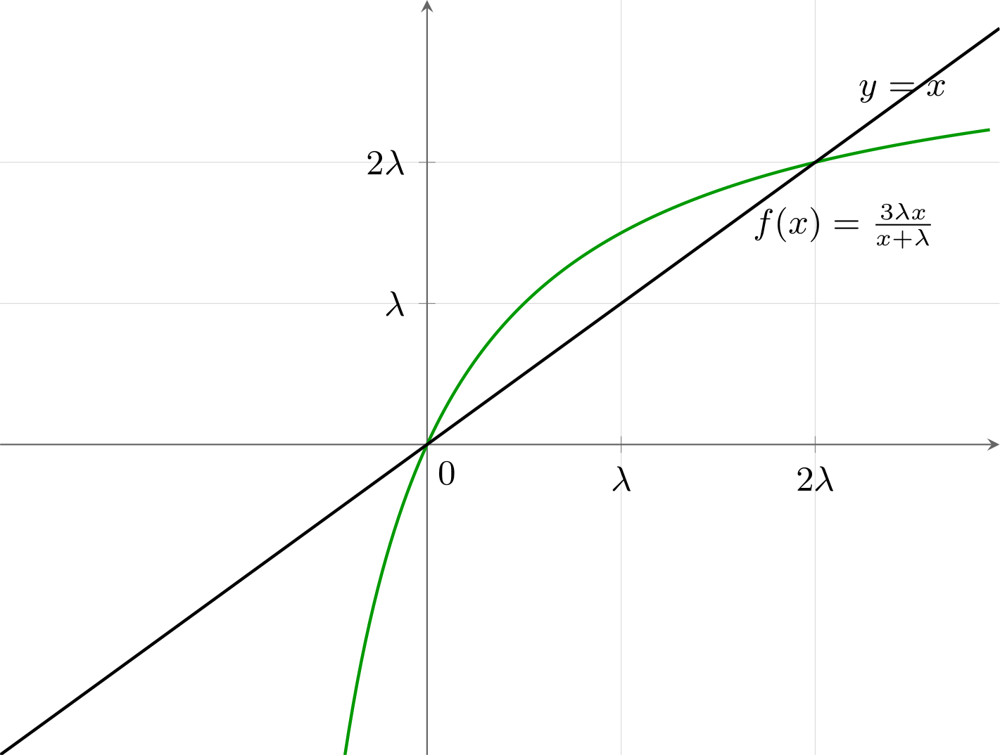
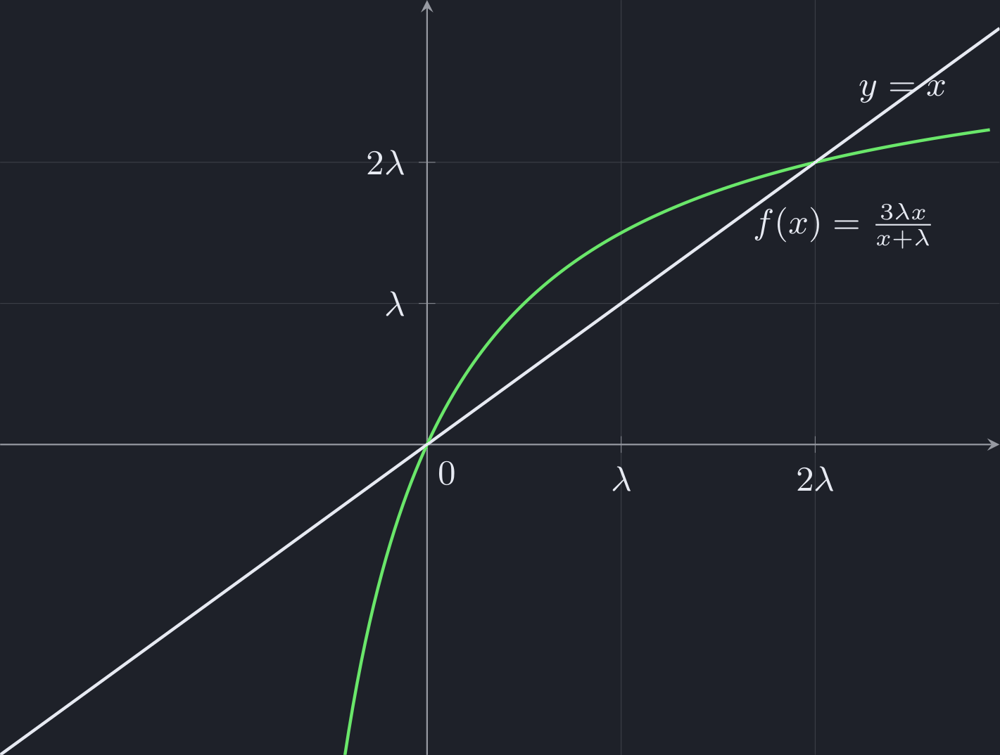
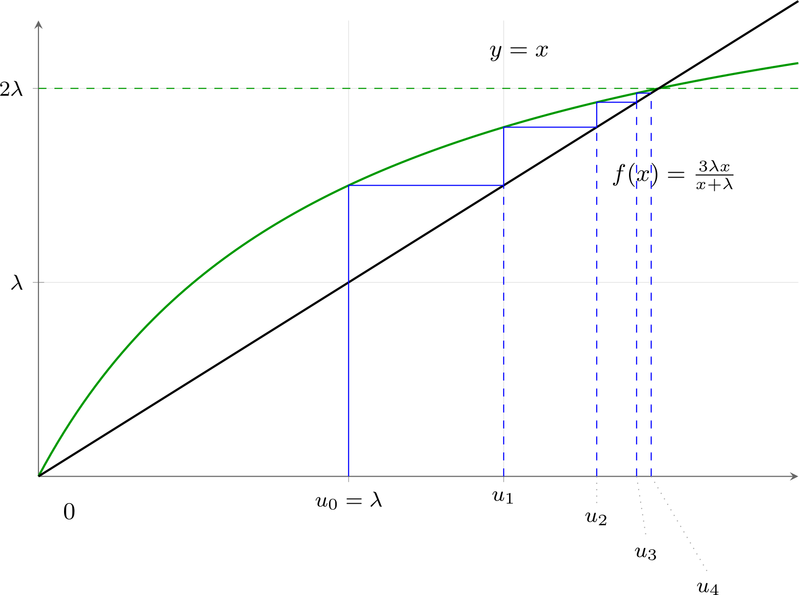
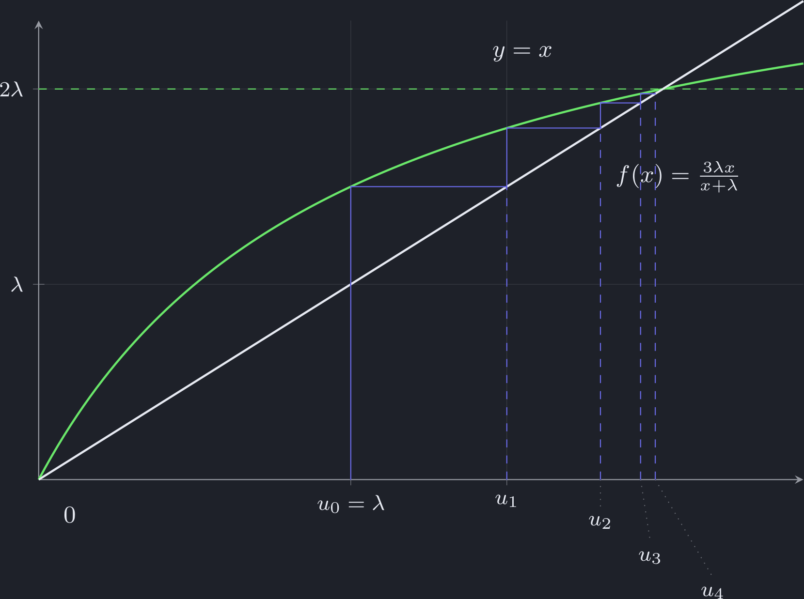

# 实分析　期中考试参考解答

Examen de mi-semestre — Analyse réelle · Corrigé

CORRIGÉ · 参考解答

2026-10-28 · 考试时长 3h · 满分 100 分 · 中法对照

!!! info "阅读说明"

    每段先列法语原文；其下缩进、带深蓝竖条的小字号段落为中文翻译。题目与解答均按原试卷顺序排列，<strong>Exercice 1–3</strong> 分别对应实数、数列与数列极限，分值 30 + 40 + 30。

!!! warning "考试须知（摘要）"

    - 请在每页右上角填写学号。／Inscrivez votre numéro d'étudiant en haut à droite de chaque page.
    - 严禁使用任何资料及电子设备。／Les documents et les appareils électroniques sont interdits.
    - 各大题相互独立，可按任意顺序作答；同一大题内可跳过前面的小题，可使用前面小题的结论，但不得使用后面小题的结论。
    - 课程知识题只需准确陈述所要求的内容，无须证明。其余题目请用法语说明推理过程并论证答案；只有结果或计算而没有解释可能被扣分。

## Exercice 1　Nombres réels 练习 1 · 实数（30 分）

<strong>1.</strong> <strong>Question de cours.</strong> Rappeler la définition de la partie entière.
{: .fr-exo }

<strong>1.</strong> <strong>课程知识题。</strong>叙述<strong>整数部分</strong>（partie entière）的定义。
{: .zh }

!!! sol ""

    Pour tout \(x \in \mathbb{R}\), la partie entière de \(x\) est l'unique \(\lfloor x \rfloor \in \mathbb{Z}\) tel que \(\lfloor x \rfloor \leqslant x < \lfloor x \rfloor + 1\).

    对任意 \(x \in \mathbb{R}\)，\(x\) 的<strong>整数部分</strong>（partie entière）是唯一的 \(\lfloor x \rfloor \in \mathbb{Z}\)，满足 \(\lfloor x \rfloor \leqslant x < \lfloor x \rfloor + 1\)。
    {: .zh }

<strong>2.</strong> <strong>Question de cours.</strong> Rappeler la propriété de la borne supérieure.
{: .fr-exo }

<strong>2.</strong> <strong>课程知识题。</strong>叙述<strong>上确界</strong>（borne supérieure）的性质。
{: .zh }

!!! sol ""

    Toute partie non vide et majorée de \(\mathbb{R}\) admet une borne supérieure.

    \(\mathbb{R}\) 的任意<strong>非空且有上界</strong>的子集都有<strong>上确界</strong>（borne supérieure）。
    {: .zh }

Dans la suite de l'exercice, on considère la fonction \(f : x \mapsto \dfrac{x^2-7}{4-x}\) et les ensembles :

本练习余下部分考虑函数 \(f : x \mapsto \dfrac{x^2-7}{4-x}\) 以及集合：
{: .zh }

\[
\mathcal{A} = \{ f(x) \mid x \in \,]5,13[\,\} \quad \text{et} \quad
\mathcal{B} = \{ x \mid f(x) \in [2,4[\,\}.
\]

<strong>3.</strong> Déterminer le tableau des variations de \(f\) en précisant les limites.
{: .fr-exo }

<strong>3.</strong> 作出 \(f\) 的<strong>变化表</strong>（tableau des variations），并写明各极限。
{: .zh }

!!! sol ""

    La fonction \(f\) est définie et dérivable sur \(\mathbb{R}\setminus\{4\}\) comme quotient de fonctions polynomiales dont le dénominateur ne s'annule pas. On a :

    函数 \(f\) 在 \(\mathbb{R}\setminus\{4\}\) 上有定义且可导：它是两个多项式函数之商，且分母不为零。有：
    {: .zh }

    \[
    \forall x \in \mathbb{R} \setminus \{4\},\quad
    f'(x) = \frac{2x(4-x) - (x^2-7)\times(-1)}{(4-x)^2} = \frac{-x^2+8x-7}{(4-x)^2}.
    \]

    Au numérateur, on reconnaît un polynôme de degré 2 dont le discriminant est égal à \(\Delta = 8^2 - 4\times(-1)\times(-7) = 36 > 0\). Donc le numérateur s'annule en \((-8+\sqrt{36})/(-2) = 1\) et en \((-8-\sqrt{36})/(-2) = 7\), est strictement positif sur \(]1,7[\) et strictement négatif sur \(]-\infty,1[\,\cup\,]7,+\infty[\). De plus, \((4-x)^2 > 0\) pour tout \(x \neq 4\). D'où :

    分子是二次多项式，其判别式为 \(\Delta = 8^2 - 4\times(-1)\times(-7) = 36 > 0\)。因此分子在 \((-8+\sqrt{36})/(-2) = 1\) 与 \((-8-\sqrt{36})/(-2) = 7\) 处为零，在 \(]1,7[\) 上严格为正，在 \(]-\infty,1[\,\cup\,]7,+\infty[\) 上严格为负。又 \((4-x)^2 > 0\) 对一切 \(x \neq 4\) 成立。于是：
    {: .zh }

    \[
    \begin{array}{c|cccccccc}
    x & -\infty & & 1 & & 4 & & 7 & & +\infty\\ \hline
    f'(x) & & - & 0 & + & \| & + & 0 & - & \\ \hline
    f(x) & +\infty & \searrow & -2 & \nearrow &
            \substack{+\infty\\[2pt]\|\\[2pt]-\infty} & \nearrow & -14 & \searrow & -\infty
    \end{array}
    \]

    car :

    因为：
    {: .zh }

    \[
    \begin{aligned}
    \lim_{x\to-\infty} f(x) &= \lim_{x\to-\infty} \frac{x - \frac{7}{x}}{\frac{4}{x} - 1} = +\infty, &
    f(1) &= \frac{1^2-7}{4-1} = -2,\\
    \lim_{x\to 4^-} f(x) &= \lim_{x\to 4^-} \frac{x^2-7}{4-x} = +\infty, &
    \lim_{x\to 4^+} f(x) &= \lim_{x\to 4^+} \frac{x^2-7}{4-x} = -\infty,\\
    f(7) &= \frac{7^2-7}{4-7} = -14, &
    \lim_{x\to+\infty} f(x) &= \lim_{x\to+\infty} \frac{x - \frac{7}{x}}{\frac{4}{x} - 1} = -\infty.
    \end{aligned}
    \]

<strong>4.</strong> À l'aide du tableau des variations de \(f\), déterminer \(\mathcal{A}\).
{: .fr-exo }

<strong>4.</strong> 利用 \(f\) 的变化表确定 \(\mathcal{A}\)。
{: .zh }

!!! sol ""

    On a :

    有：
    {: .zh }

    \[
    f(5) = \frac{5^2-7}{4-5} = -18
    \quad \text{et} \quad
    f(13) = \frac{13^2-7}{4-13} = \frac{162}{-9} = -18.
    \]

    \[
    \begin{array}{c|cccccccc}
    x & 4 & & 5 & & 7 & & 13 & & +\infty\\ \hline
    f(x) & -\infty & \nearrow & -18 & \nearrow & -14 & \searrow & -18 & \searrow & -\infty
    \end{array}
    \]

    En complétant le tableau des variations de \(f\), on en déduit que :

    补全 \(f\) 的变化表，可得：
    {: .zh }

    \[
    \mathcal{A} = \{ f(x) \mid x \in \,]5,13[\,\} = \boxed{\,]-\,18,\,-14\,]}.
    \]

<strong>5.</strong> À l'aide du tableau des variations de \(f\), déterminer \(\mathcal{B}\).
{: .fr-exo }

<strong>5.</strong> 利用 \(f\) 的变化表确定 \(\mathcal{B}\)。
{: .zh }

!!! sol ""

    - \(f(x) = 2 \iff \dfrac{x^2-7}{4-x} = 2 \iff x^2-7 = 2(4-x) \iff x^2+2x-15 = 0\).

        \(f(x) = 2 \iff \dfrac{x^2-7}{4-x} = 2 \iff x^2-7 = 2(4-x) \iff x^2+2x-15 = 0\)。
        {: .zh }

        On obtient une équation de degré 2 de discriminant \(\Delta = 2^2 - 4\times1\times(-15) = 64 > 0\) qui admet pour solutions \((-2+\sqrt{64})/2 = 3\) et \((-2-8)/2 = -5\).

        得到二次方程，判别式 \(\Delta = 2^2 - 4\times1\times(-15) = 64 > 0\)，其解为 \((-2+\sqrt{64})/2 = 3\) 与 \((-2-8)/2 = -5\)。
        {: .zh }

    - \(f(x) = 4 \iff \dfrac{x^2-7}{4-x} = 4 \iff x^2-7 = 4(4-x) \iff x^2+4x-23 = 0\).

        \(f(x) = 4 \iff \dfrac{x^2-7}{4-x} = 4 \iff x^2-7 = 4(4-x) \iff x^2+4x-23 = 0\)。
        {: .zh }

        On obtient une équation de degré 2 de discriminant \(\Delta = 4^2 - 4\times1\times(-23) = 108 > 0\) qui admet pour solutions \((-4+\sqrt{108})/2 = -2+3\sqrt{3}\) et \((-4-\sqrt{108})/2 = -2-3\sqrt{3}\).

        得到二次方程，判别式 \(\Delta = 4^2 - 4\times1\times(-23) = 108 > 0\)，其解为 \((-4+\sqrt{108})/2 = -2+3\sqrt{3}\) 与 \((-4-\sqrt{108})/2 = -2-3\sqrt{3}\)。
        {: .zh }

    - De plus, \(\frac{25}{9} < 3 < 4\) donc \(\frac{5}{3} < \sqrt{3} < 2\) (car la fonction \(t \mapsto \sqrt{t}\) est strictement croissante), par conséquent \(-2+3\sqrt{3} \in \,]3,4[\,\) et \(-2-3\sqrt{3} \in \,]-8,-7[\).

        此外 \(\frac{25}{9} < 3 < 4\)，故 \(\frac{5}{3} < \sqrt{3} < 2\)（因 \(t \mapsto \sqrt{t}\) 严格递增），从而 \(-2+3\sqrt{3} \in \,]3,4[\,\)，\(-2-3\sqrt{3} \in \,]-8,-7[\,\)。
        {: .zh }

    \[
    \begin{array}{c|cccccccc}
    x & -\infty & -2-3\sqrt{3} & -5 & 1 & 3 & -2+3\sqrt{3} & 4 & +\infty\\ \hline
    f(x) & +\infty & 4 & 2 & -2 & 2 & 4 &
            \substack{+\infty\\[2pt]\|\\[2pt]-\infty} & -\infty\\
         & \searrow & \searrow & \searrow & \nearrow & \nearrow & \nearrow & \searrow &
    \end{array}
    \]

    En complétant le tableau des variations de \(f\), on en déduit que :

    补全 \(f\) 的变化表，可得：
    {: .zh }

    \[
    \mathcal{B} = \{ x \in \mathbb{R} \mid f(x) \in [2,4[\,\} =
    \boxed{\,]-\,2-3\sqrt{3},\,-5\,]\,\cup\,[\,3,\,-2+3\sqrt{3}\,[}
    \]

<strong>6.</strong> Pour chacun des nombres suivants, dire s'il existe et, si oui, donner sa valeur :
{: .fr-exo }

<strong>6.</strong> 对下列各量，说明是否存在；若存在，给出其值：
{: .zh }

\[
\max(\mathcal{A}),\ \min(\mathcal{A}),\ \sup(\mathcal{A}),\ \inf(\mathcal{A}),\
\max(\mathcal{B}),\ \min(\mathcal{B}),\ \sup(\mathcal{B}),\ \inf(\mathcal{B}).
\]

!!! sol ""

    - Puisque \(\mathcal{A} = \,]-\,18,\,-14]\) d'après la question 4, on a :

        由第 4 题，\(\mathcal{A} = \,]-\,18,\,-14]\)，故：
        {: .zh }

        \[
        \boxed{\max(\mathcal{A}) = \sup(\mathcal{A}) = -14}, \quad
        \boxed{\min(\mathcal{A}) \text{ n'existe pas}} \quad \text{et} \quad
        \boxed{\inf(\mathcal{A}) = -18}.
        \]

    - Puisque \(\mathcal{B} = \,]-\,2-3\sqrt{3},\,-5\,]\,\cup\,[\,3,\,-2+3\sqrt{3}\,[\) d'après la question 5, on a :

        由第 5 题，\(\mathcal{B} = \,]-\,2-3\sqrt{3},\,-5\,]\,\cup\,[\,3,\,-2+3\sqrt{3}\,[\)，故：
        {: .zh }

        \[
        \boxed{\max(\mathcal{B}) \text{ et } \min(\mathcal{B}) \text{ n'existent pas}},
        \]

        \[
        \boxed{\sup(\mathcal{B}) = -2+3\sqrt{3}} \quad \text{et} \quad
        \boxed{\inf(\mathcal{B}) = -2-3\sqrt{3}}.
        \]

## Exercice 2　Suites 练习 2 · 数列（40 分）

<strong>1.</strong> <strong>Question de cours.</strong> Rappeler la définition d'une suite réelle convergente.
{: .fr-exo }

<strong>1.</strong> <strong>课程知识题。</strong>叙述<strong>实数列收敛</strong>的定义。
{: .zh }

!!! sol ""

    Une suite réelle \((u_n)_{n\geqslant n_0}\) est convergente lorsque :

    实数列 \((u_n)_{n\geqslant n_0}\) 收敛，当且仅当：
    {: .zh }

    \[
    \exists \ell \in \mathbb{R},\ \forall \varepsilon > 0,\ \exists N \geqslant n_0,\ \forall n \geqslant N,\ |u_n - \ell| < \varepsilon.
    \]

<strong>2.</strong> <strong>Question de cours.</strong> Rappeler le théorème des suites adjacentes.
{: .fr-exo }

<strong>2.</strong> <strong>课程知识题。</strong>叙述<strong>相邻数列定理</strong>（théorème des suites adjacentes）。
{: .zh }

!!! sol ""

    Soient \((a_n)_{n\geqslant n_0}\) et \((b_n)_{n\geqslant n_0}\) deux suites adjacentes, c'est-à-dire telles que : \((a_n)_{n\geqslant n_0}\) est croissante, \((b_n)_{n\geqslant n_0}\) est décroissante et \(\lim\limits_{n\to+\infty}(b_n-a_n) = 0\). Alors \((a_n)_{n\geqslant n_0}\) et \((b_n)_{n\geqslant n_0}\) convergent vers une même limite \(\ell \in \mathbb{R}\) et pour tout \(n \geqslant n_0\), \(a_n \leqslant \ell \leqslant b_n\).

    设 \((a_n)_{n\geqslant n_0}\) 与 \((b_n)_{n\geqslant n_0}\) 是两个<strong>相邻数列</strong>，即满足：\((a_n)_{n\geqslant n_0}\) 递增，\((b_n)_{n\geqslant n_0}\) 递减，且 \(\lim\limits_{n\to+\infty}(b_n-a_n) = 0\)。则 \((a_n)_{n\geqslant n_0}\) 与 \((b_n)_{n\geqslant n_0}\) 收敛于同一极限 \(\ell \in \mathbb{R}\)，且对一切 \(n \geqslant n_0\) 有 \(a_n \leqslant \ell \leqslant b_n\)。
    {: .zh }

Dans la suite de l'exercice, on fixe un nombre réel \(\lambda > 0\) et on souhaite étudier la suite \((u_n)_{n\geqslant 0}\) définie par :

本练习余下部分固定一个实数 \(\lambda > 0\)，研究如下定义的数列 \((u_n)_{n\geqslant 0}\)：
{: .zh }

\[
u_0 = \lambda \quad \text{et} \quad \forall n \geqslant 0,\ u_{n+1} = \frac{3\lambda u_n}{u_n + \lambda}.
\]

<strong>3.</strong> Étudier les variations de la fonction \(f : x \mapsto \dfrac{3\lambda x}{x+\lambda}\) sur son ensemble de définition.
{: .fr-exo }

<strong>3.</strong> 研究函数 \(f : x \mapsto \dfrac{3\lambda x}{x+\lambda}\) 在其定义域上的单调性。
{: .zh }

!!! sol ""

    La fonction \(f\) est définie et dérivable sur \(\mathbb{R}\setminus\{-\lambda\}\) comme quotient de fonctions polynomiales dont le dénominateur ne s'annule pas. On a :

    函数 \(f\) 在 \(\mathbb{R}\setminus\{-\lambda\}\) 上有定义且可导：它是两个多项式函数之商，且分母不为零。有：
    {: .zh }

    \[
    \forall x \in \mathbb{R} \setminus \{-\lambda\},\quad
    f'(x) = \frac{3\lambda \times (x+\lambda) - 3\lambda x \times 1}{(x+\lambda)^2} = \frac{3\lambda^2}{(x+\lambda)^2} > 0.
    \]

    Donc \(f\) est strictement croissante sur \(\,]-\infty,-\lambda[\,\) et sur \(\,]-\lambda,+\infty[\).

    因此 \(f\) 在 \(\,]-\infty,-\lambda[\,\) 与 \(\,]-\lambda,+\infty[\,\) 上都严格递增。
    {: .zh }

    \[
    \begin{array}{c|ccccc}
    x & -\infty & & -\lambda & & +\infty\\ \hline
    f(x) & 3\lambda & \nearrow &
            \substack{+\infty\\[2pt]\|\\[2pt]-\infty} & \nearrow & 3\lambda
    \end{array}
    \]

    car :

    因为：
    {: .zh }

    \[
    \begin{aligned}
    \lim_{x\to\pm\infty} f(x) &= \lim_{x\to\pm\infty} \frac{3\lambda}{1+\frac{\lambda}{x}} = 3\lambda,\\
    \lim_{x\to-\lambda^-} f(x) &= \lim_{x\to-\lambda^-}
      \frac{\overbrace{3\lambda x}^{\to\,-3\lambda^2<0}}{\underbrace{x+\lambda}_{\to\,0^-}} = +\infty
    \quad \text{et} \quad
    \lim_{x\to-\lambda^+} f(x) = \lim_{x\to-\lambda^+}
      \frac{\overbrace{3\lambda x}^{\to\,-3\lambda^2<0}}{\underbrace{x+\lambda}_{\to\,0^+}} = -\infty.
    \end{aligned}
    \]

<strong>4.</strong> Étudier le signe de \(x \mapsto f(x)-x\).
{: .fr-exo }

<strong>4.</strong> 研究 \(x \mapsto f(x)-x\) 的符号。
{: .zh }

!!! sol ""

    Soit \(x \in \mathbb{R}\setminus\{-\lambda\}\). On a :

    设 \(x \in \mathbb{R}\setminus\{-\lambda\}\)。有：
    {: .zh }

    \[
    f(x)-x = \frac{3\lambda x}{x+\lambda} - \frac{x(x+\lambda)}{x+\lambda}
    = \frac{3\lambda x - x^2 - \lambda x}{x+\lambda} = \frac{x(2\lambda-x)}{x+\lambda}.
    \]

    D'où le tableau des signes de \(f(x)-x\) :

    由此得 \(f(x)-x\) 的符号表：
    {: .zh }

    \[
    \begin{array}{c|ccccccc}
    x & & -\lambda & & 0 & & 2\lambda & \\ \hline
    f(x)-x & + & \| & - & 0 & + & 0 & -
    \end{array}
    \]

<strong>5.</strong> Sur un même graphique, tracer la droite d'équation \(y=x\), la courbe représentative de \(f\) et les premiers termes de \((u_n)_{n\geqslant 0}\). Quelles propriétés de la suite \((u_n)_{n\geqslant 0}\) peut-on conjecturer ?
{: .fr-exo }

<strong>5.</strong> 在同一坐标系中画出直线 \(y=x\)、\(f\) 的曲线以及 \((u_n)_{n\geqslant 0}\) 的前几项。可以<strong>猜测</strong>数列 \((u_n)_{n\geqslant 0}\) 具有哪些性质？
{: .zh }

!!! sol ""

    On a à l'aide des questions 3 et 4 :

    由第 3、4 题可得：
    {: .zh }

    

    En zoomant pour les valeurs de \(x\) entre \(\lambda\) et \(2\lambda\) :

    把 \(x\) 在 \(\lambda\) 与 \(2\lambda\) 之间的部分放大：
    {: .zh }

    

    On conjecture que \((u_n)_{n\geqslant 0}\) est <strong class="text-red">minorée par \(\lambda\)</strong>, <strong class="text-red">majorée par \(2\lambda\)</strong>, <strong class="text-red">strictement croissante</strong> et <strong class="text-red">converge vers \(2\lambda\)</strong>.

    猜测 \((u_n)_{n\geqslant 0}\) <strong>以 \(\lambda\) 为下界</strong>、<strong>以 \(2\lambda\) 为上界</strong>、<strong>严格递增</strong>，且<strong>收敛于 \(2\lambda\)</strong>。
    {: .zh }

<strong>6.</strong> Montrer que pour tout \(n \geqslant 0\), \(\lambda \leqslant u_n < u_{n+1} < 2\lambda\).
{: .fr-exo }

<strong>6.</strong> 证明对一切 \(n \geqslant 0\)，\(\lambda \leqslant u_n < u_{n+1} < 2\lambda\)。
{: .zh }

!!! sol ""

    On raisonne par récurrence.

    用归纳法证明。
    {: .zh }

    - <u>Initialisation</u>. Pour \(n=0\), on a \(u_0 = \lambda\) et \(u_1 = f(u_0) = \frac{3}{2}\lambda\). De plus, \(\lambda < \frac{3}{2}\lambda < 2\lambda\) car \(\lambda > 0\), donc le résultat est vrai pour \(n=0\).

        <u>初始步</u>。\(n=0\) 时 \(u_0 = \lambda\)，\(u_1 = f(u_0) = \frac{3}{2}\lambda\)。又因 \(\lambda > 0\) 有 \(\lambda < \frac{3}{2}\lambda < 2\lambda\)，故 \(n=0\) 时结论成立。
        {: .zh }

    - <u>Hérédité</u>. On suppose que \(\lambda \leqslant u_n < u_{n+1} < 2\lambda\) pour un rang \(n \geqslant 0\) fixé. Puisque \(f\) est strictement croissante sur \(\,]-\lambda,+\infty[\,\) d'après la question 3, on a :

        <u>归纳步</u>。设对某个固定的 \(n \geqslant 0\) 有 \(\lambda \leqslant u_n < u_{n+1} < 2\lambda\)。由第 3 题，\(f\) 在 \(\,]-\lambda,+\infty[\,\) 上严格递增，故：
        {: .zh }

        \[
        \underbrace{f(\lambda)}_{=\,\frac{3}{2}\lambda} \leqslant
        \underbrace{f(u_n)}_{=\,u_{n+1}} <
        \underbrace{f(u_{n+1})}_{=\,u_{n+2}} <
        \underbrace{f(2\lambda)}_{=\,2\lambda}.
        \]

        De plus, \(\lambda < \frac{3}{2}\lambda\) car \(\lambda > 0\), donc le résultat est vrai aussi au rang \(n+1\).

        又 \(\lambda < \frac{3}{2}\lambda\)（因 \(\lambda > 0\)），故 \(n+1\) 时结论亦成立。
        {: .zh }

    - <u>Conclusion</u>. D'après le principe de récurrence, on a bien montré que :

        <u>结论</u>。由归纳法原理，已证得：
        {: .zh }

        \[
        \boxed{\forall n \geqslant 0,\quad \lambda \leqslant u_n < u_{n+1} < 2\lambda}.
        \]

<strong>7.</strong> Justifier que la suite \((u_n)_{n\geqslant 0}\) converge et déterminer sa limite.
{: .fr-exo }

<strong>7.</strong> 证明数列 \((u_n)_{n\geqslant 0}\) 收敛，并求其极限。
{: .zh }

!!! sol ""

    D'après la question précédente, on sait que \((u_n)_{n\geqslant 0}\) est croissante et majorée. Donc \(\boxed{(u_n)_{n\geqslant 0} \text{ converge}}\) d'après le théorème de limite monotone. On pose \(\ell = \lim\limits_{n\to+\infty} u_n\). Puisque \((u_n)_{n\geqslant 0}\) est minorée par \(\lambda\), on a \(\ell \geqslant \lambda\), en particulier \(\ell \neq -\lambda\) donc \(f(\ell)\) est bien défini. De plus :

    由上一题，\((u_n)_{n\geqslant 0}\) 递增且有上界，故由<strong>单调极限定理</strong>，\((u_n)_{n\geqslant 0}\) <strong>收敛</strong>。记 \(\ell = \lim\limits_{n\to+\infty} u_n\)。由于 \((u_n)_{n\geqslant 0}\) 以 \(\lambda\) 为下界，\(\ell \geqslant \lambda\)，特别地 \(\ell \neq -\lambda\)，故 \(f(\ell)\) 有定义。此外：
    {: .zh }

    \[
    \ell = \lim_{n\to+\infty} u_{n+1} = \lim_{n\to+\infty} \frac{3\lambda u_n}{u_n+\lambda} = \frac{3\lambda\ell}{\ell+\lambda} = f(\ell).
    \]

    D'après la question 4, on en déduit que \(\ell = 2\lambda\). Finalement :

    由第 4 题推出 \(\ell = 2\lambda\)。最终：
    {: .zh }

    \[
    \boxed{\lim_{n\to+\infty} u_n = 2\lambda}.
    \]

<strong>8.</strong> Dans cette question, on considère la suite auxiliaire \((a_n = 1/u_n)_{n\geqslant 0}\).
{: .fr-exo }

<strong>8.</strong> 本题考虑<strong>辅助数列</strong> \((a_n = 1/u_n)_{n\geqslant 0}\)。
{: .zh }

<strong>8 (a).</strong> Trouver deux constantes \((q,r) \in \mathbb{R}^2\) telles que : \(\forall n \geqslant 0\), \(a_{n+1} = q a_n + r\).
{: .fr-exo }

<strong>8 (a).</strong> 求两个常数 \((q,r) \in \mathbb{R}^2\)，使得 \(\forall n \geqslant 0\)，\(a_{n+1} = q a_n + r\)。
{: .zh }

!!! sol ""

    Soit \(n \geqslant 0\). On a :

    设 \(n \geqslant 0\)。有：
    {: .zh }

    \[
    \begin{aligned}
    a_{n+1} &= \frac{1}{u_{n+1}} = \frac{1}{\frac{3\lambda u_n}{u_n+\lambda}}\\[2pt]
    &= \frac{u_n+\lambda}{3\lambda u_n} = \frac{1+\frac{\lambda}{u_n}}{3\lambda}
       \qquad \text{car } u_n \geqslant \lambda \text{ donc } u_n \neq 0\\[2pt]
    &= \frac{1+\lambda a_n}{3\lambda} = \boxed{\frac{1}{3}a_n + \frac{1}{3\lambda}}.
    \end{aligned}
    \]

    D'où le résultat en posant \(\boxed{(q,r) = \left(\tfrac{1}{3},\tfrac{1}{3\lambda}\right)}\).

    于是取 \((q,r) = (\frac{1}{3},\frac{1}{3\lambda})\) 即得结果。
    {: .zh }

<strong>8 (b).</strong> En déduire l'expression de \(a_n\) en fonction de \(n \geqslant 0\).
{: .fr-exo }

<strong>8 (b).</strong> 由此推出 \(a_n\) 关于 \(n \geqslant 0\) 的表达式。
{: .zh }

!!! sol ""

    D'après la question précédente, on reconnaît une suite arithmético-géométrique. On commence par résoudre l'équation suivante d'inconnue \(\alpha \in \mathbb{R}\) :

    由上一题可识别出<strong>算术-几何数列</strong>（suite arithmético-géométrique）。先解关于未知数 \(\alpha \in \mathbb{R}\) 的方程：
    {: .zh }

    \[
    \alpha = \frac{1}{3}\alpha + \frac{1}{3\lambda}
    \iff \left(1-\frac{1}{3}\right)\alpha = \frac{1}{3\lambda}
    \iff \alpha = \frac{\frac{1}{3\lambda}}{\frac{2}{3}} = \frac{1}{2\lambda}.
    \]

    On pose la suite \((b_n = a_n-\alpha)_{n\geqslant 0}\). Alors on a pour tout \(n \geqslant 0\) :

    令数列 \((b_n = a_n-\alpha)_{n\geqslant 0}\)。则对一切 \(n \geqslant 0\) 有：
    {: .zh }

    \[
    b_{n+1} = a_{n+1}-\alpha = \left(\frac{1}{3}a_n+\frac{1}{3\lambda}\right)-\left(\frac{1}{3}\alpha+\frac{1}{3\lambda}\right)
    = \frac{1}{3}(a_n-\alpha) = \frac{1}{3}b_n.
    \]

    On reconnaît une suite géométrique de raison \(q = \frac{1}{3}\). Donc, pour tout \(n \geqslant 0\) :

    这是公比 \(q = \frac{1}{3}\) 的等比数列。故对一切 \(n \geqslant 0\)：
    {: .zh }

    \[
    a_n = b_n+\alpha = b_0\left(\frac{1}{3}\right)^n + \alpha
    = \frac{a_0-\alpha}{3^n} + \alpha
    = \frac{\frac{1}{\lambda}-\frac{1}{2\lambda}}{3^n} + \frac{1}{2\lambda}
    = \boxed{\frac{3^{-n}+1}{2\lambda}}.
    \]

<strong>8 (c).</strong> À l'aide du résultat de la question 8(b), retrouver le résultat de la question 7.
{: .fr-exo }

<strong>8 (c).</strong> 利用 8(b) 的结果重新得到第 7 题的结论。
{: .zh }

!!! sol ""

    On a d'après la question précédente :

    由上一题有：
    {: .zh }

    \[
    \lim_{n\to+\infty} u_n = \lim_{n\to+\infty} \frac{1}{a_n}
    = \lim_{n\to+\infty} \frac{2\lambda}{\underbrace{3^{-n}+1}_{\to\,1}} = \boxed{2\lambda}.
    \]

    On retrouve bien le résultat de la question 7.

    确实重新得到了第 7 题的结论。
    {: .zh }

## Exercice 3　Suites 练习 3 · 数列极限（30 分）

<strong>1.</strong> <strong>Question de cours.</strong> Rappeler la définition de deux suites équivalentes.
{: .fr-exo }

<strong>1.</strong> <strong>课程知识题。</strong>叙述<strong>两个数列等价</strong>的定义。
{: .zh }

!!! sol ""

    Soient \((a_n)\) et \((b_n)\) deux suites réelles dont les termes sont non nuls à partir d'un certain rang. \((a_n)\) et \((b_n)\) sont équivalentes lorsque :

    设 \((a_n)\) 与 \((b_n)\) 是两个实数列，其各项从某一项起均不为零。若下式成立，则称 \((a_n)\) 与 \((b_n)\) <strong>等价</strong>：
    {: .zh }

    \[
    \lim_{n\to+\infty} \frac{a_n}{b_n} = 1.
    \]

<strong>2.</strong> <strong>Question de cours.</strong> Rappeler le théorème des croissances comparées.
{: .fr-exo }

<strong>2.</strong> <strong>课程知识题。</strong>叙述<strong>增长比较定理</strong>（théorème des croissances comparées）。
{: .zh }

!!! sol ""

    Soient \(\alpha > 0\) et \(q > 1\). Alors :

    设 \(\alpha > 0\)，\(q > 1\)。则：
    {: .zh }

    \[
    \ln(n) = \on(n^\alpha), \qquad n^\alpha = \on(q^n) \qquad \text{et} \qquad q^n = \on(n!).
    \]

<strong>3.</strong> Déterminer chacune des limites suivantes en justifiant vos réponses.
{: .fr-exo }

<strong>3.</strong> 求下列各极限，并说明理由。
{: .zh }

<strong>3 (a).</strong> \(\displaystyle\lim_{n\to+\infty} \sqrt{n^2+3n+1} - \sqrt{n^2+n+1}\).
{: .fr-exo }

<strong>3 (a).</strong> 求此极限。
{: .zh }

!!! sol ""

    \[
    \begin{aligned}
    &\underbrace{\lim_{n\to+\infty} \left(\sqrt{n^2+3n+1} - \sqrt{n^2+n+1}\right)}_{\text{\scriptsize forme indéterminée } \infty-\infty}\\[2pt]
    &\quad = \lim_{n\to+\infty}
     \frac{\left(\sqrt{n^2+3n+1} - \sqrt{n^2+n+1}\right)\left(\sqrt{n^2+3n+1} + \sqrt{n^2+n+1}\right)}
          {\sqrt{n^2+3n+1} + \sqrt{n^2+n+1}}\\[2pt]
    &\quad = \underbrace{\lim_{n\to+\infty} \frac{2n}{\sqrt{n^2+3n+1} + \sqrt{n^2+n+1}}}_{\text{\scriptsize forme indéterminée } \infty/\infty}\\[2pt]
    &\quad = \lim_{n\to+\infty} \frac{2}{\sqrt{1+\frac{3}{n}+\frac{1}{n^2}} + \sqrt{1+\frac{1}{n}+\frac{1}{n^2}}}\\[2pt]
    &\quad = \frac{2}{\sqrt{1+0+0} + \sqrt{1+0+0}} = \boxed{1}.
    \end{aligned}
    \]

<strong>3 (b).</strong> \(\displaystyle\lim_{n\to+\infty} \frac{n^3+2^n}{n^2+3^n}\).
{: .fr-exo }

<strong>3 (b).</strong> 求此极限。
{: .zh }

!!! sol ""

    \[
    \underbrace{\lim_{n\to+\infty} \frac{n^3+2^n}{n^2+3^n}}_{\text{\scriptsize forme indéterminée } \infty/\infty}
    = \lim_{n\to+\infty} \frac{\frac{n^3}{3^n} + \left(\frac{2}{3}\right)^n}{\frac{n^2}{3^n}+1}
    = \frac{0+0}{0+1} = \boxed{0}.
    \]

    car :

    因为：
    {: .zh }

    \[
    \left\{
    \begin{array}{l}
    n^3 = \on(3^n)\\[2pt]
    n^2 = \on(3^n)
    \end{array}
    \right.
    \qquad \text{d'après le théorème des croissances comparées}
    \]

    et \(\lim\limits_{n\to+\infty}\left(\frac{2}{3}\right)^n = 0\) car \(\frac{2}{3} \in \,]0,1[\).

    且 \(\lim\limits_{n\to+\infty}\left(\frac{2}{3}\right)^n = 0\)，因为 \(\frac{2}{3} \in \,]0,1[\)。
    {: .zh }

<strong>3 (c).</strong> \(\displaystyle\lim_{n\to+\infty} \frac{(\ln(n))^2}{\sqrt{n}}\).
{: .fr-exo }

<strong>3 (c).</strong> 求此极限。
{: .zh }

!!! sol ""

    \[
    \underbrace{\lim_{n\to+\infty} \frac{(\ln(n))^2}{\sqrt{n}}}_{\text{\scriptsize forme indéterminée } \infty/\infty}
    = \lim_{n\to+\infty} \left(\frac{\ln(n)}{n^{1/4}}\right)^2 = 0^2 = \boxed{0}.
    \]

    car :

    因为：
    {: .zh }

    \[
    \ln(n) = \on\left(n^{1/4}\right) \qquad \text{d'après le théorème des croissances comparées.}
    \]

<strong>3 (d).</strong> \(\displaystyle\lim_{n\to+\infty} \left(\frac{n+2}{n-1}\right)^n\).
{: .fr-exo }

<strong>3 (d).</strong> 求此极限。
{: .zh }

!!! sol ""

    \[
    \begin{aligned}
    \lim_{n\to+\infty} \left(\frac{n+2}{n-1}\right)^n
    &= \underbrace{\lim_{n\to+\infty} \left(1+\frac{3}{n-1}\right)^n}_{\text{\scriptsize forme indéterminée } 1^\infty}
    = \lim_{n\to+\infty} e^{\,n\ln\left(1+\frac{3}{n-1}\right)}.
    \end{aligned}
    \]

    Or :

    而：
    {: .zh }

    \[
    \begin{aligned}
    &\lim_{n\to+\infty} n\ln\left(1+\frac{3}{n-1}\right)\\[2pt]
    &\quad = \lim_{n\to+\infty} \underbrace{\left(\frac{3n}{n-1}\right)}_{\to\,3}\ \frac{\ln\left(1+\frac{3}{n-1}\right)}{\frac{3}{n-1}}\\[2pt]
    &\quad = 3\lim_{h\to 0} \frac{\ln(1+h)-\ln(1)}{h}
    \qquad \text{en posant } h = \frac{3}{n-1} \to 0 \text{ quand } n \to +\infty\\[2pt]
    &\quad = 3\ln'(1) = \frac{3}{1} = 3.
    \end{aligned}
    \]

    Par conséquent :

    因此：
    {: .zh }

    \[
    \lim_{n\to+\infty} \left(\frac{n+2}{n-1}\right)^n
    = \lim_{n\to+\infty} e^{\,n\ln\left(1+\frac{3}{n-1}\right)} = \boxed{e^3}.
    \]
