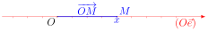
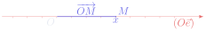
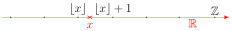
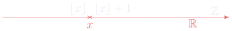
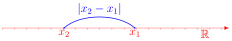
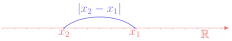
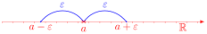
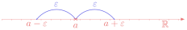

# 第 1 章　\(\mathbb{R}\) 的拓扑

Chapitre n°1 — Topologie de ℝ

中法对照讲义 · 由 LaTeX 源文件渲染

!!! info "阅读说明"

    每段先列法语原文；其下缩进、带深蓝竖条的小字号段落为中文翻译。<strong>加粗</strong>为关键词，括号内为中文释义。

### Objectifs 学习目标

1. Manipuler des nombres réels.

    熟练操作实数。
    {: .zh }

1. Résoudre des équations et des inéquations d'inconnues réelles.

    求解以实数为未知量的方程与不等式。
    {: .zh }

1. Comprendre les différentes propriétés topologiques des parties de \(\mathbb{R}\).

    理解 \(\mathbb{R}\) 的子集的各种拓扑性质。
    {: .zh }

### Notations 记号

On rappelle que \(\mathbb{R}\) désigne l'ensemble des nombres réels, \(\mathbb{Q}\) désigne l'ensemble des nombres rationnels, \(\mathbb{Z}\) désigne l'ensemble des entiers relatifs et \(\mathbb{N}\) désigne l'ensemble des entiers naturels.

回顾：\(\mathbb{R}\) 表示<strong>实数集</strong>，\(\mathbb{Q}\) 表示<strong>有理数集</strong>，\(\mathbb{Z}\) 表示<strong>整数集</strong>（entiers relatifs），\(\mathbb{N}\) 表示<strong>自然数集</strong>。
{: .zh }

On note \(\mathbb{R}_+=\{x\in\mathbb{R}\mid x\geqslant 0\}\) le sous-ensemble des nombres réels positifs, \(\mathbb{R}_-=\{x\in\mathbb{R}\mid x\leqslant 0\}\) le sous-ensemble des nombres réels négatifs et \(\mathbb{R}^*=\{x\in\mathbb{R}\mid x\neq 0\}\) le sous-ensemble des nombres réels non nuls.

记 \(\mathbb{R}_+=\{x\in\mathbb{R}\mid x\geqslant 0\}\) 为非负实数子集，\(\mathbb{R}_-=\{x\in\mathbb{R}\mid x\leqslant 0\}\) 为非正实数子集，\(\mathbb{R}^*=\{x\in\mathbb{R}\mid x\neq 0\}\) 为非零实数子集。
{: .zh }

## Description de ℝ 描述 ℝ

!!! success "Définition 1.1 : la droite réelle 定义 1.1：实数轴（droite réelle）"

    L'ensemble des nombres réels, noté \(\mathbb{R}\), peut être vu comme l'ensemble des positions possibles sur une droite orientée. Autrement dit, on peut représenter géométriquement \(\mathbb{R}\) par une droite munie d'un repère \((O,\vec{e})\) : à chaque nombre réel \(x\in\mathbb{R}\), on associe le point \(M\) de <strong>coordonnée</strong> \(x\), c'est-à-dire tel que \(\overrightarrow{OM}=x\vec{e}\). Cette représentation de \(\mathbb{R}\) est appelée la <strong>droite réelle</strong>.

    实数集记作 \(\mathbb{R}\)，可以看作一条<strong>有向直线</strong>（droite orientée）上所有可能位置的集合。换言之， 可以把 \(\mathbb{R}\) 几何地表示为一条带有<strong>标架</strong>（repère）\((O,\vec{e})\) 的直线：对每个实数 \(x\in\mathbb{R}\)，对应直线上的点 \(M\)，其<strong>坐标</strong>（coordonnée）为 \(x\)，即满足 \(\overrightarrow{OM}=x\vec{e}\)。\(\mathbb{R}\) 的这种表示称为<strong>实数轴</strong>（droite réelle）。
    {: .zh }

    \[
    \overrightarrow{OM}=x\vec{e}.
    \]

!!! warning "Remarque 注（Remarque）"

    Il existe des constructions mathématiques plus précises de l'ensemble des nombres réels, qui permettent de démontrer rigoureusement ses propriétés. On ne les présentera pas ici : le but de ce chapitre est seulement de rappeler les principales propriétés de \(\mathbb{R}\), en admettant certaines d'entre elles.

    实数集还存在更精确的数学构造，可以严格证明它的各种性质。这里不介绍这些构造：本章的目的仅仅是 回顾 \(\mathbb{R}\) 的主要性质，其中某些性质我们<strong>直接承认</strong>（admettre）。
    {: .zh }

!!! danger "Propriété 1.2 : opérations avec les nombres réels 性质 1.2：实数的运算"

    L'ensemble \(\mathbb{R}\) est muni d'une <strong>addition</strong> et d'une <strong>multiplication</strong> qui vérifient les propriétés usuelles, en particulier :

    集合 \(\mathbb{R}\) 上带有<strong>加法</strong>（addition）与<strong>乘法</strong>（multiplication），它们满足通常的 性质，特别地：
    {: .zh }

    - <strong>associativité</strong>（结合律）：\(\forall(x_1,x_2,x_3)\in\mathbb{R}^3\), \(\begin{cases}(x_1+x_2)+x_3=x_1+(x_2+x_3)\\[2pt](x_1x_2)x_3=x_1(x_2x_3)\end{cases}\),
    - <strong>commutativité</strong>（交换律）：\(\forall(x_1,x_2)\in\mathbb{R}^2\), \(\begin{cases}x_1+x_2=x_2+x_1\\[2pt]x_1x_2=x_2x_1\end{cases}\),
    - <strong>distributivité</strong>（分配律）：\(\forall(x_1,x_2,x_3)\in\mathbb{R}^3\), \(x_1(x_2+x_3)=x_1x_2+x_1x_3\),
    - <strong>intégrité</strong>（整性，即无零因子）：\(\forall(x,y)\in\mathbb{R}^2\), \(xy=0\Longrightarrow(x=0\) ou \(y=0)\).

!!! danger "Propriété 1.3 : relation d'ordre sur \(\mathbb{R}\) 性质 1.3：\(\mathbb{R}\) 上的序关系"

    L'ensemble \(\mathbb{R}\) est muni d'une <strong>relation d'ordre</strong> \(\leqslant\) qui vérifie les propriétés usuelles, en particulier :

    集合 \(\mathbb{R}\) 上带有<strong>序关系</strong>（relation d'ordre）\(\leqslant\)，它满足通常的性质， 特别地：
    {: .zh }

    - <strong>antisymétrie</strong>（反对称性）：\(\forall(x,y)\in\mathbb{R}^2\), \((x\leqslant y\) et \(x\geqslant y)\Longrightarrow x=y\),
    - <strong>transitivité</strong>（传递性）：\(\forall(x_1,x_2,x_3)\in\mathbb{R}^3\), \((x_1\leqslant x_2\) et \(x_2\leqslant x_3)\Longrightarrow x_1\leqslant x_3\),
    - <strong>compatibilité avec l'addition</strong>（与加法的相容性）：\(\forall(x_1,x_2,x_3)\in\mathbb{R}^3\), \(x_1\leqslant x_2\Longrightarrow x_1+x_3\leqslant x_2+x_3\),
    - <strong>compatibilité avec la multiplication</strong>（与乘法的相容性）：

        \[
        \forall(x_1,x_2)\in\mathbb{R}^2,\ \forall\lambda\in\mathbb{R}_+,\ x_1\leqslant x_2\Longrightarrow\lambda x_1\leqslant\lambda x_2.
        \]

!!! warning "Attention 注意（Attention）"

    Si on multiplie une inégalité par un nombre négatif, l'inégalité change de sens !

    如果用一个<strong>负数</strong>去乘一个不等式，不等号要<strong>变向</strong>！
    {: .zh }

    \[
    \forall(x_1,x_2)\in\mathbb{R}^2,\ \forall\lambda\in\mathbb{R}_-,\ x_1\leqslant x_2\Longrightarrow\lambda x_1\geqslant\lambda x_2.
    \]

    En particulier, il faut être vigilant pour soustraire des inégalités :

    特别地，<strong>两个不等式相减</strong>时要格外小心：
    {: .zh }

    \[
    \forall(x_1,x_2,y_1,y_2)\in\mathbb{R}^4,\
    \begin{cases}x_1\leqslant x_2\\ y_1\leqslant y_2\end{cases}
    \Longrightarrow
    \begin{cases}x_1\leqslant x_2\\ -y_2\leqslant -y_1\end{cases}
    \Longrightarrow x_1-y_2\leqslant x_2-y_1.
    \]

    De même, puisque la fonction \(t\mapsto 1/t\) est décroissante sur \(\mathbb{R}_+^*\) et sur \(\mathbb{R}_-^*\) (mais pas sur \(\mathbb{R}^*\)), il faut être vigilant pour inverser des inégalités :

    同样，由于函数 \(t\mapsto 1/t\) 在 \(\mathbb{R}_+^*\) 和 \(\mathbb{R}_-^*\) 上<strong>递减</strong>（但在 \(\mathbb{R}^*\) 上并非如此），<strong>取倒数</strong>时要格外小心：
    {: .zh }

    \[
    \forall(x_1,x_2)\in\mathbb{R}^2,\ \big(0<x_1\leqslant x_2\ \text{ou}\ x_1\leqslant x_2<0\big)
    \Longrightarrow\frac{1}{x_1}\geqslant\frac{1}{x_2}.
    \]

!!! warning "Vocabulaire clé &nbsp;&nbsp; 重点词汇 第一节核心术语"

    - <strong>droite réelle</strong>：实数轴
    - <strong>droite orientée</strong>：有向直线
    - <strong>repère \((O,\vec{e})\)</strong>：标架（原点 \(O\) 与基向量 \(\vec{e}\)）
    - <strong>coordonnée</strong>：坐标
    - <strong>muni de</strong>：带有、赋予（「\(\mathbb{R}\) est muni d'une addition」即 \(\mathbb{R}\) 上带有加法）
    - <strong>vérifier les propriétés usuelles</strong>：满足通常的性质
    - <strong>en particulier</strong>：特别地
    - <strong>autrement dit</strong>：换言之
    - <strong>relation d'ordre</strong>：序关系
    - <strong>associativité / commutativité / distributivité</strong>：结合律 / 交换律 / 分配律
    - <strong>intégrité</strong>：整性（无零因子）
    - <strong>antisymétrie / transitivité</strong>：反对称性 / 传递性
    - <strong>compatibilité avec l'addition</strong>：与加法的相容性
    - <strong>être vigilant</strong>：要小心、要警惕
    - <strong>changer de sens</strong>：变向（不等号方向改变）
    - <strong>on admet</strong>：我们承认（不加证明地接受）

## Partie entière 整数部分

!!! success "Définition 2.1 : partie entière 定义 2.1：整数部分（partie entière）"

    La <strong>partie entière</strong> d'un nombre réel \(x\in\mathbb{R}\) est l'unique entier \(\lfloor x\rfloor\in\mathbb{Z}\) tel que :

    实数 \(x\in\mathbb{R}\) 的<strong>整数部分</strong>（partie entière）是唯一满足下式的整数 \(\lfloor x\rfloor\in\mathbb{Z}\)：
    {: .zh }

    \[
    \lfloor x\rfloor\leqslant x<\lfloor x\rfloor+1.
    \]

    Autrement dit, la partie entière de \(x\) est le plus grand entier inférieur ou égal à \(x\).

    换言之，\(x\) 的整数部分就是<strong>不超过 \(x\) 的最大整数</strong>。
    {: .zh }

!!! info "Exemple 2.2 例 2.2"

    Puisque \(1<3<4\), on a \(1<\sqrt{3}<2\) car la fonction \(t\mapsto\sqrt{t}\) est strictement croissante, donc \(\lfloor\sqrt{3}\rfloor=1\). De même, puisque \(4<7<9\), on a \(2<\sqrt{7}<3\), donc \(\lfloor\sqrt{7}\rfloor=2\).

    由于 \(1<3<4\)，有 \(1<\sqrt{3}<2\)，这是因为函数 \(t\mapsto\sqrt{t}\) <strong>严格递增</strong>，故 \(\lfloor\sqrt{3}\rfloor=1\)。同理，由于 \(4<7<9\)，有 \(2<\sqrt{7}<3\)，故 \(\lfloor\sqrt{7}\rfloor=2\)。
    {: .zh }

    Mais ces inégalités sont insuffisantes pour déterminer \(\lfloor 2\sqrt{3}+\sqrt{7}\rfloor\) car on a seulement \(4<2\sqrt{3}+\sqrt{7}<7\). Il faut trouver des encadrements plus précis, par exemple :

    但这些不等式不足以确定 \(\lfloor 2\sqrt{3}+\sqrt{7}\rfloor\)，因为只知道 \(4<2\sqrt{3}+\sqrt{7}<7\)。 需要更精细的<strong>夹逼估计</strong>（encadrement），例如：
    {: .zh }

    \[
    \begin{cases}
    \underbrace{144}_{=12^2}<\underbrace{147}_{=3\times 49}<\underbrace{169}_{=13^2}
      \quad\text{donne}\quad \dfrac{12}{7}<\sqrt{3}<\dfrac{13}{7}\\[10pt]
    \underbrace{169}_{=13^2}<\underbrace{175}_{=7\times 25}<\underbrace{196}_{=14^2}
      \quad\text{donne}\quad \dfrac{13}{5}<\sqrt{7}<\dfrac{14}{5}
    \end{cases}
    .
    \]

    On en déduit que :

    由此推出：
    {: .zh }

    \[
    6<\frac{211}{35}=\frac{24}{7}+\frac{13}{5}<2\sqrt{3}+\sqrt{7}<\frac{26}{7}+\frac{14}{5}=\frac{228}{35}<7
    \quad\text{donc}\quad \lfloor 2\sqrt{3}+\sqrt{7}\rfloor=6.
    \]

## Valeur absolue 绝对值

!!! success "Définition 3.1 : valeur absolue 定义 3.1：绝对值（valeur absolue）"

    La <strong>valeur absolue</strong> d'un nombre réel \(x\in\mathbb{R}\) est le nombre réel positif :

    实数 \(x\in\mathbb{R}\) 的<strong>绝对值</strong>（valeur absolue）是如下非负实数：
    {: .zh }

    \[
    |x|=\max\{-x,x\}=
    \begin{cases}
    x & \text{si } x\geqslant 0\\[2pt]
    -x & \text{si } x\leqslant 0
    \end{cases}
    .
    \]

    Sur la droite réelle, \(|x|\) est la distance entre l'origine \(O\) et le point de coordonnée \(x\).

    在实数轴上，\(|x|\) 是原点 \(O\) 与坐标为 \(x\) 的点之间的<strong>距离</strong>。
    {: .zh }

Plus généralement, si \(x_1\in\mathbb{R}\) et \(x_2\in\mathbb{R}\) sont les coordonnées respectives des points \(M_1\) et \(M_2\) sur la droite réelle, alors \(|x_2-x_1|=\big\|\overrightarrow{M_1M_2}\big\|=M_1M_2\) est la distance entre \(M_1\) et \(M_2\).

更一般地，若 \(x_1\in\mathbb{R}\) 与 \(x_2\in\mathbb{R}\) 分别是实数轴上点 \(M_1\) 与 \(M_2\) 的坐标， 则 \(|x_2-x_1|=\big\|\overrightarrow{M_1M_2}\big\|=M_1M_2\) 是 \(M_1\) 与 \(M_2\) 之间的距离。
{: .zh }

!!! info "Exemple 3.2 例 3.2"

    Soit \((x,y)\in\mathbb{R}^2\). On a :

    设 \((x,y)\in\mathbb{R}^2\)。有：
    {: .zh }

    \[
    \frac{x+y+|x-y|}{2}=
    \begin{cases}
    \dfrac{x+y+(x-y)}{2}=x & \text{si } x\geqslant y\\[8pt]
    \dfrac{x+y-(x-y)}{2}=y & \text{si } x\leqslant y
    \end{cases}
    =\max\{x,y\}.
    \]

    De même, on peut montrer que \(\dfrac{x+y-|x-y|}{2}=\min\{x,y\}\).

    同样可以证明 \(\dfrac{x+y-|x-y|}{2}=\min\{x,y\}\)。
    {: .zh }

!!! danger "Propriété 3.3 性质 3.3"

    - \(\forall x\in\mathbb{R}\), \(|x|\geqslant 0\),
    - \(\forall x\in\mathbb{R}\), \(|x|=0\Longleftrightarrow x=0\),
    - \(\forall(x,y)\in\mathbb{R}^2\), \(|xy|=|x||y|\).

!!! danger "Propriété 3.4 : inégalité triangulaire dans \(\mathbb{R}\) 性质 3.4：\(\mathbb{R}\) 中的三角不等式"

    \[
    \forall(x,y)\in\mathbb{R}^2,\ |x+y|\leqslant|x|+|y|.
    \]

    Le cas d'égalité se produit si et seulement si \(x\) et \(y\) ont même signe. De plus :

    <strong>等号成立</strong>（cas d'égalité）当且仅当 \(x\) 与 \(y\) <strong>同号</strong>。此外：
    {: .zh }

    \[
    \forall(x,y)\in\mathbb{R}^2,\ \big||x|-|y|\big|\leqslant|x-y|.
    \]

!!! warning "Vocabulaire clé &nbsp;&nbsp; 重点词汇 第二、三节核心术语"

    - <strong>partie entière \(\lfloor x\rfloor\)</strong>：整数部分（向下取整）
    - <strong>l'unique entier</strong>：唯一的整数
    - <strong>le plus grand entier inférieur ou égal à \(x\)</strong>：不超过 \(x\) 的最大整数
    - <strong>strictement croissante</strong>：严格递增的
    - <strong>encadrement</strong>：夹逼估计、上下界估计
    - <strong>on en déduit que</strong>：由此推出
    - <strong>valeur absolue \(|x|\)</strong>：绝对值
    - <strong>distance</strong>：距离
    - <strong>même signe</strong>：同号
    - <strong>inégalité triangulaire</strong>：三角不等式
    - <strong>le cas d'égalité</strong>：等号成立的情形
    - <strong>si et seulement si</strong>：当且仅当
    - <strong>on peut montrer que</strong>：可以证明

## Intervalles 区间

!!! success "Définition 4.1 : intervalle 定义 4.1：区间（intervalle）"

    Un <strong>intervalle</strong> est un sous-ensemble \(I\subset\mathbb{R}\) qui vérifie la propriété suivante :

    <strong>区间</strong>（intervalle）是满足下述性质的子集 \(I\subset\mathbb{R}\)：
    {: .zh }

    \[
    \forall(a,b)\in I^2,\ \forall x\in\mathbb{R},\ a<x<b\Longrightarrow x\in I.
    \]

Autrement dit, un intervalle est une partie de \(\mathbb{R}\) sans trou.

换言之，区间就是 \(\mathbb{R}\) 中<strong>没有洞</strong>的子集。
{: .zh }

!!! info "Exemple 4.2 例 4.2"

    - \(\mathbb{N}\), \(\mathbb{Z}\) et \(\mathbb{Q}\) ne sont pas des intervalles.

        \(\mathbb{N}\)、\(\mathbb{Z}\) 和 \(\mathbb{Q}\) 都不是区间。
        {: .zh }

    - \(\mathbb{R}_+\) et \(\mathbb{R}_-\) sont des intervalles, mais pas \(\mathbb{R}^*\).

        \(\mathbb{R}_+\) 和 \(\mathbb{R}_-\) 是区间，但 \(\mathbb{R}^*\) 不是。
        {: .zh }

!!! danger "Propriété 4.3 性质 4.3"

    Les intervalles sont les parties de \(\mathbb{R}\) de la forme :

    区间就是 \(\mathbb{R}\) 中具有下列形式的子集：
    {: .zh }

    

    où \(a\) et \(b\) sont des nombres réels.

    其中 \(a\) 与 \(b\) 是实数。
    {: .zh }

En particulier, l'<strong>ensemble vide</strong> \(\varnothing=]a,a[\) est un intervalle et tout <strong>singleton</strong> \(\{a\}=[a,a]\) est un intervalle. Les intervalles de la forme \([a,b]\) sont appelés des <strong>segments</strong>.

特别地，<strong>空集</strong>（ensemble vide）\(\varnothing=]a,a[\) 是区间，任何<strong>单元素集</strong>（singleton） \(\{a\}=[a,a]\) 也是区间。形如 \([a,b]\) 的区间称为<strong>闭区间</strong>（segment）。
{: .zh }

!!! danger "Propriété 4.4 性质 4.4"

    Soient \(a\in\mathbb{R}\) et \(\varepsilon>0\). Pour tout \(x\in\mathbb{R}\), on a :

    设 \(a\in\mathbb{R}\)，\(\varepsilon>0\)。对任意 \(x\in\mathbb{R}\)，有：
    {: .zh }

    \[
    |x-a|\leqslant\varepsilon\Longleftrightarrow x\in[a-\varepsilon,a+\varepsilon]
    \quad\text{et}\quad
    |x-a|<\varepsilon\Longleftrightarrow x\in\,]a-\varepsilon,a+\varepsilon[.
    \]

## Voisinages, ouverts et fermés 邻域、开集与闭集

!!! success "Définition 5.1 : voisinage 定义 5.1：邻域（voisinage）"

    Soient \(V\subset\mathbb{R}\) et \(a\in\mathbb{R}\). On dit que \(V\) est un <strong>voisinage</strong> de \(a\) lorsque :

    设 \(V\subset\mathbb{R}\)，\(a\in\mathbb{R}\)。当下式成立时，称 \(V\) 是 \(a\) 的一个<strong>邻域</strong>（voisinage）：
    {: .zh }

    \[
    \exists\varepsilon>0,\ ]a-\varepsilon,a+\varepsilon[\subset V.
    \]

Autrement dit, \(V\) est un voisinage de \(a\) si et seulement si \(V\) contient tous les nombres réels suffisamment proches de \(a\).

换言之，\(V\) 是 \(a\) 的邻域当且仅当 \(V\) 包含所有与 \(a\) <strong>充分接近</strong>的实数。
{: .zh }

!!! info "Exemple 5.2 例 5.2"

    - \(\mathbb{R}_+=[0,+\infty[\) est un voisinage de \(1\) mais pas de \(0\).

        \(\mathbb{R}_+=[0,+\infty[\) 是 \(1\) 的邻域，但不是 \(0\) 的邻域。
        {: .zh }

    - Pour tout \(x\in\mathbb{R}\), \(\mathbb{R}\) est un voisinage de \(x\) alors que \(\mathbb{N}\), \(\mathbb{Z}\) et \(\mathbb{Q}\) ne le sont pas.

        对任意 \(x\in\mathbb{R}\)，\(\mathbb{R}\) 都是 \(x\) 的邻域，而 \(\mathbb{N}\)、\(\mathbb{Z}\) 和 \(\mathbb{Q}\) 都不是。
        {: .zh }

!!! success "Définition 5.3 : ouvert et fermé 定义 5.3：开集与闭集（ouvert et fermé）"

    Soit \(A\subset\mathbb{R}\).

    设 \(A\subset\mathbb{R}\)。
    {: .zh }

    - On dit que \(A\) est <strong>ouvert</strong> lorsque \(A\) est un voisinage de chacun de ses points, c'est-à-dire lorsque :

        当 \(A\) 是它<strong>每一点</strong>的邻域时，称 \(A\) 是<strong>开集</strong>（ouvert），也就是说：
        {: .zh }

        \[
        \forall a\in A,\ \exists\varepsilon>0,\ ]a-\varepsilon,a+\varepsilon[\subset A.
        \]

    - On dit que \(A\) est <strong>fermé</strong> lorsque son <strong>complémentaire</strong> \(\mathbb{R}\setminus A=\{x\in\mathbb{R}\mid x\notin A\}\) est ouvert.

        当 \(A\) 的<strong>补集</strong>（complémentaire）\(\mathbb{R}\setminus A=\{x\in\mathbb{R}\mid x\notin A\}\) 是开集时，称 \(A\) 是<strong>闭集</strong>（fermé）。
        {: .zh }

!!! info "Exemple 5.4 例 5.4"

    - Les intervalles ouverts sont ceux de la forme \(]a,b[\), \(]a,+\infty[\), \(]-\infty,b[\) et \(\mathbb{R}\) où \((a,b)\in\mathbb{R}^2\).

        开区间就是形如 \(]a,b[\)、\(]a,+\infty[\)、\(]-\infty,b[\) 和 \(\mathbb{R}\) 的区间，其中 \((a,b)\in\mathbb{R}^2\)。
        {: .zh }

    - Les intervalles fermés sont ceux de la forme \([a,b]\), \([a,+\infty[\), \(]-\infty,b]\) et \(\mathbb{R}\) où \((a,b)\in\mathbb{R}^2\).

        闭区间就是形如 \([a,b]\)、\([a,+\infty[\)、\(]-\infty,b]\) 和 \(\mathbb{R}\) 的区间，其中 \((a,b)\in\mathbb{R}^2\)。
        {: .zh }

    - Les intervalles de la forme \([a,b[\) et \(]a,b]\) où \((a,b)\in\mathbb{R}^2\) ne sont ni ouverts ni fermés.

        形如 \([a,b[\) 和 \(]a,b]\) 的区间（其中 \((a,b)\in\mathbb{R}^2\)）<strong>既不是开集也不是闭集</strong>。
        {: .zh }

    - \(\mathbb{N}\) et \(\mathbb{Z}\) ne sont pas ouverts mais sont fermés, alors que \(\mathbb{Q}\) n'est ni ouvert ni fermé.

        \(\mathbb{N}\) 和 \(\mathbb{Z}\) 不是开集但是闭集，而 \(\mathbb{Q}\) 既不是开集也不是闭集。
        {: .zh }

    - \(\mathbb{R}^*=\,]-\infty,0[\,\cup\,]0,+\infty[\) est ouvert mais pas fermé.

        \(\mathbb{R}^*=\,]-\infty,0[\,\cup\,]0,+\infty[\) 是开集但不是闭集。
        {: .zh }

En particulier, les seuls intervalles ouverts et fermés sont \(\mathbb{R}\) et \(\varnothing\).

特别地，唯一<strong>既是开集又是闭集</strong>的区间是 \(\mathbb{R}\) 和 \(\varnothing\)。
{: .zh }

## Densité de ℚ ℚ 的稠密性

On rappelle que les nombres rationnels sont les nombres réels dont l'écriture décimale est <strong>périodique</strong> à partir d'une certaine décimale.

回顾：有理数就是小数表示从某一位起<strong>循环</strong>的实数。
{: .zh }

!!! danger "Théorème 6.1 : approximation par des rationnels 定理 6.1：用有理数逼近"

    \(\mathbb{Q}\) est <strong>dense</strong> dans \(\mathbb{R}\), c'est-à-dire que pour tout \(x\in\mathbb{R}\), tout voisinage de \(x\) contient au moins un nombre rationnel.

    \(\mathbb{Q}\) 在 \(\mathbb{R}\) 中<strong>稠密</strong>（dense），也就是说：对任意 \(x\in\mathbb{R}\)， \(x\) 的任意邻域至少包含一个有理数。
    {: .zh }

Plus généralement, tout ouvert non vide de \(\mathbb{R}\) contient au moins un nombre rationnel.

更一般地，\(\mathbb{R}\) 的任何非空开集都至少包含一个有理数。
{: .zh }

!!! demo ""

    <strong>Démonstration.</strong> Soient \(x\in\mathbb{R}\) et \(V\subset\mathbb{R}\) un voisinage de \(x\). On sait qu'il existe \(\varepsilon>0\) tel que \(]x-\varepsilon,x+\varepsilon[\subset V\). Pour tout \(n\in\mathbb{N}\), on a par définition de la partie entière :

    <strong>证明.</strong> 设 \(x\in\mathbb{R}\)，\(V\subset\mathbb{R}\) 是 \(x\) 的邻域。已知存在 \(\varepsilon>0\) 使得 \(]x-\varepsilon,x+\varepsilon[\subset V\)。对任意 \(n\in\mathbb{N}\)，由整数部分的定义有：
    {: .zh }

    \[
    \lfloor 10^n x\rfloor\leqslant 10^n x<\lfloor 10^n x\rfloor+1.
    \]

    Par conséquent :

    因此：
    {: .zh }

    \[
    x-\frac{1}{10^n}<\underbrace{\frac{\lfloor 10^n x\rfloor}{10^n}}_{\in\mathbb{Q}}\leqslant x.
    \]

    Ainsi, si on choisit \(n\) suffisamment grand afin que \(10^{-n}<\varepsilon\), alors \(x-\varepsilon<x-\frac{1}{10^n}\), donc le nombre rationnel \(\lfloor 10^n x\rfloor/10^n\) appartient à \(]x-\varepsilon,x+\varepsilon[\subset V\).

    于是，若取 \(n\) 充分大使得 \(10^{-n}<\varepsilon\)，则 \(x-\varepsilon<x-\frac{1}{10^n}\)， 因此有理数 \(\lfloor 10^n x\rfloor/10^n\) 属于 \(]x-\varepsilon,x+\varepsilon[\subset V\)。
    {: .zh }

    
∎

!!! warning "Important 要点（Important）"

    La densité de \(\mathbb{Q}\) dans \(\mathbb{R}\) signifie que tout nombre réel peut être approché aussi près qu'on veut par des nombres rationnels.

    \(\mathbb{Q}\) 在 \(\mathbb{R}\) 中的稠密性意味着：任何实数都可以用有理数<strong>任意逼近</strong>。
    {: .zh }

!!! info "Exemple 6.2 例 6.2"

    Montrons <strong>par l'absurde</strong> que \(\sqrt{2}\notin\mathbb{Q}\). Sinon, on peut écrire \(\sqrt{2}\) sous la forme d'une fraction irréductible : \(\sqrt{2}=\frac{p}{q}\) où \(p\) et \(q\neq 0\) sont deux entiers <strong>premiers entre eux</strong>. On en déduit que \(q^2=2p^2\) est pair, donc que \(q\) est pair. Ainsi, \(q\) peut s'écrire sous la forme \(q=2k\) où \(k\neq 0\) est un entier. Par conséquent, \(p^2=q^2/2=2k^2\) est pair, donc \(p\) est pair. Ce qui est absurde car \(p\) et \(q\) sont premiers entre eux. On a bien montré que \(\sqrt{2}\notin\mathbb{Q}\).

    我们用<strong>反证法</strong>（par l'absurde）证明 \(\sqrt{2}\notin\mathbb{Q}\)。否则，可以把 \(\sqrt{2}\) 写成 <strong>不可约分数</strong>（fraction irréductible）：\(\sqrt{2}=\frac{p}{q}\)，其中 \(p\) 与 \(q\neq 0\) 是 两个<strong>互素</strong>（premiers entre eux）的整数。由此推出 \(q^2=2p^2\) 是偶数，故 \(q\) 是偶数。于是 \(q\) 可写成 \(q=2k\)，其中 \(k\neq 0\) 是整数。因此 \(p^2=q^2/2=2k^2\) 是偶数，故 \(p\) 是偶数。这与 \(p\)、\(q\) 互素矛盾。这就证明了 \(\sqrt{2}\notin\mathbb{Q}\)。
    {: .zh }

    Par contre, on peut approcher \(\sqrt{2}\) aussi près qu'on veut par des nombres rationnels. Par exemple, pour tout \(n\in\mathbb{N}\), le nombre \(\lfloor 10^n\sqrt{2}\rfloor/10^n\in\mathbb{Q}\) obtenu en supprimant les décimales de \(\sqrt{2}\) après la \(n\)-ième est une approximation de \(\sqrt{2}\) à \(10^{-n}\) près.

    但另一方面，\(\sqrt{2}\) 可以用有理数任意逼近。例如，对任意 \(n\in\mathbb{N}\)，把 \(\sqrt{2}\) 第 \(n\) 位 之后的小数舍去得到的数 \(\lfloor 10^n\sqrt{2}\rfloor/10^n\in\mathbb{Q}\)，就是 \(\sqrt{2}\) 的一个 误差不超过 \(10^{-n}\) 的逼近。
    {: .zh }

!!! warning "Vocabulaire clé &nbsp;&nbsp; 重点词汇 第四、五、六节核心术语"

    - <strong>intervalle</strong>：区间
    - <strong>sous-ensemble</strong>：子集
    - <strong>ensemble vide \(\varnothing\)</strong>：空集
    - <strong>singleton \(\{a\}\)</strong>：单元素集
    - <strong>segment \([a,b]\)</strong>：闭区间（线段）
    - <strong>sans trou</strong>：没有洞
    - <strong>voisinage de \(a\)</strong>：\(a\) 的邻域
    - <strong>suffisamment proche</strong>：充分接近
    - <strong>ouvert / fermé</strong>：开集 / 闭集
    - <strong>complémentaire</strong>：补集
    - <strong>ni ouvert ni fermé</strong>：既不是开集也不是闭集
    - <strong>dense dans \(\mathbb{R}\)</strong>：在 \(\mathbb{R}\) 中稠密
    - <strong>densité</strong>：稠密性
    - <strong>approcher aussi près qu'on veut</strong>：任意逼近
    - <strong>par l'absurde</strong>：用反证法
    - <strong>fraction irréductible</strong>：不可约分数
    - <strong>premiers entre eux</strong>：互素的
    - <strong>pair / impair</strong>：偶数的 / 奇数的
    - <strong>écriture décimale périodique</strong>：循环小数表示
    - <strong>ouvert non vide</strong>：非空开集

## Bornes 界

!!! success "Définition 7.1 : majorant et minorant 定义 7.1：上界与下界（majorant et minorant）"

    Soit \(A\subset\mathbb{R}\).

    设 \(A\subset\mathbb{R}\)。
    {: .zh }

    - On dit qu'un nombre réel \(M\in\mathbb{R}\) est un <strong>majorant</strong> de \(A\) lorsque :

        当实数 \(M\in\mathbb{R}\) 满足下式时，称它是 \(A\) 的一个<strong>上界</strong>（majorant）：
        {: .zh }

        \[
        \forall a\in A,\ a\leqslant M.
        \]

        Si \(A\) admet au moins un majorant, on dit que \(A\) est <strong>majorée</strong>.

        若 \(A\) 至少有一个上界，则称 \(A\) 是<strong>有上界的</strong>（majorée）。
        {: .zh }

    - On dit qu'un nombre réel \(m\in\mathbb{R}\) est un <strong>minorant</strong> de \(A\) lorsque :

        当实数 \(m\in\mathbb{R}\) 满足下式时，称它是 \(A\) 的一个<strong>下界</strong>（minorant）：
        {: .zh }

        \[
        \forall a\in A,\ a\geqslant m.
        \]

        Si \(A\) admet au moins un minorant, on dit que \(A\) est <strong>minorée</strong>.

        若 \(A\) 至少有一个下界，则称 \(A\) 是<strong>有下界的</strong>（minorée）。
        {: .zh }

    - On dit que \(A\) est <strong>bornée</strong> lorsque \(A\) est majorée et minorée, c'est-à-dire :

        当 \(A\) 既有上界又有下界时，称 \(A\) 是<strong>有界的</strong>（bornée），也就是说：
        {: .zh }

        \[
        \exists(m,M)\in\mathbb{R}^2,\ \forall a\in A,\ m\leqslant a\leqslant M.
        \]

!!! info "Exemple 7.2 例 7.2"

    - L'ensemble des majorants de \([0,1[\) est \([1,+\infty[\) et l'ensemble de ses minorants est \(]-\infty,0]\). En particulier, \([0,1[\) est borné.

        区间 \([0,1[\) 的上界集合是 \([1,+\infty[\)，下界集合是 \(]-\infty,0]\)。特别地，\([0,1[\) 是有界的。
        {: .zh }

    - \(\mathbb{R}_-\) est majorée mais pas minorée, donc \(\mathbb{R}_-\) n'est pas bornée.

        \(\mathbb{R}_-\) 有上界但无下界，因此 \(\mathbb{R}_-\) 不是有界的。
        {: .zh }

!!! success "Définition 7.3 : plus grand élément et plus petit élément 定义 7.3：最大元与最小元"

    Soit \(A\subset\mathbb{R}\).

    设 \(A\subset\mathbb{R}\)。
    {: .zh }

    - Si \(A\) admet un majorant qui appartient à \(A\), alors ce majorant est unique et est appelé le <strong>plus grand élément</strong> de \(A\). On le note \(\max(A)\).

        若 \(A\) 有一个属于 \(A\) 本身的上界，则该上界唯一，称为 \(A\) 的<strong>最大元</strong>（plus grand élément）， 记作 \(\max(A)\)。
        {: .zh }

    - Si \(A\) admet un minorant qui appartient à \(A\), alors ce minorant est unique et est appelé le <strong>plus petit élément</strong> de \(A\). On le note \(\min(A)\).

        若 \(A\) 有一个属于 \(A\) 本身的下界，则该下界唯一，称为 \(A\) 的<strong>最小元</strong>（plus petit élément）， 记作 \(\min(A)\)。
        {: .zh }

En effet, si \(M_1\) et \(M_2\) sont deux majorants de \(A\) qui appartiennent à \(A\), alors \(M_1\leqslant M_2\) (car \(M_1\in A\) et \(M_2\) majorant de \(A\)) et de même \(M_2\leqslant M_1\), donc \(M_1=M_2\) par antisymétrie.

事实上，若 \(M_1\) 与 \(M_2\) 是 \(A\) 的两个属于 \(A\) 的上界，则 \(M_1\leqslant M_2\)（因为 \(M_1\in A\) 而 \(M_2\) 是 \(A\) 的上界），同理 \(M_2\leqslant M_1\)，故由反对称性得 \(M_1=M_2\)。
{: .zh }

!!! success "Définition 7.4 : borne supérieure et borne inférieure 定义 7.4：上确界与下确界"

    Soit \(A\subset\mathbb{R}\).

    设 \(A\subset\mathbb{R}\)。
    {: .zh }

    - Si l'ensemble des majorants de \(A\) admet un plus petit élément, alors ce plus petit élément est appelé la <strong>borne supérieure</strong> de \(A\). On la note \(\sup(A)\).

        若 \(A\) 的上界集合有最小元，则该最小元称为 \(A\) 的<strong>上确界</strong>（borne supérieure）， 记作 \(\sup(A)\)。
        {: .zh }

    - Si l'ensemble des minorants de \(A\) admet un plus grand élément, alors ce plus grand élément est appelé la <strong>borne inférieure</strong> de \(A\). On la note \(\inf(A)\).

        若 \(A\) 的下界集合有最大元，则该最大元称为 \(A\) 的<strong>下确界</strong>（borne inférieure）， 记作 \(\inf(A)\)。
        {: .zh }

!!! info "Exemple 7.5 例 7.5"

    - \(\max([0,1[)\) n'existe pas mais \(\sup([0,1[)=1\). D'autre part, \(\min([0,1[)=\inf([0,1[)=0\).

        \(\max([0,1[)\) 不存在，但 \(\sup([0,1[)=1\)。另一方面，\(\min([0,1[)=\inf([0,1[)=0\)。
        {: .zh }

    - \(\max(]0,+\infty[)\), \(\sup(]0,+\infty[)\) et \(\min(]0,+\infty[)\) n'existent pas, mais \(\inf(]0,+\infty[)=0\).

        \(\max(]0,+\infty[)\)、\(\sup(]0,+\infty[)\) 和 \(\min(]0,+\infty[)\) 都不存在，但 \(\inf(]0,+\infty[)=0\)。
        {: .zh }

!!! danger "Théorème 7.6 : propriété de la borne supérieure 定理 7.6：上确界性质"

    Toute partie non vide et majorée de \(\mathbb{R}\) admet une borne supérieure.

    \(\mathbb{R}\) 的任何非空且有上界的子集都有上确界。
    {: .zh }

De manière équivalente, \(\mathbb{R}\) possède la propriété de la borne inférieure : toute partie non vide et minorée de \(\mathbb{R}\) admet une borne inférieure.

等价地，\(\mathbb{R}\) 具有下确界性质：\(\mathbb{R}\) 的任何非空且有下界的子集都有下确界。
{: .zh }

!!! warning "Remarque 注（Remarque）"

    On admet ce théorème, dont la démonstration nécessite une construction rigoureuse de l'ensemble des nombres réels. Cette propriété distingue notamment \(\mathbb{R}\) de \(\mathbb{Q}\) : certaines parties non vides et majorées de \(\mathbb{Q}\) n'admettent pas de borne supérieure dans \(\mathbb{Q}\) (par exemple \(]-\infty,\sqrt{2}[\cap\mathbb{Q}\)).

    我们<strong>承认</strong>这个定理，它的证明需要实数集的严格构造。这一性质特别区分了 \(\mathbb{R}\) 与 \(\mathbb{Q}\)：\(\mathbb{Q}\) 中某些非空且有上界的子集在 \(\mathbb{Q}\) 中没有上确界（例如 \(]-\infty,\sqrt{2}[\cap\mathbb{Q}\)）。
    {: .zh }

!!! warning "Important 要点（Important）"

    La propriété de la borne supérieure est fondamentale et à la base de nombreux résultats d'analyse réelle.

    上确界性质是根本性的，它是实分析中众多结果的基础。
    {: .zh }

!!! warning "Vocabulaire clé &nbsp;&nbsp; 重点词汇 第七节核心术语"

    - <strong>majorant / minorant</strong>：上界 / 下界
    - <strong>majorée / minorée</strong>：有上界的 / 有下界的
    - <strong>bornée</strong>：有界的
    - <strong>plus grand élément \(\max(A)\)</strong>：最大元
    - <strong>plus petit élément \(\min(A)\)</strong>：最小元
    - <strong>borne supérieure \(\sup(A)\)</strong>：上确界
    - <strong>borne inférieure \(\inf(A)\)</strong>：下确界
    - <strong>partie non vide et majorée</strong>：非空且有上界的子集
    - <strong>admettre une borne supérieure</strong>：有上确界
    - <strong>de manière équivalente</strong>：等价地
    - <strong>propriété de la borne supérieure</strong>：上确界性质
    - <strong>distinguer \(\mathbb{R}\) de \(\mathbb{Q}\)</strong>：把 \(\mathbb{R}\) 与 \(\mathbb{Q}\) 区分开
    - <strong>être à la base de</strong>：是……的基础
