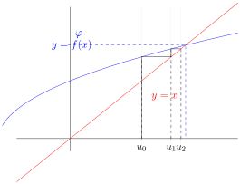
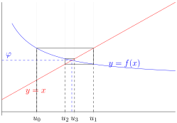

# 第 2 章　数列

Chapitre n°2 — Suites numériques

中法对照讲义 · 由 LaTeX 源文件渲染

!!! info "阅读说明"

    每段先列法语原文；其下缩进、带深蓝竖条的小字号段落为中文翻译。<strong>加粗</strong>为关键词，括号内为中文释义。

### Objectifs 学习目标

1. Connaître les suites usuelles.

    掌握常用数列。
    {: .zh }

1. Savoir étudier des suites numériques.

    会研究数列。
    {: .zh }

1. Déterminer la nature de suites réelles.

    会判定实数列的性质（nature）。
    {: .zh }

### Notations 记号

On rappelle que \(\mathbb{N}\) désigne l'ensemble des entiers <strong>naturels</strong>, \(\mathbb{Z}\) désigne l'ensemble des entiers <strong>relatifs</strong>, \(\mathbb{R}\) désigne l'ensemble des nombres <strong>réels</strong> et \(\mathbb{C}\) désigne l'ensemble des nombres <strong>complexes</strong>.

回忆：\(\mathbb{N}\) 表示<strong>自然数</strong>集，\(\mathbb{Z}\) 表示<strong>整数</strong>集（entiers relatifs）， \(\mathbb{R}\) 表示<strong>实数</strong>集，\(\mathbb{C}\) 表示<strong>复数</strong>集。
{: .zh }

Pour tout ce chapitre, \(\mathbb{K}\) désigne \(\mathbb{R}\) ou \(\mathbb{C}\) et on fixe un entier \(n_0 \in \mathbb{Z}\).

本章自始至终，\(\mathbb{K}\) 表示 \(\mathbb{R}\) 或 \(\mathbb{C}\)，并固定一个整数 \(n_0 \in \mathbb{Z}\)。
{: .zh }

## Suites usuelles 常用数列

!!! success "Définition 1.1 : suite numérique 定义 1.1：数列（suite numérique）"

    Une <strong>suite numérique</strong>, ou simplement <strong>suite</strong>, est une liste infinie de nombres de \(\mathbb{K}\) de la forme :

    一个<strong>数列</strong>（suite numérique，或简称 suite）是 \(\mathbb{K}\) 中一列无穷多个数，形如：
    {: .zh }

    \[
    u = (u_n)_{n\geqslant n_0} = \bigl(u_{n_0},\ u_{n_0+1},\ u_{n_0+2},\ u_{n_0+3},\ u_{n_0+4},\ u_{n_0+5},\ \dots\bigr).
    \]

    - \(n_0\) est un entier appelé l'<strong>indice initial</strong> ou le <strong>rang initial</strong>,

        \(n_0\) 是一个整数，称为<strong>起始下标</strong>（indice initial）或<strong>起始序号</strong>（rang initial）；
        {: .zh }

    - \(u_{n_0} \in \mathbb{K}\) est un nombre appelé le <strong>terme initial</strong> ou le <strong>premier terme</strong>,

        \(u_{n_0} \in \mathbb{K}\) 是一个数，称为<strong>首项</strong>（terme initial）或<strong>第一项</strong>（premier terme）；
        {: .zh }

    - \(\{n \in \mathbb{Z} \mid n \geqslant n_0\}\) est appelé l'ensemble des <strong>indices</strong> ou l'ensemble des <strong>rangs</strong>,

        \(\{n \in \mathbb{Z} \mid n \geqslant n_0\}\) 称为<strong>下标集</strong>（ensemble des indices）或<strong>序号集</strong>（ensemble des rangs）；
        {: .zh }

    - pour tout \(n \geqslant n_0\), \(u_n \in \mathbb{K}\) est un nombre appelé le terme d'<strong>indice</strong> \(n\) ou de <strong>rang</strong> \(n\).

        对任意 \(n \geqslant n_0\)，\(u_n \in \mathbb{K}\) 是数列 \(u\) 中<strong>下标</strong>为 \(n\) 的项（terme d'indice \(n\)），或称<strong>序号</strong>为 \(n\) 的项（terme de rang \(n\)）。
        {: .zh }

    Lorsque \(n_0 = 0\), on note \(\mathbb{K}^{\mathbb{N}} = \{(u_n)_{n\geqslant 0} \mid \forall n \in \mathbb{N},\ u_n \in \mathbb{K}\}\) l'ensemble des suites numériques.

    当 \(n_0 = 0\) 时，记 \(\mathbb{K}^{\mathbb{N}} = \{(u_n)_{n\geqslant 0} \mid \forall n \in \mathbb{N},\ u_n \in \mathbb{K}\}\) 为全体数列之集。
    {: .zh }

!!! warning "Remarque 注（Remarque）"

    - Une suite \((u_n)_{n\geqslant n_0}\) est donc une application \(u : \{n \in \mathbb{Z} \mid n \geqslant n_0\} \to \mathbb{K}\), \(n \mapsto u(n) = u_n\).

        因此，数列 \((u_n)_{n\geqslant n_0}\) 就是一个<strong>映射</strong> \(u : \{n \in \mathbb{Z} \mid n \geqslant n_0\} \to \mathbb{K}\)，\(n \mapsto u(n) = u_n\)。
        {: .zh }

    - Lorsqu'il n'y a pas d'ambiguïté, on note plus simplement \(u = (u_n)\).

        当不产生歧义时，简记为 \(u = (u_n)\)。
        {: .zh }

!!! warning "Attention 注意（Attention）"

    Ne pas confondre la <u>suite</u> \((u_n)\) et le <u>nombre</u> \(u_n\) !

    不要把<u>数列</u> \((u_n)\) 与<u>数</u> \(u_n\) 混为一谈！
    {: .zh }

!!! success "Définition 1.2 : suite constante, périodique, bornée 定义 1.2：常数列、周期数列、有界数列"

    Soit \((u_n)_{n\geqslant n_0}\) une suite.

    设 \((u_n)_{n\geqslant n_0}\) 是一个数列。
    {: .zh }

    - On dit que \((u_n)_{n\geqslant n_0}\) est <strong>constante</strong> lorsque tous ses termes sont égaux (au premier terme) :

        若各项都（与首项）相等，则称 \((u_n)_{n\geqslant n_0}\) 是<strong>常数列</strong>（constante）：
        {: .zh }

        \[
        \forall n \geqslant n_0,\ u_{n+1} = u_n.
        \]

    - On dit que \((u_n)_{n\geqslant n_0}\) est <strong>périodique</strong> lorsque :

        若满足下述条件，则称 \((u_n)_{n\geqslant n_0}\) 是<strong>周期数列</strong>（périodique）：
        {: .zh }

        \[
        \exists p \in \mathbb{N}^*,\ \forall n \geqslant n_0,\ u_{n+p} = u_n.
        \]

        On dit aussi que \((u_n)_{n\geqslant n_0}\) est <strong>\(p\)-périodique</strong>. Le plus petit entier \(p \in \mathbb{N}^*\) vérifiant cette propriété est appelé la <strong>période</strong> de la suite.

        也称 \((u_n)_{n\geqslant n_0}\) 是 <strong>\(p\)-周期的</strong>（\(p\)-périodique）。满足该性质的最小整数 \(p \in \mathbb{N}^*\) 称为该数列的<strong>周期</strong>（période）。
        {: .zh }

    - On dit que \((u_n)_{n\geqslant n_0}\) est <strong>bornée</strong> lorsque :

        若满足下述条件，则称 \((u_n)_{n\geqslant n_0}\) 是<strong>有界数列</strong>（bornée）：
        {: .zh }

        \[
        \exists R \in \mathbb{R}_+,\ \forall n \geqslant n_0,\ |u_n| \leqslant R.
        \]

!!! danger "Propriété 1.3 性质 1.3"

    Soit \((u_n)_{n\geqslant n_0}\) une suite. Alors :

    设 \((u_n)_{n\geqslant n_0}\) 是一个数列。则：
    {: .zh }

    \[
    (u_n)_{n\geqslant n_0} \text{ est constante} \implies (u_n)_{n\geqslant n_0} \text{ est périodique} \implies (u_n)_{n\geqslant n_0} \text{ est bornée.}
    \]

!!! demo ""

    <strong>Démonstration.</strong> La première implication est vraie car les suites 1-périodiques sont les suites constantes. Pour la deuxième implication, si \((u_n)_{n\geqslant n_0}\) est périodique de période \(p \in \mathbb{N}^*\), alors il suffit de poser :

    <strong>证明.</strong> 第一个蕴含式成立，因为 1-周期的数列就是常数列。对于第二个蕴含式，若 \((u_n)_{n\geqslant n_0}\) 是以 \(p \in \mathbb{N}^*\) 为周期的周期数列，则只需取：
    {: .zh }

    \[
    R = \max\bigl\{|u_{n_0}|,\ |u_{n_0+1}|,\ |u_{n_0+2}|,\ \dots,\ |u_{n_0+p-1}|\bigr\}.
    \]

    
∎

!!! success "Définition 1.4 : suite arithmétique 定义 1.4：等差数列（suite arithmétique）"

    Une <strong>suite arithmétique</strong> \((u_n)_{n\geqslant n_0}\) de <strong>raison</strong> \(r \in \mathbb{K}\) est une suite définie par la donnée de son premier terme \(u_{n_0} \in \mathbb{K}\) et d'une <strong>relation de récurrence</strong> de la forme :

    <strong>等差数列</strong> \((u_n)_{n\geqslant n_0}\) 的<strong>公差</strong>（raison）为 \(r \in \mathbb{K}\)，它由给定的首项 \(u_{n_0} \in \mathbb{K}\) 和如下<strong>递推关系式</strong>（relation de récurrence）定义：
    {: .zh }

    \[
    \forall n \geqslant n_0,\ u_{n+1} = u_n + r.
    \]

En particulier, les seules suites arithmétiques bornées sont les suites constantes (de raison nulle).

特别地，唯一有界的等差数列是常数列（公差为零）。
{: .zh }

!!! danger "Propriété 1.5 : terme général d'une suite arithmétique 性质 1.5：等差数列的通项公式"

    Soit \((u_n)_{n\geqslant n_0}\) une suite arithmétique de raison \(r \in \mathbb{K}\). Alors :

    设 \((u_n)_{n\geqslant n_0}\) 是公差为 \(r \in \mathbb{K}\) 的等差数列。则：
    {: .zh }

    \[
    \forall n \geqslant n_0,\ u_n = u_{n_0} + (n-n_0)r.
    \]

!!! success "Définition 1.6 : suite géométrique 定义 1.6：等比数列（suite géométrique）"

    Une <strong>suite géométrique</strong> \((u_n)_{n\geqslant n_0}\) de <strong>raison</strong> \(q \in \mathbb{K}\) est une suite définie par la donnée de son premier terme \(u_{n_0} \in \mathbb{K}\) et d'une relation de récurrence de la forme :

    <strong>等比数列</strong> \((u_n)_{n\geqslant n_0}\) 的<strong>公比</strong>（raison）为 \(q \in \mathbb{K}\)，它由给定的首项 \(u_{n_0} \in \mathbb{K}\) 和如下递推关系式定义：
    {: .zh }

    \[
    \forall n \geqslant n_0,\ u_{n+1} = qu_n.
    \]

En particulier, si \((u_n)_{n\geqslant n_0}\) est une suite géométrique de raison \(q \in \mathbb{K}\), alors :

特别地，若 \((u_n)_{n\geqslant n_0}\) 是公比为 \(q \in \mathbb{K}\) 的等比数列，则：
{: .zh }

\[
(u_n)_{n\geqslant n_0} \text{ est bornée} \iff \bigl(u_{n_0} = 0 \quad\text{ou}\quad |q| \leqslant 1\bigr).
\]

!!! danger "Propriété 1.7 : terme général d'une suite géométrique 性质 1.7：等比数列的通项公式"

    Soit \((u_n)_{n\geqslant n_0}\) une suite géométrique de raison \(q \in \mathbb{K}\). Alors :

    设 \((u_n)_{n\geqslant n_0}\) 是公比为 \(q \in \mathbb{K}\) 的等比数列。则：
    {: .zh }

    \[
    \forall n \geqslant n_0,\ u_n = u_{n_0}q^{n-n_0}.
    \]

!!! info "Exemple 1.8 例 1.8"

    Soit \((r,q) \in \mathbb{K}^2\). On considère une suite \((u_n)_{n\geqslant n_0}\) qui vérifie la relation de récurrence :

    设 \((r,q) \in \mathbb{K}^2\)。考虑满足下述递推关系的数列 \((u_n)_{n\geqslant n_0}\)：
    {: .zh }

    \[
    \forall n \geqslant n_0,\ u_{n+1} = qu_n + r.
    \]

    Une telle suite est dite <strong>arithmético-géométrique</strong>.

    这样的数列称为<strong>等差等比数列</strong>（arithmético-géométrique，即一阶线性非齐次递推数列）。
    {: .zh }

    - Si \(q = 1\), on reconnaît une suite arithmétique de raison \(r\), donc :

        若 \(q = 1\)，可辨认出这是公差为 \(r\) 的等差数列，于是：
        {: .zh }

        \[
        \forall n \geqslant n_0,\ u_n = u_{n_0} + (n-n_0)r.
        \]

    - Si \(q \neq 1\), on remarque que l'équation \(\alpha = q\alpha + r\) d'inconnue \(\alpha \in \mathbb{K}\) admet une <strong>unique solution</strong> notée \(\alpha = \frac{r}{1-q}\). Par conséquent, la <strong>suite auxiliaire</strong> \((w_n = u_n-\alpha)_{n\geqslant n_0}\) vérifie :

        若 \(q \neq 1\)，注意到以 \(\alpha \in \mathbb{K}\) 为未知数的方程 \(\alpha = q\alpha + r\) 有<strong>唯一解</strong>，记为 \(\alpha = \frac{r}{1-q}\)。因此，<strong>辅助数列</strong>（suite auxiliaire）\((w_n = u_n-\alpha)_{n\geqslant n_0}\) 满足：
        {: .zh }

        \[
        \forall n \geqslant n_0,\ w_{n+1} = u_{n+1}-\alpha = (qu_n+r)-(q\alpha+r) = q(u_n-\alpha) = qw_n.
        \]

        On reconnaît une suite géométrique de raison \(q\), donc :

        可辨认出这是公比为 \(q\) 的等比数列，于是：
        {: .zh }

        \[
        \forall n \geqslant n_0,\ u_n = w_n + \alpha = w_{n_0}q^{n-n_0} + \alpha = (u_{n_0}-\alpha)q^{n-n_0} + \alpha
        \]

!!! danger "Théorème 1.9 : terme général d'une suite réelle récurrente linéaire d'ordre 2 定理 1.9：二阶线性递推实数列的通项公式"

    On considère une suite réelle \((u_n)_{n\geqslant n_0}\) qui vérifie la relation de récurrence :

    考虑满足下述递推关系的实数列 \((u_n)_{n\geqslant n_0}\)：
    {: .zh }

    \[
    \forall n \geqslant n_0,\ u_{n+2} = au_{n+1} + bu_n
    \]

    où \((a,b) \in \mathbb{R}^2\) et \(b \neq 0\). On distingue trois cas selon le signe du discriminant \(\Delta = a^2+4b\) de l'<strong>équation caractéristique</strong> \(q^2 = aq+b\) d'inconnue \(q \in \mathbb{C}\).

    其中 \((a,b) \in \mathbb{R}^2\) 且 \(b \neq 0\)。按<strong>特征方程</strong>（équation caractéristique）\(q^2 = aq+b\)（未知数 \(q \in \mathbb{C}\)）的<strong>判别式</strong> \(\Delta = a^2+4b\) 的符号分三种情形讨论。
    {: .zh }

    - Si \(\Delta > 0\), l'équation caractéristique admet deux solutions réelles notées \(q_1\) et \(q_2\). Alors il existe deux constantes \((\lambda_1,\lambda_2) \in \mathbb{R}^2\) telles que :

        若 \(\Delta > 0\)，特征方程有两个实根，记为 \(q_1\) 与 \(q_2\)。则存在两个常数 \((\lambda_1,\lambda_2) \in \mathbb{R}^2\) 使得：
        {: .zh }

        \[
        \forall n \geqslant n_0,\ u_n = \lambda_1 q_1^{n-n_0} + \lambda_2 q_2^{n-n_0}.
        \]

    - Si \(\Delta = 0\), l'équation caractéristique admet une seule solution réelle notée \(q_0\). Alors il existe deux constantes \((\lambda,\mu) \in \mathbb{R}^2\) telles que :

        若 \(\Delta = 0\)，特征方程只有一个实根，记为 \(q_0\)。则存在两个常数 \((\lambda,\mu) \in \mathbb{R}^2\) 使得：
        {: .zh }

        \[
        \forall n \geqslant n_0,\ u_n = \bigl(\lambda + \mu(n-n_0)\bigr)q_0^{n-n_0}.
        \]

    - Si \(\Delta < 0\), l'équation caractéristique admet deux solutions complexes conjuguées notées \(\rho e^{i\theta}\) et \(\rho e^{-i\theta}\). Alors il existe deux constantes \((A,B) \in \mathbb{R}^2\) telles que :

        若 \(\Delta < 0\)，特征方程有两个共轭复根，记为 \(\rho e^{i\theta}\) 与 \(\rho e^{-i\theta}\)。则存在两个常数 \((A,B) \in \mathbb{R}^2\) 使得：
        {: .zh }

        \[
        \forall n \geqslant n_0,\ u_n = \rho^{n-n_0}\bigl(A\cos\bigl((n-n_0)\theta\bigr) + B\sin\bigl((n-n_0)\theta\bigr)\bigr).
        \]

Dans les trois cas, on peut déterminer les constantes à l'aide des premiers termes \(u_{n_0}\) et \(u_{n_0+1}\).

三种情形下，都可利用前两项 \(u_{n_0}\) 与 \(u_{n_0+1}\) 确定这些常数。
{: .zh }

!!! info "Exemple 1.10 例 1.10"

    - La suite de Fibonacci \((F_n)_{n\geqslant 1} = (1,1,2,3,5,8,13,21,\dots)\) est définie par \(F_1 = F_2 = 1\) et la relation de récurrence \(\forall n \geqslant 1\), \(F_{n+2} = F_{n+1}+F_n\). On reconnaît une suite réelle récurrente linéaire d'ordre 2. Son équation caractéristique \(q^2-q-1 = 0\) admet deux solutions réelles : \(q_1 = \frac{1+\sqrt{5}}{2} = \phi\) (appelé le <strong>nombre d'or</strong>) et \(q_2 = \frac{1-\sqrt{5}}{2} = -1/\phi\). Par conséquent, il existe deux constantes \((\lambda_1,\lambda_2) \in \mathbb{R}^2\) telles que :

        斐波那契数列 \((F_n)_{n\geqslant 1} = (1,1,2,3,5,8,13,21,\dots)\) 由 \(F_1 = F_2 = 1\) 及递推关系 \(\forall n \geqslant 1\)，\(F_{n+2} = F_{n+1}+F_n\) 定义。可辨认出这是二阶线性递推实数列。其特征方程 \(q^2-q-1 = 0\) 有两个实根：\(q_1 = \frac{1+\sqrt{5}}{2} = \phi\)（称为<strong>黄金数</strong>，nombre d'or）与 \(q_2 = \frac{1-\sqrt{5}}{2} = -1/\phi\)。因此，存在两个常数 \((\lambda_1,\lambda_2) \in \mathbb{R}^2\) 使得：
        {: .zh }

        \[
        \forall n \geqslant 1,\ F_n = \lambda_1\phi^{n-1} + \frac{\lambda_2}{(-\phi)^{n-1}}.
        \]

        En particulier, pour \(n = 1\) et \(n = 2\), on obtient :

        特别地，取 \(n = 1\) 与 \(n = 2\)，得到：
        {: .zh }

        \[
        \begin{cases}
        1 = \lambda_1 + \lambda_2 \\[2pt]
        1 = \phi\lambda_1 - \dfrac{\lambda_2}{\phi}
        \end{cases}
        \qquad\text{donc}\qquad
        \begin{cases}
        \lambda_1 = \dfrac{\frac{1}{\phi}+1}{\frac{1}{\phi}+\phi} = \dfrac{\phi}{\sqrt{5}} \\[10pt]
        \lambda_2 = \dfrac{\phi-1}{\phi+\frac{1}{\phi}} = \dfrac{1}{\phi\sqrt{5}}
        \end{cases}
        \]

        Finalement :

        最终：
        {: .zh }

        \[
        \forall n \geqslant 1,\ F_n = \frac{\sqrt{5}}{5}\left(\phi^n - \frac{1}{(-\phi)^n}\right).
        \]

    - On considère la suite \((u_n)_{n\geqslant 0}\) définie par \(u_0 = 2\), \(u_1 = 3\) et la relation de récurrence \(\forall n \geqslant 0\), \(u_{n+2} = u_{n+1}-u_n\). On reconnaît une suite réelle récurrente linéaire d'ordre 2. Son équation caractéristique \(q^2-q+1 = 0\) admet deux solutions complexes conjuguées : \(\frac{1\pm i\sqrt{3}}{2} = e^{\pm i\pi/3}\). Par conséquent, il existe deux constantes \((A,B) \in \mathbb{R}^2\) telles que :

        考虑由 \(u_0 = 2\)、\(u_1 = 3\) 及递推关系 \(\forall n \geqslant 0\)，\(u_{n+2} = u_{n+1}-u_n\) 定义的数列 \((u_n)_{n\geqslant 0}\)。可辨认出这是二阶线性递推实数列。其特征方程 \(q^2-q+1 = 0\) 有两个共轭复根：\(\frac{1\pm i\sqrt{3}}{2} = e^{\pm i\pi/3}\)。因此，存在两个常数 \((A,B) \in \mathbb{R}^2\) 使得：
        {: .zh }

        \[
        \forall n \geqslant 0,\ u_n = 1^n\left(A\cos\left(\frac{n\pi}{3}\right) + B\sin\left(\frac{n\pi}{3}\right)\right).
        \]

        En particulier, pour \(n = 0\) et \(n = 1\), on obtient :

        特别地，取 \(n = 0\) 与 \(n = 1\)，得到：
        {: .zh }

        \[
        \begin{cases}
        2 = A \\[2pt]
        3 = \dfrac{A}{2} + \dfrac{B\sqrt{3}}{2}
        \end{cases}
        \qquad\text{donc}\qquad
        B = \frac{2}{\sqrt{3}}\left(3 - \frac{2}{2}\right) = \frac{4\sqrt{3}}{3}.
        \]

        Finalement :

        最终：
        {: .zh }

        \[
        \forall n \geqslant 0,\ u_n = 2\cos\left(\frac{n\pi}{3}\right) + \frac{4\sqrt{3}}{3}\sin\left(\frac{n\pi}{3}\right).
        \]

        En particulier, \((u_n)_{n\geqslant 0}\) est 6-périodique.

        特别地，\((u_n)_{n\geqslant 0}\) 是 6-周期的。
        {: .zh }

!!! warning "Vocabulaire clé &nbsp;&nbsp; 重点词汇 第一节核心术语"

    - <strong>suite numérique</strong>：数列
    - <strong>indice initial / rang initial</strong>：起始下标 / 起始序号
    - <strong>terme initial / premier terme</strong>：首项 / 第一项
    - <strong>terme d'indice \(n\) / de rang \(n\)</strong>：第 \(n\) 项（下标为 \(n\) 的项）
    - <strong>terme général</strong>：通项（公式）
    - <strong>suite constante</strong>：常数列
    - <strong>suite périodique；période</strong>：周期数列；周期
    - <strong>suite bornée</strong>：有界数列
    - <strong>suite arithmétique；raison</strong>：等差数列；公差
    - <strong>suite géométrique；raison</strong>：等比数列；公比
    - <strong>relation de récurrence</strong>：递推关系式
    - <strong>arithmético-géométrique</strong>：等差等比数列（一阶线性非齐次递推数列）
    - <strong>suite auxiliaire</strong>：辅助数列
    - <strong>équation caractéristique</strong>：特征方程
    - <strong>discriminant</strong>：判别式
    - <strong>nombre d'or \(\phi\)</strong>：黄金数 \(\phi\)
    - <strong>vérifier</strong>：满足（方程、关系）；验证 —— 数学高频词
    - <strong>admettre une unique solution</strong>：有唯一解
    - <strong>on reconnaît…</strong>：可辨认出……（解题套语）

## Suites réelles 实数列

Dans cette section, on considère seulement des <strong>suites réelles</strong>, c'est-à-dire \(\mathbb{K} = \mathbb{R}\).

本节只考虑<strong>实数列</strong>，即 \(\mathbb{K} = \mathbb{R}\)。
{: .zh }

!!! success "Définition 2.1 : suite majorée, minorée 定义 2.1：有上界的数列、有下界的数列"

    Soit \((u_n)_{n\geqslant n_0}\) une suite réelle.

    设 \((u_n)_{n\geqslant n_0}\) 是一个实数列。
    {: .zh }

    - On dit qu'un nombre réel \(M \in \mathbb{R}\) est un <strong>majorant</strong> de \((u_n)_{n\geqslant n_0}\) lorsque :

        若实数 \(M \in \mathbb{R}\) 满足下述条件，则称 \(M\) 为 \((u_n)_{n\geqslant n_0}\) 的一个<strong>上界</strong>（majorant）：
        {: .zh }

        \[
        \forall n \geqslant n_0,\ u_n \leqslant M.
        \]

        Si \((u_n)_{n\geqslant n_0}\) admet au moins un majorant, on dit que \((u_n)_{n\geqslant n_0}\) est <strong>majorée</strong>.

        若 \((u_n)_{n\geqslant n_0}\) 至少有一个上界，则称 \((u_n)_{n\geqslant n_0}\) <strong>有上界</strong>（majorée）。
        {: .zh }

    - On dit qu'un nombre réel \(m \in \mathbb{R}\) est un <strong>minorant</strong> de \((u_n)_{n\geqslant n_0}\) lorsque :

        若实数 \(m \in \mathbb{R}\) 满足下述条件，则称 \(m\) 为 \((u_n)_{n\geqslant n_0}\) 的一个<strong>下界</strong>（minorant）：
        {: .zh }

        \[
        \forall n \geqslant n_0,\ u_n \geqslant m.
        \]

        Si \((u_n)_{n\geqslant n_0}\) admet au moins un minorant, on dit que \((u_n)_{n\geqslant n_0}\) est <strong>minorée</strong>.

        若 \((u_n)_{n\geqslant n_0}\) 至少有一个下界，则称 \((u_n)_{n\geqslant n_0}\) <strong>有下界</strong>（minorée）。
        {: .zh }

!!! danger "Propriété 2.2 性质 2.2"

    Soit \((u_n)_{n\geqslant n_0}\) une suite réelle. Alors :

    设 \((u_n)_{n\geqslant n_0}\) 是一个实数列。则：
    {: .zh }

    \[
    (u_n)_{n\geqslant n_0} \text{ est bornée} \iff (u_n)_{n\geqslant n_0} \text{ est majorée et minorée.}
    \]

!!! demo ""

    <strong>Démonstration.</strong>

    <strong>证明.</strong>
    {: .zh }

    \(\Rightarrow\) Si \(\exists R \in \mathbb{R}_+\), \(\forall n \geqslant n_0\), \(|u_n| \leqslant R\), alors il suffit de poser \(M = R\) et \(m = -R\).

    \(\Rightarrow\) 若 \(\exists R \in \mathbb{R}_+\)，\(\forall n \geqslant n_0\)，\(|u_n| \leqslant R\)，则只需取 \(M = R\)，\(m = -R\)。
    {: .zh }

    \(\Leftarrow\) Si \(\exists (m,M) \in \mathbb{R}^2\), \(\forall n \geqslant n_0\), \(m \leqslant u_n \leqslant M\), alors il suffit de poser \(R = \max\{-m, M\}\).

    \(\Leftarrow\) 若 \(\exists (m,M) \in \mathbb{R}^2\)，\(\forall n \geqslant n_0\)，\(m \leqslant u_n \leqslant M\)，则只需取 \(R = \max\{-m, M\}\)。
    {: .zh }

    
∎

!!! success "Définition 2.3 : suite croissante, décroissante 定义 2.3：递增数列、递减数列"

    Soit \((u_n)_{n\geqslant n_0}\) une suite réelle.

    设 \((u_n)_{n\geqslant n_0}\) 是一个实数列。
    {: .zh }

    - On dit que \((u_n)_{n\geqslant n_0}\) est <strong>croissante</strong> (respectivement <strong>strictement croissante</strong>) lorsque :

        若满足下述条件，则称 \((u_n)_{n\geqslant n_0}\) 是<strong>递增的</strong>（croissante，相应地<strong>严格递增的</strong>）：
        {: .zh }

        \[
        \forall n \geqslant n_0,\ u_{n+1} \geqslant u_n \quad (\text{respectivement } u_{n+1} > u_n).
        \]

    - On dit que \((u_n)_{n\geqslant n_0}\) est <strong>décroissante</strong> (respectivement <strong>strictement décroissante</strong>) lorsque :

        若满足下述条件，则称 \((u_n)_{n\geqslant n_0}\) 是<strong>递减的</strong>（décroissante，相应地<strong>严格递减的</strong>）：
        {: .zh }

        \[
        \forall n \geqslant n_0,\ u_{n+1} \leqslant u_n \quad (\text{respectivement } u_{n+1} < u_n).
        \]

    - On dit que \((u_n)_{n\geqslant n_0}\) est <strong>monotone</strong> (respectivement <strong>strictement monotone</strong>) lorsque \((u_n)_{n\geqslant n_0}\) est croissante ou décroissante (respectivement strictement croissante ou strictement décroissante).

        若 \((u_n)_{n\geqslant n_0}\) 递增或递减（相应地严格递增或严格递减），则称它是<strong>单调的</strong>（monotone，相应地<strong>严格单调的</strong>）。
        {: .zh }

!!! info "Exemple 2.4 例 2.4"

    - Les seules suites croissantes et décroissantes sont les suites constantes.

        既递增又递减的数列只有常数列。
        {: .zh }

    - La suite 2-périodique \(((-1)^n)_{n\geqslant 0}\) n'est pas monotone.

        2-周期数列 \(((-1)^n)_{n\geqslant 0}\) 不是单调的。
        {: .zh }

    - Toute suite réelle arithmétique de raison \(r > 0\) (respectivement \(r < 0\)) est strictement croissante (respectivement strictement décroissante).

        任何公差 \(r > 0\)（相应地 \(r < 0\)）的实等差数列都是严格递增（相应地严格递减）的。
        {: .zh }

    - Soit \(q \in \mathbb{R}^*\). La suite géométrique \((q^n)_{n\geqslant 0}\) est strictement croissante si \(q > 1\), constante si \(q = 1\), strictement décroissante si \(q \in ]0,1[\) et non monotone si \(q < 0\).

        设 \(q \in \mathbb{R}^*\)。等比数列 \((q^n)_{n\geqslant 0}\)：当 \(q > 1\) 时严格递增；当 \(q = 1\) 时为常数列；当 \(q \in ]0,1[\) 时严格递减；当 \(q < 0\) 时不单调。
        {: .zh }

!!! info "Exemple 2.5 例 2.5"

    On considère la suite \((u_n)_{n\geqslant 0}\) définie par \(u_0 = 1\) et \(\forall n \geqslant 0\), \(u_{n+1} = \sqrt{1+u_n}\). On pose la fonction \(f : x \mapsto \sqrt{1+x}\) afin que la relation de récurrence soit de la forme \(\forall n \geqslant 0\), \(u_{n+1} = f(u_n)\). La fonction \(f\) est définie et strictement croissante sur \([-1,+\infty[\). De plus, on peut montrer que :

    考虑由 \(u_0 = 1\) 及 \(\forall n \geqslant 0\)，\(u_{n+1} = \sqrt{1+u_n}\) 定义的数列 \((u_n)_{n\geqslant 0}\)。令函数 \(f : x \mapsto \sqrt{1+x}\)，使递推关系写成 \(\forall n \geqslant 0\)，\(u_{n+1} = f(u_n)\) 的形式。函数 \(f\) 在 \([-1,+\infty[\) 上有定义且严格递增。此外，可以证明：
    {: .zh }

    \[
    \forall x \in [-1,+\infty[,\quad
    \begin{cases}
    f(x) > x & \text{si } x \in [-1,\phi[,\\
    f(x) = x & \text{si } x = \phi,\\
    f(x) < x & \text{si } x > \phi,
    \end{cases}
    \qquad\text{où } \phi = \frac{1+\sqrt{5}}{2} \text{ (le nombre d'or).}
    \]

    On peut alors tracer sur un même graphique : la droite d'équation \(y = x\), la courbe représentative de \(f\) et les premiers termes de \((u_n)_{n\geqslant 0}\).

    于是可以在同一张图上画出：直线 \(y = x\)、\(f\) 的图像以及 \((u_n)_{n\geqslant 0}\) 的前几项。
    {: .zh }

    

    On conjecture que \((u_n)_{n\geqslant 0}\) est bornée et strictement croissante. Plus précisément, on va montrer par récurrence que :

    猜测 \((u_n)_{n\geqslant 0}\) 有界且严格递增。更确切地说，我们用归纳法证明：
    {: .zh }

    \[
    \forall n \geqslant 0,\quad 1 \leqslant u_n < u_{n+1} < \phi.
    \]

    - <u>Initialisation.</u> On a \(u_0 = 1\) et \(u_1 = \sqrt{2}\). Or \(1 < \sqrt{2}\), et \(\phi = \frac{1+\sqrt{5}}{2} > \frac{1+\sqrt{1}}{2} = 1\) donc \(\phi = \sqrt{1+\phi} > \sqrt{1+1} = \sqrt{2}\). Ainsi, le résultat est vrai pour \(n = 0\) : \(1 \leqslant u_0 < u_1 < \phi\).

        <u>初始步.</u> 有 \(u_0 = 1\)，\(u_1 = \sqrt{2}\)。因为 \(1 < \sqrt{2}\)，且 \(\phi = \frac{1+\sqrt{5}}{2} > \frac{1+\sqrt{1}}{2} = 1\)，所以 \(\phi = \sqrt{1+\phi} > \sqrt{1+1} = \sqrt{2}\)。因此，结论对 \(n = 0\) 成立：\(1 \leqslant u_0 < u_1 < \phi\)。
        {: .zh }

    - <u>Hérédité.</u> On suppose que \(1 \leqslant u_n < u_{n+1} < \phi\) est vrai pour un rang \(n \geqslant 0\) fixé. Puisque \(f\) est strictement croissante, on en déduit que :

        <u>归纳步.</u> 设结论对某个固定的 \(n \geqslant 0\) 成立，即 \(1 \leqslant u_n < u_{n+1} < \phi\)。由于 \(f\) 严格递增，可得：
        {: .zh }

        \[
        1 < \underbrace{f(1)}_{=\sqrt{2}} \leqslant \underbrace{f(u_n)}_{=u_{n+1}}
          < \underbrace{f(u_{n+1})}_{=u_{n+2}} < \underbrace{f(\phi)}_{=\phi}.
        \]

        Ainsi, le résultat est vrai aussi au rang \(n+1\).

        因此，结论对 \(n+1\) 也成立。
        {: .zh }

    - <u>Conclusion.</u> D'après le principe de récurrence, le résultat est vrai pour tout rang \(n \geqslant 0\). En particulier, on a montré que \((u_n)_{n\geqslant 0}\) est bornée et strictement croissante.

        <u>结论.</u> 由归纳法原理，结论对一切 \(n \geqslant 0\) 成立。特别地，我们证明了 \((u_n)_{n\geqslant 0}\) 有界且严格递增。
        {: .zh }

!!! warning "Important 重要（Important）"

    Plus généralement, pour étudier une suite \((u_n)_{n\geqslant n_0}\) définie par une relation de récurrence de la forme \(\forall n \geqslant n_0\), \(u_{n+1} = f(u_n)\), on peut :

    更一般地，研究由 \(\forall n \geqslant n_0\)，\(u_{n+1} = f(u_n)\) 这种递推关系定义的数列 \((u_n)_{n\geqslant n_0}\) 时，可以：
    {: .zh }

    - étudier les variations de \(f\) et le signe de la fonction \(x \mapsto f(x)-x\),

        研究 \(f\) 的单调性以及函数 \(x \mapsto f(x)-x\) 的符号，
        {: .zh }

    - tracer sur un même graphique la droite d'équation \(y = x\), la courbe représentative de \(f\) et les premiers termes de \((u_n)_{n\geqslant n_0}\),

        在同一张图上画直线 \(y = x\)、\(f\) 的图像以及 \((u_n)_{n\geqslant n_0}\) 的前几项，
        {: .zh }

    - conjecturer des propriétés de \((u_n)_{n\geqslant n_0}\) puis les démontrer par récurrence.

        猜想 \((u_n)_{n\geqslant n_0}\) 的性质，再用归纳法证明。
        {: .zh }

!!! warning "Vocabulaire clé &nbsp;&nbsp; 重点词汇 第二节核心术语"

    - <strong>suite réelle</strong>：实数列
    - <strong>majorant / minorant</strong>：上界 / 下界
    - <strong>suite majorée / minorée</strong>：有上界的数列 / 有下界的数列
    - <strong>suite bornée</strong>：有界数列（既有上界又有下界）
    - <strong>croissante / décroissante</strong>：递增的 / 递减的
    - <strong>strictement croissante / strictement décroissante</strong>：严格递增的 / 严格递减的
    - <strong>monotone</strong>：单调的
    - <strong>suite définie par récurrence</strong>：递推定义的数列
    - <strong>conjecturer</strong>：猜想
    - <strong>démontrer par récurrence</strong>：用归纳法证明
    - <strong>principe de récurrence</strong>：归纳法原理
    - <strong>initialisation / hérédité / conclusion</strong>：初始步 / 归纳步 / 结论
    - <strong>la nature d'une suite</strong>：数列的性质（敛散性等）
    - <strong>étudier une suite</strong>：研究一个数列（单调性、有界性、极限）

## Suites convergentes 收敛数列

!!! success "Définition 3.1 : suite convergente 定义 3.1：收敛数列（suite convergente）"

    Une suite \((u_n)_{n\geqslant n_0}\) est dite <strong>convergente</strong> lorsque :

    \[
    \exists \ell \in \mathbb{K},\ \forall \varepsilon > 0,\ \exists N \geqslant n_0,\ \forall n \geqslant N,\ |u_n-\ell| < \varepsilon.
    \]

    若存在 \(\ell \in \mathbb{K}\)，使得对任意 \(\varepsilon > 0\)，都存在 \(N \geqslant n_0\)，当 \(n \geqslant N\) 时都有 \(|u_n-\ell| < \varepsilon\)，则称数列 \((u_n)_{n\geqslant n_0}\) 是<strong>收敛的</strong>（convergente）。
    {: .zh }

    Autrement dit, \((u_n)_{n\geqslant n_0}\) est convergente s'il existe un nombre \(\ell\) tel que tout voisinage de \(\ell\) contient tous les termes de \((u_n)_{n\geqslant n_0}\) à partir d'un certain rang.

    换言之，若存在数 \(\ell\)，使得 \(\ell\) 的每个<strong>邻域</strong>（voisinage）都包含 \((u_n)_{n\geqslant n_0}\) 从某一项起的所有项，则 \((u_n)_{n\geqslant n_0}\) 收敛。
    {: .zh }

!!! info "Exemple 3.2 例 3.2"

    Soit \(\varepsilon > 0\). On a :

    \[
    \forall n \in \mathbb{N}^*,\quad \left|\frac{n+1}{n}-1\right| = \frac{1}{n} < \varepsilon
    \iff n > \frac{1}{\varepsilon}.
    \]

    设 \(\varepsilon > 0\)。有：
    {: .zh }

    Ainsi, en posant \(\ell = 1\) et \(N = \left\lfloor \frac{1}{\varepsilon} \right\rfloor + 1 \in \mathbb{N}^*\), on a montré que \(\left(\frac{n+1}{n}\right)_{n\geqslant 1}\) est convergente.

    于是，取 \(\ell = 1\)、\(N = \left\lfloor \frac{1}{\varepsilon} \right\rfloor + 1 \in \mathbb{N}^*\)，就证明了 \(\left(\frac{n+1}{n}\right)_{n\geqslant 1}\) 收敛。
    {: .zh }

!!! warning "Important 重要（Important）"

    En général, \(N\) dépend de \(\varepsilon\) : plus \(\varepsilon\) est proche de \(0\), plus il faut aller loin dans la suite pour que tous les termes soient à une distance de \(\ell\) inférieure à \(\varepsilon\).

    一般来说，\(N\) 依赖于 \(\varepsilon\)：\(\varepsilon\) 越接近 \(0\)，就需要在数列中走得越远，才能使从某一项起的所有项与 \(\ell\) 的距离都小于 \(\varepsilon\)。
    {: .zh }

!!! warning "Attention 注意（Attention）"

    Par contre, \(\ell\) ne dépend pas de \(n\) !

    但 \(\ell\) 并不依赖于 \(n\)！
    {: .zh }

!!! danger "Théorème 3.3 : unicité de la limite 定理 3.3：极限的唯一性"

    Soit \((u_n)_{n\geqslant n_0}\) une suite convergente. Alors le nombre \(\ell\) de la définition 3.1 est unique. On l'appelle la <strong>limite</strong> de \((u_n)_{n\geqslant n_0}\). On dit aussi que \((u_n)_{n\geqslant n_0}\) <strong>converge vers</strong> \(\ell\) ou que \(u_n\) <strong>tend vers</strong> \(\ell\) quand \(n\) tend vers \(+\infty\), et on note :

    设 \((u_n)_{n\geqslant n_0}\) 是收敛数列。则定义 3.1 中的数 \(\ell\) 是唯一的，称它为 \((u_n)_{n\geqslant n_0}\) 的<strong>极限</strong>（limite）。也说 \((u_n)_{n\geqslant n_0}\) <strong>收敛于</strong> \(\ell\)，或当 \(n\) 趋于 \(+\infty\) 时 \(u_n\) <strong>趋于</strong> \(\ell\)，并记作：
    {: .zh }

    \[
    \ell = \lim_{n\to+\infty} u_n.
    \]

!!! demo ""

    <strong>Démonstration.</strong> Par l'absurde, on suppose qu'il existe deux nombres \(\ell_1 \neq \ell_2\) tels que :

    \[
    \begin{cases}
    \forall \varepsilon > 0,\ \exists N_1 \geqslant n_0,\ \forall n \geqslant N_1,\ |u_n-\ell_1| < \varepsilon,\\[2pt]
    \forall \varepsilon > 0,\ \exists N_2 \geqslant n_0,\ \forall n \geqslant N_2,\ |u_n-\ell_2| < \varepsilon.
    \end{cases}
    \]

    <strong>证明.</strong> 用反证法，假设存在两个数 \(\ell_1 \neq \ell_2\) 使得：
    {: .zh }

    !!! warning "Attention 注意（Attention）"

        Le rang \(N\) pour \(\ell_1\) n'est pas nécessairement égal au rang \(N\) pour \(\ell_2\) !

        对应于 \(\ell_1\) 的序号 \(N\) 不一定等于对应于 \(\ell_2\) 的序号 \(N\)！
        {: .zh }

    Il suffit de choisir \(\varepsilon > 0\) afin que \(\varepsilon < \frac{|\ell_2-\ell_1|}{2}\), par exemple \(\varepsilon = \frac{|\ell_2-\ell_1|}{3}\). En effet, on a alors, pour tout \(n \geqslant \max\{N_1,N_2\}\), d'après l'inégalité triangulaire :

    只需选取 \(\varepsilon > 0\) 使 \(\varepsilon < \frac{|\ell_2-\ell_1|}{2}\)，例如取 \(\varepsilon = \frac{|\ell_2-\ell_1|}{3}\)。事实上，此时对一切 \(n \geqslant \max\{N_1,N_2\}\)，由三角不等式有：
    {: .zh }

    \[
    |\ell_2-\ell_1| = \bigl|-(u_n-\ell_2)+u_n-\ell_1\bigr| \leqslant |u_n-\ell_2|+|u_n-\ell_1| < 2\varepsilon = \frac{2}{3}|\ell_2-\ell_1|
    \]

    ce qui est absurde car \(|\ell_2-\ell_1| > 0\).

    这与 \(|\ell_2-\ell_1| > 0\) 矛盾，故为荒谬。
    {: .zh }

    
∎

!!! danger "Théorème 3.4 定理 3.4"

    Soit \((u_n)_{n\geqslant n_0}\) une suite. Alors :

    设 \((u_n)_{n\geqslant n_0}\) 是数列。则：
    {: .zh }

    \[
    (u_n)_{n\geqslant n_0} \text{ est convergente} \implies (u_n)_{n\geqslant n_0} \text{ est bornée.}
    \]

!!! demo ""

    <strong>Démonstration.</strong>

    <strong>证明.</strong>
    {: .zh }

    !!! danger "Lemme 3.5 引理 3.5"

        Si \((u_n)_{n\geqslant n_0}\) est une suite qui converge vers \(\ell \in D(c,r) = \{x \in \mathbb{K} \mid |x-c| < r\}\) où \(c \in \mathbb{K}\) et \(r > 0\), alors \(D(c,r)\) contient tous les termes de \((u_n)_{n\geqslant n_0}\) à partir d'un certain rang :

        若数列 \((u_n)_{n\geqslant n_0}\) 收敛于 \(\ell \in D(c,r) = \{x \in \mathbb{K} \mid |x-c| < r\}\)（其中 \(c \in \mathbb{K}\)，\(r > 0\)），则 \(D(c,r)\) 包含 \((u_n)_{n\geqslant n_0}\) 从某一项起的所有项：
        {: .zh }

        \[
        \exists N \geqslant n_0,\ \forall n \geqslant N,\ u_n \in D(c,r).
        \]

    <strong>Démonstration.</strong> Il suffit de poser \(\varepsilon = r-\lvert\ell-c\rvert > 0\) dans la définition 3.1, car on a alors, d'après l'inégalité triangulaire :

    <strong>证明.</strong> 只需在定义 3.1 中取 \(\varepsilon = r-\lvert\ell-c\rvert > 0\)，因为此时由三角不等式有：
    {: .zh }

    \[
    \forall n \geqslant N,\quad |u_n-c| = |u_n-\ell+\ell-c| \leqslant |u_n-\ell|+|\ell-c| < \varepsilon+|\ell-c| = r.
    \]

    
∎

    On suppose que \((u_n)_{n\geqslant n_0}\) converge et on note \(\ell\) sa limite. On sait d'après le lemme 3.5 que :

    设 \((u_n)_{n\geqslant n_0}\) 收敛，记其极限为 \(\ell\)。由引理 3.5 可知：
    {: .zh }

    \[
    \exists N \geqslant n_0,\ \forall n \geqslant N,\ u_n \in D(0,|\ell|+1) \quad\text{donc}\quad |u_n| < |\ell|+1.
    \]

    Par conséquent :

    因此：
    {: .zh }

    \[
    \forall n \geqslant n_0,\ |u_n| \leqslant R
    \quad\text{en posant}\quad
    R = \max\bigl\{|u_{n_0}|,\ |u_{n_0+1}|,\ \dots,\ |u_{N-1}|,\ |\ell|+1\bigr\}.
    \]

    
∎

!!! danger "Propriété 3.6 性质 3.6"

    Si \((u_n)_{n\geqslant n_0}\) est une suite réelle qui converge vers \(\ell > 0\), alors tous ses termes sont strictement positifs à partir d'un certain rang :

    若实数列 \((u_n)_{n\geqslant n_0}\) 收敛于 \(\ell > 0\)，则从某一项起它的所有项都严格为正：
    {: .zh }

    \[
    \exists N \geqslant n_0,\ \forall n \geqslant N,\ u_n > 0.
    \]

!!! demo ""

    <strong>Démonstration.</strong> D'après le lemme 3.5, en posant \(c = r = \ell\) car \(D(\ell,\ell) =\,]0,2\ell[\).

    <strong>证明.</strong> 由引理 3.5，取 \(c = r = \ell\)，因为 \(D(\ell,\ell) =\,]0,2\ell[\)。
    {: .zh }

    
∎

!!! warning "Vocabulaire clé &nbsp;&nbsp; 重点词汇 第三节核心术语"

    - <strong>suite convergente</strong>：收敛数列
    - <strong>limite</strong>：极限
    - <strong>converger vers \(\ell\)</strong>：收敛于 \(\ell\)
    - <strong>tendre vers \(\ell\)</strong>：趋于 \(\ell\)
    - <strong>voisinage</strong>：邻域
    - <strong>\(\varepsilon\) arbitraire</strong>：任意 \(\varepsilon\)
    - <strong>à partir d'un certain rang</strong>：从某一项起
    - <strong>unicité de la limite</strong>：极限的唯一性
    - <strong>suite bornée</strong>：有界数列
    - <strong>lemme</strong>：引理
    - <strong>par l'absurde</strong>：反证法
    - <strong>ce qui est absurde</strong>：这是矛盾的（反证法套语）
    - <strong>borne supérieure</strong>：上确界

## Suites réelles divergentes vers l'infini 发散到无穷的实数列

Dans les sections suivantes, on considère seulement des suites réelles, c'est-à-dire \(\mathbb{K} = \mathbb{R}\).

以下各节只考虑实数列，即 \(\mathbb{K} = \mathbb{R}\)。
{: .zh }

!!! success "Définition 4.1 : suite divergente vers l'infini 定义 4.1：发散到无穷的数列"

    Soit \((u_n)_{n\geqslant n_0}\) une suite réelle.

    设 \((u_n)_{n\geqslant n_0}\) 是实数列。
    {: .zh }

    - On dit que \((u_n)_{n\geqslant n_0}\) <strong>diverge vers</strong> \(+\infty\), ou que \(u_n\) <strong>tend vers</strong> \(+\infty\) quand \(n\) tend vers \(+\infty\), lorsque :

        \[
        \forall A \in \mathbb{R},\ \exists N \geqslant n_0,\ \forall n \geqslant N,\ u_n > A.
        \]

        若对任意 \(A \in \mathbb{R}\)，都存在 \(N \geqslant n_0\)，使得当 \(n \geqslant N\) 时 \(u_n > A\)，则称 \((u_n)_{n\geqslant n_0}\) <strong>发散到</strong> \(+\infty\)，或说当 \(n\) 趋于 \(+\infty\) 时 \(u_n\) <strong>趋于</strong> \(+\infty\)：
        {: .zh }

        Dans ce cas, on note \(\lim_{n\to+\infty} u_n = +\infty\).

        此时记 \(\lim_{n\to+\infty} u_n = +\infty\)。
        {: .zh }

    - On dit que \((u_n)_{n\geqslant n_0}\) <strong>diverge vers</strong> \(-\infty\), ou que \(u_n\) <strong>tend vers</strong> \(-\infty\) quand \(n\) tend vers \(+\infty\), lorsque \(\lim_{n\to+\infty} -u_n = +\infty\), c'est-à-dire :

        \[
        \forall B \in \mathbb{R},\ \exists N \geqslant n_0,\ \forall n \geqslant N,\ u_n < B.
        \]

        若 \(\lim_{n\to+\infty} -u_n = +\infty\)，亦即对任意 \(B \in \mathbb{R}\)，都存在 \(N \geqslant n_0\)，使得当 \(n \geqslant N\) 时 \(u_n < B\)，则称 \((u_n)_{n\geqslant n_0}\) <strong>发散到</strong> \(-\infty\)，或说当 \(n\) 趋于 \(+\infty\) 时 \(u_n\) <strong>趋于</strong> \(-\infty\)：
        {: .zh }

        Dans ce cas, on note \(\lim_{n\to+\infty} u_n = -\infty\).

        此时记 \(\lim_{n\to+\infty} u_n = -\infty\)。
        {: .zh }

!!! info "Exemple 4.2 例 4.2"

    Soit \(A \in \mathbb{R}\). On a :

    \[
    \forall n \in \mathbb{N},\quad 2n+3 > A \iff n > \frac{A-3}{2}.
    \]

    设 \(A \in \mathbb{R}\)。有：
    {: .zh }

    Ainsi, en posant \(N = \max\left\{\left\lfloor \frac{A-3}{2} \right\rfloor + 1,\ 0\right\} \in \mathbb{N}\), on a montré que \((2n+3)_{n\geqslant 0}\) diverge vers \(+\infty\).

    于是，取 \(N = \max\left\{\left\lfloor \frac{A-3}{2} \right\rfloor + 1,\ 0\right\} \in \mathbb{N}\)，就证明了 \((2n+3)_{n\geqslant 0}\) 发散到 \(+\infty\)。
    {: .zh }

!!! warning "Important 重要（Important）"

    En général, \(N\) dépend de \(A\) : plus \(A\) est grand, plus il faut aller loin dans la suite pour que tous les termes appartiennent à \(]A,+\infty[\).

    一般来说，\(N\) 依赖于 \(A\)：\(A\) 越大，就需要在数列中走得越远，才能使从某一项起的所有项都落入 \(]A,+\infty[\)。
    {: .zh }

!!! danger "Propriété 4.3 性质 4.3"

    Soit \((u_n)_{n\geqslant n_0}\) une suite réelle. Alors :

    设 \((u_n)_{n\geqslant n_0}\) 是实数列。则：
    {: .zh }

    \[
    \begin{cases}
    (u_n)_{n\geqslant n_0} \text{ diverge vers } +\infty \implies (u_n)_{n\geqslant n_0} \text{ n'est pas majorée,}\\[3pt]
    (u_n)_{n\geqslant n_0} \text{ diverge vers } -\infty \implies (u_n)_{n\geqslant n_0} \text{ n'est pas minorée.}
    \end{cases}
    \]

!!! success "Définition 4.4 : droite réelle achevée 定义 4.4：扩充实直线（droite réelle achevée）"

    On note \(\overline{\mathbb{R}} = \mathbb{R} \cup \{-\infty,+\infty\} = [-\infty,+\infty]\) l'ensemble des limites possibles, appelé la <strong>droite réelle achevée</strong>.

    记 \(\overline{\mathbb{R}} = \mathbb{R} \cup \{-\infty,+\infty\} = [-\infty,+\infty]\) 为一切可能极限之集，称为<strong>扩充实直线</strong>（droite réelle achevée）。
    {: .zh }

!!! danger "Propriété 4.5 : opérations avec les limites 性质 4.5：极限的运算"

    Soient \((a_n)\) et \((b_n)\) deux suites réelles telles que \(a = \lim_{n\to+\infty} a_n\) et \(b = \lim_{n\to+\infty} b_n\) existent dans \(\overline{\mathbb{R}}\).

    设 \((a_n)\) 与 \((b_n)\) 是两个实数列，且 \(a = \lim_{n\to+\infty} a_n\)、\(b = \lim_{n\to+\infty} b_n\) 在 \(\overline{\mathbb{R}}\) 中存在。
    {: .zh }

    - \(\displaystyle\lim_{n\to+\infty}(a_n+b_n)\) est donnée par le tableau suivant :

        \(\displaystyle\lim_{n\to+\infty}(a_n+b_n)\) 由下表给出：
        {: .zh }

        | \(+\) &amp; \(-\infty\) &amp; \(b\in\mathbb{R}\) &amp; \(+\infty\) |  |  |  |
        |---|---|---|---|
        | \(-\infty\) &amp; \(-\infty\) &amp; \(-\infty\) &amp; \(??\) |  |  |  |
        | \(a\in\mathbb{R}\) &amp; \(-\infty\) &amp; \(a+b\) &amp; \(+\infty\) |  |  |  |
        | \(+\infty\) &amp; \(??\) &amp; \(+\infty\) &amp; \(+\infty\) |  |  |  |

    - \(\displaystyle\lim_{n\to+\infty}a_nb_n\) est donnée par le tableau suivant :

        \(\displaystyle\lim_{n\to+\infty}a_nb_n\) 由下表给出：
        {: .zh }

        | \(\times\) &amp; \(-\infty\) &amp; \(b\in\mathbb{R}^*_-\) &amp; \(0\) &amp; \(b\in\mathbb{R}^*_+\) &amp; \(+\infty\) |  |  |  |  |  |
        |---|---|---|---|---|---|
        | \(-\infty\) &amp; \(+\infty\) &amp; \(+\infty\) &amp; \(??\) &amp; \(-\infty\) &amp; \(-\infty\) |  |  |  |  |  |
        | \(a\in\mathbb{R}^*_-\) &amp; \(+\infty\) &amp; \(ab\) &amp; \(0\) &amp; \(ab\) &amp; \(-\infty\) |  |  |  |  |  |
        | \(0\) &amp; \(??\) &amp; \(0\) &amp; \(0\) &amp; \(0\) &amp; \(??\) |  |  |  |  |  |
        | \(a\in\mathbb{R}^*_+\) &amp; \(-\infty\) &amp; \(ab\) &amp; \(0\) &amp; \(ab\) &amp; \(+\infty\) |  |  |  |  |  |
        | \(+\infty\) &amp; \(-\infty\) &amp; \(-\infty\) &amp; \(??\) &amp; \(+\infty\) &amp; \(+\infty\) |  |  |  |  |  |

    - si \((b_n)\) ne s'annule pas à partir d'un certain rang, \(\displaystyle\lim_{n\to+\infty}\frac{a_n}{b_n}\) est donnée par le tableau suivant :

        若 \((b_n)\) 从某一项起不为零，则 \(\displaystyle\lim_{n\to+\infty}\frac{a_n}{b_n}\) 由下表给出：
        {: .zh }

        | \(/\) &amp; \(-\infty\) &amp; \(b\in\mathbb{R}^*_-\) &amp; \(0^-\) &amp; \(0^+\) &amp; \(b\in\mathbb{R}^*_+\) &amp; \(+\infty\) |  |  |  |  |  |  |
        |---|---|---|---|---|---|---|
        | \(-\infty\) &amp; \(??\) &amp; \(+\infty\) &amp; \(+\infty\) &amp; \(-\infty\) &amp; \(-\infty\) &amp; \(??\) |  |  |  |  |  |  |
        | \(a\in\mathbb{R}^*_-\) &amp; \(0^+\) &amp; \(\dfrac{a}{b}\) &amp; \(+\infty\) &amp; \(-\infty\) &amp; \(\dfrac{a}{b}\) &amp; \(0^-\) |  |  |  |  |  |  |
        | \(0\) &amp; \(0\) &amp; \(0\) &amp; \(??\) &amp; \(??\) &amp; \(0\) &amp; \(0\) |  |  |  |  |  |  |
        | \(a\in\mathbb{R}^*_+\) &amp; \(0^-\) &amp; \(\dfrac{a}{b}\) &amp; \(-\infty\) &amp; \(+\infty\) &amp; \(\dfrac{a}{b}\) &amp; \(0^+\) |  |  |  |  |  |  |
        | \(+\infty\) &amp; \(??\) &amp; \(-\infty\) &amp; \(-\infty\) &amp; \(+\infty\) &amp; \(+\infty\) &amp; \(??\) |  |  |  |  |  |  |

    où \(0^+\) (respectivement \(0^-\)) indique que la suite converge vers \(0\) avec des termes positifs (respectivement négatifs) à partir d'un certain rang.

    其中 \(0^+\)（相应地 \(0^-\)）表示该数列从某一项起以正项（相应地负项）收敛于 \(0\)。
    {: .zh }

!!! warning "Important 重要（Important）"

    Dans ces tableaux, \(??\) indique une <strong>forme indéterminée</strong> : \(a\) et \(b\) ne suffisent pas à déterminer la limite considérée. Il faut alors utiliser d'autres méthodes.

    这些表中的 \(??\) 表示<strong>未定式</strong>（forme indéterminée）：仅凭 \(a\) 与 \(b\) 不足以确定所考虑的极限，此时必须使用其他方法。
    {: .zh }

!!! warning "Remarque 注（Remarque）"

    Ces opérations restent valables pour les limites de suites complexes convergentes.

    这些运算对收敛的复数列的极限仍然成立。
    {: .zh }

!!! info "Exemple 4.6 例 4.6"

    -

        \[
        \lim_{n\to+\infty}\underbrace{\sqrt{n^2+1}-n}_{\text{forme indéterminée }\infty-\infty}
        =\lim_{n\to+\infty}\frac{\overbrace{\bigl(\sqrt{n^2+1}-n\bigr)\bigl(\sqrt{n^2+1}+n\bigr)}^{=1}}
        {\underbrace{\sqrt{n^2+1}}_{\to+\infty}+\underbrace{n}_{\to+\infty}}=0.
        \]
    -

        \[
        \lim_{n\to+\infty}\underbrace{n\sin\left(\frac{1}{n}\right)}_{\text{forme indéterminée }\infty\times0}
        =\lim_{n\to+\infty}\frac{\sin\left(\frac{1}{n}\right)}{\frac{1}{n}}
        =\lim_{\theta\to0}\frac{\sin(\theta)}{\theta}=1
        \quad
        \begin{array}{l}
        \text{en posant } \theta=\frac{1}{n}\to0\\
        \text{quand } n\to+\infty.
        \end{array}
        \]
    -

        \[
        \lim_{n\to+\infty}\underbrace{\frac{n^3+2n+3}{n^2+4n+5}}_{\text{forme indéterminée }\infty/\infty}
        =\lim_{n\to+\infty}\frac{\overbrace{n}^{\to+\infty}+\overbrace{\frac{2}{n}}^{\to0}+\overbrace{\frac{3}{n^2}}^{\to0}}
        {1+\underbrace{\frac{4}{n}}_{\to0}+\underbrace{\frac{5}{n^2}}_{\to0}}=+\infty.
        \]
    -

        \[
        \lim_{n\to+\infty}\underbrace{\frac{\sin^2\left(\frac{1}{n}\right)}{1-\cos\left(\frac{1}{n}\right)}}_{\text{forme indéterminée }0/0}
        =\lim_{n\to+\infty}\frac{1-\cos^2\left(\frac{1}{n}\right)}{1-\cos\left(\frac{1}{n}\right)}
        =\lim_{n\to+\infty}\underbrace{1+\cos\left(\frac{1}{n}\right)}_{\to1}=2.
        \]

!!! danger "Propriété 4.7 : composition de limites 性质 4.7：极限的复合"

    Soient \(f : \mathcal{D} \to \mathbb{R}\) une fonction et \((a_n)\) une suite dont les termes appartiennent à \(\mathcal{D} \subset \mathbb{R}\) telles que \(a = \lim_{n\to+\infty} a_n\) et \(\ell = \lim_{x\to a} f(x)\) existent dans \(\overline{\mathbb{R}}\). Alors \(\lim_{n\to+\infty} f(a_n) = \ell\).

    设 \(f : \mathcal{D} \to \mathbb{R}\) 是函数，\((a_n)\) 是各项属于 \(\mathcal{D} \subset \mathbb{R}\) 的数列，且 \(a = \lim_{n\to+\infty} a_n\) 与 \(\ell = \lim_{x\to a} f(x)\) 在 \(\overline{\mathbb{R}}\) 中存在。则 \(\lim_{n\to+\infty} f(a_n) = \ell\)。
    {: .zh }

!!! info "Exemple 4.8 例 4.8"

    On a :

    \[
    \lim_{n\to+\infty}\left(1+\frac{1}{n}\right)^n
    =\lim_{n\to+\infty}\overbrace{e^{n\ln\left(1+\frac{1}{n}\right)}}^{\text{forme indéterminée }\infty\times0}.
    \]

    有：
    {: .zh }

    !!! warning "Attention 注意（Attention）"

        \(1^\infty\) est une forme indéterminée !

        \(1^\infty\) 是未定式！
        {: .zh }

    Or, en posant \(h = \frac{1}{n} \to 0\) quand \(n \to +\infty\) :

    \[
    \lim_{n\to+\infty} n\ln\left(1+\frac{1}{n}\right)
    =\lim_{n\to+\infty}\frac{\ln\left(1+\frac{1}{n}\right)}{\frac{1}{n}}
    =\lim_{h\to0}\frac{\ln(1+h)-\ln(1)}{h}=\frac{1}{1+0}=1.
    \]

    而令 \(h = \frac{1}{n} \to 0\)（当 \(n \to +\infty\) 时）：
    {: .zh }

    Donc, par composition de limites :

    因此，由极限的复合：
    {: .zh }

    \[
    \lim_{n\to+\infty}\left(1+\frac{1}{n}\right)^n
    =\lim_{x\to1} e^x = e.
    \]

!!! danger "Propriété 4.9 : comparaison de limites 性质 4.9：极限的比较"

    Soient \((a_n)\) et \((b_n)\) deux suites réelles telles que \(a = \lim_{n\to+\infty} a_n\) et \(b = \lim_{n\to+\infty} b_n\) existent dans \(\overline{\mathbb{R}}\). S'il existe un rang \(N\) tel que :

    设 \((a_n)\) 与 \((b_n)\) 是两个实数列，且 \(a = \lim_{n\to+\infty} a_n\)、\(b = \lim_{n\to+\infty} b_n\) 在 \(\overline{\mathbb{R}}\) 中存在。若存在序号 \(N\) 使得：
    {: .zh }

    \[
    \forall n \geqslant N,\ a_n \leqslant b_n,
    \]

    alors \(a \leqslant b\).

    则 \(a \leqslant b\)。
    {: .zh }

!!! warning "Remarque 注（Remarque）"

    - En particulier, la limite d'une suite convergente à termes positifs (respectivement négatifs) est positive (respectivement négative).

        特别地，各项为正（相应地负）的收敛数列，其极限为正（相应地负）。
        {: .zh }

    - Cette propriété ne permet pas de justifier l'existence des limites.

        该性质不能用来证明极限的存在性。
        {: .zh }

!!! warning "Attention 注意（Attention）"

    En général, cette propriété est fausse pour les inégalités strictes. Par exemple :

    一般来说，对于严格不等式，该性质不成立。例如：
    {: .zh }

    \[
    \forall n \geqslant 1,\quad 0 < \frac{1}{n}
    \quad\text{mais}\quad
    0 = \lim_{n\to+\infty}\frac{1}{n}.
    \]

!!! warning "Vocabulaire clé &nbsp;&nbsp; 重点词汇 第四节核心术语"

    - <strong>diverge vers \(+\infty\) / \(-\infty\)</strong>：发散到 \(+\infty\) / \(-\infty\)
    - <strong>suite non majorée / non minorée</strong>：无上界的数列 / 无下界的数列
    - <strong>droite réelle achevée \(\overline{\mathbb{R}}\)</strong>：扩充实直线 \(\overline{\mathbb{R}}\)
    - <strong>opérations avec les limites</strong>：极限的运算
    - <strong>forme indéterminée</strong>：未定式
    - <strong>lever une indétermination</strong>：消去未定式
    - <strong>composition de limites</strong>：极限的复合
    - <strong>comparaison de limites</strong>：极限的比较
    - <strong>inégalité stricte</strong>：严格不等式
    - <strong>en posant…</strong>：令……（换元套语）
    - <strong>par conséquent</strong>：因此

## Nature de suites réelles 实数列的性质

!!! success "Définition 5.1 : nature de suites réelles 定义 5.1：实数列的性质"

    Déterminer la <strong>nature</strong> d'une suite réelle \((u_n)_{n\geqslant n_0}\), c'est préciser dans lequel des trois cas suivants elle se trouve.

    确定实数列 \((u_n)_{n\geqslant n_0}\) 的<strong>性质</strong>（nature），就是指出它属于以下三种情形中的哪一种。
    {: .zh }

    - <strong>Convergence</strong> : \((u_n)_{n\geqslant n_0}\) converge vers une limite \(\ell \in \mathbb{R}\).

        <strong>收敛</strong>（convergence）：\((u_n)_{n\geqslant n_0}\) 收敛于某个极限 \(\ell \in \mathbb{R}\)。
        {: .zh }

    - <strong>Divergence de 1re espèce</strong> : \((u_n)_{n\geqslant n_0}\) diverge vers \(+\infty\) ou vers \(-\infty\).

        <strong>第一类发散</strong>（divergence de 1re espèce）：\((u_n)_{n\geqslant n_0}\) 发散到 \(+\infty\) 或 \(-\infty\)。
        {: .zh }

    - <strong>Divergence de 2e espèce</strong> : \((u_n)_{n\geqslant n_0}\) n'admet pas de limite (dans \(\overline{\mathbb{R}}\)).

        <strong>第二类发散</strong>（divergence de 2e espèce）：\((u_n)_{n\geqslant n_0}\)（在 \(\overline{\mathbb{R}}\) 中）没有极限。
        {: .zh }

!!! warning "Important 重要（Important）"

    La nature d'une suite ne dépend pas de ses premiers termes : pour tout \(n_1 \geqslant n_0\), les suites \((u_n)_{n\geqslant n_0}\) et \((u_n)_{n\geqslant n_1}\) ont même nature.

    数列的性质与其前几项无关：对任意 \(n_1 \geqslant n_0\)，数列 \((u_n)_{n\geqslant n_0}\) 与 \((u_n)_{n\geqslant n_1}\) 具有相同的性质。
    {: .zh }

!!! info "Exemple 5.2 例 5.2"

    - Toute suite réelle arithmétique de raison \(r \in \mathbb{R}^*\) est divergente de 1re espèce.

        任何公差 \(r \in \mathbb{R}^*\) 的实等差数列都是第一类发散的。
        {: .zh }

    - Soit \(q \in \mathbb{R}\). La suite géométrique \((q^n)\) est divergente de 1re espèce si \(q > 1\), convergente si \(q \in\,]-1,1]\) (vers \(0\) si \(q \in\,]-1,1[\)) et divergente de 2e espèce si \(q \leqslant -1\).

        设 \(q \in \mathbb{R}\)。等比数列 \((q^n)\)：当 \(q > 1\) 时第一类发散；当 \(q \in\,]-1,1]\) 时收敛（当 \(q \in\,]-1,1[\) 时收敛于 \(0\)）；当 \(q \leqslant -1\) 时第二类发散。
        {: .zh }

    - En particulier, la limite de \((-1)^n\) quand \(n \to +\infty\) n'existe pas.

        特别地，当 \(n \to +\infty\) 时 \((-1)^n\) 的极限不存在。
        {: .zh }

!!! danger "Théorème 5.3 : théorème de limite par encadrement 定理 5.3：夹逼定理（极限的夹逼）"

    Soient \((a_n)\), \((b_n)\) et \((u_n)\) trois suites réelles telles qu'à partir d'un certain rang \(N\) :

    设 \((a_n)\)、\((b_n)\)、\((u_n)\) 是三个实数列，且从某一序号 \(N\) 起有：
    {: .zh }

    \[
    \forall n \geqslant N,\ a_n \leqslant u_n \leqslant b_n.
    \]

    Si \((a_n)\) et \((b_n)\) convergent vers la même limite \(\ell \in \overline{\mathbb{R}}\), alors \((u_n)\) converge aussi vers \(\ell\).

    若 \((a_n)\) 与 \((b_n)\) 收敛于同一极限 \(\ell \in \overline{\mathbb{R}}\)，则 \((u_n)\) 也收敛于 \(\ell\)。
    {: .zh }

!!! danger "Théorème 5.4 : théorème de limite par comparaison 定理 5.4：比较定理（极限的比较）"

    - Soient \((a_n)\) et \((u_n)\) deux suites réelles telles qu'à partir d'un certain rang \(N\) :

        设 \((a_n)\) 与 \((u_n)\) 是两个实数列，且从某一序号 \(N\) 起有：
        {: .zh }

        \[
        \forall n \geqslant N,\ a_n \leqslant u_n.
        \]

        Si \((a_n)\) diverge vers \(+\infty\), alors \((u_n)\) diverge aussi vers \(+\infty\).

        若 \((a_n)\) 发散到 \(+\infty\)，则 \((u_n)\) 也发散到 \(+\infty\)。
        {: .zh }

    - Soient \((u_n)\) et \((b_n)\) deux suites réelles telles qu'à partir d'un certain rang \(N\) :

        设 \((u_n)\) 与 \((b_n)\) 是两个实数列，且从某一序号 \(N\) 起有：
        {: .zh }

        \[
        \forall n \geqslant N,\ u_n \leqslant b_n.
        \]

        Si \((b_n)\) diverge vers \(-\infty\), alors \((u_n)\) diverge aussi vers \(-\infty\).

        若 \((b_n)\) 发散到 \(-\infty\)，则 \((u_n)\) 也发散到 \(-\infty\)。
        {: .zh }

!!! warning "Important 重要（Important）"

    Contrairement à la propriété 4.9, ces deux théorèmes permettent de déterminer la nature de \((u_n)\) et de justifier l'existence de sa limite. Ils sont donc très utiles en pratique.

    与性质 4.9 不同，这两个定理可以确定 \((u_n)\) 的性质并证明其极限存在，因此在实践中非常有用。
    {: .zh }

!!! info "Exemple 5.5 例 5.5"

    - Pour tout \(n \in \mathbb{N}^*\), on pose \(S_n = \sum_{k=1}^{n} \frac{n}{n^2+k}\). On a :

        对任意 \(n \in \mathbb{N}^*\)，令 \(S_n = \sum_{k=1}^{n} \frac{n}{n^2+k}\)。有：
        {: .zh }

        \[
        \forall k \in \llbracket 1,n \rrbracket,\quad
        \frac{n}{n^2+n} \leqslant \frac{n}{n^2+k} \leqslant \frac{n}{n^2+1}.
        \]

        Par conséquent :

        因此：
        {: .zh }

        \[
        \underbrace{\frac{1}{1+\frac{1}{n}}}_{\to1}
        = n\frac{n}{n^2+n}
        = \sum_{k=1}^{n}\frac{n}{n^2+n}
        \leqslant S_n
        \leqslant \sum_{k=1}^{n}\frac{n}{n^2+1}
        = n\frac{n}{n^2+1}
        = \underbrace{\frac{1}{1+\frac{1}{n^2}}}_{\to1}.
        \]

        D'après le théorème de limite par encadrement, on en déduit que \((S_n)\) converge vers \(1\).

        由夹逼定理可得，\((S_n)\) 收敛于 \(1\)。
        {: .zh }

    - Pour tout \(n \in \mathbb{N}^*\), on pose \(R_n = \sum_{k=1}^{n} \frac{1}{\sqrt{n+k}}\). On a :

        对任意 \(n \in \mathbb{N}^*\)，令 \(R_n = \sum_{k=1}^{n} \frac{1}{\sqrt{n+k}}\)。有：
        {: .zh }

        \[
        R_n = \sum_{k=1}^{n}\frac{1}{\sqrt{n+k}}
        \geqslant \sum_{k=1}^{n}\frac{1}{\sqrt{n+n}}
        = \frac{n}{\sqrt{2n}}
        = \sqrt{\frac{n}{2}}
        \to +\infty \quad\text{quand } n \to +\infty.
        \]

        D'après le théorème de limite par comparaison, on en déduit que \((R_n)\) diverge vers \(+\infty\).

        由比较定理可得，\((R_n)\) 发散到 \(+\infty\)。
        {: .zh }

!!! warning "Important 重要（Important）"

    Avant de parler de la limite d'une suite, il faut justifier son existence. Ainsi, dans les exemples précédents, il faut utiliser les théorèmes de limite par encadrement et de limite par comparaison avant d'écrire \(\lim_{n\to+\infty} S_n = 1\) et \(\lim_{n\to+\infty} R_n = +\infty\).

    在谈论数列的极限之前，必须先证明极限存在。因此，在上面的例子中，必须先使用夹逼定理与比较定理，才能写 \(\lim_{n\to+\infty} S_n = 1\) 与 \(\lim_{n\to+\infty} R_n = +\infty\)。
    {: .zh }

!!! danger "Corollaire 5.6 推论 5.6"

    Si \((\varepsilon_n)\) est une suite qui converge vers \(0\) et \((u_n)\) est une suite bornée, alors la suite \((\varepsilon_n u_n)\) converge aussi vers \(0\).

    若 \((\varepsilon_n)\) 是收敛于 \(0\) 的数列，\((u_n)\) 是有界数列，则数列 \((\varepsilon_n u_n)\) 也收敛于 \(0\)。
    {: .zh }

!!! info "Exemple 5.7 例 5.7"

    \[
    \lim_{n\to+\infty}\frac{\cos(n)}{n}
    =\lim_{n\to+\infty}\underbrace{\frac{1}{n}}_{\to0}\underbrace{\cos(n)}_{\in[-1,1]}=0.
    \]

!!! danger "Théorème 5.8 : théorème des suites extraites d'indices pairs et impairs 定理 5.8：偶、奇下标子列定理"

    Soit \((u_n)\) une suite réelle. Alors \((u_n)\) admet une limite \(\ell \in \overline{\mathbb{R}}\) si et seulement si les deux <strong>suites extraites</strong> \((u_{2k})\) et \((u_{2k+1})\) admettent aussi la même limite \(\ell\) :

    设 \((u_n)\) 是实数列。则 \((u_n)\) 有极限 \(\ell \in \overline{\mathbb{R}}\) 当且仅当两个<strong>子列</strong>（suites extraites）\((u_{2k})\) 与 \((u_{2k+1})\) 也有相同的极限 \(\ell\)：
    {: .zh }

    \[
    \lim_{n\to+\infty} u_n = \ell
    \iff
    \lim_{k\to+\infty} u_{2k} = \lim_{k\to+\infty} u_{2k+1} = \ell.
    \]

On remarque que \((u_{2k})\) est la suite de tous les termes d'indices pairs de \((u_n)\), et que \((u_{2k+1})\) est la suite de tous les termes d'indices impairs de \((u_n)\).

注意：\((u_{2k})\) 是 \((u_n)\) 中所有偶下标项组成的子列，\((u_{2k+1})\) 是所有奇下标项组成的子列。
{: .zh }

!!! warning "Remarque 注（Remarque）"

    Ce théorème est en particulier très pratique pour justifier une divergence de 2e espèce : si les suites extraites \((u_{2k})\) et \((u_{2k+1})\) ne sont pas de même nature, ou si elles admettent des limites différentes, alors \((u_n)\) n'admet pas de limite (dans \(\overline{\mathbb{R}}\)).

    该定理特别适合用来证明第二类发散：若子列 \((u_{2k})\) 与 \((u_{2k+1})\) 的性质不同，或它们的极限不同，则 \((u_n)\)（在 \(\overline{\mathbb{R}}\) 中）没有极限。
    {: .zh }

!!! info "Exemple 5.9 例 5.9"

    On a :

    \[
    \lim_{k\to+\infty}(-1)^{2k} = 1 \neq -1 = \lim_{k\to+\infty}(-1)^{2k+1}.
    \]

    有：
    {: .zh }

    D'après le théorème des suites extraites, on en déduit que \(((-1)^n)\) n'admet pas de limite.

    由子列定理可得，\(((-1)^n)\) 没有极限。
    {: .zh }

!!! warning "Vocabulaire clé &nbsp;&nbsp; 重点词汇 第五节核心术语"

    - <strong>nature d'une suite</strong>：数列的性质（收敛 / 第一类发散 / 第二类发散）
    - <strong>convergence</strong>：收敛
    - <strong>divergence de 1re espèce</strong>：第一类发散（趋于 \(\pm\infty\)）
    - <strong>divergence de 2e espèce</strong>：第二类发散（无极限）
    - <strong>théorème de limite par encadrement</strong>：夹逼定理
    - <strong>théorème de limite par comparaison</strong>：比较定理
    - <strong>suite extraite</strong>：子列
    - <strong>indices pairs / impairs</strong>：偶下标 / 奇下标
    - <strong>corollaire</strong>：推论
    - <strong>on en déduit que</strong>：由此推出
    - <strong>si et seulement si</strong>：当且仅当

## Théorème de limite monotone 单调极限定理

!!! danger "Théorème 6.1 : théorème de limite monotone 定理 6.1：单调极限定理"

    - Soit \((u_n)\) une suite croissante (à partir d'un certain rang).

        设 \((u_n)\) 是（从某一项起）递增的数列。
        {: .zh }

        - Si \((u_n)\) est majorée, alors \((u_n)\) converge.

            若 \((u_n)\) 有上界，则 \((u_n)\) 收敛。
            {: .zh }

        - Si \((u_n)\) n'est pas majorée, alors \((u_n)\) diverge vers \(+\infty\).

            若 \((u_n)\) 无上界，则 \((u_n)\) 发散到 \(+\infty\)。
            {: .zh }

    - Soit \((u_n)\) une suite décroissante (à partir d'un certain rang).

        设 \((u_n)\) 是（从某一项起）递减的数列。
        {: .zh }

        - Si \((u_n)\) est minorée, alors \((u_n)\) converge.

            若 \((u_n)\) 有下界，则 \((u_n)\) 收敛。
            {: .zh }

        - Si \((u_n)\) n'est pas minorée, alors \((u_n)\) diverge vers \(-\infty\).

            若 \((u_n)\) 无下界，则 \((u_n)\) 发散到 \(-\infty\)。
            {: .zh }

En particulier, toute suite monotone admet une limite (dans \(\overline{\mathbb{R}}\)). Autrement dit, il n'existe pas de suite monotone divergente de 2e espèce.

特别地，任何单调数列都有极限（在 \(\overline{\mathbb{R}}\) 中）。换言之，不存在第二类发散的单调数列。
{: .zh }

!!! demo ""

    <strong>Démonstration.</strong>

    <strong>证明.</strong>
    {: .zh }

    - Puisque la nature de \((u_n)\) ne dépend pas de ses premiers termes, on peut supposer que \((u_n)_{n\geqslant n_0}\) est croissante à partir de son rang initial.

        由于 \((u_n)\) 的性质与其前几项无关，可假设 \((u_n)_{n\geqslant n_0}\) 从其起始序号起递增。
        {: .zh }

        - On suppose que \((u_n)_{n\geqslant n_0}\) est majorée, donc \(\{u_n \mid n \geqslant n_0\}\) est une partie non vide et majorée de \(\mathbb{R}\). D'après la propriété de la borne supérieure, on sait que \(s = \sup\{u_n \mid n \geqslant n_0\}\) existe. Soit \(\varepsilon > 0\). Puisque \(s-\varepsilon\) n'est pas un majorant de \(\{u_n \mid n \geqslant n_0\}\), on sait qu'il existe un rang \(N \geqslant n_0\) tel que \(s-\varepsilon < u_N\). Puisque \((u_n)_{n\geqslant n_0}\) est croissante et que \(s\) est un majorant de \(\{u_n \mid n \geqslant n_0\}\), on a :

            设 \((u_n)_{n\geqslant n_0}\) 有上界，因此 \(\{u_n \mid n \geqslant n_0\}\) 是 \(\mathbb{R}\) 的非空有上界子集。由上确界性质，\(s = \sup\{u_n \mid n \geqslant n_0\}\) 存在。设 \(\varepsilon > 0\)。由于 \(s-\varepsilon\) 不是 \(\{u_n \mid n \geqslant n_0\}\) 的上界，存在序号 \(N \geqslant n_0\) 使得 \(s-\varepsilon < u_N\)。又因 \((u_n)_{n\geqslant n_0}\) 递增且 \(s\) 是 \(\{u_n \mid n \geqslant n_0\}\) 的上界，有：
            {: .zh }

            \[
            \forall n \geqslant N,\quad s-\varepsilon < u_N \leqslant u_n \leqslant s < s+\varepsilon.
            \]

            Ainsi, on a montré que \((u_n)_{n\geqslant n_0}\) converge vers \(s\) :

            于是证明了 \((u_n)_{n\geqslant n_0}\) 收敛于 \(s\)：
            {: .zh }

            \[
            \forall \varepsilon > 0,\ \exists N \geqslant n_0,\ \forall n \geqslant N,\ |u_n-s| < \varepsilon.
            \]

        - On suppose que \((u_n)_{n\geqslant n_0}\) n'est pas majorée. Soit \(A \in \mathbb{R}\). Puisque \(A\) n'est pas un majorant de \((u_n)_{n\geqslant n_0}\), on sait qu'il existe un rang \(N \geqslant n_0\) tel que \(A < u_N\). Puisque \((u_n)_{n\geqslant n_0}\) est croissante, on a :

            设 \((u_n)_{n\geqslant n_0}\) 无上界。任取 \(A \in \mathbb{R}\)。由于 \(A\) 不是 \((u_n)_{n\geqslant n_0}\) 的上界，存在序号 \(N \geqslant n_0\) 使得 \(A < u_N\)。又因 \((u_n)_{n\geqslant n_0}\) 递增，有：
            {: .zh }

            \[
            \forall n \geqslant N,\quad u_n \geqslant u_N > A.
            \]

            Ainsi, on a montré que \((u_n)_{n\geqslant n_0}\) diverge vers \(+\infty\) :

            于是证明了 \((u_n)_{n\geqslant n_0}\) 发散到 \(+\infty\)：
            {: .zh }

            \[
            \forall A \in \mathbb{R},\ \exists N \geqslant n_0,\ \forall n \geqslant N,\ u_n > A.
            \]

    - Si \((u_n)_{n\geqslant n_0}\) est décroissante, alors il suffit de considérer la suite \((-u_n)_{n\geqslant n_0}\) qui est croissante, car \((-u_n)_{n\geqslant n_0}\) est majorée si et seulement si \((u_n)_{n\geqslant n_0}\) est minorée.

        若 \((u_n)_{n\geqslant n_0}\) 递减，则只需考虑递增数列 \((-u_n)_{n\geqslant n_0}\)，因为 \((-u_n)_{n\geqslant n_0}\) 有上界当且仅当 \((u_n)_{n\geqslant n_0}\) 有下界。
        {: .zh }

    
∎

!!! info "Exemple 6.2 例 6.2"

    Dans l'exemple 2.5, on a montré que la suite \((u_n)_{n\geqslant 0}\), définie par \(u_0 = 1\) et la relation de récurrence \(\forall n \geqslant 0\), \(u_{n+1} = \sqrt{1+u_n}\), est bornée et strictement croissante. En particulier, \((u_n)_{n\geqslant 0}\) converge d'après le théorème de limite monotone. On pose \(\ell = \lim_{n\to+\infty} u_n \in \mathbb{R}\). Alors :

    在例 2.5 中，我们证明了由 \(u_0 = 1\) 及递推关系 \(\forall n \geqslant 0\)，\(u_{n+1} = \sqrt{1+u_n}\) 定义的数列 \((u_n)_{n\geqslant 0}\) 有界且严格递增。特别地，由单调极限定理，\((u_n)_{n\geqslant 0}\) 收敛。令 \(\ell = \lim_{n\to+\infty} u_n \in \mathbb{R}\)。则：
    {: .zh }

    \[
    \ell = \lim_{n\to+\infty} u_{n+1}
    = \lim_{n\to+\infty}\sqrt{1+u_n}
    = \sqrt{1+\ell} = f(\ell)
    \quad\text{donc}\quad
    \ell = \phi \ \text{(voir l'exemple 2.5)}.
    \]

    Finalement, on a montré que :

    最终，我们证明了：
    {: .zh }

    \[
    \phi = \lim_{n\to+\infty} u_n = \sqrt{1+\sqrt{1+\sqrt{1+\dots}}}.
    \]

!!! danger "Théorème 6.3 : théorème des suites adjacentes 定理 6.3：相邻数列定理"

    Soient \((a_n)_{n\geqslant n_0}\) et \((b_n)_{n\geqslant n_0}\) deux suites <strong>adjacentes</strong>, c'est-à-dire telles que :

    设 \((a_n)_{n\geqslant n_0}\) 与 \((b_n)_{n\geqslant n_0}\) 是两个<strong>相邻数列</strong>（suites adjacentes），即满足：
    {: .zh }

    - \((a_n)_{n\geqslant n_0}\) est croissante,

        \((a_n)_{n\geqslant n_0}\) 递增，
        {: .zh }

    - \((b_n)_{n\geqslant n_0}\) est décroissante,

        \((b_n)_{n\geqslant n_0}\) 递减，
        {: .zh }

    - et \(\lim_{n\to+\infty}(b_n-a_n) = 0\).

        且 \(\lim_{n\to+\infty}(b_n-a_n) = 0\)。
        {: .zh }

    Alors \((a_n)_{n\geqslant n_0}\) et \((b_n)_{n\geqslant n_0}\) convergent vers une même limite \(\ell \in \mathbb{R}\) et :

    则 \((a_n)_{n\geqslant n_0}\) 与 \((b_n)_{n\geqslant n_0}\) 收敛于同一极限 \(\ell \in \mathbb{R}\)，且：
    {: .zh }

    \[
    \forall n \geqslant n_0,\quad a_n \leqslant \ell \leqslant b_n.
    \]

!!! demo ""

    <strong>Démonstration.</strong> Puisque \((a_n)_{n\geqslant n_0}\) est croissante et \((b_n)_{n\geqslant n_0}\) est décroissante, on a :

    <strong>证明.</strong> 由于 \((a_n)_{n\geqslant n_0}\) 递增、\((b_n)_{n\geqslant n_0}\) 递减，有：
    {: .zh }

    \[
    \forall n \geqslant n_0,\quad (b_{n+1}-a_{n+1})-(b_n-a_n)
    = (b_{n+1}-b_n)+(a_n-a_{n+1}) \leqslant 0.
    \]

    Ainsi, \((b_n-a_n)_{n\geqslant n_0}\) est décroissante. Par conséquent :

    因此，\((b_n-a_n)_{n\geqslant n_0}\) 递减。从而：
    {: .zh }

    \[
    \forall n \geqslant n_0,\quad b_n-a_n \geqslant \lim_{k\to+\infty}(b_{n+k}-a_{n+k}) = 0
    \quad\text{donc}\quad a_n \leqslant b_n.
    \]

    On en déduit que \((a_n)_{n\geqslant n_0}\) est majorée par \(b_{n_0}\) et que \((b_n)_{n\geqslant n_0}\) est minorée par \(a_{n_0}\). Donc \((a_n)_{n\geqslant n_0}\) et \((b_n)_{n\geqslant n_0}\) convergent d'après le théorème de limite monotone. On pose \(\ell_1 = \lim_{n\to+\infty} a_n \in \mathbb{R}\) et \(\ell_2 = \lim_{n\to+\infty} b_n \in \mathbb{R}\). Alors :

    由此可知 \((a_n)_{n\geqslant n_0}\) 以 \(b_{n_0}\) 为上界，\((b_n)_{n\geqslant n_0}\) 以 \(a_{n_0}\) 为下界。因此由单调极限定理，二者都收敛。令 \(\ell_1 = \lim_{n\to+\infty} a_n \in \mathbb{R}\)，\(\ell_2 = \lim_{n\to+\infty} b_n \in \mathbb{R}\)。则：
    {: .zh }

    \[
    \ell_2-\ell_1 = \lim_{n\to+\infty}(b_n-a_n) = 0
    \quad\text{donc}\quad \ell_1 = \ell_2.
    \]

    Ainsi, \((a_n)_{n\geqslant n_0}\) et \((b_n)_{n\geqslant n_0}\) convergent vers la même limite \(\ell = \ell_1 = \ell_2\). De plus :

    于是 \((a_n)_{n\geqslant n_0}\) 与 \((b_n)_{n\geqslant n_0}\) 收敛于同一极限 \(\ell = \ell_1 = \ell_2\)。此外：
    {: .zh }

    \[
    \forall n \geqslant n_0,\quad
    a_n \leqslant \lim_{k\to+\infty} a_{n+k} = \ell = \lim_{k\to+\infty} b_{n+k} \leqslant b_n.
    \]

    
∎

!!! info "Exemple 6.4 例 6.4"

    On considère la suite \((u_n)_{n\geqslant 0}\) définie par \(u_0 = 1\) et \(\forall n \geqslant 0\), \(u_{n+1} = 1+\frac{1}{u_n}\). En utilisant la même méthode qu'à l'exemple 2.5 avec la fonction \(f : x \mapsto 1+\frac{1}{x}\), on obtient le graphique suivant.

    考虑由 \(u_0 = 1\) 及 \(\forall n \geqslant 0\)，\(u_{n+1} = 1+\frac{1}{u_n}\) 定义的数列 \((u_n)_{n\geqslant 0}\)。用与例 2.5 相同的方法，取函数 \(f : x \mapsto 1+\frac{1}{x}\)，得到下图。
    {: .zh }

    

    On conjecture que :

    猜测：
    {: .zh }

    \[
    \forall k \geqslant 0,\quad
    1 \leqslant u_{2k} < u_{2(k+1)} < \phi < u_{2(k+1)+1} < u_{2k+1} \leqslant 2
    \]

    et on peut démontrer cette conjecture par récurrence comme dans l'exemple 2.5. En particulier, on obtient que \((u_{2k})_{k\geqslant 0}\) est croissante et que \((u_{2k+1})_{k\geqslant 0}\) est décroissante. De plus, on peut aussi montrer par récurrence que :

    并且可以像例 2.5 那样用归纳法证明这一猜想。特别地，可得 \((u_{2k})_{k\geqslant 0}\) 递增、\((u_{2k+1})_{k\geqslant 0}\) 递减。此外，还可以用归纳法证明：
    {: .zh }

    \[
    \forall k \geqslant 0,\quad 0 < u_{2k+1}-u_{2k} \leqslant \frac{1}{4^k}.
    \]

    - <u>Initialisation.</u> On a \(u_0 = 1\) et \(u_1 = 2\), donc \(0 < u_1-u_0 \leqslant \frac{1}{4^0}\).

        <u>初始步.</u> 有 \(u_0 = 1\)，\(u_1 = 2\)，因此 \(0 < u_1-u_0 \leqslant \frac{1}{4^0}\)。
        {: .zh }

    - <u>Hérédité.</u> On suppose que \(0 < u_{2k+1}-u_{2k} \leqslant \frac{1}{4^k}\) est vrai pour un rang \(k \geqslant 0\) fixé. On a :

        <u>归纳步.</u> 设 \(0 < u_{2k+1}-u_{2k} \leqslant \frac{1}{4^k}\) 对某个固定的 \(k \geqslant 0\) 成立。有：
        {: .zh }

        \[
        \begin{aligned}
        0 < u_{2(k+1)+1}-u_{2(k+1)}
        &= u_{2k+3}-u_{2k+2}
        = 1+\frac{1}{u_{2k+2}}-1-\frac{1}{u_{2k+1}}\\
        &= \frac{1}{1+\frac{1}{u_{2k+1}}}-\frac{1}{1+\frac{1}{u_{2k}}}
        = \frac{u_{2k+1}-u_{2k}}{(1+u_{2k+1})(1+u_{2k})}\\
        &< \frac{1/4^k}{(1+1)(1+1)} = \frac{1}{4^{k+1}}.
        \end{aligned}
        \]

        Ainsi, le résultat est vrai aussi au rang \(k+1\).

        因此，结论对 \(k+1\) 也成立。
        {: .zh }

    - <u>Conclusion.</u> D'après le principe de récurrence, le résultat est vrai pour tout rang \(k \geqslant 0\).

        <u>结论.</u> 由归纳法原理，结论对一切 \(k \geqslant 0\) 成立。
        {: .zh }

    D'après le théorème de limite par encadrement, on en déduit que \(\lim_{k\to+\infty}(u_{2k+1}-u_{2k}) = 0\). Puis, d'après le théorème des suites adjacentes, on en déduit que \((u_{2k})_{k\geqslant 0}\) et \((u_{2k+1})_{k\geqslant 0}\) convergent vers la même limite, qui est égale à \(\phi\). Enfin, d'après le théorème des suites extraites, on en déduit que \((u_n)_{n\geqslant 0}\) converge vers \(\phi\). Finalement, on a montré que :

    由夹逼定理可得 \(\lim_{k\to+\infty}(u_{2k+1}-u_{2k}) = 0\)。再由相邻数列定理，\((u_{2k})_{k\geqslant 0}\) 与 \((u_{2k+1})_{k\geqslant 0}\) 收敛于同一极限，该极限等于 \(\phi\)。最后由子列定理，\((u_n)_{n\geqslant 0}\) 收敛于 \(\phi\)。最终，我们证明了：
    {: .zh }

    \[
    \phi = \lim_{n\to+\infty} u_n = 1+\frac{1}{1+\frac{1}{1+\frac{1}{\dots}}}.
    \]

!!! warning "Vocabulaire clé &nbsp;&nbsp; 重点词汇 第六节核心术语"

    - <strong>théorème de limite monotone</strong>：单调极限定理
    - <strong>suite croissante / décroissante</strong>：递增 / 递减数列
    - <strong>suite majorée / minorée</strong>：有上界 / 有下界的数列
    - <strong>borne supérieure</strong>：上确界
    - <strong>suites adjacentes</strong>：相邻数列
    - <strong>théorème des suites adjacentes</strong>：相邻数列定理
    - <strong>suite extraite</strong>：子列
    - <strong>théorème de limite par encadrement</strong>：夹逼定理
    - <strong>converger vers</strong>：收敛于
    - <strong>on en déduit que</strong>：由此推出
    - <strong>montrer par récurrence</strong>：用归纳法证明

## Comparaison de suites 数列的比较

Dans cette section, on revient au cas général des suites numériques, c'est-à-dire \(\mathbb{K} = \mathbb{R}\) ou \(\mathbb{C}\).

本节回到一般情形的数列，即 \(\mathbb{K} = \mathbb{R}\) 或 \(\mathbb{C}\)。
{: .zh }

!!! success "Définition 7.1 : suite négligeable par rapport à une autre 定义 7.1：相对于另一数列可忽略的数列（négligeable）"

    Soient \((a_n)\) et \((b_n)\) deux suites telles que tous les termes de \((b_n)\) sont non nuls à partir d'un certain rang. On dit que \((a_n)\) est <strong>négligeable par rapport</strong> à \((b_n)\) lorsque \(a_n/b_n\) tend vers \(0\) quand \(n \to +\infty\). On note :

    设 \((a_n)\) 与 \((b_n)\) 是两个数列，且 \((b_n)\) 从某一项起所有项都不为零。若当 \(n \to +\infty\) 时 \(a_n/b_n\) 趋于 \(0\)，则称 \((a_n)\) <strong>相对于</strong> \((b_n)\) <strong>可忽略</strong>（négligeable par rapport à \((b_n)\)）。记作：
    {: .zh }

    \[
    a_n = \on (b_n) \iff \lim_{n\to+\infty} \frac{a_n}{b_n} = 0.
    \]

!!! info "Exemple 7.2 例 7.2"

    - \(n = \on(n^2)\) car \(\lim_{n\to+\infty} \frac{n}{n^2} = \lim_{n\to+\infty} \frac{1}{n} = 0\). De même, \(\frac{1}{n^2} = \on\left(\frac{1}{n}\right)\). Plus généralement :

        \(n = \on(n^2)\)，因为 \(\lim_{n\to+\infty} \frac{n}{n^2} = \lim_{n\to+\infty} \frac{1}{n} = 0\)。同样，\(\frac{1}{n^2} = \on\left(\frac{1}{n}\right)\)。更一般地：
        {: .zh }

        \[
        \forall \alpha < \beta,\quad n^\alpha = \on \bigl(n^\beta\bigr).
        \]

    - \(2^n = \on(3^n)\) car \(\lim_{n\to+\infty} \frac{2^n}{3^n} = \lim_{n\to+\infty} \left(\frac{2}{3}\right)^n = 0\). Plus généralement :

        \(2^n = \on(3^n)\)，因为 \(\lim_{n\to+\infty} \frac{2^n}{3^n} = \lim_{n\to+\infty} \left(\frac{2}{3}\right)^n = 0\)。更一般地：
        {: .zh }

        \[
        \forall 0 < q < r,\quad q^n = \on(r^n) \quad\text{car}\quad \frac{q}{r} \in\,]0,1[.
        \]

!!! warning "Remarque 注（Remarque）"

    La relation « être négligeable » est transitive :

    “可忽略”关系具有传递性：
    {: .zh }

    \[
    \Bigl(a_n = \on(b_n) \ \text{et}\ b_n = \on(c_n)\Bigr) \implies a_n = \on(c_n).
    \]

!!! danger "Théorème 7.3 : théorème des croissances comparées 定理 7.3：增长比较定理"

    Soient \(\alpha > 0\) et \(q > 1\). Alors :

    设 \(\alpha > 0\)，\(q > 1\)。则：
    {: .zh }

    \[
    \ln(n) = \on(n^\alpha),\qquad n^\alpha = \on(q^n)\qquad\text{et}\qquad q^n = \on(n!).
    \]

!!! demo ""

    <strong>Démonstration.</strong>

    <strong>证明.</strong>
    {: .zh }

    !!! danger "Lemme 7.4 引理 7.4"

        \[
        \forall x \in \mathbb{R}_+^*,\quad \ln(x) < x.
        \]

    - En appliquant le lemme à \(x = n^{\alpha/2}\), on a :

        将引理应用于 \(x = n^{\alpha/2}\)，得：
        {: .zh }

        \[
        \forall n \geqslant 1,\quad 0 \leqslant \frac{\ln(n)}{n^\alpha} = \frac{2\ln\bigl(n^{\alpha/2}\bigr)}{\alpha n^\alpha} < \frac{2}{\alpha n^{\alpha/2}}.
        \]

        D'après le théorème de limite par encadrement, on en déduit que \(\ln(n) = \on(n^\alpha)\).

        由夹逼定理可得 \(\ln(n) = \on(n^\alpha)\)。
        {: .zh }

    - On a :

        有：
        {: .zh }

        \[
        \lim_{n\to+\infty} \frac{n^\alpha}{q^n} = \lim_{n\to+\infty} e^{n\left(\alpha\frac{\ln(n)}{n}-\ln(q)\right)} = 0 \quad\text{car } \ln(n) = \on(n) \text{ et } \ln(q) > 0.
        \]

    - On pose \((u_n = q^n/n!)\) et \(N = \lfloor 2q \rfloor\). On a :

        令 \((u_n = q^n/n!)\)，\(N = \lfloor 2q \rfloor\)。有：
        {: .zh }

        \[
        \forall n \geqslant N,\quad \frac{u_{n+1}}{u_n} = \frac{q}{n+1} < \frac{1}{2}.
        \]

        On peut alors montrer par récurrence que :

        于是可用归纳法证明：
        {: .zh }

        \[
        \forall n \geqslant N,\quad 0 < u_n \leqslant u_N \left(\frac{1}{2}\right)^{n-N}.
        \]

        D'après le théorème de limite par encadrement, on en déduit que \(\lim_{n\to+\infty} u_n = 0\), donc que \(q^n = \on(n!)\).

        由夹逼定理可得 \(\lim_{n\to+\infty} u_n = 0\)，因此 \(q^n = \on(n!)\)。
        {: .zh }

    
∎

!!! info "Exemple 7.5 例 7.5"

    \[
    \lim_{n\to+\infty} \frac{(\ln(n))^2}{n}
    = \lim_{n\to+\infty} \left(\frac{\ln(n)}{n^{1/2}}\right)^2 = 0
    \quad\text{d'après le théorème des croissances comparées.}
    \]

!!! success "Définition 7.6 : suites équivalentes 定义 7.6：等价数列（suites équivalentes）"

    Soient \((a_n)\) et \((b_n)\) deux suites telles que tous leurs termes sont non nuls à partir d'un certain rang. On dit que \((a_n)\) et \((b_n)\) sont <strong>équivalentes</strong> lorsque \(a_n/b_n\) tend vers \(1\) quand \(n \to +\infty\). On note :

    设 \((a_n)\) 与 \((b_n)\) 是两个数列，且二者从某一项起所有项都不为零。若当 \(n \to +\infty\) 时 \(a_n/b_n\) 趋于 \(1\)，则称 \((a_n)\) 与 \((b_n)\) <strong>等价</strong>（équivalentes）。记作：
    {: .zh }

    \[
    a_n \simn b_n \iff \lim_{n\to+\infty} \frac{a_n}{b_n} = 1.
    \]

!!! danger "Propriété 7.7 性质 7.7"

    Si deux suites sont équivalentes et si l'une converge, alors l'autre converge aussi vers la même limite. Deux suites réelles équivalentes ont même nature et même limite (quand les limites existent dans \(\overline{\mathbb{R}}\)).

    若两个数列等价且其中一个收敛，则另一个也收敛于同一极限。两个等价实数列具有相同的性质与相同的极限（当极限在 \(\overline{\mathbb{R}}\) 中存在时）。
    {: .zh }

!!! warning "Attention 注意（Attention）"

    La réciproque est fausse : deux suites qui convergent vers la même limite ne sont pas toujours équivalentes ! Par exemple, \((1/n)\) et \((1/n^2)\) convergent vers \(0\), mais ne sont pas équivalentes.

    逆命题不成立：收敛于同一极限的两个数列不一定等价！例如 \((1/n)\) 与 \((1/n^2)\) 都收敛于 \(0\)，但它们并不等价。
    {: .zh }

!!! warning "Remarque 注（Remarque）"

    Étant donnée une suite \((u_n)\), trouver une suite équivalente plus simple permet de décrire le <strong>comportement asymptotique</strong> de \((u_n)\), c'est-à-dire le comportement de \(u_n\) quand \(n \to +\infty\).

    给定数列 \((u_n)\)，找到一个更简单的等价数列，可以描述 \((u_n)\) 的<strong>渐近行为</strong>（comportement asymptotique），即当 \(n \to +\infty\) 时 \(u_n\) 的行为。
    {: .zh }

!!! info "Exemple 7.8 例 7.8"

    On a :

    有：
    {: .zh }

    \[
    u_n = \frac{\bigl(3n^2+n(\ln(n))^2+(-1)^n\bigr)\bigl(2^n+n^3\bigr)}{2^n(n+\sqrt{n})} \simn 3n
    \]

    car :

    因为：
    {: .zh }

    \[
    \begin{aligned}
    \lim_{n\to+\infty} \frac{u_n}{3n}
    &= \lim_{n\to+\infty} \frac{\left(1+\frac{(\ln(n))^2}{3n}+\frac{(-1)^n}{3n^2}\right)\left(1+\frac{n^3}{2^n}\right)}{1+\frac{1}{\sqrt{n}}}\\
    &= 1 \qquad\text{d'après le théorème des croissances comparées.}
    \end{aligned}
    \]

    Ainsi, \((u_n)\) a le même comportement asymptotique que la suite \((3n)\).

    因此，\((u_n)\) 与数列 \((3n)\) 具有相同的渐近行为。
    {: .zh }

!!! danger "Propriété 7.9 性质 7.9"

    Soient \((a_n)\) et \((b_n)\) deux suites telles que tous leurs termes sont non nuls à partir d'un certain rang. Alors :

    设 \((a_n)\) 与 \((b_n)\) 是两个数列，且二者从某一项起所有项都不为零。则：
    {: .zh }

    \[
    a_n \simn b_n \iff a_n = b_n + \on(b_n).
    \]

!!! demo ""

    <strong>Démonstration.</strong>

    <strong>证明.</strong>
    {: .zh }

    \[
    \lim_{n\to+\infty}\frac{a_n}{b_n} = 1
    \iff \lim_{n\to+\infty}\frac{a_n-b_n}{b_n}
    = \lim_{n\to+\infty}\left(\frac{a_n}{b_n}-1\right) = 0.
    \]

    
∎

!!! info "Exemple 7.10 例 7.10"

    \[
    n-\sqrt{n} \simn n \quad\text{car}\quad \sqrt{n} = \on(n),
    \quad\text{en particulier}\quad \lim_{n\to+\infty} n-\sqrt{n} = +\infty.
    \]

!!! warning "Vocabulaire clé &nbsp;&nbsp; 重点词汇 第七节核心术语"

    - <strong>négligeable par rapport à</strong>：相对于……可忽略
    - <strong>être négligeable</strong>：可忽略
    - <strong>transitive</strong>：传递的
    - <strong>théorème des croissances comparées</strong>：增长比较定理
    - <strong>équivalent / suites équivalentes</strong>：等价的 / 等价数列
    - <strong>comportement asymptotique</strong>：渐近行为
    - <strong>suite équivalente plus simple</strong>：更简单的等价数列
    - <strong>réciproque</strong>：逆命题
    - <strong>en particulier</strong>：特别地
    - <strong>on en déduit que</strong>：由此推出
