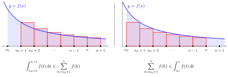
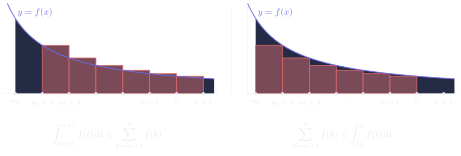

# 第 3 章　数项级数

Chapitre n°3 — Séries numériques

中法对照讲义 · 由 LaTeX 源文件渲染

!!! info "阅读说明"

    每段先列法语原文；其下缩进、带深蓝竖条的小字号段落为中文翻译。<strong>加粗</strong>为关键词，括号内为中文释义。

## Objectifs 学习目标

1. Manipuler des séries.

    熟练操作级数（manipuler des séries）。
    {: .zh }

1. Déterminer la nature de séries numériques.

    判定数项级数的性质（nature，即收敛或发散）。
    {: .zh }

1. Calculer la somme de séries convergentes.

    计算收敛级数的和。
    {: .zh }

## Notations 记号

On rappelle que \(\mathbb{N}\) désigne l'ensemble des entiers naturels, \(\mathbb{Z}\) désigne l'ensemble des entiers relatifs, \(\mathbb{R}\) désigne l'ensemble des nombres réels et \(\mathbb{C}\) désigne l'ensemble des nombres complexes.

回忆：\(\mathbb{N}\) 表示<strong>自然数</strong>集（entiers naturels），\(\mathbb{Z}\) 表示<strong>整数</strong>集（entiers relatifs）， \(\mathbb{R}\) 表示<strong>实数</strong>集，\(\mathbb{C}\) 表示<strong>复数</strong>集。
{: .zh }

Pour tout ce chapitre, \(\mathbb{K}\) désigne \(\mathbb{R}\) ou \(\mathbb{C}\) et on fixe un entier \(n_0 \in \mathbb{Z}\).

本章自始至终，\(\mathbb{K}\) 表示 \(\mathbb{R}\) 或 \(\mathbb{C}\)，并固定一个整数 \(n_0 \in \mathbb{Z}\)。
{: .zh }

## 1　Séries numériques 数项级数

!!! success "Définition 1.1 : série numérique 定义 1.1：数项级数（série numérique）"

    Soit \((u_n)_{n\geqslant n_0}\) une suite de nombres de \(\mathbb{K}\). La <strong>série numérique</strong>, ou simplement <strong>série</strong>, de terme général \(u_n\) est la suite \((S_n)_{n\geqslant n_0}\) des <strong>sommes partielles</strong> définie par :

    设 \((u_n)_{n\geqslant n_0}\) 为取值于 \(\mathbb{K}\) 的数列。以 \(u_n\) 为通项的<strong>数项级数</strong>（série numérique，或简称<strong>级数</strong> série），是<strong>部分和</strong>（sommes partielles）所成的数列 \((S_n)_{n\geqslant n_0}\)，定义为：
    {: .zh }

    \[
    \forall n \geqslant n_0,\ S_n = u_{n_0} + u_{n_0+1} + u_{n_0+2} + \cdots + u_{n-1} + u_n = \sum_{k=n_0}^{n} u_k.
    \]

    On note \(\sum\limits_{n\geqslant n_0} u_n\) la série de terme général \(u_n\).

    记 \(\sum\limits_{n\geqslant n_0} u_n\) 为以 \(u_n\) 为通项的级数。
    {: .zh }

!!! warning "Remarque 注（Remarque）"

    - On peut retrouver le terme général d'une série à l'aide de ses sommes partielles :

        可以由部分和反求出级数的通项：
        {: .zh }

        \[
        u_{n_0} = S_{n_0} \quad \text{et} \quad \forall n \geqslant n_0 + 1,\ u_n = S_n - S_{n-1}.
        \]

    - Lorsqu'il n'y a pas d'ambiguïté, on note plus simplement \(\sum u_n = \sum\limits_{n\geqslant n_0} u_n\).

        当不产生歧义时，简记为 \(\sum u_n = \sum\limits_{n\geqslant n_0} u_n\)。
        {: .zh }

!!! warning "Attention 注意（Attention）"

    Ne pas confondre la <u>série</u> \(\sum u_n = (S_n)\), la <u>somme partielle</u> \(S_n\), la <u>suite</u> \((u_n)\) et le <u>nombre</u> \(u_n\).

    不要把<u>级数</u> \(\sum u_n = (S_n)\)、<u>部分和</u> \(S_n\)、<u>数列</u> \((u_n)\) 与<u>数</u> \(u_n\) 混为一谈。
    {: .zh }

Puisqu'une série est une suite particulière, on retrouve toutes les définitions et tous les résultats sur les suites numériques. Ce chapitre présente seulement les spécificités des séries.

由于级数是一种特殊的数列，关于数列的全部定义与结论在这里都成立。本章只介绍级数特有的内容。
{: .zh }

!!! success "Définition 1.2 : somme et reste d'une série convergente 定义 1.2：收敛级数的和与余项"

    Une série \(\sum\limits_{n\geqslant n_0} u_n\) est dite <strong>convergente</strong> lorsque la suite \((S_n)_{n\geqslant n_0}\) de ses sommes partielles est convergente. Sa limite est appelée la <strong>somme</strong> de \(\sum\limits_{n\geqslant n_0} u_n\) et on note :

    若级数 \(\sum\limits_{n\geqslant n_0} u_n\) 的部分和数列 \((S_n)_{n\geqslant n_0}\) 收敛，则称该级数是<strong>收敛的</strong>（convergente）。其极限称为 \(\sum\limits_{n\geqslant n_0} u_n\) 的<strong>和</strong>（somme），并记作：
    {: .zh }

    \[
    \sum_{n=n_0}^{+\infty} u_n = \lim_{n\to+\infty} S_n.
    \]

    De plus, lorsque \(\sum\limits_{n\geqslant n_0} u_n\) est convergente, on définit la suite \((R_n)_{n\geqslant n_0}\) de ses <strong>restes</strong> par :

    此外，当 \(\sum\limits_{n\geqslant n_0} u_n\) 收敛时，定义其<strong>余项</strong>（restes）所成的数列 \((R_n)_{n\geqslant n_0}\) 为：
    {: .zh }

    \[
    \forall n \geqslant n_0,\ R_n = \sum_{k=n_0}^{+\infty} u_k - S_n = \sum_{k=n+1}^{+\infty} u_k.
    \]

Autrement dit, lorsque \(\sum\limits_{n\geqslant n_0} u_n\) converge, on a :

换言之，当级数收敛时，有（式中标注：<em>la somme</em> 为「和」，<em>somme partielle</em> 为「部分和」，<em>reste</em> 为「余项」）：
{: .zh }

\[
\forall n \geqslant n_0,\quad
\underbrace{\sum_{k=n_0}^{+\infty} u_k}_{\text{la somme}} =
\underbrace{\sum_{k=n_0}^{n} u_k}_{\text{somme partielle}} +
\underbrace{\sum_{k=n+1}^{+\infty} u_k}_{\text{reste}}.
\]

!!! warning "Remarque 注（Remarque）"

    La suite des restes d'une série convergente converge toujours vers 0. Son étude, par exemple trouver une suite équivalente plus simple, permet de décrire la <strong>vitesse de convergence</strong> de la série vers sa somme.

    收敛级数的余项数列总收敛于 0。研究它（例如找出一个更简单的等价数列），可以刻画级数趋于其和的<strong>收敛速度</strong>（vitesse de convergence）。
    {: .zh }

!!! info "Exemple 1.3 例 1.3"

    - Soit \((u_n)_{n\geqslant n_0}\) une suite numérique. On a pour tout \(n \geqslant n_0\) :

        设 \((u_n)_{n\geqslant n_0}\) 为一个数列。对一切 \(n \geqslant n_0\)，有：
        {: .zh }

        \[
        \sum_{k=n_0}^{n} (u_{k+1} - u_k)
        = (u_{n_0+1} - u_{n_0}) + (u_{n_0+2} - u_{n_0+1}) + \cdots + (u_{n+1} - u_n)
        = u_{n+1} - u_{n_0}.
        \]

        Ainsi, la <strong>série télescopique</strong> \(\sum\limits_{n\geqslant n_0}(u_{n+1} - u_n)\) est convergente si et seulement si la suite \((u_n)_{n\geqslant n_0}\) est convergente.

        因此，<strong>裂项级数</strong>（série télescopique）\(\sum\limits_{n\geqslant n_0}(u_{n+1} - u_n)\) 收敛当且仅当数列 \((u_n)_{n\geqslant n_0}\) 收敛。
        {: .zh }

    - Soit \(q \in \mathbb{C}\). On a pour tout \(n \in \mathbb{N}\) :

        设 \(q \in \mathbb{C}\)。对一切 \(n \in \mathbb{N}\)，有：
        {: .zh }

        \[
        (1 - q)\sum_{k=0}^{n} q^k
        = \sum_{k=0}^{n}\left(q^k - q^{k+1}\right)
        = 1 - q^{n+1}
        \quad\text{donc}\quad
        \sum_{k=0}^{n} q^k =
        \begin{cases}
        n + 1 & \text{si } q = 1, \\[4pt]
        \dfrac{1 - q^{n+1}}{1 - q} & \text{si } q \neq 1.
        \end{cases}
        \]

        Ainsi, la <strong>série géométrique</strong> \(\sum\limits_{n\geqslant 0} q^n\) est convergente si et seulement si \(|q| < 1\). Dans ce cas, sa somme est égale à :

        因此，<strong>几何级数</strong>（série géométrique）\(\sum\limits_{n\geqslant 0} q^n\) 收敛当且仅当 \(|q| < 1\)。此时其和等于：
        {: .zh }

        \[
        \sum_{n=0}^{+\infty} q^n
        = \lim_{n\to+\infty}\frac{1 - q^{n+1}}{1 - q}
        = \frac{1}{1 - q}.
        \]

!!! warning "Important 重要（Important）"

    Comme pour les suites, la nature d'une série ne dépend pas de ses premiers termes : pour tout \(n_1 \geqslant n_0\), les séries \(\sum\limits_{n\geqslant n_0} u_n\) et \(\sum\limits_{n\geqslant n_1} u_n\) ont même nature. Par contre, dans le cas où ces séries convergent, leurs sommes sont différentes en général :

    与数列一样，级数的性质（nature，即收敛或发散）与它的最初几项无关：对任意 \(n_1 \geqslant n_0\)，级数 \(\sum\limits_{n\geqslant n_0} u_n\) 与 \(\sum\limits_{n\geqslant n_1} u_n\) 同性质。但反过来，当这两个级数都收敛时，它们的和一般并不相同：
    {: .zh }

    \[
    \sum_{n=n_0}^{+\infty} u_n = \sum_{n=n_0}^{n_1-1} u_n + \sum_{n=n_1}^{+\infty} u_n.
    \]

!!! danger "Propriété 1.4 : divergence grossière 性质 1.4：粗略发散（divergence grossière）"

    Soit \(\sum u_n\) une série. Alors :

    设 \(\sum u_n\) 为一个级数。则：
    {: .zh }

    \[
    \sum u_n \text{ est convergente} \quad\Longrightarrow\quad \lim_{n\to+\infty} u_n = 0.
    \]

    Si \((u_n)\) ne converge pas vers 0, alors on dit que \(\sum u_n\) <strong>diverge grossièrement</strong>.

    若 \((u_n)\) 不收敛于 0，则称 \(\sum u_n\) <strong>粗略发散</strong>（diverge grossièrement）。
    {: .zh }

!!! demo ""

    <strong>Démonstration.</strong> Si \((S_n)\) converge vers \(\ell = \lim\limits_{n\to+\infty} S_n \in \mathbb{K}\), alors :

    <strong>证明.</strong> 若 \((S_n)\) 收敛于 \(\ell = \lim\limits_{n\to+\infty} S_n \in \mathbb{K}\)，则：
    {: .zh }

    \[
    \lim_{n\to+\infty} u_n = \lim_{n\to+\infty} S_n - S_{n-1} = \ell - \ell = 0.
    \]

    
∎

!!! warning "Attention 注意（Attention）"

    La réciproque est fausse en général : il existe des séries qui divergent non grossièrement, c'est-à-dire des séries divergentes dont le terme général tend vers 0.

    逆命题一般不成立：存在并非粗略发散的级数，即通项趋于 0 却仍然发散的级数。
    {: .zh }

!!! info "Exemple 1.5 例 1.5"

    On considère la <strong>série harmonique</strong> \(\sum\limits_{n\geqslant 1}\dfrac{1}{n}\) dont la suite des sommes partielles est notée \((H_n = \sum\limits_{k=1}^{n}\frac{1}{k})_{n\geqslant 1}\). On remarque que :

    考虑<strong>调和级数</strong>（série harmonique）\(\sum\limits_{n\geqslant 1}\dfrac{1}{n}\)，其部分和数列记为 \((H_n = \sum\limits_{k=1}^{n}\frac{1}{k})_{n\geqslant 1}\)。注意到：
    {: .zh }

    \[
    \forall n \in \mathbb{N}^*,\quad H_{2n} - H_n = \sum_{k=n+1}^{2n} \frac{1}{k} \geqslant \sum_{k=n+1}^{2n} \frac{1}{2n} = \frac{n}{2n} = \frac{1}{2}.
    \]

    Si \(\ell = \lim\limits_{n\to+\infty} H_n\) existe et est finie, alors on en déduit que \(0 = \ell - \ell \geqslant \frac{1}{2}\) ce qui est absurde. Par conséquent, la série harmonique \(\sum\limits_{n\geqslant 1}\dfrac{1}{n}\) est divergente, mais ne diverge pas grossièrement car \(\dfrac{1}{n}\) tend vers 0 quand \(n \to +\infty\).

    若 \(\ell = \lim\limits_{n\to+\infty} H_n\) 存在且有限，则由此推出 \(0 = \ell - \ell \geqslant \frac{1}{2}\)，矛盾。因此调和级数 \(\sum\limits_{n\geqslant 1}\dfrac{1}{n}\) 发散；但它并非粗略发散，因为 \(\dfrac{1}{n}\) 当 \(n \to +\infty\) 时趋于 0。
    {: .zh }

!!! danger "Propriété 1.6 : linéarité de la somme 性质 1.6：和（somme）的线性性"

    Soient \(\sum\limits_{n\geqslant n_0} a_n\) et \(\sum\limits_{n\geqslant n_0} b_n\) deux séries convergentes. Alors, pour tout \(\lambda \in \mathbb{K}\), la série \(\sum\limits_{n\geqslant n_0}(a_n + \lambda b_n)\) est convergente et :

    设 \(\sum\limits_{n\geqslant n_0} a_n\) 与 \(\sum\limits_{n\geqslant n_0} b_n\) 是两个收敛级数。则对任意 \(\lambda \in \mathbb{K}\)，级数 \(\sum\limits_{n\geqslant n_0}(a_n + \lambda b_n)\) 收敛，且：
    {: .zh }

    \[
    \sum_{n=n_0}^{+\infty} (a_n + \lambda b_n) = \sum_{n=n_0}^{+\infty} a_n + \lambda \sum_{n=n_0}^{+\infty} b_n.
    \]

!!! warning "Vocabulaire clé 第 1 节核心术语"

    - <strong>série numérique</strong>：数项级数
    - <strong>terme général \(u_n\)</strong>：通项 \(u_n\)
    - <strong>somme partielle</strong>：部分和
    - <strong>somme d'une série convergente</strong>：收敛级数的和
    - <strong>reste d'une série convergente</strong>：收敛级数的余项
    - <strong>série convergente / divergente</strong>：收敛级数 / 发散级数
    - <strong>vitesse de convergence</strong>：收敛速度
    - <strong>série géométrique；raison</strong>：几何级数；公比
    - <strong>série télescopique</strong>：裂项级数（télescopique）
    - <strong>série harmonique</strong>：调和级数
    - <strong>divergence grossière</strong>：粗略发散（通项不趋于 0）
    - <strong>linéarité de la somme</strong>：和的线性性
    - <strong>nature d'une série</strong>：级数的性质（敛散性）

## 2　Séries à termes positifs 正项级数

Dans cette section, on considère seulement des séries à termes positifs, c'est-à-dire \(\mathbb{K} = \mathbb{R}\) et pour tout \(n \geqslant n_0\), \(u_n \geqslant 0\).

本节只考虑正项级数（séries à termes positifs），即 \(\mathbb{K} = \mathbb{R}\)，且对一切 \(n \geqslant n_0\)，\(u_n \geqslant 0\)。
{: .zh }

!!! danger "Théorème 2.1 : nature des séries à termes positifs 定理 2.1：正项级数的性质"

    Soit \(\sum u_n\) une série à termes positifs (à partir d'un certain rang). On note \((S_n)\) la suite des sommes partielles de \(\sum u_n\).

    设 \(\sum u_n\) 为（从某一项起）正项的级数。记 \((S_n)\) 为 \(\sum u_n\) 的部分和数列。
    {: .zh }

    - Si \((S_n)\) est majorée, alors \(\sum u_n\) converge.

        若 \((S_n)\) 有上界，则 \(\sum u_n\) 收敛。
        {: .zh }

    - Si \((S_n)\) n'est pas majorée, alors \(\sum u_n\) diverge vers \(+\infty\) et on note \(\sum\limits_{n=n_0}^{+\infty} u_n = +\infty\).

        若 \((S_n)\) 无上界，则 \(\sum u_n\) 发散到 \(+\infty\)，并记 \(\sum\limits_{n=n_0}^{+\infty} u_n = +\infty\)。
        {: .zh }

En particulier, la somme d'une série à termes positifs existe toujours (dans \(\mathbb{R}_+ \cup \{+\infty\}\)).

特别地，正项级数的和总是存在的（在 \(\mathbb{R}_+ \cup \{+\infty\}\) 中）。
{: .zh }

!!! demo ""

    <strong>Démonstration.</strong> Puisque la nature de \(\sum u_n\) ne dépend pas de ses premiers termes, on peut supposer que \(\sum\limits_{n\geqslant n_0} u_n\) est à termes positifs. On a :

    <strong>证明.</strong> 由于 \(\sum u_n\) 的性质不依赖于最初几项，可设 \(\sum\limits_{n\geqslant n_0} u_n\) 为正项级数。有：
    {: .zh }

    \[
    \forall n \geqslant n_0,\quad S_{n+1} - S_n = \sum_{k=n_0}^{n+1} u_k - \sum_{k=n_0}^{n} u_k = u_{n+1} \geqslant 0.
    \]

    Donc \((S_n)_{n\geqslant n_0}\) est croissante et on peut appliquer le théorème de limite monotone.

    因此 \((S_n)_{n\geqslant n_0}\) 递增，可以应用单调极限定理。
    {: .zh }

    
∎

!!! info "Exemple 2.2 例 2.2"

    - On a montré dans l'exemple 1.5 que la série harmonique \(\sum\limits_{n\geqslant 1}\dfrac{1}{n}\) diverge. Puisque la série harmonique est à termes positifs, on en déduit qu'elle diverge vers \(+\infty\) :

        我们在例 1.5 中已证明调和级数 \(\sum\limits_{n\geqslant 1}\dfrac{1}{n}\) 发散。由于调和级数是正项级数，由此推出它发散到 \(+\infty\)：
        {: .zh }

        \[
        \sum_{n=1}^{+\infty} \frac{1}{n} = +\infty.
        \]

    - On considère la <strong>série d'Euler</strong> \(\sum\limits_{n\geqslant 1}\dfrac{1}{n^2}\) qui est à termes positifs. On a :

        考虑<strong>欧拉级数</strong>（série d'Euler）\(\sum\limits_{n\geqslant 1}\dfrac{1}{n^2}\)，它是正项级数。有：
        {: .zh }

        \[
        \forall n \geqslant 2,\quad \sum_{k=2}^{n} \frac{1}{k^2} \leqslant \sum_{k=2}^{n} \frac{1}{k(k-1)}
        = \sum_{k=2}^{n} \left(\frac{1}{k-1} - \frac{1}{k}\right) = \frac{1}{2-1} - \frac{1}{n} \leqslant 1.
        \]

        Ainsi, la suite des sommes partielles de \(\sum\limits_{n\geqslant 1}\dfrac{1}{n^2}\) est majorée par 2. D'après la nature des séries à termes positifs, on en déduit que la série d'Euler est convergente.

        因此，\(\sum\limits_{n\geqslant 1}\dfrac{1}{n^2}\) 的部分和数列以 2 为上界。由正项级数的性质，推出欧拉级数收敛。
        {: .zh }

!!! warning "Remarque 注（Remarque）"

    On peut montrer que la somme de la série d'Euler est égale à :

    可以证明欧拉级数的和等于：
    {: .zh }

    \[
    \sum_{n=1}^{+\infty} \frac{1}{n^2} = \frac{\pi^2}{6}.
    \]

!!! danger "Théorème 2.3 : théorème de comparaison des séries à termes positifs 定理 2.3：正项级数的比较判别法"

    Soient \(\sum a_n\) et \(\sum b_n\) deux séries telles qu'à partir d'un certain rang \(N\) :

    设 \(\sum a_n\) 与 \(\sum b_n\) 是两个级数，且从某一项 \(N\) 起：
    {: .zh }

    \[
    \forall n \geqslant N,\quad 0 \leqslant a_n \leqslant b_n.
    \]

    - Si \(\sum b_n\) est convergente, alors \(\sum a_n\) est convergente.

        若 \(\sum b_n\) 收敛，则 \(\sum a_n\) 收敛。
        {: .zh }

    - Si \(\sum a_n\) est divergente, alors \(\sum b_n\) est divergente.

        若 \(\sum a_n\) 发散，则 \(\sum b_n\) 发散。
        {: .zh }

!!! info "Exemple 2.4 例 2.4"

    - On a :

        有：
        {: .zh }

        \[
        \forall n \geqslant 1,\quad 0 \leqslant \frac{1}{2n+2} \leqslant \frac{1}{2n+1}
        \quad \text{et} \quad
        \sum_{n\geqslant 0} \frac{1}{2n+2} = \frac{1}{2}\sum_{n\geqslant 1}\frac{1}{n}.
        \]

        Puisque la série harmonique \(\sum\limits_{n\geqslant 1}\dfrac{1}{n}\) est divergente (voir l'exemple 1.5), on en déduit que \(\sum\limits_{n\geqslant 0}\dfrac{1}{2n+1}\) est divergente d'après le théorème de comparaison des séries à termes positifs.

        由于调和级数 \(\sum\limits_{n\geqslant 1}\dfrac{1}{n}\) 发散（见例 1.5），由正项级数的比较判别法推出 \(\sum\limits_{n\geqslant 0}\dfrac{1}{2n+1}\) 发散。
        {: .zh }

    - Pour montrer que \(\sum\limits_{n\geqslant 1}\dfrac{n}{2^n}\) est convergente d'après le théorème de comparaison des séries à termes positifs, il suffit de trouver \(q \in \,]0,1[\) tel qu'à partir d'un certain rang \(N\) :

        为了用正项级数的比较判别法证明 \(\sum\limits_{n\geqslant 1}\dfrac{n}{2^n}\) 收敛，只需找到一个 \(q \in \,]0,1[\)，使得从某一项 \(N\) 起：
        {: .zh }

        \[
        \forall n \geqslant N,\quad \frac{n}{2^n} \leqslant q^n
        \qquad \text{c'est-à-dire} \qquad \frac{n}{(2q)^n} < 1.
        \]

        Or on sait que si \(2q > 1\), alors \(n = \on((2q)^n)\) quand \(n \to +\infty\) par croissances comparées. Par exemple, on choisit \(q = \frac{3}{4}\). Puisque \(2q = \frac{3}{2} > 1\), on a :

        而我们知道，若 \(2q > 1\)，则由增长比较，当 \(n \to +\infty\) 时 \(n = \on((2q)^n)\)。例如取 \(q = \frac{3}{4}\)。由于 \(2q = \frac{3}{2} > 1\)，有：
        {: .zh }

        \[
        \lim_{n\to+\infty} \frac{n}{(2q)^n} = 0
        \quad \text{donc} \quad
        \exists N \in \mathbb{N},\ \forall n \geqslant N,\ \frac{n}{(2q)^n} < 1.
        \]

        On en déduit que pour tout \(n \geqslant N\), \(0 \leqslant \frac{n}{2^n} \leqslant q^n = \left(\frac{3}{4}\right)^n\). Or la série géométrique \(\sum \left(\frac{3}{4}\right)^n\) est convergente car \(q = \frac{3}{4} \in \,]0,1[\). Par conséquent, \(\sum\limits_{n\geqslant 1}\dfrac{n}{2^n}\) est convergente d'après le théorème de comparaison des séries à termes positifs.

        由此，对一切 \(n \geqslant N\)，\(0 \leqslant \frac{n}{2^n} \leqslant q^n = \left(\frac{3}{4}\right)^n\)。而几何级数 \(\sum \left(\frac{3}{4}\right)^n\) 收敛，因为 \(q = \frac{3}{4} \in \,]0,1[\)。因此由正项级数的比较判别法，\(\sum\limits_{n\geqslant 1}\dfrac{n}{2^n}\) 收敛。
        {: .zh }

!!! danger "Théorème 2.5 : sommation des équivalents 定理 2.5：等价量求和（sommation des équivalents）"

    Soient \((a_n)_{n\geqslant n_0}\) et \((b_n)_{n\geqslant n_0}\) deux suites réelles positives telles que \(a_n \simn b_n\). Alors \(\sum\limits_{n\geqslant n_0} a_n\) et \(\sum\limits_{n\geqslant n_0} b_n\) ont même nature. De plus :

    设 \((a_n)_{n\geqslant n_0}\) 与 \((b_n)_{n\geqslant n_0}\) 是两个非负实数列，且 \(a_n \simn b_n\)。则 \(\sum\limits_{n\geqslant n_0} a_n\) 与 \(\sum\limits_{n\geqslant n_0} b_n\) 同性质。此外：
    {: .zh }

    - si \(\sum\limits_{n\geqslant n_0} a_n\) et \(\sum\limits_{n\geqslant n_0} b_n\) sont convergentes, alors \(\sum\limits_{k=n+1}^{+\infty} a_k \simn \sum\limits_{k=n+1}^{+\infty} b_k\),

        若 \(\sum\limits_{n\geqslant n_0} a_n\) 与 \(\sum\limits_{n\geqslant n_0} b_n\) 都收敛，则 \(\sum\limits_{k=n+1}^{+\infty} a_k \simn \sum\limits_{k=n+1}^{+\infty} b_k\)；
        {: .zh }

    - si \(\sum\limits_{n\geqslant n_0} a_n\) et \(\sum\limits_{n\geqslant n_0} b_n\) sont divergentes, alors \(\sum\limits_{k=n_0}^{n} a_k \simn \sum\limits_{k=n_0}^{n} b_k\).

        若 \(\sum\limits_{n\geqslant n_0} a_n\) 与 \(\sum\limits_{n\geqslant n_0} b_n\) 都发散，则 \(\sum\limits_{k=n_0}^{n} a_k \simn \sum\limits_{k=n_0}^{n} b_k\)。
        {: .zh }

!!! demo ""

    <strong>Démonstration.</strong> Soit \(\varepsilon \in \,]0,1[\). Puisque \(\frac{a_n}{b_n} \to 1\) quand \(n \to +\infty\), on sait qu'il existe un rang \(N \geqslant n_0\) tel que :

    <strong>证明.</strong> 设 \(\varepsilon \in \,]0,1[\)。由于当 \(n \to +\infty\) 时 \(\frac{a_n}{b_n} \to 1\)，存在某一项 \(N \geqslant n_0\) 使得：
    {: .zh }

    \[
    \forall n \geqslant N,\quad \left|\frac{a_n}{b_n} - 1\right| < \varepsilon
    \quad \text{donc} \quad
    (1-\varepsilon)b_n < a_n < (1+\varepsilon)b_n.
    \]

    D'après le théorème de comparaison des séries à termes positifs, on en déduit que \(\sum\limits_{n\geqslant n_0} a_n\) et \(\sum\limits_{n\geqslant n_0} b_n\) ont même nature.

    由正项级数的比较判别法，推出 \(\sum\limits_{n\geqslant n_0} a_n\) 与 \(\sum\limits_{n\geqslant n_0} b_n\) 同性质。
    {: .zh }

    - Si \(\sum\limits_{n\geqslant n_0} a_n\) et \(\sum\limits_{n\geqslant n_0} b_n\) sont convergentes, alors on a par linéarité de la somme :

        若 \(\sum\limits_{n\geqslant n_0} a_n\) 与 \(\sum\limits_{n\geqslant n_0} b_n\) 都收敛，则由和的线性性：
        {: .zh }

        \[
        \forall n \geqslant N,\quad
        (1-\varepsilon)\sum_{k=n+1}^{+\infty} b_k
        < \sum_{k=n+1}^{+\infty} a_k
        < (1+\varepsilon)\sum_{k=n+1}^{+\infty} b_k
        \quad \text{donc} \quad
        \left|\frac{\sum_{k=n+1}^{+\infty} a_k}{\sum_{k=n+1}^{+\infty} b_k} - 1\right| < \varepsilon.
        \]

        On en déduit bien que \(\sum\limits_{k=n+1}^{+\infty} a_k \simn \sum\limits_{k=n+1}^{+\infty} b_k\) quand \(n \to +\infty\).

        由此确实得到：当 \(n \to +\infty\) 时 \(\sum\limits_{k=n+1}^{+\infty} a_k \simn \sum\limits_{k=n+1}^{+\infty} b_k\)。
        {: .zh }

    - Si \(\sum\limits_{n\geqslant n_0} a_n\) et \(\sum\limits_{n\geqslant n_0} b_n\) sont divergentes, alors on a d'après l'inégalité triangulaire :

        若 \(\sum\limits_{n\geqslant n_0} a_n\) 与 \(\sum\limits_{n\geqslant n_0} b_n\) 都发散，则由三角不等式：
        {: .zh }

        \[
        \forall n \geqslant N,\quad
        \left|\frac{\sum_{k=n_0}^{n} a_k}{\sum_{k=n_0}^{n} b_k} - 1\right|
        \leqslant
        \frac{\overbrace{\sum_{k=n_0}^{N-1} |a_k - b_k|}^{\text{constante}}}{\sum_{k=n_0}^{n} b_k}
        +
        \frac{\overbrace{\sum_{k=N}^{n} \left|\frac{a_k}{b_k} - 1\right| b_k}^{<\,\varepsilon}}{\underbrace{\sum_{k=n_0}^{n} b_k}_{\geqslant\, \sum_{k=N}^{n} b_k}}.
        \]

        Par conséquent, il existe un rang \(N' \geqslant N\) tel que :

        因此，存在某一项 \(N' \geqslant N\) 使得：
        {: .zh }

        \[
        \forall n \geqslant N',\quad
        \left|\frac{\sum_{k=n_0}^{n} a_k}{\sum_{k=n_0}^{n} b_k} - 1\right| < \varepsilon + \varepsilon = 2\varepsilon.
        \]

        Finalement, on en déduit bien que \(\sum\limits_{k=n_0}^{n} a_k \simn \sum\limits_{k=n_0}^{n} b_k\) quand \(n \to +\infty\).

        最终确实得到：当 \(n \to +\infty\) 时 \(\sum\limits_{k=n_0}^{n} a_k \simn \sum\limits_{k=n_0}^{n} b_k\)。
        {: .zh }

    
∎

!!! info "Exemple 2.6 例 2.6"

    - On a :

        有：
        {: .zh }

        \[
        \frac{1}{n(n+1)} \simn \frac{1}{n^2}
        \quad \text{et} \quad
        \forall n \geqslant 1,\quad \sum_{k=1}^{n} \frac{1}{k(k+1)}
        = \sum_{k=1}^{n}\left(\frac{1}{k} - \frac{1}{k+1}\right)
        = 1 - \underbrace{\frac{1}{n+1}}_{\to\,0}.
        \]

        Par sommation des équivalents, on retrouve que la série d'Euler \(\sum\limits_{n\geqslant 1}\dfrac{1}{n^2}\) est convergente. De plus :

        由正项级数的等价量求和，重新得到欧拉级数 \(\sum\limits_{n\geqslant 1}\dfrac{1}{n^2}\) 收敛。此外：
        {: .zh }

        \[
        \sum_{k=n+1}^{+\infty} \frac{1}{k^2} \simn \sum_{k=n+1}^{+\infty} \frac{1}{k(k+1)}
        = 1 - \left(1 - \frac{1}{n+1}\right) = \frac{1}{n+1} \simn \frac{1}{n}.
        \]

    - On a :

        有：
        {: .zh }

        \[
        \sqrt{n+1} - \sqrt{n} = \frac{1}{\sqrt{n+1} + \sqrt{n}} \simn \frac{1}{2\sqrt{n}}.
        \]

        Puisque \(\sum\limits_{k=0}^{n}\left(\sqrt{k+1} - \sqrt{k}\right) = \sqrt{n+1} \to +\infty\) quand \(n \to +\infty\), on en déduit que \(\sum\limits_{n\geqslant 1}\dfrac{1}{\sqrt{n}}\) est divergente par sommation des équivalents. De plus :

        由于当 \(n \to +\infty\) 时 \(\sum\limits_{k=0}^{n}\left(\sqrt{k+1} - \sqrt{k}\right) = \sqrt{n+1} \to +\infty\)，由等价量求和推出 \(\sum\limits_{n\geqslant 1}\dfrac{1}{\sqrt{n}}\) 发散。此外：
        {: .zh }

        \[
        \sum_{k=1}^{n} \frac{1}{\sqrt{k}} \simn 2\sum_{k=1}^{n}\left(\sqrt{k+1} - \sqrt{k}\right)
        = 2\left(\sqrt{n+1} - 1\right) \simn 2\sqrt{n}.
        \]

!!! warning "Attention 注意（Attention）"

    Le théorème de sommation des équivalents est en général faux lorsque les deux suites ne sont pas de signe constant à partir d'un certain rang. Voir l'exemple 5.3.

    当两个数列从某一项起不保持符号恒定（de signe constant）时，等价量求和定理一般不再成立。参见例 5.3。
    {: .zh }

!!! danger "Théorème 2.7 : sommation des petits o 定理 2.7：小 \(o\) 的求和（sommation des petits o）"

    Soient \((a_n)_{n\geqslant n_0}\) et \((b_n)_{n\geqslant n_0}\) deux suites réelles positives telles que \(a_n = \on(b_n)\).

    设 \((a_n)_{n\geqslant n_0}\) 与 \((b_n)_{n\geqslant n_0}\) 是两个非负实数列，且 \(a_n = \on(b_n)\)。
    {: .zh }

    - Si \(\sum\limits_{n\geqslant n_0} b_n\) est convergente, alors \(\sum\limits_{n\geqslant n_0} a_n\) est convergente et \(\sum\limits_{k=n+1}^{+\infty} a_k = \on\left(\sum\limits_{k=n+1}^{+\infty} b_k\right)\).

        若 \(\sum\limits_{n\geqslant n_0} b_n\) 收敛，则 \(\sum\limits_{n\geqslant n_0} a_n\) 收敛，且 \(\sum\limits_{k=n+1}^{+\infty} a_k = \on\left(\sum\limits_{k=n+1}^{+\infty} b_k\right)\)。
        {: .zh }

    - Si \(\sum\limits_{n\geqslant n_0} a_n\) est divergente, alors \(\sum\limits_{n\geqslant n_0} b_n\) est divergente et \(\sum\limits_{k=n_0}^{n} a_k = \on\left(\sum\limits_{k=n_0}^{n} b_k\right)\).

        若 \(\sum\limits_{n\geqslant n_0} a_n\) 发散，则 \(\sum\limits_{n\geqslant n_0} b_n\) 发散，且 \(\sum\limits_{k=n_0}^{n} a_k = \on\left(\sum\limits_{k=n_0}^{n} b_k\right)\)。
        {: .zh }

!!! demo ""

    <strong>Démonstration.</strong> Il suffit de remarquer que \(a_n + b_n \simn b_n\) quand \(n \to +\infty\), puis d'utiliser le théorème de sommation des équivalents.

    <strong>证明.</strong> 只需注意到当 \(n \to +\infty\) 时 \(a_n + b_n \simn b_n\)，然后使用等价量求和定理即可。
    {: .zh }

    
∎

!!! warning "Vocabulaire clé 第 2 节核心术语"

    - <strong>série à termes positifs</strong>：正项级数
    - <strong>série harmonique</strong>：调和级数
    - <strong>série d'Euler</strong>：欧拉级数（\(\sum 1/n^2\)）
    - <strong>théorème de comparaison</strong>：比较判别法
    - <strong>équivalent</strong>：等价
    - <strong>sommation des équivalents</strong>：等价量求和
    - <strong>majorée / non majorée</strong>：有上界的 / 无上界的
    - <strong>théorème des croissances comparées</strong>：增长比较定理
    - <strong>de signe constant</strong>：符号恒定的
    - <strong>à partir d'un certain rang</strong>：从某一项起
    - <strong>avoir même nature</strong>：同性质（同时收敛或同时发散）

## 3　Comparaison série-intégrale 级数与积分的比较

Le but de cette section est de présenter une méthode efficace pour étudier la nature d'une série à termes positifs : la <strong>comparaison série-intégrale</strong>.

本节的目的是介绍一种研究正项级数性质的有效方法：<strong>级数与积分的比较</strong>（comparaison série-intégrale）。
{: .zh }

!!! danger "Théorème 3.1 : comparaison série-intégrale 定理 3.1：级数与积分的比较"

    Soit \(f : [n_0, +\infty[\, \to \mathbb{R}_+\) une fonction réelle continue et décroissante. La série \(\sum\limits_{n\geqslant n_0} f(n)\) et la suite \((\int_{n_0}^{n} f(t)\,\mathrm{d}t)_{n\geqslant n_0}\) ont même nature.

    设 \(f : [n_0, +\infty[\, \to \mathbb{R}_+\) 是连续、递减的实函数。级数 \(\sum\limits_{n\geqslant n_0} f(n)\) 与数列 \((\int_{n_0}^{n} f(t)\,\mathrm{d}t)_{n\geqslant n_0}\) 同性质。
    {: .zh }

!!! demo ""

    <strong>Démonstration.</strong> Puisque \(f\) est continue et décroissante, on a par monotonie de l'intégrale :

    <strong>证明.</strong> 由于 \(f\) 连续且递减，由积分的单调性有：
    {: .zh }

    \[
    \forall k \geqslant n_0,\quad
    \underbrace{\int_{k}^{k+1} f(k+1)\,\mathrm{d}t}_{=\,f(k+1)}
    \leqslant \int_{k}^{k+1} f(t)\,\mathrm{d}t
    \leqslant \underbrace{\int_{k}^{k+1} f(k)\,\mathrm{d}t}_{=\,f(k)}.
    \]

    Par conséquent, on obtient d'après la relation de Chasles :

    因此，由 Chasles 关系（积分对区间的可加性）得到：
    {: .zh }

    \[
    \forall n \geqslant n_0 + 1,\quad \int_{n_0+1}^{n+1} f(t)\,\mathrm{d}t \leqslant \sum_{k=n_0+1}^{n} f(k) \leqslant \int_{n_0}^{n} f(t)\,\mathrm{d}t.
    \]

    D'où le résultat d'après la nature des séries à termes positifs et le théorème de limite monotone, car \(f\) est positive (donc \((\int_{n_0}^{n} f(t)\,\mathrm{d}t)_{n\geqslant n_0}\) est croissante).

    再根据正项级数的性质与单调极限定理即得结论，因为 \(f\) 非负（因此 \((\int_{n_0}^{n} f(t)\,\mathrm{d}t)_{n\geqslant n_0}\) 递增）。
    {: .zh }

    
∎

!!! warning "Important 重要（Important）"

    La méthode utilisée dans cette démonstration est plus importante que le résultat. En effet, elle peut aussi permettre de trouver un équivalent des restes dans le cas convergent, donc de décrire la <strong>vitesse de convergence</strong>, ou des sommes partielles dans le cas divergent, donc de décrire la <strong>vitesse de divergence</strong>.

    这个证明中所用的方法比结论本身更重要。事实上，它还可以在收敛情形下求出余项的等价量，从而刻画<strong>收敛速度</strong>（vitesse de convergence）；或在发散情形下求出部分和的等价量，从而刻画<strong>发散速度</strong>（vitesse de divergence）。
    {: .zh }

    

    \[
    \int_{n_0+1}^{n+1} f(t)\,\mathrm{d}t \leqslant \sum_{k=n_0+1}^{n} f(k)
    \qquad\text{et}\qquad
    \sum_{k=n_0+1}^{n} f(k) \leqslant \int_{n_0}^{n} f(t)\,\mathrm{d}t.
    \]

!!! info "Exemple 3.2 例 3.2"

    - On a :

        有：
        {: .zh }

        \[
        \lim_{n\to+\infty} \int_2^{n} \frac{\mathrm{d}t}{t\ln(t)}
        = \lim_{n\to+\infty} \bigl[\ln(\ln(t))\bigr]_2^n = +\infty.
        \]

        On en déduit que \(\sum\limits_{n\geqslant 2}\frac{1}{n\ln(n)}\) diverge vers \(+\infty\) par comparaison série-intégrale. Plus précisément, on peut aussi obtenir un équivalent des sommes partielles :

        由此，由级数与积分的比较推出 \(\sum\limits_{n\geqslant 2}\frac{1}{n\ln(n)}\) 发散到 \(+\infty\)。更精确地说，也可以求出部分和的等价量：
        {: .zh }

        \[
        \forall n \geqslant 3,\quad
        \underbrace{\int_3^{n+1}\frac{\mathrm{d}t}{t\ln(t)}}_{\sim\ln(\ln(n))}
        \leqslant \sum_{k=3}^{n}\frac{1}{k\ln(k)}
        \leqslant \underbrace{\int_2^{n}\frac{\mathrm{d}t}{t\ln(t)}}_{\sim\ln(\ln(n))}
        \quad\text{donc}\quad
        \sum_{k=2}^{n}\frac{1}{k\ln(k)} \simn \ln(\ln(n)).
        \]

    - On a :

        有：
        {: .zh }

        \[
        \lim_{n\to+\infty} \int_2^{n} \frac{\mathrm{d}t}{t(\ln t)^2}
        = \lim_{n\to+\infty} \left[\frac{-1}{\ln(t)}\right]_2^n = \frac{1}{\ln(2)}.
        \]

        On en déduit que \(\sum\limits_{n\geqslant 2}\frac{1}{n(\ln(n))^2}\) est convergente par comparaison série-intégrale. De plus, on peut aussi obtenir un équivalent des restes :

        由此，由级数与积分的比较推出 \(\sum\limits_{n\geqslant 2}\frac{1}{n(\ln(n))^2}\) 收敛。此外，也可以求出余项的等价量：
        {: .zh }

        \[
        \forall N \geqslant n+1 \geqslant 3,\quad
        \underbrace{\int_{n+1}^{N+1}\frac{\mathrm{d}t}{t(\ln t)^2}}_{=\,\frac{1}{\ln(n+1)}-\frac{1}{\ln(N+1)}}
        \leqslant \sum_{k=n+1}^{N}\frac{1}{k(\ln k)^2}
        \leqslant \underbrace{\int_n^{N}\frac{\mathrm{d}t}{t(\ln t)^2}}_{=\,\frac{1}{\ln(n)}-\frac{1}{\ln(N)}}.
        \]

        puis l'encadrement obtenu quand \(N \to +\infty\) permet d'en déduire que :

        于是，当 \(N \to +\infty\) 时所得的两侧夹逼（encadrement）便推出：
        {: .zh }

        \[
        \sum_{k=n+1}^{+\infty}\frac{1}{k(\ln k)^2} \simn \frac{1}{\ln(n)}.
        \]

!!! danger "Théorème 3.3 : séries de Riemann 定理 3.3：黎曼级数（séries de Riemann）"

    Soit \(\alpha \in \mathbb{R}\). La <strong>série de Riemann</strong> \(\sum\limits_{n\geqslant 1}\frac{1}{n^\alpha}\) est convergente si et seulement si \(\alpha > 1\).

    设 \(\alpha \in \mathbb{R}\)。<strong>黎曼级数</strong>（série de Riemann）\(\sum\limits_{n\geqslant 1}\frac{1}{n^\alpha}\) 收敛当且仅当 \(\alpha > 1\)。
    {: .zh }

!!! demo ""

    <strong>Démonstration.</strong> Si \(\alpha \leqslant 0\), alors \(\sum\limits_{n\geqslant 1}\frac{1}{n^\alpha}\) diverge grossièrement. Si \(\alpha > 0\), alors la fonction \(t \mapsto \frac{1}{t^\alpha}\) est continue et décroissante sur \(]0,+\infty[\), donc on peut utiliser une comparaison série-intégrale. Si \(\alpha \neq 1\), on a :

    <strong>证明.</strong> 若 \(\alpha \leqslant 0\)，则 \(\sum\limits_{n\geqslant 1}\frac{1}{n^\alpha}\) 粗略发散。若 \(\alpha > 0\)，则函数 \(t \mapsto \frac{1}{t^\alpha}\) 在 \(]0,+\infty[\) 上连续且递减，故可用级数与积分的比较。若 \(\alpha \neq 1\)，有：
    {: .zh }

    \[
    \lim_{n\to+\infty}\int_1^{n} \frac{\mathrm{d}t}{t^\alpha}
    = \lim_{n\to+\infty}\left[\frac{t^{1-\alpha}}{1-\alpha}\right]_1^n
    = \begin{cases}
    +\infty & \text{si } \alpha < 1,\\[4pt]
    \dfrac{1}{\alpha-1} & \text{si } \alpha > 1.
    \end{cases}
    \]

    Et si \(\alpha = 1\) :

    而当 \(\alpha = 1\) 时：
    {: .zh }

    \[
    \lim_{n\to+\infty}\int_1^{n} \frac{\mathrm{d}t}{t}
    = \lim_{n\to+\infty}\bigl[\ln(t)\bigr]_1^n = +\infty.
    \]

    
∎

En particulier, on retrouve que la série harmonique \(\sum\limits_{n\geqslant 1}\frac{1}{n}\) diverge vers \(+\infty\) et que la série d'Euler \(\sum\limits_{n\geqslant 1}\frac{1}{n^2}\) est convergente. Plus précisément, on obtient aussi que :

特别地，由此重新得到：调和级数 \(\sum\limits_{n\geqslant 1}\frac{1}{n}\) 发散到 \(+\infty\)，而欧拉级数 \(\sum\limits_{n\geqslant 1}\frac{1}{n^2}\) 收敛。更精确地说，还可以得到：
{: .zh }

\[
\forall n \geqslant 2,\quad
\underbrace{\int_2^{n+1}\frac{\mathrm{d}t}{t}}_{\sim\ln(n)}
\leqslant \sum_{k=2}^{n}\frac{1}{k}
\leqslant \underbrace{\int_1^{n}\frac{\mathrm{d}t}{t}}_{=\ln(n)}
\quad\text{donc}\quad
\sum_{k=1}^{n}\frac{1}{k} \simn \ln(n).
\]

et :

以及：
{: .zh }

\[
\forall N \geqslant n+1 \geqslant 2,\quad
\underbrace{\int_{n+1}^{N+1}\frac{\mathrm{d}t}{t^2}}_{=\,\frac{1}{n+1}-\frac{1}{N+1}}
\leqslant \sum_{k=n+1}^{N}\frac{1}{k^2}
\leqslant \underbrace{\int_n^{N}\frac{\mathrm{d}t}{t^2}}_{=\,\frac{1}{n}-\frac{1}{N}}
\quad\text{donc}\quad
\sum_{k=n+1}^{+\infty}\frac{1}{k^2} \simn \frac{1}{n}.
\]

!!! danger "Corollaire 3.4 : critère de Riemann 推论 3.4：黎曼判别法（critère de Riemann）"

    Soit \(\sum u_n\) une série à termes positifs (à partir d'un certain rang).

    设 \(\sum u_n\) 为（从某一项起）正项的级数。
    {: .zh }

    - S'il existe \(\alpha > 1\) tel que \(\lim\limits_{n\to+\infty} n^\alpha u_n = 0\), alors \(\sum u_n\) est convergente.

        若存在 \(\alpha > 1\) 使得 \(\lim\limits_{n\to+\infty} n^\alpha u_n = 0\)，则 \(\sum u_n\) 收敛。
        {: .zh }

    - S'il existe \(\alpha \leqslant 1\) tel que \(\lim\limits_{n\to+\infty} n^\alpha u_n = +\infty\), alors \(\sum u_n\) diverge vers \(+\infty\).

        若存在 \(\alpha \leqslant 1\) 使得 \(\lim\limits_{n\to+\infty} n^\alpha u_n = +\infty\)，则 \(\sum u_n\) 发散到 \(+\infty\)。
        {: .zh }

!!! demo ""

    <strong>Démonstration.</strong>

    <strong>证明.</strong>
    {: .zh }

    - Si \(\lim\limits_{n\to+\infty} n^\alpha u_n = 0\), alors \(u_n = \on\left(\frac{1}{n^\alpha}\right)\) quand \(n \to +\infty\), d'où le résultat par sommation des petits o car la série de Riemann \(\sum\limits_{n\geqslant 1}\frac{1}{n^\alpha}\) est convergente si \(\alpha > 1\).

        若 \(\lim\limits_{n\to+\infty} n^\alpha u_n = 0\)，则当 \(n \to +\infty\) 时 \(u_n = \on\left(\frac{1}{n^\alpha}\right)\)；由于当 \(\alpha > 1\) 时黎曼级数 \(\sum\limits_{n\geqslant 1}\frac{1}{n^\alpha}\) 收敛，由小 \(o\) 的求和即得结论。
        {: .zh }

    - Si \(\lim\limits_{n\to+\infty} n^\alpha u_n = +\infty\), alors \(\frac{1}{n^\alpha} = \on(u_n)\) quand \(n \to +\infty\), d'où le résultat par sommation des petits o car la série de Riemann \(\sum\limits_{n\geqslant 1}\frac{1}{n^\alpha}\) est divergente si \(\alpha \leqslant 1\).

        若 \(\lim\limits_{n\to+\infty} n^\alpha u_n = +\infty\)，则当 \(n \to +\infty\) 时 \(\frac{1}{n^\alpha} = \on(u_n)\)；由于当 \(\alpha \leqslant 1\) 时黎曼级数 \(\sum\limits_{n\geqslant 1}\frac{1}{n^\alpha}\) 发散，由小 \(o\) 的求和即得结论。
        {: .zh }

    
∎

!!! info "Exemple 3.5 例 3.5"

    - \(\sum\limits_{n\geqslant 2}\frac{\ln(n)}{n^2}\) est convergente d'après le critère de Riemann car :

        由黎曼判别法，\(\sum\limits_{n\geqslant 2}\frac{\ln(n)}{n^2}\) 收敛，因为：
        {: .zh }

        \[
        \lim_{n\to+\infty} n^{3/2}\frac{\ln(n)}{n^2}
        = \lim_{n\to+\infty}\frac{\ln(n)}{n^{1/2}} = 0
        \qquad\text{par croissances comparées.}
        \]

        Plus généralement, pour tout \(\alpha > 1\) et tout \(\beta \in \mathbb{R}\), \(\sum\limits_{n\geqslant 2}\frac{(\ln(n))^\beta}{n^\alpha}\) est convergente d'après le critère de Riemann car :

        更一般地，对任意 \(\alpha > 1\) 与 \(\beta \in \mathbb{R}\)，由黎曼判别法，\(\sum\limits_{n\geqslant 2}\frac{(\ln(n))^\beta}{n^\alpha}\) 收敛，因为：
        {: .zh }

        \[
        \begin{aligned}
        \lim_{n\to+\infty} \underbrace{n^{(1+\alpha)/2}}_{\geqslant 1}\frac{(\ln(n))^\beta}{n^\alpha}
        &= \lim_{n\to+\infty}\frac{(\ln(n))^\beta}{n^{(\alpha-1)/2}}\\
        &= \begin{cases}
        0 & \text{si } \beta \leqslant 0 \text{ car } \frac{\alpha-1}{2} > 0,\\[4pt]
        \lim\limits_{n\to+\infty}\left(\frac{\ln(n)}{n^{(\alpha-1)/(2\beta)}}\right)^\beta = 0 & \text{si } \beta > 0.
        \end{cases}
        \end{aligned}
        \]

    - \(\sum\limits_{n\geqslant 2}\frac{1}{\sqrt{n}\ln(n)}\) diverge vers \(+\infty\) d'après le critère de Riemann car :

        由黎曼判别法，\(\sum\limits_{n\geqslant 2}\frac{1}{\sqrt{n}\ln(n)}\) 发散到 \(+\infty\)，因为：
        {: .zh }

        \[
        \lim_{n\to+\infty} n^{3/4}\frac{1}{\sqrt{n}\ln(n)}
        = \lim_{n\to+\infty}\frac{n^{1/4}}{\ln(n)} = +\infty.
        \]

        Plus généralement, pour tout \(\alpha < 1\) et tout \(\beta \in \mathbb{R}\), \(\sum\limits_{n\geqslant 2}\frac{(\ln(n))^\beta}{n^\alpha}\) diverge vers \(+\infty\) d'après le critère de Riemann car :

        更一般地，对任意 \(\alpha < 1\) 与 \(\beta \in \mathbb{R}\)，由黎曼判别法，\(\sum\limits_{n\geqslant 2}\frac{(\ln(n))^\beta}{n^\alpha}\) 发散到 \(+\infty\)，因为：
        {: .zh }

        \[
        \begin{aligned}
        \lim_{n\to+\infty} \underbrace{n^{(\alpha+1)/2}}_{<\,1}\frac{(\ln(n))^\beta}{n^\alpha}
        &= \lim_{n\to+\infty} n^{(1-\alpha)/2}(\ln(n))^\beta\\
        &= \begin{cases}
        +\infty & \text{si } \beta \geqslant 0 \text{ car } \frac{1-\alpha}{2} > 0,\\[4pt]
        \lim\limits_{n\to+\infty}\left(\frac{n^{(1-\alpha)/(-2\beta)}}{\ln(n)}\right)^{-\beta} = +\infty & \text{si } \beta < 0.
        \end{cases}
        \end{aligned}
        \]

    Le cas \(\alpha = 1\) dépend de \(\beta\), voir l'exemple 3.2.

    \(\alpha = 1\) 的情形取决于 \(\beta\)，见例 3.2。
    {: .zh }

La méthode de comparaison série-intégrale peut aussi s'adapter aux fonctions croissantes.

级数与积分比较的方法也可以推广到递增函数。
{: .zh }

!!! info "Exemple 3.6 例 3.6"

    Puisque la fonction \(t \mapsto \ln(t)\) est continue et croissante sur \(]0,+\infty[\), on a par monotonie de l'intégrale :

    由于函数 \(t \mapsto \ln(t)\) 在 \(]0,+\infty[\) 上连续且递增，由积分的单调性有：
    {: .zh }

    \[
    \forall k \geqslant 1,\quad
    \underbrace{\int_{k}^{k+1} \ln(k)\,\mathrm{d}t}_{=\,\ln(k)}
    \leqslant \int_{k}^{k+1} \ln(t)\,\mathrm{d}t
    \leqslant \underbrace{\int_{k}^{k+1} \ln(k+1)\,\mathrm{d}t}_{=\,\ln(k+1)}.
    \]

    Par conséquent, on obtient d'après la relation de Chasles :

    因此，由 Chasles 关系得到：
    {: .zh }

    \[
    \forall n \geqslant 2,\quad
    \int_1^{n} \ln(t)\,\mathrm{d}t
    \leqslant \sum_{k=2}^{n} \ln(k)
    \leqslant \int_2^{n+1} \ln(t)\,\mathrm{d}t.
    \]

    Puisque \(t \mapsto t\ln(t) - t\) est une primitive de \(t \mapsto \ln(t)\) sur \(]0,+\infty[\), on en déduit que :

    由于 \(t \mapsto t\ln(t) - t\) 是 \(t \mapsto \ln(t)\) 在 \(]0,+\infty[\) 上的一个原函数，推出：
    {: .zh }

    \[
    \ln(n!) = \sum_{k=2}^{n}\ln(k) \simn n\ln(n).
    \]

!!! warning "Vocabulaire clé 第 3 节核心术语"

    - <strong>comparaison série-intégrale</strong>：级数与积分的比较
    - <strong>fonction continue et décroissante</strong>：连续递减函数
    - <strong>monotonie de l'intégrale</strong>：积分的单调性
    - <strong>relation de Chasles</strong>：Chasles 关系（积分区间可加性）
    - <strong>encadrement</strong>：两侧夹逼 / 夹逼估计
    - <strong>série de Riemann</strong>：黎曼级数（\(p\)-级数）
    - <strong>primitive</strong>：原函数
    - <strong>équivalent des sommes partielles</strong>：部分和的等价量
    - <strong>équivalent des restes</strong>：余项的等价量
    - <strong>vitesse de convergence / de divergence</strong>：收敛速度 / 发散速度
    - <strong>sommation des petits o</strong>：小 \(o\) 的求和
    - <strong>critère de Riemann</strong>：黎曼判别法
    - <strong>fonction croissante</strong>：递增函数

## 4　Convergence absolue 绝对收敛

Dans cette section, on revient au cas général des séries numériques, c'est-à-dire \(\mathbb{K} = \mathbb{R}\) ou \(\mathbb{C}\).

本节回到一般情形的数项级数，即 \(\mathbb{K} = \mathbb{R}\) 或 \(\mathbb{C}\)。
{: .zh }

!!! danger "Théorème 4.1 : convergence absolue 定理 4.1：绝对收敛（convergence absolue）"

    Soit \(\sum u_n\) une série. Alors :

    设 \(\sum u_n\) 为一个级数。则：
    {: .zh }

    \[
    \sum |u_n| \text{ est convergente} \quad\Longrightarrow\quad \sum u_n \text{ est convergente}.
    \]

    On dit que \(\sum u_n\) <strong>converge absolument</strong> lorsque \(\sum |u_n|\) est convergente.

    当 \(\sum |u_n|\) 收敛时，称 \(\sum u_n\) <strong>绝对收敛</strong>（converge absolument）。
    {: .zh }

!!! demo ""

    <strong>Démonstration.</strong> On suppose que \(\sum\limits_{n\geqslant n_0} u_n\) converge absolument.

    <strong>证明.</strong> 假设 \(\sum\limits_{n\geqslant n_0} u_n\) 绝对收敛。
    {: .zh }

    - Dans le cas \(\mathbb{K} = \mathbb{R}\), on pose pour tout \(n \geqslant n_0\) :

        在 \(\mathbb{K} = \mathbb{R}\) 的情形，对一切 \(n \geqslant n_0\) 令：
        {: .zh }

        \[
        u_n^+ = \max\{0,u_n\} =
        \begin{cases}
        u_n & \text{si } u_n \geqslant 0,\\
        0 & \text{si } u_n \leqslant 0,
        \end{cases}
        \quad\text{et}\quad
        u_n^- = \max\{0,-u_n\} =
        \begin{cases}
        0 & \text{si } u_n \geqslant 0,\\
        -u_n & \text{si } u_n \leqslant 0.
        \end{cases}
        \]

        ainsi \(u_n = u_n^+ - u_n^-\) et \(|u_n| = u_n^+ + u_n^-\), \(0 \leqslant u_n^+ \leqslant |u_n|\) et \(0 \leqslant u_n^- \leqslant |u_n|\). D'après le théorème de comparaison des séries à termes positifs, on en déduit que \(\sum\limits_{n\geqslant n_0} u_n^+\) et \(\sum\limits_{n\geqslant n_0} u_n^-\) sont convergentes. Donc \(\sum\limits_{n\geqslant n_0} u_n\) est convergente par linéarité de la somme.

        于是 \(u_n = u_n^+ - u_n^-\) 且 \(|u_n| = u_n^+ + u_n^-\)，并且 \(0 \leqslant u_n^+ \leqslant |u_n|\)、\(0 \leqslant u_n^- \leqslant |u_n|\)。由正项级数的比较判别法推出 \(\sum\limits_{n\geqslant n_0} u_n^+\) 与 \(\sum\limits_{n\geqslant n_0} u_n^-\) 都收敛。因此由和的线性性，\(\sum\limits_{n\geqslant n_0} u_n\) 收敛。
        {: .zh }

    - Dans le cas \(\mathbb{K} = \mathbb{C}\), on a pour tout \(n \geqslant n_0\) : \(u_n = \operatorname{Re}(u_n) + i\operatorname{Im}(u_n)\), \(|\operatorname{Re}(u_n)| \leqslant |u_n|\) et \(|\operatorname{Im}(u_n)| \leqslant |u_n|\). On en déduit que \(\sum\limits_{n\geqslant n_0} \operatorname{Re}(u_n)\) et \(\sum\limits_{n\geqslant n_0} \operatorname{Im}(u_n)\) sont convergentes d'après le cas \(\mathbb{K} = \mathbb{R}\), donc \(\sum\limits_{n\geqslant n_0} u_n\) est convergente par linéarité de la somme.

        在 \(\mathbb{K} = \mathbb{C}\) 的情形，对一切 \(n \geqslant n_0\) 有 \(u_n = \operatorname{Re}(u_n) + i\operatorname{Im}(u_n)\)，且 \(|\operatorname{Re}(u_n)| \leqslant |u_n|\)、\(|\operatorname{Im}(u_n)| \leqslant |u_n|\)。由 \(\mathbb{K} = \mathbb{R}\) 的情形推出 \(\sum\limits_{n\geqslant n_0} \operatorname{Re}(u_n)\) 与 \(\sum\limits_{n\geqslant n_0} \operatorname{Im}(u_n)\) 都收敛，因此由和的线性性，\(\sum\limits_{n\geqslant n_0} u_n\) 收敛。
        {: .zh }

    
∎

!!! warning "Attention 注意（Attention）"

    La réciproque est fausse en général : il existe des séries convergentes qui ne convergent pas absolument (voir l'exemple 5.2). Dans ce cas, on dit que la série est <strong>semi-convergente</strong>.

    逆命题一般不成立：存在收敛但并非绝对收敛的级数（见例 5.2）。此时称该级数<strong>半收敛</strong>（semi-convergente）。
    {: .zh }

!!! info "Exemple 4.2 例 4.2"

    - Puisque la série d'Euler \(\sum\limits_{n\geqslant 1}\frac{1}{n^2}\) est convergente, \(\sum\limits_{n\geqslant 1}\frac{(-1)^n}{n^2}\) converge absolument.

        由于欧拉级数 \(\sum\limits_{n\geqslant 1}\frac{1}{n^2}\) 收敛，\(\sum\limits_{n\geqslant 1}\frac{(-1)^n}{n^2}\) 绝对收敛。
        {: .zh }

    - Puisque la série harmonique \(\sum\limits_{n\geqslant 1}\frac{1}{n}\) est divergente, \(\sum\limits_{n\geqslant 1}\frac{(-1)^n}{n}\) ne converge pas absolument. Mais on peut montrer que \(\sum\limits_{n\geqslant 1}\frac{(-1)^n}{n}\) est semi-convergente (voir l'exemple 5.2).

        由于调和级数 \(\sum\limits_{n\geqslant 1}\frac{1}{n}\) 发散，\(\sum\limits_{n\geqslant 1}\frac{(-1)^n}{n}\) 不绝对收敛。但可以证明 \(\sum\limits_{n\geqslant 1}\frac{(-1)^n}{n}\) 是半收敛的（见例 5.2）。
        {: .zh }

    - Pour tout \(\alpha > 1\) et tout \(\theta \in \mathbb{R}\), \(\sum\limits_{n\geqslant 1}\frac{e^{in\theta}}{n^\alpha}\) converge absolument d'après la convergence de la série de Riemann \(\sum\limits_{n\geqslant 1}\frac{1}{n^\alpha}\).

        对任意 \(\alpha > 1\) 与 \(\theta \in \mathbb{R}\)，由黎曼级数 \(\sum\limits_{n\geqslant 1}\frac{1}{n^\alpha}\) 的收敛性，\(\sum\limits_{n\geqslant 1}\frac{e^{in\theta}}{n^\alpha}\) 绝对收敛。
        {: .zh }

!!! danger "Propriété 4.3 : inégalité triangulaire 性质 4.3：三角不等式（inégalité triangulaire）"

    Soit \(\sum\limits_{n\geqslant n_0} u_n\) une série qui converge absolument. Alors :

    设 \(\sum\limits_{n\geqslant n_0} u_n\) 为绝对收敛的级数。则：
    {: .zh }

    \[
    \left|\sum_{n=n_0}^{+\infty} u_n\right| \leqslant \sum_{n=n_0}^{+\infty} |u_n|.
    \]

!!! danger "Théorème 4.4 : critère de d'Alembert 定理 4.4：达朗贝尔判别法（critère de d'Alembert）"

    Soit \(\sum u_n\) une série telle que tous les termes de \((u_n)\) sont non nuls à partir d'un certain rang et \(\ell = \lim\limits_{n\to+\infty}\left|\frac{u_{n+1}}{u_n}\right|\) existe (dans \(\mathbb{R}_+ \cup \{+\infty\}\)).

    设 \(\sum u_n\) 为这样的级数：\((u_n)\) 从某一项起各项均不为零，且 \(\ell = \lim\limits_{n\to+\infty}\left|\frac{u_{n+1}}{u_n}\right|\) 存在（在 \(\mathbb{R}_+ \cup \{+\infty\}\) 中）。
    {: .zh }

    - Si \(\ell < 1\), alors \(\sum u_n\) converge absolument.

        若 \(\ell < 1\)，则 \(\sum u_n\) 绝对收敛。
        {: .zh }

    - Si \(\ell > 1\), alors \(\sum u_n\) diverge grossièrement.

        若 \(\ell > 1\)，则 \(\sum u_n\) 粗略发散。
        {: .zh }

    Si \(\ell = 1\), alors le critère de d'Alembert ne permet pas de conclure, il faut utiliser d'autres méthodes.

    若 \(\ell = 1\)，达朗贝尔判别法无法得出结论，需要改用其他方法。
    {: .zh }

!!! demo ""

    <strong>Démonstration.</strong>

    <strong>证明.</strong>
    {: .zh }

    - Si \(\ell < 1\), alors on sait qu'il existe \(q \in \,]\ell,1[\) et un rang \(N \geqslant n_0\) tels que :

        若 \(\ell < 1\)，则存在 \(q \in \,]\ell,1[\) 以及某一项 \(N \geqslant n_0\)，使得：
        {: .zh }

        \[
        \forall n \geqslant N,\quad \left|\frac{u_{n+1}}{u_n}\right| < q
        \quad\text{donc}\quad |u_{n+1}| < q|u_n|.
        \]

        On peut alors montrer par récurrence que pour tout \(n \geqslant N\), \(|u_n| \leqslant |u_N|q^{n-N}\). Puisque la série géométrique \(\sum q^n\) est convergente car \(|q| < 1\), on en déduit que \(\sum |u_n|\) converge d'après le théorème de comparaison des séries à termes positifs.

        于是可以归纳证明：对一切 \(n \geqslant N\)，\(|u_n| \leqslant |u_N|q^{n-N}\)。由于 \(|q| < 1\)，几何级数 \(\sum q^n\) 收敛，因此由正项级数的比较判别法推出 \(\sum |u_n|\) 收敛。
        {: .zh }

    - Si \(\ell > 1\), alors on peut montrer de même qu'il existe \(q \in \,]1,\ell[\) et \(N \geqslant n_0\) tels que pour tout \(n \geqslant N\), \(|u_n| \geqslant |u_N|q^{n-N}\). On en déduit que \(|u_n|\) tend vers \(+\infty\) quand \(n \to +\infty\) d'après le théorème de limite par comparaison car \(q > 1\).

        若 \(\ell > 1\)，同理可证存在 \(q \in \,]1,\ell[\) 与 \(N \geqslant n_0\)，使得对一切 \(n \geqslant N\)，\(|u_n| \geqslant |u_N|q^{n-N}\)。由于 \(q > 1\)，由比较极限定理推出当 \(n \to +\infty\) 时 \(|u_n| \to +\infty\)。
        {: .zh }

    
∎

!!! info "Exemple 4.5 例 4.5"

    - Soit \(q \in \mathbb{C}^*\). On a :

        设 \(q \in \mathbb{C}^*\)。有：
        {: .zh }

        \[
        \lim_{n\to+\infty}\left|\frac{(n+1)q^{n+1}}{nq^n}\right|
        = \lim_{n\to+\infty}\left(1+\frac{1}{n}\right)|q| = |q|.
        \]

        Si \(|q| < 1\), alors \(\sum\limits_{n\geqslant 1} nq^n\) est convergente d'après le critère de d'Alembert. De plus, on a par linéarité de la somme :

        若 \(|q| < 1\)，则由达朗贝尔判别法，\(\sum\limits_{n\geqslant 1} nq^n\) 收敛。此外，由和的线性性：
        {: .zh }

        \[
        (1-q)\sum_{n=1}^{+\infty} nq^n
        = \sum_{n=1}^{+\infty} nq^n - \sum_{n=2}^{+\infty}(n-1)q^n
        = \sum_{n=1}^{+\infty} q^n = \frac{q}{1-q}
        \quad\text{donc}\quad
        \sum_{n=1}^{+\infty} nq^n = \frac{q}{(1-q)^2}.
        \]

    - Pour tout \(z \in \mathbb{C}^*\), \(\sum\limits_{n\geqslant 0}\frac{z^n}{n!}\) converge absolument d'après le critère de d'Alembert car :

        对任意 \(z \in \mathbb{C}^*\)，由达朗贝尔判别法，\(\sum\limits_{n\geqslant 0}\frac{z^n}{n!}\) 绝对收敛，因为：
        {: .zh }

        \[
        \lim_{n\to+\infty}\left|\frac{z^{n+1}/(n+1)!}{z^n/n!}\right|
        = \lim_{n\to+\infty}\frac{|z|}{n+1} = 0.
        \]

!!! warning "Remarque 注（Remarque）"

    On peut montrer que :

    可以证明：
    {: .zh }

    \[
    \forall z \in \mathbb{C},\quad \sum_{n=0}^{+\infty}\frac{z^n}{n!} = e^z.
    \]

!!! warning "Vocabulaire clé 第 4 节核心术语"

    - <strong>convergence absolue</strong>：绝对收敛
    - <strong>converger absolument</strong>：绝对收敛
    - <strong>semi-convergente</strong>：半收敛（收敛但不绝对收敛）
    - <strong>inégalité triangulaire</strong>：三角不等式
    - <strong>critère de d'Alembert</strong>：达朗贝尔判别法（比值判别法）
    - <strong>partie positive / partie négative</strong>：正部 / 负部
    - <strong>partie réelle / partie imaginaire</strong>：实部 / 虚部
    - <strong>théorème de limite par comparaison</strong>：比较极限定理

## 5　Critère des séries alternées 交错级数判别法

Dans cette section, on considère seulement des séries réelles, c'est-à-dire \(\mathbb{K} = \mathbb{R}\).

本节只考虑实级数，即 \(\mathbb{K} = \mathbb{R}\)。
{: .zh }

!!! danger "Théorème 5.1 : critère des séries alternées 定理 5.1：交错级数判别法（critère des séries alternées）"

    Soit \(\sum\limits_{n\geqslant n_0}(-1)^n u_n\) une <strong>série alternée</strong>, c'est-à-dire telle que \((u_n)_{n\geqslant n_0}\) est une suite réelle positive. Si \((u_n)_{n\geqslant n_0}\) est décroissante et converge vers 0, alors \(\sum\limits_{n\geqslant n_0}(-1)^n u_n\) est convergente. De plus :

    设 \(\sum\limits_{n\geqslant n_0}(-1)^n u_n\) 为<strong>交错级数</strong>（série alternée），即 \((u_n)_{n\geqslant n_0}\) 是非负实数列。若 \((u_n)_{n\geqslant n_0}\) 递减且收敛于 0，则 \(\sum\limits_{n\geqslant n_0}(-1)^n u_n\) 收敛。此外：
    {: .zh }

    - \(\sum\limits_{k=n_0}^{+\infty}(-1)^k u_k\) est du signe de \((-1)^{n_0}\) (ou égal à 0),

        \(\sum\limits_{k=n_0}^{+\infty}(-1)^k u_k\) 的符号与 \((-1)^{n_0}\) 相同（或等于 0）；
        {: .zh }

    - pour tout \(n \geqslant n_0\), \(R_n = \sum\limits_{k=n+1}^{+\infty}(-1)^k u_k\) est du signe de \((-1)^{n+1}\) et \(|R_n| \leqslant u_{n+1}\).

        对一切 \(n \geqslant n_0\)，\(R_n = \sum\limits_{k=n+1}^{+\infty}(-1)^k u_k\) 的符号与 \((-1)^{n+1}\) 相同，且 \(|R_n| \leqslant u_{n+1}\)。
        {: .zh }

!!! demo ""

    <strong>Démonstration.</strong> Pour tout \(n \geqslant n_0\), on pose \(S_n = \sum\limits_{k=n_0}^{n}(-1)^k u_k\). Alors, pour tout \(n\) tel que \(2n \geqslant n_0\), on a :

    <strong>证明.</strong> 对一切 \(n \geqslant n_0\)，令 \(S_n = \sum\limits_{k=n_0}^{n}(-1)^k u_k\)。则对一切满足 \(2n \geqslant n_0\) 的 \(n\)，有：
    {: .zh }

    - \(S_{2(n+1)} - S_{2n} = (-1)^{2n+2}u_{2n+2} + (-1)^{2n+1}u_{2n+1} = u_{2n+2} - u_{2n+1} \leqslant 0\),

        \(S_{2(n+1)} - S_{2n} = (-1)^{2n+2}u_{2n+2} + (-1)^{2n+1}u_{2n+1} = u_{2n+2} - u_{2n+1} \leqslant 0\)，
        {: .zh }

    - \(S_{2(n+1)+1} - S_{2n+1} = (-1)^{2n+3}u_{2n+3} + (-1)^{2n+2}u_{2n+2} = u_{2n+2} - u_{2n+3} \geqslant 0\),

        \(S_{2(n+1)+1} - S_{2n+1} = (-1)^{2n+3}u_{2n+3} + (-1)^{2n+2}u_{2n+2} = u_{2n+2} - u_{2n+3} \geqslant 0\)，
        {: .zh }

    - et \(S_{2n} - S_{2n+1} = -(-1)^{2n+1}u_{2n+1} = u_{2n+1} \to 0\) quand \(n \to +\infty\).

        以及当 \(n \to +\infty\) 时 \(S_{2n} - S_{2n+1} = -(-1)^{2n+1}u_{2n+1} = u_{2n+1} \to 0\)。
        {: .zh }

    D'après le théorème des suites adjacentes, on en déduit que \((S_{2n})\) et \((S_{2n+1})\) convergent vers une même limite \(S \in \mathbb{R}\) et, pour tout \(n\) tel que \(2n \geqslant n_0\), \(S_{2n+1} \leqslant S \leqslant S_{2n}\). D'après le théorème des suites extraites, on en déduit que \(\sum\limits_{n\geqslant n_0}(-1)^n u_n\) converge vers \(S = \sum\limits_{k=n_0}^{+\infty}(-1)^k u_k\). De plus, puisque \(S\) est compris entre \(S_{n_0} = (-1)^{n_0}u_{n_0}\) et \(S_{n_0+1} = (-1)^{n_0}(u_{n_0} - u_{n_0+1})\), \(S\) est du signe de \((-1)^{n_0}\) et \(u_{n_0} - u_{n_0+1} \leqslant |S| \leqslant u_{n_0}\). On raisonne de même pour le reste \(R_n = \sum\limits_{k=n+1}^{+\infty}(-1)^k u_k\) en remplaçant \(n_0\) par \(n+1\).

    由相邻数列定理（théorème des suites adjacentes）推出 \((S_{2n})\) 与 \((S_{2n+1})\) 收敛于同一极限 \(S \in \mathbb{R}\)，且对一切满足 \(2n \geqslant n_0\) 的 \(n\)，\(S_{2n+1} \leqslant S \leqslant S_{2n}\)。由子列定理（théorème des suites extraites）推出 \(\sum\limits_{n\geqslant n_0}(-1)^n u_n\) 收敛于 \(S = \sum\limits_{k=n_0}^{+\infty}(-1)^k u_k\)。此外，由于 \(S\) 介于 \(S_{n_0} = (-1)^{n_0}u_{n_0}\) 与 \(S_{n_0+1} = (-1)^{n_0}(u_{n_0} - u_{n_0+1})\) 之间，故 \(S\) 与 \((-1)^{n_0}\) 同号，且 \(u_{n_0} - u_{n_0+1} \leqslant |S| \leqslant u_{n_0}\)。对余项 \(R_n = \sum\limits_{k=n+1}^{+\infty}(-1)^k u_k\)，把 \(n_0\) 换成 \(n+1\) 同理可证。
    {: .zh }

    
∎

!!! info "Exemple 5.2 例 5.2"

    - \(\sum\limits_{n\geqslant 1}\frac{(-1)^n}{n}\) est convergente d'après le critère des séries alternées. De plus :

        由交错级数判别法，\(\sum\limits_{n\geqslant 1}\frac{(-1)^n}{n}\) 收敛。此外：
        {: .zh }

        \[
        \sum_{n=1}^{+\infty}\frac{(-1)^n}{n} \leqslant 0
        \quad\text{et}\quad
        \forall n \geqslant 1,\quad
        \left|\sum_{k=n+1}^{+\infty}\frac{(-1)^k}{k}\right| \leqslant \frac{1}{n+1}.
        \]

        Mais \(\sum\limits_{n\geqslant 1}\frac{(-1)^n}{n}\) ne converge pas absolument car la série harmonique \(\sum\limits_{n\geqslant 1}\frac{1}{n}\) est divergente. On dit que \(\sum\limits_{n\geqslant 1}\frac{(-1)^n}{n}\) est <strong>semi-convergente</strong>.

        但 \(\sum\limits_{n\geqslant 1}\frac{(-1)^n}{n}\) 不绝对收敛，因为调和级数 \(\sum\limits_{n\geqslant 1}\frac{1}{n}\) 发散。此时称 \(\sum\limits_{n\geqslant 1}\frac{(-1)^n}{n}\) 是<strong>半收敛的</strong>（semi-convergente）。
        {: .zh }

        !!! warning "Remarque 注（Remarque）"

            On peut montrer que :

            可以证明：
            {: .zh }

            \[
            \sum_{n=1}^{+\infty}\frac{(-1)^{n+1}}{n} = \ln(2).
            \]

    - Plus généralement, pour tout \(\alpha \in \mathbb{R}\) :

        更一般地，对任意 \(\alpha \in \mathbb{R}\)：
        {: .zh }

        \[
        \sum_{n\geqslant 1}\frac{(-1)^n}{n^\alpha}
        \begin{cases}
        \text{diverge grossièrement} & \text{si } \alpha \leqslant 0,\\[2pt]
        \text{est semi-convergente} & \text{si } \alpha \in \,]0,1],\\[2pt]
        \text{converge absolument} & \text{si } \alpha > 1.
        \end{cases}
        \]

!!! warning "Attention 注意（Attention）"

    Le critère des séries alternées est en général faux lorsque \((u_n)_{n\geqslant n_0}\) n'est pas décroissante.

    当 \((u_n)_{n\geqslant n_0}\) 不递减时，交错级数判别法一般不再成立。
    {: .zh }

!!! info "Exemple 5.3 例 5.3"

    On a :

    有：
    {: .zh }

    \[
    \forall n \geqslant 2,\quad
    \frac{(-1)^n}{\sqrt{n}} - \frac{1}{n + (-1)^n\sqrt{n}}
    = \frac{(-1)^n\sqrt{n} + 1 - 1}{\sqrt{n}\left(\sqrt{n} + (-1)^n\right)}
    = \frac{(-1)^n}{\sqrt{n} + (-1)^n}.
    \]

    Or :

    而：
    {: .zh }

    - \(\sum\limits_{n\geqslant 2}\frac{(-1)^n}{\sqrt{n}}\) est convergente d'après le critère des séries alternées,

        由交错级数判别法，\(\sum\limits_{n\geqslant 2}\frac{(-1)^n}{\sqrt{n}}\) 收敛；
        {: .zh }

    - \(0 \leqslant \sqrt{n}(\sqrt{n} - 1) \leqslant n + (-1)^n\sqrt{n} \sim n\) quand \(n \to +\infty\), donc \(\sum\limits_{n\geqslant 2}\frac{1}{n+(-1)^n\sqrt{n}}\) est divergente par sommation des équivalents car \(\sum\limits_{n\geqslant 1}\frac{1}{n}\) est divergente.

        当 \(n \to +\infty\) 时 \(0 \leqslant \sqrt{n}(\sqrt{n} - 1) \leqslant n + (-1)^n\sqrt{n} \sim n\)，故由等价量求和，\(\sum\limits_{n\geqslant 2}\frac{1}{n+(-1)^n\sqrt{n}}\) 发散，因为 \(\sum\limits_{n\geqslant 1}\frac{1}{n}\) 发散。
        {: .zh }

    On en déduit que \(\sum\limits_{n\geqslant 2}\frac{(-1)^n}{\sqrt{n}+(-1)^n}\) diverge vers \(-\infty\). En particulier :

    由此推出 \(\sum\limits_{n\geqslant 2}\frac{(-1)^n}{\sqrt{n}+(-1)^n}\) 发散到 \(-\infty\)。特别地：
    {: .zh }

    - on ne peut pas utiliser le critère des séries alternées car la suite \((u_n = \frac{1}{\sqrt{n}+(-1)^n})_{n\geqslant 2}\) n'est pas décroissante (car pour tout \(k \geqslant 1\), \(u_{2k} = \frac{1}{\sqrt{2k}+1} < \frac{1}{\sqrt{2k+1}-1} = u_{2k+1}\)),

        不能使用交错级数判别法，因为数列 \((u_n = \frac{1}{\sqrt{n}+(-1)^n})_{n\geqslant 2}\) 不递减（因为对一切 \(k \geqslant 1\)，\(u_{2k} = \frac{1}{\sqrt{2k}+1} < \frac{1}{\sqrt{2k+1}-1} = u_{2k+1}\)）；
        {: .zh }

    - même si \(\frac{(-1)^n}{\sqrt{n}+(-1)^n} \sim \frac{(-1)^n}{\sqrt{n}}\) quand \(n \to +\infty\), on ne peut pas utiliser le théorème de sommation des équivalents car les deux suites ne sont pas de signe constant.

        即使当 \(n \to +\infty\) 时 \(\frac{(-1)^n}{\sqrt{n}+(-1)^n} \sim \frac{(-1)^n}{\sqrt{n}}\)，也不能使用等价量求和定理，因为两个数列不保持符号恒定。
        {: .zh }

!!! warning "Vocabulaire clé 第 5 节核心术语"

    - <strong>série alternée</strong>：交错级数
    - <strong>critère des séries alternées</strong>：交错级数判别法
    - <strong>hypothèse de décroissance</strong>：递减假设
    - <strong>du signe de</strong>：与……同号
    - <strong>reste \(R_n\)</strong>：余项 \(R_n\)
    - <strong>contre-exemple</strong>：反例
    - <strong>semi-convergente</strong>：半收敛

## 6　Critère d'Abel 阿贝尔判别法

Le but de cette section est de présenter le <strong>critère d'Abel</strong> qui généralise le critère des séries alternées en remplaçant par exemple le signe \((-1)^n\) par un facteur de la forme \(\cos(n)\), \(\sin(n)\) ou même une exponentielle complexe \(e^{i\theta n}\) avec \(\theta \in \mathbb{R} \setminus 2\pi\mathbb{Z}\).

本节介绍<strong>阿贝尔判别法</strong>（critère d'Abel）：它把交错级数判别法中的符号 \((-1)^n\) 换成 \(\cos(n)\)、\(\sin(n)\) 乃至复指数 \(e^{i\theta n}\)（\(\theta \in \mathbb{R} \setminus 2\pi\mathbb{Z}\)）之类的因子，从而推广交错级数判别法。
{: .zh }

!!! danger "Théorème 6.1 : formule de sommation par parties 定理 6.1：分部求和公式（formule de sommation par parties）"

    Soient \((a_n)_{n\geqslant n_0}\) et \((b_n)_{n\geqslant n_0}\) deux suites de nombres de \(\mathbb{K}\). On a pour tout \(n \geqslant n_0 + 1\) :

    设 \((a_n)_{n\geqslant n_0}\) 与 \((b_n)_{n\geqslant n_0}\) 为取值于 \(\mathbb{K}\) 的两个数列。对一切 \(n \geqslant n_0 + 1\)，有：
    {: .zh }

    \[
    \sum_{k=n_0}^{n-1} (a_{k+1} - a_k) b_k
    = [a_n b_n - a_{n_0} b_{n_0}] - \sum_{k=n_0}^{n-1} a_{k+1}(b_{k+1} - b_k).
    \]

!!! demo ""

    <strong>Démonstration.</strong>

    <strong>证明.</strong> 将下列两式相加，中间项逐项相消：
    {: .zh }

    \[
    \sum_{k=n_0}^{n-1}(a_{k+1} - a_k)b_k + \sum_{k=n_0}^{n-1}a_{k+1}(b_{k+1} - b_k)
    = \sum_{k=n_0}^{n-1}\left(a_{k+1}b_{k+1} - a_kb_k\right)
    = a_nb_n - a_{n_0}b_{n_0}.
    \]

    
∎

!!! danger "Corollaire 6.2 : critère d'Abel 推论 6.2：阿贝尔判别法（critère d'Abel）"

    Soit \(\sum\limits_{n\geqslant n_0} s_n u_n\) une série telle que :

    设 \(\sum\limits_{n\geqslant n_0} s_n u_n\) 为一个级数，满足：
    {: .zh }

    - \((u_n)_{n\geqslant n_0}\) est une suite réelle, positive, décroissante et qui converge vers 0,

        \((u_n)_{n\geqslant n_0}\) 是非负、递减且收敛于 0 的实数列；
        {: .zh }

    - \((s_n)_{n\geqslant n_0}\) est une suite de nombres de \(\mathbb{K}\) telle que \((S_n = \sum\limits_{k=n_0}^{n} s_k)_{n\geqslant n_0}\) est bornée.

        \((s_n)_{n\geqslant n_0}\) 是取值于 \(\mathbb{K}\) 的数列，且 \((S_n = \sum\limits_{k=n_0}^{n} s_k)_{n\geqslant n_0}\) 有界。
        {: .zh }

    Alors \(\sum\limits_{n\geqslant n_0} s_n u_n\) est convergente.

    则 \(\sum\limits_{n\geqslant n_0} s_n u_n\) 收敛。
    {: .zh }

!!! demo ""

    <strong>Démonstration.</strong> Par sommation par parties, on a pour tout \(n \geqslant n_0 + 1\) :

    <strong>证明.</strong> 由分部求和，对一切 \(n \geqslant n_0 + 1\) 有：
    {: .zh }

    \[
    \sum_{k=n_0+1}^{n} s_k u_k
    = \sum_{k=n_0+1}^{n}(S_k - S_{k-1})u_k
    = \left[S_n u_{n+1} - S_{n_0}u_{n_0+1}\right] - \sum_{k=n_0+1}^{n} S_k(u_{k+1} - u_k).
    \]

    Puisque \((S_n)_{n\geqslant n_0}\) est bornée et que \(u_{n+1}\) tend vers 0 quand \(n \to +\infty\), on en déduit que \(\lim\limits_{n\to+\infty} S_n u_{n+1} = 0\), donc que \(\sum\limits_{n\geqslant n_0} s_n u_n\) et \(\sum\limits_{n\geqslant n_0} S_n(u_{n+1} - u_n)\) ont même nature.

    由于 \((S_n)_{n\geqslant n_0}\) 有界，且当 \(n \to +\infty\) 时 \(u_{n+1}\) 趋于 0，推出 \(\lim\limits_{n\to+\infty} S_n u_{n+1} = 0\)，因此 \(\sum\limits_{n\geqslant n_0} s_n u_n\) 与 \(\sum\limits_{n\geqslant n_0} S_n(u_{n+1} - u_n)\) 同性质。
    {: .zh }

    De plus, on sait qu'il existe \(R \in \mathbb{R}_+\) tel que pour tout \(n \geqslant n_0\), \(|S_n| \leqslant R\). Puisque \((u_n)_{n\geqslant n_0}\) est positive et décroissante, on a :

    此外，存在 \(R \in \mathbb{R}_+\) 使得对一切 \(n \geqslant n_0\)，\(|S_n| \leqslant R\)。由于 \((u_n)_{n\geqslant n_0}\) 非负且递减，有：
    {: .zh }

    \[
    \forall n \geqslant n_0,\quad
    \sum_{k=n_0}^{n}\left|S_k(u_{k+1} - u_k)\right|
    \leqslant R\sum_{k=n_0}^{n}(u_k - u_{k+1})
    = R(u_{n_0} - u_{n+1})
    \leqslant R u_{n_0}.
    \]

    Par conséquent, \(\sum\limits_{n\geqslant n_0} S_n(u_{n+1} - u_n)\) converge absolument, donc \(\sum\limits_{n\geqslant n_0} s_n u_n\) est convergente.

    因此，\(\sum\limits_{n\geqslant n_0} S_n(u_{n+1} - u_n)\) 绝对收敛，故 \(\sum\limits_{n\geqslant n_0} s_n u_n\) 收敛。
    {: .zh }

    
∎

!!! warning "Remarque 注（Remarque）"

    Pour \((s_n = (-1)^n)_{n\geqslant n_0}\), on retrouve le critère des séries alternées. En effet :

    取 \((s_n = (-1)^n)_{n\geqslant n_0}\) 时，便重新得到交错级数判别法。事实上：
    {: .zh }

    \[
    \forall n \in \mathbb{N},\quad
    \sum_{k=0}^{n} (-1)^k = \frac{1 - (-1)^{n+1}}{1 - (-1)}
    = \begin{cases}
    1 & \text{si } n \text{ pair},\\
    0 & \text{si } n \text{ impair},
    \end{cases}
    \]

    donc \((S_n = \sum\limits_{k=n_0}^{n} s_k)_{n\geqslant n_0}\) est bornée.

    因此 \((S_n = \sum\limits_{k=n_0}^{n} s_k)_{n\geqslant n_0}\) 有界。
    {: .zh }

!!! info "Exemple 6.3 例 6.3"

    Soit \(\theta \in \mathbb{R} \setminus 2\pi\mathbb{Z}\). Puisque \(e^{in\theta} \neq 1\), on a d'après les formules d'Euler :

    设 \(\theta \in \mathbb{R} \setminus 2\pi\mathbb{Z}\)。由于 \(e^{in\theta} \neq 1\)，由欧拉公式（formules d'Euler）有：
    {: .zh }

    \[
    \forall n \in \mathbb{N},\quad
    \sum_{k=0}^{n} e^{ik\theta}
    = \frac{1 - e^{i(n+1)\theta}}{1 - e^{i\theta}}
    = \frac{e^{i(n+1)\theta/2}\,2i\sin\left(\frac{(n+1)\theta}{2}\right)}{e^{i\theta/2}\,2i\sin\left(\frac{\theta}{2}\right)}
    = \frac{\sin\left(\frac{(n+1)\theta}{2}\right)}{\sin\left(\frac{\theta}{2}\right)}\,e^{in\theta/2}.
    \]

    Donc :

    因此：
    {: .zh }

    \[
    \forall n \in \mathbb{N},\quad
    \left|\sum_{k=0}^{n} e^{ik\theta}\right|
    = \left|\frac{1 - e^{i(n+1)\theta}}{1 - e^{i\theta}}\right|
    = \frac{\left|\sin\left(\frac{(n+1)\theta}{2}\right)\right|}{\left|\sin\left(\frac{\theta}{2}\right)\right|}
    \leqslant \frac{1}{\left|\sin\left(\frac{\theta}{2}\right)\right|}.
    \]

    Ainsi, \((S_n = \sum\limits_{k=1}^{n} e^{ik\theta})_{n\geqslant 1}\) est bornée. D'après le critère d'Abel, on en déduit que pour tout \(\alpha > 0\), \(\sum\limits_{n\geqslant 1}\frac{e^{in\theta}}{n^\alpha}\) est convergente. En particulier, en prenant les parties réelle et imaginaire pour \(\alpha = 1\), on obtient que \(\sum\limits_{n\geqslant 1}\frac{\cos(n)}{n}\) et \(\sum\limits_{n\geqslant 1}\frac{\sin(n)}{n}\) sont convergentes.

    于是，\((S_n = \sum\limits_{k=1}^{n} e^{ik\theta})_{n\geqslant 1}\) 有界。由阿贝尔判别法推出，对任意 \(\alpha > 0\)，\(\sum\limits_{n\geqslant 1}\frac{e^{in\theta}}{n^\alpha}\) 收敛。特别地，取 \(\alpha = 1\) 并分离实部与虚部，得到 \(\sum\limits_{n\geqslant 1}\frac{\cos(n)}{n}\) 与 \(\sum\limits_{n\geqslant 1}\frac{\sin(n)}{n}\) 都收敛。
    {: .zh }

!!! warning "Remarque 注（Remarque）"

    On peut montrer que \(\sum\limits_{n\geqslant 1}\frac{\cos(n)}{n}\) et \(\sum\limits_{n\geqslant 1}\frac{\sin(n)}{n}\) sont semi-convergentes, comme \(\sum\limits_{n\geqslant 1}\frac{(-1)^n}{n}\).

    可以证明 \(\sum\limits_{n\geqslant 1}\frac{\cos(n)}{n}\) 与 \(\sum\limits_{n\geqslant 1}\frac{\sin(n)}{n}\) 是半收敛的，与 \(\sum\limits_{n\geqslant 1}\frac{(-1)^n}{n}\) 类似。
    {: .zh }

!!! warning "Vocabulaire clé 第 6 节核心术语"

    - <strong>transformation d'Abel</strong>：阿贝尔变换
    - <strong>sommation par parties</strong>：分部求和
    - <strong>critère d'Abel</strong>：阿贝尔判别法
    - <strong>suite bornée</strong>：有界数列
    - <strong>série trigonométrique</strong>：三角级数
    - <strong>semi-convergente</strong>：半收敛
