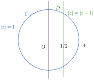
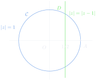
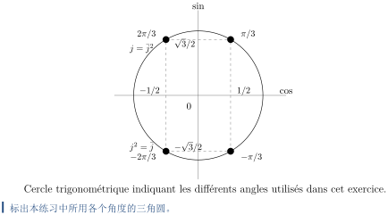

# 第 1 次习题课　复数

TD n°1 — Nombres complexes

CORRIGÉ · 参考解答

中法对照讲义 · 由 LaTeX 源文件渲染

!!! info "阅读说明"

    每段先列法语原文；其下缩进、带深蓝竖条的小字号段落为中文翻译。<strong>加粗</strong>为关键词，括号内为中文释义。

## Exercices à préparer 预备练习

### Exercice 1 练习 1

équation　方程

Trouver tous les nombres complexes \(a\) et \(b\) tels que \(\dfrac{1}{a}+\dfrac{1}{b}=\dfrac{1}{a+b}\).
{: .fr-exo }

求所有满足 \(\dfrac{1}{a}+\dfrac{1}{b}=\dfrac{1}{a+b}\) 的复数 \(a\) 与 \(b\)。
{: .zh }

!!! sol ""

    <strong>Solution.</strong> Soit \((a,b)\in\mathbb{C}^2\) un couple de solutions. On remarque que \(a\neq0\), \(b\neq0\) et \(a+b\neq0\) car sinon l'équation n'est pas définie. On a :

    <strong>解.</strong> 设 \((a,b)\in\mathbb{C}^2\) 是一组解。注意到 \(a\neq0\)、\(b\neq0\) 且 \(a+b\neq0\)， 否则方程无定义。我们有：
    {: .zh }

    \[
    \begin{aligned}
    \frac{1}{a}+\frac{1}{b}&=\frac{1}{a+b}\\
    \text{donc}\quad 1+\frac{a}{b}&=\frac{a}{a+b}=\frac{1}{1+\frac{b}{a}}
      &&\text{car } a\neq0\\
    \text{donc}\quad 1+z&=\frac{1}{1+\frac{1}{z}}
      &&\text{en posant } z=\frac{a}{b}\neq0\\
    \text{donc}\quad 1&=(1+z)\left(1+\frac{1}{z}\right)=2+z+\frac{1}{z}\\
    \text{donc}\quad z^2+z+1&=0.
    \end{aligned}
    \]

    逐步化简：先因 \(a\neq0\) 将第一行两边乘以 \(a\)，再令 \(z=a/b\neq0\)， 展开后即得最末一行关于 \(z\) 的二次方程。
    {: .zh }

    On reconnaît une équation de degré 2 à coefficients réels. Son discriminant est égal à :

    可辨认出这是一个实系数二次方程。其判别式为：
    {: .zh }

    \[
    \Delta=1^2-4\times1\times1=-3<0.
    \]

    L'équation a donc deux solutions complexes conjuguées :

    因此该方程有两个共轭复根：
    {: .zh }

    \[
    z=\frac{-1+i\sqrt3}{2}=e^{2i\pi/3}=j
    \qquad\text{ou}\qquad
    z=\frac{-1-i\sqrt3}{2}=e^{4i\pi/3}=\bar j=\frac{1}{j}.
    \]

    Par conséquent, \(a=jb\) ou \(a=\bar jb\).

    因此 \(a=jb\) 或 \(a=\bar jb\)。
    {: .zh }

!!! warn ""

    <strong>Attention,</strong> on a seulement montré une implication : si \(\frac{1}{a}+\frac{1}{b}=\frac{1}{a+b}\) alors \(a=jb\) ou \(a=\bar jb\), mais il faut aussi vérifier la réciproque pour pouvoir conclure. Autrement dit, si \(\mathscr{S}\) est l'ensemble des couples de solutions, on a seulement montré que :

    <strong>注意：</strong>我们只证明了一个蕴含关系：若 \(\frac{1}{a}+\frac{1}{b}=\frac{1}{a+b}\)，则 \(a=jb\) 或 \(a=\bar jb\)； 还必须验证逆命题才能下结论。换言之，若 \(\mathscr{S}\) 是解对的集合， 我们只证明了：

    \[
    \mathscr{S}\subset\{(jb,b),(\bar jb,b)\mid b\in\mathbb{C}^*\}.
    \]

!!! sol ""

    Réciproquement, soient \(b\in\mathbb{C}^*\) et \(a=jb\). Puisque \(j+\bar j=-1\), on a :

    反之，设 \(b\in\mathbb{C}^*\)，\(a=jb\)。由于 \(j+\bar j=-1\)，有：
    {: .zh }

    \[
    \frac{1}{a}+\frac{1}{b}=\frac{1}{b}(\bar j+1)=\frac{-j}{b}
    \qquad\text{et}\qquad
    \frac{1}{a+b}=\frac{1}{b(j+1)}=\frac{1}{-\bar jb}=\frac{-j}{b}.
    \]

    De même si \(a=\bar jb=b/j\), on vérifie bien que \(\frac{1}{a}+\frac{1}{b}=\frac{-j}{a}=\frac{1}{a+b}\). Finalement, on a montré que l'ensemble des couples de solutions est égal à :

    同样，若 \(a=\bar jb=b/j\)，可验证 \(\frac{1}{a}+\frac{1}{b}=\frac{-j}{a}=\frac{1}{a+b}\)。 最终我们证明了解对的集合等于：
    {: .zh }

    \[
    \boxed{\{(jb,b),(\bar jb,b)\mid b\in\mathbb{C}^*\}}.
    \]

### Exercice 2 练习 2

module　模

Soient \(u,v\in\mathbb{C}\), montrer les relations suivantes :
{: .fr-exo }

设 \(u,v\in\mathbb{C}\)，证明下列关系式：
{: .zh }

1. \(|u|+|v|\leqslant|u+v|+|u-v|\),
    {: .fr-exo }

    \(|u|+|v|\leqslant|u+v|+|u-v|\)，
    {: .zh }

    !!! sol ""

        <strong>Solution.</strong> Pour \(u,v\in\mathbb{C}\), en utilisant l'inégalité triangulaire \(\forall a,b\in\mathbb{C},\ |a+b|\leqslant|a|+|b|\) on a :

        <strong>解.</strong> 对 \(u,v\in\mathbb{C}\)，利用三角不等式 \(\forall a,b\in\mathbb{C},\ |a+b|\leqslant|a|+|b|\)，有：
        {: .zh }

        \[
        \begin{aligned}
          |u|+|v|
          &=\left|\frac{u+v}{2}+\frac{u-v}{2}\right|
           +\left|\frac{u+v}{2}-\frac{u-v}{2}\right|\\
          &\leqslant\left|\frac{u+v}{2}\right|+\left|\frac{u-v}{2}\right|
           +\left|\frac{u+v}{2}\right|+\left|\frac{u-v}{2}\right|
          =|u+v|+|u-v|.
          \end{aligned}
        \]

1. \(|u+v|^2+|u-v|^2=2\left(|u|^2+|v|^2\right)\).
    {: .fr-exo }

    \(|u+v|^2+|u-v|^2=2\left(|u|^2+|v|^2\right)\)。
    {: .zh }

    !!! sol ""

        <strong>Solution.</strong> Pour \(u,v\in\mathbb{C}\), en utilisant \(\forall a\in\mathbb{C},\ |a|^2=a\bar a\), et en développant on a :

        <strong>解.</strong> 对 \(u,v\in\mathbb{C}\)，利用 \(\forall a\in\mathbb{C},\ |a|^2=a\bar a\) 并展开，得：
        {: .zh }

        \[
        \begin{aligned}
          |u+v|^2+|u-v|^2
          &=(u+v)(\bar u+\bar v)+(u-v)(\bar u-\bar v)\\
          &=|u|^2+u\bar v+\bar uv+|v|^2+|u|^2-u\bar v-\bar uv+|v|^2\\
          &=2\left(|u|^2+|v|^2\right).
          \end{aligned}
        \]

### Exercice 3 练习 3

équations　方程

Résoudre les équations d'inconnue \(z\in\mathbb{C}\) suivantes :
{: .fr-exo }

解下列以 \(z\in\mathbb{C}\) 为未知数的方程：
{: .zh }

1. \(z+\dfrac{1}{z}=1\),
    {: .fr-exo }

    \(z+\dfrac{1}{z}=1\)，
    {: .zh }

    !!! sol ""

        <strong>Solution.</strong> Comme \(0\) n'est pas solution, en multipliant par \(z\neq0\), on voit que cette équation est équivalente à \(z\neq0\) et \(z^2-z+1=0\).

        <strong>解.</strong> 由于 \(0\) 不是解，乘以 \(z\neq0\) 可知该方程等价于 \(z\neq0\) 且 \(z^2-z+1=0\)。
        {: .zh }

        On résout cette équation du type \(az^2+bz+c=0\) à l'aide du discriminant \(\Delta=b^2-4ac\) ; on trouve \(\delta\in\mathbb{C}\) solution de \(\Delta=\delta^2\) ; et on obtient \(z=\frac{-b\pm\delta}{2a}\). Dans le cas présent,

        我们借助判别式 \(\Delta=b^2-4ac\) 求解这类方程 \(az^2+bz+c=0\)： 先找 \(\delta\in\mathbb{C}\) 使 \(\Delta=\delta^2\)，于是得到 \(z=\frac{-b\pm\delta}{2a}\)。在本题中，
        {: .zh }

        \[
        \Delta=1-4=-3=(i\sqrt3)^2.
        \]

        D'où les solutions \(z=\boxed{\dfrac{1\pm i\sqrt3}{2}}\).

        由此得解 \(z=\boxed{\dfrac{1\pm i\sqrt3}{2}}\)。
        {: .zh }

1. \(z^3-3z^2+5z=3\),
    {: .fr-exo }

    \(z^3-3z^2+5z=3\)，
    {: .zh }

    !!! sol ""

        <strong>Solution.</strong> On voit que \(z=1\) est racine évidente de cette équation qui est donc équivalente à

        <strong>解.</strong> 可以看出 \(z=1\) 是该方程的一个显然根，因此方程等价于
        {: .zh }

        \[
        (z-1)(z^2-2z+3)=0
          \iff z=1\quad\text{ou}\quad z^2-2z+3=0.
        \]

        On a le discriminant \(\Delta'=1-3=-2=(i\sqrt2)^2\).

        判别式为 \(\Delta'=1-3=-2=(i\sqrt2)^2\)。
        {: .zh }

        (Ici on utilise \(\Delta'=(b/2)^2-ac\) car \(2\mid b\) dans l'équation \(az^2+bz+c=0\). Et si \(\delta\in\mathbb{C}\) est tel que \(\Delta'=\delta^2\) on obtient alors les racines \(z_0=\frac{-b/2\pm\delta}{a}\).)

        （这里使用 \(\Delta'=(b/2)^2-ac\)，因为在方程 \(az^2+bz+c=0\) 中 \(2\mid b\)。 若 \(\delta\in\mathbb{C}\) 满足 \(\Delta'=\delta^2\)，则根为 \(z_0=\frac{-b/2\pm\delta}{a}\)。）
        {: .zh }

        D'où les solutions \(z=\boxed{1\ \text{ou}\ 1+i\sqrt2\ \text{ou}\ 1-i\sqrt2}\).

        由此得解 \(z=\boxed{1\ \text{或}\ 1+i\sqrt2\ \text{或}\ 1-i\sqrt2}\)。
        {: .zh }

1. \(m\in\mathbb{R}\) un paramètre, \(4z^2+12mz+36m+48=3\),
    {: .fr-exo }

    设参数 \(m\in\mathbb{R}\)，\(4z^2+12mz+36m+48=3\)，
    {: .zh }

    !!! sol ""

        <strong>Solution.</strong> Pour traiter ce problème on va utiliser la forme canonique \(z^2+bz+c=(z+b/2)^2-(b/2)^2+c\). On a donc

        <strong>解.</strong> 处理此问题我们将使用配方式 \(z^2+bz+c=(z+b/2)^2-(b/2)^2+c\)。因此
        {: .zh }

        \[
        4z^2+12mz+36m+45=(2z+3m)^2-9m^2+36m+45
          =(2z+3m)^2-9(m^2-4m-5).
        \]

        Pour ce dernier polynôme de degré 2 en \(m\) on a \(\Delta'=4+5=9\) et donc les racines \(m_0=2\pm3=-1\) ou \(5\).

        对这个关于 \(m\) 的二次多项式，\(\Delta'=4+5=9\)，故根为 \(m_0=2\pm3=-1\) 或 \(5\)。
        {: .zh }

        Ainsi, si \(m=-1\) ou \(5\), il n'y a qu'une solution \(z=\boxed{-\dfrac{3m}{2}}\),

        因此，若 \(m=-1\) 或 \(5\)，只有一个解 \(z=\boxed{-\dfrac{3m}{2}}\)，
        {: .zh }

        si \(m\in\left]-\infty,-1\right[\cup\left]5,+\infty\right[\), alors \(m^2-4m-5>0\), et il y a deux solutions réelles :

        若 \(m\in\left]-\infty,-1\right[\cup\left]5,+\infty\right[\)，则 \(m^2-4m-5>0\)， 有两个实解：
        {: .zh }

        \[
        \boxed{z=-\frac{3}{2}\left(m\pm\sqrt{(m+1)(m-5)}\right)}
        \]

        et si \(m\in\left]-1,5\right[\), il y a deux solutions complexes conjuguées :

        而若 \(m\in\left]-1,5\right[\)，则有两个共轭复解：
        {: .zh }

        \[
        \boxed{z=-\frac{3}{2}\left(m\pm i\sqrt{(m+1)(5-m)}\right)}.
        \]

1. \(z^7=z\).
    {: .fr-exo }

    \(z^7=z\)。
    {: .zh }

    !!! sol ""

        <strong>Solution.</strong> On a

        <strong>解.</strong> 有
        {: .zh }

        \[
        \begin{aligned}
          z^7=z
          &\iff z(z^6-1)=0\\
          &\iff z=0\quad\text{ou}\quad z^6=1\\
          &\iff z=0\quad\text{ou}\quad \exists k\in[\![0,5]\!],\ z=e^{2ik\pi/6}\\
          &\iff \boxed{z=0\quad\text{ou}\quad \exists k\in[\![0,5]\!],\ z=e^{ik\pi/3}}.
          \end{aligned}
        \]

### Exercice 4 练习 4

forme polaire　极坐标形式

Calculer le nombre complexe \(\left(\dfrac{1+i\sqrt3}{1-i}\right)^{20}\) et donner le résultat sous sa forme algébrique.
{: .fr-exo }

计算复数 \(\left(\dfrac{1+i\sqrt3}{1-i}\right)^{20}\)，并把结果写成代数形式。
{: .zh }

!!! sol ""

    <strong>Solution.</strong> On commence par calculer une forme polaire pour \(\frac{1+i\sqrt3}{1-i}\). On a

    <strong>解.</strong> 先求 \(\frac{1+i\sqrt3}{1-i}\) 的极坐标形式。有
    {: .zh }

    \[
    \begin{aligned}
    1+i\sqrt3&=2\left(\frac{1}{2}+i\frac{\sqrt3}{2}\right)
     =2\left(\cos\frac{\pi}{3}+i\sin\frac{\pi}{3}\right)=2e^{i\pi/3},\\
    1-i&=\sqrt2\left(\frac{1}{\sqrt2}-\frac{i}{\sqrt2}\right)
     =\sqrt2\left(\cos\frac{\pi}{4}-i\sin\frac{\pi}{4}\right)=\sqrt2e^{-i\pi/4}.
    \end{aligned}
    \]

    D'où

    由此得
    {: .zh }

    \[
    \begin{aligned}
    \left(\frac{1+i\sqrt3}{1-i}\right)^{20}
    &=(\sqrt2)^{20}e^{i\pi\left(\frac13+\frac14\right)\times20}\\
    &=2^{10}e^{i\pi\left(\frac{4-3}{3}\right)\times5}\\
    &=2^{10}e^{i\pi\frac53}\\
    &=1024\left(\frac12-i\frac{\sqrt3}{2}\right)\\
    &=\boxed{512-i512\sqrt3}.
    \end{aligned}
    \]

### Exercice 5 练习 5

géométrie　几何

Soit \(M\) un point d'affixe \(z\in\mathbb{C}\). Soient \(A\) et \(B\) deux points distincts d'affixes respectifs \(a,b\in\mathbb{C}\). Dans chaque cas, donner une condition sur \(z\) équivalente à la propriété géométrique proposée.
{: .fr-exo }

设 \(M\) 是一个复数坐标为 \(z\in\mathbb{C}\) 的点，\(A\) 与 \(B\) 是两个不同的点， 其复数坐标分别为 \(a,b\in\mathbb{C}\)。在每种情形下，给出与所给几何性质等价的 关于 \(z\) 的条件。
{: .zh }

1. Caractériser l'alignement des points \(A\), \(B\) et \(M\).
    {: .fr-exo }

    刻画点 \(A\)、\(B\)、\(M\) 共线（alignement）的条件。
    {: .zh }

    !!! sol ""

        <strong>Solution.</strong> Le point \(M\) est le long de la droite \((AB)\) est équivalent à

        <strong>解.</strong> 点 \(M\) 位于直线 \((AB)\) 上等价于
        {: .zh }

        \[
        \exists\lambda\in\mathbb{R}\quad z-a=\lambda(b-a)
        \]

        c'est-à-dire

        即
        {: .zh }

        \[
        \frac{z-a}{b-a}\in\mathbb{R}
        \]

        ou encore

        或等价地
        {: .zh }

        \[
        \frac{z-a}{b-a}=\frac{\bar z-\bar a}{\bar b-\bar a}.
        \]

        D'où

        由此得
        {: .zh }

        \[
        (\bar b-\bar a)z-(b-a)\bar z=a(\bar b-\bar a)-\bar a(b-a).
        \]

        Ce qui, après simplification par \(|a|^2\) et multiplication par \((-1)\) donne

        约去 \(|a|^2\) 并乘以 \((-1)\) 后得到
        {: .zh }

        \[
        \boxed{(b-a)\bar z-(\bar b-\bar a)z=\bar ab-a\bar b}.
        \]

1. Caractériser la propriété \(AM=BM\).
    {: .fr-exo }

    刻画性质 \(AM=BM\)。
    {: .zh }

    !!! sol ""

        <strong>Solution.</strong> La distance \(AM\) est donnée par \(|z-a|\) d'où la caractérisation

        <strong>解.</strong> 距离 \(AM\) 由 \(|z-a|\) 给出，故有刻画
        {: .zh }

        \[
        |z-a|=|z-b|
        \]

        c'est-à-dire

        即
        {: .zh }

        \[
        |z-a|^2=|z-b|^2
        \]

        ou encore

        或等价地
        {: .zh }

        \[
        (z-a)(\bar z-\bar a)=(z-b)(\bar z-\bar b)
        \]

        ce qui après simplification donne

        化简后得到
        {: .zh }

        \[
        \boxed{(b-a)\bar z-(\bar b-\bar a)z=|b|^2-|a|^2}.
        \]

        On remarquera que, si le membre de gauche est identique au cas précédent, le membre de droite est ici réel tandis que qu'il était imaginaire pur dans le cas précédent.

        注意：虽然左端与前一种情形相同，但这里的右端是实数，而在前一种情形中它是纯虚数。
        {: .zh }

1. Caractériser la propriété \((AM)\perp(BM)\). Faire le calcul montrant qu'alors \(M\) appartient au cercle de diamètre \([AB]\).
    {: .fr-exo }

    刻画性质 \((AM)\perp(BM)\)。完成计算，证明此时 \(M\) 属于以 \([AB]\) 为直径的圆。
    {: .zh }

    !!! sol ""

        <strong>Solution.</strong> Pour que les droites \((AM)\) et \((BM)\) soient définies, cela suppose que \(M\) est différent de \(A\) et de \(B\). Sachant que pour \(u,v\in\mathbb{C}^*\), \(u=\rho e^{i\theta}v\) avec \(\rho>0\) et \(\theta\in\mathbb{R}\) caractérise le fait que les vecteurs \(\vec u\) et \(\vec v\) d'affixes respectifs \(u\) et \(v\) forment un angle \(\theta\), l'orthogonalité entre \((AM)\) et \((BM)\) se caractérise donc par

        <strong>解.</strong> 为使直线 \((AM)\) 与 \((BM)\) 有定义，需假设 \(M\) 不同于 \(A\) 与 \(B\)。 已知对 \(u,v\in\mathbb{C}^*\)，\(u=\rho e^{i\theta}v\)（\(\rho>0\)，\(\theta\in\mathbb{R}\)） 刻画了分别以 \(u\)、\(v\) 为复数坐标的向量 \(\vec u\) 与 \(\vec v\) 夹角为 \(\theta\) 这一事实，因此 \((AM)\) 与 \((BM)\) 的正交性可刻画为
        {: .zh }

        \[
        \frac{a-z}{b-z}=\rho e^{\pm i\pi/2}\in i\mathbb{R}
        \]

        c'est-à-dire

        即
        {: .zh }

        \[
        \frac{\bar a-\bar z}{\bar b-\bar z}=-\frac{a-z}{b-z}
        \]

        ou encore

        或等价地
        {: .zh }

        \[
        (\bar a-\bar z)(b-z)=-(a-z)(\bar b-\bar z).
        \]

        On développe alors selon \(z\) et on obtient

        按 \(z\) 展开即得
        {: .zh }

        \[
        \boxed{2|z|^2-(a+b)\bar z-(\bar a+\bar b)z=-\bar ab-a\bar b}.
        \]

        On introduit le milieu \(C\) de \([AB]\) d'affixe \(m=\frac{a+b}{2}\) et on calcule

        引入 \([AB]\) 的中点 \(C\)，其复数坐标为 \(m=\frac{a+b}{2}\)，并计算
        {: .zh }

        \[
        \begin{aligned}
          |z-m|^2
          &=\left(z-\frac{a+b}{2}\right)\left(\bar z-\frac{\bar a+\bar b}{2}\right)\\
          &=|z|^2-\frac12(a+b)\bar z-\frac12(\bar a+\bar b)z+\left|\frac{a+b}{2}\right|^2\\
          &=-\frac12\bar ab-\frac12 a\bar b+\frac14\left(|a|^2+a\bar b+\bar ab+|b|^2\right)\\
          &=\left|\frac{a-b}{2}\right|^2.
          \end{aligned}
        \]

        Donc \(CM=AB/2\) et \(M\) est sur le cercle de diamètre \([AB]\).

        因此 \(CM=AB/2\)，即 \(M\) 在以 \([AB]\) 为直径的圆上。
        {: .zh }

### Exercice 6 练习 6

géométrie　几何

Déterminer \(z\in\mathbb{C}\) pour que \(z\), \(z-1\) et \(1/z\) aient le même module.
{: .fr-exo }

求 \(z\in\mathbb{C}\)，使得 \(z\)、\(z-1\) 与 \(1/z\) 具有相同的模。
{: .zh }

!!! sol ""

    <strong>Solution.</strong> L'ensemble des points d'affixe \(z\in\mathbb{C}\) tels que \(|z|=1/|z|\) c'est-à-dire \(|z|^2=1\) est le cercle \(\mathcal{C}\) de centre \(O=(0,0)\) et de rayon \(1\). Par ailleurs, l'égalité \(|z|=|1-z|\) équivaut à \(M\) d'affixe \(z\) équidistant de \(O\) d'affixe \(0\) et de \(A=(1,0)\) d'affixe \(1\), c'est-à-dire \(M\) est sur la médiatrice \(\mathcal{D}\) de \([OA]\), la droite \(D\) d'équation \(\operatorname{Re}(z)=1/2\). L'ensemble solution est donc l'intersection du cercle \(\mathcal{C}\) et de la droite \(\mathcal{D}\) c'est-à-dire

    <strong>解.</strong> 满足 \(|z|=1/|z|\) 即 \(|z|^2=1\) 的复数坐标 \(z\in\mathbb{C}\) 的点的集合， 是以 \(O=(0,0)\) 为圆心、半径为 \(1\) 的圆 \(\mathcal{C}\)。另一方面，等式 \(|z|=|1-z|\) 等价于坐标为 \(z\) 的点 \(M\) 到坐标为 \(0\) 的 \(O\) 与到坐标为 \(1\) 的 \(A=(1,0)\) 等距，也就是说 \(M\) 在 \([OA]\) 的中垂线 \(\mathcal{D}\) 上，即直线 \(D\)：\(\operatorname{Re}(z)=1/2\)。因此解集是圆 \(\mathcal{C}\) 与直线 \(\mathcal{D}\) 的交集，即
    {: .zh }

    \[
    \boxed{z\in\left\{\left(\frac12+i\frac{\sqrt3}{2}\right),
      \left(\frac12-i\frac{\sqrt3}{2}\right)\right\}}.
    \]

!!! warning "Vocabulaire clé 重点词汇"

    - <strong>couple de solutions</strong>：解对
    - <strong>vérifier la réciproque</strong>：验证逆命题
    - <strong>inégalité triangulaire</strong>：三角不等式
    - <strong>discriminant</strong>：判别式
    - <strong>racine évidente</strong>：显然根
    - <strong>forme canonique</strong>：配方式
    - <strong>forme polaire</strong>：极坐标形式
    - <strong>forme algébrique</strong>：代数形式
    - <strong>affixe</strong>：复数坐标
    - <strong>alignement</strong>：共线
    - <strong>médiatrice</strong>：中垂线
    - <strong>équidistant</strong>：等距
    - <strong>cercle de diamètre \([AB]\)</strong>：以 \([AB]\) 为直径的圆
    - <strong>réciproquement</strong>：反之

## Exercices supplémentaires 补充练习

### Exercice 7 练习 7

géométrie　几何

Déterminer la nature géométrique des ensembles suivants
{: .fr-exo }

确定下列集合的几何性质：
{: .zh }

1. \(S_1=\left\{z\in\mathbb{C}\mid |z|=|z-6+5i|\right\}\)
    {: .fr-exo }

    \(S_1=\left\{z\in\mathbb{C}\mid |z|=|z-6+5i|\right\}\)
    {: .zh }

    !!! sol ""

        <strong>Solution.</strong> Le point \(M\) d'affixe \(z\in S_1\) est équidistant de \(O=(0,0)\) et de \(A=(6,-5)\). Il décrit donc la droite médiatrice du segment \([OA]\), c'est-à-dire la droite de vecteur directeur \(\vec u=\overrightarrow{OA}^{\perp}=(5,6)\) et passant par \((3,-5/2)\) le milieu de \([OA]\).

        <strong>解.</strong> 坐标为 \(z\in S_1\) 的点 \(M\) 到 \(O=(0,0)\) 与 \(A=(6,-5)\) 等距。 因此它描出线段 \([OA]\) 的中垂线，即方向向量为 \(\vec u=\overrightarrow{OA}^{\perp}=(5,6)\)、且经过 \([OA]\) 中点 \((3,-5/2)\) 的直线。
        {: .zh }

1. \(S_2=\left\{z\in\mathbb{C}\mid z(2\bar z+1)=1\right\}\)
    {: .fr-exo }

    \(S_2=\left\{z\in\mathbb{C}\mid z(2\bar z+1)=1\right\}\)
    {: .zh }

    !!! sol ""

        <strong>Solution.</strong> On pose \(z=x+iy\), pour \(x,y\in\mathbb{R}\). Alors

        <strong>解.</strong> 令 \(z=x+iy\)，其中 \(x,y\in\mathbb{R}\)。则
        {: .zh }

        \[
        \begin{aligned}
          z\in S_2
          &\iff (x+iy)(2x-2iy+1)=1\\
          &\iff 2x^2+2y^2-2ixy+2ixy+x+iy=1\\
          &\iff 2x^2+2y^2+x+iy=1\\
          &\iff y=0\quad\text{et}\quad 2x^2+x-1=0.
          \end{aligned}
        \]

        Pour cette dernière équation on a le discriminant \(\Delta=1+8=9\).

        对最后一个方程，判别式 \(\Delta=1+8=9\)。
        {: .zh }

        D'où \(z\in S_2\iff y=0\) et \(x=\frac{-1\pm3}{4}=-1\) ou \(\frac12\).

        由此 \(z\in S_2\iff y=0\) 且 \(x=\frac{-1\pm3}{4}=-1\) 或 \(\frac12\)。
        {: .zh }

        \[
        \boxed{S_2=\{(-1,0),(1/2,0)\}}.
        \]

1. \(S_3=\left\{z\in\mathbb{C}\mid \dfrac{z+4i}{5z-3}\in\mathbb{R}\right\}\)
    {: .fr-exo }

    \(S_3=\left\{z\in\mathbb{C}\mid \dfrac{z+4i}{5z-3}\in\mathbb{R}\right\}\)
    {: .zh }

    !!! sol ""

        <strong>Solution.</strong> L'équation \(\frac{z+4i}{5z-3}\in\mathbb{R}\) correspond à l'alignement des points \((0,-4)\), \(\left(\frac35,0\right)\) et \(M\) d'affixe \(z\) tout en excluant le point \(\left(\frac35,0\right)\). Soit \(D\) la droite de vecteur directeur \(\left(\frac35,4\right)\) et passant par \((0,-4)\), alors

        <strong>解.</strong> 方程 \(\frac{z+4i}{5z-3}\in\mathbb{R}\) 对应于点 \((0,-4)\)、 \(\left(\frac35,0\right)\) 与坐标为 \(z\) 的点 \(M\) 共线，同时排除点 \(\left(\frac35,0\right)\)。设 \(D\) 为方向向量 \(\left(\frac35,4\right)\) 且经过 \((0,-4)\) 的直线，则
        {: .zh }

        \[
        \boxed{S_3=D\setminus\{(3/5,0)\}}.
        \]

1. \(S_4=\left\{z\in\mathbb{C}\mid
     \operatorname{Re}\left(\dfrac{z-1}{z+1}\right)=0\right\}\)
    {: .fr-exo }

    \(S_4=\left\{z\in\mathbb{C}\mid
     \operatorname{Re}\left(\dfrac{z-1}{z+1}\right)=0\right\}\)
    {: .zh }

    !!! sol ""

        <strong>Solution.</strong> Soient \(A=(1,0)\), \(B=(-1,0)\) et \(M\) d'affixe \(z\). Soit \(\mathcal{C}\) le cercle de diamètre \([AB]\) alors \(\frac{z-1}{z+1}\in i\mathbb{R}\) correspond à \((AM)\perp(BM)\) ou \(M=A\) c'est-à-dire

        <strong>解.</strong> 设 \(A=(1,0)\)、\(B=(-1,0)\)，\(M\) 的复数坐标为 \(z\)。设 \(\mathcal{C}\) 为以 \([AB]\) 为直径的圆，则 \(\frac{z-1}{z+1}\in i\mathbb{R}\) 对应于 \((AM)\perp(BM)\) 或 \(M=A\)，即
        {: .zh }

        \[
        \boxed{S_4=\mathcal{C}\setminus\{B\}}.
        \]

### Exercice 8 练习 8

arithmétique　算术

Un entier est dit somme de deux carrés s'il existe un couple d'entiers \((a,b)\in\mathbb{N}^2\) tel que \(n=a^2+b^2\). Montrer que le produit de deux tels entiers est encore somme de deux carrés.
{: .fr-exo }

若存在整数对 \((a,b)\in\mathbb{N}^2\) 使 \(n=a^2+b^2\)，则称整数 \(n\) 为两个平方数之和。 证明两个这样的整数之积仍是两个平方数之和。
{: .zh }

!!! sol ""

    <strong>Solution.</strong> Soient \(n\) et \(m\) deux entiers qui sont tous deux sommes de deux carrés : \(n=a^2+b^2\) et \(m=c^2+d^2\) avec \(a,b,c,d\in\mathbb{N}\). On reconnait l'expression d'un module au carré et on peut écrire \(n=|a+ib|^2\) et \(m=|c+id|^2\). On a alors

    <strong>解.</strong> 设 \(n\) 与 \(m\) 都是两个平方数之和：\(n=a^2+b^2\)，\(m=c^2+d^2\)， 其中 \(a,b,c,d\in\mathbb{N}\)。可以识别出这是模的平方的表达式，于是可写 \(n=|a+ib|^2\)、\(m=|c+id|^2\)。于是
    {: .zh }

    \[
    nm=|(a+ib)(c+id)|^2=|ac-bd+i(ad+bc)|^2=(ac-bd)^2+(ad+bc)^2,
    \]

    avec \(|ac-bd|,|ad+bc|\in\mathbb{N}\).

    其中 \(|ac-bd|,|ad+bc|\in\mathbb{N}\)。
    {: .zh }

### Exercice 9 练习 9

calcul　计算

Soit \(n\) un entier tel que \(n\geqslant2\). On considère le produit
{: .fr-exo }

设整数 \(n\geqslant2\)。考虑乘积
{: .zh }

\[
P=\prod_{k=2}^{n}\frac{k^3+1}{k^3-1}.
\]

1. Résoudre l'équation \(z^3=1\) d'inconnue \(z\in\mathbb{C}\). On note \(j\) la solution telle que \(\operatorname{Im}j>0\).
    {: .fr-exo }

    解以 \(z\in\mathbb{C}\) 为未知数的方程 \(z^3=1\)。将满足 \(\operatorname{Im}j>0\) 的解记为 \(j\)。
    {: .zh }

    !!! sol ""

        <strong>Solution.</strong> On reconnaît les racines 3-ièmes de l'unité. Donc :

        <strong>解.</strong> 可以识别出这是三次单位根。因此：
        {: .zh }

        \[
        \forall z\in\mathbb{C},\quad
          \boxed{z^3=1\iff z\in\{1,e^{2i\pi/3},e^{4i\pi/3}\}=\{1,j,\bar j\}}
          \quad\text{où}\quad
          \boxed{j=-\frac12+i\frac{\sqrt3}{2}}.
        \]

1. Calculer \(1+j+j^2\).
    {: .fr-exo }

    计算 \(1+j+j^2\)。
    {: .zh }

    !!! sol ""

        <strong>Solution.</strong> On a :

        <strong>解.</strong> 有：
        {: .zh }

        \[
        1+j+j^2=1+j+\bar j=1+2\underbrace{\operatorname{Re}(j)}_{=-1/2}=\boxed{0}.
        \]

1. Montrer que l'on a les factorisations suivantes :
    {: .fr-exo }

    证明下列因式分解：
    {: .zh }

    \[
    X^3-1=(X-1)(X-j)(X-j^2)
      \qquad\text{et}\qquad
      X^3+1=(X+1)(X+j)(X+j^2).
    \]

    \[3\]

    !!! sol ""

        <strong>Solution.</strong> On a :

        <strong>解.</strong> 有：
        {: .zh }

        \[
        \begin{aligned}
          (X-1)(X-j)(X-j^2)
          &=(X^2-jX-X+j)(X-j^2)\\
          &=X^3-j^2X^2-jX^2+j^3X-X^2+j^2X+jX-j^3\\
          &=X^3-(1+j+j^2)X^2+j(1+j+j^2)X-j^3.
          \end{aligned}
        \]

        Or \(j^3=1\) d'après la question 1 et \(1+j+j^2=0\) d'après la question 2, donc :

        而由第 1 问 \(j^3=1\)，由第 2 问 \(1+j+j^2=0\)，故：
        {: .zh }

        \[
        \boxed{(X-1)(X-j)(X-j^2)=X^3-1}.
        \]

        De même :

        同样：
        {: .zh }

        \[
        (X+1)(X+j)(X+j^2)=X^3+(1+j+j^2)X^2+j(1+j+j^2)X+j^3
          =\boxed{X^3+1}.
        \]

1. En déduire
    {: .fr-exo }

    由此推出
    {: .zh }

    \[
    P=\left(\prod_{k=2}^{n}\frac{k+1}{k-1}\right)
        \left(\prod_{k=2}^{n}\frac{k+j}{k+1+j}\right)
        \left(\prod_{k=2}^{n}\frac{k+j^2}{k+1+j^2}\right)
    \]

    !!! sol ""

        <strong>Solution.</strong> On a :

        <strong>解.</strong> 有：
        {: .zh }

        \[
        \begin{aligned}
          P&=\prod_{k=2}^{n}\frac{k^3+1}{k^3-1}\\
          &=\prod_{k=2}^{n}\frac{(k+1)(k+j)(k+j^2)}{(k-1)(k-j)(k-j^2)}
           \quad\text{d'après le résultat de la question précédente}\\
          &=\left(\prod_{k=2}^{n}\frac{k+1}{k-1}\right)
            \left(\prod_{k=2}^{n}\frac{(k+j)(k+j^2)}{(k-j)(k-j^2)}\right).
          \end{aligned}
        \]

        其中第二个等号使用了上一问的因式分解结果。
        {: .zh }

        De plus, \(1+j+j^2=0\) d'après la question 2, donc \(-j=1+j^2\) et \(-j^2=1+j\). Par conséquent :

        此外，由第 2 问 \(1+j+j^2=0\)，故 \(-j=1+j^2\)，\(-j^2=1+j\)。因此：
        {: .zh }

        \[
        \begin{aligned}
          P&=\left(\prod_{k=2}^{n}\frac{k+1}{k-1}\right)
            \left(\prod_{k=2}^{n}\frac{(k+j)(k+j^2)}{(k+1+j^2)(k+1+j)}\right)\\
          &=\boxed{\left(\prod_{k=2}^{n}\frac{k+1}{k-1}\right)
            \left(\prod_{k=2}^{n}\frac{k+j}{k+1+j}\right)
            \left(\prod_{k=2}^{n}\frac{k+j^2}{k+1+j^2}\right)}
            \quad\text{par commutativité.}
          \end{aligned}
        \]

1. Simplifier \(P\).
    {: .fr-exo }

    化简 \(P\)。
    {: .zh }

    !!! sol ""

        <strong>Solution.</strong> On a :

        <strong>解.</strong> 有：
        {: .zh }

        \[
        \begin{aligned}
          \prod_{k=2}^{n}\frac{k+1}{k-1}
          &=\frac31\times\frac42\times\frac53\times\frac64\times\cdots
           \times\frac{n-1}{n-3}\times\frac{n}{n-2}\times\frac{n+1}{n-1}\\
          &=\frac{n\times(n+1)}{1\times2}=\frac{n(n+1)}{2}
           &&\text{après simplifications.}
          \end{aligned}
        \]

    !!! warn ""

        Ce type de simplification en mathématiques s'appelle un « télescopage ». Ce mot est aussi utilisé pour un accident de la route où plusieurs voitures se heurtent les unes après les autres : une voiture est projetée contre la suivante, qui est projetée contre la suivante, etc. De même, dans un télescopage mathématique, les termes se simplifient les uns après les autres.

        这类化简在数学中称为「裂项相消」（télescopage）。这个词也用于描述 多辆汽车依次相撞的交通事故：一辆车被撞向紧随其后的车，后者又被撞向再后面的一辆， 依此类推。同样，在数学的裂项相消中，各项也依次相互抵消。

    !!! sol ""

        De même :

        同样：
        {: .zh }

        \[
        \prod_{k=2}^{n}\frac{k+j}{k+1+j}
          =\frac{2+j}{3+j}\times\frac{3+j}{4+j}\times\frac{4+j}{5+j}\times\cdots
           \times\frac{n-1+j}{n+j}\times\frac{n+j}{n+1+j}
          =\frac{2+j}{n+1+j},
        \]

        \[
        \text{et}\qquad
          \prod_{k=2}^{n}\frac{k+j^2}{k+1+j^2}
          =\frac{2+j^2}{n+1+j^2}.
        \]

        Par conséquent, on a d'après la question précédente :

        因此，由上一问可得：
        {: .zh }

        \[
        \begin{aligned}
          P&=\left(\prod_{k=2}^{n}\frac{k+1}{k-1}\right)
            \left(\prod_{k=2}^{n}\frac{k+j}{k+1+j}\right)
            \left(\prod_{k=2}^{n}\frac{k+j^2}{k+1+j^2}\right)\\
          &=\frac{n(n+1)}{2}\times\frac{2+j}{n+1+j}\times\frac{2+j^2}{n+1+j^2}\\
          &=\frac{n(n+1)}{2}\times\frac{4+2(j+j^2)+j^3}
            {(n+1)^2+(n+1)(j+j^2)+j^3}\\
          &=\frac{n(n+1)}{2}\times\frac{3}{(n+1)^2-(n+1)+1}
           \quad\substack{\text{l@{}}
             car $j^3=1$ d'après la question 1 et\\
             $j+j^2=-1$ d'après la question 2}}\\
          &=\boxed{\frac{3n(n+1)}{2(n^2+n+1)}}.
          \end{aligned}
        \]

        最后一步使用了第 1 问的 \(j^3=1\) 与第 2 问的 \(j+j^2=-1\)。
        {: .zh }

### Exercice 10 练习 10

géométrie　几何

Soient \(A\), \(B\) et \(C\) trois points du plan d'affixes \(a,b,c\in\mathbb{C}\).
{: .fr-exo }

设 \(A\)、\(B\)、\(C\) 是平面上三个点，其复数坐标分别为 \(a,b,c\in\mathbb{C}\)。
{: .zh }

1. Montrer que le triangle \(ABC\) est équilatéral si et seulement si \(j=e^{2i\pi/3}\) ou \(\bar j=e^{-2i\pi/3}\) est solution de l'équation \(az^2+bz+c=0\) d'inconnue \(z\in\mathbb{C}\).
    {: .fr-exo }

    证明三角形 \(ABC\) 为等边三角形，当且仅当 \(j=e^{2i\pi/3}\) 或 \(\bar j=e^{-2i\pi/3}\) 是以 \(z\in\mathbb{C}\) 为未知数的方程 \(az^2+bz+c=0\) 的解。
    {: .zh }

    !!! sol ""

        <strong>Solution.</strong> On a \(ABC\) triangle équilatéral équivaut aux vecteurs \(\overrightarrow{AB}\) et \(\overrightarrow{AC}\) sont de même longueur et forment un angle de \(\pi/3\) ou \(-\pi/3\).

        <strong>解.</strong> 三角形 \(ABC\) 为等边三角形，等价于向量 \(\overrightarrow{AB}\) 与 \(\overrightarrow{AC}\) 长度相等且夹角为 \(\pi/3\) 或 \(-\pi/3\)。
        {: .zh }

        Soient \(a,b,c\in\mathbb{C}\) les affixes respectifs de \(A,B,C\), alors

        设 \(a,b,c\in\mathbb{C}\) 分别为 \(A,B,C\) 的复数坐标，则
        {: .zh }

        \[
        \begin{aligned}
          &(ABC)\ \text{triangle équilatéral}\\
          &\iff b-a=e^{i\pi/3}(c-a)\quad\text{ou}\quad b-a=e^{-i\pi/3}(c-a)\\
          &\iff b+\left(e^{i\pi/3}-1\right)a-e^{i\pi/3}c=0
           \quad\text{ou}\quad
           b+\left(e^{-i\pi/3}-1\right)a-e^{-i\pi/3}c=0\\
          &\iff b+e^{2i\pi/3}a+e^{4i\pi/3}c=0
           \quad\text{ou}\quad
           b+e^{-2i\pi/3}a+e^{-4i\pi/3}c=0\\
          &\iff b+ja+j^2c=0\quad\text{ou}\quad b+\bar ja+\bar j^2c=0\\
          &\iff a+\bar jb+\bar j^2c=0\quad\text{ou}\quad a+jb+j^2c=0\\
          &\iff a+bz+cz^2=0\quad\text{admet pour solution }j\text{ ou }\bar j.
          \end{aligned}
        \]

1. Peut-on trouver un triangle équilatéral dont les trois sommets ont des coordonnées entières ?
    {: .fr-exo }

    能否找到一个三个顶点坐标均为整数的等边三角形？
    {: .zh }

    !!! sol ""

        <strong>Solution.</strong> On suppose par l'absurde que \(a,b,c\in\mathbb{Z}+i\mathbb{Z}\), alors

        <strong>解.</strong> 反设 \(a,b,c\in\mathbb{Z}+i\mathbb{Z}\)，则
        {: .zh }

        \[
        e^{\pm i\pi/3}=\frac12\pm i\frac{\sqrt3}{2}
          =\frac{b-a}{c-a}
          =\frac{(b-a)(\bar c-\bar a)}{|c-a|^2}\in\mathbb{Q}+i\mathbb{Q}.
        \]

        Or \(\sqrt3\notin\mathbb{Q}\) car si \(\sqrt3\in\mathbb{Q}\), alors \(\exists p,q\in\mathbb{N}\) avec \(p\) et \(q\) premiers entre eux tels que \(\sqrt3=p/q\) ou encore \(3q^2=p^2\). Alors \(3\mid p\) et \(p=3p'\), donc \(q^3=3p'^2\), d'où \(3\mid q\) ce qui contredit \(p\) et \(q\) premiers entre eux.

        而 \(\sqrt3\notin\mathbb{Q}\)，因为若 \(\sqrt3\in\mathbb{Q}\)，则存在互质的 \(p,q\in\mathbb{N}\) 使 \(\sqrt3=p/q\)，即 \(3q^2=p^2\)。于是 \(3\mid p\)， 设 \(p=3p'\)，从而 \(q^3=3p'^2\)，故 \(3\mid q\)，这与 \(p\)、\(q\) 互质矛盾。
        {: .zh }

        On conclut par l'absurde qu'il n'existe pas de triangle équilatéral dont les trois sommets ont des coordonnées entières.

        由反证法得出结论：不存在三个顶点坐标均为整数的等边三角形。
        {: .zh }

!!! warning "Vocabulaire clé 重点词汇"

    - <strong>nature géométrique</strong>：几何性质
    - <strong>somme de deux carrés</strong>：两个平方数之和
    - <strong>racines 3-ièmes de l'unité</strong>：三次单位根
    - <strong>télescopage</strong>：裂项相消
    - <strong>par commutativité</strong>：由交换律
    - <strong>triangle équilatéral</strong>：等边三角形
    - <strong>coordonnées entières</strong>：整数坐标
    - <strong>premiers entre eux</strong>：互质
    - <strong>par l'absurde</strong>：反证
    - <strong>en déduire</strong>：由此推出
    - <strong>simplifier</strong>：化简
    - <strong>on reconnaît</strong>：可识别出 / 看出
    - <strong>d'où</strong>：由此得
    - <strong>par conséquent</strong>：因此
