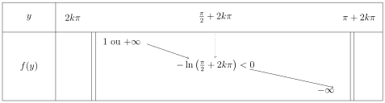

# 第 2 次习题课　三角学

TD n°2 — Trigonométrie

CORRIGÉ · 参考解答

中法对照讲义 · 由 LaTeX 源文件渲染

!!! info "阅读说明"

    每段先列法语原文；其下缩进、带深蓝竖条的小字号段落为中文翻译。<strong>加粗</strong>为关键词，括号内为中文释义。

## Exercices à préparer 预备练习

### Exercice 1 练习 1

extraction de racines carrées　求平方根

Résoudre les équations d'inconnue \(z\in\mathbb{C}\) suivantes
{: .fr-exo }

\[
1.\ z^2=1,\qquad 2.\ z^2=-1,\qquad 3.\ z^2=i,\qquad
4.\ z^2=7+4i\sqrt3,\qquad 5.\ z^2=j
\]

求解下列以 \(z\in\mathbb{C}\) 为未知数的方程
{: .zh }

où \(j\in\mathbb{C}\) tel que \(j^3=1\) et \(\operatorname{Im} j>0\).

其中 \(j\in\mathbb{C}\) 满足 \(j^3=1\) 且 \(\operatorname{Im} j>0\)。
{: .zh }

!!! sol ""

    <strong>Solution.</strong> 1. \(z^2=1\iff\boxed{z=1\text{ ou }z=-1}\)

    <strong>解.</strong> 1. \(z^2=1\iff\boxed{z=1\text{ 或 }z=-1}\)
    {: .zh }

    2. \(z^2=-1\iff\boxed{z=\pm i}\)

    2. \(z^2=-1\iff\boxed{z=\pm i}\)
    {: .zh }

    3. \(z^2=i=e^{i\pi/2}\iff z=\pm e^{i\pi/4}
     =\boxed{\pm\left(\frac{\sqrt2}{2}+i\frac{\sqrt2}{2}\right)}\)

    3. \(z^2=i=e^{i\pi/2}\iff z=\pm e^{i\pi/4}
     =\boxed{\pm\left(\frac{\sqrt2}{2}+i\frac{\sqrt2}{2}\right)}\)
    {: .zh }

    4. Ici on cherche \(a,b\in\mathbb{R}\) tels que \((a+ib\sqrt3)^2=7+4i\sqrt3\) c'est-à-dire \(a^2-3b^2=7\) et \(2ab=4\).

    4. 这里寻找 \(a,b\in\mathbb{R}\) 使得 \((a+ib\sqrt3)^2=7+4i\sqrt3\)， 即 \(a^2-3b^2=7\) 且 \(2ab=4\)。
    {: .zh }

    Cela équivaut à \(ab=2\) et \(a^4-7a^2-12=0\) de discriminant \(\Delta=49+48=97\), d'où \(a^2=\frac{7\pm\sqrt{97}}{2}=\frac{7+\sqrt{97}}{2}\) car \(a\in\mathbb{R}\). Finalement

    \[
    \boxed{z=\pm\left(\sqrt{\frac{7+\sqrt{97}}{2}}
      +i\,\frac{2\sqrt6}{\sqrt{7+\sqrt{97}}}\right)}.
    \]

    这等价于 \(ab=2\) 且 \(a^4-7a^2-12=0\)，其判别式 \(\Delta=49+48=97\)，故 \(a^2=\frac{7\pm\sqrt{97}}{2}=\frac{7+\sqrt{97}}{2}\) （因为 \(a\in\mathbb{R}\)）。最终
    {: .zh }

    5. \(z^2=j=e^{2i\pi/3}\), d'où les solutions \(\boxed{z=\pm e^{i\pi/3}}\).

    5. \(z^2=j=e^{2i\pi/3}\)，因此解为 \(\boxed{z=\pm e^{i\pi/3}}\)。
    {: .zh }

### Exercice 2 练习 2

forme exponentielle　指数形式

Soient \(\alpha,\beta\in\mathbb{R}\). Écrire sous forme exponentielle
{: .fr-exo }

\[
z=(\cos\alpha+\sin\beta)+i(\sin\alpha+\cos\beta).
\]

设 \(\alpha,\beta\in\mathbb{R}\)。将下式写成指数形式
{: .zh }

!!! sol ""

    <strong>Solution.</strong> On utilise \(\sin(\pi/2-\beta)=\cos\beta\) pour écrire

    \[
    \begin{aligned}
    z&=\cos\alpha+i\sin\alpha+\cos(\pi/2-\beta)+i\sin(\pi/2-\beta)\\
     &=e^{i\alpha}+e^{i(\pi/2-\beta)}\\
     &=e^{i\left(\frac{\pi}{4}+\frac{\alpha-\beta}{2}\right)}
       \left(e^{i\left(-\frac{\pi}{4}+\frac{\alpha+\beta}{2}\right)}
       +e^{i\left(\frac{\pi}{4}-\frac{\alpha+\beta}{2}\right)}\right)\\
     &=2\cos\left(\frac{\pi}{4}-\frac{\alpha+\beta}{2}\right)
       e^{i\left(\frac{\pi}{4}+\frac{\alpha-\beta}{2}\right)}.
    \end{aligned}
    \]

    <strong>解.</strong> 利用 \(\sin(\pi/2-\beta)=\cos\beta\) 可写出
    {: .zh }

    Par ailleur, on a \(\cos\theta\leqslant0\iff
     \theta\in\bigcup_{k\in\mathbb{Z}}\left[\frac{\pi}{2}+2k\pi,\frac{3\pi}{2}+2k\pi\right]\), donc

    \[
    \begin{aligned}
    \cos\left(\frac{\pi}{4}-\frac{\alpha+\beta}{2}\right)\leqslant0
    &\iff \frac{\pi}{4}-\frac{\alpha+\beta}{2}
      \in\bigcup_{k\in\mathbb{Z}}\left[\frac{\pi}{2}+2k\pi,\frac{3\pi}{2}+2k\pi\right]\\
    &\iff -\frac{\alpha+\beta}{2}
      \in\bigcup_{k\in\mathbb{Z}}\left[\frac{\pi}{4}+2k\pi,\frac{5\pi}{4}+2k\pi\right]\\
    &\iff (\alpha+\beta)
      \in\bigcup_{k\in\mathbb{Z}}\left[-\frac{5\pi}{2}+4k\pi,-\frac{\pi}{2}+4k\pi\right].
    \end{aligned}
    \]

    此外，\(\cos\theta\leqslant0\iff
     \theta\in\bigcup_{k\in\mathbb{Z}}\left[\frac{\pi}{2}+2k\pi,\frac{3\pi}{2}+2k\pi\right]\)，因此
    {: .zh }

    Soient \(E\) un ensemble et \(A\) un sous-ensemble de \(E\). On note \(\chi_A:E\to\{0,1\}\) la fonction telle que pour tout \(x\in E\), \(\chi_A(x)=1\iff x\in A\). Alors si on note \(A=\bigcup_{k\in\mathbb{Z}}\left[\frac{3\pi}{2}+4k\pi,\frac{7\pi}{2}+4k\pi\right]\), la forme exponentielle de \(z\) est

    \[
    \boxed{z=2\cos\left(\frac{\pi}{4}-\frac{\alpha+\beta}{2}+\pi\chi_A(\alpha+\beta)\right)
    e^{i\left(\frac{\pi}{4}+\frac{\alpha-\beta}{2}+\pi\chi_A(\alpha+\beta)\right)}}.
    \]

    设 \(E\) 为集合，\(A\) 为 \(E\) 的子集。记 \(\chi_A:E\to\{0,1\}\) 为满足 “对任意 \(x\in E\)，\(\chi_A(x)=1\iff x\in A\)”的函数。那么若记 \(A=\bigcup_{k\in\mathbb{Z}}\left[\frac{3\pi}{2}+4k\pi,\frac{7\pi}{2}+4k\pi\right]\)， 则 \(z\) 的指数形式为
    {: .zh }

    Remarque : Si \(\cos\left(\frac{\pi}{4}-\frac{\alpha+\beta}{2}\right)=0\) c'est-à-dire si \(\exists k\in\mathbb{Z}\), \(\alpha+\beta=\frac{3\pi}{2}+2k\pi\), alors le module est nul et l'argument est indéterminé.

    注：若 \(\cos\left(\frac{\pi}{4}-\frac{\alpha+\beta}{2}\right)=0\)， 即存在 \(k\in\mathbb{Z}\) 使 \(\alpha+\beta=\frac{3\pi}{2}+2k\pi\)， 则模为零，辐角不确定。
    {: .zh }

### Exercice 3 练习 3

linéariser/développer　线性化/展开

1. Pour \(\theta\in\mathbb{R}\), écrire les expressions suivantes comme sommes de sinus et de cosinus
{: .fr-exo }

\[
a)\ \cos^2\theta\sin^2\theta,\qquad b)\ \cos^3\theta,\qquad
c)\ \cos^2\theta\sin^3\theta.
\]

1. 对 \(\theta\in\mathbb{R}\)，将下列表达式写成正弦与余弦之和
{: .zh }

!!! sol ""

    <strong>Solution.</strong> a) En utilisant \(\sin(2\theta)=2\sin\theta\cos\theta\) et \(\cos(2\theta)=1-2\sin^2\theta\), on a

    \[
    \cos^2\theta\sin^2\theta
    =\left(\frac{\sin(2\theta)}{2}\right)^2
    =\frac14\left(\frac{1-\cos(4\theta)}{2}\right)
    =\boxed{-\frac{\cos(4\theta)}{8}+\frac18}.
    \]

    <strong>解.</strong> a) 利用 \(\sin(2\theta)=2\sin\theta\cos\theta\) 与 \(\cos(2\theta)=1-2\sin^2\theta\)，有
    {: .zh }

    b) En utilisant la formule d'Euler pour \(\cos\theta\), on a

    \[
    \begin{aligned}
    \cos^3\theta&=\left(\frac{e^{i\theta}+e^{-i\theta}}{2}\right)^3\\
    &=\frac18\left(e^{3i\theta}+3e^{i\theta}+3e^{-i\theta}+e^{-3i\theta}\right)\\
    &=\boxed{\frac14\cos(3\theta)+\frac34\cos\theta}.
    \end{aligned}
    \]

    b) 利用 \(\cos\theta\) 的欧拉公式，有
    {: .zh }

    c) En utilisant les formules d'Euler pour \(\cos\theta\) et \(\sin\theta\), on a

    \[
    \begin{aligned}
    \cos^2\theta\sin^3\theta
    &=\left(\frac{e^{i\theta}+e^{-i\theta}}{2}\right)^2
      \left(\frac{e^{i\theta}-e^{-i\theta}}{2i}\right)^3\\
    &=\frac{1}{-32i}\left(\left(e^{2i\theta}+2+e^{-2i\theta}\right)
      \left(e^{3i\theta}-3e^{i\theta}+3e^{-i\theta}-e^{-3i\theta}\right)\right)\\
    &=\frac{1}{-32i}\left(e^{5i\theta}-e^{3i\theta}-2e^{i\theta}
      +2e^{-i\theta}+e^{-3i\theta}-e^{-5i\theta}\right)\\
    &=\boxed{-\frac{\sin(5\theta)}{16}+\frac{\sin(3\theta)}{16}
      +\frac{\sin(\theta)}{8}}.
    \end{aligned}
    \]

    c) 利用 \(\cos\theta\) 与 \(\sin\theta\) 的欧拉公式，有
    {: .zh }

    2. Pour \(\theta\in\mathbb{R}\), écrire les expressions suivantes comme polynômes en \(\sin\theta\) et \(\cos\theta\)
    {: .fr-exo }

    \[
    a)\ \sin(4\theta),\qquad b)\ \cos(5\theta),\qquad
    c)\ \cos\theta+\cos(2\theta)+\cos(3\theta)+\cos(4\theta).
    \]

    2. 对 \(\theta\in\mathbb{R}\)，将下列表达式写成关于 \(\sin\theta\) 与 \(\cos\theta\) 的多项式
    {: .zh }

    <strong>Solution.</strong> Pour effectuer ces opérations on utilise la formule de Moivre après avoir pris, pour \(\alpha\in\mathbb{R}\), \(\cos\alpha=\operatorname{Re}\left(e^{i\alpha}\right)\) ou \(\sin\alpha=\operatorname{Im}\left(e^{i\alpha}\right)\).

    <strong>解.</strong> 为完成这些运算，我们先取（对 \(\alpha\in\mathbb{R}\)） \(\cos\alpha=\operatorname{Re}\left(e^{i\alpha}\right)\) 或 \(\sin\alpha=\operatorname{Im}\left(e^{i\alpha}\right)\)，再使用棣莫弗公式。
    {: .zh }

    a) On a

    \[
    \begin{aligned}
    \sin(4\theta)&=\operatorname{Im}\left(\cos(4\theta)+i\sin(4\theta)\right)\\
    &=\operatorname{Im}\left((\cos\theta+i\sin\theta)^4\right)\\
    &=\operatorname{Im}\left(\cos^4\theta+4i\cos^3\theta\sin\theta
      -6\cos^2\theta\sin^2\theta-4i\cos\theta\sin^3\theta+\sin^4\theta\right)\\
    &=\boxed{4\cos^3\theta\sin\theta-4\cos\theta\sin^3\theta}.
    \end{aligned}
    \]

    a) 有
    {: .zh }

    b) On a

    \[
    \begin{aligned}
    \cos(5\theta)&=\operatorname{Re}\left((\cos\theta+i\sin\theta)^5\right)\\
    &=\operatorname{Re}\Bigl(\cos^5\theta+5i\cos^4\theta\sin\theta
      -10\cos^3\theta\sin^2\theta-10i\cos^2\theta\sin^3\theta
      +5\cos\theta\sin^4\theta\\
    &\qquad +i\sin^5\theta\Bigr)\\
    &=\boxed{\cos^5\theta-10\cos^3\theta\sin^2\theta+5\cos\theta\sin^4\theta}.
    \end{aligned}
    \]

    b) 有
    {: .zh }

    c) On a, en utilisant la formule de Moivre et \(\sin^2\theta=1-\cos^2\theta\),

    \[
    \begin{aligned}
    &\cos\theta+\cos(2\theta)+\cos(3\theta)+\cos(4\theta)\\
    &\quad=\cos\theta+\operatorname{Re}\left(e^{2i\theta}+e^{3i\theta}+e^{4i\theta}\right)\\
    &\quad=\cos\theta+\operatorname{Re}\left((\cos\theta+i\sin\theta)^2
      +(\cos\theta+i\sin\theta)^3+(\cos\theta+i\sin\theta)^4\right)\\
    &\quad=\cos\theta+\cos^2\theta-\sin^2\theta+\cos^3\theta
      -3\cos\theta\sin^2\theta+\cos^4\theta-6\cos^2\theta\sin^2\theta+\sin^4\theta\\
    &\quad=\cos\theta+2\cos^2\theta-1+4\cos^3\theta-3\cos\theta+\cos^4\theta
      -6\cos^2\theta+6\cos^4\theta+1-2\cos^2\theta\\
    &\qquad+\cos^4\theta\\
    &\quad=\boxed{8\cos^4\theta+4\cos^3\theta-6\cos^2\theta-2\cos\theta}
    \end{aligned}
    \]

    c) 利用棣莫弗公式与 \(\sin^2\theta=1-\cos^2\theta\)，有
    {: .zh }

### Exercice 4 练习 4

somme　求和

Soit \(n\in\mathbb{N}^*\). Soit \(\theta\in\mathbb{R}\), calculer \(S_n(\theta)=\sum_{k=1}^{n}\sin(2k\theta)\), puis résoudre \(S_n(\theta)=0\).
{: .fr-exo }

设 \(n\in\mathbb{N}^*\)。设 \(\theta\in\mathbb{R}\)，计算 \(S_n(\theta)=\sum_{k=1}^{n}\sin(2k\theta)\)，然后解 \(S_n(\theta)=0\)。
{: .zh }

!!! sol ""

    <strong>Solution.</strong> Si \(\theta=k\pi\) avec \(k\in\mathbb{Z}\) alors \(S_n(\theta)=0\), sinon

    \[
    \begin{aligned}
    S_n(\theta)&=\sum_{k=0}^{n}\sin(2k\theta)\\
    &=\operatorname{Im}\left(\sum_{k=0}^{n}e^{2ik\theta}\right)\\
    &=\operatorname{Im}\left(\frac{1-e^{2i(n+1)\theta}}{1-e^{2i\theta}}\right)\\
    &=\operatorname{Im}\left(\frac{e^{i(n+1)\theta}}{e^{i\theta}}
      \frac{e^{-i(n+1)\theta}-e^{i(n+1)\theta}}{e^{-i\theta}-e^{i\theta}}\right)\\
    &=\operatorname{Im}\left(e^{in\theta}
      \frac{e^{i(n+1)\theta}-e^{-i(n+1)\theta}}{2i}
      \frac{2i}{e^{i\theta}-e^{-i\theta}}\right)\\
    &=\operatorname{Im}\left((\cos(n\theta)+i\sin(n\theta))
      \frac{\sin((n+1)\theta)}{\sin\theta}\right)
      \qquad\text{d'après Euler}\\
    &=\frac{\sin(n\theta)\sin((n+1)\theta)}{\sin\theta}.
    \end{aligned}
    \]

    <strong>解.</strong> 若 \(\theta=k\pi\)（\(k\in\mathbb{Z}\)），则 \(S_n(\theta)=0\)；否则
    {: .zh }

    On trouve donc

    \[
    \begin{aligned}
    S_n(\theta)=0&\iff \theta\equiv0\text{ modulo }\pi
      \quad\text{ou}\quad \sin(n\theta)=0
      \quad\text{ou}\quad \sin((n+1)\theta)=0\\
    &\iff n\theta\equiv0\text{ modulo }\pi
      \quad\text{ou}\quad (n+1)\theta\equiv0\text{ modulo }\pi\\
    &\iff\boxed{\theta\equiv0\text{ modulo }\frac{\pi}{n}
      \quad\text{ou}\quad \theta\equiv0\text{ modulo }\frac{\pi}{n+1}}.
    \end{aligned}
    \]

    于是得到
    {: .zh }

### Exercice 5 练习 5

primitive　原函数

Déterminer une primitive de \(f:x\mapsto\cos(2x+1)\sin(3x-1)\).
{: .fr-exo }

求 \(f:x\mapsto\cos(2x+1)\sin(3x-1)\) 的一个原函数。
{: .zh }

!!! sol ""

    <strong>Solution.</strong> En utilisant \(\cos a\sin b=\frac12(\sin(a+b)-\sin(a-b))\), on a, pour tout réel \(x\),

    \[
    \cos(2x+1)\sin(3x-1)=\frac12(\sin(5x)+\sin(x-2)).
    \]

    <strong>解.</strong> 利用 \(\cos a\sin b=\frac12(\sin(a+b)-\sin(a-b))\)， 对任意实数 \(x\)，有
    {: .zh }

    On sait primitiver ces fonctions linéaires en sinus. On trouve donc comme primitive de \(f\) la fonction \(F\) définie, pour tout réel \(x\), par

    \[
    \boxed{F(x)=-\frac{1}{10}\cos(5x)-\frac12\cos(x-2)}.
    \]

    这些关于 \(x\) 的线性函数的正弦可以求原函数。因此 \(f\) 的一个原函数为 对任意实数 \(x\) 定义的函数 \(F\)：
    {: .zh }

### Exercice 6 练习 6

inéquation oscillante　振荡不等式

Trouver l'ensemble des réels \(x\) tels que \(\sin(7x)\leqslant\sin(5x)\).
{: .fr-exo }

求满足 \(\sin(7x)\leqslant\sin(5x)\) 的实数 \(x\) 的集合。
{: .zh }

!!! sol ""

    <strong>Solution.</strong> Tout d'abord on remarque que, pour tout réel \(y\), \(\sin y=\operatorname{Im}(e^{iy})\), donc, avec pour tout réel \(x\), \(e^{ix}-e^{-ix}=2i\sin x\), on a

    \[
    \begin{aligned}
    \sin(7x)-\sin(5x)&=\operatorname{Im}\left(e^{7ix}-e^{5ix}\right)\\
    &=\operatorname{Im}\left(e^{6ix}\left(e^{ix}-e^{-ix}\right)\right)\\
    &=\operatorname{Im}\left(e^{6ix}\times2i\sin x\right)
      \qquad\text{d'après Euler}\\
    &=2\cos(6x)\sin x.
    \end{aligned}
    \]

    <strong>解.</strong> 首先注意到，对任意实数 \(y\)，\(\sin y=\operatorname{Im}(e^{iy})\)， 因此，且对任意实数 \(x\)，\(e^{ix}-e^{-ix}=2i\sin x\)，有
    {: .zh }

    Aussi a-t-on \(\sin(7x)\leqslant\sin(5x)\iff
     \cos(6x)\sin x\leqslant0\).  En considérant \(\cos(6x)=0\iff6x\equiv\frac{\pi}{2}\text{ modulo }\pi
     \iff x\equiv\frac{\pi}{12}\text{ modulo }\frac{\pi}{6}\), l'expression précédente change de signe en \(0\), \(\pm\frac{\pi}{12}\), \(\pm\frac{\pi}{4}\), \(\pm\frac{5\pi}{12}\), \(\pm\frac{7\pi}{12}\), \(\pm\frac{3\pi}{4}\), \(\pm\frac{11\pi}{12}\), et pour \(x>0\) proche de \(0\) on a \(\cos(6x)\sin x>0\). D'où

    \[
    \begin{aligned}
    \sin(7x)\leqslant\sin(5x)
    &\iff\exists k\in\mathbb{Z},\ x+2k\pi\in
    \Bigl(\Bigl[-\pi,-\frac{11\pi}{12}\Bigr]
    \cup\Bigl[-\frac{3\pi}{4},-\frac{7\pi}{12}\Bigr]
    \cup\Bigl[-\frac{5\pi}{12},-\frac{\pi}{4}\Bigr]\\
    &\qquad\cup\Bigl[-\frac{\pi}{12},0\Bigr]
    \cup\Bigl[\frac{\pi}{12},\frac{\pi}{4}\Bigr]
    \cup\Bigl[\frac{5\pi}{12},\frac{7\pi}{12}\Bigr]
    \cup\Bigl[\frac{3\pi}{4},\frac{11\pi}{12}\Bigr]\Bigr).
    \end{aligned}
    \]

    于是有 \(\sin(7x)\leqslant\sin(5x)\iff\cos(6x)\sin x\leqslant0\)。  考虑 \(\cos(6x)=0\iff6x\equiv\frac{\pi}{2}\text{（模 }\pi\text{）}
     \iff x\equiv\frac{\pi}{12}\text{（模 }\frac{\pi}{6}\text{)}\)， 上述表达式在 \(0\)、\(\pm\frac{\pi}{12}\)、\(\pm\frac{\pi}{4}\)、 \(\pm\frac{5\pi}{12}\)、\(\pm\frac{7\pi}{12}\)、\(\pm\frac{3\pi}{4}\)、 \(\pm\frac{11\pi}{12}\) 处变号，且当 \(x>0\) 且靠近 \(0\) 时 \(\cos(6x)\sin x>0\)。因此
    {: .zh }

### Exercice 7 练习 7

inéquation décalée　平移不等式

Résoudre \(\cos\left(\theta+\frac{\pi}{3}\right)\leqslant
 \sin\left(\theta+\frac{\pi}{7}\right)\).
{: .fr-exo }

解 \(\cos\left(\theta+\frac{\pi}{3}\right)\leqslant
 \sin\left(\theta+\frac{\pi}{7}\right)\)。
{: .zh }

!!! sol ""

    <strong>Solution.</strong> Tout d'abord, en utilisant \(\sin\theta=\cos\left(\frac{\pi}{2}-\theta\right)\), on remarque que

    \[
    \sin\left(\theta+\frac{\pi}{7}\right)
    =\cos\left(\frac{\pi}{2}-\theta-\frac{\pi}{7}\right)
    =\cos\left(\theta-\frac{5\pi}{14}\right).
    \]

    <strong>解.</strong> 首先，利用 \(\sin\theta=\cos\left(\frac{\pi}{2}-\theta\right)\)， 注意到
    {: .zh }

    On a alors en utilisant \(\cos\theta=\operatorname{Re}(e^{i\theta})\) puis en factorisant par la moyenne algébrique des deux nombres complexes obtenus,

    \[
    \begin{aligned}
    \cos\left(\theta+\frac{\pi}{3}\right)-\sin\left(\theta+\frac{\pi}{7}\right)
    &=\cos\left(\theta+\frac{\pi}{3}\right)-\cos\left(\theta-\frac{5\pi}{14}\right)\\
    &=\operatorname{Re}\left(e^{i\left(\theta+\frac{\pi}{3}\right)}
      -e^{i\left(\theta-\frac{5\pi}{14}\right)}\right)\\
    &=\operatorname{Re}\left(e^{i\left(\theta-\frac{\pi}{84}\right)}
      \left(e^{i\frac{29\pi}{84}}-e^{-i\frac{29\pi}{84}}\right)\right)\\
    &=\operatorname{Re}\left(e^{i\left(\theta-\frac{\pi}{84}\right)}
      2i\sin\left(\frac{29\pi}{84}\right)\right)
      \qquad\text{d'après Euler}\\
    &=-2\sin\left(\frac{29\pi}{84}\right)
      \sin\left(\theta-\frac{\pi}{84}\right).
    \end{aligned}
    \]

    然后利用 \(\cos\theta=\operatorname{Re}(e^{i\theta})\)， 再对所得两个复数的代数平均值作因式分解，得到
    {: .zh }

    Comme \(-2\sin\left(\frac{29\pi}{84}\right)<0\), on a

    \[
    \begin{aligned}
    \cos\left(\theta+\frac{\pi}{3}\right)\leqslant
    \sin\left(\theta+\frac{\pi}{7}\right)
    &\iff\sin\left(\theta-\frac{\pi}{84}\right)\geqslant0\\
    &\iff\exists k\in\mathbb{Z},\
      \left(\theta-\frac{\pi}{84}\right)+2k\pi\in[0,\pi]\\
    &\iff\boxed{\exists k\in\mathbb{Z},\
      \theta\in\left[\frac{\pi}{84}+2k\pi,\frac{85\pi}{84}+2k\pi\right]}.
    \end{aligned}
    \]

    由于 \(-2\sin\left(\frac{29\pi}{84}\right)<0\)，有
    {: .zh }

!!! warning "Vocabulaire clé 重点词汇"

    - <strong>extraction de racines carrées</strong>：平方根的提取
    - <strong>forme exponentielle</strong>：指数形式
    - <strong>forme algébrique</strong>：代数形式
    - <strong>linéariser</strong>：线性化
    - <strong>développer</strong>：展开
    - <strong>primitive</strong>：原函数
    - <strong>inéquation</strong>：不等式
    - <strong>ensemble des solutions</strong>：解集
    - <strong>somme d'une suite géométrique</strong>：等比数列求和
    - <strong>formule d'Euler</strong>：欧拉公式
    - <strong>formule de Moivre</strong>：棣莫弗公式
    - <strong>discriminant</strong>：判别式
    - <strong>racine de l'unité</strong>：单位根
    - <strong>module</strong>：模
    - <strong>argument</strong>：辐角
    - <strong>proche de</strong>：靠近……
    - <strong>changer de signe</strong>：变号
    - <strong>polynôme en \(\sin\theta\) et \(\cos\theta\)</strong>：关于 \(\sin\theta\) 与 \(\cos\theta\) 的多项式

## Exercices supplémentaires 补充练习

### Exercice 8 练习 8

points fixes de l'exponentielle　指数函数的不动点

Montrer que l'équation \(\exp(z)=z\) d'inconnue \(z\in\mathbb{C}\) admet une infinité de solutions.
{: .fr-exo }

证明以 \(z\in\mathbb{C}\) 为未知数的方程 \(\exp(z)=z\) 有无穷多个解。
{: .zh }

!!! sol ""

    <strong>Solution.</strong> On sait déjà qu'il n'y a pas de solutions réelles et que l'ensemble des solutions est invariant par conjugaison car \(\overline{e^z}=e^{\bar z}\). On peut donc supposer que \(z=x+iy\) où \((x,y)\in\mathbb{R}\times\mathbb{R}_+^*\). On a :

    \[
    \exp(z)=z\iff
    \begin{cases}
    e^x\cos(y)=x\\
    e^x\sin(y)=y
    \end{cases}.
    \]

    <strong>解.</strong> 已知没有实数解，且解集在共轭变换下不变，因为 \(\overline{e^z}=e^{\bar z}\)。因此可设 \(z=x+iy\)，其中 \((x,y)\in\mathbb{R}\times\mathbb{R}_+^*\)。有：
    {: .zh }

    Puisque \(y>0\), la deuxième équation implique que \(y\in\bigcup_{k\in\mathbb{N}}]2k\pi,\pi+2k\pi[\). Et puisque \(\cos(y)\neq0\) car sinon la première équation entraine \(x=0\) puis la seconde \(y=\sin y\) qui ne se réalise qu'en \(0\), on peut supposer que \(y\in E_k=]2k\pi,\pi+2k\pi[\setminus\{\frac{\pi}{2}+2k\pi\}\) où \(k\in\mathbb{N}\). Alors :

    \[
    \exp(z)=z\iff
    \begin{cases}
    x=\ln\left(\dfrac{y}{\sin(y)}\right)\\[6pt]
    \dfrac{y}{\tan(y)}=\ln\left(\dfrac{y}{\sin(y)}\right)
    \end{cases}.
    \]

    由于 \(y>0\)，第二式蕴含 \(y\in\bigcup_{k\in\mathbb{N}}]2k\pi,\pi+2k\pi[\)。又因为 \(\cos(y)\neq0\)， 否则第一式推出 \(x=0\)，进而第二式给出 \(y=\sin y\)，而这只在 \(0\) 处成立， 所以可设 \(y\in E_k=]2k\pi,\pi+2k\pi[\setminus\{\frac{\pi}{2}+2k\pi\}\)， 其中 \(k\in\mathbb{N}\)。于是：
    {: .zh }

    La fonction \(f:y\mapsto\frac{y}{\tan(y)}
     -\ln\left(\frac{y}{\sin(y)}\right)\) est dérivable sur \(E_k\) comme composée de fonctions usuelles et :

    \[
    \begin{aligned}
    \forall y\in E_k,\quad f'(y)
    &=\frac{\tan(y)-y(1+\tan^2(y))}{\tan^2(y)}
      -\frac{\sin(y)-y\cos(y)}{\sin^2(y)}\times\frac{\sin(y)}{y}\\
    &=\frac{1}{y\sin^2(y)}\left(y\cos(y)\sin(y)-y^2-\sin^2(y)
      +y\cos(y)\sin(y)\right)\\
    &=\frac{-1}{y\sin^2(y)}\left(\left(y\cos(y)-\sin(y)\right)^2
      +y^2\left(1-\cos^2(y)\right)\right)<0.
    \end{aligned}
    \]

    函数 \(f:y\mapsto\frac{y}{\tan(y)}
     -\ln\left(\frac{y}{\sin(y)}\right)\) 作为常见函数的复合，在 \(E_k\) 上可导，且：
    {: .zh }

    D'autre part, on a :

    \[
    \lim_{y\to\frac{\pi}{2}+2k\pi}f(y)=-\ln\left(\frac{\pi}{2}+2k\pi\right),
    \qquad
    \lim_{y\to(\pi+2k\pi)^-}f(y)=-\infty,
    \]

    \[
    \lim_{y\to0^+}f(y)=1
    \qquad\text{et}\qquad
    \forall k\in\mathbb{N}^*,\quad
    \lim_{y\to(2k\pi)^+}f(y)=+\infty
    \]

    另一方面，有：
    {: .zh }

    On en déduit que :

    

    由此推出：
    {: .zh }

    D'après le théorème des valeurs intermédiaires, on obtient que \(f(y)=0\) admet une unique solution sur \(E_k\) (qui est comprise entre \(2k\pi\) et \(\frac{\pi}{2}+2k\pi\)). Donc \(\exp(z)=z\) admet bien une infinité de solutions.

    根据介值定理，\(f(y)=0\) 在 \(E_k\) 上有唯一解（位于 \(2k\pi\) 与 \(\frac{\pi}{2}+2k\pi\) 之间）。因此 \(\exp(z)=z\) 确实有无穷多个解。
    {: .zh }

### Exercice 9 练习 9

calcul de \(\cos(\pi/5)\)　计算 \(\cos(\pi/5)\)

Le but de cet exercice est de calculer les valeurs exactes de \(\cos\left(\frac{\pi}{5}\right)\) et \(\sin\left(\frac{\pi}{5}\right)\).
{: .fr-exo }

本练习的目的是计算 \(\cos\left(\frac{\pi}{5}\right)\) 与 \(\sin\left(\frac{\pi}{5}\right)\) 的精确值。
{: .zh }

1. Résoudre l'équation \(z^5=1\) d'inconnue \(z\in\mathbb{C}\). On donnera le résultat sous forme exponentielle.
{: .fr-exo }

1. 解以 \(z\in\mathbb{C}\) 为未知数的方程 \(z^5=1\)，结果用指数形式表示。
{: .zh }

!!! sol ""

    <strong>Solution.</strong> L'équation \(z^5=1\) a pour solution les cinq racines cinquièmes de l'unité c'est-à-dire

    \[
    \boxed{z\in\left\{e^{2ik\pi/5},\,k\in[\![0,4]\!]\right\}}.
    \]

    <strong>解.</strong> 方程 \(z^5=1\) 的解是五个五次单位根，即
    {: .zh }

    2. Soit \(u=e^{2i\pi/5}\), montrer que \(u^4+u^3+u^2+u+1=0\).
    {: .fr-exo }

    2. 设 \(u=e^{2i\pi/5}\)，证明 \(u^4+u^3+u^2+u+1=0\)。
    {: .zh }

    <strong>Solution.</strong> On a \(u\) racine de \(z^5-1=(z-1)(z^4+z^3+z^2+z+1)\) c'est-à-dire \((u-1)(u^4+u^3+u^2+u+1)=0\). Or \(u\neq1\) donc \(u^4+u^3+u^2+u+1=0\).

    <strong>解.</strong> \(u\) 是 \(z^5-1=(z-1)(z^4+z^3+z^2+z+1)\) 的根，即 \((u-1)(u^4+u^3+u^2+u+1)=0\)。而 \(u\neq1\)，故 \(u^4+u^3+u^2+u+1=0\)。
    {: .zh }

    3. Résoudre l'équation d'inconnue \(z\in\mathbb{C}\), \(z^4+z^3+z^2+z+1=0\) et donner le résultat sous forme algébrique \(z=a+ib\) avec \(a,b\in\mathbb{R}\) exprimés à l'aide de racines carrées.  (On pourra poser la variable intermédiaire \(w=z+z^{-1}\) et se ramener à la résolution de deux équations de degré deux successives.)
    {: .fr-exo }

    3. 解以 \(z\in\mathbb{C}\) 为未知数的方程 \(z^4+z^3+z^2+z+1=0\)， 并将结果写成代数形式 \(z=a+ib\)，其中 \(a,b\in\mathbb{R}\) 用平方根表示。  （可引入中间变量 \(w=z+z^{-1}\)，化为依次求解两个二次方程。）
    {: .zh }

    <strong>Solution.</strong> 0 n'est pas solution donc on peut diviser l'équation par \(z^2\) et

    \[
    \begin{aligned}
    z^4+z^3+z^2+z+1=0
    &\iff z^2+z+1+z^{-1}+z^{-2}=0\\
    &\iff \left(z+z^{-1}\right)^2-2+z+z^{-1}+1=0\\
    &\iff \left(z+z^{-1}\right)^2+z+z^{-1}-1=0.
    \end{aligned}
    \]

    <strong>解.</strong> 0 不是解，故可将方程除以 \(z^2\)，得
    {: .zh }

    On pose \(w=z+z^{-1}\), on a alors l'équation sur \(w\)

    \[
    w^2+w-1=0
    \]

    令 \(w=z+z^{-1}\)，则得到关于 \(w\) 的方程
    {: .zh }

    de discriminant \(\Delta=1+4=5\), donc \(w=\frac{-1\pm\sqrt5}{2}\).

    其判别式 \(\Delta=1+4=5\)，故 \(w=\frac{-1\pm\sqrt5}{2}\)。
    {: .zh }

    Maintenant il reste à résoudre pour les deux cas \(+\) et \(-\) dans l'écriture de \(w\),

    \[
    \begin{aligned}
    z+z^{-1}=w&\iff z^2-wz+1=0\\
    &\iff z^2+\frac{1\mp\sqrt5}{2}z+1=0
    \end{aligned}
    \]

    现在只需对 \(w\) 的两种情形（正号与负号）分别求解，
    {: .zh }

    de discriminant

    \[
    \Delta=\left(\frac{1\mp\sqrt5}{2}\right)^2-4
    =\frac14\mp\frac{\sqrt5}{2}+\frac54-4
    =\frac{-5\mp\sqrt5}{2}
    =\left(i\sqrt{\frac{5\pm\sqrt5}{2}}\right)^2.
    \]

    其判别式为
    {: .zh }

    D'où les quatre solutions distinctes

    \[
    \boxed{z=\frac{\frac{-1+\sqrt5}{2}\pm
      i\sqrt{\frac{5+\sqrt5}{2}}}{2}
      \quad\text{ou}\quad
      \frac{\frac{-1-\sqrt5}{2}\pm
      i\sqrt{\frac{5-\sqrt5}{2}}}{2}}.
    \]

    由此得到四个互异解
    {: .zh }

    4. En déduire des expressions algébriques pour \(\cos\left(\frac{\pi}{5}\right)\) et \(\sin\left(\frac{\pi}{5}\right)\).
    {: .fr-exo }

    4. 由此推出 \(\cos\left(\frac{\pi}{5}\right)\) 与 \(\sin\left(\frac{\pi}{5}\right)\) 的代数表达式。
    {: .zh }

    <strong>Solution.</strong> On a, en utilisant \(\cos(\pi-\theta)=-\cos\theta\) et \(\sin(\pi-\theta)=\sin\theta\),

    \[
    e^{4\pi/5}=\cos\frac{4\pi}{5}+i\sin\frac{4\pi}{5}
    =-\cos\frac{\pi}{5}+i\sin\frac{\pi}{5}
    \]

    <strong>解.</strong> 利用 \(\cos(\pi-\theta)=-\cos\theta\) 与 \(\sin(\pi-\theta)=\sin\theta\)，有
    {: .zh }

    En plaçant \(e^{4i\pi/5}\) sur le cercle trigonométrique

    

    将 \(e^{4i\pi/5}\) 标在三角圆上
    {: .zh }

    on trouve

    \[
    \boxed{\cos\frac{\pi}{5}=\frac{1+\sqrt5}{4}}
    \]

    得到
    {: .zh }

    et

    \[
    \boxed{\sin\frac{\pi}{5}=\sqrt{\frac{5-\sqrt5}{8}}}.
    \]

    以及
    {: .zh }

    On vérifie

    \[
    \cos^2\frac{\pi}{5}+\sin^2\frac{\pi}{5}
    =\frac{1+2\sqrt5+5}{16}+\frac{5-\sqrt5}{8}
    =\frac{3+\sqrt5+5-\sqrt5}{8}=1.
    \]

    验证
    {: .zh }

### Exercice 10 练习 10

sommes en \(\sum z^k\)　形如 \(\sum z^k\) 的求和

Soient \(n\in\mathbb{N}\) et \(x\in\mathbb{R}\). Calculer les sommes suivantes
{: .fr-exo }

设 \(n\in\mathbb{N}\)，\(x\in\mathbb{R}\)。计算下列求和
{: .zh }

1.&nbsp;&nbsp; \(\displaystyle S_1=\sum_{k=0}^{n}\cos(kx)\)&nbsp;&nbsp;&nbsp;&nbsp; \(\displaystyle S_2=\sum_{k=0}^{n}\sin(kx)\)
{: .fr-exo }

1.&nbsp;&nbsp; \(\displaystyle S_1=\sum_{k=0}^{n}\cos(kx)\)&nbsp;&nbsp;&nbsp;&nbsp; \(\displaystyle S_2=\sum_{k=0}^{n}\sin(kx)\)
{: .zh }

!!! sol ""

    <strong>Solution.</strong> Le calcul de ces sommes repose sur la somme d'une suite géométrique qui dit que pour tout \(z\in\mathbb{C}\setminus\{1\}\) on a

    \[
    \sum_{k=0}^{n}z^k=\frac{z^{n+1}-1}{z-1}.
    \]

    <strong>解.</strong> 这些求和的计算基于等比数列求和公式：对任意 \(z\in\mathbb{C}\setminus\{1\}\)，有
    {: .zh }

    On a pour \(x\notin2\pi\mathbb{Z}\), grâce à la formule de Moivre,

    \[
    \begin{aligned}
    S=S_1+iS_2&=\sum_{k=0}^{n}e^{ikx}\\
    &=\frac{e^{i(n+1)x}-1}{e^{ix}-1}\\
    &=\frac{e^{i(n+1)x/2}}{e^{ix/2}}
      \times\frac{e^{i(n+1)x/2}-e^{-i(n+1)x/2}}{e^{ix/2}-e^{-ix/2}}\\
    &=e^{inx/2}\frac{\sin\left(\frac{(n+1)x}{2}\right)}{\sin\left(\frac{x}{2}\right)}\\
    &=\left(\cos\left(\frac{nx}{2}\right)+i\sin\left(\frac{nx}{2}\right)\right)
      \frac{\sin\left(\frac{(n+1)x}{2}\right)}{\sin\left(\frac{x}{2}\right)}.
    \end{aligned}
    \]

    对 \(x\notin2\pi\mathbb{Z}\)，利用棣莫弗公式，有
    {: .zh }

    On en déduit

    \[
    \boxed{S_1=\frac{\cos\left(\frac{nx}{2}\right)
      \sin\left(\frac{(n+1)x}{2}\right)}{\sin\left(\frac{x}{2}\right)}},
    \qquad
    \boxed{S_2=\frac{\sin\left(\frac{nx}{2}\right)
      \sin\left(\frac{(n+1)x}{2}\right)}{\sin\left(\frac{x}{2}\right)}}.
    \]

    由此推出
    {: .zh }

    Dans le cas où il existe \(k\in\mathbb{Z}\) tel que \(x=2k\pi\), on a \(S_1=n+1\) et \(S_2=0\).

    若存在 \(k\in\mathbb{Z}\) 使 \(x=2k\pi\)，则 \(S_1=n+1\) 且 \(S_2=0\)。
    {: .zh }

    2.&nbsp;&nbsp; \(\displaystyle S_3=\sum_{k=0}^{n}\cos^2(kx)\)&nbsp;&nbsp;&nbsp;&nbsp; \(\displaystyle S_4=\sum_{k=0}^{n}\sin^2(kx)\)
    {: .fr-exo }

    2.&nbsp;&nbsp; \(\displaystyle S_3=\sum_{k=0}^{n}\cos^2(kx)\)&nbsp;&nbsp;&nbsp;&nbsp; \(\displaystyle S_4=\sum_{k=0}^{n}\sin^2(kx)\)
    {: .zh }

    <strong>Solution.</strong> Tout d'abord on remarque que \(S_3+S_4=n+1\).  Ensuite, en utilisant, pour tout réel \(\theta\), \(\cos(2\theta)=2\cos^2\theta-1\), on a

    \[
    \begin{aligned}
    S_3&=\sum_{k=0}^{n}\cos^2(kx)
    =\sum_{k=0}^{n}\frac{\cos(2kx)+1}{2}\\
    &=\frac{n+1}{2}+\frac12\sum_{k=0}^{n}\cos(k\times2x)\\
    &=\frac{n+1}{2}+\frac12
      \frac{\cos(nx)\sin((n+1)x)}{\sin x}
    \end{aligned}
    \]

    <strong>解.</strong> 首先注意到 \(S_3+S_4=n+1\)。  其次，利用对任意实数 \(\theta\) 有 \(\cos(2\theta)=2\cos^2\theta-1\)，得
    {: .zh }

    où, pour calculer la somme, on a utilisé le cacul de \(S_1\) en remplaçant \(x\) par \(2x\).  Finalement, si \(\forall k\in\mathbb{Z}\), \(x\neq k\pi\), alors

    \[
    \boxed{S_3=\frac{n+1}{2}+\frac{\cos(nx)\sin((n+1)x)}{2\sin x}},
    \qquad
    \boxed{S_4=\frac{n+1}{2}-\frac{\cos(nx)\sin((n+1)x)}{2\sin x}},
    \]

    \[
    \text{sinon, } S_3=n+1\text{ et }S_4=0.
    \]

    其中计算该和时利用了 \(S_1\) 的计算结果，并将 \(x\) 换成 \(2x\)。  最终，若对任意 \(k\in\mathbb{Z}\) 有 \(x\neq k\pi\)，则；否则 \(S_3=n+1\) 且 \(S_4=0\)。
    {: .zh }

    3.&nbsp;&nbsp; \(\displaystyle S_5=\sum_{k=0}^{n}\frac{\cos(kx)}{\cos^k x}\)&nbsp;&nbsp;&nbsp;&nbsp; \(\displaystyle S_6=\sum_{k=0}^{n}\frac{\sin(kx)}{\cos^k x}\)
    {: .fr-exo }

    3.&nbsp;&nbsp; \(\displaystyle S_5=\sum_{k=0}^{n}\frac{\cos(kx)}{\cos^k x}\)&nbsp;&nbsp;&nbsp;&nbsp; \(\displaystyle S_6=\sum_{k=0}^{n}\frac{\sin(kx)}{\cos^k x}\)
    {: .zh }

    <strong>Solution.</strong> On a, en utilisant Moivre, si pour tout \(k\in\mathbb{Z}\), \(x\neq\pi/2+k\pi\) et \(x\neq k\pi\), alors \(\frac{e^{ix}}{\cos x}\) est défini différent de \(1\) et

    \[
    \begin{aligned}
    S_5+iS_6&=\sum_{k=0}^{n}\frac{\cos(kx)+i\sin(kx)}{\cos^k x}\\
    &=\sum_{k=0}^{n}\left(\frac{e^{ix}}{\cos x}\right)^k\\
    &=\frac{\left(\frac{e^{ix}}{\cos x}\right)^{n+1}-1}
      {\frac{e^{ix}}{\cos x}-1}\\
    &=\frac{\cos x}{\cos^{n+1}x}
      \times\frac{e^{i(n+1)x}-\cos^{n+1}x}{e^{ix}-\cos x}\\
    &=\frac{1}{\cos^n x}
      \times\frac{\cos((n+1)x)+i\sin((n+1)x)-\cos^{n+1}x}{i\sin x}\\
    &=\frac{-i\cos((n+1)x)+\sin((n+1)x)+i\cos^{n+1}x}
      {\sin x\cos^n x}.
    \end{aligned}
    \]

    <strong>解.</strong> 利用棣莫弗公式，若对任意 \(k\in\mathbb{Z}\) 有 \(x\neq\pi/2+k\pi\) 且 \(x\neq k\pi\)，则 \(\frac{e^{ix}}{\cos x}\) 有定义且不等于 \(1\)，并且
    {: .zh }

    On en déduit qu'alors

    \[
    \boxed{S_5=\frac{\sin((n+1)x)}{\sin x\cos^n x}},
    \qquad
    \boxed{S_6=\frac{\cos^{n+1}x-\cos((n+1)x)}{\sin x\cos^n x}}.
    \]

    由此推出
    {: .zh }

    Dans le cas où il existe \(k\in\mathbb{Z}\) tel que \(x=k\pi\), on a \(S_5=n+1\) et \(S_6=0\).

    若存在 \(k\in\mathbb{Z}\) 使 \(x=k\pi\)，则 \(S_5=n+1\) 且 \(S_6=0\)。
    {: .zh }

    4.&nbsp;&nbsp; \(\displaystyle S_7=\sum_{k=0}^{n}\binom{n}{k}\cos(kx)\)&nbsp;&nbsp;&nbsp;&nbsp; \(\displaystyle S_8=\sum_{k=0}^{n}\binom{n}{k}\sin(kx)\)
    {: .fr-exo }

    4.&nbsp;&nbsp; \(\displaystyle S_7=\sum_{k=0}^{n}\binom{n}{k}\cos(kx)\)&nbsp;&nbsp;&nbsp;&nbsp; \(\displaystyle S_8=\sum_{k=0}^{n}\binom{n}{k}\sin(kx)\)
    {: .zh }

    <strong>Solution.</strong> Pour calculer ces sommes, on utilise le binôme de Newton.

    \[
    \begin{aligned}
    S_7+iS_8&=\sum_{k=0}^{n}\binom{n}{k}\left(\cos(kx)+i\sin(kx)\right)\\
    &=\sum_{k=0}^{n}\binom{n}{k}e^{ikx}\\
    &=\left(e^{ix}+1\right)^n\\
    &=e^{inx/2}\left(e^{ix/2}+e^{-ix/2}\right)^n\\
    &=\left(\cos\left(\frac{nx}{2}\right)+i\sin\left(\frac{nx}{2}\right)\right)
      2^n\cos^n\left(\frac{x}{2}\right).
    \end{aligned}
    \]

    <strong>解.</strong> 为计算这些和，使用牛顿二项式定理。
    {: .zh }

    D'où

    \[
    \boxed{S_7=2^n\cos\left(\frac{nx}{2}\right)\cos^n\left(\frac{x}{2}\right)},
    \qquad
    \boxed{S_8=2^n\sin\left(\frac{nx}{2}\right)\cos^n\left(\frac{x}{2}\right)}.
    \]

    因此
    {: .zh }

### Exercice 11 练习 11

irrationalité　无理性

On note \(\theta\) l'unique réel appartenant à \([0,\pi/2]\) tel que \(\cos\theta=1/3\). Le but de cet exercice est de prouver que \(\theta\) n'est pas de la forme \(p\pi/q\) avec \(p,q\in\mathbb{N}^*\). Raisonnons par l'absurde et supposons qu'il existe \(p,q\in\mathbb{N}^*\) tels que \(\theta=p\pi/q\).
{: .fr-exo }

记 \(\theta\) 为 \([0,\pi/2]\) 中满足 \(\cos\theta=1/3\) 的唯一实数。 本练习旨在证明 \(\theta\) 不具有 \(p\pi/q\) 的形式，其中 \(p,q\in\mathbb{N}^*\)。我们采用反证法，假设存在 \(p,q\in\mathbb{N}^*\) 使得 \(\theta=p\pi/q\)。
{: .zh }

1. Donner une forme algébrique de \(e^{i\theta}\) et montrer que \((1+i2\sqrt2)^{2q}=3^{2q}\).
{: .fr-exo }

1. 给出 \(e^{i\theta}\) 的代数形式，并证明 \((1+i2\sqrt2)^{2q}=3^{2q}\)。
{: .zh }

!!! sol ""

    <strong>Solution.</strong> Si \(\theta\in[0,\pi/2]\) et \(\cos\theta=1/3\) alors \(\sin\theta=\sqrt{1-\cos^2\theta}=\frac{2\sqrt2}{3}\), et

    \[
    e^{i\theta}=\frac13+i\frac{2\sqrt2}{3}.
    \]

    <strong>解.</strong> 若 \(\theta\in[0,\pi/2]\) 且 \(\cos\theta=1/3\)，则 \(\sin\theta=\sqrt{1-\cos^2\theta}=\frac{2\sqrt2}{3}\)，且
    {: .zh }

    En supposant \(\theta=p\pi/q\), c'est-à-dire \(q\theta=p\pi\), on a

    \[
    \left(\frac13+i\frac{2\sqrt2}{3}\right)^{2q}
    =e^{2qi\theta}=e^{i2p\pi}=1.
    \]

    假设 \(\theta=p\pi/q\)，即 \(q\theta=p\pi\)，则
    {: .zh }

    D'où

    \[
    (1+i2\sqrt2)^{2q}=3^{2q}.
    \]

    因此
    {: .zh }

    2. Démontrer que pour tout \(k\in\mathbb{N}\), il existe \((a_k,b_k)\in\mathbb{Z}^2\) tel que \((1+i2\sqrt2)^k=a_k+ib_k\sqrt2\).
    {: .fr-exo }

    2. 证明对任意 \(k\in\mathbb{N}\)，存在 \((a_k,b_k)\in\mathbb{Z}^2\) 使得 \((1+i2\sqrt2)^k=a_k+ib_k\sqrt2\)。
    {: .zh }

    <strong>Solution.</strong> Montrons par récurrence sur \(k\in\mathbb{N}\) que \(\forall k\in\mathbb{N}\), \(\exists a_k,b_k\in\mathbb{Z}\) tels que \((1+i2\sqrt2)^k=a_k+ib_k\sqrt2\) :

    <strong>解.</strong> 对 \(k\in\mathbb{N}\) 归纳证明 \(\forall k\in\mathbb{N}\)，\(\exists a_k,b_k\in\mathbb{Z}\) 使得 \((1+i2\sqrt2)^k=a_k+ib_k\sqrt2\)：
    {: .zh }

    - C'est vrai pour \(k=0\), on a alors \(a_0=1\) et \(b_0=0\).

        \(k=0\) 时成立，此时 \(a_0=1\) 且 \(b_0=0\)。
        {: .zh }

    - Supposons le résultat vrai pour \(k\in\mathbb{N}\), soient alors \(a_k,b_k\in\mathbb{Z}\) tels que \((1+i2\sqrt2)^k=a_k+ib_k\sqrt2\), on a

        \[
        \begin{aligned}
            (1+i2\sqrt2)^{k+1}&=(1+i2\sqrt2)(1+i2\sqrt2)^k\\
            &=(1+i2\sqrt2)(a_k+ib_k\sqrt2)
            =a_k-4b_k+i(2a_k+b_k)\sqrt2.
            \end{aligned}
        \]

        假设结论对 \(k\in\mathbb{N}\) 成立，即存在 \(a_k,b_k\in\mathbb{Z}\) 使得 \((1+i2\sqrt2)^k=a_k+ib_k\sqrt2\)，则
        {: .zh }

        En posant

        \[
        \begin{cases}
            a_{k+1}=a_k-4b_k\\
            b_{k+1}=2a_k+b_k
            \end{cases}
        \]

        令
        {: .zh }

        on obtient le résultat pour \(k+1\).

        即得 \(k+1\) 时的结论。
        {: .zh }

    On conclut par récurrence

    \[
    \forall k\in\mathbb{N},\ \exists a_k,b_k\in\mathbb{Z}\text{ tels que }
    (1+i2\sqrt2)^k=a_k+ib_k\sqrt2.
    \]

    由归纳法得
    {: .zh }

    3. Montrer que pour tout \(k\in\mathbb{N}\), \(a_{k+2}=2a_{k+1}-9a_k\), prouver que \(\forall k\in\mathbb{N}\), \(3\) ne divise pas \(a_k\), puis conclure.
    {: .fr-exo }

    3. 证明对任意 \(k\in\mathbb{N}\)，\(a_{k+2}=2a_{k+1}-9a_k\)； 证明 \(\forall k\in\mathbb{N}\)，\(3\) 不整除 \(a_k\)；然后得出结论。
    {: .zh }

    <strong>Solution.</strong> On a pour tout \(k\in\mathbb{N}\), \(a_{k+2}=a_{k+1}-4b_{k+1}\), \(b_{k+1}=2a_k+b_k\) et \(-4b_k=a_{k+1}-a_k\), d'où

    \[
    a_{k+2}=a_{k+1}-8a_k-4b_k=a_{k+1}-8a_k+a_{k+1}-a_k=2a_{k+1}-9a_k.
    \]

    <strong>解.</strong> 对任意 \(k\in\mathbb{N}\)，有 \(a_{k+2}=a_{k+1}-4b_{k+1}\)、 \(b_{k+1}=2a_k+b_k\) 且 \(-4b_k=a_{k+1}-a_k\)，故
    {: .zh }

    Par récurrence sur \(k\in\mathbb{N}^*\), montrons que pour tout \(k\in\mathbb{N}^*\), \(3\) ne divise pas \(a_k\) :

    对 \(k\in\mathbb{N}^*\) 归纳证明：对任意 \(k\in\mathbb{N}^*\)， \(3\) 不整除 \(a_k\)：
    {: .zh }

    - C'est vrai pour \(k=1\), on a \(3\) ne divise pas \(a_1=1\).

        \(k=1\) 时成立，\(3\) 不整除 \(a_1=1\)。
        {: .zh }

    - Supposons le résultat vrai pour \(k\in\mathbb{N}^*\), \(3\) ne divise pas \(a_k\), alors comme \(3\) ne divise ni \(2\) ni \(a_k\), \(3\) ne divise pas \(2a_k\) ni \(2a_k-9a_{k-1}=a_{k+1}\).

        假设结论对 \(k\in\mathbb{N}^*\) 成立，即 \(3\) 不整除 \(a_k\)；由于 \(3\) 既不整除 \(2\) 也不整除 \(a_k\)，故 \(3\) 不整除 \(2a_k\)，也不整除 \(2a_k-9a_{k-1}=a_{k+1}\)。
        {: .zh }

    On conclut par récurrence que pour tout \(k\in\mathbb{N}^*\), \(3\) ne divise pas \(a_k\).

    由归纳法得：对任意 \(k\in\mathbb{N}^*\)，\(3\) 不整除 \(a_k\)。
    {: .zh }

    Or, si on suit l'hypothèse de départ, comme \(q>0\), \(3\) divise \(3^{2q}=(1+i2\sqrt2)^{2q}=a_{2q}\). D'où contradiction.  On conclut par l'absurde que \(\theta/\pi\) n'est pas rationnel.

    然而，按初始假设，由于 \(q>0\)，\(3\) 整除 \(3^{2q}=(1+i2\sqrt2)^{2q}=a_{2q}\)。矛盾。  故由反证法知 \(\theta/\pi\) 不是有理数。\(\square\)
    {: .zh }

!!! warning "Vocabulaire clé 重点词汇"

    - <strong>point fixe</strong>：不动点
    - <strong>invariant par conjugaison</strong>：共轭不变
    - <strong>théorème des valeurs intermédiaires</strong>：介值定理
    - <strong>tableau de variations</strong>：变化表
    - <strong>dérivable</strong>：可导
    - <strong>unique solution</strong>：唯一解
    - <strong>racine cinquième de l'unité</strong>：五次单位根
    - <strong>cercle trigonométrique</strong>：三角圆
    - <strong>valeur exacte</strong>：精确值
    - <strong>suite géométrique</strong>：等比数列
    - <strong>binôme de Newton</strong>：牛顿二项式
    - <strong>récurrence</strong>：归纳法
    - <strong>diviser / diviser par</strong>：整除 / 除以
    - <strong>rationnel</strong>：有理数
    - <strong>irrationalité</strong>：无理性
    - <strong>par l'absurde</strong>：反证法
    - <strong>en déduire</strong>：由此推出
    - <strong>on remarque que</strong>：注意到
    - <strong>on conclut que</strong>：于是得出
