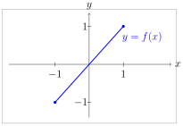
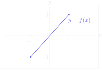
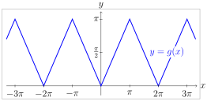
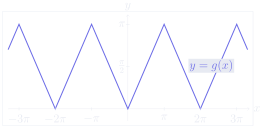

# 第 3 次习题课　反三角函数

TD n°3 — Fonctions trigonométriques réciproques

CORRIGÉ · 参考解答

中法对照讲义 · 由 LaTeX 源文件渲染

!!! info "阅读说明"

    每段先列法语原文；其下缩进、带深蓝竖条的小字号段落为中文翻译。<strong>加粗</strong>为关键词，括号内为中文释义。

## Exercices à préparer 预备练习

### Exercice 1 练习 1

identité ou non　是否为恒等式

Étudier et représenter les fonctions suivantes :
{: .fr-exo }

研究并作出下列函数的图像：
{: .zh }

1. \(f : x \mapsto \cos(\arccos x)\)
{: .fr-exo }

1. \(f : x \mapsto \cos(\arccos x)\)
{: .zh }

!!! sol ""

    La fonction \(\arccos\) est définie sur \([-1,1]\) et la fonction \(\cos\) est définie sur \(\mathbb{R}\) donc la fonction \(f\) est définie sur \([-1,1]\).

    函数 \(\arccos\) 定义在 \([-1,1]\) 上，函数 \(\cos\) 定义在 \(\mathbb{R}\) 上， 因此函数 \(f\) 定义在 \([-1,1]\) 上。
    {: .zh }

    Comme \(\arccos : [-1,1] \to [0,\pi]\) et \(\cos : [0,\pi] \to [-1,1]\), on a \(\forall x \in [-1,1],\ f(x) = x\).

    由于 \(\arccos : [-1,1] \to [0,\pi]\) 且 \(\cos : [0,\pi] \to [-1,1]\)， 故 \(\forall x \in [-1,1]\)，\(f(x) = x\)。
    {: .zh }

    Ainsi \(f\) est la restriction de l'application identité à l'intervalle \([-1,1]\).

    因此 \(f\) 是恒等映射在区间 \([-1,1]\) 上的限制。
    {: .zh }

    

2. \(g : x \mapsto \arccos(\cos x)\)
{: .fr-exo }

2. \(g : x \mapsto \arccos(\cos x)\)
{: .zh }

!!! sol ""

    On a \(\cos : \mathbb{R} \to [-1,1]\) et \(\arccos : [-1,1] \to \mathbb{R}\), donc \(g\) est définie sur \(\mathbb{R}\).

    有 \(\cos : \mathbb{R} \to [-1,1]\) 且 \(\arccos : [-1,1] \to \mathbb{R}\)， 因此 \(g\) 定义在 \(\mathbb{R}\) 上。
    {: .zh }

    De plus \(\cos\) est \(2\pi\) périodique et paire, donc \(g\) aussi.

    此外 \(\cos\) 以 \(2\pi\) 为周期且为偶函数，因此 \(g\) 亦然。
    {: .zh }

    On étudie donc \(g\) sur l'intervalle \([0,\pi]\) puis on complète par parité puis par périodicité.

    于是先在区间 \([0,\pi]\) 上研究 \(g\)，再利用奇偶性、然后利用周期性补全。
    {: .zh }

    On a

    有
    {: .zh }

    \[
    \begin{aligned}
    g(0) &= \arccos 1 = 0\\
    g(1) &= \arccos 0 = \pi
    \end{aligned}
    \]

    donc, \(\forall x \in [0,\pi],\ g(x) = x\).

    因此 \(\forall x \in [0,\pi]\)，\(g(x) = x\)。
    {: .zh }

    

### Exercice 2 练习 2

étude détaillée　详细研究

On veut montrer que : \(\forall x \in \mathbb{R},\
 \arcsin\left(\dfrac{x}{\sqrt{1+x^2}}\right) = \arctan x\).
{: .fr-exo }

我们希望证明：\(\forall x \in \mathbb{R}\)， \(\arcsin\left(\dfrac{x}{\sqrt{1+x^2}}\right) = \arctan x\)。
{: .zh }

1. Soit \(x \in \mathbb{R}\). Montrer que \(\dfrac{x}{\sqrt{1+x^2}} \in \,]-1,1[\).
{: .fr-exo }

1. 设 \(x \in \mathbb{R}\)。证明 \(\dfrac{x}{\sqrt{1+x^2}} \in \,]-1,1[\)。
{: .zh }

!!! sol ""

    Pour tout \(x \in \mathbb{R}\),

    对任意 \(x \in \mathbb{R}\)，
    {: .zh }

    \[
    \left(\frac{x}{\sqrt{1+x^2}}\right)^2 = \frac{x^2}{1+x^2} < 1.
    \]

    Donc

    因此
    {: .zh }

    \[
    -1 < \frac{x}{\sqrt{1+x^2}} < 1,
    \]

    c'est-à-dire

    即
    {: .zh }

    \[
    \boxed{\frac{x}{\sqrt{1+x^2}} \in \,]-1,1[\,}.
    \]

2. Déterminer l'ensemble \(\left\{\arcsin\left(\dfrac{x}{\sqrt{1+x^2}}\right),\ x \in \mathbb{R}\right\}\).
{: .fr-exo }

2. 确定集合 \(\left\{\arcsin\left(\dfrac{x}{\sqrt{1+x^2}}\right),\ x \in \mathbb{R}\right\}\)。
{: .zh }

!!! sol ""

    Lorsque \(x\) parcourt \(\mathbb{R}\), la quantité \(\dfrac{x}{\sqrt{1+x^2}}\) parcourt exactement l'intervalle \(]-1,1[\).

    当 \(x\) 遍历 \(\mathbb{R}\) 时，量 \(\dfrac{x}{\sqrt{1+x^2}}\) 恰好遍历区间 \(]-1,1[\)。
    {: .zh }

    De plus \(\arcsin\) est strictement croissante et continue sur \([-1,1]\), donc

    此外 \(\arcsin\) 在 \([-1,1]\) 上严格递增且连续，因此
    {: .zh }

    \[
    \left\{\arcsin\left(\frac{x}{\sqrt{1+x^2}}\right),\ x \in \mathbb{R}\right\}
    = \,]\arcsin(-1),\arcsin(1)[\,
    = \boxed{\left]-\frac{\pi}{2},\frac{\pi}{2}\right[}.
    \]

3. Soit \(\theta \in \left]-\dfrac{\pi}{2},\dfrac{\pi}{2}\right[\). Exprimer \(\sin\theta\) en fonction de \(\tan\theta\).
{: .fr-exo }

3. 设 \(\theta \in \left]-\dfrac{\pi}{2},\dfrac{\pi}{2}\right[\)。 用 \(\tan\theta\) 表示 \(\sin\theta\)。
{: .zh }

!!! sol ""

    Comme \(\theta \in \left]-\frac{\pi}{2},\frac{\pi}{2}\right[\), on a \(\cos\theta > 0\).

    由于 \(\theta \in \left]-\frac{\pi}{2},\frac{\pi}{2}\right[\)，有 \(\cos\theta > 0\)。
    {: .zh }

    De plus, \(\cos^2\theta + \sin^2\theta = 1\), donc \(1 + \dfrac{\sin^2\theta}{\cos^2\theta} = \dfrac{1}{\cos^2\theta}\), ou encore \(\cos^2\theta = \dfrac{1}{1+\tan^2\theta}\).

    此外 \(\cos^2\theta + \sin^2\theta = 1\)，因此 \(1 + \dfrac{\sin^2\theta}{\cos^2\theta} = \dfrac{1}{\cos^2\theta}\)， 亦即 \(\cos^2\theta = \dfrac{1}{1+\tan^2\theta}\)。
    {: .zh }

    D'où

    由此
    {: .zh }

    \[
    \sin\theta = \tan\theta\cos\theta
    = \tan\theta\,\frac{1}{\sqrt{1+\tan^2\theta}}.
    \]

    Ainsi,

    因此，
    {: .zh }

    \[
    \boxed{\sin\theta = \frac{\tan\theta}{\sqrt{1+\tan^2\theta}}}.
    \]

4. Conclure.
{: .fr-exo }

4. 得出结论。
{: .zh }

!!! sol ""

    Soit \(x \in \mathbb{R}\). Posons

    设 \(x \in \mathbb{R}\)。令
    {: .zh }

    \[
    \theta = \arctan x.
    \]

    Alors \(\theta \in \left]-\frac{\pi}{2},\frac{\pi}{2}\right[\) et \(\tan\theta = x\). D'après la question précédente,

    则 \(\theta \in \left]-\frac{\pi}{2},\frac{\pi}{2}\right[\) 且 \(\tan\theta = x\)。根据上一问，
    {: .zh }

    \[
    \sin\theta = \frac{x}{\sqrt{1+x^2}}.
    \]

    Or \(\theta \in \left]-\frac{\pi}{2},\frac{\pi}{2}\right[\), donc \(\arcsin(\sin\theta) = \theta\). Par suite,

    而 \(\theta \in \left]-\frac{\pi}{2},\frac{\pi}{2}\right[\)，故 \(\arcsin(\sin\theta) = \theta\)。从而
    {: .zh }

    \[
    \arcsin\left(\frac{x}{\sqrt{1+x^2}}\right)
    = \arcsin(\sin\theta) = \theta = \arctan x.
    \]

    On a donc bien

    于是确实有
    {: .zh }

    \[
    \boxed{\forall x \in \mathbb{R},\quad
    \arcsin\left(\frac{x}{\sqrt{1+x^2}}\right) = \arctan x}.
    \]

### Exercice 3 练习 3

simplifier des fonctions composées　化简复合函数

Préciser le domaine de définition des expressions suivantes, puis les simplifier.
{: .fr-exo }

指出下列表达式的定义域，然后化简。
{: .zh }

1. \(\cos(\arctan x)\)
{: .fr-exo }

1. \(\cos(\arctan x)\)
{: .zh }

!!! sol ""

    Les fonctions \(x \mapsto \arctan x\) et \(x \mapsto \cos x\) sont définies sur \(\mathbb{R}\), donc l'expression est définie sur \(\mathbb{R}\).

    函数 \(x \mapsto \arctan x\) 与 \(x \mapsto \cos x\) 都定义在 \(\mathbb{R}\) 上， 因此该表达式定义在 \(\mathbb{R}\) 上。
    {: .zh }

    Soit \(\theta = \arctan x\). Alors \(\theta \in \left]-\frac{\pi}{2},\frac{\pi}{2}\right[\) et \(\tan\theta = x\). Donc

    令 \(\theta = \arctan x\)。则 \(\theta \in \left]-\frac{\pi}{2},\frac{\pi}{2}\right[\) 且 \(\tan\theta = x\)。因此
    {: .zh }

    \[
    \cos^2\theta = \frac{1}{1+\tan^2\theta} = \frac{1}{1+x^2}.
    \]

    Comme \(\cos\theta > 0\), on obtient

    由于 \(\cos\theta > 0\)，得到
    {: .zh }

    \[
    \boxed{\cos(\arctan x) = \frac{1}{\sqrt{1+x^2}}},\qquad x \in \mathbb{R}.
    \]

2. \(\sin(\arctan x)\)
{: .fr-exo }

2. \(\sin(\arctan x)\)
{: .zh }

!!! sol ""

    L'expression, composée de fonctions définies sur \(\mathbb{R}\), est définie sur \(\mathbb{R}\).

    该表达式由定义在 \(\mathbb{R}\) 上的函数复合而成，故定义在 \(\mathbb{R}\) 上。
    {: .zh }

    Avec \(\theta = \arctan x \in \left]-\frac{\pi}{2},\frac{\pi}{2}\right[\), on a \(\cos^2\theta = \frac{1}{1+\tan^2\theta}\) et \(\cos\theta > 0\), donc

    取 \(\theta = \arctan x \in \left]-\frac{\pi}{2},\frac{\pi}{2}\right[\)， 有 \(\cos^2\theta = \frac{1}{1+\tan^2\theta}\) 且 \(\cos\theta > 0\)，因此
    {: .zh }

    \[
    \sin\theta = \tan\theta\cos\theta = x\,\frac{1}{\sqrt{1+x^2}}.
    \]

    Donc

    所以
    {: .zh }

    \[
    \forall x \in \mathbb{R},\quad
    \boxed{\sin(\arctan x) = \frac{x}{\sqrt{1+x^2}}}.
    \]

3. \(\tan(2\arctan x)\)
{: .fr-exo }

3. \(\tan(2\arctan x)\)
{: .zh }

!!! sol ""

    L'expression est définie lorsque \(2\arctan x\) n'est pas de la forme \(\frac{\pi}{2} + k\pi\), \(k \in \mathbb{Z}\).

    该表达式有定义当且仅当 \(2\arctan x\) 不形如 \(\frac{\pi}{2} + k\pi\)，\(k \in \mathbb{Z}\)。
    {: .zh }

    Comme

    由于
    {: .zh }

    \[
    2\arctan x \in \,]-\pi,\pi[,
    \]

    il faut exclure

    须排除
    {: .zh }

    \[
    2\arctan x = \pm\frac{\pi}{2},
    \]

    c'est-à-dire

    即
    {: .zh }

    \[
    \arctan x = \pm\frac{\pi}{4},
    \]

    soit

    亦即
    {: .zh }

    \[
    x = \pm 1.
    \]

    Le domaine de définition est donc

    因此定义域为
    {: .zh }

    \[
    \boxed{\mathbb{R}\setminus\{-1,1\}}.
    \]

    Pour \(x \neq \pm 1\), en posant \(t = \arctan x\), on a

    对 \(x \neq \pm 1\)，令 \(t = \arctan x\)，有
    {: .zh }

    \[
    \tan(2t) = \frac{2\tan t}{1-\tan^2 t} = \frac{2x}{1-x^2}.
    \]

    Ainsi,

    因此，
    {: .zh }

    \[
    \boxed{\tan(2\arctan x) = \frac{2x}{1-x^2}},\qquad
    x \in \mathbb{R}\setminus\{-1,1\}.
    \]

4. \(\tan(\arcsin x)\)
{: .fr-exo }

4. \(\tan(\arcsin x)\)
{: .zh }

!!! sol ""

    La fonction \(x \mapsto \arcsin x\) est définie pour \(x \in [-1,1]\). De plus, \(\tan\) n'est pas définie en \(\pm\frac{\pi}{2}\). Or

    函数 \(x \mapsto \arcsin x\) 对 \(x \in [-1,1]\) 有定义。 此外 \(\tan\) 在 \(\pm\frac{\pi}{2}\) 处无定义。而
    {: .zh }

    \[
    \arcsin x \in \left[-\frac{\pi}{2},\frac{\pi}{2}\right],
    \]

    et \(\arcsin x = \pm\frac{\pi}{2}\) correspond à \(x = \pm 1\). Le domaine de définition est donc

    且 \(\arcsin x = \pm\frac{\pi}{2}\) 对应于 \(x = \pm 1\)。因此定义域为
    {: .zh }

    \[
    \boxed{\;]-1,1[\;}.
    \]

    Pour \(x \in \,]-1,1[\), posons \(\theta = \arcsin x \in \left]-\frac{\pi}{2},\frac{\pi}{2}\right[\). Alors \(\sin\theta = x\) et \(\cos\theta = \sqrt{1-x^2} > 0\).

    对 \(x \in \,]-1,1[\)，令 \(\theta = \arcsin x \in \left]-\frac{\pi}{2},\frac{\pi}{2}\right[\)。 则 \(\sin\theta = x\) 且 \(\cos\theta = \sqrt{1-x^2} > 0\)。
    {: .zh }

    Donc

    因此
    {: .zh }

    \[
    \tan\theta = \frac{\sin\theta}{\cos\theta} = \frac{x}{\sqrt{1-x^2}}.
    \]

    Ainsi,

    因此，
    {: .zh }

    \[
    \forall x \in \,]-1,1[,\quad
    \boxed{\tan(\arcsin x) = \frac{x}{\sqrt{1-x^2}}}.
    \]

5. \(\tan(\arccos x)\)
{: .fr-exo }

5. \(\tan(\arccos x)\)
{: .zh }

!!! sol ""

    La fonction \(x \mapsto \arccos x\) est définie pour \(x \in [-1,1]\). De plus, \(\tan\) n'est pas définie en \(\frac{\pi}{2}\). Or

    函数 \(x \mapsto \arccos x\) 对 \(x \in [-1,1]\) 有定义。 此外 \(\tan\) 在 \(\frac{\pi}{2}\) 处无定义。而
    {: .zh }

    \[
    \arccos x = \frac{\pi}{2} \iff x = 0.
    \]

    Le domaine est donc

    因此定义域为
    {: .zh }

    \[
    \boxed{[-1,1]\setminus\{0\}}.
    \]

    Pour \(x \in [-1,1]\setminus\{0\}\), posons \(\theta = \arccos x\). Alors \(\cos\theta = x\) et \(\sin\theta = \sqrt{1-x^2} \geqslant 0\).

    对 \(x \in [-1,1]\setminus\{0\}\)，令 \(\theta = \arccos x\)。 则 \(\cos\theta = x\) 且 \(\sin\theta = \sqrt{1-x^2} \geqslant 0\)。
    {: .zh }

    Donc

    因此
    {: .zh }

    \[
    \tan\theta = \frac{\sin\theta}{\cos\theta} = \frac{\sqrt{1-x^2}}{x}.
    \]

    Ainsi,

    因此，
    {: .zh }

    \[
    \forall x \in [-1,1]\setminus\{0\},\quad
    \boxed{\tan(\arccos x) = \frac{\sqrt{1-x^2}}{x}}.
    \]

### Exercice 4 练习 4

inéquation　不等式

Trouver l'ensemble des réels \(\theta\) vérifiant :
{: .fr-exo }

\[
\color{#0069D2}6\cos\theta \geqslant 7 + 8\sin\theta
\]

求满足下式的实数 \(\theta\) 的集合：
{: .zh }

!!! sol ""

    On écrit

    将不等式写成
    {: .zh }

    \[
    6\cos\theta - 8\sin\theta \geqslant 7.
    \]

    Or \(6^2 + 8^2 = 36 + 64 = 100 = 10^2\), donc

    由于 \(6^2 + 8^2 = 36 + 64 = 100 = 10^2\)，因此
    {: .zh }

    \[
    6\cos\theta - 8\sin\theta
    = 10\left(\frac{3}{5}\cos\theta - \frac{4}{5}\sin\theta\right)
    \]

    avec

    其中
    {: .zh }

    \[
    \left(\frac{3}{5}\right)^2 + \left(\frac{4}{5}\right)^2
    = \frac{9+16}{25} = 1.
    \]

    Posons \(\alpha = \arctan\frac{4}{3}\). Alors \(\alpha \in \left]0,\frac{\pi}{2}\right[\) et

    令 \(\alpha = \arctan\frac{4}{3}\)。则 \(\alpha \in \left]0,\frac{\pi}{2}\right[\) 且
    {: .zh }

    \[
    \cos\alpha = \frac{3}{5},\qquad \sin\alpha = \frac{4}{5},
    \]

    donc

    因此
    {: .zh }

    \[
    6\cos\theta - 8\sin\theta
    = 10(\cos\alpha\cos\theta - \sin\alpha\sin\theta)
    = 10\cos(\theta+\alpha).
    \]

    L'inéquation devient

    不等式化为
    {: .zh }

    \[
    10\cos(\theta+\alpha) \geqslant 7,
    \]

    soit

    即
    {: .zh }

    \[
    \cos(\theta+\alpha) \geqslant \frac{7}{10}.
    \]

    Ainsi,

    因此，
    {: .zh }

    \[
    \theta + \alpha \in
    \bigcup_{k\in\mathbb{Z}}
    \left[-\arccos\frac{7}{10}+2k\pi,\ \arccos\frac{7}{10}+2k\pi\right].
    \]

    Finalement,

    最终，
    {: .zh }

    \[
    \boxed{\theta \in
    \bigcup_{k\in\mathbb{Z}}
    \left[-\arctan\frac{4}{3} - \arccos\frac{7}{10}+2k\pi,\
    -\arctan\frac{4}{3} + \arccos\frac{7}{10}+2k\pi\right]}.
    \]

    <strong>Remarque :</strong> On peut encore simplifier, en utilisant (comme on a vu à l'exercice précédent), si \(x \in [-1,1]\setminus\{0\}\), \(\tan(\arccos x) = \frac{\sqrt{1-x^2}}{x}\) qui donne

    <strong>注：</strong>还可以进一步化简：利用（如上一练习所见） 当 \(x \in [-1,1]\setminus\{0\}\) 时 \(\tan(\arccos x) = \frac{\sqrt{1-x^2}}{x}\)，由此得到
    {: .zh }

    \[
    \arccos\frac{7}{10} = \arctan\frac{\sqrt{51}}{7}
    \]

    et (comme on va le voir à l'exercice prochain)

    以及（如下一练习所示）
    {: .zh }

    \[
    \arctan x + \arctan y =
    \begin{cases}
    \arctan\left(\dfrac{x+y}{1-xy}\right) - \pi,
      & 1-xy<0 \text{ et } x+y<0,\\[6pt]
    \arctan\left(\dfrac{x+y}{1-xy}\right),
      & 1-xy>0,\\[6pt]
    \arctan\left(\dfrac{x+y}{1-xy}\right) + \pi,
      & 1-xy<0 \text{ et } x+y>0
    \end{cases}
    \]

    qui donne

    这给出
    {: .zh }

    \[
    -\arctan\frac{4}{3} - \arccos\frac{7}{10}
    = -\left(\arctan\frac{4}{3} + \arctan\frac{\sqrt{51}}{7}\right)
    = -\pi + \arctan\frac{48+7\sqrt{51}}{15}
    \]

    et

    以及
    {: .zh }

    \[
    -\arctan\frac{4}{3} + \arccos\frac{7}{10}
    = \arctan\left(-\frac{4}{3}\right) + \arctan\frac{\sqrt{51}}{7}
    = \arctan\frac{48-7\sqrt{51}}{15},
    \]

    on a alors

    于是
    {: .zh }

    \[
    \boxed{\theta \in
    \bigcup_{k\in\mathbb{Z}}
    \left[-\pi + \arctan\frac{48+7\sqrt{51}}{15}+2k\pi,\
    \arctan\frac{48-7\sqrt{51}}{15}+2k\pi\right]}.
    \]

!!! warning "Vocabulaire clé 重点词汇"

    - <strong>fonction réciproque</strong>：反函数
    - <strong>domaine de définition</strong>：定义域
    - <strong>restriction d'une application</strong>：映射的限制
    - <strong>application identité</strong>：恒等映射
    - <strong>parité, périodicité</strong>：奇偶性、周期性
    - <strong>strictement croissante</strong>：严格递增
    - <strong>continue</strong>：连续
    - <strong>arcsinus / arccosinus / arctangente</strong>：反正弦 / 反余弦 / 反正切
    - <strong>on pose</strong>：令
    - <strong>d'où</strong>：由此
    - <strong>ainsi</strong>：因此
    - <strong>par suite</strong>：从而
    - <strong>c'est-à-dire</strong>：即
    - <strong>il faut exclure</strong>：须排除
    - <strong>correspond à</strong>：对应于
    - <strong>on obtient</strong>：得到
    - <strong>vérifier</strong>：验证；满足
    - <strong>on reconnaît</strong>：可辨认出
    - <strong>inéquation</strong>：不等式
    - <strong>ensemble des solutions</strong>：解集

## Exercices supplémentaires 补充练习

### Exercice 5 练习 5

sommes de arctan　反正切之和

1. Soient \(\theta,\varphi \in
 \left]-\dfrac{\pi}{2},\dfrac{\pi}{2}\right[\) tels que \((\theta+\varphi) \neq \pm\dfrac{\pi}{2}\).
{: .fr-exo }

1. 设 \(\theta,\varphi \in
 \left]-\dfrac{\pi}{2},\dfrac{\pi}{2}\right[\)，且 \((\theta+\varphi) \neq \pm\dfrac{\pi}{2}\)。
{: .zh }

(a) Exprimer \(\tan(\theta+\varphi)\) en fonction de \(\tan\theta\) et \(\tan\varphi\).
{: .fr-exo }

（a）用 \(\tan\theta\) 与 \(\tan\varphi\) 表示 \(\tan(\theta+\varphi)\)。
{: .zh }

!!! sol ""

    D'après la formule d'addition de la tangente,

    根据正切的加法公式，
    {: .zh }

    \[
    \boxed{\tan(\theta+\varphi) = \frac{\tan\theta+\tan\varphi}
    {1-\tan\theta\tan\varphi}}.
    \]

(b) Discuter selon \((\theta+\varphi) \in \,]-\pi,\pi[\) la valeur de \(\arctan(\tan(\theta+\varphi))\).
{: .fr-exo }

（b）按 \((\theta+\varphi) \in \,]-\pi,\pi[\) 讨论 \(\arctan(\tan(\theta+\varphi))\) 的取值。
{: .zh }

!!! sol ""

    Comme \(\theta,\varphi \in
     \left]-\frac{\pi}{2},\frac{\pi}{2}\right[\), on a

    由于 \(\theta,\varphi \in
     \left]-\frac{\pi}{2},\frac{\pi}{2}\right[\)，有
    {: .zh }

    \[
    \theta+\varphi \in \,]-\pi,\pi[.
    \]

    On sait que \(\arctan(\tan u) = u\) si et seulement si \(u \in \left]-\frac{\pi}{2},\frac{\pi}{2}\right[\). Donc

    已知 \(\arctan(\tan u) = u\) 当且仅当 \(u \in \left]-\frac{\pi}{2},\frac{\pi}{2}\right[\)。因此
    {: .zh }

    \[
    \arctan(\tan(\theta+\varphi)) =
    \begin{cases}
    \theta+\varphi+\pi,
      & \theta+\varphi \in \left]-\pi,-\frac{\pi}{2}\right[,\\[6pt]
    \theta+\varphi,
      & \theta+\varphi \in \left[-\frac{\pi}{2},\frac{\pi}{2}\right],\\[6pt]
    \theta+\varphi-\pi,
      & \theta+\varphi \in \left]\frac{\pi}{2},\pi\right[.
    \end{cases}
    \]

(c) En posant \(x = \tan\theta\) et \(y = \tan\varphi\), exprimer \(\arctan x + \arctan y\) à l'aide d'une seule fonction \(\arctan\) selon les différents cas obtenus à la question précédente.
{: .fr-exo }

（c）令 \(x = \tan\theta\)、\(y = \tan\varphi\)，根据上一问得到的各种情形， 用单个 \(\arctan\) 函数表示 \(\arctan x + \arctan y\)。
{: .zh }

!!! sol ""

    Puisque \(\theta,\varphi \in
     \left]-\frac{\pi}{2},\frac{\pi}{2}\right[\), on a

    由于 \(\theta,\varphi \in
     \left]-\frac{\pi}{2},\frac{\pi}{2}\right[\)，有
    {: .zh }

    \[
    \theta = \arctan x,\qquad \varphi = \arctan y.
    \]

    Ainsi,

    因此，
    {: .zh }

    \[
    \arctan x + \arctan y = \theta+\varphi.
    \]

    D'après la question précédente et la formule de \(\tan(\theta+\varphi)\),

    根据上一问以及 \(\tan(\theta+\varphi)\) 的公式，
    {: .zh }

    \[
    \arctan x + \arctan y =
    \begin{cases}
    \arctan\left(\dfrac{x+y}{1-xy}\right)-\pi,
      & \theta+\varphi \in \left]-\pi,-\frac{\pi}{2}\right[,\\[6pt]
    \arctan\left(\dfrac{x+y}{1-xy}\right),
      & \theta+\varphi \in \left[-\frac{\pi}{2},\frac{\pi}{2}\right],\\[6pt]
    \arctan\left(\dfrac{x+y}{1-xy}\right)+\pi,
      & \theta+\varphi \in \left]\frac{\pi}{2},\pi\right[.
    \end{cases}
    \]

(d) Selon \((\theta+\varphi) \in \,]-\pi,\pi[\), donner les signes de \(1-xy\) et \(x+y\).
{: .fr-exo }

（d）按 \((\theta+\varphi) \in \,]-\pi,\pi[\)，给出 \(1-xy\) 与 \(x+y\) 的符号。
{: .zh }

!!! sol ""

    On a

    有
    {: .zh }

    \[
    1 - xy = 1 - \tan\theta\tan\varphi
    = \frac{\cos(\theta+\varphi)}{\cos\theta\cos\varphi}.
    \]

    Comme \(\cos\theta > 0\) et \(\cos\varphi > 0\), le signe de \(1-xy\) est celui de \(\cos(\theta+\varphi)\).

    由于 \(\cos\theta > 0\) 且 \(\cos\varphi > 0\)，\(1-xy\) 的符号与 \(\cos(\theta+\varphi)\) 相同。
    {: .zh }

    De même,

    同样，
    {: .zh }

    \[
    x+y = \tan\theta+\tan\varphi
    = \frac{\sin(\theta+\varphi)}{\cos\theta\cos\varphi}.
    \]

    Le signe de \(x+y\) est donc celui de \(\sin(\theta+\varphi)\).

    因此 \(x+y\) 的符号与 \(\sin(\theta+\varphi)\) 相同。
    {: .zh }

    On obtient le tableau suivant :

    得到下表：
    {: .zh }

    \[
    \begin{array}{c|ccc}
    \theta+\varphi
      & \left]-\pi,-\frac{\pi}{2}\right[
      & \left]-\frac{\pi}{2},\frac{\pi}{2}\right[
      & \left]\frac{\pi}{2},\pi\right[\\ \hline
    1-xy & <0 & >0 & <0\\
    x+y  & <0 & \text{signe de } \theta+\varphi & >0
    \end{array}
    \]

(e) En déduire un calcul de \(\arctan x + \arctan y\) selon les signes de \(1-xy\) et \(x+y\).
{: .fr-exo }

（e）由此根据 \(1-xy\) 与 \(x+y\) 的符号，得出 \(\arctan x + \arctan y\) 的计算方法。
{: .zh }

!!! sol ""

    D'après les questions précédentes,

    根据前几问，
    {: .zh }

    \[
    \boxed{\arctan x + \arctan y =
    \begin{cases}
    \arctan\left(\dfrac{x+y}{1-xy}\right)-\pi,
      & 1-xy<0 \text{ et } x+y<0,\\[6pt]
    \arctan\left(\dfrac{x+y}{1-xy}\right),
      & 1-xy>0,\\[6pt]
    \arctan\left(\dfrac{x+y}{1-xy}\right)+\pi,
      & 1-xy<0 \text{ et } x+y>0.
    \end{cases}}
    \]

    <strong>Remarque :</strong> On peut compléter cette discussion avec le cas \(xy = 1\) qui correspond aux cas \(\theta+\varphi = \pm\frac{\pi}{2}\) initialement exclus. On a alors

    <strong>注：</strong>可以用情形 \(xy = 1\) 补全这一讨论，它对应最初排除的 \(\theta+\varphi = \pm\frac{\pi}{2}\) 的情形。此时有
    {: .zh }

    \[
    \arctan x + \arctan y =
    \begin{cases}
    -\dfrac{\pi}{2}, & xy=1 \text{ et } x+y<0,\\[6pt]
    \dfrac{\pi}{2}, & xy=1 \text{ et } x+y>0.
    \end{cases}
    \]

2. Première application :
{: .fr-exo }

2. 第一个应用：
{: .zh }

(a) Soit \(p \in \mathbb{N}\). Calculer \(\arctan(p+1) - \arctan p\)
{: .fr-exo }

（a）设 \(p \in \mathbb{N}\)。计算 \(\arctan(p+1) - \arctan p\)。
{: .zh }

!!! sol ""

    Pour \(p \in \mathbb{N}\), on a, d'après la question précédente, comme \(1+p(p+1) > 0\),

    对 \(p \in \mathbb{N}\)，根据上一问，由于 \(1+p(p+1) > 0\)，有
    {: .zh }

    \[
    \arctan(p+1) - \arctan p
    = \arctan(p+1) + \arctan(-p)
    = \arctan\left(\frac{(p+1)-p}{1+p(p+1)}\right)
    \]

    Donc

    因此
    {: .zh }

    \[
    \boxed{\arctan(p+1) - \arctan p
    = \arctan\left(\frac{1}{p^2+p+1}\right)}.
    \]

(b) Étudier la convergence et la limite de la suite \((S_n)\) définie par
{: .fr-exo }

\[
\color{#0069D2}S_n = \sum_{p=0}^{n}\arctan\left(\frac{1}{p^2+p+1}\right)
\]

（b）研究由下式定义的数列 \((S_n)\) 的敛散性与极限：
{: .zh }

!!! sol ""

    D'après la question précédente,

    根据上一问，
    {: .zh }

    \[
    S_n = \sum_{p=0}^{n}\left(\arctan(p+1) - \arctan p\right).
    \]

    C'est une somme télescopique :

    这是一个裂项求和（望远镜和）：
    {: .zh }

    \[
    S_n = \arctan(n+1) - \arctan 0 = \arctan(n+1).
    \]

    Or

    而
    {: .zh }

    \[
    \lim_{n\to+\infty}\arctan(n+1) = \frac{\pi}{2}.
    \]

    Donc \((S_n)\) converge et

    因此 \((S_n)\) 收敛，且
    {: .zh }

    \[
    \boxed{\lim_{n\to+\infty} S_n = \frac{\pi}{2}}.
    \]

3. Deuxième application : démontrer la formule de Machin
{: .fr-exo }

\[
\color{#0069D2}\frac{\pi}{4} = 4\arctan\frac{1}{5} - \arctan\frac{1}{239}
\]

3. 第二个应用：证明 Machin 公式
{: .zh }

!!! sol ""

    On applique trois fois le résultat obtenu à la question 1.

    将第 1 问所得结果应用三次。
    {: .zh }

    Comme \(\left(\frac{1}{5}\right)^2 < 1\), on a

    由于 \(\left(\frac{1}{5}\right)^2 < 1\)，有
    {: .zh }

    \[
    \arctan\frac{1}{5} + \arctan\frac{1}{5}
    = \arctan\left(\frac{\frac{1}{5}+\frac{1}{5}}{1-\frac{1}{25}}\right)
    = \arctan\frac{5}{12}
    \]

    Comme \(\left(\frac{5}{12}\right)^2 < 1\), on a

    由于 \(\left(\frac{5}{12}\right)^2 < 1\)，有
    {: .zh }

    \[
    \arctan\frac{5}{12} + \arctan\frac{5}{12}
    = \arctan\left(\frac{\frac{10}{12}}{1-\frac{25}{144}}\right)
    = \arctan\frac{120}{119}
    \]

    Et enfin, comme \(1 - \frac{120}{119}\times\left(-\frac{1}{239}\right) > 0\), on a

    最后，由于 \(1 - \frac{120}{119}\times\left(-\frac{1}{239}\right) > 0\)，有
    {: .zh }

    \[
    \arctan\frac{120}{119} - \arctan\frac{1}{239}
    = \arctan\frac{120}{119} + \arctan\left(-\frac{1}{239}\right).
    \]

    On a donc pour \(x = \arctan\frac{120}{119}\) et \(y = -\frac{1}{239}\),

    于是对于 \(x = \arctan\frac{120}{119}\) 与 \(y = -\frac{1}{239}\)，
    {: .zh }

    \[
    z = \frac{x+y}{1-xy}
    = \frac{\frac{120}{119} - \frac{1}{239}}
           {1 + \frac{120}{119\times 239}}
    = \frac{239\times 120 - 119}{119\times 239 + 120}
    \]

    En posant \(t = 120\), on a \(119 = t-1\), \(239 = 2t-1\) et

    令 \(t = 120\)，则 \(119 = t-1\)，\(239 = 2t-1\)，且
    {: .zh }

    \[
    z = \frac{(2t-1)t-(t-1)}{(t-1)(2t-1)+t}
    = \frac{2t^2-t-t+1}{2t^2-2t-t+1+t}
    = \frac{2t^2-2t+1}{2t^2-2t+1} = 1
    \]

    D'où

    由此
    {: .zh }

    \[
    \boxed{4\arctan\frac{1}{5} - \arctan\frac{1}{239}
    = \arctan 1 = \frac{\pi}{4}}.
    \]

### Exercice 6 练习 6

expression　表达式

Soit \(x \in [-1,1]\). Simplifier l'expression
{: .fr-exo }

\[
\color{#0069D2}\cos(\arccos x - \arcsin x) - \sin(\arccos x - \arcsin x)
\]

设 \(x \in [-1,1]\)。化简表达式
{: .zh }

!!! sol ""

    Comme \(x \in [-1,1]\), on pose \(x = \cos\theta\) avec \(\theta \in [0,\pi]\), alors \(x = \sin\left(\frac{\pi}{2}-\theta\right)\) et \(\left(\frac{\pi}{2}-\theta\right) \in
     \left[-\frac{\pi}{2},\frac{\pi}{2}\right]\). Donc

    由于 \(x \in [-1,1]\)，令 \(x = \cos\theta\)，\(\theta \in [0,\pi]\)， 则 \(x = \sin\left(\frac{\pi}{2}-\theta\right)\) 且 \(\left(\frac{\pi}{2}-\theta\right) \in
     \left[-\frac{\pi}{2},\frac{\pi}{2}\right]\)。因此
    {: .zh }

    \[
    \begin{aligned}
    &\cos(\arccos x - \arcsin x) - \sin(\arccos x - \arcsin x)\\
    &\quad = \cos\left(\theta-\left(\frac{\pi}{2}-\theta\right)\right)
            - \sin\left(\theta-\left(\frac{\pi}{2}-\theta\right)\right)\\
    &\quad = \cos\left(2\theta-\frac{\pi}{2}\right)
            - \sin\left(2\theta-\frac{\pi}{2}\right)\\
    &\quad = \sin(\pi-2\theta) - \cos(\pi-2\theta)\\
    &\quad = \sin(2\theta) + \cos(2\theta)\\
    &\quad = 2\sin\theta\cos\theta + 2\cos^2\theta - 1\\
    &\quad = \boxed{2x\sqrt{1-x^2} + 2x^2 - 1}
    \end{aligned}
    \]

!!! warning "Vocabulaire clé 重点词汇"

    - <strong>formule d'addition</strong>：加法公式
    - <strong>somme de arctan</strong>：反正切之和
    - <strong>discussion</strong>：讨论
    - <strong>initialement exclus</strong>：最初排除的
    - <strong>tableau de signes</strong>：符号表
    - <strong>signe de</strong>：……的符号
    - <strong>selon</strong>：根据；按
    - <strong>on en déduit</strong>：由此推出
    - <strong>somme télescopique</strong>：裂项求和（望远镜和）
    - <strong>suite convergente</strong>：收敛数列
    - <strong>limite</strong>：极限
    - <strong>formule de Machin</strong>：Machin 公式
    - <strong>simplifier</strong>：化简
    - <strong>exprimer en fonction de</strong>：用……表示
    - <strong>si et seulement si</strong>：当且仅当
    - <strong>compléter</strong>：补全
