# 第 1 章　复数

Chapitre n°1 — Nombres complexes

中法对照讲义 · 由 LaTeX 源文件渲染

!!! info "阅读说明"

    每段先列法语原文；其下缩进、带深蓝竖条的小字号段落为中文翻译。<strong>加粗</strong>为关键词，括号内为中文释义。

### Objectifs 学习目标

1. Manipuler des nombres complexes sous forme algébrique ou exponentielle.

    熟练操作<strong>代数形式</strong>或<strong>指数形式</strong>的复数。
    {: .zh }

1. Simplifier des expressions contenant des nombres complexes.

    化简含有复数的表达式。
    {: .zh }

1. Résoudre des équations d'inconnues complexes.

    求解未知量为复数的方程。
    {: .zh }

### Notations 记号

On rappelle que \(\mathbb{R}\) désigne l'ensemble des nombres <strong>réels</strong>, \(\mathbb{Z}\) désigne l'ensemble des entiers <strong>relatifs</strong> et \(\mathbb{N}\) désigne l'ensemble des entiers <strong>naturels</strong>.

回忆：\(\mathbb{R}\) 表示<strong>实数</strong>集，\(\mathbb{Z}\) 表示<strong>整数</strong>集， \(\mathbb{N}\) 表示<strong>自然数</strong>集。
{: .zh }

## Forme algébrique 代数形式

!!! success "Définition 1.1 : nombre complexe sous forme algébrique 定义 1.1：代数形式的复数（nombre complexe sous forme algébrique）"

    Un <strong>nombre complexe</strong> est un nombre de la forme \(z = x + iy\) où :

    一个<strong>复数</strong>是形如 \(z = x + iy\) 的数，其中：
    {: .zh }

    - \(x = \mathrm{Re}(z)\) est un nombre réel appelé la <strong>partie réelle</strong> du nombre complexe \(z\),

        \(x = \mathrm{Re}(z)\) 是一个实数，称为复数 \(z\) 的<strong>实部</strong>（partie réelle）；
        {: .zh }

    - \(y = \mathrm{Im}(z)\) est un nombre réel appelé la <strong>partie imaginaire</strong> du nombre complexe \(z\),

        \(y = \mathrm{Im}(z)\) 是一个实数，称为复数 \(z\) 的<strong>虚部</strong>（partie imaginaire）；
        {: .zh }

    - et \(i\) est un symbole mathématique.

        \(i\) 是一个数学符号。
        {: .zh }

    L'écriture \(x + iy\) est appelée la <strong>forme algébrique</strong> de \(z\). On note \(\mathbb{C}\) l'ensemble des nombres complexes :

    写法 \(x + iy\) 称为 \(z\) 的<strong>代数形式</strong>（forme algébrique）。记 \(\mathbb{C}\) 为复数集：
    {: .zh }

    \[
    \mathbb{C} = \{x + iy \mid (x,y) \in \mathbb{R}^2\}.
    \]

!!! info "Exemple 1.2 例 1.2"

    - \(3 - 2i\) est un nombre complexe de partie réelle égale à \(\mathrm{Re}(3-2i) = 3\) et de partie imaginaire égale à \(\mathrm{Im}(3-2i) = -2\).

        \(3 - 2i\) 是一个复数，其实部等于 \(\mathrm{Re}(3-2i) = 3\)，虚部等于 \(\mathrm{Im}(3-2i) = -2\)。
        {: .zh }

    - Tout nombre réel est un nombre complexe dont la partie imaginaire est nulle :

        任何实数都是虚部为零的复数：
        {: .zh }

        \[
        \forall x \in \mathbb{R},\ x = x + 0i \in \mathbb{C}.
        \]

        Autrement dit, \(\mathbb{R} \subset \mathbb{C}\). En particulier, \(0\) et \(1\) sont des nombres complexes.

        换言之，\(\mathbb{R} \subset \mathbb{C}\)。特别地，\(0\) 和 \(1\) 都是复数。
        {: .zh }

    - \(i = 0 + 1i\) est un nombre complexe.

        \(i = 0 + 1i\) 是一个复数。
        {: .zh }

!!! success "Définition 1.3 : opérations avec les nombres complexes 定义 1.3：复数的运算（opérations）"

    L'ensemble \(\mathbb{C}\) est muni d'une <strong>addition</strong> et d'une <strong>multiplication</strong> définies par :

    集合 \(\mathbb{C}\) 上定义了<strong>加法</strong>（addition）与<strong>乘法</strong>（multiplication）：
    {: .zh }

    \[
    \forall (z,w) \in \mathbb{C}^2,\quad
    \begin{cases}
    z + w = \left[\mathrm{Re}(z) + \mathrm{Re}(w)\right] + i\left[\mathrm{Im}(z) + \mathrm{Im}(w)\right] \\[4pt]
    zw = \left[\mathrm{Re}(z)\mathrm{Re}(w) - \mathrm{Im}(z)\mathrm{Im}(w)\right]
         + i\left[\mathrm{Re}(z)\mathrm{Im}(w) + \mathrm{Im}(z)\mathrm{Re}(w)\right]
    \end{cases}.
    \]

!!! info "Exemple 1.4 例 1.4"

    - \((2-3i) + (4+i) = 6 - 2i\) et \((2-3i)(4+i) = [8-(-3)] + [2+(-12)] = 11 - 10i\).

        \((2-3i) + (4+i) = 6 - 2i\)，且 \((2-3i)(4+i) = [8-(-3)] + [2+(-12)] = 11 - 10i\)。
        {: .zh }

    - Pour \(x_1 = x_1 + i0 \in \mathbb{R}\) et \(x_2 = x_2 + i0 \in \mathbb{R}\), on retrouve l'addition et la multiplication des nombres réels :

        对于 \(x_1 = x_1 + i0 \in \mathbb{R}\) 与 \(x_2 = x_2 + i0 \in \mathbb{R}\)，重新得到实数的加法和乘法：
        {: .zh }

        \[
        \begin{cases}
        (x_1 + i0) + (x_2 + i0) = [x_1 + x_2] + i[0+0] = x_1 + x_2 \\[3pt]
        (x_1 + i0)(x_2 + i0) = [x_1x_2 - 0] + i[0+0] = x_1x_2
        \end{cases}.
        \]

    - On remarque que \(i^2 = (0+1i)(0+1i) = [0-1] + i[0+0] = -1\).

        注意到 \(i^2 = (0+1i)(0+1i) = [0-1] + i[0+0] = -1\)。
        {: .zh }

!!! danger "Propriété 1.5 性质 1.5"

    Les opérations avec les nombres complexes ont les mêmes propriétés algébriques que les opérations avec les nombres réels, en particulier :

    复数的运算与实数的运算具有相同的代数性质，特别地：
    {: .zh }

    - <strong>associativité</strong> : \(\forall (z_1,z_2,z_3) \in \mathbb{C}^3\), \(\begin{cases}(z_1+z_2)+z_3 = z_1+(z_2+z_3) \\[3pt] (z_1z_2)z_3 = z_1(z_2z_3)\end{cases}\) ,

        <strong>结合律</strong>（associativité）：\(\forall (z_1,z_2,z_3) \in \mathbb{C}^3\)， \(\begin{cases}(z_1+z_2)+z_3 = z_1+(z_2+z_3) \\[3pt] (z_1z_2)z_3 = z_1(z_2z_3)\end{cases}\) ,
        {: .zh }

    - <strong>commutativité</strong> : \(\forall (z_1,z_2) \in \mathbb{C}^2\), \(\begin{cases}z_1+z_2 = z_2+z_1 \\[3pt] z_1z_2 = z_2z_1\end{cases}\) ,

        <strong>交换律</strong>（commutativité）：\(\forall (z_1,z_2) \in \mathbb{C}^2\)， \(\begin{cases}z_1+z_2 = z_2+z_1 \\[3pt] z_1z_2 = z_2z_1\end{cases}\) ,
        {: .zh }

    - <strong>distributivité</strong> : \(\forall (z_1,z_2,z_3) \in \mathbb{C}^3\), \(z_1(z_2+z_3) = z_1z_2 + z_1z_3\).

        <strong>分配律</strong>（distributivité）：\(\forall (z_1,z_2,z_3) \in \mathbb{C}^3\)， \(z_1(z_2+z_3) = z_1z_2 + z_1z_3\)。
        {: .zh }

!!! warning "Important 重要"

    Ainsi, les calculs avec les nombres complexes se mènent comme ceux avec les nombres réels, en simplifiant les expressions à l'aide de \(i^2 = -1\).

    因此，复数的计算与实数的计算方式相同，只需利用 \(i^2 = -1\) 化简表达式。
    {: .zh }

!!! warning "Attention 注意"

    Par contre, il n'existe pas de relation d'ordre sur \(\mathbb{C}\) compatible avec les opérations, comme la relation d'ordre sur \(\mathbb{R}\). On ne peut donc pas comparer deux nombres complexes, ni définir des notions de bornes pour des parties de \(\mathbb{C}\) (telles que majorant, minorant, maximum, minimum, etc.).

    然而，\(\mathbb{C}\) 上不存在与运算<strong>相容</strong>（compatible）的<strong>序关系</strong>（relation d'ordre）， 不像 \(\mathbb{R}\) 上的序关系。因此既不能比较两个复数的大小，也不能对 \(\mathbb{C}\) 的子集定义界的 概念（如上界 majorant、下界 minorant、最大值 maximum、最小值 minimum 等）。
    {: .zh }

!!! warning "Vocabulaire clé &nbsp;&nbsp; 重点词汇 第一节核心术语"

    - <strong>nombre complexe</strong>：复数
    - <strong>partie réelle / partie imaginaire</strong>：实部 / 虚部
    - <strong>forme algébrique</strong>：代数形式
    - <strong>addition / multiplication</strong>：加法 / 乘法
    - <strong>associativité / commutativité / distributivité</strong>：结合律 / 交换律 / 分配律
    - <strong>être muni de</strong>：带有、赋予（「\(\mathbb{C}\) est muni d'une addition」即 \(\mathbb{C}\) 上定义了加法）
    - <strong>relation d'ordre</strong>：序关系
    - <strong>compatible avec</strong>：与……相容
    - <strong>majorant / minorant</strong>：上界 / 下界
    - <strong>maximum / minimum</strong>：最大值 / 最小值
    - <strong>autrement dit</strong>：换言之
    - <strong>en particulier</strong>：特别地
    - <strong>on remarque que</strong>：注意到
    - <strong>se mènent comme</strong>：与……同样进行（计算）

## Le plan complexe 复平面

On rappelle que l'ensemble \(\mathbb{R}^2\), appelé le <strong>plan euclidien</strong>, peut être représenté géométriquement par un plan muni d'un repère orthonormé \((O,\vec{e_1},\vec{e_2})\) : chaque couple \((x,y) \in \mathbb{R}^2\) est associé à un point \(M\) d'<strong>abscisse</strong> \(x\) et d'<strong>ordonnée</strong> \(y\). On dit aussi que \((x,y)\) sont les <strong>coordonnées</strong> du point \(M\) ou du vecteur \(\overrightarrow{OM} = x\vec{e_1} + y\vec{e_2}\).

回忆：集合 \(\mathbb{R}^2\)（称为<strong>欧几里得平面</strong>）可以用一个带有<strong>正交标架</strong> （repère orthonormé）\((O,\vec{e_1},\vec{e_2})\) 的平面几何地表示：每个数对 \((x,y) \in \mathbb{R}^2\) 对应一个<strong>横坐标</strong>（abscisse）为 \(x\)、<strong>纵坐标</strong>（ordonnée）为 \(y\) 的点 \(M\)。我们也说 \((x,y)\) 是点 \(M\) 或向量 \(\overrightarrow{OM} = x\vec{e_1} + y\vec{e_2}\) 的<strong>坐标</strong>（coordonnées）。
{: .zh }

!!! success "Définition 2.1 : représentation géométrique de \(\mathbb{C}\) 定义 2.1：\(\mathbb{C}\) 的几何表示"

    À chaque nombre complexe \(z = x + iy \in \mathbb{C}\), on associe le point \(M\) de coordonnées \((x,y) \in \mathbb{R}^2\) dans le plan euclidien. On dit aussi que \(z\) est l'<strong>affixe</strong> du point \(M\) ou du vecteur \(\overrightarrow{OM} = x\vec{e_1} + y\vec{e_2}\). Cette représentation de \(\mathbb{C}\) est appelée le <strong>plan complexe</strong>.

    对每个复数 \(z = x + iy \in \mathbb{C}\)，对应欧几里得平面中坐标为 \((x,y) \in \mathbb{R}^2\) 的点 \(M\)。 我们也说 \(z\) 是点 \(M\) 或向量 \(\overrightarrow{OM} = x\vec{e_1} + y\vec{e_2}\) 的<strong>坐标</strong>（affixe）。 \(\mathbb{C}\) 的这种表示称为<strong>复平面</strong>（plan complexe）。
    {: .zh }

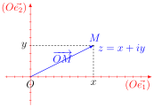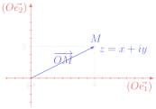

On remarque que l'axe \((O\vec{e_1})\), appelé <strong>axe des réels</strong>, correspond à l'ensemble \(\mathbb{R}\). L'axe \((O\vec{e_2})\) correspond à l'ensemble \(i\mathbb{R} = \{0 + iy \mid y \in \mathbb{R}\}\) et est appelé l'<strong>axe des imaginaires purs</strong>.

注意到轴 \((O\vec{e_1})\) 称为<strong>实轴</strong>（axe des réels），对应集合 \(\mathbb{R}\)。轴 \((O\vec{e_2})\) 对应集合 \(i\mathbb{R} = \{0 + iy \mid y \in \mathbb{R}\}\)，称为<strong>虚轴</strong>（axe des imaginaires purs）。
{: .zh }

On peut interpréter géométriquement l'addition de deux nombres complexes : si \(z_1 \in \mathbb{C}\) et \(z_2 \in \mathbb{C}\) sont les affixes respectives des points \(M_1\) et \(M_2\) dans le plan complexe, alors \(z_1 + z_2\) est l'affixe du point \(P\) défini par \(\overrightarrow{OP} = \overrightarrow{OM_1} +
 \overrightarrow{OM_2}\). On reconnaît la grande diagonale du parallélogramme porté par les vecteurs d'affixe \(z_1\) et \(z_2\). De même, \(z_2 - z_1\) est l'affixe du vecteur \(\overrightarrow{M_1M_2}\) qui correspond à la petite diagonale du parallélogramme.

可以几何地解释两个复数的加法：若 \(z_1 \in \mathbb{C}\) 与 \(z_2 \in \mathbb{C}\) 分别是复平面中点 \(M_1\) 与 \(M_2\) 的坐标（affixes respectives 即「各自的坐标」），则 \(z_1 + z_2\) 是由 \(\overrightarrow{OP} = \overrightarrow{OM_1} + \overrightarrow{OM_2}\) 定义的点 \(P\) 的坐标。 可以认出（on reconnaît）这是以坐标为 \(z_1\)、\(z_2\) 的向量为边的平行四边形的长对角线。同样， \(z_2 - z_1\) 是向量 \(\overrightarrow{M_1M_2}\) 的坐标，对应平行四边形的短对角线。
{: .zh }

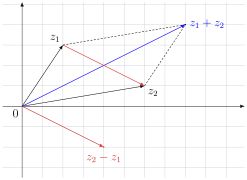

!!! success "Définition 2.2 : conjugué 定义 2.2：共轭（conjugué）"

    Le <strong>conjugué</strong> d'un nombre complexe \(z = x + iy \in \mathbb{C}\) est le nombre complexe \(\bar{z} = x - iy\). Dans le plan complexe, \(\bar{z}\) est l'affixe du symétrique par rapport à l'axe des réels du point d'affixe \(z\).

    复数 \(z = x + iy \in \mathbb{C}\) 的<strong>共轭</strong>是复数 \(\bar{z} = x - iy\)。在复平面中，\(\bar{z}\) 是 坐标为 \(z\) 的点关于实轴的对称点的坐标。
    {: .zh }

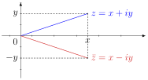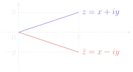

!!! info "Exemple 2.3 例 2.3"

    Pour \(j = -\frac{1}{2} + i\frac{\sqrt{3}}{2}\), on a :

    对于 \(j = -\frac{1}{2} + i\frac{\sqrt{3}}{2}\)，有：
    {: .zh }

    \[
    j^2 = \left(-\frac{1}{2} + i\frac{\sqrt{3}}{2}\right)^2
        = \frac{1}{4} - i\frac{\sqrt{3}}{4} - i\frac{\sqrt{3}}{4} - \frac{3}{4}
        = -\frac{1}{2} - i\frac{\sqrt{3}}{2} = \bar{j}.
    \]

!!! danger "Propriété 2.4 性质 2.4"

    - \(\forall z \in \mathbb{C},\ \bar{\bar{z}} = z\),

        \(\forall z \in \mathbb{C},\ \bar{\bar{z}} = z\)，
        {: .zh }

    - \(\forall (z,w) \in \mathbb{C}^2\), \(\begin{cases}\overline{z + w} = \bar{z} + \bar{w} \\[3pt] \overline{zw} = \bar{z}\,\bar{w}\end{cases}\) .

        \(\forall (z,w) \in \mathbb{C}^2\)， \(\begin{cases}\overline{z + w} = \bar{z} + \bar{w} \\[3pt] \overline{zw} = \bar{z}\,\bar{w}\end{cases}\) 。
        {: .zh }

!!! danger "Propriété 2.5 性质 2.5"

    Pour tout nombre complexe \(z \in \mathbb{C}\), on a :

    对任何复数 \(z \in \mathbb{C}\)，有：
    {: .zh }

    \[
    \mathrm{Re}(z) = \frac{z + \bar{z}}{2} \quad \text{et} \quad \mathrm{Im}(z) = \frac{z - \bar{z}}{2i},
    \]

    en particulier :

    特别地：
    {: .zh }

    \[
    z \in \mathbb{R} \iff \bar{z} = z \quad \text{et} \quad z \in i\mathbb{R} \iff \bar{z} = -z.
    \]

!!! warning "Vocabulaire clé &nbsp;&nbsp; 重点词汇 第二节核心术语"

    - <strong>plan euclidien</strong>：欧几里得平面
    - <strong>repère orthonormé</strong>：正交标架
    - <strong>abscisse / ordonnée</strong>：横坐标 / 纵坐标
    - <strong>coordonnées</strong>：坐标
    - <strong>affixe</strong>：坐标（复平面中点的复数表示）
    - <strong>plan complexe</strong>：复平面
    - <strong>axe des réels</strong>：实轴
    - <strong>axe des imaginaires purs</strong>：虚轴
    - <strong>conjugué \(\bar{z}\)</strong>：共轭
    - <strong>symétrique par rapport à l'axe des réels</strong>：关于实轴的对称点
    - <strong>parallélogramme</strong>：平行四边形
    - <strong>grande / petite diagonale</strong>：长 / 短对角线
    - <strong>on reconnaît</strong>：可以认出
    - <strong>affixes respectives</strong>：各自的坐标
    - <strong>on associe à</strong>：把……对应到

## Module 模

!!! success "Définition 3.1 : module 定义 3.1：模（module）"

    Le <strong>module</strong> d'un nombre complexe \(z = x + iy \in \mathbb{C}\) est le nombre réel positif :

    复数 \(z = x + iy \in \mathbb{C}\) 的<strong>模</strong>是非负实数：
    {: .zh }

    \[
    |z| = \sqrt{x^2 + y^2}.
    \]

    Dans le plan complexe, \(|z|\) est la distance entre l'origine \(O\) et le point d'affixe \(z\), c'est-à-dire la norme euclidienne du vecteur d'affixe \(z\).

    在复平面中，\(|z|\) 是原点 \(O\) 与坐标为 \(z\) 的点之间的距离，即坐标为 \(z\) 的向量的欧几里得范数。
    {: .zh }

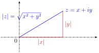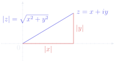

Pour \(x = x + i0 \in \mathbb{R}\), on retrouve la valeur absolue d'un nombre réel : \(|x + i0| = \sqrt{x^2} = |x|\).

对于 \(x = x + i0 \in \mathbb{R}\)，重新得到实数的绝对值：\(|x + i0| = \sqrt{x^2} = |x|\)。
{: .zh }

!!! info "Exemple 3.2 例 3.2"

    - Si \(z_1 \in \mathbb{C}\) et \(z_2 \in \mathbb{C}\) sont les affixes respectives des points \(M_1\) et \(M_2\) dans le plan complexe, alors \(|z_2 - z_1| = \left\|\overrightarrow{M_1M_2}\right\| = M_1M_2\) est la distance entre \(M_1\) et \(M_2\).

        若 \(z_1 \in \mathbb{C}\) 与 \(z_2 \in \mathbb{C}\) 分别是复平面中点 \(M_1\) 与 \(M_2\) 的坐标，则 \(|z_2 - z_1| = \left\|\overrightarrow{M_1M_2}\right\| = M_1M_2\) 是 \(M_1\) 与 \(M_2\) 之间的距离。
        {: .zh }

    - Soient \(w \in \mathbb{C}\) et \(r > 0\). L'ensemble des affixes des points du cercle de centre d'affixe \(w\) et de rayon \(r\) est \(\{z \in \mathbb{C} \mid |z - w| = r\}\). En particulier, l'ensemble \(\mathbb{U} = \{z \in \mathbb{C} \mid |z| = 1\}\) des nombres complexes de module 1, appelé <strong>cercle unité</strong>, correspond au <strong>cercle trigonométrique</strong> \(\{(\cos(\theta),\sin(\theta)) \mid \theta \in \mathbb{R}\}\) dans le plan euclidien.

        设 \(w \in \mathbb{C}\)，\(r > 0\)。以坐标为 \(w\) 的点为圆心、\(r\) 为半径的圆上各点的坐标之集为 \(\{z \in \mathbb{C} \mid |z - w| = r\}\)。特别地，模为 1 的复数之集 \(\mathbb{U} = \{z \in \mathbb{C} \mid |z| = 1\}\) 称为<strong>单位圆</strong>（cercle unité）， 对应欧几里得平面中的<strong>三角圆</strong>（cercle trigonométrique） \(\{(\cos(\theta),\sin(\theta)) \mid \theta \in \mathbb{R}\}\)。
        {: .zh }

    - \(|j| = \left|-\frac{1}{2} + i\frac{\sqrt{3}}{2}\right|
         = \sqrt{\left(-\frac{1}{2}\right)^2 + \left(\frac{\sqrt{3}}{2}\right)^2} = 1\), donc \(j \in \mathbb{U}\).

        \(|j| = \left|-\frac{1}{2} + i\frac{\sqrt{3}}{2}\right|
         = \sqrt{\left(-\frac{1}{2}\right)^2 + \left(\frac{\sqrt{3}}{2}\right)^2} = 1\)，因此 \(j \in \mathbb{U}\)。
        {: .zh }

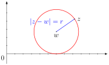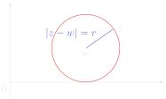

!!! danger "Propriété 3.3 : inverse d'un nombre complexe 性质 3.3：复数的逆元"

    \[
    \forall z \in \mathbb{C},\quad |z| = \sqrt{z\bar{z}}.
    \]

    En particulier, tout nombre complexe \(z \neq 0\) admet un inverse qui est égal à \(\frac{1}{z} = \frac{\bar{z}}{|z|^2}\).

    特别地，任何非零复数 \(z \neq 0\) 都有逆元，且 \(\frac{1}{z} = \frac{\bar{z}}{|z|^2}\)。
    {: .zh }

Par analogie avec les autres ensembles de nombres, on note \(\mathbb{C}^* = \{z \in \mathbb{C} \mid z \neq 0\}\).

仿照其他数集的记法，记 \(\mathbb{C}^* = \{z \in \mathbb{C} \mid z \neq 0\}\)。
{: .zh }

!!! info "Exemple 3.4 例 3.4"

    - \(\dfrac{2+i\sqrt{3}}{\sqrt{3}-2i}
         = \dfrac{(2+i\sqrt{3})\left(\sqrt{3}+2i\right)}{\left(\sqrt{3}-2i\right)\left(\sqrt{3}+2i\right)}
         = \dfrac{\left[2\sqrt{3}-2\sqrt{3}\right] + i[4+3]}{3+4} = i\).

        \(\dfrac{2+i\sqrt{3}}{\sqrt{3}-2i}
         = \dfrac{(2+i\sqrt{3})\left(\sqrt{3}+2i\right)}{\left(\sqrt{3}-2i\right)\left(\sqrt{3}+2i\right)}
         = \dfrac{\left[2\sqrt{3}-2\sqrt{3}\right] + i[4+3]}{3+4} = i\)。
        {: .zh }

    - \(\frac{1}{j} = \frac{\bar{j}}{|j|^2} = \bar{j} = j^2\), donc \(j^3 = 1\).

        \(\frac{1}{j} = \frac{\bar{j}}{|j|^2} = \bar{j} = j^2\)，因此 \(j^3 = 1\)。
        {: .zh }

!!! danger "Propriété 3.5 性质 3.5"

    - \(\forall z \in \mathbb{C},\ |z| \geqslant 0\),

        \(\forall z \in \mathbb{C},\ |z| \geqslant 0\)，
        {: .zh }

    - \(\forall z \in \mathbb{C},\ |z| = 0 \iff z = 0\),

        \(\forall z \in \mathbb{C},\ |z| = 0 \iff z = 0\)，
        {: .zh }

    - \(\forall z \in \mathbb{C},\ |\bar{z}| = |z|\),

        \(\forall z \in \mathbb{C},\ |\bar{z}| = |z|\)，
        {: .zh }

    - \(\forall (z,w) \in \mathbb{C}^2,\ |zw| = |z||w|\).

        \(\forall (z,w) \in \mathbb{C}^2,\ |zw| = |z||w|\)。
        {: .zh }

!!! danger "Théorème 3.6 : inégalité triangulaire dans \(\mathbb{C}\) 定理 3.6：\(\mathbb{C}\) 中的三角不等式"

    \[
    \forall (z,w) \in \mathbb{C}^2,\quad |z + w| \leqslant |z| + |w|.
    \]

    Le cas d'égalité se produit si et seulement si \(z\bar{w} \in \mathbb{R}_+\), c'est-à-dire si et seulement si les points d'affixes \(z\) et \(w\) appartiennent à la même demi-droite issue de l'origine \(O\) dans le plan complexe.

    <strong>等号成立</strong>（cas d'égalité）当且仅当 \(z\bar{w} \in \mathbb{R}_+\)，即当且仅当坐标为 \(z\) 与 \(w\) 的点 在复平面中属于同一条从原点 \(O\) 出发的射线（demi-droite issue de l'origine）。
    {: .zh }

!!! demo ""

    <strong>Démonstration.</strong>&nbsp;&nbsp; 证明。

    Soit \((z,w) \in \mathbb{C}^2\). On a :

    设 \((z,w) \in \mathbb{C}^2\)。有：
    {: .zh }

    \[
    |z + w|^2 = (z+w)\overline{(z+w)} = z\bar{z} + z\bar{w}
              + \underbrace{\bar{z}w}_{=\overline{z\bar{w}}} + w\bar{w}
              = |z|^2 + 2\,\mathrm{Re}\left(z\bar{w}\right) + |w|^2
    \]

    \[
    \text{et} \quad (|z| + |w|)^2 = |z|^2 + 2|z||w| + |w|^2 = |z|^2 + 2\left|z\bar{w}\right| + |w|^2.
    \]

    !!! danger "Lemme 3.7 引理 3.7"

        Pour tout nombre complexe \(z \in \mathbb{C}\), on a :

        对任何复数 \(z \in \mathbb{C}\)，有：
        {: .zh }

        \[
        |\mathrm{Re}(z)| \leqslant |z| \quad \text{et} \quad |\mathrm{Im}(z)| \leqslant |z|.
        \]

        !!! demo ""

            <strong>Démonstration.</strong>&nbsp;&nbsp; 证明。

            Soit \(z = x + iy \in \mathbb{C}\). On a :

            设 \(z = x + iy \in \mathbb{C}\)。有：
            {: .zh }

            \[
            |\mathrm{Re}(z)| = |x| = \sqrt{x^2} \leqslant \sqrt{x^2 + y^2} = |z|
            \quad \text{car la fonction } t \mapsto \sqrt{t} \text{ est croissante}.
            \]

            On raisonne de même pour la partie imaginaire.

            （car la fonction \(t \mapsto \sqrt{t}\) est croissante 意为：因为函数 \(t \mapsto \sqrt{t}\) 单调递增。） 对虚部同样推理。
            {: .zh }

            
∎

    D'après le lemme, on a \(\mathrm{Re}(z\bar{w}) \leqslant |\mathrm{Re}(z\bar{w})| \leqslant |z\bar{w}|\), donc \(|z + w|^2 \leqslant (|z| + |w|)^2\). On en déduit l'inégalité triangulaire par croissance de la fonction \(t \mapsto \sqrt{t}\). De plus, on remarque que le cas d'égalité se produit si et seulement si \(\mathrm{Re}(z\bar{w}) = |z\bar{w}|\), donc si et seulement si \(z\bar{w} \in \mathbb{R}_+\). Si \(w = 0\) l'égalité est évidente, sinon on remarque que :

    根据引理，有 \(\mathrm{Re}(z\bar{w}) \leqslant |\mathrm{Re}(z\bar{w})| \leqslant |z\bar{w}|\)，因此 \(|z + w|^2 \leqslant (|z| + |w|)^2\)。由函数 \(t \mapsto \sqrt{t}\) 的单调递增性即可推出三角不等式。 此外注意到，等号成立当且仅当 \(\mathrm{Re}(z\bar{w}) = |z\bar{w}|\)，即当且仅当 \(z\bar{w} \in \mathbb{R}_+\)。若 \(w = 0\)，等号显然成立；否则注意到：
    {: .zh }

    \[
    z = \frac{z}{w}w = \underbrace{\frac{z\bar{w}}{|w|^2}}_{\in \mathbb{R}_+} w.
    \]

    Autrement dit, le cas d'égalité se produit si et seulement si les vecteurs d'affixe \(z\) et \(w\) sont proportionnels, avec une constante de proportionnalité positive.

    换言之，等号成立当且仅当坐标为 \(z\) 与 \(w\) 的向量<strong>成比例</strong>（proportionnels），且比例系数为正。 ∎
    {: .zh }

!!! danger "Corollaire 3.8 推论 3.8"

    \[
    \forall (z,w) \in \mathbb{C}^2,\quad \bigl||z| - |w|\bigr| \leqslant |z - w|.
    \]

!!! warning "Attention 注意"

    Ne pas confondre valeurs absolues et modules.

    不要混淆绝对值与模。
    {: .zh }

!!! warning "Vocabulaire clé &nbsp;&nbsp; 重点词汇 第三节核心术语"

    - <strong>module \(|z|\)</strong>：模
    - <strong>valeur absolue</strong>：绝对值
    - <strong>cercle unité</strong>：单位圆
    - <strong>cercle trigonométrique</strong>：三角圆
    - <strong>rayon</strong>：半径
    - <strong>distance</strong>：距离
    - <strong>norme euclidienne</strong>：欧几里得范数
    - <strong>inverse</strong>：逆元
    - <strong>inégalité triangulaire</strong>：三角不等式
    - <strong>le cas d'égalité</strong>：等号成立的情形
    - <strong>demi-droite issue de l'origine</strong>：从原点出发的射线
    - <strong>proportionnels</strong>：成比例的
    - <strong>constante de proportionnalité positive</strong>：正的（比例）系数
    - <strong>ne pas confondre … et …</strong>：不要混淆……与……
    - <strong>on en déduit que</strong>：由此推出

## Argument 辐角

!!! success "Définition 4.1 : argument d'un nombre complexe non nul 定义 4.1：非零复数的辐角（argument）"

    Soit \(z \in \mathbb{C}^*\). On appelle <strong>argument</strong> de \(z\), noté \(\arg(z)\), toute mesure en radians de l'angle orienté \((\vec{e_1},\overrightarrow{OM})\) où \(M\) est le point d'affixe \(z\) dans le plan complexe.

    设 \(z \in \mathbb{C}^*\)。称 \(z\) 的<strong>辐角</strong>，记作 \(\arg(z)\)，为有向角 \((\vec{e_1},\overrightarrow{OM})\) 的任意弧度度量，其中 \(M\) 是复平面中坐标为 \(z\) 的点。
    {: .zh }

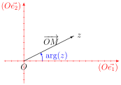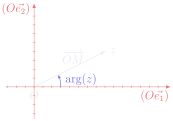

!!! warning "Important 重要"

    Par définition, tout nombre complexe non nul admet une infinité d'arguments. Plus précisément, un argument est défini modulo \(2\pi\). On parle toujours d'<strong>un</strong> argument et jamais de <strong>l'</strong>argument. Par contre, l'unique valeur d'argument comprise dans \(]-\pi,\pi]\) est appelée l'<strong>argument principal</strong>.

    按定义，任何非零复数都有无穷多个辐角。更确切地说，辐角是模 \(2\pi\) 定义的。我们总说「一个辐角」， 而绝不说「那个辐角」。而落在 \(]-\pi,\pi]\) 内的唯一辐角值称为<strong>主辐角</strong>（argument principal）。
    {: .zh }

!!! warning "Attention 注意"

    On ne peut pas attribuer d'argument à \(0\) car l'angle \((\vec{e_1},\vec{0})\) n'est pas défini.

    不能给 \(0\) 指定辐角，因为角 \((\vec{e_1},\vec{0})\) 没有定义。
    {: .zh }

!!! danger "Théorème 4.2 : forme trigonométrique d'un nombre complexe non nul 定理 4.2：非零复数的三角形式"

    Tout \(z \in \mathbb{C}^*\) s'écrit de manière unique sous la forme :

    任何 \(z \in \mathbb{C}^*\) 都能唯一地写成如下形式：
    {: .zh }

    \[
    z = \rho\left(\cos(\theta) + i\sin(\theta)\right)
    \]

    où \(\rho > 0\) et \(\theta \in \mathbb{R}\) est défini modulo \(2\pi\). De plus, on a \(\rho = |z|\) et \(\theta = \arg(z)\). Cette écriture est appelée la <strong>forme trigonométrique</strong> de \(z\).

    其中 \(\rho > 0\)，\(\theta \in \mathbb{R}\) 模 \(2\pi\) 定义。此外有 \(\rho = |z|\)、\(\theta = \arg(z)\)。 这种写法称为 \(z\) 的<strong>三角形式</strong>（forme trigonométrique）。
    {: .zh }

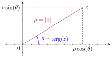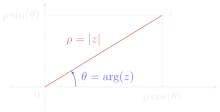

!!! info "Exemple 4.3 例 4.3"

    Pour \(z = 1-i\), on a \(|z| = \sqrt{1^2 + (-1)^2} = \sqrt{2}\). En notant \(\theta = \arg(z)\), on obtient :

    对于 \(z = 1-i\)，有 \(|z| = \sqrt{1^2 + (-1)^2} = \sqrt{2}\)。记 \(\theta = \arg(z)\)，得到：
    {: .zh }

    \[
    z = \sqrt{2}\left(\frac{\sqrt{2}}{2} - i\frac{\sqrt{2}}{2}\right)
      = \sqrt{2}\left(\cos(\theta) + i\sin(\theta)\right)
    \quad \text{donc} \quad
    \begin{cases}
    \cos(\theta) = \dfrac{\sqrt{2}}{2} \\[6pt]
    \sin(\theta) = -\dfrac{\sqrt{2}}{2}
    \end{cases}.
    \]

    On en déduit que \(\theta = -\frac{\pi}{4}\) est un argument de \(z\).

    （donc 意为：因此。）由此得出 \(\theta = -\frac{\pi}{4}\) 是 \(z\) 的一个辐角。
    {: .zh }

Plus généralement, le passage de la forme algébrique de \(z = x + iy \in \mathbb{C}^*\) à la forme trigonométrique \(z = \rho(\cos(\theta) + i\sin(\theta))\) est donné par les formules :

更一般地，从 \(z = x + iy \in \mathbb{C}^*\) 的代数形式转换到三角形式 \(z = \rho(\cos(\theta) + i\sin(\theta))\) 由以下公式给出：
{: .zh }

\[
\rho = \sqrt{x^2 + y^2}, \quad
\cos(\theta) = \frac{x}{\sqrt{x^2 + y^2}} \quad \text{et} \quad
\sin(\theta) = \frac{y}{\sqrt{x^2 + y^2}}.
\]

!!! warning "Vocabulaire clé &nbsp;&nbsp; 重点词汇 第四节核心术语"

    - <strong>argument \(\arg(z)\)</strong>：辐角
    - <strong>argument principal</strong>：主辐角
    - <strong>angle orienté</strong>：有向角
    - <strong>mesure en radians</strong>：弧度度量
    - <strong>défini modulo \(2\pi\)</strong>：模 \(2\pi\) 定义（相差 \(2\pi\) 的整数倍视为相同）
    - <strong>une infinité d'arguments</strong>：无穷多个辐角
    - <strong>forme trigonométrique</strong>：三角形式
    - <strong>s'écrit de manière unique</strong>：唯一地写成
    - <strong>le passage de … à …</strong>：从……到……的转换
    - <strong>on en déduit que</strong>：由此得出
    - <strong>plus généralement</strong>：更一般地

## Exponentielle complexe 复指数

!!! success "Définition 5.1 : notation exponentielle du cercle unité 定义 5.1：单位圆的指数记号"

    Pour tout \(\theta \in \mathbb{R}\), on note \(e^{i\theta}\) l'unique nombre complexe de module 1 et d'argument \(\theta\), c'est-à-dire :

    对任何 \(\theta \in \mathbb{R}\)，记 \(e^{i\theta}\) 为模为 1、辐角为 \(\theta\) 的唯一复数，即：
    {: .zh }

    \[
    e^{i\theta} = \cos(\theta) + i\sin(\theta).
    \]

    On obtient ainsi une nouvelle représentation du <strong>cercle unité</strong> :

    由此得到<strong>单位圆</strong>的一种新表示：
    {: .zh }

    \[
    \mathbb{U} = \{z \in \mathbb{C} \mid |z| = 1\} = \{e^{i\theta} \mid \theta \in \mathbb{R}\}.
    \]

    On a aussi en utilisant seulement l'argument principal : \(\mathbb{U} = \{e^{i\theta} \mid \theta \in\;]-\pi,\pi]\}\).

    只用主辐角也可写为 \(\mathbb{U} = \{e^{i\theta} \mid \theta \in\;]-\pi,\pi]\}\)。
    {: .zh }

!!! info "Exemple 5.2 例 5.2"

    - \(e^{2i\pi} = e^{i0} = 1\), \(e^{i\pi} = -1\) et \(e^{i\pi/2} = i\).

        \(e^{2i\pi} = e^{i0} = 1\)，\(e^{i\pi} = -1\)，\(e^{i\pi/2} = i\)。
        {: .zh }

    - \(j = -\frac{1}{2} + i\frac{\sqrt{3}}{2} = e^{2i\pi/3}\) et \(\bar{j} = j^2 = \frac{1}{j} = e^{-2i\pi/3} = e^{4i\pi/3}\).

        \(j = -\frac{1}{2} + i\frac{\sqrt{3}}{2} = e^{2i\pi/3}\)，且 \(\bar{j} = j^2 = \frac{1}{j} = e^{-2i\pi/3} = e^{4i\pi/3}\)。
        {: .zh }

!!! danger "Propriété 5.3 性质 5.3"

    - \(\forall \theta \in \mathbb{R},\ \left|e^{i\theta}\right| = 1\),

        \(\forall \theta \in \mathbb{R},\ \left|e^{i\theta}\right| = 1\)，
        {: .zh }

    - \(\forall \theta \in \mathbb{R},\ \overline{e^{i\theta}} = e^{-i\theta} = \dfrac{1}{e^{i\theta}}\),

        \(\forall \theta \in \mathbb{R},\ \overline{e^{i\theta}} = e^{-i\theta} = \dfrac{1}{e^{i\theta}}\)，
        {: .zh }

    - \(\forall (\alpha,\beta) \in \mathbb{R}^2,\ e^{i(\alpha+\beta)} = e^{i\alpha}e^{i\beta}\).

        \(\forall (\alpha,\beta) \in \mathbb{R}^2,\ e^{i(\alpha+\beta)} = e^{i\alpha}e^{i\beta}\)。
        {: .zh }

!!! danger "Propriété 5.4 : formules d'Euler 性质 5.4：欧拉公式"

    Pour tout nombre réel \(\theta \in \mathbb{R}\), on a :

    对任何实数 \(\theta \in \mathbb{R}\)，有：
    {: .zh }

    \[
    \cos(\theta) = \frac{e^{i\theta} + e^{-i\theta}}{2}
    \quad \text{et} \quad
    \sin(\theta) = \frac{e^{i\theta} - e^{-i\theta}}{2i}.
    \]

!!! info "Exemple 5.5 例 5.5"

    Soit \(\theta \in \mathbb{R}\). On a :

    设 \(\theta \in \mathbb{R}\)。有：
    {: .zh }

    \[
    \begin{aligned}
    \cos^2(\theta)\sin(\theta)
      &= \left(\frac{e^{i\theta} + e^{-i\theta}}{2}\right)^2 \frac{e^{i\theta} - e^{-i\theta}}{2i}
         \quad \text{d'après les formules d'Euler} \\[4pt]
      &= \frac{1}{8i}\left(e^{2i\theta} + 2 + e^{-2i\theta}\right)\left(e^{i\theta} - e^{-i\theta}\right) \\[4pt]
      &= \frac{1}{8i}\left(e^{3i\theta} + e^{i\theta} - e^{-i\theta} - e^{-3i\theta}\right) \\[4pt]
      &= \frac{\sin(3\theta) + \sin(\theta)}{4} \quad \text{d'après les formules d'Euler.}
    \end{aligned}
    \]

!!! danger "Propriété 5.6 : formule de Moivre 性质 5.6：棣莫弗公式"

    \[
    \forall (n,\theta) \in \mathbb{Z} \times \mathbb{R},\quad
    \left(\cos(\theta) + i\sin(\theta)\right)^n = \cos(n\theta) + i\sin(n\theta).
    \]

!!! demo ""

    <strong>Démonstration.</strong>&nbsp;&nbsp; 证明。

    Soit \(\theta \in \mathbb{R}\). En notation exponentielle, la formule de Moivre s'écrit :

    设 \(\theta \in \mathbb{R}\)。用指数记号，棣莫弗公式可写为：
    {: .zh }

    \[
    \forall n \in \mathbb{Z},\quad \left(e^{i\theta}\right)^n = e^{in\theta}.
    \]

    On commence par montrer la formule pour les entiers \(n \in \mathbb{N}\) par récurrence.

    先用<strong>归纳法</strong>（par récurrence）对整数 \(n \in \mathbb{N}\) 证明该公式。
    {: .zh }

    - <strong>Initialisation.</strong> Pour \(n = 0\), on a \(\left(e^{i\theta}\right)^0 = 1 = e^{i0}\).

        <strong>初始步骤</strong>（Initialisation）：当 \(n = 0\) 时，\(\left(e^{i\theta}\right)^0 = 1 = e^{i0}\)。
        {: .zh }

    - <strong>Hérédité.</strong> On suppose que \(\left(e^{i\theta}\right)^n = e^{in\theta}\) pour un \(n \in \mathbb{N}\) fixé. Alors :

        <strong>归纳步骤</strong>（Hérédité）：假设对某个固定的 \(n \in \mathbb{N}\) 有 \(\left(e^{i\theta}\right)^n = e^{in\theta}\)。则：
        {: .zh }

        \[
        \left(e^{i\theta}\right)^{n+1} = \left(e^{i\theta}\right)^n e^{i\theta}
        = e^{in\theta}e^{i\theta} = e^{i(n\theta + \theta)} = e^{i(n+1)\theta}.
        \]

    - <strong>Conclusion.</strong> D'après le principe de récurrence, la formule est vérifiée pour tout \(n \in \mathbb{N}\).

        <strong>结论</strong>（Conclusion）：根据<strong>归纳原理</strong>（principe de récurrence），公式对一切 \(n \in \mathbb{N}\) 成立。
        {: .zh }

    Puis on généralise aux entiers \(n \in \mathbb{Z} \setminus \mathbb{N}\) de la façon suivante :

    然后按如下方式推广到整数 \(n \in \mathbb{Z} \setminus \mathbb{N}\)：
    {: .zh }

    \[
    \left(e^{i\theta}\right)^n = \frac{1}{\left(e^{i\theta}\right)^{-n}} = \frac{1}{e^{-in\theta}}
    = e^{in\theta} \quad \text{car } -n \in \mathbb{N}.
    \]

    
∎

!!! info "Exemple 5.7 例 5.7"

    Soit \(\theta \in \mathbb{R}\). On a :

    设 \(\theta \in \mathbb{R}\)。有：
    {: .zh }

    \[
    \begin{aligned}
    \cos(3\theta)
      &= \mathrm{Re}\left(\cos(3\theta) + i\sin(3\theta)\right) \\[4pt]
      &= \mathrm{Re}\left(\left(\cos(\theta) + i\sin(\theta)\right)^3\right)
         \quad \text{d'après la formule de Moivre} \\[4pt]
      &= \mathrm{Re}\left(\cos^3(\theta) + 3i\cos^2(\theta)\sin(\theta)
         - 3\cos(\theta)\sin^2(\theta) - i\sin^3(\theta)\right) \\[4pt]
      &= \cos^3(\theta) - 3\cos(\theta)\sin^2(\theta).
    \end{aligned}
    \]

!!! success "Définition 5.8 : exponentielle complexe 定义 5.8：复指数（exponentielle complexe）"

    On définit l'<strong>exponentielle</strong> d'un nombre complexe \(z = x + iy \in \mathbb{C}\) par :

    定义复数 \(z = x + iy \in \mathbb{C}\) 的<strong>指数</strong>为：
    {: .zh }

    \[
    e^z = e^xe^{iy} = e^x\cos(y) + ie^x\sin(y) \in \mathbb{C}.
    \]

!!! danger "Propriété 5.9 性质 5.9"

    - \(\forall z \in \mathbb{C},\ \left|e^z\right| = e^{\mathrm{Re}(z)}\),

        \(\forall z \in \mathbb{C},\ \left|e^z\right| = e^{\mathrm{Re}(z)}\)，
        {: .zh }

    - \(\forall z \in \mathbb{C},\ \overline{e^z} = e^{\bar{z}}\),

        \(\forall z \in \mathbb{C},\ \overline{e^z} = e^{\bar{z}}\)，
        {: .zh }

    - \(\forall (z,w) \in \mathbb{C}^2,\ e^{z+w} = e^ze^w\).

        \(\forall (z,w) \in \mathbb{C}^2,\ e^{z+w} = e^ze^w\)。
        {: .zh }

!!! warning "Vocabulaire clé &nbsp;&nbsp; 重点词汇 第五节核心术语"

    - <strong>exponentielle complexe</strong>：复指数
    - <strong>notation exponentielle</strong>：指数记号
    - <strong>formules d'Euler</strong>：欧拉公式
    - <strong>formule de Moivre</strong>：棣莫弗公式
    - <strong>par récurrence</strong>：用归纳法
    - <strong>initialisation</strong>：初始步骤
    - <strong>hérédité</strong>：归纳步骤（递推步）
    - <strong>conclusion</strong>：结论
    - <strong>principe de récurrence</strong>：归纳原理
    - <strong>on suppose que</strong>：假设
    - <strong>on généralise à</strong>：推广到
    - <strong>d'après</strong>：根据
    - <strong>de la façon suivante</strong>：按如下方式

## Forme exponentielle 指数形式

!!! success "Définition 6.1 : forme exponentielle d'un nombre complexe non nul 定义 6.1：非零复数的指数形式"

    Tout \(z \in \mathbb{C}^*\) s'écrit de manière unique sous la forme \(z = \rho e^{i\theta}\) où \(\rho > 0\) et \(\theta \in \mathbb{R}\) est défini modulo \(2\pi\). De plus, on a \(\rho = |z|\) et \(\theta = \arg(z)\). Cette écriture est appelée la <strong>forme exponentielle</strong> de \(z\).

    任何 \(z \in \mathbb{C}^*\) 都能唯一地写成 \(z = \rho e^{i\theta}\) 的形式，其中 \(\rho > 0\)， \(\theta \in \mathbb{R}\) 模 \(2\pi\) 定义。此外有 \(\rho = |z|\)、\(\theta = \arg(z)\)。这种写法称为 \(z\) 的<strong>指数形式</strong>（forme exponentielle）。
    {: .zh }

!!! info "Exemple 6.2 例 6.2"

    Soit \((\alpha,\beta) \in \mathbb{R}^2\). On a :

    设 \((\alpha,\beta) \in \mathbb{R}^2\)。有：
    {: .zh }

    \[
    \begin{aligned}
    e^{i\alpha} + e^{i\beta}
      &= \left(e^{i(\alpha-\beta)/2} + e^{-i(\alpha-\beta)/2}\right)e^{i(\alpha+\beta)/2} \\[4pt]
      &= 2\cos\left(\frac{\alpha-\beta}{2}\right)e^{i(\alpha+\beta)/2}
         \quad \text{d'après les formules d'Euler.}
    \end{aligned}
    \]

    Si \(\cos\left(\frac{\alpha-\beta}{2}\right) > 0\), c'est-à-dire si \(\alpha - \beta \in \bigcup_{k\in\mathbb{Z}}\,]-\pi + 4k\pi,\ \pi + 4k\pi[\), alors on a trouvé la forme exponentielle de \(e^{i\alpha} + e^{i\beta}\). Plus précisément, on a \(\left|e^{i\alpha} + e^{i\beta}\right| = 2\left|\cos\left(\frac{\alpha-\beta}{2}\right)\right|\) et :

    若 \(\cos\left(\frac{\alpha-\beta}{2}\right) > 0\)，即 \(\alpha - \beta \in \bigcup_{k\in\mathbb{Z}}\,]-\pi + 4k\pi,\ \pi + 4k\pi[\)，则已经求出 \(e^{i\alpha} + e^{i\beta}\) 的指数形式。更确切地说，有 \(\left|e^{i\alpha} + e^{i\beta}\right| = 2\left|\cos\left(\frac{\alpha-\beta}{2}\right)\right|\)，且：
    {: .zh }

    - \(\arg\left(e^{i\alpha} + e^{i\beta}\right) = \frac{\alpha+\beta}{2}\) si \(\alpha - \beta \in \bigcup_{k\in\mathbb{Z}}\,]-\pi + 4k\pi,\ \pi + 4k\pi[\),

        \(\arg\left(e^{i\alpha} + e^{i\beta}\right) = \frac{\alpha+\beta}{2}\)，若 \(\alpha - \beta \in \bigcup_{k\in\mathbb{Z}}\,]-\pi + 4k\pi,\ \pi + 4k\pi[\)；
        {: .zh }

    - \(e^{i\alpha} + e^{i\beta} = 0\) (donc l'argument n'est pas défini) si \(\alpha - \beta \equiv \pi\) modulo \(2\pi\),

        \(e^{i\alpha} + e^{i\beta} = 0\)（因此辐角无定义），若 \(\alpha - \beta \equiv \pi\) 模 \(2\pi\)；
        {: .zh }

    - \(\arg\left(e^{i\alpha} + e^{i\beta}\right) = \frac{\alpha+\beta}{2} + \pi\) si \(\alpha - \beta \in \bigcup_{k\in\mathbb{Z}}\,]\pi + 4k\pi,\ 3\pi + 4k\pi[\).

        \(\arg\left(e^{i\alpha} + e^{i\beta}\right) = \frac{\alpha+\beta}{2} + \pi\)，若 \(\alpha - \beta \in \bigcup_{k\in\mathbb{Z}}\,]\pi + 4k\pi,\ 3\pi + 4k\pi[\)。
        {: .zh }

!!! danger "Propriété 6.3 性质 6.3"

    - \(\forall z \in \mathbb{C}^*,\ \arg(\bar{z}) \equiv \arg\left(\frac{1}{z}\right) \equiv -\arg(z)\) modulo \(2\pi\),

        \(\forall z \in \mathbb{C}^*,\ \arg(\bar{z}) \equiv \arg\left(\frac{1}{z}\right) \equiv -\arg(z)\) 模 \(2\pi\)，
        {: .zh }

    - \(\forall (z,w) \in (\mathbb{C}^*)^2,\ \arg(zw) \equiv \arg(z) + \arg(w)\) modulo \(2\pi\).

        \(\forall (z,w) \in (\mathbb{C}^*)^2,\ \arg(zw) \equiv \arg(z) + \arg(w)\) 模 \(2\pi\)。
        {: .zh }

    En particulier, \(\arg(z) \equiv \arg(w)\) modulo \(2\pi\) si et seulement si \(z\bar{w} \in \mathbb{R}_+^*\), c'est-à-dire si et seulement si les points d'affixes \(z\) et \(w\) appartiennent à la même demi-droite issue de l'origine \(O\) dans le plan complexe.

    特别地，\(\arg(z) \equiv \arg(w)\) 模 \(2\pi\) 当且仅当 \(z\bar{w} \in \mathbb{R}_+^*\)，即当且仅当坐标为 \(z\) 与 \(w\) 的点在复平面中属于同一条从原点 \(O\) 出发的射线。
    {: .zh }

La forme exponentielle permet d'interpréter géométriquement la multiplication de deux nombres complexes : si \(z_1 = \rho_1e^{i\theta_1} \in \mathbb{C}^*\) et \(z_2 = \rho_2e^{i\theta_2} \in
 \mathbb{C}^*\) alors \(z_1z_2 = (\rho_1\rho_2)e^{i(\theta_1+\theta_2)}\). Autrement dit, pour multiplier deux nombres complexes, on multiplie leur module et on additionne leur argument.

指数形式可以几何地解释两个复数的乘法：若 \(z_1 = \rho_1e^{i\theta_1} \in \mathbb{C}^*\) 且 \(z_2 = \rho_2e^{i\theta_2} \in \mathbb{C}^*\)，则 \(z_1z_2 = (\rho_1\rho_2)e^{i(\theta_1+\theta_2)}\)。 换言之，两个复数相乘时，模相乘、辐角相加。
{: .zh }

!!! info "Exemple 6.4 例 6.4"

    Soient \((a,b) \in \mathbb{C}^2\) les affixes respectives des points \(A\) et \(B\) dans le plan complexe, et \(\theta \in \mathbb{R}\). Si on multiplie \(b - a\), qui est l'affixe du vecteur \(\overrightarrow{AB}\), par \(e^{i\theta}\), son module ne change pas et son argument augmente de \(\theta\). Ainsi, \(c - a = (b-a)e^{i\theta}\) est l'affixe du vecteur \(\overrightarrow{AC}\) où le point \(C\) est l'image de \(B\) par la rotation de centre \(A\) et d'angle \(\theta\).

    设 \((a,b) \in \mathbb{C}^2\) 分别是复平面中点 \(A\) 与 \(B\) 的坐标，\(\theta \in \mathbb{R}\)。把向量 \(\overrightarrow{AB}\) 的坐标 \(b - a\) 乘以 \(e^{i\theta}\)，其模不变，辐角增加 \(\theta\)。因此 \(c - a = (b-a)e^{i\theta}\) 是向量 \(\overrightarrow{AC}\) 的坐标，其中点 \(C\) 是 \(B\) 在以 \(A\) 为中心、 \(\theta\) 为角的<strong>旋转</strong>（rotation）下的像。
    {: .zh }

!!! warning "Vocabulaire clé &nbsp;&nbsp; 重点词汇 第六节核心术语"

    - <strong>forme exponentielle</strong>：指数形式
    - <strong>rotation</strong>：旋转
    - <strong>centre / angle de la rotation</strong>：旋转中心 / 旋转角
    - <strong>l'image de \(B\) par la rotation</strong>：旋转下 \(B\) 的像
    - <strong>on multiplie … par …</strong>：把……乘以……
    - <strong>son module ne change pas</strong>：其模不变
    - <strong>son argument augmente de \(\theta\)</strong>：其辐角增加 \(\theta\)
    - <strong>interpréter géométriquement</strong>：几何地解释
    - <strong>c'est-à-dire</strong>：也就是说
    - <strong>plus précisément</strong>：更确切地说

## Résolution des équations de degré 2 à coefficients réels 实系数二次方程的求解

!!! danger "Théorème 7.1 : résolution des équations de degré 2 à coefficients réels 定理 7.1：实系数二次方程的求解"

    On considère une équation de degré 2 d'inconnue \(z \in \mathbb{C}\) de la forme :

    考虑未知量为 \(z \in \mathbb{C}\) 的二次方程，形如：
    {: .zh }

    \[
    \begin{aligned}
    az^2 + bz + c = 0 \tag{E}
    \end{aligned}
    \]

    où \((a,b,c) \in \mathbb{R}^3\) et \(a \neq 0\). Il y a trois cas selon le signe du nombre réel \(\Delta = b^2 - 4ac\) appelé le <strong>discriminant</strong> de (E).

    其中 \((a,b,c) \in \mathbb{R}^3\) 且 \(a \neq 0\)。根据实数 \(\Delta = b^2 - 4ac\)（称为 (E) 的 <strong>判别式</strong> discriminant）的符号分三种情况。
    {: .zh }

    - Si \(\Delta > 0\) alors (E) admet deux solutions réelles :

        若 \(\Delta > 0\)，则 (E) 有两个实根：
        {: .zh }

        \[
        \frac{-b + \sqrt{\Delta}}{2a} \quad \text{et} \quad \frac{-b - \sqrt{\Delta}}{2a}.
        \]

    - Si \(\Delta = 0\) alors (E) admet une seule solution réelle :

        若 \(\Delta = 0\)，则 (E) 只有一个实根：
        {: .zh }

        \[
        \frac{-b}{2a}.
        \]

    - Si \(\Delta < 0\) alors (E) admet deux solutions complexes conjuguées :

        若 \(\Delta < 0\)，则 (E) 有两个共轭复根：
        {: .zh }

        \[
        \frac{-b + i\sqrt{-\Delta}}{2a} \quad \text{et} \quad \frac{-b - i\sqrt{-\Delta}}{2a}.
        \]

!!! demo ""

    <strong>Démonstration.</strong>&nbsp;&nbsp; 证明。

    Le discriminant apparaît naturellement dans la <strong>forme canonique</strong> de l'expression polynomiale :

    判别式自然地出现在该多项式的<strong>标准形</strong>（forme canonique，即配方形式）中：
    {: .zh }

    \[
    \begin{aligned}
    \forall z \in \mathbb{C},\quad az^2 + bz + c
      &= a\left(z^2 + 2\frac{b}{2a}z + \frac{c}{a}\right)
         = a\left(\left(z + \frac{b}{2a}\right)^2 - \frac{b^2}{4a^2} + \frac{c}{a}\right) \\[4pt]
      &= a\left(\left(z + \frac{b}{2a}\right)^2 - \frac{b^2 - 4ac}{4a^2}\right)
         = a\left(\left(z + \frac{b}{2a}\right)^2 - \frac{\Delta}{4a^2}\right).
    \end{aligned}
    \]

    On admet pour l'instant qu'on peut trouver un nombre complexe \(\delta\) tel que \(\delta^2 = \Delta\). Alors :

    我们暂且承认（on admet pour l'instant）可以找到复数 \(\delta\) 使 \(\delta^2 = \Delta\)。则：
    {: .zh }

    \[
    \forall z \in \mathbb{C},\quad az^2 + bz + c
    = a\left(\left(z + \frac{b}{2a}\right)^2 - \left(\frac{\delta}{2a}\right)^2\right)
    = a\left(z - \frac{-b+\delta}{2a}\right)\left(z - \frac{-b-\delta}{2a}\right).
    \]

    !!! danger "Lemme 7.2 : intégrité dans \(\mathbb{C}\) 引理 7.2：\(\mathbb{C}\) 的无零因子性质"

        \[
        \forall (z,w) \in \mathbb{C}^2,\quad zw = 0 \implies (z = 0 \text{ ou } w = 0).
        \]

        !!! demo ""

            <strong>Démonstration.</strong>&nbsp;&nbsp; 证明。

            Soit \((z,w) \in \mathbb{C}^2\). Il suffit d'utiliser le module et l'intégrité dans \(\mathbb{R}\) :

            设 \((z,w) \in \mathbb{C}^2\)。只需利用模与 \(\mathbb{R}\) 的无零因子性质：
            {: .zh }

            \[
            \begin{aligned}
            zw = 0 &\implies |zw| = |z|\,|w| = 0 \\
                   &\implies (|z| = 0 \text{ ou } |w| = 0) \implies (z = 0 \text{ ou } w = 0).
            \end{aligned}
            \]

            
∎

    Par intégrité, on en déduit donc que :

    由无零因子性质，由此推出：
    {: .zh }

    \[
    (E) \iff \left(z = \frac{-b+\delta}{2a} \text{ ou } z = \frac{-b-\delta}{2a}\right).
    \]

    Enfin, pour trouver \(\delta \in \mathbb{C}\) tel que \(\delta^2 = \Delta\), il suffit de poser \(\delta = \sqrt{\Delta}\) si \(\Delta \geqslant 0\) et \(\delta = i\sqrt{-\Delta}\) sinon. On en déduit les solutions de (E).

    最后，要找 \(\delta \in \mathbb{C}\) 使 \(\delta^2 = \Delta\)，只需在 \(\Delta \geqslant 0\) 时取 \(\delta = \sqrt{\Delta}\)，否则取 \(\delta = i\sqrt{-\Delta}\)。由此得到 (E) 的解。∎
    {: .zh }

!!! warning "Attention 注意"

    La fonction \(t \mapsto \sqrt{t}\) est définie seulement sur \(\mathbb{R}_+\). On ne peut pas l'appliquer directement à un nombre complexe.

    函数 \(t \mapsto \sqrt{t}\) 只在 \(\mathbb{R}_+\) 上有定义，不能直接作用于复数。
    {: .zh }

!!! danger "Corollaire 7.3 推论 7.3"

    Si on note \(z_1\) et \(z_2\) les deux solutions de (E) (avec \(z_1 = z_2 = -\frac{b}{2a}\) dans le cas où \(\Delta = 0\)), alors :

    若记 \(z_1\) 与 \(z_2\) 为 (E) 的两个解（当 \(\Delta = 0\) 时 \(z_1 = z_2 = -\frac{b}{2a}\)），则：
    {: .zh }

    \[
    z_1 + z_2 = -\frac{b}{a} \quad \text{et} \quad z_1z_2 = \frac{c}{a}.
    \]

!!! danger "Corollaire 7.4 推论 7.4"

    Soit \((S,P) \in \mathbb{R}^2\). Deux nombres complexes \(z_1\) et \(z_2\) ont pour somme \(S\) et pour produit \(P\) si et seulement s'ils sont les solutions de l'équation \(z^2 - Sz + P = 0\) d'inconnue \(z \in \mathbb{C}\) :

    设 \((S,P) \in \mathbb{R}^2\)。两个复数 \(z_1\) 与 \(z_2\) 的和为 \(S\)、积为 \(P\)，当且仅当它们是方程 \(z^2 - Sz + P = 0\)（未知量为 \(z \in \mathbb{C}\)）的解：
    {: .zh }

    \[
    \begin{cases}
    z_1 + z_2 = S \\
    z_1z_2 = P
    \end{cases}
    \quad \Longleftrightarrow \quad
    \left\{z \in \mathbb{C} \mid z^2 - Sz + P = 0\right\} = \{z_1,z_2\}.
    \]

!!! info "Exemple 7.5 例 7.5"

    Pour trouver deux nombres dont la somme vaut \(-1\) et le produit vaut \(1\), il suffit de résoudre l'équation \(z^2 + z + 1 = 0\) d'inconnue \(z \in \mathbb{C}\). Puisque le discriminant est égal à \(\Delta = 1^2 - 4 = -3 < 0\), les solutions sont :

    要找两个和为 \(-1\)、积为 \(1\) 的数，只需解方程 \(z^2 + z + 1 = 0\)（未知量为 \(z \in \mathbb{C}\)）。 由于判别式 \(\Delta = 1^2 - 4 = -3 < 0\)，两个解为：
    {: .zh }

    \[
    z_1 = \frac{-1 + i\sqrt{3}}{2} = j
    \quad \text{et} \quad
    z_2 = \frac{-1 - i\sqrt{3}}{2} = \bar{j} = j^2 = \frac{1}{j}.
    \]

    Les deux nombres cherchés sont donc \(j\) et \(\bar{j}\).

    因此所求的两个数就是 \(j\) 与 \(\bar{j}\)。
    {: .zh }

!!! warning "Vocabulaire clé &nbsp;&nbsp; 重点词汇 第七节核心术语"

    - <strong>équation de degré 2</strong>：二次方程
    - <strong>coefficients réels</strong>：实系数
    - <strong>discriminant \(\Delta\)</strong>：判别式
    - <strong>forme canonique</strong>：标准形（配方形式）
    - <strong>solutions complexes conjuguées</strong>：共轭复根
    - <strong>intégrité</strong>：无零因子性质
    - <strong>somme / produit</strong>：和 / 积
    - <strong>admettre deux solutions</strong>：有两个解
    - <strong>on admet</strong>：我们暂且承认
    - <strong>il suffit de</strong>：只需
    - <strong>on en déduit les solutions</strong>：由此得到解
    - <strong>le cas où</strong>：……的情形

## Racines n-ièmes de l'unité n 次单位根

!!! success "Définition 8.1 : racines \(n\)-ièmes de l'unité 定义 8.1：\(n\) 次单位根（racines \(n\)-ièmes de l'unité）"

    Soit \(n \in \mathbb{N}^*\). Les <strong>racines \(n\)-ièmes de l'unité</strong> sont les solutions de l'équation \(z^n = 1\) d'inconnue \(z \in \mathbb{C}\). On note \(\mathbb{U}_n\) l'ensemble des racines \(n\)-ièmes de l'unité.

    设 \(n \in \mathbb{N}^*\)。<strong>\(n\) 次单位根</strong>是方程 \(z^n = 1\)（未知量为 \(z \in \mathbb{C}\)）的解。 记 \(\mathbb{U}_n\) 为 \(n\) 次单位根之集。
    {: .zh }

!!! danger "Théorème 8.2 : racines \(n\)-ièmes de l'unité sous forme exponentielle 定理 8.2：\(n\) 次单位根的指数形式"

    Soit \(n \in \mathbb{N}^*\). On a :

    设 \(n \in \mathbb{N}^*\)。有：
    {: .zh }

    \[
    \mathbb{U}_n = \left\{e^{2ik\pi/n} \mid k \in \{0,1,\dots,n-1\}\right\}
    = \left\{1,\ e^{2i\pi/n},\ e^{4i\pi/n},\ \dots,\ e^{2i(n-1)\pi/n}\right\} \subset \mathbb{U}.
    \]

    En particulier, il y a exactement \(n\) racines \(n\)-ièmes de l'unité.

    特别地，\(n\) 次单位根恰好有 \(n\) 个。
    {: .zh }

!!! demo ""

    <strong>Démonstration.</strong>&nbsp;&nbsp; 证明。

    On veut résoudre l'équation \(z^n = 1\) d'inconnue \(z \in \mathbb{C}\). On remarque que \(z = 0\) n'est pas une solution, donc on peut supposer que \(z \neq 0\) et écrire \(z\) sous forme exponentielle : \(z = \rho e^{i\theta}\) où \(\rho > 0\) et \(\theta \in \mathbb{R}\) est défini modulo \(2\pi\). Alors :

    要解方程 \(z^n = 1\)（未知量为 \(z \in \mathbb{C}\)）。注意到 \(z = 0\) 不是解，因此可设 \(z \neq 0\)， 并把 \(z\) 写成指数形式：\(z = \rho e^{i\theta}\)，其中 \(\rho > 0\)，\(\theta \in \mathbb{R}\) 模 \(2\pi\) 定义。于是：
    {: .zh }

    \[
    \begin{aligned}
    z^n = 1
      &\iff \left(\rho e^{i\theta}\right)^n = 1 \iff \rho^ne^{in\theta} = 1e^{i0} \\[4pt]
      &\iff
        \begin{cases}
        \rho^n = 1 \\
        n\theta \equiv 0 \ \text{modulo } 2\pi
        \end{cases}
        \qquad \text{par unicité de la forme exponentielle} \\[4pt]
      &\iff
        \begin{cases}
        \rho = 1 \quad \text{car } \rho > 0 \\
        \exists k \in \mathbb{Z},\ \theta = \frac{2k\pi}{n}
        \end{cases}
        \iff \exists k \in \mathbb{Z},\ z = e^{2ik\pi/n}.
    \end{aligned}
    \]

    Puisque les arguments sont définis modulo \(2\pi\), on en déduit que :

    （par unicité de la forme exponentielle 意为：由指数形式的唯一性。）由于辐角模 \(2\pi\) 定义，由此推出：
    {: .zh }

    \[
    \mathbb{U}_n = \left\{e^{2ik\pi/n} \mid k \in \mathbb{Z}\right\}
    = \left\{e^{2ik\pi/n} \mid k \in \{0,1,\dots,n-1\}\right\}.
    \]

    
∎

!!! info "Exemple 8.3 例 8.3"

    - \(\mathbb{U}_1 = \{1\}\),

        \(\mathbb{U}_1 = \{1\}\)，
        {: .zh }

    - \(\mathbb{U}_2 = \{1, e^{i\pi}\} = \{1,-1\}\),

        \(\mathbb{U}_2 = \{1, e^{i\pi}\} = \{1,-1\}\)，
        {: .zh }

    - \(\mathbb{U}_3 = \{1, e^{2i\pi/3}, e^{4i\pi/3}\} = \{1, j, \bar{j}\}\),

        \(\mathbb{U}_3 = \{1, e^{2i\pi/3}, e^{4i\pi/3}\} = \{1, j, \bar{j}\}\)，
        {: .zh }

    - \(\mathbb{U}_4 = \{1, e^{i\pi/2}, e^{i\pi}, e^{3i\pi/2}\} = \{1, i, -1, -i\}\),

        \(\mathbb{U}_4 = \{1, e^{i\pi/2}, e^{i\pi}, e^{3i\pi/2}\} = \{1, i, -1, -i\}\)，
        {: .zh }

    - etc.

        等等。
        {: .zh }

!!! warning "Remarque 注"

    Dans le plan complexe, les racines \(n\)-ièmes de l'unité correspondent aux sommets d'un polygone régulier inscrit dans le cercle unité.

    在复平面中，\(n\) 次单位根对应内接于单位圆的正多边形的顶点。
    {: .zh }

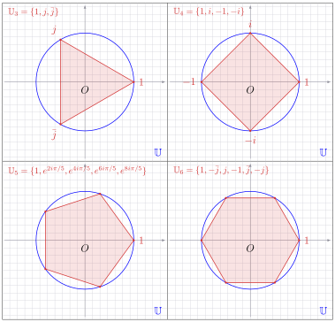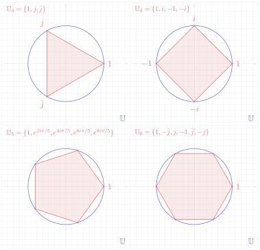

!!! warning "Vocabulaire clé &nbsp;&nbsp; 重点词汇 第八节核心术语"

    - <strong>racines \(n\)-ièmes de l'unité</strong>：\(n\) 次单位根
    - <strong>polynôme</strong>：多项式
    - <strong>polygone régulier inscrit</strong>：内接正多边形
    - <strong>sommet</strong>：顶点
    - <strong>cercle unité</strong>：单位圆
    - <strong>exactement \(n\)</strong>：恰好 \(n\) 个
    - <strong>par unicité de la forme exponentielle</strong>：由指数形式的唯一性
    - <strong>on peut supposer que</strong>：可以假设
    - <strong>correspondre à</strong>：对应
