# 第 2 章　三角学

Chapitre n°2 — Trigonométrie

中法对照讲义 · 由 LaTeX 源文件渲染

!!! info "阅读说明"

    每段先列法语原文；其下缩进、带深蓝竖条的小字号段落为中文翻译。<strong>加粗</strong>为关键词，括号内为中文释义。

### Objectifs 学习目标

1. Manipuler les fonctions trigonométriques.

    熟练操作<strong>三角函数</strong>（fonctions trigonométriques）。
    {: .zh }

1. Simplifier des expressions à l'aide des formules de trigonométrie.

    借助三角公式<strong>化简</strong>（simplifier）表达式。
    {: .zh }

1. Résoudre des équations et des inéquations trigonométriques.

    求解三角<strong>方程</strong>（équations）与三角<strong>不等式</strong>（inéquations）。
    {: .zh }

### Notations 记号

On rappelle que \(\mathbb{C}\) désigne l'ensemble des nombres complexes, \(\mathbb{R}\) désigne l'ensemble des nombres réels et \(\mathbb{Z}\) désigne l'ensemble des entiers relatifs.

我们回顾：\(\mathbb{C}\) 表示<strong>复数集</strong>（l'ensemble des nombres complexes）， \(\mathbb{R}\) 表示<strong>实数集</strong>（les nombres réels），\(\mathbb{Z}\) 表示<strong>整数集</strong> （les entiers relatifs）。
{: .zh }

!!! warning "Vocabulaire clé 重点词汇"

    - <strong>manipuler</strong>：操作、处理（un outil, une fonction）
    - <strong>simplifier une expression</strong>：化简一个表达式
    - <strong>résoudre une équation / une inéquation</strong>：解方程 / 解不等式
    - <strong>on rappelle que…</strong>：我们回顾（温习旧知识时的固定开场白）
    - <strong>désigner</strong>：表示、指代（\(\mathbb{R}\) désigne l'ensemble des…：\(\mathbb{R}\) 表示……的集合）
    - <strong>à l'aide de…</strong>：借助……、利用……
    - <strong>l'ensemble des nombres réels / entiers relatifs</strong>：实数集 / 整数集

## Le cercle trigonométrique 单位圆

On rappelle que l'ensemble \(\mathbb{R}^2\), appelé <strong>plan euclidien</strong>, peut être représenté géométriquement par un plan muni d'un <strong>repère orthonormé</strong> \((O,\vec{e_1},\vec{e_2})\) : chaque point \(M\) est associé à ses <strong>coordonnées</strong> \((x,y)\in\mathbb{R}^2\) définies par \(\overrightarrow{OM}=x\vec{e_1}+y\vec{e_2}\). La <strong>distance</strong> entre l'origine \(O\) et le point \(M\) est alors égale à \(OM=\left\|\overrightarrow{OM}\right\|=\sqrt{x^2+y^2}\).

我们回顾：集合 \(\mathbb{R}^2\) 称为<strong>欧几里得平面</strong>（plan euclidien），可以用一个带有 <strong>标准正交坐标系</strong>（repère orthonormé）\((O,\vec{e_1},\vec{e_2})\) 的平面来几何地表示： 每个点 \(M\) 都对应着由 \(\overrightarrow{OM}=x\vec{e_1}+y\vec{e_2}\) 定义的<strong>坐标</strong> （coordonnées）\((x,y)\in\mathbb{R}^2\)。原点 \(O\) 与点 \(M\) 之间的<strong>距离</strong>于是等于 \(OM=\left\|\overrightarrow{OM}\right\|=\sqrt{x^2+y^2}\)。
{: .zh }

!!! success "Définition 1.1 : le cercle trigonométrique 定义 1.1：单位圆（le cercle trigonométrique）"

    Le <strong>cercle trigonométrique</strong> est le cercle de centre \(O\) et de rayon \(1\) dans le plan euclidien :

    <strong>单位圆</strong>（cercle trigonométrique）是欧几里得平面中圆心为 \(O\)、半径为 \(1\) 的圆：
    {: .zh }

    \[
    \left\{(x,y)\in\mathbb{R}^2 \;\middle|\; x^2+y^2=1\right\}.
    \]

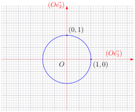

!!! success "Définition 1.2 : le nombre \(\pi\) 定义 1.2：数 π"

    Le <strong>demi-périmètre</strong> du cercle trigonométrique est noté \(\pi\). En particulier, la longueur totale parcourue après un <strong>tour complet</strong> du cercle trigonométrique est égale à \(2\pi\).

    单位圆的<strong>半周长</strong>（demi-périmètre）记作 \(\pi\)。特别地，绕单位圆<strong>一整圈</strong> （tour complet）所走过的总长度为 \(2\pi\)。
    {: .zh }

!!! warning "Remarque 注"

    \[
    \pi \approx 3{,}141592653589793238462643383279502884197169\ldots
    \]

On rappelle que le <strong>sens trigonométrique</strong> est le sens inverse des aiguilles d'une montre.

我们回顾：<strong>三角正方向</strong>（sens trigonométrique）就是逆时针方向 （le sens inverse des aiguilles d'une montre）。
{: .zh }

!!! success "Définition 1.3 : mesure d'angle orienté en radians 定义 1.3：有向角的弧度数"

    Soit \(M\) un point du cercle trigonométrique. La <strong>mesure en radians de l'angle orienté</strong> \((\vec{e_1},\overrightarrow{OM})\) est la longueur parcourue sur le cercle trigonométrique pour aller du point de coordonnées \((1,0)\) au point \(M\) avec un signe :

    设 \(M\) 是单位圆上的一点。<strong>有向角的弧度数</strong>（mesure en radians de l'angle orienté） \((\vec{e_1},\overrightarrow{OM})\) 是指：在单位圆上从坐标为 \((1,0)\) 的点走到点 \(M\) 所经过的 弧长，并带有一个符号：
    {: .zh }

    - <strong>positif</strong> si le cercle est parcouru dans le sens trigonométrique,

        若沿三角正方向绕圆，则为<strong>正</strong>；
        {: .zh }

    - <strong>négatif</strong> si le cercle est parcouru dans le sens opposé.

        若沿相反方向绕圆，则为<strong>负</strong>。
        {: .zh }

    En pratique, une mesure en radians d'un angle orienté est appelée plus simplement <strong>angle</strong>.

    实践中，有向角的弧度数被更简单地称为<strong>角</strong>（angle）。
    {: .zh }

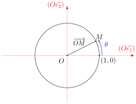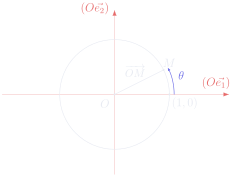

!!! warning "Important 重要"

    Après un tour complet du cercle trigonométrique, on revient au même point. Ainsi, si un angle \(\theta\in\mathbb{R}\) correspond à un point \(M\) du cercle trigonométrique, alors pour tout \(k\in\mathbb{Z}\), l'angle \(\theta+2k\pi\) correspond au même point. On dit que les angles sont définis <strong>modulo</strong> \(2\pi\) et on note pour tout \((\theta,\theta')\in\mathbb{R}^2\) :

    绕单位圆一整圈之后回到同一点。因此，若角 \(\theta\in\mathbb{R}\) 对应于单位圆上的点 \(M\)， 则对任意 \(k\in\mathbb{Z}\)，角 \(\theta+2k\pi\) 都对应于同一点。我们说角是<strong>模</strong> （modulo）\(2\pi\) 定义的，并对任意 \((\theta,\theta')\in\mathbb{R}^2\) 记：
    {: .zh }

    \[
    \theta'\equiv\theta \ \text{modulo}\ 2\pi
    \iff \exists k\in\mathbb{Z},\ \theta'=\theta+2k\pi .
    \]

    即 \(\theta'\) 与 \(\theta\) 模 \(2\pi\) 同余，当且仅当存在 \(k\in\mathbb{Z}\) 使得 \(\theta'=\theta+2k\pi\)。
    {: .zh .gloss }

!!! warning "Vocabulaire clé 重点词汇"

    - <strong>le cercle trigonométrique</strong>：单位圆（三角圆）
    - <strong>le plan euclidien</strong>：欧几里得平面
    - <strong>un repère orthonormé</strong>：标准正交坐标系
    - <strong>les coordonnées \((x,y)\)</strong>：坐标
    - <strong>la distance</strong>：距离
    - <strong>le demi-périmètre</strong>：半周长
    - <strong>le tour complet</strong>：（绕圆）一整圈
    - <strong>le sens trigonométrique</strong>：三角正方向（逆时针）
    - <strong>le sens inverse des aiguilles d'une montre</strong>：逆时针方向
    - <strong>une mesure d'angle orienté en radians</strong>：有向角的弧度数
    - <strong>parcourir</strong>：沿……走、绕行（le cercle est parcouru：沿圆绕行）
    - <strong>être défini modulo \(2\pi\)</strong>：在模 \(2\pi\) 意义下定义
    - <strong>un signe positif / négatif</strong>：正的 / 负的符号

## Fonctions trigonométriques 三角函数

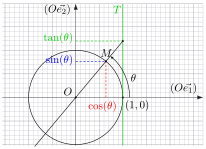

!!! success "Définition 2.1 : cosinus et sinus 定义 2.1：余弦与正弦"

    Pour tout angle \(\theta\in\mathbb{R}\), on note \((\cos(\theta),\sin(\theta))\) les coordonnées du point \(M\) du cercle trigonométrique tel que l'angle orienté \((\vec{e_1},\overrightarrow{OM})\) ait \(\theta\) pour mesure en radians. On définit ainsi sur \(\mathbb{R}\) deux fonctions \(2\pi\)-périodiques, appelées respectivement <strong>cosinus</strong> et <strong>sinus</strong>.

    对任意角 \(\theta\in\mathbb{R}\)，记 \((\cos(\theta),\sin(\theta))\) 为单位圆上使得有向角 \((\vec{e_1},\overrightarrow{OM})\) 的弧度数为 \(\theta\) 的点 \(M\) 的坐标。由此在 \(\mathbb{R}\) 上 定义了两个以 \(2\pi\) 为周期的函数，分别称为<strong>余弦</strong>（cosinus）与<strong>正弦</strong>（sinus）。
    {: .zh }

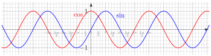

Pour tout angle \(\theta\in\mathbb{R}\), en notant \(M\) le point de coordonnées \((\cos(\theta),\sin(\theta))\), on remarque que :

对任意角 \(\theta\in\mathbb{R}\)，记 \(M\) 为坐标为 \((\cos(\theta),\sin(\theta))\) 的点，我们注意到：
{: .zh }

\[
(OM)\ \text{et}\ (O\vec{e_2})\ \text{sont parallèles}
\iff \theta\equiv\frac{\pi}{2}\ \text{ou}\ -\frac{\pi}{2}\ \text{modulo}\ 2\pi
\iff \cos(\theta)=0 .
\]

即：\((OM)\) 与 \((O\vec{e_2})\) 平行 \(\iff\) \(\theta\equiv\frac{\pi}{2}\) 或 \(-\frac{\pi}{2}\) （模 \(2\pi\)）\(\iff\) \(\cos(\theta)=0\)。
{: .zh .gloss }

!!! success "Définition 2.2 : tangente 定义 2.2：正切"

    On note \(T\) la droite <strong>tangente</strong> au cercle trigonométrique au point de coordonnées \((1,0)\), qui est donc <strong>parallèle</strong> à l'axe des ordonnées \((O\vec{e_2})\). Pour tout angle \(\theta\in\mathbb{R}\) tel que \(\cos(\theta)\neq 0\), on note \((1,\tan(\theta))\) les coordonnées du point d'<strong>intersection</strong> de \(T\) avec la droite passant par \(O\) et le point de coordonnées \((\cos(\theta),\sin(\theta))\). On définit ainsi sur \(\mathbb{R}\setminus\left\{\frac{\pi}{2}+k\pi \;\middle|\; k\in\mathbb{Z}\right\}\) une fonction \(\pi\)-périodique, appelée <strong>tangente</strong>.

    记 \(T\) 为单位圆在坐标为 \((1,0)\) 的点处的<strong>切线</strong>（droite tangente），它因此<strong>平行</strong>于 纵轴 \((O\vec{e_2})\)。对任意满足 \(\cos(\theta)\neq 0\) 的角 \(\theta\in\mathbb{R}\)，记 \((1,\tan(\theta))\) 为 \(T\) 与过 \(O\) 及坐标为 \((\cos(\theta),\sin(\theta))\) 的直线之<strong>交点</strong> （intersection）的坐标。由此在 \(\mathbb{R}\setminus\left\{\frac{\pi}{2}+k\pi \;\middle|\; k\in\mathbb{Z}\right\}\) 上定义了一个以 \(\pi\) 为周期的函数，称为<strong>正切</strong>（tangente）。
    {: .zh }

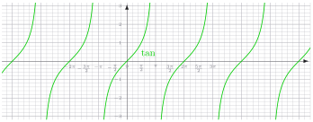

!!! warning "Vocabulaire clé 重点词汇"

    - <strong>le cosinus / le sinus / la tangente</strong>：余弦 / 正弦 / 正切
    - <strong>la fonction \(2\pi\)-périodique</strong>：以 \(2\pi\) 为周期的函数
    - <strong>une droite tangente à…</strong>：……的切线
    - <strong>être parallèle à…</strong>：平行于……
    - <strong>l'axe des ordonnées / des abscisses</strong>：纵轴 / 横轴
    - <strong>le point d'intersection</strong>：交点
    - <strong>les valeurs remarquables</strong>：特殊值（常用角的值）
    - <strong>un encadrement</strong>：夹逼（两侧不等式）
    - <strong>en comparant les aires</strong>：通过比较面积
    - <strong>la portion de disque</strong>：扇形（圆的一部分）
    - <strong>on en déduit que…</strong>：由此推出……
    - <strong>le théorème de Thalès / de Pythagore</strong>：泰勒斯定理 / 勾股定理
    - <strong>dérivable sur son ensemble de définition</strong>：在其定义域上可导

D'après le théorème de Thalès, on retrouve les formules connues dans un triangle rectangle :

由泰勒斯定理，我们重新得到直角三角形中熟知的公式：
{: .zh }

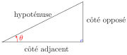

\[
\cos(\theta)=\frac{\text{côté adjacent}}{\text{hypoténuse}},\qquad
\sin(\theta)=\frac{\text{côté opposé}}{\text{hypoténuse}}
\quad\text{et}\quad
\tan(\theta)=\frac{\text{côté opposé}}{\text{côté adjacent}} .
\]

即：\(\cos(\theta)=\dfrac{\text{邻边}}{\text{斜边}}\)，\(\sin(\theta)=\dfrac{\text{对边}}{\text{斜边}}\)， \(\tan(\theta)=\dfrac{\text{对边}}{\text{邻边}}\)。
{: .zh .gloss }

!!! danger "Propriété 2.3 : valeurs remarquables 性质 2.3：特殊角的三角函数值"

    | \(\theta\) | \(0\) | \(\dfrac{\pi}{6}\) | \(\dfrac{\pi}{4}\) | \(\dfrac{\pi}{3}\) | \(\dfrac{\pi}{2}\) |
    |---|---|---|---|---|---|
    | \(\cos(\theta)\) | \(\dfrac{\sqrt{4}}{2}=1\) | \(\dfrac{\sqrt{3}}{2}\) | \(\dfrac{\sqrt{2}}{2}\) | \(\dfrac{\sqrt{1}}{2}=\dfrac{1}{2}\) | \(\dfrac{\sqrt{0}}{2}=0\) |
    | \(\sin(\theta)\) | \(\dfrac{\sqrt{0}}{2}=0\) | \(\dfrac{\sqrt{1}}{2}=\dfrac{1}{2}\) | \(\dfrac{\sqrt{2}}{2}\) | \(\dfrac{\sqrt{3}}{2}\) | \(\dfrac{\sqrt{4}}{2}=1\) |
    | \(\tan(\theta)\) | \(\dfrac{0}{1}=0\) | \(\dfrac{1/2}{\sqrt{3}/2}=\dfrac{1}{\sqrt{3}}\) | \(\dfrac{\sqrt{2}/2}{\sqrt{2}/2}=1\) | \(\dfrac{\sqrt{3}/2}{1/2}=\sqrt{3}\) |  |

!!! danger "Propriété 2.4 性质 2.4"

    \[
    \forall\theta\in\left]0,\frac{\pi}{2}\right[,\ \sin(\theta)<\theta<\tan(\theta).
    \]

!!! demo ""

    <strong>Démonstration. &nbsp;&nbsp; 证明</strong>

    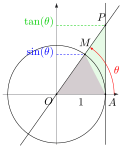

    Soit \(\theta\in\left]0,\frac{\pi}{2}\right[\). On note \(A\) le point de coordonnées \((1,0)\), \(M\) le point de coordonnées \((\cos(\theta),\sin(\theta))\) et \(P\) le point de coordonnées \((1,\tan(\theta))\). En comparant les aires du triangle \(OAM\), de la portion de disque \(OAM\) et du triangle \(OAP\), on obtient :

    设 \(\theta\in\left]0,\frac{\pi}{2}\right[\)。记 \(A\) 为坐标为 \((1,0)\) 的点，\(M\) 为坐标为 \((\cos(\theta),\sin(\theta))\) 的点，\(P\) 为坐标为 \((1,\tan(\theta))\) 的点。通过比较三角形 \(OAM\)、 扇形 \(OAM\) 与三角形 \(OAP\) 的面积，得到：
    {: .zh }

    \[
    \frac{1\times\sin(\theta)}{2}<\frac{\theta}{2\pi}\times\pi 1^2<\frac{1\times\tan(\theta)}{2}
    \]

    \[
    \text{donc}\quad \sin(\theta)<\theta<\tan(\theta).
    \]

    即得 \(\sin(\theta)<\theta<\tan(\theta)\)。
    {: .zh .gloss }

    
∎

!!! warning "Important 重要"

    Cet encadrement a de nombreuses applications en analyse. Par exemple, on en déduit que :

    这个夹逼不等式在分析学中有许多应用。例如，我们由此推出：
    {: .zh }

    \[
    \forall\theta\in\left]-\frac{\pi}{2},\frac{\pi}{2}\right[\setminus\{0\},\
    \cos(\theta)<\frac{\sin(\theta)}{\theta}<1
    \quad\text{donc}\quad \lim_{\theta\to 0}\frac{\sin(\theta)}{\theta}=1 .
    \]

    即：对一切 \(\theta\in\left]-\frac{\pi}{2},\frac{\pi}{2}\right[\setminus\{0\}\)， \(\cos(\theta)<\frac{\sin(\theta)}{\theta}<1\)，故 \(\lim\limits_{\theta\to 0}\frac{\sin(\theta)}{\theta}=1\)。
    {: .zh .gloss }

!!! danger "Propriété 2.5 性质 2.5"

    Les fonctions cosinus, sinus et tangente sont dérivables sur leur ensemble de définition et :

    余弦、正弦与正切函数在其定义域上可导，并且：
    {: .zh }

    \[
    \cos'=-\sin,\qquad \sin'=\cos
    \quad\text{et}\quad \tan'=1+\tan^2 .
    \]

## Formules de trigonométrie 三角公式

!!! danger "Propriété 3.1 性质 3.1"

    On a :

    我们有：
    {: .zh }

    - d'après le théorème de Pythagore : \(\forall\theta\in\mathbb{R},\ \cos^2(\theta)+\sin^2(\theta)=1\),

        由勾股定理：\(\forall\theta\in\mathbb{R},\ \cos^2(\theta)+\sin^2(\theta)=1\)，
        {: .zh }

    - d'après le théorème de Thalès : \(\forall\theta\in\mathbb{R}\setminus\left\{\frac{\pi}{2}+k\pi \;\middle|\; k\in\mathbb{Z}\right\},\
         \tan(\theta)=\dfrac{\sin(\theta)}{\cos(\theta)}\),

        由泰勒斯定理：对 \(\theta\in\mathbb{R}\setminus\left\{\frac{\pi}{2}+k\pi \;\middle|\; k\in\mathbb{Z}\right\}\)， \(\tan(\theta)=\dfrac{\sin(\theta)}{\cos(\theta)}\)，
        {: .zh }

    - et par conséquent : \(\forall\theta\in\mathbb{R}\setminus\left\{\frac{\pi}{2}+k\pi \;\middle|\; k\in\mathbb{Z}\right\},\
         1+\tan^2(\theta)=\dfrac{1}{\cos^2(\theta)}\).

        从而：对 \(\theta\in\mathbb{R}\setminus\left\{\frac{\pi}{2}+k\pi \;\middle|\; k\in\mathbb{Z}\right\}\)， \(1+\tan^2(\theta)=\dfrac{1}{\cos^2(\theta)}\)。
        {: .zh }

!!! danger "Propriété 3.2 性质 3.2"

    Pour tout \(\theta\in\mathbb{R}\) pour cosinus et sinus, ou \(\theta\in\mathbb{R}\setminus\left\{\frac{\pi}{2}+k\pi \;\middle|\; k\in\mathbb{Z}\right\}\) pour tangente, on&nbsp;a&nbsp;:

    对余弦与正弦取任意 \(\theta\in\mathbb{R}\)，对正切取 \(\theta\in\mathbb{R}\setminus\left\{\frac{\pi}{2}+k\pi \;\middle|\; k\in\mathbb{Z}\right\}\)，都有：
    {: .zh }

    - <strong>périodicités</strong> : \(\cos(\theta+2\pi)=\cos(\theta)\), \(\sin(\theta+2\pi)=\sin(\theta)\) et \(\tan(\theta+\pi)=\tan(\theta)\),

        <strong>周期性</strong>（périodicités）：\(\cos(\theta+2\pi)=\cos(\theta)\)， \(\sin(\theta+2\pi)=\sin(\theta)\)，\(\tan(\theta+\pi)=\tan(\theta)\)，
        {: .zh }

    - <strong>décalages</strong> : \(\cos(\theta+\pi)=-\cos(\theta)\) et \(\sin(\theta+\pi)=-\sin(\theta)\),

        <strong>平移</strong>（décalages）：\(\cos(\theta+\pi)=-\cos(\theta)\)，\(\sin(\theta+\pi)=-\sin(\theta)\)，
        {: .zh }

    - <strong>parités</strong> : \(\cos(-\theta)=\cos(\theta)\), \(\sin(-\theta)=-\sin(\theta)\) et \(\tan(-\theta)=-\tan(\theta)\),

        <strong>奇偶性</strong>（parités）：\(\cos(-\theta)=\cos(\theta)\)，\(\sin(-\theta)=-\sin(\theta)\)， \(\tan(-\theta)=-\tan(\theta)\)，
        {: .zh }

    - <strong>symétries</strong> : \(\cos(\pi-\theta)=-\cos(\theta)\), \(\sin(\pi-\theta)=\sin(\theta)\) et \(\tan(\pi-\theta)=-\tan(\theta)\).

        <strong>对称性</strong>（symétries）：\(\cos(\pi-\theta)=-\cos(\theta)\)， \(\sin(\pi-\theta)=\sin(\theta)\)，\(\tan(\pi-\theta)=-\tan(\theta)\)。
        {: .zh }

!!! warning "Remarque 注"

    Pour tout \(\theta\in\mathbb{R}\) pour cosinus et sinus, ou \(\theta\in\mathbb{R}\setminus\{k\pi \mid k\in\mathbb{Z}\}\) pour tangente, on&nbsp;a&nbsp;aussi&nbsp;:

    对余弦与正弦取任意 \(\theta\in\mathbb{R}\)，对正切取 \(\theta\in\mathbb{R}\setminus\{k\pi \mid k\in\mathbb{Z}\}\)，还有：
    {: .zh }

    - <strong>décalages</strong> : \(\cos\left(\theta+\frac{\pi}{2}\right)=-\sin(\theta)\), \(\sin\left(\theta+\frac{\pi}{2}\right)=\cos(\theta)\) et \(\tan\left(\theta+\frac{\pi}{2}\right)=-\dfrac{1}{\tan(\theta)}\),

        <strong>平移</strong>：\(\cos\left(\theta+\frac{\pi}{2}\right)=-\sin(\theta)\)， \(\sin\left(\theta+\frac{\pi}{2}\right)=\cos(\theta)\)， \(\tan\left(\theta+\frac{\pi}{2}\right)=-\dfrac{1}{\tan(\theta)}\)，
        {: .zh }

    - <strong>symétries</strong> : \(\cos\left(\frac{\pi}{2}-\theta\right)=\sin(\theta)\), \(\sin\left(\frac{\pi}{2}-\theta\right)=\cos(\theta)\) et \(\tan\left(\frac{\pi}{2}-\theta\right)=\dfrac{1}{\tan(\theta)}\).

        <strong>对称性</strong>：\(\cos\left(\frac{\pi}{2}-\theta\right)=\sin(\theta)\)， \(\sin\left(\frac{\pi}{2}-\theta\right)=\cos(\theta)\)， \(\tan\left(\frac{\pi}{2}-\theta\right)=\dfrac{1}{\tan(\theta)}\)。
        {: .zh }

!!! danger "Théorème 3.3 : formules d'addition du cosinus et du sinus 定理 3.3：余弦与正弦的和角公式（formules d'addition）"

    \[
    \forall(\alpha,\beta)\in\mathbb{R}^2,\quad
    \begin{cases}
    \cos(\alpha+\beta)=\cos(\alpha)\cos(\beta)-\sin(\alpha)\sin(\beta)\\
    \sin(\alpha+\beta)=\cos(\alpha)\sin(\beta)+\sin(\alpha)\cos(\beta)
    \end{cases}.
    \]

!!! warning "Remarque 注"

    - Les formules d'addition peuvent se démontrer géométriquement.

        和角公式可以用几何方法证明。
        {: .zh }

    - On peut retrouver facilement les formules d'addition à l'aide des nombres complexes&nbsp;:

        借助复数可以很容易地重新得到和角公式：
        {: .zh }

        \[
        \begin{aligned}
        \cos(\alpha+\beta)+i\sin(\alpha+\beta)
        &=e^{i(\alpha+\beta)}=e^{i\alpha}e^{i\beta}\\
        &=\bigl(\cos(\alpha)+i\sin(\alpha)\bigr)\bigl(\cos(\beta)+i\sin(\beta)\bigr)\\
        &=\bigl(\cos(\alpha)\cos(\beta)-\sin(\alpha)\sin(\beta)\bigr)\\
        &\quad{}+i\bigl(\cos(\alpha)\sin(\beta)+\sin(\alpha)\cos(\beta)\bigr).
        \end{aligned}
        \]

    - D'après le théorème de Thalès, on en déduit une formule d'addition de la tangente&nbsp;:

        由泰勒斯定理，我们由此推出正切的加法公式：
        {: .zh }

        \[
        \tan(\alpha+\beta)=\frac{\tan(\alpha)+\tan(\beta)}{1-\tan(\alpha)\tan(\beta)}
        \]

        sous réserve que \(\tan(\alpha+\beta)\), \(\tan(\alpha)\) et \(\tan(\beta)\) soient bien définis.

        前提是 \(\tan(\alpha+\beta)\)、\(\tan(\alpha)\) 与 \(\tan(\beta)\) 均有定义。
        {: .zh }

!!! danger "Corollaire 3.4 : formules de l'angle double du cosinus et du sinus 推论 3.4：余弦与正弦的倍角公式"

    \[
    \forall\theta\in\mathbb{R},\quad
    \begin{cases}
    \cos(2\theta)=\cos^2(\theta)-\sin^2(\theta)=2\cos^2(\theta)-1=1-2\sin^2(\theta)\\
    \sin(2\theta)=2\cos(\theta)\sin(\theta)
    \end{cases}.
    \]

!!! warning "Remarque 注"

    D'après le théorème de Thalès, on en déduit une formule de l'angle double de la tangente&nbsp;:

    由泰勒斯定理，我们由此推出正切的倍角公式：
    {: .zh }

    \[
    \tan(2\theta)=\frac{2\tan(\theta)}{1-\tan^2(\theta)}
    \]

    sous réserve que \(\tan(2\theta)\) et \(\tan(\theta)\) soient bien définis.

    前提是 \(\tan(2\theta)\) 与 \(\tan(\theta)\) 均有定义。
    {: .zh }

!!! info "Exemple 3.5 例 3.5"

    Soit \(\theta\in\left]-\frac{\pi}{2},\frac{\pi}{2}\right[\). On pose \(t=\tan(\theta/2)\). On a :

    设 \(\theta\in\left]-\frac{\pi}{2},\frac{\pi}{2}\right[\)。令 \(t=\tan(\theta/2)\)。则有：
    {: .zh }

    \[
    \cos(\theta)=\cos\left(2\frac{\theta}{2}\right)
    =2\cos^2\left(\frac{\theta}{2}\right)-1
    =\frac{2}{1+\tan^2\left(\frac{\theta}{2}\right)}-1
    =\frac{1-t^2}{1+t^2}.
    \]

    De même :

    同样地：
    {: .zh }

    \[
    \sin(\theta)=\frac{2t}{1+t^2}
    \qquad\text{et}\qquad
    \tan(\theta)=\frac{2t}{1-t^2}.
    \]

!!! warning "Important 重要"

    On peut obtenir de nombreuses autres formules de trigonométrie à l'aide des nombres complexes, en particulier à l'aide des formules d'Euler et de la formule de Moivre.

    借助复数，特别是借助<strong>欧拉公式</strong>（formules d'Euler）与<strong>棣莫弗公式</strong> （formule de Moivre），可以得到许多其他的三角公式。
    {: .zh }

!!! info "Exemple 3.6 例 3.6"

    - Soit \(\theta\in\mathbb{R}\). On a :

        设 \(\theta\in\mathbb{R}\)。有：
        {: .zh }

        \[
        \begin{aligned}
        \cos^5(\theta)
        &=\left(\frac{e^{i\theta}+e^{-i\theta}}{2}\right)^{5}
          &&\text{d'après les formules d'Euler}\\
        &=\frac{1}{32}\left(e^{5i\theta}+5e^{3i\theta}+10e^{i\theta}\right.\\
        &\quad\left.{}+10e^{-i\theta}+5e^{-3i\theta}+e^{-5i\theta}\right)\\
        &=\frac{\cos(5\theta)+5\cos(3\theta)+10\cos(\theta)}{16}
          &&\text{d'après les formules d'Euler.}
        \end{aligned}
        \]

        其中两处标注「d'après les formules d'Euler」意为「由欧拉公式」。
        {: .zh .gloss }

    - Soit \(\theta\in\mathbb{R}\). On a :

        设 \(\theta\in\mathbb{R}\)。有：
        {: .zh }

        \[
        \begin{aligned}
        \sin(5\theta)
        &=\operatorname{Im}\bigl(\cos(5\theta)+i\sin(5\theta)\bigr)
         =\operatorname{Im}\left(e^{5i\theta}\right)\\
        &=\operatorname{Im}\left(\left(e^{i\theta}\right)^{5}\right)\\
        &=\operatorname{Im}\left(\bigl(\cos(\theta)+i\sin(\theta)\bigr)^{5}\right)
          \quad\text{d'après la formule de Moivre}\\
        &=\operatorname{Im}\begin{pmatrix}
           \cos^5(\theta)+5i\cos^4(\theta)\sin(\theta)-10\cos^3(\theta)\sin^2(\theta)\\
           -10i\cos^2(\theta)\sin^3(\theta)+5\cos(\theta)\sin^4(\theta)+i\sin^5(\theta)
         \end{pmatrix}\\
        &=5\cos^4(\theta)\sin(\theta)-10\cos^2(\theta)\sin^3(\theta)+\sin^5(\theta).
        \end{aligned}
        \]

        其中标注「d'après la formule de Moivre」意为「由棣莫弗公式」。\(\operatorname{Im}\) 表示取虚部。
        {: .zh .gloss }

    - Soit \((\alpha,\beta)\in\mathbb{R}^2\). On a :

        设 \((\alpha,\beta)\in\mathbb{R}^2\)。有：
        {: .zh }

        \[
        \begin{aligned}
        \cos(\alpha)-\cos(\beta)
        &=\operatorname{Re}\left(e^{i\alpha}-e^{i\beta}\right)\\
        &=\operatorname{Re}\left(\left(e^{i(\alpha-\beta)/2}-e^{-i(\alpha-\beta)/2}\right)
          e^{i(\alpha+\beta)/2}\right)\\
        &=\operatorname{Re}\left(2i\sin\left(\frac{\alpha-\beta}{2}\right)e^{i(\alpha+\beta)/2}\right)\\
        &\quad\text{d'après les formules d'Euler}\\
        &=-2\sin\left(\frac{\alpha-\beta}{2}\right)\sin\left(\frac{\alpha+\beta}{2}\right).
        \end{aligned}
        \]

        \(\operatorname{Re}\) 表示取实部；「d'après les formules d'Euler」意为「由欧拉公式」。
        {: .zh .gloss }

!!! danger "Propriété 3.7 性质 3.7"

    Soit \((a,b)\in\mathbb{R}^2\setminus\{(0,0)\}\). Pour tout \(\theta\in\mathbb{R}\), on a :

    设 \((a,b)\in\mathbb{R}^2\setminus\{(0,0)\}\)。对任意 \(\theta\in\mathbb{R}\)，有：
    {: .zh }

    \[
    a\cos(\theta)+b\sin(\theta)=r\cos(\theta-\varphi)
    \quad\text{où}\quad
    \begin{cases}
    r=|a+ib|=\sqrt{a^2+b^2}>0\\
    \varphi\equiv\arg(a+ib) \ \text{modulo}\ 2\pi
    \end{cases}.
    \]

    「où」意为「其中」。
    {: .zh .gloss }

!!! demo ""

    <strong>Démonstration. &nbsp;&nbsp; 证明</strong>

    Puisque \(a+ib\in\mathbb{C}^*\), on peut l'écrire sous forme exponentielle :

    因为 \(a+ib\in\mathbb{C}^*\)，可以把它写成指数形式：
    {: .zh }

    \[
    a+ib=re^{i\varphi}=r\cos(\varphi)+ir\sin(\varphi).
    \]

    Par conséquent :

    因此：
    {: .zh }

    \[
    \begin{aligned}
    a\cos(\theta)+b\sin(\theta)
    &=r\cos(\varphi)\cos(\theta)+r\sin(\varphi)\sin(\theta)\\
    &=r\bigl(\cos(\theta)\cos(-\varphi)-\sin(\theta)\sin(-\varphi)\bigr)
     =r\cos(\theta-\varphi).
    \end{aligned}
    \]

    
∎

!!! info "Exemple 3.8 例 3.8"

    Puisque le nombre complexe \(1+i\) n'est pas nul, on peut l'écrire sous forme exponentielle&nbsp;:

    因为复数 \(1+i\) 不为零，可以把它写成指数形式：
    {: .zh }

    \[
    1+i=re^{i\varphi}=r\cos(\varphi)+ir\sin(\varphi)
    \quad\text{où}\quad
    \begin{cases}
    r=|1+i|=\sqrt{2}\\
    \varphi\equiv\arg(1+i) \ \text{modulo}\ 2\pi
    \end{cases}
    \]

    \[
    \text{donc}\quad \cos(\varphi)=\sin(\varphi)=\frac{1}{\sqrt{2}}=\frac{\sqrt{2}}{2}.
    \]

    「donc」意为「故」。
    {: .zh .gloss }

    On peut donc choisir \(\varphi=\frac{\pi}{4}\) et alors :

    于是可以取 \(\varphi=\frac{\pi}{4}\)，此时：
    {: .zh }

    \[
    \forall\theta\in\mathbb{R},\quad
    \cos(\theta)+\sin(\theta)=\sqrt{2}\cos\left(\theta-\frac{\pi}{4}\right).
    \]

!!! warning "Vocabulaire clé 重点词汇"

    - <strong>une formule d'addition</strong>：和角公式
    - <strong>le décalage</strong>：平移（相位的移动）
    - <strong>la parité</strong>：奇偶性
    - <strong>la symétrie</strong>：对称性
    - <strong>l'angle double</strong>：倍角
    - <strong>sous réserve que… soient bien définis</strong>：前提是……都有定义
    - <strong>les formules d'Euler / la formule de Moivre</strong>：欧拉公式 / 棣莫弗公式
    - <strong>la forme exponentielle</strong>：指数形式
    - <strong>un argument \(\arg(z)\)</strong>：辐角
    - <strong>on pose \(t=\ldots\)</strong>：令 \(t=\ldots\)
    - <strong>on peut choisir…</strong>：可以取……
    - <strong>on peut retrouver…</strong>：可以重新得到……
    - <strong>se démontrer géométriquement</strong>：用几何方法证明

## Fonctions trigonométriques réciproques 反三角函数

Les fonctions trigonométriques ne sont pas <strong>injectives</strong> : chaque image dans \([-1,1]\) pour cosinus et sinus, ou dans \(\mathbb{R}\) pour tangente, admet une infinité d'<strong>antécédents</strong>. Cependant, on remarque que :

三角函数不是<strong>单射</strong>（injectives）的：余弦与正弦的每个像（属于 \([-1,1]\)）、以及正切的每个像 （属于 \(\mathbb{R}\)）都有无穷多个<strong>原像</strong>（antécédents）。然而我们注意到：
{: .zh }

- cosinus est <strong>strictement décroissante</strong> sur \([0,\pi]\),

    余弦在 \([0,\pi]\) 上<strong>严格递减</strong>（strictement décroissante），
    {: .zh }

- sinus est <strong>strictement croissante</strong> sur \(\left[-\frac{\pi}{2},\frac{\pi}{2}\right]\),

    正弦在 \(\left[-\frac{\pi}{2},\frac{\pi}{2}\right]\) 上<strong>严格递增</strong> （strictement croissante），
    {: .zh }

- et tangente est <strong>strictement croissante</strong> sur \(\left]-\frac{\pi}{2},\frac{\pi}{2}\right[\).

    而正切在 \(\left]-\frac{\pi}{2},\frac{\pi}{2}\right[\) 上<strong>严格递增</strong>。
    {: .zh }

En particulier, les <strong>restrictions</strong> \(\cos:[0,\pi]\to[-1,1]\), \(\sin:\left[-\frac{\pi}{2},\frac{\pi}{2}\right]\to[-1,1]\) et \(\tan:\left]-\frac{\pi}{2},\frac{\pi}{2}\right[\to\mathbb{R}\) sont <strong>bijectives</strong> et admettent donc des <strong>bijections réciproques</strong>.

特别地，<strong>限制</strong>（restrictions）\(\cos:[0,\pi]\to[-1,1]\)、 \(\sin:\left[-\frac{\pi}{2},\frac{\pi}{2}\right]\to[-1,1]\) 与 \(\tan:\left]-\frac{\pi}{2},\frac{\pi}{2}\right[\to\mathbb{R}\) 都是<strong>双射</strong>（bijectives）， 因此都有<strong>反函数</strong>（bijections réciproques）。
{: .zh }

!!! success "Définition 4.1 : arc cosinus, arc sinus et arc tangente 定义 4.1：反余弦、反正弦与反正切"

    - Pour tout \(x\in[-1,1]\), l'unique \(\theta\in[0,\pi]\) tel que \(\cos(\theta)=x\) est noté \(\theta=\arccos(x)\). On définit ainsi une fonction \(\arccos:[-1,1]\to[0,\pi]\) appelée <strong>arc cosinus</strong>.

        对任意 \(x\in[-1,1]\)，使得 \(\cos(\theta)=x\) 的<strong>唯一</strong>的 \(\theta\in[0,\pi]\) 记作 \(\theta=\arccos(x)\)。由此定义了一个函数 \(\arccos:[-1,1]\to[0,\pi]\)，称为 <strong>反余弦</strong>（arc cosinus）。
        {: .zh }

    - Pour tout \(y\in[-1,1]\), l'unique \(\theta\in\left[-\frac{\pi}{2},\frac{\pi}{2}\right]\) tel que \(\sin(\theta)=y\) est noté \(\theta=\arcsin(y)\). On définit ainsi une fonction \(\arcsin:[-1,1]\to\left[-\frac{\pi}{2},\frac{\pi}{2}\right]\) appelée <strong>arc sinus</strong>.

        对任意 \(y\in[-1,1]\)，使得 \(\sin(\theta)=y\) 的唯一的 \(\theta\in\left[-\frac{\pi}{2},\frac{\pi}{2}\right]\) 记作 \(\theta=\arcsin(y)\)。由此定义了一个 函数 \(\arcsin:[-1,1]\to\left[-\frac{\pi}{2},\frac{\pi}{2}\right]\)，称为<strong>反正弦</strong> （arc sinus）。
        {: .zh }

    - Pour tout \(t\in\mathbb{R}\), l'unique \(\theta\in\left]-\frac{\pi}{2},\frac{\pi}{2}\right[\) tel que \(\tan(\theta)=t\) est noté \(\theta=\arctan(t)\). On définit ainsi une fonction \(\arctan:\mathbb{R}\to\left]-\frac{\pi}{2},\frac{\pi}{2}\right[\) appelée <strong>arc tangente</strong>.

        对任意 \(t\in\mathbb{R}\)，使得 \(\tan(\theta)=t\) 的唯一的 \(\theta\in\left]-\frac{\pi}{2},\frac{\pi}{2}\right[\) 记作 \(\theta=\arctan(t)\)。由此定义了一个 函数 \(\arctan:\mathbb{R}\to\left]-\frac{\pi}{2},\frac{\pi}{2}\right[\)，称为<strong>反正切</strong> （arc tangente）。
        {: .zh }

!!! info "Exemple 4.2 例 4.2"

    Soit \(x\in[-1,1]\). On a d'après la définition de \(\arccos(x)\) :

    设 \(x\in[-1,1]\)。由 \(\arccos(x)\) 的定义有：
    {: .zh }

    \[
    0\leqslant\arccos(x)\leqslant\pi
    \quad\text{donc}\quad
    -\frac{\pi}{2}=\frac{\pi}{2}-\pi\leqslant\frac{\pi}{2}-\arccos(x)\leqslant\frac{\pi}{2}-0=\frac{\pi}{2}
    \]

    \[
    \text{et}\quad
    \sin\left(\frac{\pi}{2}-\arccos(x)\right)=\cos\bigl(\arccos(x)\bigr)=x .
    \]

    「donc」意为「故」，「et」意为「且」。
    {: .zh .gloss }

    Ainsi, \(\theta=\frac{\pi}{2}-\arccos(x)\) vérifie \(\theta\in\left[-\frac{\pi}{2},\frac{\pi}{2}\right]\) et \(\sin(\theta)=x\). D'après l'unicité de la définition de \(\arcsin(x)\), on en déduit que \(\frac{\pi}{2}-\arccos(x)=\arcsin(x)\). On a donc montré que :

    于是 \(\theta=\frac{\pi}{2}-\arccos(x)\) 满足 \(\theta\in\left[-\frac{\pi}{2},\frac{\pi}{2}\right]\) 且 \(\sin(\theta)=x\)。由 \(\arcsin(x)\) 定义中的唯一性，推出 \(\frac{\pi}{2}-\arccos(x)=\arcsin(x)\)。于是我们证明了：
    {: .zh }

    \[
    \forall x\in[-1,1],\quad \arccos(x)+\arcsin(x)=\frac{\pi}{2}.
    \]

!!! danger "Théorème 4.3 : résolution des équations trigonométriques 定理 4.3：三角方程的求解"

    - Soit \(x\in[-1,1]\). Pour tout \(\theta\in\mathbb{R}\), on a :

        设 \(x\in[-1,1]\)。对任意 \(\theta\in\mathbb{R}\)，有：
        {: .zh }

        \[
        \cos(\theta)=x \iff \theta\equiv\arccos(x)\ \text{ou}\ -\arccos(x)\ \text{modulo}\ 2\pi .
        \]

        「ou」意为「或」；即 \(\cos(\theta)=x\) 当且仅当 \(\theta\equiv\arccos(x)\) 或 \(-\arccos(x)\)（模 \(2\pi\)）。
        {: .zh .gloss }

        Autrement dit, l'ensemble des solutions de l'équation \(\cos(\theta)=x\) d'inconnue \(\theta\) est :

        换言之，以 \(\theta\) 为未知量的方程 \(\cos(\theta)=x\) 的解集为：
        {: .zh }

        \[
        \left\{\arccos(x)+2k\pi \mid k\in\mathbb{Z}\right\}
        \cup\left\{-\arccos(x)+2k\pi \mid k\in\mathbb{Z}\right\}.
        \]

    - Soit \(y\in[-1,1]\). Pour tout \(\theta\in\mathbb{R}\), on a :

        设 \(y\in[-1,1]\)。对任意 \(\theta\in\mathbb{R}\)，有：
        {: .zh }

        \[
        \sin(\theta)=y \iff \theta\equiv\arcsin(y)\ \text{ou}\ \pi-\arcsin(y)\ \text{modulo}\ 2\pi .
        \]

        即 \(\sin(\theta)=y\) 当且仅当 \(\theta\equiv\arcsin(y)\) 或 \(\pi-\arcsin(y)\)（模 \(2\pi\)）。
        {: .zh .gloss }

        Autrement dit, l'ensemble des solutions de l'équation \(\sin(\theta)=y\) d'inconnue \(\theta\) est :

        换言之，以 \(\theta\) 为未知量的方程 \(\sin(\theta)=y\) 的解集为：
        {: .zh }

        \[
        \left\{\arcsin(y)+2k\pi \mid k\in\mathbb{Z}\right\}
        \cup\left\{\pi-\arcsin(y)+2k\pi \mid k\in\mathbb{Z}\right\}.
        \]

    - Soit \(t\in\mathbb{R}\). Pour tout \(\theta\in\mathbb{R}\setminus\left\{\frac{\pi}{2}+k\pi \mid k\in\mathbb{Z}\right\}\), on a :

        设 \(t\in\mathbb{R}\)。对任意 \(\theta\in\mathbb{R}\setminus\left\{\frac{\pi}{2}+k\pi \mid k\in\mathbb{Z}\right\}\)，有：
        {: .zh }

        \[
        \tan(\theta)=t \iff \theta\equiv\arctan(t)\ \text{ou}\ \arctan(t)+\pi\ \text{modulo}\ 2\pi .
        \]

        即 \(\tan(\theta)=t\) 当且仅当 \(\theta\equiv\arctan(t)\) 或 \(\arctan(t)+\pi\)（模 \(2\pi\)）。
        {: .zh .gloss }

        Autrement dit, l'ensemble des solutions de l'équation \(\tan(\theta)=t\) d'inconnue \(\theta\) est :

        换言之，以 \(\theta\) 为未知量的方程 \(\tan(\theta)=t\) 的解集为：
        {: .zh }

        \[
        \left\{\arctan(t)+k\pi \mid k\in\mathbb{Z}\right\}.
        \]

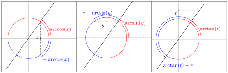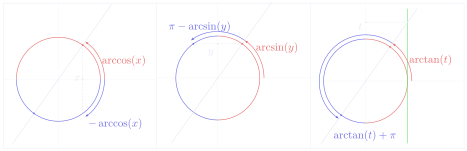

!!! info "Exemple 4.4 例 4.4"

    - Pour \(z=3-4i\), on a \(|z|=\sqrt{3^2+(-4)^2}=5\). En notant \(\varphi=\arg(z)\), on obtient :

        对于 \(z=3-4i\)，有 \(|z|=\sqrt{3^2+(-4)^2}=5\)。记 \(\varphi=\arg(z)\)，得到：
        {: .zh }

        \[
        z=5\left(\frac{3}{5}-i\frac{4}{5}\right)=5\bigl(\cos(\varphi)+i\sin(\varphi)\bigr)
        \quad\text{donc}\quad
        \begin{cases}
        \cos(\varphi)=\frac{3}{5}\\[3pt]
        \sin(\varphi)=-\frac{4}{5}
        \end{cases}.
        \]

        「donc」意为「故」。
        {: .zh .gloss }

        On en déduit que \(\varphi=-\arccos\left(\frac{3}{5}\right)=\arcsin\left(-\frac{4}{5}\right)\) est un argument de \(z\).

        由此推出 \(\varphi=-\arccos\left(\frac{3}{5}\right)=\arcsin\left(-\frac{4}{5}\right)\) 是 \(z\) 的一个辐角。
        {: .zh }

    - On considère l'équation \(2+3\cos(\theta)=4\sin(\theta)\) d'inconnue \(\theta\in\mathbb{R}\). D'après l'exemple précédent, on a :

        考虑以 \(\theta\in\mathbb{R}\) 为未知量的方程 \(2+3\cos(\theta)=4\sin(\theta)\)。由上一例，有：
        {: .zh }

        \[
        \forall\theta\in\mathbb{R},\quad
        3\cos(\theta)-4\sin(\theta)=5\cos\left(\theta+\arccos\left(\frac{3}{5}\right)\right).
        \]

        On en déduit que l'ensemble des solutions est :

        由此推出解集为：
        {: .zh }

        \[
        \begin{aligned}
        &\left\{\arccos\left(-\frac{2}{5}\right)-\arccos\left(\frac{3}{5}\right)+2k\pi
          \;\middle|\; k\in\mathbb{Z}\right\}\\
        &\qquad\cup\left\{-\arccos\left(-\frac{2}{5}\right)-\arccos\left(\frac{3}{5}\right)+2k\pi
          \;\middle|\; k\in\mathbb{Z}\right\}.
        \end{aligned}
        \]

Plus généralement, si \(z=x+iy\in\mathbb{C}^*\), on a modulo \(2\pi\) :

更一般地，若 \(z=x+iy\in\mathbb{C}^*\)，则模 \(2\pi\) 有：
{: .zh }

\[
\arg(z)\equiv
\begin{cases}
\arccos\left(\dfrac{x}{\sqrt{x^2+y^2}}\right) & \text{si } y\geqslant 0\\[4pt]
-\arccos\left(\dfrac{x}{\sqrt{x^2+y^2}}\right) & \text{si } y\leqslant 0
\end{cases}
\;=\;
\begin{cases}
\arcsin\left(\dfrac{y}{\sqrt{x^2+y^2}}\right) & \text{si } x\geqslant 0\\[4pt]
\pi-\arcsin\left(\dfrac{y}{\sqrt{x^2+y^2}}\right) & \text{si } x\leqslant 0
\end{cases}
\]

\[
\equiv
\begin{cases}
\arctan\left(\dfrac{y}{x}\right) & \text{si } x>0\\[4pt]
\dfrac{y}{|y|}\dfrac{\pi}{2} & \text{si } x=0\\[4pt]
\arctan\left(\dfrac{y}{x}\right)+\pi & \text{si } x<0
\end{cases}.
\]

「si」意为「若」。
{: .zh .gloss }

!!! warning "Vocabulaire clé 重点词汇"

    - <strong>injective / bijective</strong>：单射 / 双射
    - <strong>une bijection réciproque</strong>：反函数（双射的逆映射）
    - <strong>strictement croissante / décroissante</strong>：严格递增 / 严格递减
    - <strong>la restriction de \(f\) à…</strong>：\(f\) 在……上的限制
    - <strong>l'unique \(\theta\) tel que…</strong>：使得……的唯一的 \(\theta\)
    - <strong>arc cosinus / arc sinus / arc tangente</strong>：反余弦 / 反正弦 / 反正切
    - <strong>l'ensemble des solutions</strong>：解集
    - <strong>l'inconnue \(\theta\)</strong>：未知量 \(\theta\)
    - <strong>d'après l'unicité de…</strong>：由……的唯一性
    - <strong>une infinité d'antécédents</strong>：无穷多个原像
    - <strong>on en déduit que…</strong>：由此推出……
    - <strong>plus généralement</strong>：更一般地
