# 第 3 章　多项式

Chapitre n°3 — Polynômes

中法对照讲义 · 由 LaTeX 源文件渲染

!!! info "阅读说明"

    每段先列法语原文；其下缩进、带深蓝竖条的小字号段落为中文翻译。<strong>加粗</strong>为关键词，括号内为中文释义。

## Objectifs 学习目标

1. Manipuler des polynômes.

    熟练操作多项式。
    {: .zh }

1. Factoriser des polynômes à l'aide de leurs racines.

    利用多项式的根对多项式进行因式分解。
    {: .zh }

1. Décomposer des fractions rationnelles en éléments simples.

    将有理分式分解为部分分式（éléments simples）。
    {: .zh }

## Notations 记号

On rappelle que \(\mathbb{N}\) désigne l'ensemble des entiers naturels, \(\mathbb{R}\) désigne l'ensemble des nombres réels et \(\mathbb{C}\) désigne l'ensemble des nombres complexes. Dans ce chapitre, \(\mathbb{K}\) désigne \(\mathbb{R}\) ou \(\mathbb{C}\).

回忆：\(\mathbb{N}\) 表示自然数集，\(\mathbb{R}\) 表示实数集，\(\mathbb{C}\) 表示复数集。本章中，\(\mathbb{K}\) 表示 \(\mathbb{R}\) 或 \(\mathbb{C}\)。
{: .zh }

## 1　Polynômes 多项式

!!! success "Définition 1.1 : polynôme 定义 1.1：多项式（polynôme）"

    Un <strong>polynôme</strong> est une suite \((a_n)_{n\geqslant 0}\in\mathbb{K}^{\mathbb{N}}\) dont tous les termes sont nuls à partir d'un certain rang :

    <strong>多项式</strong>（polynôme）是一个序列 \((a_n)_{n\geqslant 0}\in\mathbb{K}^{\mathbb{N}}\)，其所有项从某一项起均为零：
    {: .zh }

    \[
    \exists N\in\mathbb{N},\quad \forall n>N,\quad a_n=0.
    \]

    Le polynôme est alors noté :

    该多项式则记为：
    {: .zh }

    \[
    P=a_0+a_1X+a_2X^2+\cdots+a_NX^N=\sum_{n=0}^{N}a_nX^n
    \]

    où \(X\) est un symbole mathématique. Les termes de la suite \((a_0,a_1,a_2,\dots)\in\mathbb{K}^{\mathbb{N}}\) sont appelés les <strong>coefficients</strong> du polynôme \(P\), en particulier le premier terme \(a_0\) est appelé le <strong>coefficient constant</strong> de \(P\). On note \(\mathbb{K}[X]\) l'ensemble des polynômes.

    其中 \(X\) 是一个数学符号。序列 \((a_0,a_1,a_2,\dots)\in\mathbb{K}^{\mathbb{N}}\) 的各项称为多项式 \(P\) 的<strong>系数</strong>（coefficients），特别地，第一项 \(a_0\) 称为 \(P\) 的<strong>常数项</strong>（coefficient constant）。所有多项式的集合记为 \(\mathbb{K}[X]\)。
    {: .zh }

!!! info "Exemple 1.2 例 1.2"

    - \(1-\pi X+\frac{1}{2}X^{888}\in\mathbb{R}[X]\) et \((1-i)X^2+X^6-jX^8\in\mathbb{C}[X]\).

        \(1-\pi X+\frac{1}{2}X^{888}\in\mathbb{R}[X]\)，且 \((1-i)X^2+X^6-jX^8\in\mathbb{C}[X]\)。
        {: .zh }

    - Puisque \(\mathbb{R}\subset\mathbb{C}\), on a \(\mathbb{R}[X]\subset\mathbb{C}[X]\).

        由于 \(\mathbb{R}\subset\mathbb{C}\)，故有 \(\mathbb{R}[X]\subset\mathbb{C}[X]\)。
        {: .zh }

    - Tout nombre \(a\in\mathbb{K}\) peut être vu comme le <strong>polynôme constant</strong> \(P=a\in\mathbb{K}[X]\) qui correspond à la suite \((a,0,0,0,\dots)\in\mathbb{K}^{\mathbb{N}}\). Autrement dit, \(\mathbb{K}\subset\mathbb{K}[X]\). En particulier, \(0\) est un polynôme, appelé le <strong>polynôme nul</strong>.

        任意数 \(a\in\mathbb{K}\) 都可看作<strong>常数多项式</strong>（polynôme constant）\(P=a\in\mathbb{K}[X]\)，它对应序列 \((a,0,0,0,\dots)\in\mathbb{K}^{\mathbb{N}}\)。换言之，\(\mathbb{K}\subset\mathbb{K}[X]\)。特别地，\(0\) 是一个多项式，称为<strong>零多项式</strong>（polynôme nul）。
        {: .zh }

    - \(X\) est un polynôme qui correspond à la suite \((0,1,0,0,0,\dots)\in\mathbb{K}^{\mathbb{N}}\).

        \(X\) 是一个多项式，对应序列 \((0,1,0,0,0,\dots)\in\mathbb{K}^{\mathbb{N}}\)。
        {: .zh }

!!! warning "Important 要点"

    Par définition, deux polynômes sont égaux si et seulement si leurs coefficients de même indice sont égaux. Plus précisément, pour tout \(P=\sum_{n=0}^{N_P}a_nX^n\in\mathbb{K}[X]\) et tout \(Q=\sum_{n=0}^{N_Q}b_nX^n\in\mathbb{K}[X]\) :

    按定义，两个多项式相等当且仅当它们同一下标的系数相等。更确切地说，对任意 \(P=\sum_{n=0}^{N_P}a_nX^n\in\mathbb{K}[X]\) 与 \(Q=\sum_{n=0}^{N_Q}b_nX^n\in\mathbb{K}[X]\)：
    {: .zh }

    \[
    P=Q\iff\forall n\in\mathbb{N},\quad a_n=b_n.
    \]

    Cette méthode, souvent utilisée en pratique, s'appelle l'<strong>identification des coefficients</strong>.

    这种方法在实践中经常使用，称为<strong>系数比较法</strong>（identification des coefficients）。
    {: .zh }

!!! success "Définition 1.3 : opérations avec les polynômes 定义 1.3：多项式的运算"

    L'ensemble \(\mathbb{K}[X]\) est muni d'une <strong>addition</strong> et d'une <strong>multiplication</strong> définies pour tout \(P=\sum_{n=0}^{N_P}a_nX^n\in\mathbb{K}[X]\) et tout \(Q=\sum_{n=0}^{N_Q}b_nX^n\in\mathbb{K}[X]\) par :

    集合 \(\mathbb{K}[X]\) 上定义了<strong>加法</strong>（addition）与<strong>乘法</strong>（multiplication），对任意 \(P=\sum_{n=0}^{N_P}a_nX^n\in\mathbb{K}[X]\) 与 \(Q=\sum_{n=0}^{N_Q}b_nX^n\in\mathbb{K}[X]\)，定义为：
    {: .zh }

    \[
    \left\{
    \begin{aligned}
    P+Q &= (a_0+b_0)+(a_1+b_1)X+(a_2+b_2)X^2+\cdots\\
        &= \sum_{n=0}^{\max\{N_P,N_Q\}}(a_n+b_n)X^n,\\[4pt]
    PQ &= a_0b_0+(a_0b_1+a_1b_0)X+(a_0b_2+a_1b_1+a_2b_0)X^2+\cdots\\
       &= \sum_{n=0}^{N_P+N_Q}\left(\sum_{k=0}^{n}a_kb_{n-k}\right)X^n.
    \end{aligned}
    \right.
    \]

!!! info "Exemple 1.4 例 1.4"

    - \(\displaystyle
        (1+\sqrt{2}X+X^2)(1-\sqrt{2}X+X^2)
        =
        \left(
        \begin{matrix}
        1+(-\sqrt{2}+\sqrt{2})X\\
        +(1-2+1)X^2\\
        +(0+\sqrt{2}-\sqrt{2}+0)X^3\\
        +(0+0+1+0+0)X^4
        \end{matrix}
        \right)
        =1+X^4.\)

    - Pour des polynômes constants \(P=a\in\mathbb{K}\) et \(Q=b\in\mathbb{K}\), on retrouve l'addition et la multiplication des nombres :

        对于常数多项式 \(P=a\in\mathbb{K}\) 与 \(Q=b\in\mathbb{K}\)，我们重新得到了数的加法与乘法：
        {: .zh }

        \[
        \left\{
        \begin{aligned}
        P+Q &= (a+0X+0X^2+\dots)+(b+0X+0X^2+\dots)\\
            &= (a+b)+0X+0X^2+\cdots=a+b,\\
        PQ  &= (a+0X+0X^2+\dots)(b+0X+0X^2+\dots)\\
            &= ab+(0+0)X+(0+0+0)X^2+\cdots=ab.
        \end{aligned}
        \right.
        \]

    - Pour tout \((m,n)\in\mathbb{N}^2\), on a :

        对任意 \((m,n)\in\mathbb{N}^2\)，有：
        {: .zh }

        \[
        \begin{aligned}
        X^mX^n
        &= \left(\sum_{i=0}^{m}a_iX^i\right)\left(\sum_{j=0}^{n}b_jX^j\right)
           \quad\text{où } a_i=\begin{cases}1 & \text{si } i=m\\ 0 & \text{sinon}\end{cases}
           \quad\text{et } b_j=\begin{cases}1 & \text{si } j=n\\ 0 & \text{sinon}\end{cases}\\
        &= \sum_{k=0}^{m+n}\left(\sum_{i=0}^{k}a_ib_{k-i}\right)X^k
           \quad\text{où } a_ib_{k-i}=\begin{cases}1 & \text{si } i=m \text{ et } k-i=n\\ 0 & \text{sinon}\end{cases}\\
        &= X^{m+n}.
        \end{aligned}
        \]

    - On peut montrer par récurrence que : \(\forall n\in\mathbb{N},\ (X)^n=X^n\).

        可以用归纳法证明：\(\forall n\in\mathbb{N},\ (X)^n=X^n\)。
        {: .zh }

!!! danger "Propriété 1.5 性质 1.5"

    Comme pour les nombres (réels ou complexes), l'addition et la multiplication de polynômes ont les mêmes propriétés algébriques : l'<strong>associativité</strong>, la <strong>commutativité</strong> et la <strong>distributivité</strong>.

    与（实或复）数一样，多项式的加法与乘法具有相同的代数性质：<strong>结合律</strong>（associativité）、<strong>交换律</strong>（commutativité）与<strong>分配律</strong>（distributivité）。
    {: .zh }

En particulier, on rappelle le résultat suivant qui se généralise aux polynômes.

特别地，我们回忆以下结果，它可推广到多项式。
{: .zh }

!!! danger "Théorème 1.6 : formule du binôme de Newton 定理 1.6：牛顿二项式公式"

    Pour tout \((P,Q)\in\mathbb{K}[X]^2\) et tout \(n\in\mathbb{N}\) :

    对任意 \((P,Q)\in\mathbb{K}[X]^2\) 与任意 \(n\in\mathbb{N}\)：
    {: .zh }

    \[
    (P+Q)^n=\sum_{k=0}^{n}\binom{n}{k}P^kQ^{n-k}
    \quad\text{où}\quad \binom{n}{k}=\frac{n!}{k!(n-k)!}.
    \]

On rappelle également que les <strong>coefficients binomiaux</strong> vérifient la relation de récurrence (avec la convention \(\binom{n}{k}=0\) si \(k>n\)) :

我们还回忆，<strong>二项式系数</strong>（coefficients binomiaux）满足递推关系（采用约定：当 \(k>n\) 时 \(\binom{n}{k}=0\)）：
{: .zh }

\[
\forall(k,n)\in\mathbb{N}^2,\quad \binom{n}{k}+\binom{n}{k+1}=\binom{n+1}{k+1}.
\]

On peut donc les calculer à l'aide du <strong>triangle de Pascal</strong>.

因此可以借助<strong>帕斯卡三角形</strong>（triangle de Pascal）计算它们。
{: .zh }

!!! warning "Vocabulaire clé 重点词汇"

    - <strong>polynôme</strong>：多项式
    - <strong>coefficient / coefficient constant</strong>：系数 / 常数项
    - <strong>polynôme constant / polynôme nul</strong>：常数多项式 / 零多项式
    - <strong>identification des coefficients</strong>：系数比较法
    - <strong>on note …</strong>：记作……
    - <strong>si et seulement si</strong>：当且仅当
    - <strong>autrement dit</strong>：换言之
    - <strong>en particulier</strong>：特别地

## 2　Fonctions polynomiales 多项式函数

!!! success "Définition 2.1 : fonction polynomiale 定义 2.1：多项式函数（fonction polynomiale）"

    Une fonction \(f:\mathscr{D}\to\mathbb{K}\) définie sur \(\mathscr{D}\subset\mathbb{K}\) est dite <strong>polynomiale</strong> lorsqu'il existe un polynôme \(P=\sum_{n=0}^{N}a_nX^n\in\mathbb{K}[X]\) tel que :

    定义在 \(\mathscr{D}\subset\mathbb{K}\) 上的函数 \(f:\mathscr{D}\to\mathbb{K}\) 称为<strong>多项式函数</strong>（fonction polynomiale），若存在多项式 \(P=\sum_{n=0}^{N}a_nX^n\in\mathbb{K}[X]\) 使得：
    {: .zh }

    \[
    \forall x\in\mathscr{D},\quad f(x)=a_0+a_1x+a_2x^2+\cdots+a_Nx^N=\sum_{n=0}^{N}a_nx^n=P(x).
    \]

!!! warning "Attention 注意"

    Une fonction polynomiale n'est pas nécessairement définie sur tout \(\mathbb{K}\) !

    多项式函数不一定在整个 \(\mathbb{K}\) 上有定义！
    {: .zh }

!!! info "Exemple 2.2 例 2.2"

    - \(x\mapsto\cos(\arccos(x))\) est une fonction polynomiale définie sur \([-1,1]\) car :

        \(x\mapsto\cos(\arccos(x))\) 是定义在 \([-1,1]\) 上的多项式函数，因为：
        {: .zh }

        \[
        \forall x\in[-1,1],\quad \cos\bigl(\arccos(x)\bigr)=x.
        \]

    - \(x\mapsto|x|\) est une fonction définie sur \(\mathbb{R}\) qui n'est pas polynomiale (car non dérivable en 0).

        \(x\mapsto|x|\) 是定义在 \(\mathbb{R}\) 上的函数，但它不是多项式函数（因为在 \(0\) 处不可导）。
        {: .zh }

    - Pour tout \(n\in\mathbb{N}^*\), \(z\mapsto\frac{z^n-1}{z-1}\) est une fonction polynomiale définie sur \(\mathbb{C}\setminus\{1\}\) car :

        对任意 \(n\in\mathbb{N}^*\)，\(z\mapsto\frac{z^n-1}{z-1}\) 是定义在 \(\mathbb{C}\setminus\{1\}\) 上的多项式函数，因为：
        {: .zh }

        \[
        \forall z\in\mathbb{C}\setminus\{1\},\quad \frac{z^n-1}{z-1}=1+z+z^2+\cdots+z^{n-1}.
        \]

!!! success "Définition 2.3 : composition 定义 2.3：复合（composition）"

    L'ensemble \(\mathbb{K}[X]\) est muni d'une <strong>composition</strong> définie comme pour les fonctions, c'est-à-dire pour tout \(P=\sum_{n=0}^{N}a_nX^n\in\mathbb{K}[X]\) et tout \(Q\in\mathbb{K}[X]\) :

    集合 \(\mathbb{K}[X]\) 上定义了<strong>复合</strong>（composition），其定义方式与函数的复合相同，即对任意 \(P=\sum_{n=0}^{N}a_nX^n\in\mathbb{K}[X]\) 与 \(Q\in\mathbb{K}[X]\)：
    {: .zh }

    \[
    P\circ Q=a_0+a_1Q+a_2Q^2+\cdots+a_NQ^N=\sum_{n=0}^{N}a_nQ^n=P(Q).
    \]

!!! info "Exemple 2.4 例 2.4"

    Si \(P=1+X^3\) et \(Q=1-X^2\) alors \(P\circ Q=1+(1-X^2)^3=2-3X^2+3X^4-X^6\) et \(Q\circ P=1-(1+X^3)^2=-2X^3-X^6\). En particulier, la composition n'est pas commutative.

    若 \(P=1+X^3\) 且 \(Q=1-X^2\)，则 \(P\circ Q=1+(1-X^2)^3=2-3X^2+3X^4-X^6\)，且 \(Q\circ P=1-(1+X^3)^2=-2X^3-X^6\)。特别地，复合不满足交换律。
    {: .zh }

!!! success "Définition 2.5 : dérivation 定义 2.5：求导（dérivation）"

    Pour tout polynôme \(P=\sum_{n=0}^{N}a_nX^n\in\mathbb{K}[X]\), on définit son <strong>polynôme dérivé</strong> par :

    对任意多项式 \(P=\sum_{n=0}^{N}a_nX^n\in\mathbb{K}[X]\)，定义其<strong>导多项式</strong>（polynôme dérivé）为：
    {: .zh }

    \[
    P'=a_1+2a_2X+3a_3X^2+\cdots+Na_NX^{N-1}=\sum_{n=0}^{N-1}(n+1)a_{n+1}X^n.
    \]

    On peut dériver plusieurs fois : pour tout \(k\in\mathbb{N}\), on note \(P^{(k)}\) le <strong>polynôme dérivé \(k\) fois</strong> qui est défini par \(P^{(0)}=P\) et la relation de récurrence \(P^{(k+1)}=(P^{(k)})'\).

    可以多次求导：对任意 \(k\in\mathbb{N}\)，记 \(P^{(k)}\) 为<strong>求导 \(k\) 次所得的多项式</strong>，它由 \(P^{(0)}=P\) 与递推关系 \(P^{(k+1)}=(P^{(k)})'\) 定义。
    {: .zh }

On retrouve les formules classiques de dérivation des fonctions réelles.

我们由此重新得到实函数求导的经典公式。
{: .zh }

!!! danger "Propriété 2.6 性质 2.6"

    Pour tout \((P,Q)\in\mathbb{K}[X]^2\) :

    对任意 \((P,Q)\in\mathbb{K}[X]^2\)：
    {: .zh }

    \[
    (P+Q)'=P'+Q',\qquad (PQ)'=P'Q+PQ'\qquad\text{et}\qquad (P\circ Q)'=(P'\circ Q)Q'.
    \]

On peut exprimer les coefficients d'un polynôme à l'aide de ses dérivées en 0. Plus généralement, on a le résultat suivant.

可以用多项式在 \(0\) 处的各阶导数来表示其系数。更一般地，有如下结果。
{: .zh }

!!! danger "Théorème 2.7 : formule de Taylor pour les polynômes 定理 2.7：多项式的泰勒公式"

    Soient \(P=\sum_{n=0}^{N}a_nX^n\in\mathbb{K}[X]\) et \(a\in\mathbb{K}\). Alors :

    设 \(P=\sum_{n=0}^{N}a_nX^n\in\mathbb{K}[X]\) 且 \(a\in\mathbb{K}\)。则：
    {: .zh }

    \[
    P=\sum_{n=0}^{N}\frac{P^{(n)}(a)}{n!}(X-a)^n.
    \]

    En particulier : \(\forall n\in\mathbb{N},\ a_n=\frac{P^{(n)}(0)}{n!}\).

    特别地：\(\forall n\in\mathbb{N},\ a_n=\frac{P^{(n)}(0)}{n!}\)。
    {: .zh }

!!! demo ""

    <strong>Démonstration.</strong> On pose \(Q=P(X+a)=\sum_{n=0}^{N}b_nX^n\). Ainsi :

    \[
    P=Q(X-a)=\sum_{n=0}^{N}b_n(X-a)^n
    \qquad\text{et}\qquad
    \forall n\in\mathbb{N},\quad Q^{(n)}(0)=P^{(n)}(a).
    \]

    <strong>证明.</strong> 令 \(Q=P(X+a)=\sum_{n=0}^{N}b_nX^n\)。于是：
    {: .zh }

    !!! danger "Lemme 2.8 引理 2.8"

        \[
        \forall(k,n)\in\mathbb{N}^2,\quad (X^n)^{(k)}
        =\begin{cases}
        \dfrac{n!}{(n-k)!}X^{n-k} & \text{si } k\leqslant n,\\[6pt]
        0 & \text{sinon}.
        \end{cases}
        \]

        即：单项式 \(X^n\) 求导 \(k\) 次，当 \(k\leqslant n\) 时得到 \(\frac{n!}{(n-k)!}X^{n-k}\)，否则为 \(0\)。
        {: .zh }

    D'après le lemme, on a :

    \[
    \forall k\in\mathbb{N},\quad Q^{(k)}
    =\sum_{n=k}^{N}\frac{n!}{(n-k)!}b_nX^{n-k}
    =\sum_{n=0}^{N-k}\frac{(n+k)!}{n!}b_{n+k}X^n
    \quad\text{donc}\quad Q^{(k)}(0)=k!\,b_k.
    \]

    根据该引理，有：
    {: .zh }

    Par conséquent :

    \[
    P=Q(X-a)=\sum_{n=0}^{N}\frac{Q^{(n)}(0)}{n!}(X-a)^n
    =\sum_{n=0}^{N}\frac{P^{(n)}(a)}{n!}(X-a)^n.
    \]

    因此：
    {: .zh }

    
∎

!!! warning "Vocabulaire clé 重点词汇"

    - <strong>fonction polynomiale</strong>：多项式函数
    - <strong>composition</strong>：复合
    - <strong>polynôme dérivé / dériver</strong>：导多项式 / 求导
    - <strong>on pose …</strong>：令……
    - <strong>tel que</strong>：使得
    - <strong>on retrouve</strong>：重新得到
    - <strong>d'après le lemme</strong>：根据引理
    - <strong>par conséquent</strong>：因此

## 3　Degré 次数

!!! success "Définition 3.1 : degré d'un polynôme 定义 3.1：多项式的次数（degré）"

    Soit \(P=\sum_{n=0}^{N}a_nX^n\in\mathbb{K}[X]\). Si \(P\neq0\) alors il existe un unique entier \(\deg(P)\in\mathbb{N}\), appelé le <strong>degré</strong> de \(P\), tel que :

    设 \(P=\sum_{n=0}^{N}a_nX^n\in\mathbb{K}[X]\)。若 \(P\neq0\)，则存在唯一的整数 \(\deg(P)\in\mathbb{N}\)，称为 \(P\) 的<strong>次数</strong>（degré），使得：
    {: .zh }

    \[
    P=a_0+a_1X+a_2X^2+\cdots+a_{\deg(P)}X^{\deg(P)}
    \qquad\text{et}\qquad a_{\deg(P)}\neq0.
    \]

    Si \(P=0\), on utilise la convention \(\deg(0)=-\infty\). Pour tout \(n\in\mathbb{N}\), on note \(\mathbb{K}_n[X]\) l'ensemble des polynômes de degré inférieur ou égal à \(n\) (y compris le polynôme nul).

    若 \(P=0\)，采用约定 \(\deg(0)=-\infty\)。对任意 \(n\in\mathbb{N}\)，记 \(\mathbb{K}_n[X]\) 为次数小于或等于 \(n\) 的多项式（包括零多项式）的集合。
    {: .zh }

Autrement dit, si \(P\neq0\) alors \(\deg(P)=\max\{n\in\mathbb{N}\mid a_n\neq0\}\).

换言之，若 \(P\neq0\)，则 \(\deg(P)=\max\{n\in\mathbb{N}\mid a_n\neq0\}\)。
{: .zh }

!!! info "Exemple 3.2 例 3.2"

    - \(\deg(0)=-\infty\), \(\deg(5)=0\), \(\deg(6X^7-3X^8+0X^9)=8\) et \(\forall n\in\mathbb{N},\ \deg(X^n)=n\).

        \(\deg(0)=-\infty\)，\(\deg(5)=0\)，\(\deg(6X^7-3X^8+0X^9)=8\)，且 \(\forall n\in\mathbb{N},\ \deg(X^n)=n\)。
        {: .zh }

    - \(\mathbb{K}_0[X]\) est l'ensemble des polynômes constants.

        \(\mathbb{K}_0[X]\) 是常数多项式的集合。
        {: .zh }

!!! success "Définition 3.3 : coefficient dominant 定义 3.3：首项系数（coefficient dominant）"

    Soit \(P\in\mathbb{K}[X]\setminus\{0\}\). Le coefficient d'indice \(\deg(P)\) de \(P\) est appelé son <strong>coefficient dominant</strong>. De plus, on dit que \(P\) est <strong>unitaire</strong> lorsque son coefficient dominant est égal à 1.

    设 \(P\in\mathbb{K}[X]\setminus\{0\}\)。\(P\) 中下标为 \(\deg(P)\) 的系数称为它的<strong>首项系数</strong>（coefficient dominant）。此外，若首项系数等于 1，则称 \(P\) 是<strong>首一的</strong>（unitaire）。
    {: .zh }

!!! danger "Propriété 3.4 性质 3.4"

    - \(\forall(P,Q)\in\mathbb{K}[X]^2\), \(\deg(P+Q)\leqslant\max\bigl\{\deg(P),\deg(Q)\bigr\}\) avec égalité si \(\deg(P)\neq\deg(Q)\),

        对任意 \((P,Q)\in\mathbb{K}[X]^2\)，\(\deg(P+Q)\leqslant\max\{\deg(P),\deg(Q)\}\)，且当 \(\deg(P)\neq\deg(Q)\) 时取等号，
        {: .zh }

    - \(\forall(P,Q)\in\mathbb{K}[X]^2\), \(\deg(PQ)=\deg(P)+\deg(Q)\),

        对任意 \((P,Q)\in\mathbb{K}[X]^2\)，\(\deg(PQ)=\deg(P)+\deg(Q)\)，
        {: .zh }

    - \(\forall(P,Q)\in\mathbb{K}[X]^2\), \(\deg(Q)\geqslant1\implies\deg(P\circ Q)=\deg(P)\deg(Q)\),

        对任意 \((P,Q)\in\mathbb{K}[X]^2\)，\(\deg(Q)\geqslant1\implies\deg(P\circ Q)=\deg(P)\deg(Q)\)，
        {: .zh }

    - \(\forall(P,k)\in\mathbb{K}[X]\times\mathbb{N}\), \(\deg(P^{(k)})=\begin{cases}\deg(P)-k & \text{si } \deg(P)\geqslant k,\\ -\infty & \text{sinon}.\end{cases}\)

        对任意 \((P,k)\in\mathbb{K}[X]\times\mathbb{N}\)，\(\deg(P^{(k)})=\begin{cases}\deg(P)-k & \text{若 } \deg(P)\geqslant k,\\ -\infty & \text{否则}.\end{cases}\)
        {: .zh }

- Si \(\deg(P)=\deg(Q)\in\mathbb{N}\) alors \(\deg(P+Q)=\deg(P)=\deg(Q)\) si et seulement si la somme des coefficients dominants de \(P\) et \(Q\) n'est pas égale à 0.

    若 \(\deg(P)=\deg(Q)\in\mathbb{N}\)，则 \(\deg(P+Q)=\deg(P)=\deg(Q)\) 当且仅当 \(P\) 与 \(Q\) 的首项系数之和不等于 0。
    {: .zh }

- Si \(\deg(Q)<1\), donc \(Q=b\in\mathbb{K}\) est un polynôme constant, alors \(\deg(P\circ Q)=\deg(P(b))\) est égal à 0 si \(P(b)\neq0\) et à \(-\infty\) si \(P(b)=0\).

    若 \(\deg(Q)<1\)，即 \(Q=b\in\mathbb{K}\) 是常数多项式，则 \(\deg(P\circ Q)=\deg(P(b))\)：当 \(P(b)\neq0\) 时等于 0，当 \(P(b)=0\) 时等于 \(-\infty\)。
    {: .zh }

!!! info "Exemple 3.5 例 3.5"

    La fonction \(\exp:x\mapsto e^x\) n'est pas polynomiale. En effet, si on suppose qu'il existe \(P\in\mathbb{R}[X]\) tel que \(\forall x\in\mathbb{R},\ P(x)=e^x\), alors pour \(d=\deg(P)\geqslant1\) (car \(\exp\) n'est pas constante) on a \(P^{(d+1)}=0\), ce qui est absurde car \(\exp'=\exp\).

    函数 \(\exp:x\mapsto e^x\) 不是多项式函数。事实上，若假设存在 \(P\in\mathbb{R}[X]\) 使得 \(\forall x\in\mathbb{R},\ P(x)=e^x\)，则对 \(d=\deg(P)\geqslant1\)（因为 \(\exp\) 不是常数函数），有 \(P^{(d+1)}=0\)，这是荒谬的，因为 \(\exp'=\exp\)。
    {: .zh }

!!! danger "Théorème 3.6 : intégrité dans \(\mathbb{K}[X]\) 定理 3.6：\(\mathbb{K}[X]\) 的整性"

    \[
    \forall(P,Q)\in\mathbb{K}[X]^2,\quad PQ=0\iff(P=0\ \text{ou}\ Q=0).
    \]

    即：两个多项式之积为零，当且仅当其中至少有一个为零。
    {: .zh }

!!! demo ""

    <strong>Démonstration.</strong>

    \[
    \begin{aligned}
    PQ=0 &\iff \deg(PQ)=-\infty \iff \deg(P)+\deg(Q)=-\infty\\
    &\iff \bigl(\deg(P)=-\infty\ \text{ou}\ \deg(Q)=-\infty\bigr)
    \iff (P=0\ \text{ou}\ Q=0).
    \end{aligned}
    \]

    <strong>证明.</strong> 即：若乘积为零，则其次数为 \(-\infty\)，故两个多项式的次数中至少一个为 \(-\infty\)，从而至少一个多项式为零。
    {: .zh }

    
∎

!!! warning "Remarque 注"

    L'<strong>intégrité</strong> dans \(\mathbb{K}[X]\) est une propriété remarquable des polynômes. En effet, il n'y a pas d'intégrité dans l'ensemble des fonctions. Par exemple, \(f:x\mapsto|x|+x\) et \(g:x\mapsto|x|-x\) ne sont pas égales à la fonction constante égale à 0 (car \(f(1)=g(-1)=2\neq0\)) alors que&nbsp;:

    \(\mathbb{K}[X]\) 中的<strong>整性</strong>（intégrité）是多项式的一个显著性质。事实上，函数集合中并不具有整性。例如，\(f:x\mapsto|x|+x\) 与 \(g:x\mapsto|x|-x\) 都不等于恒为零的常函数（因为 \(f(1)=g(-1)=2\neq0\)），然而：
    {: .zh }

    \[
    \forall x\in\mathbb{R},\quad f(x)g(x)=|x|^2-x^2=0.
    \]

!!! warning "Vocabulaire clé 重点词汇"

    - <strong>degré d'un polynôme</strong>：多项式的次数
    - <strong>coefficient dominant</strong>：首项系数
    - <strong>polynôme unitaire</strong>：首一多项式
    - <strong>intégrité</strong>：整性
    - <strong>avec égalité si …</strong>：当……时取等号
    - <strong>si et seulement si</strong>：当且仅当
    - <strong>autrement dit</strong>：换言之

## 4　Racines 根

!!! success "Définition 4.1 : racine 定义 4.1：根（racine）"

    On dit qu'un nombre \(\alpha\in\mathbb{K}\) est une <strong>racine</strong> d'un polynôme \(P\in\mathbb{K}[X]\) lorsque \(P(\alpha)=0\).

    若 \(P(\alpha)=0\)，则称数 \(\alpha\in\mathbb{K}\) 是多项式 \(P\in\mathbb{K}[X]\) 的一个<strong>根</strong>（racine）。
    {: .zh }

!!! info "Exemple 4.2 例 4.2"

    - \(X^2+1\) n'a pas de racines réelles, mais admet deux racines complexes : \(i\) et \(-i\).

        \(X^2+1\) 没有实根，但有两个复根：\(i\) 与 \(-i\)。
        {: .zh }

    - Tout nombre \(\alpha\in\mathbb{K}\) est racine du polynôme nul.

        任意数 \(\alpha\in\mathbb{K}\) 都是零多项式的根。
        {: .zh }

    - Soit \(n\in\mathbb{N}^*\). Les racines de \(X^n-1\in\mathbb{C}[X]\) sont les racines \(n\)-ièmes de l'unité.

        设 \(n\in\mathbb{N}^*\)。\(X^n-1\in\mathbb{C}[X]\) 的根是 \(n\) 次单位根（racines \(n\)-ièmes de l'unité）。
        {: .zh }

On dit qu'un polynôme \(P\in\mathbb{K}[X]\) est <strong>factorisable</strong> par un polynôme \(Q\in\mathbb{K}[X]\) lorsqu'il existe un polynôme \(R\in\mathbb{K}[X]\) tel que \(P=QR\).

若存在多项式 \(R\in\mathbb{K}[X]\) 使得 \(P=QR\)，则称多项式 \(P\in\mathbb{K}[X]\) 可被多项式 \(Q\in\mathbb{K}[X]\) <strong>因式分解</strong>（factorisable）。
{: .zh }

!!! danger "Théorème 4.3 : factorisation à l'aide d'une racine 定理 4.3：利用根进行因式分解"

    Soient \(P\in\mathbb{K}[X]\) et \(\alpha\in\mathbb{K}\). Alors \(\alpha\) est une racine de \(P\) si et seulement si \(P\) est <strong>factorisable</strong> par \(X-\alpha\) :

    设 \(P\in\mathbb{K}[X]\) 且 \(\alpha\in\mathbb{K}\)。则 \(\alpha\) 是 \(P\) 的根当且仅当 \(P\) 可被 \(X-\alpha\) <strong>因式分解</strong>：
    {: .zh }

    \[
    P(\alpha)=0\iff\exists R\in\mathbb{K}[X],\quad P=(X-\alpha)R.
    \]

!!! demo ""

    \(\Leftarrow\) S'il existe \(R\in\mathbb{K}[X]\) tel que \(P=(X-\alpha)R\), alors \(P(\alpha)=(\alpha-\alpha)R(\alpha)=0\).

    \(\Leftarrow\) 若存在 \(R\in\mathbb{K}[X]\) 使得 \(P=(X-\alpha)R\)，则 \(P(\alpha)=(\alpha-\alpha)R(\alpha)=0\)。
    {: .zh }

    \(\Rightarrow\) On note \(P=\sum_{n=0}^{N}a_nX^n\) et on suppose que \(P(\alpha)=0\). D'après la formule de Taylor pour les polynômes, on a :

    \(\Rightarrow\) 记 \(P=\sum_{n=0}^{N}a_nX^n\)，并假设 \(P(\alpha)=0\)。根据多项式的泰勒公式，有：
    {: .zh }

    \[
    \begin{aligned}
    P&=\sum_{n=0}^{N}\frac{P^{(n)}(\alpha)}{n!}(X-\alpha)^n
     =\sum_{n=1}^{N}\frac{P^{(n)}(\alpha)}{n!}(X-\alpha)^n
     &&\text{car } P^{(0)}(\alpha)=P(\alpha)=0\\
    &=(X-\alpha)\sum_{n=1}^{N}\frac{P^{(n)}(\alpha)}{n!}(X-\alpha)^{n-1}\\
    &=(X-\alpha)\underbrace{\sum_{n=0}^{N-1}\frac{P^{(n+1)}(\alpha)}{(n+1)!}(X-\alpha)^{n}}_{=R\in\mathbb{K}[X]}.
    \end{aligned}
    \]

    
∎

!!! warning "Remarque 注"

    En particulier, si un polynôme \(P\neq0\) admet une racine, alors \(\deg(P)\geqslant1\).

    特别地，若多项式 \(P\neq0\) 有一个根，则 \(\deg(P)\geqslant1\)。
    {: .zh }

!!! info "Exemple 4.4 例 4.4"

    Puisque \(-1\) est une racine de \(P=X^4-X-2\), on sait qu'il existe \(R\in\mathbb{R}[X]\) tel que \(P=(X+1)R\). En particulier, \(4=\deg(P)=1+\deg(R)\), donc \(\deg(R)=3\). On pose \(R=aX^3+bX^2+cX+d\) où \((a,b,c,d)\in\mathbb{R}^4\). Alors :

    由于 \(-1\) 是 \(P=X^4-X-2\) 的根，可知存在 \(R\in\mathbb{R}[X]\) 使得 \(P=(X+1)R\)。特别地，\(4=\deg(P)=1+\deg(R)\)，故 \(\deg(R)=3\)。令 \(R=aX^3+bX^2+cX+d\)，其中 \((a,b,c,d)\in\mathbb{R}^4\)。则：
    {: .zh }

    \[
    \begin{aligned}
    P=X^4-X-2&=(X+1)(aX^3+bX^2+cX+d)\\
    &=aX^4+(b+a)X^3+(c+b)X^2+(d+c)X+d.
    \end{aligned}
    \]

    En identifiant les coefficients, on en déduit que \((a,b,c,d)=(1,-1,1,-2)\), donc :

    比较系数可得 \((a,b,c,d)=(1,-1,1,-2)\)，因此：
    {: .zh }

    \[
    P=X^4-X-2=(X+1)(X^3-X^2+X-2).
    \]

!!! danger "Théorème 4.5 : factorisation à l'aide d'une racine multiple 定理 4.5：利用重根进行因式分解"

    Soient \(P\in\mathbb{K}[X]\), \(\alpha\in\mathbb{K}\) et \(m\in\mathbb{N}^*\). Alors :

    设 \(P\in\mathbb{K}[X]\)，\(\alpha\in\mathbb{K}\)，\(m\in\mathbb{N}^*\)。则：
    {: .zh }

    \[
    P(\alpha)=P'(\alpha)=\cdots=P^{(m-1)}(\alpha)=0
    \iff\exists R\in\mathbb{K}[X],\quad P=(X-\alpha)^mR.
    \]

!!! demo ""

    \(\Rightarrow\) On note \(P=\sum_{n=0}^{N}a_nX^n\) et on suppose que \(P(\alpha)=P'(\alpha)=\cdots=P^{(m-1)}(\alpha)=0\). D'après la formule de Taylor pour les polynômes, on a :

    \[
    \begin{aligned}
    P&=\sum_{n=0}^{N}\frac{P^{(n)}(\alpha)}{n!}(X-\alpha)^n
     =\sum_{n=m}^{N}\frac{P^{(n)}(\alpha)}{n!}(X-\alpha)^n\\
    &=(X-\alpha)^m\sum_{n=m}^{N}\frac{P^{(n)}(\alpha)}{n!}(X-\alpha)^{n-m}
     =(X-\alpha)^m\underbrace{\sum_{n=0}^{N-m}\frac{P^{(n+m)}(\alpha)}{(n+m)!}(X-\alpha)^n}_{=R\in\mathbb{K}[X]}.
    \end{aligned}
    \]

    \(\Rightarrow\) 记 \(P=\sum_{n=0}^{N}a_nX^n\)，并假设 \(P(\alpha)=P'(\alpha)=\cdots=P^{(m-1)}(\alpha)=0\)。根据多项式的泰勒公式，有：
    {: .zh }

    \(\Leftarrow\) On suppose qu'il existe \(R\in\mathbb{K}[X]\) tel que \(P=(X-\alpha)^mR\).

    \(\Leftarrow\) 假设存在 \(R\in\mathbb{K}[X]\) 使得 \(P=(X-\alpha)^mR\)。
    {: .zh }

    !!! danger "Lemme 4.6 : formule de Leibniz 引理 4.6：莱布尼茨公式"

        Pour tout \((P,Q)\in\mathbb{K}[X]^2\) et tout \(k\in\mathbb{N}\) :

        对任意 \((P,Q)\in\mathbb{K}[X]^2\) 与任意 \(k\in\mathbb{N}\)：
        {: .zh }

        \[
        (PQ)^{(k)}=\sum_{j=0}^{k}\binom{k}{j}P^{(j)}Q^{(k-j)}.
        \]

    D'après la formule de Leibniz, on a pour tout \(k\in\llbracket0,m-1\rrbracket\) :

    \[
    P^{(k)}(\alpha)=\sum_{j=0}^{k}\binom{k}{j}\frac{m!}{(m-j)!}(\alpha-\alpha)^{\overbrace{m-j}^{\geqslant1}}R^{(k-j)}(\alpha)=0
    \quad\text{car } j\leqslant k\leqslant m-1.
    \]

    根据莱布尼茨公式，对任意 \(k\in\llbracket0,m-1\rrbracket\)：由于 \(j\leqslant k\leqslant m-1\)，故 \(m-j\geqslant1\)，从而 \((\alpha-\alpha)^{m-j}=0\)，即 \(P^{(k)}(\alpha)=0\)。
    {: .zh }

    
∎

!!! success "Définition 4.7 : multiplicité d'une racine 定义 4.7：根的重数（multiplicité）"

    On dit qu'un nombre \(\alpha\in\mathbb{K}\) est une racine de <strong>multiplicité</strong> \(m\in\mathbb{N}^*\) d'un polynôme \(P\in\mathbb{K}[X]\setminus\{0\}\) lorsque :

    若对多项式 \(P\in\mathbb{K}[X]\setminus\{0\}\) 有：
    {: .zh }

    \[
    P(\alpha)=P'(\alpha)=\cdots=P^{(m-1)}(\alpha)=0
    \quad\text{et}\quad P^{(m)}(\alpha)\neq0,
    \]

    Autrement dit, la <strong>multiplicité</strong> d'une racine \(\alpha\) de \(P\) est le plus grand entier \(m\in\mathbb{N}^*\) tel que \(P\) est factorisable par \((X-\alpha)^m\). Une racine de multiplicité 1 est dite <strong>simple</strong> alors qu'une racine de multiplicité au moins égale à 2 est dite <strong>multiple</strong>.

    则称数 \(\alpha\in\mathbb{K}\) 是 \(P\) 的一个<strong>重数</strong>（multiplicité）为 \(m\in\mathbb{N}^*\) 的根。换言之，\(P\) 的根 \(\alpha\) 的<strong>重数</strong>是使得 \(P\) 可被 \((X-\alpha)^m\) 因式分解的最大整数 \(m\in\mathbb{N}^*\)。重数为 1 的根称为<strong>单根</strong>（simple），而重数至少为 2 的根称为<strong>重根</strong>（multiple）。
    {: .zh }

!!! info "Exemple 4.8 例 4.8"

    \(1\) est une racine de \(P=X^5-3X^4+4X^3-4X^2+3X-1\), de \(P'=5X^4-12X^3+12X^2-8X+3\), de \(P''=20X^3-36X^2+24X-8\), mais pas de \(P'''=60X^2-72X+24\). Donc \(1\) est une racine de multiplicité 3 de \(P\) et on sait qu'il existe \(R\in\mathbb{R}[X]\) tel que \(P=(X-1)^3R\). En particulier, \(5=\deg(P)=3+\deg(R)\), donc \(\deg(R)=2\). On pose \(R=aX^2+bX+c\) où \((a,b,c)\in\mathbb{R}^3\). Alors :

    \(1\) 是 \(P=X^5-3X^4+4X^3-4X^2+3X-1\) 的根，是 \(P'=5X^4-12X^3+12X^2-8X+3\) 的根，是 \(P''=20X^3-36X^2+24X-8\) 的根，但不是 \(P'''=60X^2-72X+24\) 的根。因此 \(1\) 是 \(P\) 的重数为 3 的根，且已知存在 \(R\in\mathbb{R}[X]\) 使得 \(P=(X-1)^3R\)。特别地，\(5=\deg(P)=3+\deg(R)\)，故 \(\deg(R)=2\)。令 \(R=aX^2+bX+c\)，其中 \((a,b,c)\in\mathbb{R}^3\)。则：
    {: .zh }

    \[
    \begin{aligned}
    P&=X^5-3X^4+4X^3-4X^2+3X-1\\
    &=(X-1)^3(aX^2+bX+c)=(X^3-3X^2+3X-1)(aX^2+bX+c)\\
    &=aX^5+(b-3a)X^4+(c-3b+3a)X^3+(-3c+3b-a)X^2+(3c-b)X-c.
    \end{aligned}
    \]

    En identifiant les coefficients, on en déduit que \((a,b,c)=(1,0,1)\), donc :

    比较系数可得 \((a,b,c)=(1,0,1)\)，因此：
    {: .zh }

    \[
    P=X^5-3X^4+4X^3-4X^2+3X-1=(X-1)^3(X^2+1)=(X-1)^3(X-i)(X+i).
    \]

    Ainsi, \(P\) a 3 racines différentes : \(1\) de multiplicité 3, et \(i\) et \(-i\) qui sont des racines simples.

    于是，\(P\) 有 3 个不同的根：\(1\)（重数为 3），以及 \(i\) 与 \(-i\)（单根）。
    {: .zh }

!!! danger "Théorème 4.9 : nombre de racines 定理 4.9：根的个数"

    Tout polynôme \(P\in\mathbb{K}[X]\) de degré \(d=\deg(P)\geqslant0\) (donc \(P\neq0\)) admet au plus \(d\) racines comptées avec leurs multiplicités, c'est-à-dire que si \(m_1,m_2,\dots,m_r\) sont les multiplicités des racines de \(P\) alors \(m_1+m_2+\cdots+m_r\leqslant d\).

    任意次数为 \(d=\deg(P)\geqslant0\)（故 \(P\neq0\)）的多项式 \(P\in\mathbb{K}[X]\) 至多有 \(d\) 个按重数计算的根，即若 \(m_1,m_2,\dots,m_r\) 是 \(P\) 的各根的重数，则 \(m_1+m_2+\cdots+m_r\leqslant d\)。
    {: .zh }

!!! demo ""

    <strong>Démonstration.</strong> Soient \(\alpha_1,\alpha_2,\dots,\alpha_r\) des racines de \(P\), toutes différentes, de multiplicité \(m_1,m_2,\dots,m_r\) respectivement. En appliquant \(r\) fois le théorème 4.5, on sait qu'il existe \(R\in\mathbb{K}[X]\) tel que :

    \[
    P=(X-\alpha_1)^{m_1}(X-\alpha_2)^{m_2}\dots(X-\alpha_r)^{m_r}R.
    \]

    <strong>证明.</strong> 设 \(\alpha_1,\alpha_2,\dots,\alpha_r\) 是 \(P\) 的互不相同的根，重数分别为 \(m_1,m_2,\dots,m_r\)。应用 \(r\) 次定理 4.5，可知存在 \(R\in\mathbb{K}[X]\) 使得：
    {: .zh }

    Donc \(d=\deg(P)=m_1+m_2+\cdots+m_r+\deg(R)\geqslant m_1+m_2+\cdots+m_r\) car \(R\neq0\).

    因此 \(d=\deg(P)=m_1+m_2+\cdots+m_r+\deg(R)\geqslant m_1+m_2+\cdots+m_r\)，因为 \(R\neq0\)。
    {: .zh }

    
∎

!!! info "Exemple 4.10 例 4.10"

    La fonction \(\cos:x\mapsto\cos(x)\) n'est pas polynomiale. En effet, si on suppose qu'il existe \(P\in\mathbb{R}[X]\) tel que \(\forall x\in\mathbb{R},\ P(x)=\cos(x)\), alors \(P\) admet une infinité de racines car \(\forall n\in\mathbb{Z},\ \cos\bigl(\frac{\pi}{2}+n\pi\bigr)=0\), donc \(P=0\) ce qui est absurde. De même, la fonction sinus n'est pas polynomiale.

    函数 \(\cos:x\mapsto\cos(x)\) 不是多项式函数。事实上，若假设存在 \(P\in\mathbb{R}[X]\) 使得 \(\forall x\in\mathbb{R},\ P(x)=\cos(x)\)，则 \(P\) 有无穷多个根，因为 \(\forall n\in\mathbb{Z},\ \cos\bigl(\frac{\pi}{2}+n\pi\bigr)=0\)，所以 \(P=0\)，这是荒谬的。同样，正弦函数也不是多项式函数。
    {: .zh }

!!! warning "Important 要点"

    Ainsi, si un polynôme \(P\in\mathbb{K}[X]\) admet plus de racines (comptées avec leurs multiplicités) que son degré, alors \(P=0\). En particulier, pour démontrer que deux polynômes \((P,Q)\in\mathbb{K}[X]^2\) sont égaux, il suffit de montrer que \(P-Q\) admet plus de racines que son degré. Par exemple, deux fonctions polynomiales qui sont égales sur un ensemble infini (comme un intervalle contenant au moins deux points) sont nécessairement définies par le même polynôme.

    因此，若多项式 \(P\in\mathbb{K}[X]\) 的根（按重数计算）多于其次数，则 \(P=0\)。特别地，要证明两个多项式 \((P,Q)\in\mathbb{K}[X]^2\) 相等，只需证明 \(P-Q\) 的根多于其次数。例如，两个在无限集（如至少包含两个点的区间）上相等的多项式函数，必然由同一个多项式定义。
    {: .zh }

!!! warning "Vocabulaire clé 重点词汇"

    - <strong>racine</strong>：根
    - <strong>factorisable par …</strong>：可被……因式分解
    - <strong>multiplicité / racine simple / racine multiple</strong>：重数 / 单根 / 重根
    - <strong>racines \(n\)-ièmes de l'unité</strong>：\(n\) 次单位根
    - <strong>en identifiant les coefficients</strong>：比较系数
    - <strong>on en déduit</strong>：由此推出
    - <strong>si et seulement si</strong>：当且仅当
    - <strong>autrement dit</strong>：换言之

## 5　Interpolation de Lagrange 拉格朗日插值

Les problèmes d'<strong>interpolation</strong> consistent à chercher des courbes passant par un nombre fini de points donnés. Ils ont de nombreuses applications en sciences.

<strong>插值</strong>（interpolation）问题在于寻找经过有限个给定点的曲线。这类问题在科学中有许多应用。
{: .zh }

Par exemple, il existe une unique droite qui passe par deux points du plan d'abscisses différentes. On remarque que cette droite est la courbe représentative d'une fonction polynomiale de degré inférieur ou égal à 1.

例如，存在唯一一条经过平面上两个横坐标不同的点的直线。我们注意到这条直线是次数小于或等于 1 的多项式函数的图像。
{: .zh }

Le théorème suivant généralise ce résultat aux polynômes de degré supérieur. L'unicité repose sur le résultat concernant le nombre de racines d'un polynôme (théorème 4.9).

下面的定理将此结果推广到更高次的多项式。唯一性依赖于关于多项式根数的结果（定理 4.9）。
{: .zh }

!!! danger "Théorème 5.1 : interpolation de Lagrange 定理 5.1：拉格朗日插值"

    Soit \(n\in\mathbb{N}\). On considère \(n+1\) points \((x_0,y_0),(x_1,y_1),\dots,(x_n,y_n)\) dans le plan \(\mathbb{R}^2\), tels que \(x_0<x_1<\cdots<x_n\). Alors il existe un unique polynôme \(P\in\mathbb{R}_n[X]\) de degré inférieur ou égal à \(n\) dont la courbe représentative passe par ces points, c'est-à-dire tel que :

    设 \(n\in\mathbb{N}\)。考虑平面 \(\mathbb{R}^2\) 中 \(n+1\) 个点 \((x_0,y_0),(x_1,y_1),\dots,(x_n,y_n)\)，满足 \(x_0<x_1<\cdots<x_n\)。则存在唯一的次数小于或等于 \(n\) 的多项式 \(P\in\mathbb{R}_n[X]\)，其图像经过这些点，即满足：
    {: .zh }

    \[
    \forall i\in\llbracket0,n\rrbracket,\quad P(x_i)=y_i.
    \]

    De plus :

    此外：
    {: .zh }

    \[
    P=\sum_{j=0}^{n}y_jL_j
    \qquad\text{où}\qquad
    L_j=\prod_{\substack{i=0\\i\neq j}}^{n}\frac{X-x_i}{x_j-x_i}.
    \]

    Les polynômes \(L_0,L_1,\dots,L_n\) sont appelés les <strong>polynômes interpolateurs de Lagrange</strong> associés à \(x_0,x_1,\dots,x_n\).

    多项式 \(L_0,L_1,\dots,L_n\) 称为与 \(x_0,x_1,\dots,x_n\) 相关联的<strong>拉格朗日插值多项式</strong>（polynômes interpolateurs de Lagrange）。
    {: .zh }

!!! demo ""

    - <strong>Unicité.</strong> On suppose qu'il existe deux polynômes \((P,Q)\in\mathbb{R}_n[X]^2\) tels que :

        <strong>唯一性。</strong> 假设存在两个多项式 \((P,Q)\in\mathbb{R}_n[X]^2\) 使得：
        {: .zh }

        \[
        \forall i\in\llbracket0,n\rrbracket,\quad P(x_i)=Q(x_i)=y_i.
        \]

        Alors \(x_0,x_1,\dots,x_n\) sont \(n+1\) racines du polynôme \(P-Q\in\mathbb{R}_n[X]\). On en déduit que \(P-Q\) est le polynôme nul, donc que \(P=Q\).

        则 \(x_0,x_1,\dots,x_n\) 是多项式 \(P-Q\in\mathbb{R}_n[X]\) 的 \(n+1\) 个根。由此推出 \(P-Q\) 是零多项式，故 \(P=Q\)。
        {: .zh }

    - <strong>Existence.</strong> Puisque les polynômes \(L_0,L_1,\dots,L_n\) sont tous de degré \(n\), \(P=\sum_{j=0}^{n}y_jL_j\) est bien de degré inférieur ou égal à \(n\). On remarque que pour tout \((i,j)\in\llbracket0,n\rrbracket^2\) :

        <strong>存在性。</strong> 由于多项式 \(L_0,L_1,\dots,L_n\) 的次数均为 \(n\)，\(P=\sum_{j=0}^{n}y_jL_j\) 的次数确实小于或等于 \(n\)。注意到对任意 \((i,j)\in\llbracket0,n\rrbracket^2\)：
        {: .zh }

        \[
        L_j(x_i)=\prod_{\substack{k=0\\k\neq j}}^{n}\frac{x_i-x_k}{x_j-x_k}
        =
        \begin{cases}
        \displaystyle\prod_{\substack{k=0\\k\neq j}}^{n}\frac{x_j-x_k}{x_j-x_k}=1 & \text{si } i=j,\\[20pt]
        \displaystyle\frac{x_i-x_i}{x_j-x_i}\prod_{\substack{k=0\\k\notin\{i,j\}}}^{n}\frac{x_i-x_k}{x_j-x_k}=0 & \text{si } i\neq j.
        \end{cases}
        \]

        Par conséquent :

        因此：
        {: .zh }

        \[
        \forall i\in\llbracket0,n\rrbracket,\quad P(x_i)=\sum_{j=0}^{n}y_jL_j(x_i)
        = \underbrace{y_iL_i(x_i)}_{=1}
        + \underbrace{\sum_{\substack{j=0\\j\neq i}}^{n}y_jL_j(x_i)}_{=0}
        = y_i.
        \]

    
∎

!!! info "Exemple 5.2 例 5.2"

    Dans le plan \(\mathbb{R}^2\), on considère les points de coordonnées \((-1,3)\), \((0,1)\) et \((2,5)\). D'après l'interpolation de Lagrange, on sait qu'il existe un unique polynôme \(P\in\mathbb{R}_2[X]\) dont la courbe représentative passe par ces points. De plus, \(P=3L_0+L_1+5L_2\) où :

    在平面 \(\mathbb{R}^2\) 中，考虑坐标为 \((-1,3)\)、\((0,1)\) 与 \((2,5)\) 的点。根据拉格朗日插值，存在唯一的多项式 \(P\in\mathbb{R}_2[X]\)，其图像经过这些点。此外，\(P=3L_0+L_1+5L_2\)，其中：
    {: .zh }

    \[
    \begin{aligned}
    L_0 &= \left(\frac{X-0}{-1-0}\right)\left(\frac{X-2}{-1-2}\right)=\frac{1}{3}X^2-\frac{2}{3}X,\\
    L_1 &= \left(\frac{X+1}{0+1}\right)\left(\frac{X-2}{0-2}\right)=-\frac{1}{2}X^2+\frac{1}{2}X+1,\\
    L_2 &= \left(\frac{X+1}{2+1}\right)\left(\frac{X-0}{2-0}\right)=\frac{1}{6}X^2+\frac{1}{6}X.
    \end{aligned}
    \]

    On en déduit que la courbe d'équation

    由此推出，方程
    {: .zh }

    \[
    y=P(x)=\left(1-\frac{1}{2}+\frac{5}{6}\right)x^2+\left(-2+\frac{1}{2}+\frac{5}{6}\right)x+1=\frac{4}{3}x^2-\frac{2}{3}x+1
    \]

    est une <strong>parabole</strong> qui passe par les points \((-1,3)\), \((0,1)\) et \((2,5)\).

    所表示的曲线是一条经过点 \((-1,3)\)、\((0,1)\) 与 \((2,5)\) 的<strong>抛物线</strong>（parabole）。
    {: .zh }

!!! warning "Vocabulaire clé 重点词汇"

    - <strong>interpolation</strong>：插值
    - <strong>courbe représentative</strong>：图像（曲线）
    - <strong>droite</strong>：直线
    - <strong>parabole</strong>：抛物线
    - <strong>point de coordonnées …</strong>：坐标为……的点
    - <strong>abscisse</strong>：横坐标
    - <strong>il existe un unique …</strong>：存在唯一的……
    - <strong>c'est-à-dire</strong>：即
    - <strong>on en déduit</strong>：由此推出

## 6　Théorème fondamental de l'algèbre 代数基本定理

!!! danger "Théorème 6.1 : théorème fondamental de l'algèbre (de d'Alembert-Gauss) 定理 6.1：代数基本定理（达朗贝尔--高斯定理）"

    Tout polynôme \(P\in\mathbb{C}[X]\) qui n'est pas constant admet au moins une racine complexe.

    任意非常数多项式 \(P\in\mathbb{C}[X]\) 至少有一个复根。
    {: .zh }

!!! warning "Remarque 注"

    On admet ce théorème, dont les démonstrations classiques utilisent des résultats d'analyse alors que ses conséquences en algèbre sont fondamentales.

    我们承认这个定理；其经典证明使用分析学的结果，而它在代数中的推论是根本性的。
    {: .zh }

!!! warning "Attention 注意"

    Ce résultat est faux dans \(\mathbb{R}\). Par exemple, le polynôme \(X^2+1\) qui n'est pas constant n'a pas de racines réelles (mais admet deux racines complexes : \(i\) et \(-i\)).

    此结果在 \(\mathbb{R}\) 中不成立。例如，非常数多项式 \(X^2+1\) 没有实根（但有两个复根：\(i\) 与 \(-i\)）。
    {: .zh }

!!! danger "Corollaire 6.2 : factorisation dans \(\mathbb{C}[X]\) 推论 6.2：\(\mathbb{C}[X]\) 中的因式分解"

    Tout polynôme \(P\in\mathbb{C}[X]\) de degré \(d=\deg(P)\geqslant0\) (donc \(P\neq0\)) admet exactement \(d\) racines complexes comptées avec leurs multiplicités. De plus, si on note \(\alpha_1,\alpha_2,\dots,\alpha_r\) les racines complexes de \(P\), toutes différentes, et \(m_1,m_2,\dots,m_r\) leurs multiplicités respectives, alors on peut <strong>factoriser</strong> \(P\) sous la forme :

    任意次数为 \(d=\deg(P)\geqslant0\)（故 \(P\neq0\)）的多项式 \(P\in\mathbb{C}[X]\) 恰有 \(d\) 个按重数计算的复根。此外，若记 \(\alpha_1,\alpha_2,\dots,\alpha_r\) 为 \(P\) 的互不相同的复根，\(m_1,m_2,\dots,m_r\) 为它们各自的重数，则可将 \(P\) <strong>因式分解</strong>为：
    {: .zh }

    \[
    P=a_d(X-\alpha_1)^{m_1}(X-\alpha_2)^{m_2}\dots(X-\alpha_r)^{m_r}
    \]

    où \(a_d\neq0\) est le coefficient dominant de \(P\) et \(m_1+m_2+\cdots+m_r=d\).

    其中 \(a_d\neq0\) 是 \(P\) 的首项系数，且 \(m_1+m_2+\cdots+m_r=d\)。
    {: .zh }

!!! info "Exemple 6.3 例 6.3"

    \(\frac{1}{2}\) est une racine de \(P=4X^4+X^2-3X+1\), de \(P'=16X^3+2X-3\), mais pas de \(P''=48X^2+2\). Donc \(\frac{1}{2}\) est une racine de multiplicité 2 de \(P\). En raisonnant comme dans les exemples 4.4 et 4.8, on obtient :

    \(\frac{1}{2}\) 是 \(P=4X^4+X^2-3X+1\) 的根，是 \(P'=16X^3+2X-3\) 的根，但不是 \(P''=48X^2+2\) 的根。因此 \(\frac{1}{2}\) 是 \(P\) 的重数为 2 的根。仿照例 4.4 与 4.8 的推理，可得：
    {: .zh }

    \[
    P=4X^4+X^2-3X+1=\left(X-\frac{1}{2}\right)^2(4X^2+4X+4)=4\left(X-\frac{1}{2}\right)^2(X^2+X+1).
    \]

    Pour trouver les racines complexes de \(X^2+X+1\), il suffit de résoudre l'équation \(z^2+z+1=0\) d'inconnue \(z\in\mathbb{C}\). Puisque le discriminant est égal à \(\Delta=1^2-4=-3<0\), les solutions sont \(z_1=\frac{-1+i\sqrt{3}}{2}=j\) et \(z_2=\overline{j}\). Finalement, la factorisation de \(P\) dans \(\mathbb{C}[X]\) est :

    为求 \(X^2+X+1\) 的复根，只需解未知数 \(z\in\mathbb{C}\) 的方程 \(z^2+z+1=0\)。由于判别式 \(\Delta=1^2-4=-3<0\)，其解为 \(z_1=\frac{-1+i\sqrt{3}}{2}=j\) 与 \(z_2=\overline{j}\)。最终，\(P\) 在 \(\mathbb{C}[X]\) 中的因式分解为：
    {: .zh }

    \[
    P=4X^4+X^2-3X+1=4\left(X-\frac{1}{2}\right)^2(X-j)(X-\overline{j}).
    \]

!!! danger "Corollaire 6.4 : factorisation dans \(\mathbb{R}[X]\) 推论 6.4：\(\mathbb{R}[X]\) 中的因式分解"

    Tout polynôme \(P\in\mathbb{R}[X]\setminus\{0\}\) peut se factoriser sous la forme d'un produit de son coefficient dominant, de polynômes unitaires de degré 1 à coefficients réels (qui correspondent aux racines réelles de \(P\)), et de polynômes unitaires de degré 2 à coefficients réels de discriminant strictement négatif.

    任意多项式 \(P\in\mathbb{R}[X]\setminus\{0\}\) 都可分解为其首项系数、次数为 1 的实系数首一多项式（对应于 \(P\) 的实根）以及判别式严格为负的次数为 2 的实系数首一多项式的乘积。
    {: .zh }

!!! demo ""

    <strong>Démonstration.</strong> Soit \(P\in\mathbb{R}[X]\setminus\{0\}\). Dans la factorisation de \(P\) dans \(\mathbb{C}[X]\), on conserve le coefficient dominant et les facteurs associés aux racines réelles de \(P\) (qui sont bien des polynômes unitaires de degré 1 à coefficients réels). Il reste les facteurs associés aux racines complexes non réelles de \(P\).

    <strong>证明.</strong> 设 \(P\in\mathbb{R}[X]\setminus\{0\}\)。在 \(P\) 于 \(\mathbb{C}[X]\) 中的因式分解中，保留首项系数以及与 \(P\) 的实根相关联的因子（它们确实是次数为 1 的实系数首一多项式）。剩下的是与 \(P\) 的非实复根相关联的因子。
    {: .zh }

    !!! danger "Lemme 6.5 引理 6.5"

        \[
        \forall P\in\mathbb{R}[X],\ \forall\alpha\in\mathbb{C},\quad P(\alpha)=0\iff P(\overline{\alpha})=0.
        \]

        即：实系数多项式 \(P\) 在 \(\alpha\) 处为零，当且仅当它在 \(\overline{\alpha}\) 处为零。
        {: .zh }

    En appliquant le lemme à \(P\) et à ses dérivées, on en déduit que les racines complexes non réelles de \(P\) sont conjuguées deux à deux avec la même multiplicité. On peut donc regrouper deux à deux les facteurs associés aux racines complexes non réelles conjuguées. Pour chaque racine \(\alpha\in\mathbb{C}\setminus\mathbb{R}\), on obtient un facteur de la forme :

    将该引理应用于 \(P\) 及其各阶导数，可推出 \(P\) 的非实复根两两共轭且重数相同。因此可以将与共轭非实复根相关联的因子两两合并。对每个根 \(\alpha\in\mathbb{C}\setminus\mathbb{R}\)，得到一个形如上的因子。
    {: .zh }

    \[
    (X-\alpha)(X-\overline{\alpha})=X^2-2\operatorname{Re}(\alpha)X+|\alpha|^2.
    \]

    Ce polynôme est bien unitaire, de degré 2, à coefficients réels, et de discriminant \(\Delta=4\operatorname{Re}(\alpha)^2-4|\alpha|^2=-4\operatorname{Im}(\alpha)^2<0\).

    这个多项式确实是首一的、次数为 2、系数为实数，且判别式 \(\Delta=4\operatorname{Re}(\alpha)^2-4|\alpha|^2=-4\operatorname{Im}(\alpha)^2<0\)。
    {: .zh }

    
∎

!!! info "Exemple 6.6 例 6.6"

    - Revoir les exemples 4.8 et 6.3.

        回顾例 4.8 与 6.3。
        {: .zh }

    - Puisque les racines de \(P=X^5-1\) sont les racines 5-ièmes de l'unité, on a :

        由于 \(P=X^5-1\) 的根是 5 次单位根，有：
        {: .zh }

        \[
        \begin{aligned}
        X^5-1&=(X-1)\bigl(X-e^{2i\pi/5}\bigr)\bigl(X-e^{4i\pi/5}\bigr)
        \bigl(X-\underbrace{e^{6i\pi/5}}_{=e^{-4i\pi/5}}\bigr)
        \bigl(X-\underbrace{e^{8i\pi/5}}_{=e^{-2i\pi/5}}\bigr)
        &&\text{dans } \mathbb{C}[X]\\
        &=(X-1)\underbrace{\Bigl(X^2-2\cos\Bigl(\frac{2\pi}{5}\Bigr)X+1\Bigr)}_{=a}
        \underbrace{\Bigl(X^2-2\cos\Bigl(\frac{4\pi}{5}\Bigr)X+1\Bigr)}_{=b}
        &&\text{dans } \mathbb{R}[X]\\
        &=(X-1)\bigl(X^4-(a+b)X^3+(ab+2)X^2-(a+b)X+1\bigr).
        \end{aligned}
        \]

        D'autre part, on sait que \(X^5-1=(X-1)(X^4+X^3+X^2+X+1)\). En identifiant les coefficients, on obtient \(a+b=-1\) et \(ab=-1\), donc \(a\) et \(b\) sont les solutions de l'équation \(x^2+x-1=0\) d'inconnue \(x\in\mathbb{R}\), c'est-à-dire \(\{a,b\}=\left\{\frac{-1+\sqrt{5}}{2},\frac{-1-\sqrt{5}}{2}\right\}\). Puisque \(\frac{2\pi}{5}\in\left]0,\frac{\pi}{2}\right[\), on en déduit que \(a=2\cos\left(\frac{2\pi}{5}\right)>0\), donc \(\cos\left(\frac{2\pi}{5}\right)=\frac{-1+\sqrt{5}}{4}\).

        另一方面，已知 \(X^5-1=(X-1)(X^4+X^3+X^2+X+1)\)。比较系数可得 \(a+b=-1\) 且 \(ab=-1\)，故 \(a\) 与 \(b\) 是方程 \(x^2+x-1=0\)（未知数 \(x\in\mathbb{R}\)）的解，即 \(\{a,b\}=\left\{\frac{-1+\sqrt{5}}{2},\frac{-1-\sqrt{5}}{2}\right\}\)。由于 \(\frac{2\pi}{5}\in\left]0,\frac{\pi}{2}\right[\)，可推出 \(a=2\cos\left(\frac{2\pi}{5}\right)>0\)，因此 \(\cos\left(\frac{2\pi}{5}\right)=\frac{-1+\sqrt{5}}{4}\)。
        {: .zh }

!!! warning "Vocabulaire clé 重点词汇"

    - <strong>théorème fondamental de l'algèbre</strong>：代数基本定理
    - <strong>corollaire</strong>：推论
    - <strong>factorisation</strong>：因式分解
    - <strong>racine complexe / racine réelle</strong>：复根 / 实根
    - <strong>conjugué</strong>：共轭
    - <strong>discriminant</strong>：判别式
    - <strong>on admet …</strong>：承认……（不加证明地接受）
    - <strong>d'autre part</strong>：另一方面
    - <strong>en identifiant les coefficients</strong>：比较系数
