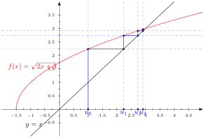
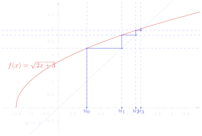

# 方法论讲义 第 5 讲　研究实数列

Fiche méthodologique n°5 — Étudier des suites réelles

中法对照讲义 · 由 LaTeX 源文件渲染

!!! info "阅读说明"

    每段先列法语原文；其下缩进、带深蓝竖条的小字号段落为中文翻译。<strong>加粗</strong>为关键词，括号内为中文释义。

说明：每段法语原文下方、缩进并带深蓝竖条的小字，是紧随其后的中文翻译。

## Calculer le terme général d'une suite usuelle

计算常见数列的通项

Si une suite réelle \((u_n)\) est définie par récurrence, on peut calculer tous ses termes les uns après les autres à partir d'un terme initial \(u_{n_0}\) donné. Mais cette méthode peut être très longue pour calculer un terme de rang beaucoup plus grand que le rang initial \(n_0\).

若实数列 \((u_n)\) 由递推关系定义，那么从给定的初始项 \(u_{n_0}\) 出发，可以逐项算出它的所有项。 但若要计算序号远大于初始序号 \(n_0\) 的项，这种方法可能非常冗长。
{: .zh }

Calculer le terme général de \((u_n)\) consiste à exprimer directement \(u_n\) en fonction du rang \(n\) afin de surmonter ce problème.

计算 \((u_n)\) 的<strong>通项</strong>（terme général），就是直接把 \(u_n\) 表示成序号 \(n\) 的表达式， 以此克服上述困难。
{: .zh }

<em>Conseil.</em> La relation de récurrence définissant une suite permet surtout de raisonner par récurrence. Dès qu'on connaît une propriété de la suite à démontrer (par exemple une majoration, une minoration ou sa monotonie), on peut la prouver par récurrence.

<strong>建议</strong>（Conseil）。数列的递推关系最主要的用处，是让人能进行<strong>递推推理</strong> （raisonnement par récurrence）。一旦知道了要证明的数列性质（例如有上界、有下界或单调性）， 就可以用递推法把它证出来。
{: .zh }

### Suite arithmétique

等差数列

Une suite \((u_n)\) est <strong>arithmétique</strong> lorsqu'elle vérifie une relation de récurrence du type :

数列 \((u_n)\) 若满足如下形式的递推关系式，就称为<strong>等差数列</strong>（suite arithmétique）：
{: .zh }

\[
\forall n \geqslant n_0, \qquad \boxed{u_{n+1} = u_n + r}
\]

où \(r \in \mathbb{R}\) est appelée la <strong>raison arithmétique</strong> de la suite. Son <strong>terme général</strong> est égal à :

其中 \(r \in \mathbb{R}\) 称为该数列的<strong>公差</strong>（raison arithmétique）。 它的<strong>通项</strong>为：
{: .zh }

\[
\forall n \geqslant n_0, \qquad \boxed{u_n = u_{n_0} + (n-n_0)r}.
\]

### Exercice d'application 1 应用练习 1

Soit \(n \in \mathbb{N}^*\). Déterminer le \(n\)-ième entier impair positif.

设 \(n \in \mathbb{N}^*\)。求第 \(n\) 个正的奇整数。
{: .zh }

### Exercice d'application 2 应用练习 2

Soit \((u_n)_{n\in\mathbb{N}}\) une suite arithmétique telle que \(u_{13} = 13^2\) et \(u_{29} = 29^2\). Calculer le terme général de \((u_n)_{n\in\mathbb{N}}\).

设 \((u_n)_{n\in\mathbb{N}}\) 是等差数列，满足 \(u_{13} = 13^2\) 且 \(u_{29} = 29^2\)。 计算 \((u_n)_{n\in\mathbb{N}}\) 的通项。
{: .zh }

### Suite géométrique

等比数列

Une suite \((u_n)\) est <strong>géométrique</strong> lorsqu'elle vérifie une relation de récurrence du type :

数列 \((u_n)\) 若满足如下形式的递推关系式，就称为<strong>等比数列</strong>（suite géométrique）：
{: .zh }

\[
\forall n \geqslant n_0, \qquad \boxed{u_{n+1} = qu_n}
\]

où \(q \in \mathbb{R}\) est appelée la <strong>raison géométrique</strong> de la suite. Son <strong>terme général</strong> est égal à :

其中 \(q \in \mathbb{R}\) 称为该数列的<strong>公比</strong>（raison géométrique）。它的<strong>通项</strong>为：
{: .zh }

\[
\forall n \geqslant n_0, \qquad \boxed{u_n = u_{n_0}q^{n-n_0}}.
\]

### Exercice d'application 3 应用练习 3

Soit \((u_n)_{n\in\mathbb{N}}\) la suite définie par \(u_0 = 3\) et \(\forall n \geqslant 0,\ u_{n+1} = u_n^2\). Justifier que les termes de \((u_n)_{n\in\mathbb{N}}\) sont strictement positifs puis calculer son terme général en considérant la suite auxiliaire \((v_n = \ln(u_n))_{n\in\mathbb{N}}\).

设 \((u_n)_{n\in\mathbb{N}}\) 是由 \(u_0 = 3\) 和 \(\forall n \geqslant 0,\ u_{n+1} = u_n^2\) 定义的数列。证明 \((u_n)_{n\in\mathbb{N}}\) 的各项都严格为正，然后借助<strong>辅助数列</strong> （suite auxiliaire）\((v_n = \ln(u_n))_{n\in\mathbb{N}}\) 计算它的通项。
{: .zh }

### Exercice d'application 4 应用练习 4

Soit \((u_n)_{n\in\mathbb{N}}\) une suite telle que \(u_0 = 3\) et \(u_{n+1} - u_n \geqslant u_n\) pour tout \(n \in \mathbb{N}\). Montrer que les termes de \((u_n)_{n\in\mathbb{N}}\) sont supérieurs à ceux d'une suite géométrique \((v_n)_{n\in\mathbb{N}}\) dont on calculera le terme général.

设 \((u_n)_{n\in\mathbb{N}}\) 是满足 \(u_0 = 3\)，且对一切 \(n \in \mathbb{N}\) 都有 \(u_{n+1} - u_n \geqslant u_n\) 的数列。证明 \((u_n)_{n\in\mathbb{N}}\) 的各项都大于某个等比数列 \((v_n)_{n\in\mathbb{N}}\) 的对应项，并求出该等比数列的通项。
{: .zh }

### Suite arithmético-géométrique

算术-等比数列

Une suite \((u_n)\) est <strong>arithmético-géométrique</strong> lorsqu'elle vérifie une relation de récurrence du type :

数列 \((u_n)\) 若满足如下形式的递推关系式，就称为<strong>算术-等比数列</strong> （suite arithmético-géométrique）：
{: .zh }

\[
\forall n \geqslant n_0, \qquad \boxed{u_{n+1} = qu_n + r}
\]

où \(q \in \mathbb{R}\setminus\{1\}\) et \(r \in \mathbb{R}\) sont appelées les <strong>raisons</strong> de la suite. Pour calculer son terme général, on commence par chercher une suite constante vérifiant la même relation de récurrence, c'est-à-dire par résoudre l'équation \(\alpha = q\alpha + r\) d'inconnue \(\alpha \in \mathbb{R}\). Puis on remarque que la suite auxiliaire \((v_n = u_n - \alpha)\) est géométrique (de raison \(q\)) et on peut donc calculer son terme général. Enfin, on en déduit le terme général de \((u_n = v_n + \alpha)\).

其中 \(q \in \mathbb{R}\setminus\{1\}\) 和 \(r \in \mathbb{R}\) 称为该数列的<strong>公比与公差</strong>。 要计算它的通项，先寻找一个满足同一递推关系的常数列，也就是解以 \(\alpha \in \mathbb{R}\) 为未知量的方程 \(\alpha = q\alpha + r\)。接着注意到辅助数列 \((v_n = u_n - \alpha)\) 是等比数列（公比为 \(q\)），于是可以算出它的通项。最后由此推出 \((u_n = v_n + \alpha)\) 的通项。
{: .zh }

### Exercice d'application 5 应用练习 5

Soit \((u_n)_{n\in\mathbb{N}^*}\) une suite arithmético-géométrique telle que \(u_1 = 1\), \(u_2 = 4\) et \(u_3 = 9\). Calculer le terme général de \((u_n)_{n\in\mathbb{N}^*}\).

设 \((u_n)_{n\in\mathbb{N}^*}\) 是算术-等比数列，满足 \(u_1 = 1\)、\(u_2 = 4\)、\(u_3 = 9\)。 计算 \((u_n)_{n\in\mathbb{N}^*}\) 的通项。
{: .zh }

### Exercice d'application 6 应用练习 6

Soient \(\lambda \in \mathbb{R}\) et \((u_n)_{n\in\mathbb{N}}\) la suite définie par \(u_0 = 1\) et \(\forall n \geqslant 0,\ u_{n+1} - u_n = \lambda u_n + 1\). Calculer le terme général de \((u_n)_{n\in\mathbb{N}}\) en fonction des valeurs de \(\lambda\).

设 \(\lambda \in \mathbb{R}\)，\((u_n)_{n\in\mathbb{N}}\) 是由 \(u_0 = 1\) 和 \(\forall n \geqslant 0,\ u_{n+1} - u_n = \lambda u_n + 1\) 定义的数列。按 \(\lambda\) 的取值 计算 \((u_n)_{n\in\mathbb{N}}\) 的通项。
{: .zh }

### Suite récurrente linéaire d'ordre 2

二阶线性递推数列

Une suite \((u_n)\) est <strong>récurrente linéaire d'ordre 2</strong> lorsqu'elle vérifie une relation de récurrence double du type :

数列 \((u_n)\) 若满足如下形式的二阶递推关系式，就称为<strong>二阶线性递推数列</strong> （suite récurrente linéaire d'ordre 2）：
{: .zh }

\[
\forall n \geqslant n_0, \qquad \boxed{u_{n+2} = au_{n+1} + bu_n}
\]

où \((a,b) \in \mathbb{R}^2\).

其中 \((a,b) \in \mathbb{R}^2\)。
{: .zh }

<em>Attention.</em> Pour qu'une suite récurrente linéaire d'ordre 2 soit bien définie (c'est-à-dire pour pouvoir calculer tous ses termes), il est nécessaire de connaître deux termes initiaux.

<strong>注意</strong>（Attention）。要使二阶线性递推数列<strong>良定义</strong>（即能够算出它的所有项）， 必须知道两个初始项。
{: .zh }

Pour calculer son terme général, on commence par résoudre l'équation caractéristique associée d'inconnue \(q \in \mathbb{C}\) :

要计算它的通项，先解与之相伴的<strong>特征方程</strong>（équation caractéristique）， 未知量为 \(q \in \mathbb{C}\)：
{: .zh }

\[
\boxed{q^2 = aq + b}.
\]

On reconnaît une équation du second degré à coefficients réels. Il y a alors trois cas selon le signe du discriminant \(\Delta\).

可以辨认出这是一个实系数一元二次方程。于是按判别式 \(\Delta\) 的符号分三种情形。
{: .zh }

- Si \(\Delta > 0\) : l'équation caractéristique admet deux solutions réelles (distinctes) qu'on note \(q_1\) et \(q_2\). Alors il existe deux constantes \((\lambda_1,\lambda_2) \in \mathbb{R}^2\) telles que :

    若 \(\Delta > 0\)：特征方程有两个（互异的）实根，记为 \(q_1\) 和 \(q_2\)。则存在两个常数 \((\lambda_1,\lambda_2) \in \mathbb{R}^2\)，使得：
    {: .zh }

    \[
    \forall n \geqslant n_0, \qquad \boxed{u_n = \lambda_1q_1^{n-n_0} + \lambda_2q_2^{n-n_0}}.
    \]

- Si \(\Delta = 0\) : l'équation caractéristique admet une seule solution réelle (double) qu'on note \(q_0\). Alors il existe deux constantes \((\lambda,\mu) \in \mathbb{R}^2\) telles que :

    若 \(\Delta = 0\)：特征方程只有一个（二重的）实根，记为 \(q_0\)。则存在两个常数 \((\lambda,\mu) \in \mathbb{R}^2\)，使得：
    {: .zh }

    \[
    \forall n \geqslant n_0, \qquad \boxed{u_n = \left(\lambda + \mu(n-n_0)\right)q_0^{n-n_0}}.
    \]

- Si \(\Delta < 0\) : l'équation caractéristique admet deux solutions complexes conjuguées (distinctes) qu'on note \(\rho e^{i\theta}\) et \(\rho e^{-i\theta}\). Alors il existe deux constantes \((A,B) \in \mathbb{R}^2\) telles que :

    若 \(\Delta < 0\)：特征方程有两个（互异的）共轭复根，记为 \(\rho e^{i\theta}\) 和 \(\rho e^{-i\theta}\)。则存在两个常数 \((A,B) \in \mathbb{R}^2\)，使得：
    {: .zh }

    \[
    \forall n \geqslant n_0, \qquad \boxed{u_n = \rho^{n-n_0}\left(A\cos\left((n-n_0)\theta\right)
       + B\sin\left((n-n_0)\theta\right)\right)}.
    \]

<em>Conseil.</em> Pour déterminer le couple de constantes \((\lambda_1,\lambda_2)\), \((\lambda,\mu)\) ou \((A,B)\) selon le cas considéré, il suffit d'utiliser deux termes initiaux de la suite puis de résoudre un système de deux équations à deux inconnues.

<strong>建议</strong>。要按所讨论的情形确定常数对 \((\lambda_1,\lambda_2)\)、\((\lambda,\mu)\) 或 \((A,B)\)，只需用数列的两个初始项，再解一个二元一次方程组即可。
{: .zh }

### Exercice d'application 7 应用练习 7

Soit \((u_n)_{n\in\mathbb{N}}\) la suite définie par \(u_0 = u_1 = 1\) et \(\forall n \geqslant 0,\ u_{n+2} = 6(u_{n+1} - 2u_n)\). Calculer le terme général de \((u_n)_{n\in\mathbb{N}}\).

设 \((u_n)_{n\in\mathbb{N}}\) 是由 \(u_0 = u_1 = 1\) 和 \(\forall n \geqslant 0,\ u_{n+2} = 6(u_{n+1} - 2u_n)\) 定义的数列。 计算 \((u_n)_{n\in\mathbb{N}}\) 的通项。
{: .zh }

### Exercice d'application 8 应用练习 8

Soit \((u_n)_{n\in\mathbb{N}^*}\) une suite telle que \(u_1 = 4\), \(u_3 = 2\) et chacun de ses autres termes est la moyenne du terme suivant et du terme précédent (ainsi, \(u_2 = (u_3+u_1)/2 = 3\)). Calculer le terme général de \((u_n)_{n\in\mathbb{N}^*}\).

设 \((u_n)_{n\in\mathbb{N}^*}\) 是满足 \(u_1 = 4\)、\(u_3 = 2\)，且其余每一项都等于它后一项 与前一项的平均值的数列（于是 \(u_2 = (u_3+u_1)/2 = 3\)）。计算 \((u_n)_{n\in\mathbb{N}^*}\) 的通项。
{: .zh }

### Exercice d'application 9 应用练习 9

Soient \((a_n)_{n\in\mathbb{N}}\) et \((b_n)_{n\in\mathbb{N}}\) deux suites définies par \(a_0 = 1\), \(b_0 = 0\) et :

设 \((a_n)_{n\in\mathbb{N}}\) 和 \((b_n)_{n\in\mathbb{N}}\) 是由 \(a_0 = 1\)、\(b_0 = 0\) 以及下式定义的两个数列：
{: .zh }

\[
\forall n \geqslant 0, \qquad
\left\{
\begin{array}{l}
a_{n+1} = 4a_n - b_n\\
b_{n+1} = 2a_n + b_n
\end{array}
\right.
\]

Montrer que \((a_n)_{n\in\mathbb{N}}\) et \((b_n)_{n\in\mathbb{N}}\) sont récurrentes linéaires d'ordre 2 puis calculer leur terme général.

证明 \((a_n)_{n\in\mathbb{N}}\) 和 \((b_n)_{n\in\mathbb{N}}\) 都是二阶线性递推数列， 然后计算它们的通项。
{: .zh }

### Exercice d'application 10 应用练习 10

Soit \((u_n)_{n\in\mathbb{N}^*}\) une suite récurrente linéaire d'ordre 2 telle que \(u_1 = -4\), \(u_2 = 5\), \(u_3 = 10\) et \(u_4 = 7\). Calculer le terme général de \((u_n)_{n\in\mathbb{N}^*}\).

设 \((u_n)_{n\in\mathbb{N}^*}\) 是二阶线性递推数列，满足 \(u_1 = -4\)、\(u_2 = 5\)、 \(u_3 = 10\)、\(u_4 = 7\)。计算 \((u_n)_{n\in\mathbb{N}^*}\) 的通项。
{: .zh }

!!! warning "Vocabulaire clé 重点词汇"

    - <strong>terme général</strong>：通项 &nbsp;&nbsp; 计算通项 = exprimer \(u_n\) en fonction du rang \(n\)
    - <strong>suite arithmétique / géométrique</strong>：等差数列（公差 raison \(r\)）/ 等比数列（公比 raison \(q\)）
    - <strong>suite arithmético-géométrique</strong>：算术-等比数列 &nbsp;&nbsp; \(u_{n+1} = qu_n + r\)，\(q \neq 1\)
    - <strong>suite récurrente linéaire d'ordre 2</strong>：二阶线性递推数列 &nbsp;&nbsp; \(u_{n+2} = au_{n+1} + bu_n\)
    - <strong>relation de récurrence</strong>：递推关系式 &nbsp;&nbsp; 动词：vérifier une relation「满足某关系式」
    - <strong>terme initial</strong>：初始项 &nbsp;&nbsp; 原版提示：二阶递推必须知道<em>两个</em>初始项
    - <strong>suite auxiliaire</strong>：辅助数列 &nbsp;&nbsp; \(v_n = \ln(u_n)\)、\(v_n = u_n - \alpha\) 之类
    - <strong>équation caractéristique</strong>：特征方程 &nbsp;&nbsp; 未知量 d'inconnue \(q \in \mathbb{C}\)
    - <strong>discriminant \(\Delta\)</strong>：判别式 &nbsp;&nbsp; 三种情形：deux solutions réelles (distinctes) / une solution double / deux solutions complexes conjuguées
    - <strong>il existe … tel que</strong>：存在……使得 &nbsp;&nbsp; 引入待定常数 \((\lambda_1,\lambda_2)\) 等
    - <strong>on reconnaît …</strong>：可辨认出…… &nbsp;&nbsp; 原版套语：on reconnaît une équation du second degré
    - <strong>Exercice d'application</strong>：应用题、随堂练习 &nbsp;&nbsp; 原版共 12 道

## Étudier une suite définie par récurrence

研究由递推关系定义的数列

Pour étudier une suite réelle \((u_n)\) non usuelle vérifiant une relation de récurrence du type :

要研究一个满足如下形式递推关系的<strong>非标准</strong>实数列 \((u_n)\)：
{: .zh }

\[
\forall n \geqslant n_0, \qquad u_{n+1} = f(u_n)
\]

où \(f\) est une fonction réelle, le principe général est de conjecturer des propriétés de la suite (par exemple une majoration, une minoration et sa monotonie) puis de démontrer ces propriétés par récurrence.

其中 \(f\) 是实值函数。一般做法是先<strong>猜测</strong>（conjecturer）数列的一些性质 （例如有上界、有下界以及它的单调性），再用递推法把这些性质证明出来。
{: .zh }

Pour établir ces conjectures, il suffit de calculer un nombre suffisant de premiers termes. Mais les calculs peuvent être longs et la moindre erreur va se répercuter dans les termes suivants.

为了提出这些猜测，只需算出足够多的前几项。但计算可能很长，而且稍有差错就会影响到后面的项。
{: .zh }

Une autre méthode plus efficace consiste à représenter graphiquement les premiers termes de \((u_n)\). Pour cela, on procède ainsi :

另一种更有效的方法，是把 \((u_n)\) 的前几项<strong>作图</strong>表示出来。做法如下：
{: .zh }

- on commence par étudier les variations de \(f\) (donc le signe de sa dérivée \(f'\)) ;

    先研究 \(f\) 的单调性（也就是其导数 \(f'\) 的符号）；
    {: .zh }

- puis on étudie le signe de la fonction \(x \mapsto f(x) - x\) afin de connaître la position relative de la courbe représentative de \(f\) par rapport à la droite d'équation \(y = x\) ;

    再研究函数 \(x \mapsto f(x) - x\) 的符号，以确定 \(f\) 的曲线相对于直线 \(y = x\) 的 <strong>位置关系</strong>；
    {: .zh }

- on trace sur un même graphique la courbe représentative de la fonction \(f\) et la droite d'équation \(y = x\) à l'aide des éléments précédents ;

    借助前面得到的信息，在同一张图上画出函数 \(f\) 的曲线与直线 \(y = x\)；
    {: .zh }

- on place le point de coordonnées \((u_{n_0},0)\) sur le graphique ;

    在图上标出坐标为 \((u_{n_0},0)\) 的点；
    {: .zh }

- en se déplaçant verticalement, on obtient à l'intersection de la courbe représentative de \(f\) le point de coordonnées \((u_{n_0},f(u_{n_0})) = (u_{n_0},u_{n_0+1})\) ;

    竖直移动，在 \(f\) 的曲线上得到坐标为 \((u_{n_0},f(u_{n_0})) = (u_{n_0},u_{n_0+1})\) 的点；
    {: .zh }

- en se déplaçant horizontalement, on obtient à l'intersection de la droite d'équation \(y = x\) le point de coordonnées \((u_{n_0+1},u_{n_0+1})\) ;

    水平移动，在直线 \(y = x\) 上得到坐标为 \((u_{n_0+1},u_{n_0+1})\) 的点；
    {: .zh }

- en se déplaçant verticalement, on obtient à l'intersection de la courbe représentative de \(f\) le point de coordonnées \((u_{n_0+1},f(u_{n_0+1})) = (u_{n_0+1},u_{n_0+2})\) ;

    竖直移动，在 \(f\) 的曲线上得到坐标为 \((u_{n_0+1},f(u_{n_0+1})) = (u_{n_0+1},u_{n_0+2})\) 的点；
    {: .zh }

- en se déplaçant horizontalement, on obtient à l'intersection de la droite d'équation \(y = x\) le point de coordonnées \((u_{n_0+2},u_{n_0+2})\) ;

    水平移动，在直线 \(y = x\) 上得到坐标为 \((u_{n_0+2},u_{n_0+2})\) 的点；
    {: .zh }

- en se déplaçant verticalement, on obtient à l'intersection de la courbe représentative de \(f\) le point de coordonnées \((u_{n_0+2},f(u_{n_0+2})) = (u_{n_0+2},u_{n_0+3})\) ;

    竖直移动，在 \(f\) 的曲线上得到坐标为 \((u_{n_0+2},f(u_{n_0+2})) = (u_{n_0+2},u_{n_0+3})\) 的点；
    {: .zh }

- etc.

    依此类推。
    {: .zh }

Ainsi, les abscisses des points obtenus sont égaux aux premiers terrmes de la suite : \(u_{n_0}\), \(u_{n_0+1}\), \(u_{n_0+2}\), \(u_{n_0+3}\), \(u_{n_0+4}\), etc. Une observation graphique de ces abscisses permet de formuler des conjectures sur \((u_n)\) qu'on démontre ensuite par récurrence.

这样，所得各点的横坐标就等于数列的前几项：\(u_{n_0}\)、\(u_{n_0+1}\)、\(u_{n_0+2}\)、 \(u_{n_0+3}\)、\(u_{n_0+4}\) 等等。对这些横坐标作图形观察，可以对 \((u_n)\) 提出猜测， 然后再用递推法加以证明。
{: .zh }

<em>Attention.</em> La monotonie de la suite \((u_n)\) n'est en général pas la même que la monotonie de la fonction \(f\) !

<strong>注意</strong>。数列 \((u_n)\) 的单调性一般与函数 \(f\) 的单调性<em>不同</em>！
{: .zh }

<em>Conseil.</em> Si \(f\) n'est pas définie sur \(\mathbb{R}\), il faut démontrer (par récurrence) que chaque terme de \((u_n)\) appartient à l'ensemble de définition de \(f\) pour justifier que la suite \((u_n)\) est bien définie (c'est-à-dire qu'on peut calculer tous ses termes à l'aide de la relation de récurrence).

<strong>建议</strong>。若 \(f\) 不是定义在 \(\mathbb{R}\) 上，就必须（用递推法）证明 \((u_n)\) 的每一项 都属于 \(f\) 的<strong>定义域</strong>（ensemble de définition），以说明数列 \((u_n)\) 是良定义的 （即可以用递推关系算出它的所有项）。
{: .zh }

!!! warning "Vocabulaire clé 重点词汇"

    - <strong>suite majorée / minorée</strong>：有上界的 / 有下界的数列 &nbsp;&nbsp; être majorée par 3「以 3 为上界」
    - <strong>monotonie, croissante</strong>：单调性、递增 &nbsp;&nbsp; strictement croissante 严格递增
    - <strong>conjecturer</strong>：猜测 &nbsp;&nbsp; 原版：conjecturer des propriétés puis les démontrer
    - <strong>raisonner par récurrence</strong>：用递推法推理
    - <strong>initialisation / hérédité / conclusion</strong>：初始步 / 递推步 / 结论 &nbsp;&nbsp; 递推证明的三段式
    - <strong>l'assertion \(P(n)\)</strong>：命题 \(P(n)\) &nbsp;&nbsp; «…» 引号内写命题内容
    - <strong>ensemble de définition</strong>：定义域 &nbsp;&nbsp; 判断数列是否 bien définie「良定义」的依据
    - <strong>courbe représentative</strong>：（函数）曲线、图像
    - <strong>droite d'équation \(y = x\)</strong>：方程为 \(y = x\) 的直线 &nbsp;&nbsp; au-dessus / en-dessous de 「在……上方 / 下方」
    - <strong>position relative</strong>：相对位置
    - <strong>raisonner par disjonction de cas</strong>：分类讨论、分情况讨论
    - <strong>être bien définie</strong>：（数列）良定义，即所有项都能算出来
    - <strong>la fonction racine carrée</strong>：平方根函数 &nbsp;&nbsp; 原版用它说明 \(\sqrt{\ }\) 保持不等号

### Exemple 1 例 1

Étudier la suite \((u_n)_{n\in\mathbb{N}}\) définie par \(u_0 = 1\) et \(\forall n \geqslant 0,\ u_{n+1} = \sqrt{2u_n + 3}\).

研究由 \(u_0 = 1\) 和 \(\forall n \geqslant 0,\ u_{n+1} = \sqrt{2u_n + 3}\) 定义的数列 \((u_n)_{n\in\mathbb{N}}\)。
{: .zh }

<em>Solution.</em> On pose la fonction \(f : x \mapsto \sqrt{2x+3}\) qui est définie sur \(\left[-\frac{3}{2},+\infty\right[\) et dérivable sur \(\left]-\frac{3}{2},+\infty\right[\). On a :

<strong>解答</strong>（Solution）。令函数 \(f : x \mapsto \sqrt{2x+3}\)，它定义在 \(\left[-\frac{3}{2},+\infty\right[\) 上，并在 \(\left]-\frac{3}{2},+\infty\right[\) 上可导。有：
{: .zh }

\[
\forall x > -\frac{3}{2}, \qquad
f'(x) = \frac{2}{2\sqrt{2x+3}} = \frac{1}{\sqrt{2x+3}} > 0.
\]

Donc \(f\) est strictement croissante sur \(\left[-\frac{3}{2},+\infty\right[\). De plus :

因此 \(f\) 在 \(\left[-\frac{3}{2},+\infty\right[\) 上严格递增。此外：
{: .zh }

\[
f(x) - x \geqslant 0 \iff \sqrt{2x+3} \geqslant x.
\]

On raisonne par disjonction de cas.

下面用分情况讨论来推理。
{: .zh }

\(1\)er cas : \(x \in \left[-\frac{3}{2},0\right[\), alors \(x < 0 \leqslant \sqrt{2x+3}\) donc \(f(x) - x \geqslant 0\).

第 1 种情形：\(x \in \left[-\frac{3}{2},0\right[\)，此时 \(x < 0 \leqslant \sqrt{2x+3}\)，故 \(f(x) - x \geqslant 0\)。
{: .zh }

\(2\)e cas : \(x \in [0,+\infty[\), alors on peut appliquer la fonction carrée qui est strictement croissante sur \([0,+\infty[\) :

第 2 种情形：\(x \in [0,+\infty[\)，此时可以两边平方（平方函数在 \([0,+\infty[\) 上 严格递增）：
{: .zh }

\[
f(x) - x \geqslant 0 \iff 2x + 3 \geqslant x^2 \iff
\underbrace{x^2 - 2x - 3}_{=(x+1)(x-3)} \leqslant 0 \iff
x \in \underbrace{[-1,3] \cap [0,+\infty[}_{=[0,3]}.
\]

<em>Conclusion.</em> La courbe représentative de \(f\) est au-dessus de la droite d'équation \(y = x\) sur \(\left[-\frac{3}{2},0\right[ \cup [0,3] = \left[-\frac{3}{2},3\right]\), et donc en-dessous sur \([3,+\infty[\). On peut maintenant représenter graphiquement les premiers termes de \((u_n)_{n\in\mathbb{N}}\) (voir ci-dessous).

<strong>结论</strong>。\(f\) 的曲线在 \(\left[-\frac{3}{2},0\right[ \cup [0,3] = \left[-\frac{3}{2},3\right]\) 上位于直线 \(y = x\) 的上方，因此在 \([3,+\infty[\) 上位于其下方。现在可以把 \((u_n)_{n\in\mathbb{N}}\) 的前几项作图表示出来（见下图）。
{: .zh }

On conjecture que la suite \((u_n)_{n\in\mathbb{N}}\) est majorée par 3, minorée par \(u_0 = 1\) et strictement croissante. Pour tout \(n \in \mathbb{N}\), on pose l'assertion \(P(n)\) : «\(1 \leqslant u_n < u_{n+1} < 3\)» et on raisonne par récurrence.

我们猜测数列 \((u_n)_{n\in\mathbb{N}}\) 以 3 为上界、以 \(u_0 = 1\) 为下界，并且严格递增。 对一切 \(n \in \mathbb{N}\)，记命题 \(P(n)\)：«\(1 \leqslant u_n < u_{n+1} < 3\)»， 然后用递推法推理。
{: .zh }

<em>Initialisation.</em> On a \(u_0 = 1\) et \(u_1 = f(u_0) = \sqrt{2 \times 1 + 3} = \sqrt{5}\). Or \(2 < \sqrt{5} < 3\) (car \(4 < 5 < 9\) et la fonction racine carrée est strictement croissante) donc \(1 \leqslant u_0 < u_1 < 3\). On a bien montré que \(P(0)\) est vraie.

<strong>初始步</strong>（Initialisation）。\(u_0 = 1\)，\(u_1 = f(u_0) = \sqrt{2 \times 1 + 3} = \sqrt{5}\)。 而 \(2 < \sqrt{5} < 3\)（因为 \(4 < 5 < 9\)，且平方根函数严格递增），所以 \(1 \leqslant u_0 < u_1 < 3\)。这就证明了 \(P(0)\) 成立。
{: .zh }

<em>Hérédité.</em> On fixe \(n \in \mathbb{N}\) et on suppose que \(P(n)\) est vraie, donc que \(1 \leqslant u_n < u_{n+1} < 3\). Puisque \(f\) est strictement croissante, on a :

<strong>递推步</strong>（Hérédité）。固定 \(n \in \mathbb{N}\)，假设 \(P(n)\) 成立，即 \(1 \leqslant u_n < u_{n+1} < 3\)。由于 \(f\) 严格递增，有：
{: .zh }

\[
\underbrace{f(1)}_{=\sqrt{5}>1} \leqslant \underbrace{f(u_n)}_{=u_{n+1}}
< \underbrace{f(u_{n+1})}_{=u_{n+2}} < \underbrace{f(3)}_{=\sqrt{2\times3+3}=3}
\qquad\text{donc}\qquad
\underbrace{1 \leqslant u_{n+1} < u_{n+2} < 3}_{P(n+1)}
\]

式中 donc 意为「因此」：即由左边的不等式推出右边的不等式。
{: .zh .gloss }

On a bien montré que \(P(n) \implies P(n+1)\) pour tout \(n \in \mathbb{N}\).

这就证明了对一切 \(n \in \mathbb{N}\) 都有 \(P(n) \implies P(n+1)\)。
{: .zh }

<em>Conclusion.</em> D'après le principe de récurrence, on en déduit que \(P(n)\) est vraie pour tout \(n \in \mathbb{N}\). Par conséquent, on a démontré que la suite \((u_n)_{n\in\mathbb{N}}\) est majorée par 3, minorée par 1 et strictement croissante. En particulier, la suite \((u_n)_{n\in\mathbb{N}}\) bien définie car \(2u_n + 3 \geqslant 0\) (autrement dit \(u_n \in \left[-\frac{3}{2},+\infty\right[\) puisque \(u_n \geqslant 1\)) pour tout \(n \in \mathbb{N}\). ∎

<strong>结论</strong>。根据递推原理，可知 \(P(n)\) 对一切 \(n \in \mathbb{N}\) 成立。因此我们证明了 数列 \((u_n)_{n\in\mathbb{N}}\) 以 3 为上界、以 1 为下界，并且严格递增。特别地，数列 \((u_n)_{n\in\mathbb{N}}\) 是良定义的，因为对一切 \(n \in \mathbb{N}\) 都有 \(2u_n + 3 \geqslant 0\)（换句话说，由于 \(u_n \geqslant 1\)，故 \(u_n \in \left[-\frac{3}{2},+\infty\right[\)）。∎
{: .zh }

### Exercice d'application 11 应用练习 11

Étudier la suite \((u_n)_{n\in\mathbb{N}^*}\) définie par \(u_1 = 2\) et \(\forall n \geqslant 1,\ u_{n+1} = \dfrac{u_n^2 + 3}{4}\).

研究由 \(u_1 = 2\) 和 \(\forall n \geqslant 1,\ u_{n+1} = \dfrac{u_n^2 + 3}{4}\) 定义的数列 \((u_n)_{n\in\mathbb{N}^*}\)。
{: .zh }

### Exercice d'application 12 应用练习 12

Étudier la suite \((u_n)_{n\in\mathbb{N}}\) définie par \(u_0 = 1\) et \(\forall n \geqslant 0,\ u_{n+1} = \dfrac{1}{1 + u_n}\).

研究由 \(u_0 = 1\) 和 \(\forall n \geqslant 0,\ u_{n+1} = \dfrac{1}{1 + u_n}\) 定义的数列 \((u_n)_{n\in\mathbb{N}}\)。
{: .zh }
