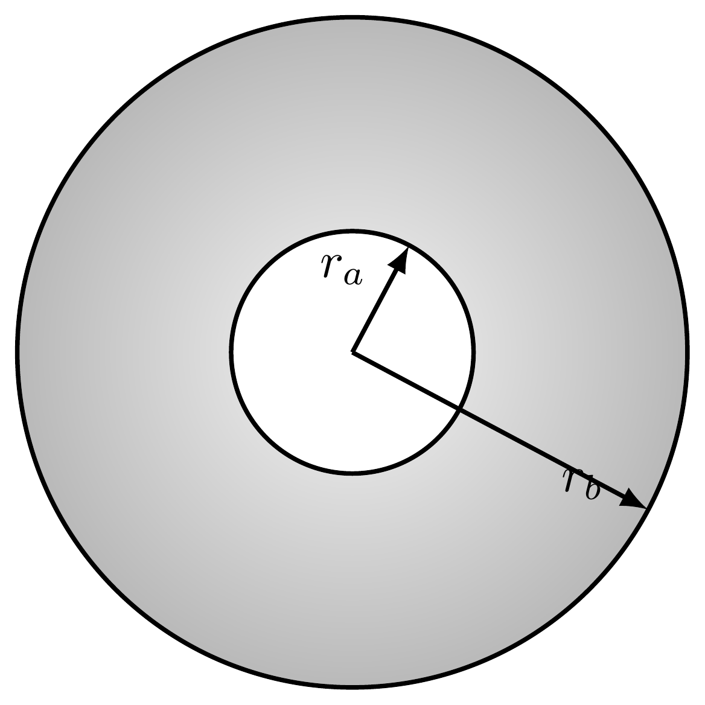

# 动电学 TD 2　电路基础

TD 2 — Fondements des circuits électriques · Corrigé

CORRIGÉ · 参考解答

中法对照讲义 · 动电学与电路

!!! info "阅读说明"

    本页是动电学部分 TD2 的完整参考解答：三道练习逐题给出推理步骤、公式与结论，每道练习末尾附重点词汇。每段先列法语原文；其下缩进、带深蓝竖条的小字号段落为中文翻译。各题解答集中在带边框的「参考解答」框中，建议先自行作答再核对。

## Exercice 1 : Résistance d'un tube cylindrique 练习 1：圆柱管的电阻

<em>Figure 2.1</em> — Tube conducteur de rayon intérieur \(r_a\) et de rayon extérieur \(r_b\). 图 2.1：内半径为 \(r_a\)、外半径为 \(r_b\) 的导体管。

Un tube cylindrique de longueur \(L\) a un rayon intérieur \(r_a\) et un rayon extérieur \(r_b\) (figure 2.1). Le matériau a une résistivité \(\rho\). Le courant circule radialement de la surface intérieure vers la surface extérieure.

长度为 \(L\) 的圆柱形管，内半径为 \(r_a\)，外半径为 \(r_b\)（图 2.1）。材料的电阻率为 \(\rho\)。电流沿径向由内表面流向外表面。
{: .zh }

1. Montrez que la résistance est

    证明该管的电阻为
    {: .zh }

    \[
    R=\frac{\rho}{2\pi L}\ln\frac{r_b}{r_a}.
    \]

2. Pour un courant circulant dans cette direction, quelle est la résistance d'un filament de carbone (graphite) dont les dimensions sont \(r_a=0{,}4\)&nbsp;cm, \(r_b=3\)&nbsp;cm et \(L=30\)&nbsp;cm ? On rappelle la résistivité du graphite \(\rho=3{,}5\times10^{-5}\)&nbsp;\(\Omega\)&nbsp;m.

    对于沿该方向流动的电流，尺寸为 \(r_a=0{,}4\)&nbsp;cm、\(r_b=3\)&nbsp;cm、\(L=30\)&nbsp;cm 的碳（石墨）丝电阻是多少？已知石墨的电阻率 \(\rho=3{,}5\times10^{-5}\)&nbsp;\(\Omega\)&nbsp;m。
    {: .zh }

!!! sol ""

    1. Le courant est radial : à travers toute surface cylindrique de rayon \(r\) (\(r_a\leqslant r\leqslant r_b\)) et de hauteur \(L\), l'intensité \(I\) est la même (conservation du courant). La densité de courant en un point de rayon \(r\) vaut donc

        电流沿径向流动：穿过任意半径为 \(r\)（\(r_a\leqslant r\leqslant r_b\)）、高为 \(L\) 的圆柱面，电流强度 \(I\) 都相同（电流守恒）。因此半径 \(r\) 处的电流密度为
        {: .zh }

        \[
        J(r)=\frac{I}{S(r)}=\frac{I}{2\pi rL}.
        \]

        La loi d'Ohm locale, \(\vec{J}=\sigma\vec{E}=\vec{E}/\rho\), donne le champ électrique, lui aussi radial :

        局部欧姆定律 \(\vec{J}=\sigma\vec{E}=\vec{E}/\rho\) 给出同样沿径向的电场：
        {: .zh }

        \[
        E(r)=\rho J(r)=\frac{\rho I}{2\pi L}\,\frac{1}{r}.
        \]

        La différence de potentiel entre les deux surfaces est l'intégrale du champ le long d'un rayon :

        两表面之间的电势差等于电场沿一条半径的积分：
        {: .zh }

        \[
        U=\int_{r_a}^{r_b}E(r)\,\mathrm{d}r
        =\frac{\rho I}{2\pi L}\int_{r_a}^{r_b}\frac{\mathrm{d}r}{r}
        =\frac{\rho I}{2\pi L}\ln\frac{r_b}{r_a}.
        \]

        La résistance est le rapport \(U/I\) :

        电阻即比值 \(U/I\)：
        {: .zh }

        \[
        R=\frac{U}{I}=\frac{\rho}{2\pi L}\ln\frac{r_b}{r_a}.
        \qquad\square
        \]

        On peut aussi voir le tube comme la mise en série de coquilles cylindriques d'épaisseur \(\mathrm{d}r\), de section \(2\pi rL\) et de résistance \(\mathrm{d}R=\rho\,\mathrm{d}r/(2\pi rL)\) : la somme de ces résistances élémentaires redonne le même résultat.

        也可将管视为一系列厚度为 \(\mathrm{d}r\)、截面积为 \(2\pi rL\)、电阻为 \(\mathrm{d}R=\rho\,\mathrm{d}r/(2\pi rL)\) 的圆柱薄壳串联：各元电阻之和给出相同结果。
        {: .zh }

    2. Avec \(r_a=4{,}0\times10^{-3}\)&nbsp;m, \(r_b=3{,}0\times10^{-2}\)&nbsp;m, \(L=0{,}30\)&nbsp;m et \(\rho=3{,}5\times10^{-5}\)&nbsp;\(\Omega\)&nbsp;m :

        代入 \(r_a=4{,}0\times10^{-3}\)&nbsp;m、\(r_b=3{,}0\times10^{-2}\)&nbsp;m、\(L=0{,}30\)&nbsp;m、\(\rho=3{,}5\times10^{-5}\)&nbsp;\(\Omega\)&nbsp;m：
        {: .zh }

        \[
        R=\frac{3{,}5\times10^{-5}}{2\pi\times0{,}30}\,
        \ln\frac{3{,}0\times10^{-2}}{4{,}0\times10^{-3}}
        =1{,}86\times10^{-5}\ln 7{,}5
        \approx3{,}7\times10^{-5}\ \Omega.
        \]

        Soit environ \(37\)&nbsp;\(\mu\Omega\) : la résistance est très faible, car le courant traverse une grande surface latérale sur une faible épaisseur radiale.

        约为 \(37\)&nbsp;\(\mu\Omega\)：电阻极小，因为电流是在很小的径向厚度内穿过很大的侧面积。
        {: .zh }

!!! warning "Vocabulaire clé &nbsp;&nbsp; 重点词汇 练习 1 核心术语"

    - <strong>tube cylindrique</strong>：圆柱管
    - <strong>rayon intérieur / extérieur</strong>：内半径 / 外半径
    - <strong>résistivité</strong>：电阻率
    - <strong>courant radial</strong>：径向电流
    - <strong>coquille cylindrique</strong>：圆柱薄壳
    - <strong>surface latérale</strong>：侧表面
    - <strong>filament de carbone (graphite)</strong>：碳（石墨）丝
    - <strong>différence de potentiel</strong>：电势差
    - <strong>loi d'Ohm locale</strong>：局部欧姆定律

## Exercice 2 : Champ électrique dans un conducteur de section variable 练习 2：变截面导体中的电场

On place le long d'un axe des \(x\) (coordonnées cartésiennes) un fil métallique de résistivité \(\rho\) et de longueur \(L\) dont le rayon \(r(x)\) croît linéairement de \(r_1\) à \(r_2\) d'une extrémité à l'autre du fil. On suppose que la variation de section est suffisamment progressive pour considérer le courant comme essentiellement longitudinal. Le fil est placé entre \(x=0\) et \(x=L\). On applique une différence de potentiel \(U\) entre ses extrémités.

沿 \(x\) 轴（笛卡尔坐标）放置一根电阻率为 \(\rho\)、长度为 \(L\) 的金属导线，其半径 \(r(x)\) 从导线一端到另一端由 \(r_1\) 线性增大到 \(r_2\)。假设截面积变化足够平缓，可认为电流基本上是纵向的。导线位于 \(x=0\) 与 \(x=L\) 之间，两端加上电势差 \(U\)。
{: .zh }

1. Déterminer l'expression de la résistance du fil.

    求导线电阻的表达式。
    {: .zh }

2. En déduire l'expression de l'intensité du courant, de la densité de courant et du champ électrique. Le fil étant quasi cylindrique, on considère que la densité de courant n'a qu'une composante selon \(x\).

    由此求电流强度、电流密度和电场的表达式。由于导线近似为圆柱形，认为电流密度只有沿 \(x\) 的分量。
    {: .zh }

3. Déterminer l'expression de la vitesse de dérive en fonction de \(x\).

    求漂移速度作为 \(x\) 的函数的表达式。
    {: .zh }

!!! sol ""

    Le rayon du fil varie linéairement :

    导线半径线性变化：
    {: .zh }

    \[
    r(x)=r_1+(r_2-r_1)\frac{x}{L}.
    \]

    1. Entre \(x\) et \(x+\mathrm{d}x\), le fil est assimilable à un cylindre de section \(S(x)=\pi r(x)^2\) et de longueur \(\mathrm{d}x\), de résistance

        在 \(x\) 与 \(x+\mathrm{d}x\) 之间，导线可视为截面积为 \(S(x)=\pi r(x)^2\)、长度为 \(\mathrm{d}x\) 的圆柱，其电阻为
        {: .zh }

        \[
        \mathrm{d}R=\frac{\rho\,\mathrm{d}x}{\pi r(x)^2}.
        \]

        Ces tranches élémentaires sont en série ; la résistance totale est

        这些元段彼此串联，总电阻为
        {: .zh }

        \[
        R=\frac{\rho}{\pi}\int_0^L
        \frac{\mathrm{d}x}{\left[r_1+(r_2-r_1)\dfrac{x}{L}\right]^2}.
        \]

        Avec le changement de variable \(u=r(x)\), \(\mathrm{d}u=\dfrac{r_2-r_1}{L}\,\mathrm{d}x\) :

        作变量代换 \(u=r(x)\)，\(\mathrm{d}u=\dfrac{r_2-r_1}{L}\,\mathrm{d}x\)：
        {: .zh }

        \[
        R=\frac{\rho L}{\pi(r_2-r_1)}\int_{r_1}^{r_2}\frac{\mathrm{d}u}{u^2}
        =\frac{\rho L}{\pi(r_2-r_1)}
        \left(\frac{1}{r_1}-\frac{1}{r_2}\right)
        =\frac{\rho L}{\pi r_1r_2}.
        \]

        On vérifie que pour un fil cylindrique (\(r_1=r_2=r\)), on retrouve bien \(R=\rho L/(\pi r^2)\).

        验证：对圆柱形导线（\(r_1=r_2=r\)），确实回到 \(R=\rho L/(\pi r^2)\)。
        {: .zh }

    2. L'intensité est la même dans toute section (conservation du courant) et vaut

        各截面的电流强度相同（电流守恒），其值为
        {: .zh }

        \[
        I=\frac{U}{R}=\frac{\pi r_1r_2}{\rho L}\,U.
        \]

        La densité de courant, purement longitudinale, s'écrit

        电流密度只有纵向分量：
        {: .zh }

        \[
        J(x)=\frac{I}{S(x)}=\frac{I}{\pi r(x)^2}
        =\frac{Ur_1r_2}{\rho L\,r(x)^2}.
        \]

        La loi d'Ohm locale \(\vec{J}=\sigma\vec{E}\) (soit \(\vec{E}=\rho\vec{J}\)) donne le champ électrique :

        局部欧姆定律 \(\vec{J}=\sigma\vec{E}\)（即 \(\vec{E}=\rho\vec{J}\)）给出电场：
        {: .zh }

        \[
        E(x)=\rho J(x)=\frac{Ur_1r_2}{L\,r(x)^2}
        =\frac{Ur_1r_2}{L\left[r_1+(r_2-r_1)\dfrac{x}{L}\right]^2}.
        \]

        Le champ est orienté dans le sens du courant, c'est-à-dire de \(x=0\) vers \(x=L\) (du potentiel le plus élevé vers le plus faible). Il est d'autant plus intense que le fil est fin. On vérifie que

        电场沿电流方向，即由 \(x=0\) 指向 \(x=L\)（从高电势指向低电势）。导线越细，电场越强。可以验证
        {: .zh }

        \[
        \int_0^L E(x)\,\mathrm{d}x
        =\frac{Ur_1r_2}{L}\int_0^L\frac{\mathrm{d}x}{r(x)^2}=U,
        \]

        en cohérence avec la différence de potentiel appliquée.

        与所加电势差一致。
        {: .zh }

    3. La densité de courant est reliée à la vitesse de dérive par \(\vec{J}=nq\vec{v}_d\), où \(n\) est la densité volumique de porteurs et \(q\) leur charge. Pour les électrons libres d'un métal, \(q=-e\) : la vitesse de dérive est opposée à \(\vec{J}\) et à \(\vec{E}\). En norme,

        电流密度与漂移速度由 \(\vec{J}=nq\vec{v}_d\) 相联系，其中 \(n\) 为载流子体密度，\(q\) 为其电荷。对金属中的自由电子 \(q=-e\)：漂移速度与 \(\vec{J}\)、\(\vec{E}\) 方向相反。其大小为
        {: .zh }

        \[
        v_d(x)=\frac{J(x)}{ne}
        =\frac{Ur_1r_2}{\rho\,neL\,r(x)^2}.
        \]

        Avec le modèle de Drude (\(\sigma=ne^2\tau/m_e\)), on peut aussi écrire \(v_d=\mu E\) avec \(\mu=e\tau/m_e\) la mobilité :

        利用 Drude 模型（\(\sigma=ne^2\tau/m_e\)），也可写成 \(v_d=\mu E\)，其中 \(\mu=e\tau/m_e\) 为迁移率：
        {: .zh }

        \[
        v_d(x)=\frac{e\tau}{m_e}\,E(x)
        =\frac{e\tau\,Ur_1r_2}{m_eL\,r(x)^2}.
        \]

        La vitesse de dérive est maximale là où le fil est le plus fin (en \(x=0\) si \(r_2>r_1\)) et décroît comme \(1/r(x)^2\) vers l'extrémité la plus épaisse.

        导线最细处漂移速度最大（若 \(r_2>r_1\)，则在 \(x=0\) 处），并向较粗的一端按 \(1/r(x)^2\) 减小。
        {: .zh }

!!! warning "Vocabulaire clé &nbsp;&nbsp; 重点词汇 练习 2 核心术语"

    - <strong>section variable</strong>：变截面
    - <strong>variation progressive</strong>：平缓变化
    - <strong>courant longitudinal</strong>：纵向电流
    - <strong>tranche élémentaire</strong>：元段
    - <strong>densité de courant</strong>：电流密度
    - <strong>vitesse de dérive</strong>：漂移速度
    - <strong>mobilité</strong>：迁移率
    - <strong>modèle de Drude</strong>：Drude 模型
    - <strong>conservation du courant</strong>：电流守恒

## Exercice 3 : Autonomie d'une voiture électrique 练习 3：电动汽车的续航

Une voiture électrique de \(600\)&nbsp;kg est alimentée par un groupe de \(20\) batteries de \(12\)&nbsp;V en parallèle, chacune d'elles pouvant libérer une charge de \(100\)&nbsp;A&nbsp;h. Le groupe motopropulseur (incluant le moteur électrique, l'électronique de puissance, la transmission aux roues, etc.) présente un rendement de \(90\,\%\). À \(60\)&nbsp;km&nbsp;h\(^{-1}\), une force résistante à l'avancement de \(180\)&nbsp;N (combinant tous les types de friction extérieure) s'oppose au mouvement de la voiture. On suppose que la différence de potentiel aux bornes des batteries reste constante.

一辆质量 \(600\)&nbsp;kg 的电动汽车由 \(20\) 节 \(12\)&nbsp;V 电池并联供电，每节电池可释放 \(100\)&nbsp;A&nbsp;h 的电荷。动力总成（包括电动机、电力电子、车轮传动等）的效率为 \(90\,\%\)。以 \(60\)&nbsp;km&nbsp;h\(^{-1}\) 行驶时，\(180\)&nbsp;N 的行驶阻力（综合各类外部摩擦）阻碍汽车前进。假设电池端电压保持不变。
{: .zh }

1. Pendant combien de temps peut-elle rouler à cette vitesse sur un sol horizontal ?

    在水平路面上以该速度能行驶多长时间？
    {: .zh }

2. Pendant combien de temps peut-elle rouler à cette vitesse en montant une pente de \(10^\circ\) ?

    以该速度上 \(10^\circ\) 的坡能行驶多长时间？
    {: .zh }

On rappelle la valeur de la gravité terrestre \(g=9{,}81\)&nbsp;m\(^2\)&nbsp;s\(^{-1}\).

已知地球重力加速度 \(g=9{,}81\)&nbsp;m\(^2\)&nbsp;s\(^{-1}\)（原讲义如此排印；应为 m&nbsp;s\(^{-2}\)）。
{: .zh }

!!! sol ""

    Les \(20\) batteries sont en parallèle : la tension aux bornes reste \(12\)&nbsp;V et les charges disponibles s'ajoutent. La charge totale est donc

    \(20\) 节电池并联：端电压保持 \(12\)&nbsp;V，可用电荷相加。总电荷为
    {: .zh }

    \[
    Q=20\times100\ \mathrm{A\,h}
    =2{,}0\times10^{3}\ \mathrm{A\,h}
    =2{,}0\times10^{3}\times3600\ \mathrm{C}
    =7{,}2\times10^{6}\ \mathrm{C}.
    \]

    L'énergie électrique totale stockée vaut

    储存的总电能为
    {: .zh }

    \[
    E_{el}=UQ=12\times7{,}2\times10^{6}\ \mathrm{J}
    =8{,}64\times10^{7}\ \mathrm{J}
    =24\ \mathrm{kW\,h}.
    \]

    Le rendement \(\eta=0{,}90\) du groupe motopropulseur limite le travail mécanique récupérable à

    动力总成的效率 \(\eta=0{,}90\) 使可获得的机械功至多为
    {: .zh }

    \[
    W_{\text{méca}}=\eta\,E_{el}
    =0{,}90\times8{,}64\times10^{7}
    \approx7{,}78\times10^{7}\ \mathrm{J}.
    \]

    À la vitesse \(v=60\)&nbsp;km&nbsp;h\(^{-1}=60/3{,}6\simeq16{,}7\)&nbsp;m&nbsp;s\(^{-1}\), la puissance mécanique nécessaire pour vaincre une force résistante \(F\) est \(P=Fv\).

    以速度 \(v=60\)&nbsp;km&nbsp;h\(^{-1}=60/3{,}6\simeq16{,}7\)&nbsp;m&nbsp;s\(^{-1}\) 行驶时，克服阻力 \(F\) 所需的机械功率为 \(P=Fv\)。
    {: .zh }

    1. Sur sol horizontal, la seule force à vaincre est la force résistante \(F=180\)&nbsp;N :

        在水平路面上，只需克服阻力 \(F=180\)&nbsp;N：
        {: .zh }

        \[
        P=Fv=180\times16{,}7\simeq3{,}0\times10^{3}\ \mathrm{W}.
        \]

        L'autonomie (durée de fonctionnement) est alors

        续航时间（持续工作时间）为
        {: .zh }

        \[
        t=\frac{W_{\text{méca}}}{P}
        =\frac{7{,}78\times10^{7}}{3{,}0\times10^{3}}
        \approx2{,}59\times10^{4}\ \mathrm{s}
        \approx7{,}2\ \mathrm{h}.
        \]

        Soit environ \(7\)&nbsp;h&nbsp;\(12\)&nbsp;min, ce qui correspond à une distance \(d=vt\approx432\)&nbsp;km.

        即约 \(7\) 小时 \(12\) 分钟，对应行驶距离 \(d=vt\approx432\)&nbsp;km。
        {: .zh }

        Vérification : le courant total débité vaut \(I=P/(\eta U)\approx278\)&nbsp;A, soit environ \(14\)&nbsp;A par batterie ; à ce régime, une batterie de \(100\)&nbsp;A&nbsp;h se vide bien en \(7{,}2\)&nbsp;h.

        验证：总放电电流 \(I=P/(\eta U)\approx278\)&nbsp;A，即每节电池约 \(14\)&nbsp;A；在此电流下，\(100\)&nbsp;A&nbsp;h 的电池恰好可用 \(7{,}2\)&nbsp;h。
        {: .zh }

    2. En montée, il faut vaincre en plus la composante du poids selon la pente, \(mg\sin10^\circ\) ; la force totale à vaincre devient

        上坡时还需额外克服重力沿坡面的分量 \(mg\sin10^\circ\)，总阻力变为
        {: .zh }

        \[
        F'=F+mg\sin10^\circ
        =180+600\times9{,}81\times\sin10^\circ
        \approx180+1{,}02\times10^{3}
        \approx1{,}20\times10^{3}\ \mathrm{N}.
        \]

        La puissance nécessaire et l'autonomie valent alors

        所需功率与续航时间相应为
        {: .zh }

        \[
        P'=F'v\approx1{,}20\times10^{3}\times16{,}7
        \approx2{,}0\times10^{4}\ \mathrm{W},
        \]

        \[
        t'=\frac{W_{\text{méca}}}{P'}
        \approx\frac{7{,}78\times10^{7}}{2{,}0\times10^{4}}
        \approx3{,}9\times10^{3}\ \mathrm{s}
        \approx65\ \mathrm{min}
        \approx1\ \mathrm{h}\ 5\ \mathrm{min}.
        \]

        L'autonomie est divisée par plus de \(6\) : la pente, quoique modérée, ajoute une force de l'ordre de \(1\)&nbsp;kN, très supérieure à la force de roulement de \(180\)&nbsp;N.

        续航时间缩短为原来的六分之一以下：坡度虽不大，却额外带来约 \(1\)&nbsp;kN 的力，远大于 \(180\)&nbsp;N 的滚动阻力。
        {: .zh }

!!! warning "Vocabulaire clé &nbsp;&nbsp; 重点词汇 练习 3 核心术语"

    - <strong>autonomie</strong>：续航时间 / 续航里程
    - <strong>batterie</strong>：电池
    - <strong>en parallèle</strong>：并联
    - <strong>charge (en A&nbsp;h)</strong>：电荷量（安时）
    - <strong>groupe motopropulseur</strong>：动力总成
    - <strong>rendement</strong>：效率
    - <strong>force résistante à l'avancement</strong>：行驶阻力
    - <strong>pente</strong>：坡度
    - <strong>travail mécanique</strong>：机械功
    - <strong>énergie stockée</strong>：储存的能量
