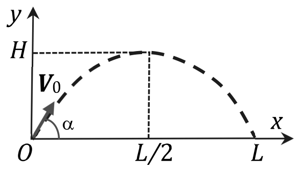
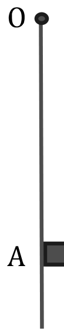
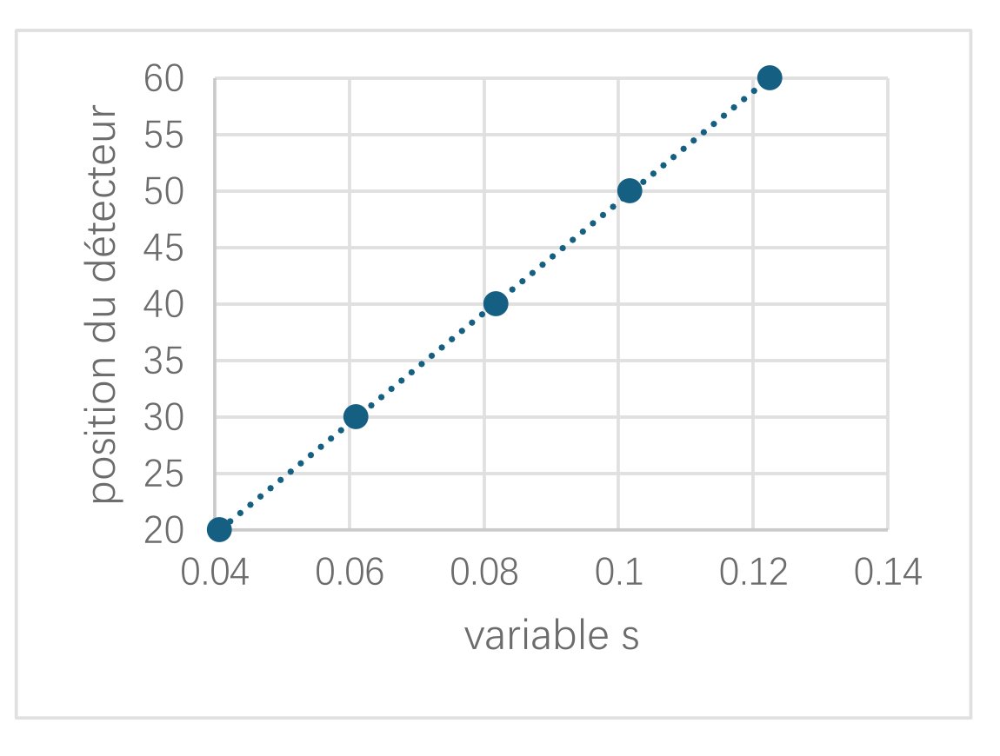

# TD 1–TD 2　量纲与不确定度

TD 1 — Dimensions et homogénéité · TD 2 — Mesures et incertitudes

CORRIGÉ OFFICIEL · 官方参考解答

中法对照讲义 · 物理方法训练

!!! info "阅读说明"

    本页收录两份物理方法习题课：TD1 训练量纲分析与齐次性，TD2 训练测量、有效数字与不确定度。每题均附官方参考解答（corrigé officiel）；每段先列法语原文，其下缩进、带深蓝竖条的小字号蓝色段落为中文翻译。

## TD 1　Dimensions et homogénéité en physique 物理中的量纲与齐次性

En mécanique et en électricité, les grandeurs fondamentales sont : le temps (\(t\)), la longueur (\(l\)), la masse (\(m\)), l'intensité de courant (\(I\)) et la température thermodynamique (\(\Theta\)). Dans le Système International (SI) les unités associées sont respectivement la seconde, le mètre, le kilogramme, l'ampère et le kelvin (symboles : s, m, kg, A, K).

在力学与电学中，基本物理量为：时间 (\(t\))、长度 (\(l\))、质量 (\(m\))、电流强度 (\(I\)) 和热力学温度 (\(\Theta\))。在国际单位制（Système International，SI）中，对应的单位依次是秒、米、千克、安培和开尔文（符号：s、m、kg、A、K）。
{: .zh }

L'équation aux dimensions est une relation symbolique \([G]=[t]^{\alpha}[l]^{\beta}[m]^{\gamma}\dots\) qui relie une grandeur dérivée \(G\) aux grandeurs fondamentales \(t\), \(l\), \(m\), …

量纲方程是一种符号关系，它把导出量 \(G\) 与基本量 \(t\)、\(l\)、\(m\)、… 联系起来。
{: .zh }

### 1. Dimensions de quelques grandeurs physiques 若干物理量的量纲

Donner les équations aux dimensions des grandeurs suivantes :

给出下列物理量的量纲方程：
{: .zh }

(a) vitesse, &emsp; (b) accélération, &emsp; (c) force, &emsp; (d) travail, &emsp; (e) puissance.

（a）速度　（b）加速度　（c）力　（d）功　（e）功率。
{: .zh }

!!! sol ""

    *Selon les notations du document officiel, les dimensions d'une grandeur physique \(g\) se notent entre crochets : \([g]\). Les dimensions fondamentales (longueur, masse, temps, etc.) sont quant à elles représentées par des lettres droites : \(\mathrm{L}\), \(\mathrm{M}\), \(\mathrm{T}\), \(\mathrm{I}\), \(\Theta\).*

    按照官方文档的记号，物理量 \(g\) 的量纲记在方括号中：\([g]\)。基本量纲（长度、质量、时间等）则用正体字母表示：\(\mathrm{L}\)、\(\mathrm{M}\)、\(\mathrm{T}\)、\(\mathrm{I}\)、\(\Theta\)。
    {: .zh }

    \[
    \begin{aligned}
    \text{1) Vitesse : }&[v]=\mathrm{L}\,\mathrm{T}^{-1},&
    \text{2) Accélération : }&[a]=\mathrm{L}\,\mathrm{T}^{-2},\\[2pt]
    \text{3) Force : }&[F]=\mathrm{M}\,\mathrm{L}\,\mathrm{T}^{-2},&
    \text{4) Travail : }&[W]=\mathrm{M}\,\mathrm{L}^{2}\,\mathrm{T}^{-2},\\[2pt]
    \text{5) Puissance : }&[P]=\mathrm{M}\,\mathrm{L}^{2}\,\mathrm{T}^{-3}.
    \end{aligned}
    \]

    1）速度 \([v]=\mathrm{L}\,\mathrm{T}^{-1}\)；2）加速度 \([a]=\mathrm{L}\,\mathrm{T}^{-2}\)；3）力 \([F]=\mathrm{M}\,\mathrm{L}\,\mathrm{T}^{-2}\)；4）功 \([W]=\mathrm{M}\,\mathrm{L}^{2}\,\mathrm{T}^{-2}\)；5）功率 \([P]=\mathrm{M}\,\mathrm{L}^{2}\,\mathrm{T}^{-3}\)。
    {: .zh }

    **Remarque.** Le corrigé officiel imprime \([F]=\mathrm{M}\,\mathrm{L}^{2}\,\mathrm{T}^{-2}\) ; c'est une coquille : la dimension de la force est \(\mathrm{M}\,\mathrm{L}\,\mathrm{T}^{-2}\) (\(\mathrm{M}\,\mathrm{L}^{2}\,\mathrm{T}^{-2}\) est celle de l'énergie).

    <strong>注。</strong>官方答案中力印作 \([F]=\mathrm{M}\,\mathrm{L}^{2}\,\mathrm{T}^{-2}\)，这是笔误：力的量纲应为 \(\mathrm{M}\,\mathrm{L}\,\mathrm{T}^{-2}\)（\(\mathrm{M}\,\mathrm{L}^{2}\,\mathrm{T}^{-2}\) 是能量的量纲）。
    {: .zh }

### 2. Dimension de grandeurs électriques 电学量的量纲

1. Donner la dimension d'une résistance (on pourra penser à la puissance dissipée par effet Joule).

    给出电阻的量纲（可以想一想焦耳效应所耗散的功率）。
    {: .zh }

2. En déduire la dimension d'une tension.

    由此推出电压的量纲。
    {: .zh }

!!! sol ""

    **(a)** La puissance \(P\) dissipée par effet Joule est \(P=RI^2\). Comme \([P]=\mathrm{M}\,\mathrm{L}^{2}\,\mathrm{T}^{-3}\), on déduit

    **(a)** 焦耳效应耗散的功率为 \(P=RI^2\)。由于 \([P]=\mathrm{M}\,\mathrm{L}^{2}\,\mathrm{T}^{-3}\)，可得
    {: .zh }

    \[
    [R]=\frac{[P]}{[I]^2}=\mathrm{M}\,\mathrm{L}^{2}\,\mathrm{T}^{-3}\,\mathrm{I}^{-2}.
    \]

    **(b)** La loi d'Ohm donne \(U=RI\), soit

    **(b)** 欧姆定律给出 \(U=RI\)，故
    {: .zh }

    \[
    [U]=[R]\,[I]=\mathrm{M}\,\mathrm{L}^{2}\,\mathrm{T}^{-3}\,\mathrm{I}^{-1}.
    \]

### 3. Portée d'un projectile 抛射体的射程

En faisant l'analyse dimensionnelle et examinant les résultats dans les cas \(\alpha=0\) et \(90^\circ\), trouver, parmi les 3 relations suivantes, celle qui peut traduire la portée \(L\) d'un projectile lancé avec une vitesse initiale \(V_0\) sous un angle \(\alpha\) :

通过量纲分析，并考察 \(\alpha=0\) 与 \(90^\circ\) 两种情形下的结果，在下列三个关系中找出能够表示抛射体射程 \(L\) 的那一个；该抛射体以初速度 \(V_0\) 沿与水平方向成 \(\alpha\) 角的方向抛出：
{: .zh }

\[
\text{a)}\quad L=\frac{V_0\sin(2\alpha)}{g},\qquad
\text{b)}\quad L=\frac{V_0^2\sin(2\alpha)}{g},\qquad
\text{c)}\quad L=\frac{V_0^2\sin(\alpha)}{g}.
\]

!!! sol ""

    **(a)** \(\left[V_0\sin(2\alpha)/g\right]=\mathrm{L}\,\mathrm{T}^{-1}\cdot\mathrm{L}^{-1}\,\mathrm{T}^{2}=\mathrm{T}\) : faux, car la formule donne un résultat de dimension du temps au lieu de longueur.

    **(a)** \(\left[V_0\sin(2\alpha)/g\right]=\mathrm{L}\,\mathrm{T}^{-1}\cdot\mathrm{L}^{-1}\,\mathrm{T}^{2}=\mathrm{T}\)：错误，因为该式给出的是时间量纲而不是长度量纲。
    {: .zh }

    **(b)** \(\left[V_0^2\sin(2\alpha)/g\right]=\mathrm{L}^{2}\,\mathrm{T}^{-2}\cdot\mathrm{L}^{-1}\,\mathrm{T}^{2}=\mathrm{L}\). La dimension est bonne. De plus, on trouve \(L=0\) pour \(\alpha=0\) et \(90^\circ\), ce qui est physiquement cohérent. La formule est donc validée.

    **(b)** \(\left[V_0^2\sin(2\alpha)/g\right]=\mathrm{L}^{2}\,\mathrm{T}^{-2}\cdot\mathrm{L}^{-1}\,\mathrm{T}^{2}=\mathrm{L}\)。量纲正确。此外，当 \(\alpha=0\) 和 \(90^\circ\) 时 \(L=0\)，这在物理上是合理的。因此该式成立。
    {: .zh }

    **(c)** La formule donne la même dimension que (b) mais \(L\) n'est pas \(0\) pour \(\alpha=90^\circ\), ce qui ne correspond pas à la réalité, donc c'est faux.

    **(c)** 该式与 (b) 量纲相同，但当 \(\alpha=90^\circ\) 时 \(L\) 不为 \(0\)，与现实不符，因此错误。
    {: .zh }

### 4. Période d'un pendule simple 单摆的周期

La période d'un pendule simple de masse \(m\) et de longueur \(l\) peut s'écrire :

质量为 \(m\)、长度为 \(l\) 的单摆，其周期可以写成：
{: .zh }

\[
[T] = 2\pi\,[m]^{\alpha}[g]^{\beta}[l]^{\gamma}.
\]

En utilisant l'analyse dimensionnelle, calculer \(\alpha\), \(\beta\), \(\gamma\).

利用量纲分析，计算 \(\alpha\)、\(\beta\)、\(\gamma\)。
{: .zh }

!!! sol ""

    Selon l'homogénéité de l'équation, on a \([T]=2\pi\,\mathrm{M}^{\alpha}\left(\mathrm{L}\,\mathrm{T}^{-2}\right)^{\beta}\mathrm{L}^{\gamma}\) et on établit trois équations :

    根据方程的齐次性，有 \([T]=2\pi\,\mathrm{M}^{\alpha}\left(\mathrm{L}\,\mathrm{T}^{-2}\right)^{\beta}\mathrm{L}^{\gamma}\)，并建立三个方程：
    {: .zh }

    \[
    \alpha=0,\qquad \beta+\gamma=0,\qquad -2\beta=1.
    \]

    On obtient \(\alpha=0\), \(\beta=-1/2\) et \(\gamma=1/2\). La formule de la période est donc

    得到 \(\alpha=0\)、\(\beta=-1/2\)、\(\gamma=1/2\)。因此周期公式为
    {: .zh }

    \[
    T=2\pi\sqrt{\frac{l}{g}}.
    \]

### 5.* Énergie d'une explosion atomique 原子弹爆炸的能量

La légende raconte que le physicien Taylor aurait pu en 1950, à l'aide d'un film et en utilisant l'analyse dimensionnelle, estimer l'énergie \(E\) dégagée par une explosion nucléaire. Information évidemment de niveau top secret.

传说物理学家泰勒（Taylor）在 1950 年借助一段胶片并运用量纲分析，就能估算出一次核爆炸所释放的能量 \(E\)。这自然是最高机密级别的信息。
{: .zh }

Le raisonnement est le suivant : le film permet d'avoir accès à l'évolution du rayon \(R(t)\) du « nuage » formé par l'explosion au cours du temps. Les quantités physiques influant sur ce rayon sont le temps \(t\), l'énergie \(E\) de l'explosion et la masse volumique \(\rho\) de l'air. Dimensionnellement, on peut écrire

推理如下：影片使我们能够获得爆炸形成的「烟云」半径 \(R(t)\) 随时间的变化。影响该半径的物理量为时间 \(t\)、爆炸能量 \(E\) 以及空气的质量体密度 \(\rho\)。从量纲上看，可以写出
{: .zh }

\[
[R] = \mathrm{L} = [E]^{\alpha}[t]^{\beta}[\rho]^{\gamma}.
\]

Déterminer les constantes \(\alpha\), \(\beta\) et \(\gamma\) selon les équations aux dimensions.

按量纲方程确定常数 \(\alpha\)、\(\beta\)、\(\gamma\)。
{: .zh }

On estime selon le film que le rayon \(R\) est de 70 m après \(t=1\) ms et on sait que la masse volumique de l'air \(\rho\) est de 1 kg.m\(^{-3}\). On aboutit à \(E\approx 2\times10^{15}\) J, soit \(E\approx 40\) kilotonnes de TNT. La valeur correcte est plutôt de l'ordre de la vingtaine de kilotonnes.

根据影片估计，\(t=1\) ms 后半径 \(R\) 为 70 m；又知空气的质量体密度 \(\rho\) 为 1 kg·m\(^{-3}\)。由此得到 \(E\approx 2\times10^{15}\) J，即 \(E\approx 40\) 千吨 TNT。而正确值大约在二十千吨的量级。
{: .zh }

!!! sol ""

    *(voir sec. 3.2 p8 du livre <em>Compétences prépa</em>)*

    Avec la même méthode que l'exercice précédent, on trouve \(\alpha=1/5\), \(\beta=2/5\) et \(\gamma=-1/5\).

    用与上一题相同的方法（见《Compétences prépa》第 8 页 3.2 节），得到 \(\alpha=1/5\)、\(\beta=2/5\)、\(\gamma=-1/5\)。
    {: .zh }

    En effet, avec \([E]=\mathrm{M}\,\mathrm{L}^{2}\,\mathrm{T}^{-2}\), \([t]=\mathrm{T}\) et \([\rho]=\mathrm{M}\,\mathrm{L}^{-3}\) :

    事实上，取 \([E]=\mathrm{M}\,\mathrm{L}^{2}\,\mathrm{T}^{-2}\)、\([t]=\mathrm{T}\)、\([\rho]=\mathrm{M}\,\mathrm{L}^{-3}\)：
    {: .zh }

    \[
    \mathrm{L}=\mathrm{M}^{\alpha+\gamma}\,\mathrm{L}^{2\alpha-3\gamma}\,\mathrm{T}^{-2\alpha+\beta},
    \]

    \[
    \alpha+\gamma=0,\qquad 2\alpha-3\gamma=1,\qquad -2\alpha+\beta=0
    \quad\Longrightarrow\quad
    \alpha=\frac15,\ \beta=\frac25,\ \gamma=-\frac15.
    \]

    soit

    即
    {: .zh }

    \[
    R=C\left(\frac{Et^2}{\rho}\right)^{1/5}.
    \]

    **Vérification numérique.** Avec \(R=70\) m, \(t=1\) ms \(=10^{-3}\) s et \(\rho=1\) kg.m\(^{-3}\), on obtient

    <strong>数值验证。</strong>取 \(R=70\) m、\(t=1\) ms \(=10^{-3}\) s、\(\rho=1\) kg·m\(^{-3}\)，得到
    {: .zh }

    \[
    E\simeq\frac{\rho R^5}{t^2}=\frac{70^5}{(10^{-3})^2}\approx1{,}7\times10^{15}\ \text{J},
    \]

    du même ordre de grandeur que la valeur \(2\times10^{15}\) J annoncée.

    与题面给出的 \(2\times10^{15}\) J 属于同一数量级。
    {: .zh }

### 6.* Équation de la trajectoire d'un projectile 抛射体的轨迹方程

On étudie le mouvement d'un projectile lancé depuis l'origine \(O\) avec une vitesse initiale \(V_0\) faisant un angle \(\alpha\) avec l'horizontale. Le projectile n'est soumis qu'à son poids et la trajectoire est décrite dans un repère cartésien par \(y=f(x)\).

研究一个从原点 \(O\) 抛出、初速度 \(V_0\) 与水平方向成 \(\alpha\) 角的抛射体的运动。抛射体只受自身重力，其轨迹在笛卡儿坐标系中由 \(y=f(x)\) 描述。
{: .zh }

1. Justifier par un raisonnement qualitatif que \(f(x)\) ne peut être ni une fonction linéaire, ni une fonction cubique.

    用定性推理说明 \(f(x)\) 既不能是一次函数，也不能是三次函数。
    {: .zh }

2. En supposant que la fonction est donnée sous forme \(y=a+bx+cx^2\), déterminer les dimensions des constantes \(a\), \(b\) et \(c\). Justifier, par un raisonnement physique, que le coefficient de \(c\) doit être négatif.

    假设该函数以 \(y=a+bx+cx^2\) 的形式给出，确定常数 \(a\)、\(b\)、\(c\) 的量纲。并通过物理推理说明系数 \(c\) 必须为负。
    {: .zh }

3. Sachant que la portée et la hauteur maximale sont données respectivement par \(L=\dfrac{V_0^2\sin(2\alpha)}{g}\) et \(H=\dfrac{V_0^2\sin^2(\alpha)}{g}\), établir, en étudiant des cas particuliers (à votre choix), les expressions de \(a\), \(b\) et \(c\) en fonction de \(V_0\) et \(\alpha\).

    已知射程和最大高度分别由 \(L=\dfrac{V_0^2\sin(2\alpha)}{g}\) 与 \(H=\dfrac{V_0^2\sin^2(\alpha)}{g}\) 给出，通过考察特例（自选），建立 \(a\)、\(b\)、\(c\) 作为 \(V_0\) 与 \(\alpha\) 的函数的表达式。
    {: .zh }

!!! sol ""

    **(a)** \(f(x)\) ne peut pas être linéaire car la trajectoire n'est pas une droite, elle est courbée vers le bas.

    **(a)** \(f(x)\) 不能是一次函数，因为轨迹不是直线，而是向下弯曲的。
    {: .zh }

    \(f(x)\) ne peut pas être cubique, l'un des deux arguments suffit :

    \(f(x)\) 不能是三次函数，下面两个论据中任取其一即可：
    {: .zh }

    **Argument 1 :** la courbe est symétrique par rapport à la droite \(x=L/2\), ce qui n'est pas le cas d'une fonction cubique.

    <strong>论据 1：</strong>曲线关于直线 \(x=L/2\) 对称，而三次函数不具有这一性质。
    {: .zh }

    **Argument 2 :** \(y'(x)\propto x^2\), ce qui implique que la pente de la fonction a le même signe pour \(x\to-\infty\) et \(x\to+\infty\). Or pour un projectile, la pente est positive pour \(x<L/2\) et négative pour \(x>L/2\). Une fonction cubique ne peut donc pas décrire cette trajectoire.

    <strong>论据 2：</strong>\(y'(x)\propto x^2\)，这意味着函数的斜率在 \(x\to-\infty\) 与 \(x\to+\infty\) 时同号。而对抛射体而言，斜率在 \(x<L/2\) 时为正、在 \(x>L/2\) 时为负。因此三次函数无法描述这一轨迹。
    {: .zh }

    **(b)** Tous les termes ont la même dimension de longueur, on en déduit donc :

    **(b)** 各项的量纲都必须是长度，因此推出：
    {: .zh }

    \[
    [a]=\mathrm{L},\qquad [b]=\mathrm{L}^{0},\qquad [c]=\mathrm{L}^{-1}.
    \]

    **(c)** On étudie deux cas particuliers :

    **(c)** 考察两个特例：
    {: .zh }

    (1). \(y=0\) : \(x=0\ \Rightarrow\ a=0\) ; \(x=L\ \Rightarrow\ 0=bL+cL^2\)　(éq1)

    （1）\(y=0\)：\(x=0\ \Rightarrow\ a=0\)；\(x=L\ \Rightarrow\ 0=bL+cL^2\)　（式 1）
    {: .zh }

    (2). \(y=H\) : \(x=L/2\ \Rightarrow\ H=bL+\dfrac{cL^2}{2}\)　(éq2)

    （2）\(y=H\)：\(x=L/2\ \Rightarrow\ H=bL+\dfrac{cL^2}{2}\)　（式 2）
    {: .zh }

    Par solution des équations (éq1) et (éq2) on trouve

    解方程（式 1）与（式 2）可得
    {: .zh }

    \[
    c=\frac{-2H}{L^2}=-\frac{g}{2V_0^2\cos^2(\alpha)}
    \qquad\text{et}\qquad
    b=-cL=\tan(\alpha).
    \]

    **Remarque.** L'énoncé donne \(H=\dfrac{V_0^2\sin^2\alpha}{g}\), qui vaut le double de la hauteur maximale réelle \(\dfrac{V_0^2\sin^2\alpha}{2g}\). L'équation (éq2) utilise cette valeur de l'énoncé : elle s'écrit \(H=2\,y(L/2)=bL+\dfrac{cL^2}{2}\), d'où \(c=-\dfrac{2H}{L^2}\). Avec la hauteur exacte \(H_{\text{exacte}}\), on écrirait \(c=-\dfrac{4H_{\text{exacte}}}{L^2}\) ; comme \(H=2H_{\text{exacte}}\), les deux expressions coïncident.

    <strong>注。</strong>题面给出 \(H=\dfrac{V_0^2\sin^2\alpha}{g}\)，它是真实最大高度 \(\dfrac{V_0^2\sin^2\alpha}{2g}\) 的两倍。（式 2）使用的正是题面这个值：\(H=2\,y(L/2)=bL+\dfrac{cL^2}{2}\)，故 \(c=-\dfrac{2H}{L^2}\)。若改用精确的最大高度 \(H_{\text{exacte}}\)，则应写 \(c=-\dfrac{4H_{\text{exacte}}}{L^2}\)；由于 \(H=2H_{\text{exacte}}\)，两式数值一致。
    {: .zh }

## TD 2　Mesures et incertitudes 测量与不确定度

### 1. Masses de différents ordres de grandeur 不同数量级的质量

Exprimer chacune des masses suivantes en grammes sous forme décimale avec le bon nombre de chiffres significatifs :

把下列各质量用克表示成十进制形式，并保留正确的有效数字位数：
{: .zh }

\[
\text{(a)}\ 1{,}00\ \mu\text{g},\qquad
\text{(b)}\ 0{,}001\ \text{ng},\qquad
\text{(c)}\ 100{,}0\ \text{mg},\qquad
\text{(d)}\ 10\,000\ \mu\text{g},\qquad
\text{(e)}\ 10{,}000\ \text{kg.}
\]

!!! sol ""

    *(exo. 15 p24 dans <em>Physique</em> (Eugene Hecht), corrigé 1.15 p3(1341))*

    \[
    \begin{aligned}
    \text{a)}\quad &1{,}00\ \mu\mathrm{g}=1{,}00\times10^{-6}\ \mathrm{g}=0{,}000\,001\,00\ \mathrm{g}\quad\text{(3 chiffres significatifs)},\\
    \text{b)}\quad &0{,}001\ \mathrm{ng}=0{,}001\times10^{-9}\ \mathrm{g}=0{,}000\,000\,000\,001\ \mathrm{g}\quad\text{(1 chiffre significatif)},\\
    \text{c)}\quad &100{,}0\ \mathrm{mg}=100{,}0\times10^{-3}\ \mathrm{g}=0{,}100\,0\ \mathrm{g}\quad\text{(4 chiffres significatifs)},\\
    \text{d)}\quad &10\,000\ \mu\mathrm{g}=10\,000\times10^{-6}\ \mathrm{g}=0{,}010\,000\ \mathrm{g}\quad\text{(5 chiffres significatifs)},\\
    \text{e)}\quad &10{,}000\ \mathrm{kg}=10{,}000\times10^{3}\ \mathrm{g}=10\,000\ \mathrm{g}=1{,}0000\times10^{4}\ \mathrm{g}\quad\text{(5 chiffres significatifs)}.
    \end{aligned}
    \]

    以上各式依次保留 3、1、4、5、5 位有效数字。第 (e) 项写成 \(1{,}0000\times10^{4}\) g 可以消除末尾零的歧义。
    {: .zh }

### 2. Somme des quantités de précisions différentes 不同精度量之和

Calculer la somme des quantités suivantes : 0,066 m, 1,132 m, 200,1 m, 5,3 m et 1600,22 m.

计算下列各量之和：0,066 m、1,132 m、200,1 m、5,3 m 和 1600,22 m。
{: .zh }

!!! sol ""

    *(exo. 31 p24 dans <em>Physique</em> (Eugene Hecht), corrigé 1.31 p9(1349))*

    On additionne les valeurs exactes :

    把各量的精确值相加：
    {: .zh }

    \[
    0{,}066+1{,}132+200{,}1+5{,}3+1600{,}22=1\,806{,}818\ \text{m}=1\,806{,}8\ \text{m}.
    \]

    **Rappel :** le résultat d'une addition et/ou d'une soustraction est arrondi de façon qu'il ait le même nombre de décimales que le terme qui a le plus petit nombre de décimales.

    <strong>回顾：</strong>加法（和/或减法）的结果应四舍五入到与小数位数最少的项相同的小数位数。
    {: .zh }

### 3. Produit des quantités de précisions différentes 不同精度量之积

Quel est le produit des trois quantités suivantes : 0,0021 g, 655,1 kg et 4,41 \(\mu\)g ?

下列三个量的乘积是多少：0,0021 g、655,1 kg 和 4,41 μg？
{: .zh }

!!! sol ""

    *(exo. 35 p24 dans <em>Physique</em> (Eugene Hecht), corrigé 1.35 p10(1350))*

    On convertit tout en kilogrammes : \(0{,}0021\) g \(=2{,}1\times10^{-6}\) kg et \(4{,}41\ \mu\)g \(=4{,}41\times10^{-9}\) kg. Le produit vaut

    全部换算为千克：\(0{,}0021\) g \(=2{,}1\times10^{-6}\) kg，\(4{,}41\ \mu\)g \(=4{,}41\times10^{-9}\) kg。乘积为
    {: .zh }

    \[
    0{,}0021\ \text{g}\times655{,}1\ \text{kg}\times4{,}41\ \mu\text{g}
    =(2{,}1\times10^{-6}\ \text{kg})\times(655{,}1\ \text{kg})\times(4{,}41\times10^{-9}\ \text{kg})
    \]

    \[
    =6{,}066\,881\times10^{-12}\ \text{kg}^{3}=6{,}1\times10^{-12}\ \text{kg}^{3}.
    \]

    Ou, en regroupant autrement :

    或者换一种分组方式：
    {: .zh }

    \[
    1{,}38\times4{,}41\times10^{-12}\ \text{kg}^{3}=6{,}1\times10^{-12}\ \text{kg}^{3}.
    \]

    **Rappel :** le résultat d'une multiplication et/ou d'une division est arrondi de façon à ne pas avoir plus de chiffres significatifs que la quantité la moins précise utilisée dans le calcul. On peut prendre un chiffre significatif de plus pour les résultats intermédiaires.

    <strong>回顾：</strong>乘法（和/或除法）的结果，其有效数字位数不应多于计算中所用最不精确的那个量。中间结果可以多保留一位有效数字。
    {: .zh }

### 4. Mesure de la constante de gravitation par un objet en chute libre 用自由落体的物体测量引力常数

On installe un détecteur en A au-dessous du point O. On lâche un objet de O et on mesure le temps auquel l'objet passe par le détecteur. Une série de mesure est effectuée pour différentes positions \(z_A\) de A et les résultats sont donnés dans le tableau ci-contre. L'incertitude de \(z_A\) est de 0,1 cm et celle de \(t_A\) est de 0,001 s. On peut déterminer la constante de gravitation \(g\) par les deux méthodes suivantes :

在 \(O\) 点下方 \(A\) 处安装一个探测器。从 \(O\) 点释放一个物体，并测量物体经过探测器的时刻。对 \(A\) 的不同位置 \(z_A\) 进行一系列测量，结果列于右表。\(z_A\) 的不确定度为 0,1 cm，\(t_A\) 的不确定度为 0,001 s。可以用以下两种方法确定引力常数 \(g\)：
{: .zh }

Tableau 1 — Résultats de mesure 表 1：测量结果

| N° | \(z_A\) (cm) | \(t_A\) (s) | \(t_A^2\) (s\(^2\)) |
|---|---|---|---|
| 1 | 20,0 | 0,202 | 0,0408 |
| 2 | 30,0 | 0,247 | 0,0610 |
| 3 | 40,0 | 0,286 | 0,0818 |
| 4 | 50,0 | 0,319 | 0,1018 |
| 5 | 60,0 | 0,350 | 0,1225 |

**A. Par les données d'une seule mesure :** effectuer le calcul pour déterminer \(g\) en utilisant les données de \(z_A\) minimal et maximal. Étudier l'incertitude des résultats et commenter.

<strong>A. 用单次测量的数据：</strong>利用 \(z_A\) 最小和最大的两组数据进行计算，确定 \(g\)。研究结果的不确定度并加以评论。
{: .zh }

<strong>B.* Par la régression linéaire :</strong> tracer sur du papier millimétré la droite représentant la relation \(z_A=f(t_A^2)\) ou utiliser un outil informatique (calculatrice, Excel, …), calculer la pente, puis en déduire la constante \(g\).

<strong>B.* 用线性回归：</strong>在毫米方格纸上画出表示关系 \(z_A=f(t_A^2)\) 的直线，或使用计算工具（计算器、Excel 等），计算斜率，并由此推出常数 \(g\)。
{: .zh }

!!! sol ""

    On sait que la position \(z\) d'un objet en chute libre est donnée par \(z=\dfrac12gt^2\).

    已知自由落体物体的位置由 \(z=\dfrac12gt^2\) 给出。
    {: .zh }

    **A. Par les données d'une seule mesure :** la constante \(g\) peut être exprimée en fonction de \(z\) et \(t\) :

    <strong>A. 用单次测量的数据：</strong>常数 \(g\) 可以表示为 \(z\) 与 \(t\) 的函数：
    {: .zh }

    \[
    g=\frac{2z}{t^2}.
    \]

    Pour \(z_A=20\) cm :

    对 \(z_A=20\) cm：
    {: .zh }

    \[
    g=\frac{2\times20{,}0}{0{,}0408}=980\ \text{cm/s}^2=9{,}80\ \text{m/s}^2.
    \]

    Pour \(z_A=60\) cm :

    对 \(z_A=60\) cm：
    {: .zh }

    \[
    g=\frac{2\times60{,}0}{0{,}1225}=980\ \text{cm/s}^2=9{,}80\ \text{m/s}^2.
    \]

    On étudie maintenant l'incertitude. Puisque \(\ln(g)=\ln(2)+\ln(z)-2\ln(t)\), on a

    下面研究不确定度。由于 \(\ln(g)=\ln(2)+\ln(z)-2\ln(t)\)，有
    {: .zh }

    \[
    \frac{\Delta g}{g}=\frac{\Delta z}{z}-2\frac{\Delta t}{t}.
    \]

    L'incertitude relative vaut donc

    因此相对不确定度为
    {: .zh }

    \[
    u=\sqrt{\left|\frac{\Delta z}{z}\right|^{2}+4\left|\frac{\Delta t}{t}\right|^{2}}.
    \]

    Pour \(z_A=20\) cm, \(\dfrac{\Delta z}{z}=\dfrac{0{,}1}{20{,}0}=0{,}005\) et \(\dfrac{\Delta t}{t}=\dfrac{0{,}001}{0{,}202}=0{,}005\). On obtient donc \(u=0{,}01\) et \(\Delta g=9{,}80\times0{,}01=0{,}1\) m/s\(^2\). Le résultat est exprimé avec l'incertitude :

    对 \(z_A=20\) cm，\(\dfrac{\Delta z}{z}=\dfrac{0{,}1}{20{,}0}=0{,}005\)，\(\dfrac{\Delta t}{t}=\dfrac{0{,}001}{0{,}202}=0{,}005\)。因此 \(u=0{,}01\)，\(\Delta g=9{,}80\times0{,}01=0{,}1\) m/s\(^2\)。结果连同不确定度表示为：
    {: .zh }

    \[
    g=9{,}80\pm0{,}10\ \text{m/s}^2.
    \]

    Pour \(z_A=60\) cm, \(\dfrac{\Delta z}{z}=\dfrac{0{,}1}{60{,}0}=0{,}0017\) et \(\dfrac{\Delta t}{t}=\dfrac{0{,}001}{0{,}350}=0{,}003\). On obtient donc \(u=0{,}006\) et \(\Delta g=9{,}80\times0{,}006=0{,}06\) m/s\(^2\). Le résultat est exprimé avec l'incertitude :

    对 \(z_A=60\) cm，\(\dfrac{\Delta z}{z}=\dfrac{0{,}1}{60{,}0}=0{,}0017\)，\(\dfrac{\Delta t}{t}=\dfrac{0{,}001}{0{,}350}=0{,}003\)。因此 \(u=0{,}006\)，\(\Delta g=9{,}80\times0{,}006=0{,}06\) m/s\(^2\)。结果连同不确定度表示为：
    {: .zh }

    \[
    g=9{,}80\pm0{,}06\ \text{m/s}^2.
    \]

    En comparant l'incertitude relative \(1\%\) pour \(z_A=20\) cm contre \(0{,}6\%\) pour \(z_A=60\) cm, on peut conclure que plus \(z_A\) est grand, meilleure est la précision. Mais <em>la relation n'est pas linéaire</em>.

    比较 \(z_A=20\) cm 时 \(1\%\) 的相对不确定度与 \(z_A=60\) cm 时 \(0{,}6\%\) 的相对不确定度，可以得出结论：\(z_A\) 越大，精度越高。但<em>这一关系并不是线性的</em>。
    {: .zh }

    <strong>B.* Par la régression linéaire.</strong> En changeant la variable \(s=t_A^2\), on trouve que la fonction \(z_A=f(t_A^2)=\dfrac12gs\) est une fonction linéaire de \(s\).

    <strong>B.* 用线性回归。</strong>作变量替换 \(s=t_A^2\)，可知函数 \(z_A=f(t_A^2)=\dfrac12gs\) 是 \(s\) 的线性函数。
    {: .zh }

    On trace la fonction \(z_{Ai}=f(t_{Ai}^2)\) et on trouve bien une droite. On peut estimer la pente par un simple calcul en utilisant les données entre (n'importe) deux mesures. Par exemple :

    画出函数 \(z_{Ai}=f(t_{Ai}^2)\)，确实得到一条直线。可以用（任意）两组测量数据通过简单计算估计斜率。例如：
    {: .zh }

    \[
    p=\frac{0{,}60-0{,}20}{0{,}1225-0{,}0408}=4{,}9\ \text{m/s}^2
    \qquad\Longrightarrow\qquad
    g=2p=9{,}8\ \text{m/s}^2.
    \]

    

    
<em>Figure</em> — Régression linéaire de la position en fonction du carré du temps de chute. 图：位置关于下落时间平方的线性回归。

    On peut utiliser la calculatrice, le tableur Excel, … On peut aussi faire la régression linéaire par le moindre carré. La pente est calculée par

    可以使用计算器、Excel 表格等；也可以用最小二乘法做线性回归。斜率由下式计算：
    {: .zh }

    \[
    p=a=\frac{n\sum zs-\sum z\sum s}{n\sum s^2-\left(\sum s\right)^2}.
    \]

    On a \(\sum z=200\), \(\sum s=0{,}4079\), \(\sum s^2=0{,}03745\), \(\sum zs=18{,}358\).

    已知 \(\sum z=200\)、\(\sum s=0{,}4079\)、\(\sum s^2=0{,}03745\)、\(\sum zs=18{,}358\)。
    {: .zh }

    On obtient donc \(p=\dfrac{10{,}21}{0{,}02085}=489{,}7\) cm/s\(^2\). L'abscisse à l'origine

    于是得到 \(p=\dfrac{10{,}21}{0{,}02085}=489{,}7\) cm/s\(^2\)。纵轴截距为
    {: .zh }

    \[
    b=s_0=\frac{\sum z-a\sum s}{n}=0{,}05016\ \text{cm}.
    \]

    Théoriquement, \(b\) doit être nul. Le non-nul est dû à l'incertitude de mesure.

    理论上 \(b\) 应为零；其不为零是测量不确定度造成的。
    {: .zh }
