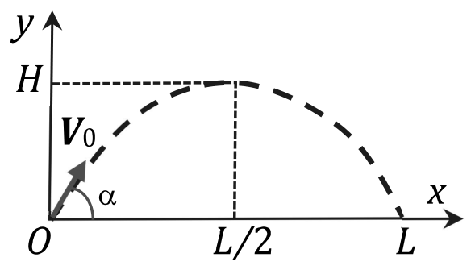
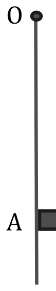

# TD 1–TD 2　量纲与不确定度

TD 1 — Dimensions et homogénéité · TD 2 — Mesures et incertitudes

CORRIGÉ · 参考解答

中法对照讲义 · 物理方法训练

!!! info "阅读说明"

    本页收录两份物理方法习题课：TD1 训练量纲分析与齐次性，TD2 训练测量、有效数字与不确定度。每题均附参考解答。

## TD 1　Dimensions et homogénéité en physique 物理中的量纲与齐次性

En mécanique et en électricité, les grandeurs fondamentales sont : le temps (\(t\)), la longueur (\(l\)), la masse (\(m\)), l'intensité de courant (\(I\)) et la température thermodynamique (\(\Theta\)). Dans le Système International (SI), les unités associées sont respectivement la seconde, le mètre, le kilogramme, l'ampère et le kelvin (s, m, kg, A, K).

在力学与电学中，基本物理量为：时间 (\(t\))、长度 (\(l\))、质量 (\(m\))、电流强度 (\(I\)) 和热力学温度 (\(\Theta\))。在国际单位制（SI）中，对应的单位依次是秒、米、千克、安培和开尔文（s、m、kg、A、K）。
{: .zh }

L'équation aux dimensions est une relation symbolique \([G]=[t]^{\alpha}[l]^{\beta}[m]^{\gamma}\dots\) qui relie une grandeur dérivée \(G\) aux grandeurs fondamentales.

量纲方程是一种符号关系，它把导出量 \(G\) 与基本量 \(t\)、\(l\)、\(m\) 等联系起来。
{: .zh }

### 1. Dimensions de quelques grandeurs physiques 若干物理量的量纲

Donner les équations aux dimensions des grandeurs suivantes : (a) vitesse, (b) accélération, (c) force, (d) travail, (e) puissance.

给出下列物理量的量纲方程：（a）速度，（b）加速度，（c）力，（d）功，（e）功率。
{: .zh }

!!! sol ""

    On part des relations de définition et on remplace chaque grandeur par sa dimension (M masse, L longueur, T temps) :

    从定义关系出发，把每个量换成它的量纲（M 质量、L 长度、T 时间）：
    {: .zh }

    \[
    [v]=\frac{\mathrm{L}}{\mathrm{T}}=\mathrm{L}\,\mathrm{T}^{-1},
    \qquad
    [a]=\frac{\mathrm{L}}{\mathrm{T}^2}=\mathrm{L}\,\mathrm{T}^{-2},
    \]

    \[
    [F]=[m][a]=\mathrm{M}\,\mathrm{L}\,\mathrm{T}^{-2},
    \qquad
    [W]=[F][l]=\mathrm{M}\,\mathrm{L}^2\,\mathrm{T}^{-2},
    \qquad
    [P]=\frac{[W]}{\mathrm{T}}=\mathrm{M}\,\mathrm{L}^2\,\mathrm{T}^{-3}.
    \]

    On retrouve les unités du SI : \(\mathrm{m\,s^{-1}}\), \(\mathrm{m\,s^{-2}}\), N = \(\mathrm{kg\,m\,s^{-2}}\), J = N·m, W = \(\mathrm{J\,s^{-1}}\).

    由此得到 SI 单位：\(\mathrm{m\,s^{-1}}\)、\(\mathrm{m\,s^{-2}}\)、N = \(\mathrm{kg\,m\,s^{-2}}\)、J = N·m、W = \(\mathrm{J\,s^{-1}}\)。
    {: .zh }

### 2. Dimension de grandeurs électriques 电学量的量纲

1. Donner la dimension d'une résistance (on pourra penser à la puissance dissipée par effet Joule).

    给出电阻的量纲（可以想一想焦耳效应所耗散的功率）。
    {: .zh }

1. En déduire la dimension d'une tension.

    由此推出电压的量纲。
    {: .zh }

!!! sol ""

    **(a)** La puissance dissipée par effet Joule dans un conducteur ohmique est \(P=RI^2\). On en tire

    **(a)** 欧姆导体中焦耳效应耗散的功率为 \(P=RI^2\)。由此得到
    {: .zh }

    \[
    [R]=\frac{[P]}{[I]^2}=\frac{\mathrm{M}\,\mathrm{L}^2\,\mathrm{T}^{-3}}{\mathrm{I}^2}
    =\mathrm{M}\,\mathrm{L}^2\,\mathrm{T}^{-3}\,\mathrm{I}^{-2}.
    \]

    **(b)** La loi d'Ohm s'écrit \(U=RI\), d'où

    **(b)** 欧姆定律为 \(U=RI\)，故
    {: .zh }

    \[
    [U]=[R][I]=\mathrm{M}\,\mathrm{L}^2\,\mathrm{T}^{-3}\,\mathrm{I}^{-1}.
    \]

    Vérification : \([U][I]=\mathrm{M}\,\mathrm{L}^2\,\mathrm{T}^{-3}=[P]\), ce qui est cohérent avec \(P=UI\).

    验证：\([U][I]=\mathrm{M}\,\mathrm{L}^2\,\mathrm{T}^{-3}=[P]\)，与 \(P=UI\) 相符。
    {: .zh }

### 3. Portée d'un projectile 抛射体的射程

En faisant l'analyse dimensionnelle et en examinant les résultats dans les cas \(\alpha=0\) et \(90^\circ\), trouver, parmi les trois relations suivantes, celle qui peut traduire la portée \(L\) d'un projectile lancé avec une vitesse initiale \(V_0\) sous un angle \(\alpha\) :

通过量纲分析，并考察 \(\alpha=0\) 与 \(90^\circ\) 两种情形下的结果，在下列三个关系中找出能够表示抛射体射程 \(L\) 的那一个；该抛射体以初速度 \(V_0\) 沿与水平方向成 \(\alpha\) 角的方向抛出：
{: .zh }

\[
\text{a)}\quad L=\frac{V_0\sin(2\alpha)}{g},\qquad
\text{b)}\quad L=\frac{V_0^2\sin(2\alpha)}{g},\qquad
\text{c)}\quad L=\frac{V_0^2\sin(\alpha)}{g}.
\]

!!! sol ""

    On calcule d'abord la dimension de chaque expression, sachant que \([V_0]=\mathrm{L}\,\mathrm{T}^{-1}\) et \([g]=\mathrm{L}\,\mathrm{T}^{-2}\) :

    先计算各表达式的量纲，已知 \([V_0]=\mathrm{L}\,\mathrm{T}^{-1}\)、\([g]=\mathrm{L}\,\mathrm{T}^{-2}\)：
    {: .zh }

    \[
    \left[\frac{V_0}{g}\right]=\frac{\mathrm{L}\,\mathrm{T}^{-1}}{\mathrm{L}\,\mathrm{T}^{-2}}=\mathrm{T},
    \qquad
    \left[\frac{V_0^2}{g}\right]=\frac{\mathrm{L}^2\,\mathrm{T}^{-2}}{\mathrm{L}\,\mathrm{T}^{-2}}=\mathrm{L}.
    \]

    La relation (a) donne un temps, pas une longueur : elle est éliminée. Les relations (b) et (c) sont toutes deux homogènes à une longueur. Pour \(\alpha=0\), les trois expressions s'annulent, ce qui ne permet pas de conclure. Pour \(\alpha=90^\circ\), \(\sin(2\alpha)=0\), donc (a) et (b) donnent \(L=0\), ce qui est correct, mais (c) donne \(L=\dfrac{V_0^2}{g}\neq0\), ce qui est absurde.

    关系 (a) 给出的是时间而不是长度：被排除。关系 (b) 与 (c) 的量纲都是长度。当 \(\alpha=0\) 时，三个表达式都为零，无法据此区分。当 \(\alpha=90^\circ\) 时，\(\sin(2\alpha)=0\)，故 (a)、(b) 给出 \(L=0\)（正确），而 (c) 给出 \(L=\dfrac{V_0^2}{g}\neq0\)，荒谬。
    {: .zh }

    Conclusion : seule la relation (b) est correcte.

    结论：只有关系 (b) 正确。
    {: .zh }

### 4. Période d'un pendule simple 单摆的周期

La période d'un pendule simple de masse \(m\) et de longueur \(l\) peut s'écrire

质量为 \(m\)、长度为 \(l\) 的单摆，其周期可以写成
{: .zh }

\[
[T]=2\pi\,[m]^{\alpha}[g]^{\beta}[l]^{\gamma}.
\]

En utilisant l'analyse dimensionnelle, calculer \(\alpha\), \(\beta\), \(\gamma\).

利用量纲分析，计算 \(\alpha\)、\(\beta\)、\(\gamma\)。
{: .zh }

!!! sol ""

    Écrivons l'équation aux dimensions, avec \([T]=\mathrm{T}\), \([m]=\mathrm{M}\), \([g]=\mathrm{L}\,\mathrm{T}^{-2}\) et \([l]=\mathrm{L}\) :

    写出量纲方程，其中 \([T]=\mathrm{T}\)、\([m]=\mathrm{M}\)、\([g]=\mathrm{L}\,\mathrm{T}^{-2}\)、\([l]=\mathrm{L}\)：
    {: .zh }

    \[
    \mathrm{T}=\mathrm{M}^{\alpha}\left(\mathrm{L}\,\mathrm{T}^{-2}\right)^{\beta}\mathrm{L}^{\gamma}
    =\mathrm{M}^{\alpha}\,\mathrm{L}^{\beta+\gamma}\,\mathrm{T}^{-2\beta}.
    \]

    Par identification des exposants : \(\alpha=0\), \(-2\beta=1\), \(\beta+\gamma=0\), d'où \(\alpha=0\), \(\beta=-\dfrac12\), \(\gamma=\dfrac12\), et

    比较指数得：\(\alpha=0\)、\(-2\beta=1\)、\(\beta+\gamma=0\)，故 \(\alpha=0\)、\(\beta=-\dfrac12\)、\(\gamma=\dfrac12\)，以及
    {: .zh }

    \[
    T=2\pi\sqrt{\frac{l}{g}}.
    \]

    La masse n'intervient pas (principe d'équivalence). Le calcul exact des petites oscillations redonne cette forme avec exactement \(C=2\pi\).

    质量不出现（等效原理）。小振动的精确计算正好给出这一形式，且常数 \(C=2\pi\)。
    {: .zh }

### 5.* Énergie d'une explosion atomique 原子弹爆炸的能量

La légende raconte que le physicien Taylor aurait pu en 1950, à l'aide d'un film et de l'analyse dimensionnelle, estimer l'énergie \(E\) dégagée par une explosion nucléaire.

传说物理学家泰勒（Taylor）在 1950 年借助一段胶片并运用量纲分析，就能估算出一次核爆炸所释放的能量 \(E\)。
{: .zh }

Le film permet d'accéder à l'évolution du rayon \(R(t)\) du « nuage » formé par l'explosion. Les quantités physiques influant sur ce rayon sont le temps \(t\), l'énergie \(E\) et la masse volumique \(\rho\) de l'air. Dimensionnellement,

影片使我们能够获得爆炸形成的「烟云」半径 \(R(t)\) 随时间的变化。影响该半径的物理量为时间 \(t\)、爆炸能量 \(E\) 以及空气的质量体密度 \(\rho\)。从量纲上看：
{: .zh }

\[
[R]=\mathrm{L}=[E]^{\alpha}[t]^{\beta}[\rho]^{\gamma}.
\]

Déterminer \(\alpha\), \(\beta\), \(\gamma\). On estime que \(R=70\) m après \(t=1\) ms, avec \(\rho=1\ \mathrm{kg\,m^{-3}}\). On obtient \(E\approx2\times10^{15}\) J, soit environ 40 kilotonnes de TNT (la valeur correcte est plutôt de l'ordre de la vingtaine de kilotonnes).

确定 \(\alpha\)、\(\beta\)、\(\gamma\)。根据影片估计，\(t=1\) ms 后半径 \(R=70\) m；又知 \(\rho=1\ \mathrm{kg\,m^{-3}}\)。由此得到 \(E\approx2\times10^{15}\) J，即约 40 千吨 TNT（正确值大约在二十千吨的量级）。
{: .zh }

!!! sol ""

    Avec \([E]=\mathrm{M}\,\mathrm{L}^2\,\mathrm{T}^{-2}\), \([t]=\mathrm{T}\) et \([\rho]=\mathrm{M}\,\mathrm{L}^{-3}\) :

    其中 \([E]=\mathrm{M}\,\mathrm{L}^2\,\mathrm{T}^{-2}\)、\([t]=\mathrm{T}\)、\([\rho]=\mathrm{M}\,\mathrm{L}^{-3}\)：
    {: .zh }

    \[
    \mathrm{L}=\mathrm{M}^{\alpha+\gamma}\,\mathrm{L}^{2\alpha-3\gamma}\,\mathrm{T}^{-2\alpha+\beta}.
    \]

    Par identification : \(\alpha+\gamma=0\), \(2\alpha-3\gamma=1\), \(-2\alpha+\beta=0\), d'où

    比较指数得：\(\alpha+\gamma=0\)、\(2\alpha-3\gamma=1\)、\(-2\alpha+\beta=0\)，故
    {: .zh }

    \[
    \alpha=\frac15,\qquad \beta=\frac25,\qquad \gamma=-\frac15,
    \qquad\text{soit}\qquad
    R=C\left(\frac{Et^2}{\rho}\right)^{1/5}.
    \]

    Numériquement, avec \(R=70\) m, \(t=1\) ms \(=10^{-3}\) s et \(\rho=1\ \mathrm{kg\,m^{-3}}\) :

    数值上，取 \(R=70\) m、\(t=1\) ms \(=10^{-3}\) s、\(\rho=1\ \mathrm{kg\,m^{-3}}\)：
    {: .zh }

    \[
    E\simeq\frac{\rho R^5}{t^2}=\frac{(70)^5}{(10^{-3})^2}\approx1{,}7\times10^{15}\ \mathrm{J}.
    \]

    **Remarque sur les unités.** Avec \(1\) kt de TNT \(=4{,}18\times10^{12}\) J, on obtient \(\approx4\times10^{2}\) kt, alors que l'énoncé annonce \(40\) kt (la valeur historique est \(\approx20\) kt). L'essentiel est l'ordre de grandeur \(E\sim10^{15}\) J, indépendant de cette conversion.

    **关于单位的注记。**取 1 千吨 TNT \(=4{,}18\times10^{12}\) J，得到约 \(4\times10^{2}\) 千吨，而题面给出 40 千吨（历史值约为 20 千吨）。要点是 \(E\sim10^{15}\) J 这一数量级，它不依赖于该换算。
    {: .zh }

### 6.* Équation de la trajectoire d'un projectile 抛射体的轨迹方程

On étudie le mouvement d'un projectile lancé depuis l'origine \(O\) avec une vitesse initiale \(V_0\) faisant un angle \(\alpha\) avec l'horizontale. Le projectile n'est soumis qu'à son poids et la trajectoire est décrite dans un repère cartésien par \(y=f(x)\).

研究一个从原点 \(O\) 抛出、初速度 \(V_0\) 与水平方向成 \(\alpha\) 角的抛射体的运动。抛射体只受自身重力，其轨迹在笛卡儿坐标系中由 \(y=f(x)\) 描述。
{: .zh }

1. Justifier par un raisonnement qualitatif que \(f(x)\) ne peut être ni une fonction linéaire, ni une fonction cubique.

    用定性推理说明 \(f(x)\) 既不能是一次函数，也不能是三次函数。
    {: .zh }

1. En supposant que la fonction est donnée sous forme \(y=a+bx+cx^2\), déterminer les dimensions de \(a\), \(b\), \(c\). Justifier que \(c\) doit être négatif.

    假设该函数以 \(y=a+bx+cx^2\) 的形式给出，确定常数 \(a\)、\(b\)、\(c\) 的量纲。并通过物理推理说明系数 \(c\) 必须为负。
    {: .zh }

1. Sachant que la portée et la hauteur maximale sont \(L=\dfrac{V_0^2\sin(2\alpha)}{g}\) et \(H=\dfrac{V_0^2\sin^2\alpha}{g}\), établir les expressions de \(a\), \(b\), \(c\) en fonction de \(V_0\) et \(\alpha\).

    已知射程和最大高度分别由 \(L=\dfrac{V_0^2\sin(2\alpha)}{g}\) 与 \(H=\dfrac{V_0^2\sin^2\alpha}{g}\) 给出，建立 \(a\)、\(b\)、\(c\) 作为 \(V_0\) 与 \(\alpha\) 的函数的表达式。
    {: .zh }

!!! sol ""

    **(a)** Le projectile n'est soumis qu'à son poids : son accélération est constante, verticale et dirigée vers le bas. La trajectoire est donc une parabole. Une fonction linéaire correspondrait à un mouvement rectiligne uniforme (accélération nulle) ; une fonction cubique donnerait une accélération variant avec \(x\), incompatible avec un poids constant.

    **(a)** 抛射体只受重力：加速度恒定、竖直向下。因此轨迹是抛物线。一次函数对应匀速直线运动（加速度为零）；三次函数则意味着加速度随 \(x\) 变化，与恒定重力不符。
    {: .zh }

    **(b)** Comme \(y\), \(a\) et \(x\) sont des longueurs, \([a]=\mathrm{L}\), \([b]=1\) (sans dimension) et \([c]=\mathrm{L}^{-1}\). Le coefficient \(c\) est négatif car la parabole est concave vers le bas : \(y''=2c<0\).

    **(b)** 由于 \(y\)、\(a\)、\(x\) 都是长度，故 \([a]=\mathrm{L}\)，\([b]=1\)（无量纲），\([c]=\mathrm{L}^{-1}\)。系数 \(c\) 为负，因为抛物线开口向下：\(y''=2c<0\)。
    {: .zh }

    **(c)** La trajectoire passe par \(O\) : \(a=0\). La pente initiale vaut \(b=\tan\alpha\). La portée \(L\) est l'abscisse où \(y\) s'annule de nouveau :

    **(c)** 轨迹经过 \(O\)：\(a=0\)。初始斜率为 \(b=\tan\alpha\)。射程 \(L\) 是 \(y\) 再次为零的横坐标：
    {: .zh }

    \[
    0=bL+cL^2\quad\Longrightarrow\quad c=-\frac{b}{L}=-\frac{\tan\alpha}{L}.
    \]

    Avec \(L=\dfrac{V_0^2\sin2\alpha}{g}=\dfrac{2V_0^2\sin\alpha\cos\alpha}{g}\) :

    代入 \(L=\dfrac{V_0^2\sin2\alpha}{g}=\dfrac{2V_0^2\sin\alpha\cos\alpha}{g}\)：
    {: .zh }

    \[
    c=-\frac{\sin\alpha}{\cos\alpha}\cdot\frac{g}{2V_0^2\sin\alpha\cos\alpha}
    =-\frac{g}{2V_0^2\cos^2\alpha}.
    \]

    **Remarque.** L'énoncé donne \(H=\dfrac{V_0^2\sin^2\alpha}{g}\), qui est le double de la valeur exacte : il manque un facteur \(\dfrac12\).

    **注记。**题面给出 \(H=\dfrac{V_0^2\sin^2\alpha}{g}\)，它是精确值的两倍——漏掉了因子 \(\dfrac12\)。
    {: .zh }

## TD 2　Mesures et incertitudes 测量与不确定度

### 1. Masses de différents ordres de grandeur 不同数量级的质量

Exprimer chacune des masses suivantes en grammes sous forme décimale avec le bon nombre de chiffres significatifs : (a) \(1{,}00\ \mu\mathrm{g}\), (b) \(0{,}001\ \mathrm{ng}\), (c) \(100{,}0\ \mathrm{mg}\), (d) \(10\,000\ \mu\mathrm{g}\), (e) \(10{,}000\ \mathrm{kg}\).

把下列各质量用克表示成十进制形式，并保留正确的有效数字位数：（a）\(1{,}00\ \mu\mathrm{g}\)，（b）\(0{,}001\ \mathrm{ng}\)，（c）\(100{,}0\ \mathrm{mg}\)，（d）\(10\,000\ \mu\mathrm{g}\)，（e）\(10{,}000\ \mathrm{kg}\)。
{: .zh }

!!! sol ""

    \[
    \begin{aligned}
    \text{(a)}\quad &1{,}00\ \mu\mathrm{g}=1{,}00\cdot10^{-6}\ \mathrm{g}=0{,}00000100\ \mathrm{g},\\
    \text{(b)}\quad &0{,}001\ \mathrm{ng}=1\cdot10^{-12}\ \mathrm{g}=0{,}000000000001\ \mathrm{g},\\
    \text{(c)}\quad &100{,}0\ \mathrm{mg}=100{,}0\cdot10^{-3}\ \mathrm{g}=0{,}1000\ \mathrm{g},\\
    \text{(d)}\quad &10\,000\ \mu\mathrm{g}=10\,000\cdot10^{-6}\ \mathrm{g}=0{,}01\ \mathrm{g},\\
    \text{(e)}\quad &10{,}000\ \mathrm{kg}=10{,}000\cdot10^{3}\ \mathrm{g}=10\,000\ \mathrm{g}.
    \end{aligned}
    \]

    Les nombres de chiffres significatifs sont respectivement 3, 1, 4, 1 et 5. Pour (e), on peut écrire \(1{,}0000\cdot10^4\) g pour lever l'ambiguïté des zéros terminaux.

    有效数字位数依次为 3、1、4、1、5。对 (e)，可写成 \(1{,}0000\cdot10^4\) g，以消除末尾零的歧义。
    {: .zh }

### 2. Somme des quantités de précisions différentes 不同精度量之和

Calculer la somme des quantités suivantes : \(0{,}066\) m, \(1{,}132\) m, \(200{,}1\) m, \(5{,}3\) m et \(1600{,}22\) m.

计算下列各量之和：\(0{,}066\) m、\(1{,}132\) m、\(200{,}1\) m、\(5{,}3\) m 和 \(1600{,}22\) m。
{: .zh }

!!! sol ""

    \[
    0{,}066+1{,}132+200{,}1+5{,}3+1600{,}22=1806{,}818\ \mathrm{m}.
    \]

    La donnée la moins précise (200,1 et 5,3) est connue au dixième de mètre : le résultat doit être arrondi au dixième, soit \(1806{,}8\) m.

    精度最低的数据（200,1 与 5,3）只精确到 0,1 m：结果应保留到十分位，即 \(1806{,}8\) m。
    {: .zh }

### 3. Produit des quantités de précisions différentes 不同精度量之积

Quel est le produit des trois quantités suivantes : \(0{,}0021\) g, \(655{,}1\) kg et \(4{,}41\ \mu\mathrm{g}\) ?

下列三个量的乘积是多少：\(0{,}0021\) g、\(655{,}1\) kg 和 \(4{,}41\ \mu\mathrm{g}\)？
{: .zh }

!!! sol ""

    On convertit tout en grammes : \(655{,}1\) kg \(=6{,}551\cdot10^{5}\) g et \(4{,}41\ \mu\mathrm{g}=4{,}41\cdot10^{-6}\) g. Le produit vaut

    全部换算为克：\(655{,}1\) kg \(=6{,}551\cdot10^{5}\) g，\(4{,}41\ \mu\mathrm{g}=4{,}41\cdot10^{-6}\) g。乘积为
    {: .zh }

    \[
    0{,}0021\times6{,}551\cdot10^{5}\times4{,}41\cdot10^{-6}
    \approx6{,}07\cdot10^{-3}\ \mathrm{g}^3.
    \]

    Le facteur le moins précis, \(0{,}0021\), n'a que deux chiffres significatifs : on arrondit à \(6{,}1\cdot10^{-3}\ \mathrm{g}^3\).

    精度最低的因子 \(0{,}0021\) 只有两位有效数字：结果保留两位有效数字，得 \(6{,}1\cdot10^{-3}\ \mathrm{g}^3\)。
    {: .zh }

### 4. Mesure de la constante de gravitation par un objet en chute libre 用自由落体的物体测量引力常数

On installe un détecteur en \(A\) au-dessous du point \(O\). On lâche un objet de \(O\) et on mesure le temps auquel l'objet passe par le détecteur. Une série de mesures est effectuée pour différentes positions \(z_A\) de \(A\). L'incertitude de \(z_A\) est de 0,1 cm et celle de \(t_A\) est de 0,001 s. On peut déterminer \(g\) par deux méthodes.

在 \(O\) 点下方 \(A\) 处安装一个探测器。从 \(O\) 点释放一个物体，并测量物体经过探测器的时刻。对 \(A\) 的不同位置 \(z_A\) 进行一系列测量。\(z_A\) 的不确定度为 0,1 cm，\(t_A\) 的不确定度为 0,001 s。可以用以下两种方法确定 \(g\)。
{: .zh }

Tableau 1 — Résultats de mesure 表 1：测量结果

| N° | \(z_A\) (cm) | \(t_A\) (s) | \(t_A^2\) (s\(^2\)) |
|---|---|---|---|
| 1 | 20,0 | 0,202 | 0,0408 |
| 2 | 30,0 | 0,247 | 0,0610 |
| 3 | 40,0 | 0,286 | 0,0818 |
| 4 | 50,0 | 0,319 | 0,1018 |
| 5 | 60,0 | 0,350 | 0,1225 |

**A. Par les données d'une seule mesure :** effectuer le calcul pour déterminer \(g\) en utilisant les données de \(z_A\) minimal et maximal. Étudier l'incertitude des résultats et commenter.

**A. 用单次测量的数据：**利用 \(z_A\) 最小和最大的两组数据进行计算，确定 \(g\)。研究结果的不确定度并加以评论。
{: .zh }

**B.* Par la régression linéaire :** tracer \(z_A=f(t_A^2)\) ou utiliser un outil informatique, calculer la pente, puis en déduire \(g\).

**B.* 用线性回归：**画出 \(z_A=f(t_A^2)\) 的直线，或使用计算工具，计算斜率，并由此推出 \(g\)。
{: .zh }

!!! sol ""

    **A.** La chute est libre : \(z_A=\dfrac12gt_A^2\), donc \(g=\dfrac{2z_A}{t_A^2}\).

    **A.** 自由落体：\(z_A=\dfrac12gt_A^2\)，故 \(g=\dfrac{2z_A}{t_A^2}\)。
    {: .zh }

    Pour \(z_A=20{,}0\) cm \(=0{,}200\) m et \(t_A^2=0{,}0408\ \mathrm{s^2}\) :

    对 \(z_A=20{,}0\) cm \(=0{,}200\) m、\(t_A^2=0{,}0408\ \mathrm{s^2}\)：
    {: .zh }

    \[
    g=\frac{2\times0{,}200}{0{,}0408}=9{,}80\ \mathrm{m\,s^{-2}}.
    \]

    Pour \(z_A=60{,}0\) cm \(=0{,}600\) m et \(t_A^2=0{,}1225\ \mathrm{s^2}\) :

    对 \(z_A=60{,}0\) cm \(=0{,}600\) m、\(t_A^2=0{,}1225\ \mathrm{s^2}\)：
    {: .zh }

    \[
    g=\frac{2\times0{,}600}{0{,}1225}=9{,}80\ \mathrm{m\,s^{-2}}.
    \]

    **Incertitudes.** Pour la première mesure :

    **不确定度。**对第一次测量：
    {: .zh }

    \[
    \frac{\Delta z}{z}=\frac{0{,}1}{20}=0{,}5\%,
    \qquad
    \frac{\Delta(t^2)}{t^2}=2\frac{\Delta t}{t}=2\frac{0{,}001}{0{,}202}\approx1{,}0\%.
    \]

    Pour la seconde :

    对第二次测量：
    {: .zh }

    \[
    \frac{\Delta z}{z}=\frac{0{,}1}{60}\approx0{,}17\%,
    \qquad
    \frac{\Delta(t^2)}{t^2}=2\frac{0{,}001}{0{,}350}\approx0{,}57\%.
    \]

    En ajoutant les contributions (majoration) : \(\Delta g/g\approx1{,}5\%\) puis \(0{,}74\%\), soit

    把各项贡献相加（取上界）：\(\Delta g/g\approx1{,}5\%\) 与 \(0{,}74\%\)，即
    {: .zh }

    \[
    g=9{,}80\pm0{,}15\ \mathrm{m\,s^{-2}},
    \qquad
    g=9{,}80\pm0{,}07\ \mathrm{m\,s^{-2}}.
    \]

    Les deux valeurs sont compatibles avec \(9{,}81\ \mathrm{m\,s^{-2}}\). La mesure à \(z_A=60\) cm est plus précise : le temps de chute est plus long, donc l'incertitude relative de chronométrage plus faible.

    两个值都与 \(9{,}81\ \mathrm{m\,s^{-2}}\) 相容。\(z_A=60\) cm 的测量更精确：下落时间更长，计时的相对不确定度更小。
    {: .zh }

    **B.** En traçant \(z_A\) en fonction de \(t_A^2\), on obtient une droite passant par l'origine, de pente \(p=g/2\). La régression linéaire sur les cinq points donne \(p\approx4{,}90\ \mathrm{m\,s^{-2}}\), soit \(g=2p\approx9{,}79\ \mathrm{m\,s^{-2}}\). Cette valeur est cohérente avec la méthode A et avec la valeur tabulée \(9{,}81\ \mathrm{m\,s^{-2}}\).

    **B.** 以 \(z_A\) 对 \(t_A^2\) 作图，得到一条过原点的直线，斜率为 \(p=g/2\)。对五个点作线性回归得 \(p\approx4{,}90\ \mathrm{m\,s^{-2}}\)，故 \(g=2p\approx9{,}79\ \mathrm{m\,s^{-2}}\)。该值与 A 法及表列值 \(9{,}81\ \mathrm{m\,s^{-2}}\) 一致。
    {: .zh }
