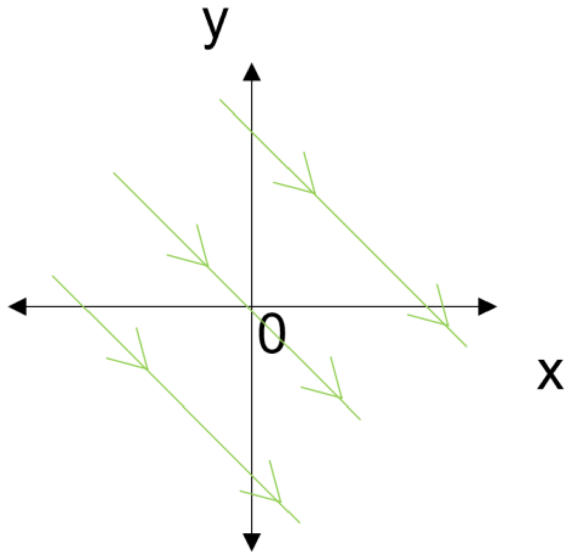
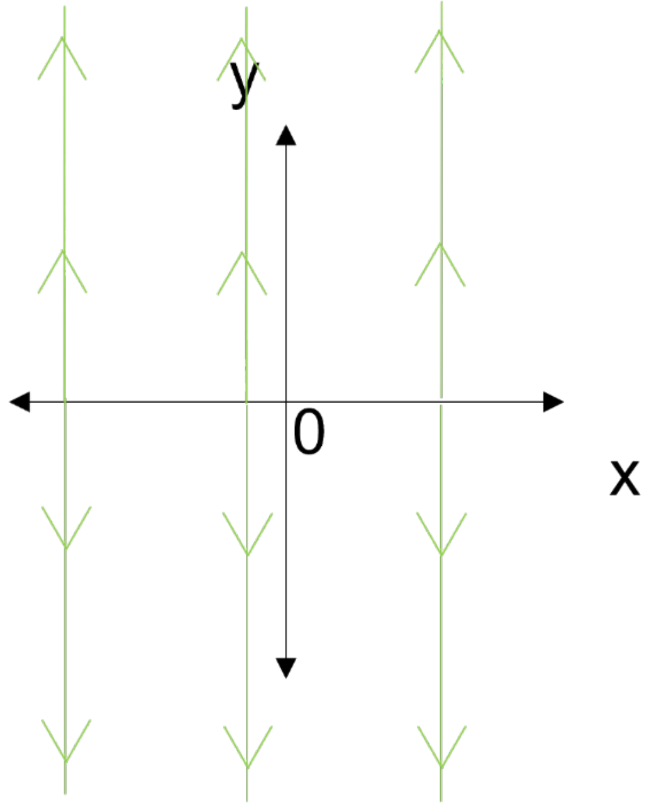
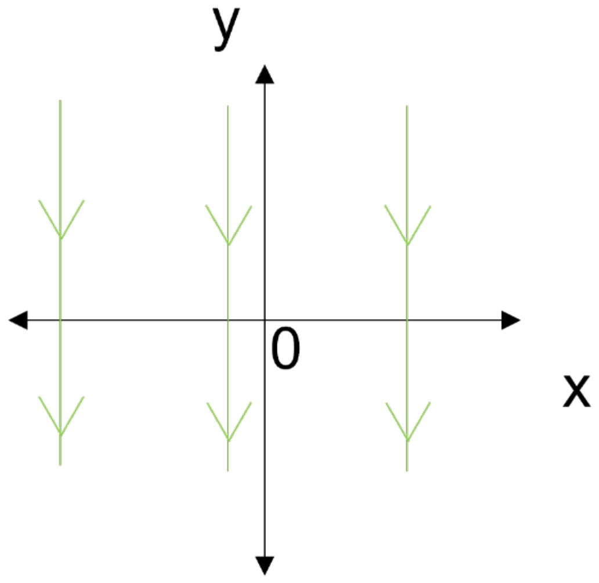
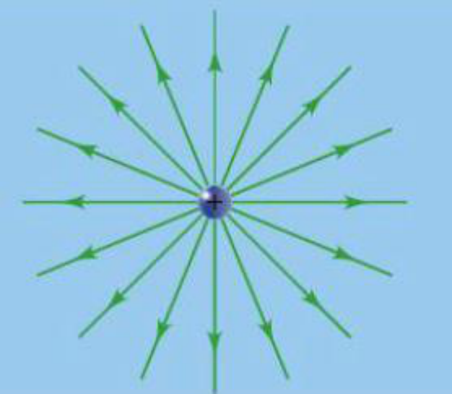
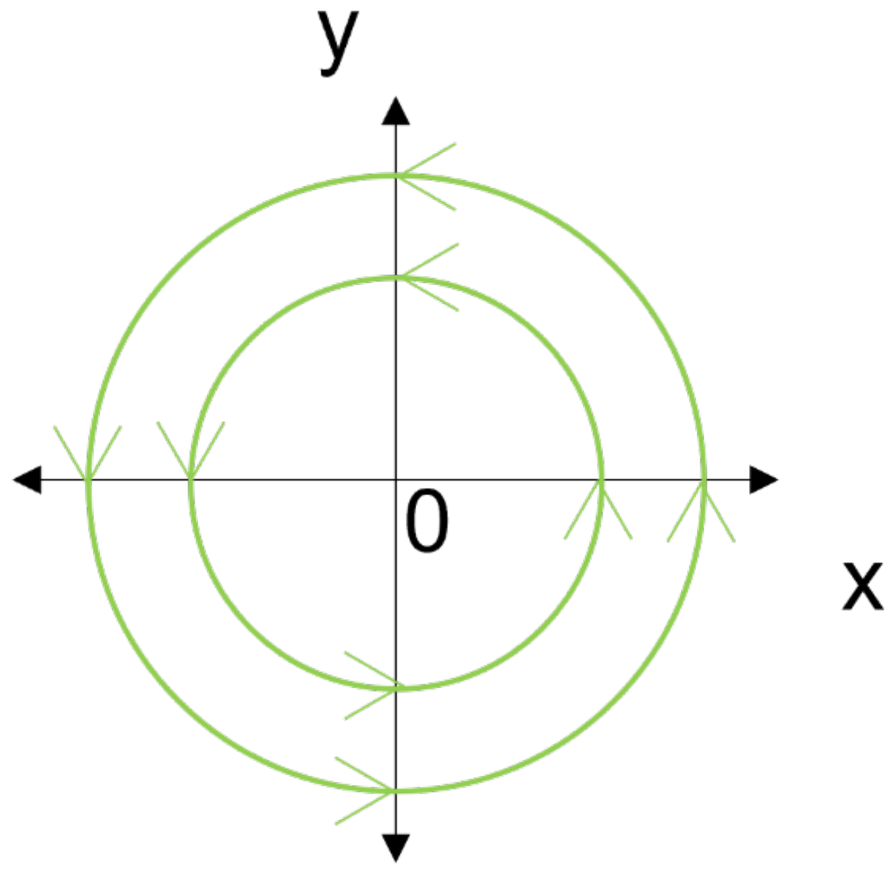
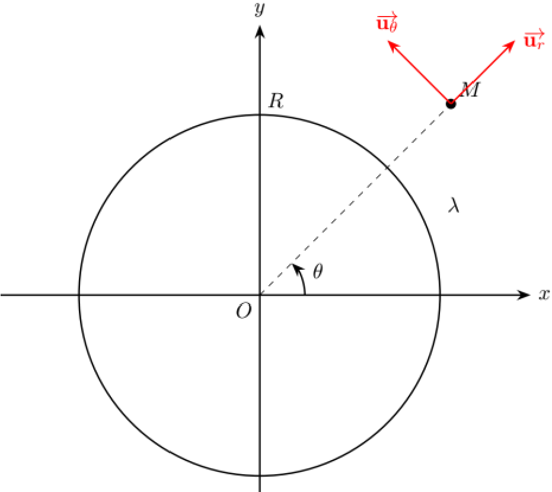
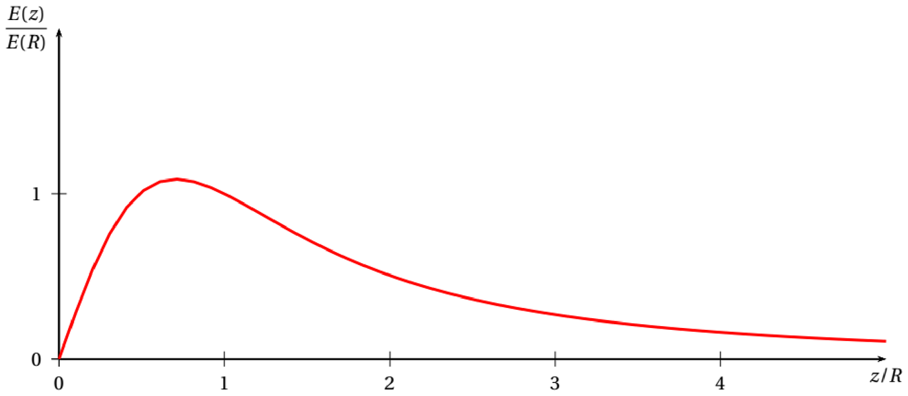
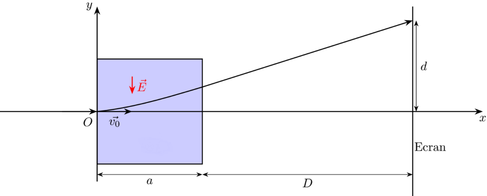
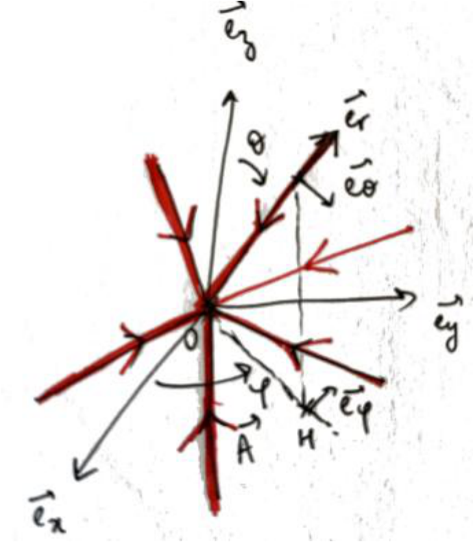
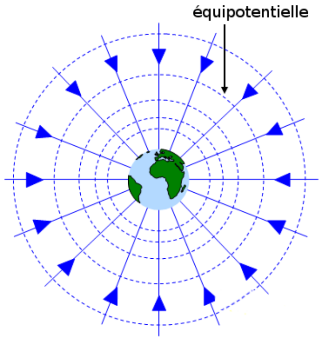

# TD1 详细解答　库仑力与静电场

Correction détaillée du TD1 — Force de Coulomb et champ électrostatique

CORRIGÉ DÉTAILLÉ · 详细解答

中法对照讲义 · 静电学部分

!!! info "阅读说明"

    本页是 TD1 的详细解答版：每道练习都给出完整的推理步骤、公式与示意图。法语原文与中文翻译逐段对照。

## Exercice 1 : Lignes de champ 练习 1：场线

Tracez dans le plan \(z=0\) les lignes de champ des champs suivants donnés en coordonnées cartésiennes :

在平面 \(z=0\) 内，画出下列以笛卡儿坐标给出的场的场线：
{: .zh }

### (a) Champ constant à deux composantes 常矢量场

Champ étudié : \(\vec{A}=A_0\vec{e}_x-A_0\vec{e}_y\), avec \(A_0>0\).

所研究的场：\(\vec{A}=A_0\vec{e}_x-A_0\vec{e}_y\)，其中 \(A_0>0\)。
{: .zh }

On résout d'abord \(\vec{A}\wedge\mathrm{d}\overrightarrow{OM}=\vec{0}\) pour trouver la direction des lignes de champ :

首先解 \(\vec{A}\wedge\mathrm{d}\overrightarrow{OM}=\vec{0}\)，以求出场线的方向：
{: .zh }

\[
(A_0\vec{e}_x-A_0\vec{e}_y)\wedge(\mathrm{d}x\,\vec{e}_x+\mathrm{d}y\,\vec{e}_y)=\vec{0}
\quad\Longrightarrow\quad
A_0(\mathrm{d}y+\mathrm{d}x)\vec{e}_z=\vec{0},
\]

donc \(\mathrm{d}y+\mathrm{d}x=0\). Ce sont des droites d'équation \(y=-x+x_0\), avec \(x_0\) une constante ; chaque ligne de champ correspond à une valeur différente de \(x_0\).

因此 \(\mathrm{d}y+\mathrm{d}x=0\)。场线是方程为 \(y=-x+x_0\) 的直线，其中 \(x_0\) 为常数；每条场线对应一个不同的 \(x_0\) 值。
{: .zh }

On cherche le sens des lignes de champ avec \(\vec{A}\cdot\mathrm{d}\overrightarrow{OM}>0\) :

再用 \(\vec{A}\cdot\mathrm{d}\overrightarrow{OM}>0\) 确定场线的指向，即：
{: .zh }

\[
(A_0\vec{e}_x-A_0\vec{e}_y)\cdot(\mathrm{d}x\,\vec{e}_x+\mathrm{d}y\,\vec{e}_y)>0
\quad\Longrightarrow\quad
A_0(\mathrm{d}x-\mathrm{d}y)>0.
\]

Comme \(\mathrm{d}y=-\mathrm{d}x\), on obtient \(2\,\mathrm{d}x>0\). Les lignes de champ sont donc orientées suivant les valeurs de \(x\) croissantes.

由于 \(\mathrm{d}y=-\mathrm{d}x\)，得到 \(2\,\mathrm{d}x>0\)。因此场线沿 \(x\) 增大的方向取向。
{: .zh }

### (b) Champ selon l'axe y 沿 y 轴的场

Champ étudié : \(\vec{B}=yB_0\vec{e}_y\), avec \(B_0>0\).

所研究的场：\(\vec{B}=yB_0\vec{e}_y\)，其中 \(B_0>0\)。
{: .zh }

On résout \(\vec{B}\wedge\mathrm{d}\overrightarrow{OM}=\vec{0}\) :

解 \(\vec{B}\wedge\mathrm{d}\overrightarrow{OM}=\vec{0}\)：
{: .zh }

\[
(yB_0\vec{e}_y)\wedge(\mathrm{d}x\,\vec{e}_x+\mathrm{d}y\,\vec{e}_y)=\vec{0}
\quad\Longrightarrow\quad
-yB_0\,\mathrm{d}x\,\vec{e}_z=\vec{0}.
\]

Donc, pour \(y\neq0\), on a \(\mathrm{d}x=0\) : ce sont des demi-droites d'équation \(x=x_0\). On cherche le sens avec \(\vec{B}\cdot\mathrm{d}\overrightarrow{OM}>0\) :

因此当 \(y\neq0\) 时有 \(\mathrm{d}x=0\)：场线是方程为 \(x=x_0\) 的半射线。再用 \(\vec{B}\cdot\mathrm{d}\overrightarrow{OM}>0\) 确定指向：
{: .zh }

\[
yB_0\,\mathrm{d}y>0
\quad\Longrightarrow\quad
\begin{cases}
\mathrm{d}y>0 & \text{pour } y>0,\\
\mathrm{d}y<0 & \text{pour } y<0.
\end{cases}
\]

Les lignes sont donc orientées vers les \(y\) croissants pour \(y>0\), et vers les \(y\) décroissants pour \(y<0\).

因此场线在 \(y>0\) 时沿 \(y\) 增大方向取向，在 \(y<0\) 时沿 \(y\) 减小方向取向。
{: .zh }

### (c) Champ selon l'axe y, fonction continue 沿 y 轴的连续函数场

Champ étudié : \(\vec{C}=f(x)\vec{e}_y\), avec \(f\) continue, ne s'annulant pas, et \(f(5)=-2\).

所研究的场：\(\vec{C}=f(x)\vec{e}_y\)，其中 \(f\) 连续、不为零，且 \(f(5)=-2\)。
{: .zh }

On résout \(\vec{C}\wedge\mathrm{d}\overrightarrow{OM}=\vec{0}\) :

解 \(\vec{C}\wedge\mathrm{d}\overrightarrow{OM}=\vec{0}\)：
{: .zh }

\[
(f(x)\vec{e}_y)\wedge(\mathrm{d}x\,\vec{e}_x+\mathrm{d}y\,\vec{e}_y)=\vec{0}
\quad\Longrightarrow\quad
f(x)\,\mathrm{d}x\,(-\vec{e}_z)=\vec{0}.
\]

Comme \(f(x)\neq0\), on a \(\mathrm{d}x=0\) : ce sont des droites \(x=x_0\). Pour le sens, \(\vec{C}\cdot\mathrm{d}\overrightarrow{OM}=f(x)\,\mathrm{d}y>0\). Or \(f\) est continue et ne s'annule pas : elle garde le signe de \(f(5)=-2\), donc \(f(x)<0\) pour tout \(x\). Ainsi \(\mathrm{d}y<0\) : les lignes sont orientées vers les \(y\) décroissants.

由于 \(f(x)\neq0\)，故 \(\mathrm{d}x=0\)：场线是直线 \(x=x_0\)。至于指向，\(\vec{C}\cdot\mathrm{d}\overrightarrow{OM}=f(x)\,\mathrm{d}y>0\)。由于 \(f\) 连续且不为零，它保持 \(f(5)=-2\) 的符号，故对一切 \(x\) 有 \(f(x)<0\)。因此 \(\mathrm{d}y<0\)：场线沿 \(y\) 减小的方向取向。
{: .zh }

### (d) Champ radial 径向场

Champ étudié : \(\vec{D}=\dfrac{k}{(x^2+y^2)^{3/2}}\,(x\vec{e}_x+y\vec{e}_y)\), avec \(k>0\).

所研究的场：\(\vec{D}=\dfrac{k}{(x^2+y^2)^{3/2}}\,(x\vec{e}_x+y\vec{e}_y)\)，其中 \(k>0\)。
{: .zh }

On peut simplifier le problème en se plaçant en coordonnées cylindriques :

可以改用柱坐标来简化问题：
{: .zh }

\[
\vec{D}=\frac{k}{(r^2)^{3/2}}(r\vec{e}_r)=\frac{k}{r^2}\vec{e}_r.
\]

On reconnaît la forme du champ électrique associé à une charge positive dans le plan \(z=0\) (ce n'est plus vrai pour d'autres plans). On résout \(\vec{D}\wedge\mathrm{d}\overrightarrow{OM}=\vec{0}\) :

这里可以辨认出这是 \(z=0\) 平面内正电荷所产生电场的形状（对其他平面则不再成立）。解 \(\vec{D}\wedge\mathrm{d}\overrightarrow{OM}=\vec{0}\)：
{: .zh }

\[
\frac{k}{r^2}\vec{e}_r\wedge(\mathrm{d}r\,\vec{e}_r+r\,\mathrm{d}\theta\,\vec{e}_\theta+\mathrm{d}z\,\vec{e}_z)=\vec{0}
\quad\Longrightarrow\quad
k\left(\frac{\mathrm{d}\theta}{r}\vec{e}_z-\frac{\mathrm{d}z}{r^2}\vec{e}_r\right)=\vec{0}.
\]

Donc \(\mathrm{d}\theta=0\) et \(\mathrm{d}z=0\) : seules les lignes où \(r\) varie. Pour le sens, \(\vec{D}\cdot\mathrm{d}\overrightarrow{OM}=\dfrac{k}{r^2}\mathrm{d}r>0\), donc \(\mathrm{d}r>0\) : les lignes sont orientées du centre vers l'extérieur.

因此 \(\mathrm{d}\theta=0\) 且 \(\mathrm{d}z=0\)：只有 \(r\) 变化的场线。至于指向，\(\vec{D}\cdot\mathrm{d}\overrightarrow{OM}=\dfrac{k}{r^2}\mathrm{d}r>0\)，故 \(\mathrm{d}r>0\)：场线由中心指向外部。
{: .zh }

### (e) Champ orthoradial 角向场

Champ étudié : \(\vec{E}=\dfrac{k}{\sqrt{x^2+y^2}}\,(-y\vec{e}_x+x\vec{e}_y)\), avec \(k>0\).

所研究的场：\(\vec{E}=\dfrac{k}{\sqrt{x^2+y^2}}\,(-y\vec{e}_x+x\vec{e}_y)\)，其中 \(k>0\)。
{: .zh }

On se place en coordonnées cylindriques. On rappelle que

改用柱坐标。回顾：
{: .zh }

\[
\vec{e}_\theta=-\sin\theta\,\vec{e}_x+\cos\theta\,\vec{e}_y,
\qquad
x=r\cos\theta,\qquad y=r\sin\theta,
\]

donc

因此：
{: .zh }

\[
\vec{e}_\theta=-\frac{y}{r}\vec{e}_x+\frac{x}{r}\vec{e}_y,
\qquad
\vec{E}=\frac{k}{r}\,r\vec{e}_\theta=k\vec{e}_\theta.
\]

On résout \(\vec{E}\wedge\mathrm{d}\overrightarrow{OM}=\vec{0}\) :

解 \(\vec{E}\wedge\mathrm{d}\overrightarrow{OM}=\vec{0}\)：
{: .zh }

\[
k\vec{e}_\theta\wedge(\mathrm{d}r\,\vec{e}_r+r\,\mathrm{d}\theta\,\vec{e}_\theta+\mathrm{d}z\,\vec{e}_z)=\vec{0}
\quad\Longrightarrow\quad
k(-\mathrm{d}r\,\vec{e}_z+\mathrm{d}z\,\vec{e}_r)=\vec{0}.
\]

Donc \(\mathrm{d}r=0\) et \(\mathrm{d}z=0\) : seules les lignes où \(\theta\) varie, c'est-à-dire des cercles. Pour le sens, \(\vec{E}\cdot\mathrm{d}\overrightarrow{OM}=k\,\mathrm{d}\theta>0\), donc \(\mathrm{d}\theta>0\) : les cercles sont parcourus dans le sens trigonométrique.

因此 \(\mathrm{d}r=0\) 且 \(\mathrm{d}z=0\)：只有 \(\theta\) 变化的场线，即圆。至于指向，\(\vec{E}\cdot\mathrm{d}\overrightarrow{OM}=k\,\mathrm{d}\theta>0\)，故 \(\mathrm{d}\theta>0\)：圆周沿逆时针方向绕行。
{: .zh }

!!! warning "Vocabulaire clé &nbsp;&nbsp; 重点词汇 练习 1 核心术语"

    - <strong>ligne de champ</strong>：场线
    - <strong>direction / sens</strong>：方向 / 指向
    - <strong>être orienté suivant</strong>：沿……方向取向
    - <strong>constante strictement positive</strong>：严格正的常数
    - <strong>demi-droite</strong>：射线（半直线）
    - <strong>ne pas s'annuler</strong>：不为零
    - <strong>théorème des valeurs intermédiaires</strong>：介值定理
    - <strong>coordonnées cylindriques</strong>：柱坐标
    - <strong>sens trigonométrique</strong>：逆时针方向

## Exercice 2 : Cerceau avec charge linéique 练习 2：带线电荷的圆环

On considère une distribution linéique de charge, de densité \(\lambda\), uniforme sur le cercle de centre \(O\), d'axe \(Oz\) et de rayon \(R\).

考虑一个线电荷分布：线密度为 \(\lambda\)，均匀分布在以 \(O\) 为圆心、\(Oz\) 为轴、半径为 \(R\) 的圆周上。
{: .zh }

**1.** Déterminer l'expression du champ électrostatique en un point \(M\) de l'axe \(Oz\).

**1.** 求 \(Oz\) 轴上任一点 \(M\) 处的静电场表达式。
{: .zh }

On se place en coordonnées cylindriques pour repérer le point \(M(0,0,z)\).

采用柱坐标来确定点 \(M(0,0,z)\) 的位置。
{: .zh }

On a

有
{: .zh }

\[
\vec{E}(M)=\oint_{\text{cerceau}}\frac{\lambda\,\mathrm{d}l}{4\pi\varepsilon_0 PM^2}\,\vec{u},
\]

où \(\vec{u}\) est le vecteur unitaire dirigé du point source vers \(M\). En ajoutant le champ créé par un élément en \(\theta\) et celui créé par l'élément en \(-\theta\), on obtient un champ suivant \(\vec{u}_z\). Par symétrie de la distribution, le champ total est donc porté par \(\vec{u}_z\) :

其中 \(\vec{u}\) 为由源点指向 \(M\) 的单位向量。将圆环上位于 \(\theta\) 的微元与位于 \(-\theta\) 的微元所产生的电场相加，得到沿 \(\vec{u}_z\) 方向的电场。由电荷分布的对称性可推知，总电场沿 \(\vec{u}_z\) 方向：
{: .zh }

\[
\vec{E}(M)=E(z)\,\vec{u}_z.
\]

On calcule \(E(z)\) :

计算 \(E(z)\)：
{: .zh }

\[
E(z)=\oint_{\text{cerceau}}\frac{\lambda\,\mathrm{d}l}{4\pi\varepsilon_0 PM^2}\,\vec{u}\cdot\vec{u}_z
=\oint_{\text{cerceau}}\frac{\lambda\,\mathrm{d}l}{4\pi\varepsilon_0 PM^3}\,\overrightarrow{PM}\cdot\vec{u}_z
=\int_{\theta=0}^{2\pi}\frac{\lambda R\,\mathrm{d}\theta}{4\pi\varepsilon_0(R^2+z^2)^{3/2}}\,z,
\]

d'où

于是
{: .zh }

\[
E(z)=\frac{\lambda R}{2\varepsilon_0(R^2+z^2)^{3/2}}\,z.
\]

**2.** Représenter l'allure de ce champ.

**2.** 画出该场的变化趋势。
{: .zh }

On étudie les cas limites. Pour \(z\ll R\) :

研究极限情形。当 \(z\ll R\) 时：
{: .zh }

\[
E(z)\approx\frac{\lambda R}{2\varepsilon_0(R^2)^{3/2}}\,z
=\frac{\lambda}{2\varepsilon_0R^2}\,z,
\]

donc \(E\) converge vers une fonction linéaire à mesure que \(z\) se rapproche de \(0\). Pour \(z\gg R\) :

因此当 \(z\ll R\) 时，随着 \(z\) 趋近于 \(0\)，\(E\) 趋于一个线性函数。当 \(z\gg R\) 时：
{: .zh }

\[
E(z)\approx\frac{\lambda R}{2\varepsilon_0(z^2)^{3/2}}\,z
=\frac{\lambda}{2\varepsilon_0z},
\]

donc \(E\) se rapproche d'une fonction inverse quand \(z\) tend vers l'infini.

因此当 \(z\) 趋于无穷时，\(E\) 趋近一个反比函数。
{: .zh }

On représente l'allure du champ en fonction de la position sur l'axe \(z\). Le champ est nul en \(z=0\), conformément à l'attente : on se trouve dans le plan du cerceau et la résultante due aux forces de Coulomb est nulle par symétrie.

画出场随 \(z\) 轴位置变化的趋势。正如预期，\(z=0\) 处场为零：此时位于圆环所在平面内，由对称性，库仑力产生的合力为零。
{: .zh }

!!! warning "Vocabulaire clé &nbsp;&nbsp; 重点词汇 练习 2 核心术语"

    - <strong>cerceau</strong>：圆环
    - <strong>distribution linéique de charge</strong>：线电荷分布
    - <strong>densité linéique</strong>：线密度
    - <strong>plan de symétrie</strong>：对称平面
    - <strong>élément du cerceau</strong>：圆环微元
    - <strong>cas limite</strong>：极限情形
    - <strong>allure</strong>：形状、变化趋势
    - <strong>résultante</strong>：合力
    - <strong>tendre vers l'infini</strong>：趋于无穷

## Exercice 3 : Mouvement d'une particule dans un champ électrique constant 练习 3：带电粒子在恒定电场中的运动

Un faisceau d'électrons de masse \(m\) et de charge \(q=-e\) possède initialement une vitesse \(\vec{v}_0=v_0\,\vec{e}_x\). Le faisceau pénètre dans une zone située entre \(x=0\) et \(x=a\) dans laquelle règne un champ électrique \(\vec{E}=-E\,\vec{e}_y\). On place un écran à une distance \(D\gg a\) de la zone d'application du champ électrostatique et on mesure sur l'écran \(d\), la déviation de l'électron induite par le champ.

一束电子，质量为 \(m\)、电荷为 \(q=-e\)，初始速度为 \(\vec{v}_0=v_0\,\vec{e}_x\)。该电子束进入位于 \(x=0\) 与 \(x=a\) 之间、存在电场 \(\vec{E}=-E\,\vec{e}_y\) 的区域。在距静电场作用区 \(D\gg a\) 处放置一块屏幕，并在屏上测量由电场引起的电子偏转量 \(d\)。
{: .zh }

Déterminer la vitesse \(v_0\) des électrons à l'entrée de la zone où règne le champ, en fonction de \(e\), \(m\), \(E\), \(a\), \(D\) et \(d\).

求电子进入场区时的速度 \(v_0\)，用 \(e\)、\(m\)、\(E\)、\(a\)、\(D\)、\(d\) 表示。
{: .zh }

On applique le PFD (principe fondamental de la dynamique) à un électron du faisceau dans le référentiel terrestre supposé galiléen, lorsqu'il traverse la zone de champ :

在场区内对电子束中的一个电子应用 PFD（动力学基本方程），取地球参考系并假定其为惯性系：
{: .zh }

\[
m\frac{\mathrm{d}\vec{v}}{\mathrm{d}t}=-e(-E)\vec{e}_y,
\qquad
m\left(\frac{\mathrm{d}v_x}{\mathrm{d}t}\vec{e}_x+\frac{\mathrm{d}v_y}{\mathrm{d}t}\vec{e}_y\right)=eE\,\vec{e}_y.
\]

En projetant :

投影得：
{: .zh }

\[
\begin{cases}
m\ddot{x}=0,\\
m\ddot{y}=eE.
\end{cases}
\]

En intégrant par rapport à \(t\), avec les conditions initiales \(\dot{x}(0)=v_0\) et \(\dot{y}(0)=0\) :

对 \(t\) 积分，并由初始条件 \(\dot{x}(0)=v_0\)、\(\dot{y}(0)=0\)：
{: .zh }

\[
\begin{cases}
\dot{x}(t)=v_0,\\[3pt]
\dot{y}(t)=\dfrac{eE}{m}t.
\end{cases}
\]

En intégrant une seconde fois, avec \(x(0)=0\) et \(y(0)=0\) :

再积分一次，并由 \(x(0)=0\)、\(y(0)=0\)：
{: .zh }

\[
\begin{cases}
x(t)=v_0t,\\[3pt]
y(t)=\dfrac{eE}{2m}t^2.
\end{cases}
\]

L'équation de la trajectoire est donc

因此轨迹方程为
{: .zh }

\[
y=\frac{eE}{2m v_0^2}\,x^2.
\]

Lorsque l'électron atteint la fin de la zone de champ, il est situé en

当电子到达场区末端时，其位置为
{: .zh }

\[
y_1=y(a)=\frac{eEa^2}{2m v_0^2}.
\]

Après la zone de champ, l'électron n'est plus soumis à aucune force jusqu'à l'écran. D'après le principe d'inertie, il est en mouvement de translation rectiligne uniforme :

离开场区后，电子在到达屏幕之前不再受任何力作用。根据惯性原理，它做匀速直线平移运动：
{: .zh }

\[
\frac{d-y_1}{D}=\frac{\mathrm{d}y}{\mathrm{d}x}(a)=\frac{eEa}{m v_0^2}.
\]

Donc

因此
{: .zh }

\[
d-\frac{eEa^2}{2m v_0^2}=\frac{eDEa}{m v_0^2}
\quad\Longrightarrow\quad
v_0=\sqrt{\frac{eEa}{md}\left(D+\frac{a}{2}\right)}.
\]

Comme \(D\gg a\) :

由于 \(D\gg a\)：
{: .zh }

\[
v_0=\sqrt{\frac{eEaD}{md}}.
\]

!!! warning "Vocabulaire clé &nbsp;&nbsp; 重点词汇 练习 3 核心术语"

    - <strong>faisceau d'électrons</strong>：电子束
    - <strong>zone de champ</strong>：场区
    - <strong>écran</strong>：屏幕
    - <strong>déviation</strong>：偏转
    - <strong>PFD (principe fondamental de la dynamique)</strong>：动力学基本方程
    - <strong>conditions initiales</strong>：初始条件
    - <strong>trajectoire</strong>：轨迹
    - <strong>translation rectiligne uniforme</strong>：匀速直线平移
    - <strong>principe d'inertie</strong>：惯性原理
    - <strong>en fonction de</strong>：用……表示

## Exercice 4 : Champ gravitationnel 练习 4：引力场

Un point matériel de masse \(m\), placé au point \(O\), crée le champ gravitationnel \(\vec{A}\) dans tout l'espace, tel que

一个质量为 \(m\) 的质点置于点 \(O\)，在整个空间中产生引力场 \(\vec{A}\)，满足
{: .zh }

\[
\vec{A}=-\frac{Gm}{OM^3}\overrightarrow{OM}=-\frac{Gm}{r^3}\vec{r},
\]

avec \(\vec{r}=\overrightarrow{OM}\), \(r=\|\vec{r}\|\) et \(G=6{,}67\cdot10^{-11}\ \mathrm{N\,m^2\,kg^{-2}}\). On note \(T\) le centre de la Terre, \(L\) le centre de la Lune et \(d=TL\). On se place dans le repère cartésien \((T,\vec{e}_x,\vec{e}_y)\) tel que \(L\) a pour coordonnées \((d,0)\).

其中 \(\vec{r}=\overrightarrow{OM}\)，\(r=\|\vec{r}\|\)，\(G=6{,}67\cdot10^{-11}\ \mathrm{N\,m^2\,kg^{-2}}\)。记 \(T\) 为地心、\(L\) 为月心，\(d=TL\) 为地月距离。取笛卡儿坐标系 \((T,\vec{e}_x,\vec{e}_y)\)，使 \(L\) 的坐标为 \((d,0)\)。
{: .zh }

**1.** Représentez l'allure des lignes du champ gravitationnel \(\vec{A}\) au voisinage de \(T\).

**1.** 画出 \(T\) 附近引力场 \(\vec{A}\) 的场线走势。
{: .zh }

On se place en coordonnées sphériques. On résout \(\vec{A}\wedge\mathrm{d}\overrightarrow{OM}=\vec{0}\) :

采用球坐标。解 \(\vec{A}\wedge\mathrm{d}\overrightarrow{OM}=\vec{0}\)：
{: .zh }

\[
-\frac{mG}{r^2}\vec{e}_r\wedge(\mathrm{d}r\,\vec{e}_r+r\,\mathrm{d}\theta\,\vec{e}_\theta+r\sin\theta\,\mathrm{d}\phi\,\vec{e}_\phi)=\vec{0}.
\]

Donc \(\mathrm{d}\theta=0\) et \(\mathrm{d}\phi=0\) : seules les lignes où \(r\) varie. En \(r=0\), le champ n'est pas défini, donc les lignes de champ non plus. Les lignes sont des demi-droites aboutissant à \(T\).

因此 \(\mathrm{d}\theta=0\) 且 \(\mathrm{d}\phi=0\)：只有 \(r\) 变化的场线。在 \(r=0\) 处场没有定义，场线也就没有定义。场线是汇聚到 \(T\) 的半射线。
{: .zh }

**2.** On considère le champ gravitationnel total \(\overrightarrow{A_{tot}}\), somme des champs créés par la Terre et la Lune. Déterminez les coordonnées du point \(B\), situé sur \((TL)\), où \(\overrightarrow{A_{tot}}\) est nul.

**2.** 考虑总引力场 \(\overrightarrow{A_{tot}}\)，即地球与月球所产生引力场之和。求位于直线 \((TL)\) 上、使 \(\overrightarrow{A_{tot}}\) 为零的点 \(B\) 的坐标。
{: .zh }

Pour \(x<0\), les deux forces sont orientées selon \(+\vec{e}_x\) et ne peuvent pas se compenser. De même pour \(x>d\), les deux forces sont selon \(-\vec{e}_x\). Pour \(x\in[0,d]\) :

当 \(x<0\) 时，两个力都沿 \(+\vec{e}_x\) 方向，因而不能相互抵消。同样，当 \(x>d\) 时两个力都沿 \(-\vec{e}_x\) 方向。当 \(x\in[0,d]\) 时：
{: .zh }

\[
\overrightarrow{A_{tot}}=-\left(\frac{GM_T}{x^2}\vec{e}_x-\frac{GM_L}{(d-x)^2}\vec{e}_x\right).
\]

On cherche \(x_B\) tel que \(\overrightarrow{A_{tot}}(B)=\vec{0}\) :

求满足 \(\overrightarrow{A_{tot}}(B)=\vec{0}\) 的 \(x_B\)：
{: .zh }

\[
\frac{GM_T}{x_B^2}=\frac{GM_L}{(d-x_B)^2}
\quad\Longrightarrow\quad
\frac{\sqrt{M_T}}{x_B}=\frac{\sqrt{M_L}}{d-x_B}
\quad\Longrightarrow\quad
x_B=\frac{d\sqrt{M_T}}{\sqrt{M_T}+\sqrt{M_L}}.
\]

On vérifie que \(x_B\) est bien dans l'intervalle \([0,d]\).

验证所求得的解确实位于区间 \([0,d]\) 内。
{: .zh }

**3.** On considère un point matériel \(M\) de masse \(m_1\) soumis à l'attraction de la Terre et de la Lune \(\overrightarrow{f_{tot}}\). Où doit-on placer \(M\) pour qu'il soit immobile ?

**3.** 考虑一个质量为 \(m_1\) 的质点 \(M\)，受地球与月球的引力 \(\overrightarrow{f_{tot}}\) 作用。应将 \(M\) 置于何处才能使其保持静止？
{: .zh }

On a \(\overrightarrow{f_{tot}}=m_1\overrightarrow{A_{tot}}\) : pour que \(M\) soit immobile, il faut le placer en \(B\), là où il n'est soumis à aucune force.

有 \(\overrightarrow{f_{tot}}=m_1\overrightarrow{A_{tot}}\)：要使 \(M\) 保持静止，必须将其放在 \(B\) 点，即它不受任何力的位置。
{: .zh }

**4.** \(\overrightarrow{f_{tot}}\) est-elle une force conservative ? Si oui, donner l'expression de l'énergie potentielle \(E_p\).

**4.** \(\overrightarrow{f_{tot}}\) 是保守力吗？若是，给出势能 \(E_p\) 的表达式。
{: .zh }

Si la force de gravitation est conservative, alors \(\overrightarrow{f_{tot}}\) l'est aussi. La forme de la force de gravitation est similaire à celle de la force de Coulomb, qui est conservative. On peut donc appliquer la même démarche avec le travail élémentaire \(\delta W\) :

若引力是保守力，则 \(\overrightarrow{f_{tot}}\) 也是保守力。引力的形式与库仑力相似，而库仑力是保守力。因此可以用元功 \(\delta W\) 走同样的推导过程：
{: .zh }

\[
\delta W=\overrightarrow{F_{12}}(M)\cdot\mathrm{d}\vec{l}
=\frac{Gm_1m}{r^2}\,\mathrm{d}r
=-\mathrm{d}\!\left(\frac{Gm_1m}{r}\right)=-\mathrm{d}E_p.
\]

Donc la force est conservative et l'énergie potentielle de gravitation est \(E_p=-\dfrac{Gm_1m}{r}\). L'énergie potentielle correspondant à la force totale est

因此该力是保守力，引力势能为 \(E_p=-\dfrac{Gm_1m}{r}\)。对应于总力的势能为
{: .zh }

\[
E_{p,tot}=-\frac{Gm_1M_T}{\sqrt{x^2+y^2}}-\frac{Gm_1M_L}{\sqrt{(x-d)^2+y^2}}.
\]

**5.** Décrire l'allure des courbes équipotentielles au voisinage de chacun des deux astres.

**5.** 描述在两个星体各自附近等势线的走势。
{: .zh }

Une courbe équipotentielle est une courbe d'énergie potentielle constante. Au voisinage d'un astre, on peut négliger l'influence de l'autre astre : les équipotentielles sont en 2D des cercles centrés sur l'astre, et en 3D des sphères (surfaces équipotentielles).

等势线是势能保持不变的曲线。在一个星体附近，可以忽略另一星体的影响：等势线在二维情形下是以星体为圆心的圆，在三维情形下则是球面（等势面）。
{: .zh }

!!! warning "Vocabulaire clé &nbsp;&nbsp; 重点词汇 练习 4 核心术语"

    - <strong>champ gravitationnel</strong>：引力场
    - <strong>point matériel</strong>：质点
    - <strong>repère cartésien</strong>：笛卡儿坐标系
    - <strong>coordonnées sphériques</strong>：球坐标
    - <strong>force conservative</strong>：保守力
    - <strong>énergie potentielle</strong>：势能
    - <strong>travail élémentaire</strong>：元功
    - <strong>courbe équipotentielle</strong>：等势线
    - <strong>se compenser</strong>：相互抵消
    - <strong>être immobile</strong>：保持静止
    - <strong>astre</strong>：星体

## Exercice 5 : L'atome d'hydrogène 练习 5：氢原子

Dans le modèle de Bohr de l'atome d'hydrogène, un électron gravite autour d'un proton stationnaire sur une orbite circulaire de rayon \(r\).

在氢原子的玻尔模型中，电子围绕一个静止的质子做半径为 \(r\) 的圆周轨道运动。
{: .zh }

**(a)** Écrivez la deuxième loi de Newton du mouvement circulaire et trouvez l'expression du module de la vitesse tangentielle \(v\) de l'électron sur cette orbite.

**(a)** 写出圆周运动的牛顿第二定律，并求出电子在该轨道上切向速度大小 \(v\) 的表达式。
{: .zh }

**(b)** Bohr imposa la condition \(L=nh/2\pi\). Montrez que le rayon de la \(n\)-ième orbite permise est

**(b)** 玻尔提出条件 \(L=nh/2\pi\)。证明第 \(n\) 条允许轨道的半径为
{: .zh }

\[
r_n=\frac{\varepsilon_0 n^2 h^2}{\pi m e^2}.
\]

**(c)** Calculez \(r_n\) pour \(n=1,2,3\).

**(c)** 计算 \(n=1,2,3\) 时的 \(r_n\)。
{: .zh }

!!! sol ""

    **(a)** Le noyau a un proton, donc la force de Coulomb est \(\vec{F}_C(r)=\dfrac{-e^2}{4\pi\varepsilon_0 r^2}\vec{e}_r\). La deuxième loi de Newton (PFD) s'écrit \(m\vec{a}=\vec{F}_C\). En coordonnées cylindriques avec \(z=0\), \(\vec{r}=r\vec{e}_r\), et

    **(a)** 原子核中有一个质子，因此库仑力为 \(\vec{F}_C(r)=\dfrac{-e^2}{4\pi\varepsilon_0 r^2}\vec{e}_r\)。牛顿第二定律（PFD）为 \(m\vec{a}=\vec{F}_C\)。取柱坐标并令 \(z=0\)，\(\vec{r}=r\vec{e}_r\)，且
    {: .zh }

    \[
    \vec{v}=\dot{r}\vec{e}_r+r\dot{\theta}\vec{e}_\theta
    =r\dot{\theta}\vec{e}_\theta,
    \qquad
    \vec{a}=r\ddot{\theta}\vec{e}_\theta-r\dot{\theta}^2\vec{e}_r.
    \]

    En projetant sur \(\vec{e}_r\) :

    投影到 \(\vec{e}_r\) 上：
    {: .zh }

    \[
    -mr\dot{\theta}^2=\frac{-e^2}{4\pi\varepsilon_0 r^2}
    \quad\Longrightarrow\quad
    \dot{\theta}=\sqrt{\frac{e^2}{4\pi m\varepsilon_0 r^3}}.
    \]

    Comme \(\vec{v}=r\dot{\theta}\vec{e}_\theta\) :

    由于 \(\vec{v}=r\dot{\theta}\vec{e}_\theta\)：
    {: .zh }

    \[
    v=\sqrt{\frac{e^2}{4\pi m\varepsilon_0 r}}
    =\frac{e}{2}\sqrt{\frac{1}{\pi m\varepsilon_0 r}}.
    \]

    **(b)** On rappelle que \(\vec{p}=m\vec{v}\) est la quantité de mouvement et que le moment cinétique est \(\vec{L}=\vec{r}\wedge\vec{p}\) :

    **(b)** 回顾：\(\vec{p}=m\vec{v}\) 为动量，角动量为 \(\vec{L}=\vec{r}\wedge\vec{p}\)：
    {: .zh }

    \[
    \vec{L}=r\vec{e}_r\wedge mr\dot{\theta}\vec{e}_\theta=mr^2\dot{\theta}\vec{e}_z,
    \qquad
    L=mr^2\dot{\theta}=\sqrt{\frac{mre^2}{4\pi\varepsilon_0}}.
    \]

    La condition de Bohr \(L=\dfrac{nh}{2\pi}\) donne

    玻尔条件 \(L=\dfrac{nh}{2\pi}\) 给出
    {: .zh }

    \[
    \sqrt{\frac{mre^2}{4\pi\varepsilon_0}}=\frac{nh}{2\pi}
    \quad\Longrightarrow\quad
    \frac{mre^2}{4\pi\varepsilon_0}=\frac{n^2h^2}{4\pi^2}
    \quad\Longrightarrow\quad
    r=\frac{\varepsilon_0 n^2h^2}{\pi m e^2}.
    \]

    **(c)** Application numérique :

    **(c)** 数值计算：
    {: .zh }

    \[
    r_1=5{,}30\cdot10^{-11}\ \mathrm{m},\qquad
    r_2=2{,}12\cdot10^{-10}\ \mathrm{m},\qquad
    r_3=4{,}77\cdot10^{-10}\ \mathrm{m}.
    \]

!!! warning "Vocabulaire clé &nbsp;&nbsp; 重点词汇 练习 5 核心术语"

    - <strong>atome d'hydrogène</strong>：氢原子
    - <strong>proton stationnaire</strong>：静止质子
    - <strong>orbite circulaire</strong>：圆轨道
    - <strong>vitesse tangentielle</strong>：切向速度
    - <strong>deuxième loi de Newton</strong>：牛顿第二定律
    - <strong>quantité de mouvement</strong>：动量
    - <strong>moment cinétique</strong>：角动量
    - <strong>constante de Planck</strong>：普朗克常数
    - <strong>valeur discrète</strong>：离散值
    - <strong>application numérique</strong>：数值计算
