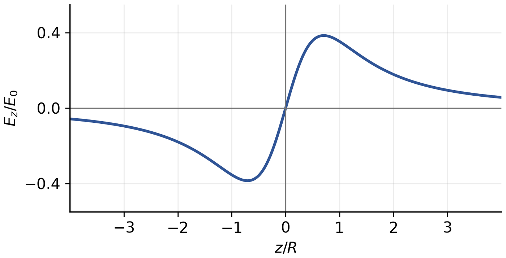
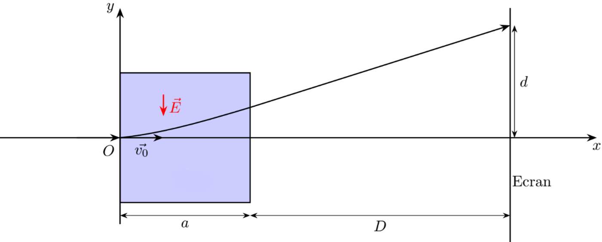

# TD 1　库仑力与静电场

TD n°1 — Force de Coulomb et champ électrostatique

CORRIGÉ · 参考解答

中法对照讲义 · 静电学部分

!!! info "阅读说明"

    每段先列法语原文；其下缩进、带深蓝竖条的小字号段落为中文翻译。<strong>加粗</strong>为关键词，括号内为中文释义。本题课包含全部练习的参考解答。

## Exercice 1 : Lignes de champ 练习 1：场线

Tracez dans le plan \(z=0\) les lignes de champ des champs suivants donnés en coordonnées cartésiennes :

在平面 \(z=0\) 内，画出下列用笛卡儿坐标给出的场的场线：
{: .zh }

1. \(\vec{A}=A_0\vec{e}_x-A_0\vec{e}_y\), avec \(A_0\) une constante strictement positive.

    \(\vec{A}=A_0\vec{e}_x-A_0\vec{e}_y\)，其中 \(A_0\) 为严格正的常数。
    {: .zh }

1. \(\vec{B}=yB_0\vec{e}_y\), avec \(B_0\) une constante strictement positive.

    \(\vec{B}=yB_0\vec{e}_y\)，其中 \(B_0\) 为严格正的常数。
    {: .zh }

1. \(\vec{C}=f(x)\vec{e}_y\), avec \(f\) une fonction continue qui ne s'annule pas telle que \(f(5)=-2\).

    \(\vec{C}=f(x)\vec{e}_y\)，其中 \(f\) 是不为零的连续函数，且 \(f(5)=-2\)。
    {: .zh }

1. \(\vec{D}=\dfrac{k}{(x^2+y^2)^{3/2}}\,(x\vec{e}_x+y\vec{e}_y)\), avec \(k\) une constante strictement positive.

    \(\vec{D}=\dfrac{k}{(x^2+y^2)^{3/2}}\,(x\vec{e}_x+y\vec{e}_y)\)，其中 \(k\) 为严格正的常数。
    {: .zh }

1. \(\vec{E}=\dfrac{k}{\sqrt{x^2+y^2}}\,(-y\vec{e}_x+x\vec{e}_y)\), avec \(k\) une constante strictement positive.

    \(\vec{E}=\dfrac{k}{\sqrt{x^2+y^2}}\,(-y\vec{e}_x+x\vec{e}_y)\)，其中 \(k\) 为严格正的常数。
    {: .zh }

!!! sol ""

    <strong>Méthode. &nbsp;&nbsp; 方法</strong>

    Une ligne de champ est une courbe dont la tangente en chaque point est portée par le vecteur champ. Dans le plan \(z=0\), en écrivant \(\vec{A}=A_x\vec{e}_x+A_y\vec{e}_y\), elle est donc solution de l'équation différentielle \(\dfrac{\mathrm{d}y}{\mathrm{d}x}=\dfrac{A_y}{A_x}\) ; on intègre cette équation pour obtenir la famille de courbes, puis on oriente chaque ligne dans le sens du champ.

    场线是每一点的切线都与场矢量共线的曲线。在平面 \(z=0\) 内，记 \(\vec{A}=A_x\vec{e}_x+A_y\vec{e}_y\)，场线因此满足微分方程 \(\dfrac{\mathrm{d}y}{\mathrm{d}x}=\dfrac{A_y}{A_x}\)；积分该方程得到曲线族，再按场的方向给每条场线定向。
    {: .zh }

    **(a)** \(\vec{A}=A_0\vec{e}_x-A_0\vec{e}_y\) : \(\dfrac{\mathrm{d}y}{\mathrm{d}x}=\dfrac{-A_0}{A_0}=-1\), d'où \(y=-x+C\). Les lignes de champ sont des droites de pente \(-1\). Comme \(A_x=A_0>0\), elles sont orientées vers les \(x\) croissants (et donc vers les \(y\) décroissants).

    **(a)** \(\vec{A}=A_0\vec{e}_x-A_0\vec{e}_y\)：\(\dfrac{\mathrm{d}y}{\mathrm{d}x}=\dfrac{-A_0}{A_0}=-1\)，故 \(y=-x+C\)。场线是斜率为 \(-1\) 的直线。由于 \(A_x=A_0>0\)，场线指向 \(x\) 增大的方向（因而也指向 \(y\) 减小的方向）。
    {: .zh }

    **(b)** \(\vec{B}=yB_0\vec{e}_y\) : \(A_x=0\), les lignes sont verticales, \(x=C\). Pour \(y>0\), \(\vec{B}\) pointe vers \(+y\) ; pour \(y<0\), vers \(-y\) : les lignes s'éloignent du plan \(y=0\), où le champ s'annule.

    **(b)** \(\vec{B}=yB_0\vec{e}_y\)：\(A_x=0\)，场线为竖直线 \(x=C\)。当 \(y>0\) 时 \(\vec{B}\) 指向 \(+y\)；当 \(y<0\) 时指向 \(-y\)：场线背离平面 \(y=0\)，在该平面上场为零。
    {: .zh }

    **(c)** \(\vec{C}=f(x)\vec{e}_y\) : les lignes sont encore les verticales \(x=C\). Comme \(f\) est continue et ne s'annule jamais, elle garde le signe de \(f(5)=-2\) : \(f(x)<0\) pour tout \(x\). Toutes les lignes sont donc orientées vers \(-y\) (vers le bas).

    **(c)** \(\vec{C}=f(x)\vec{e}_y\)：场线仍是竖直线 \(x=C\)。由于 \(f\) 连续且处处不为零，它保持 \(f(5)=-2\) 的符号：对一切 \(x\) 都有 \(f(x)<0\)。所以所有场线都指向 \(-y\)（向下）。
    {: .zh }

    **(d)** \(\vec{D}=\dfrac{k}{(x^2+y^2)^{3/2}}\,(x\vec{e}_x+y\vec{e}_y)=\dfrac{k}{r^2}\,\vec{u}_r\) avec \(r=\sqrt{x^2+y^2}\) : champ radial. Les lignes sont les demi-droites issues de \(O\) (\(y=Cx\)), orientées vers l'extérieur (\(k>0\)) ; le champ diverge en \(O\).

    **(d)** \(\vec{D}=\dfrac{k}{(x^2+y^2)^{3/2}}\,(x\vec{e}_x+y\vec{e}_y)=\dfrac{k}{r^2}\,\vec{u}_r\)，其中 \(r=\sqrt{x^2+y^2}\)：场为径向场。场线是从 \(O\) 出发的半射线（\(y=Cx\)），指向外侧（\(k>0\)）；场在 \(O\) 处发散。
    {: .zh }

    **(e)** \(\vec{E}=\dfrac{k}{\sqrt{x^2+y^2}}\,(-y\vec{e}_x+x\vec{e}_y)=\dfrac{k}{r}\,\vec{e}_\theta\) : champ orthoradial. Les lignes sont les cercles \(x^2+y^2=R^2\) centrés en \(O\), orientés dans le sens trigonométrique direct (pour \(k>0\)).

    **(e)** \(\vec{E}=\dfrac{k}{\sqrt{x^2+y^2}}\,(-y\vec{e}_x+x\vec{e}_y)=\dfrac{k}{r}\,\vec{e}_\theta\)：场为角向场。场线是以 \(O\) 为圆心的圆 \(x^2+y^2=R^2\)，对 \(k>0\) 沿逆时针方向定向。
    {: .zh }

## Exercice 2 : Cerceau avec charge linéique 练习 2：带线电荷的圆环

On considère une distribution linéique de charge, de densité \(\lambda\), uniforme sur le cercle de centre \(O\), d'axe \(Oz\) et de rayon \(R\).

考虑一条线电荷分布：线密度为 \(\lambda\)，均匀分布在以 \(O\) 为圆心、以 \(Oz\) 为轴、半径为 \(R\) 的圆周上。
{: .zh }

1. Déterminer l'expression du champ électrostatique en un point \(M\) de l'axe \(Oz\).

    确定轴 \(Oz\) 上一点 \(M\) 处静电场的表达式。
    {: .zh }

1. Représenter l'allure de ce champ.

    画出该场的形态。
    {: .zh }

!!! sol ""

    On repère \(M\) sur l'axe par sa cote \(z=OM\) et un point \(P\) du cerceau par l'angle \(\theta\). L'élément de charge \(\mathrm{d}q=\lambda R\,\mathrm{d}\theta\) placé en \(P\) crée en \(M\) le champ

    用高度 \(z=OM\) 标记轴上的点 \(M\)，用角 \(\theta\) 标记圆环上的点 \(P\)。位于 \(P\) 的电荷元 \(\mathrm{d}q=\lambda R\,\mathrm{d}\theta\) 在 \(M\) 处产生的场为
    {: .zh }

    \[
    \mathrm{d}\vec{E}(M)=\frac{\mathrm{d}q}{4\pi\varepsilon_0\,PM^2}\,\vec{u}_{PM},
    \qquad PM=\sqrt{R^2+z^2}.
    \]

    Par symétrie de révolution autour de \(Oz\), les composantes transverses se compensent deux à deux : \(\vec{E}(M)=E_z(z)\,\vec{e}_z\). Seule la composante axiale subsiste, avec \(\cos\varphi=\dfrac{z}{\sqrt{R^2+z^2}}\) :

    由绕 \(Oz\) 的旋转对称性，横向分量两两抵消：\(\vec{E}(M)=E_z(z)\,\vec{e}_z\)。只剩轴向分量，其中 \(\cos\varphi=\dfrac{z}{\sqrt{R^2+z^2}}\)：
    {: .zh }

    \[
    E_z=\int_0^{2\pi}\frac{\lambda R\,\mathrm{d}\theta}{4\pi\varepsilon_0(R^2+z^2)}\,\frac{z}{\sqrt{R^2+z^2}}
    =\frac{\lambda R z}{2\varepsilon_0(R^2+z^2)^{3/2}}.
    \]

    Avec \(Q=2\pi R\lambda\), on peut aussi écrire

    利用 \(Q=2\pi R\lambda\)，还可写成
    {: .zh }

    \[
    \vec{E}(M)=\frac{\lambda R z}{2\varepsilon_0(R^2+z^2)^{3/2}}\,\vec{e}_z
    =\frac{Qz}{4\pi\varepsilon_0(R^2+z^2)^{3/2}}\,\vec{e}_z.
    \]

    <strong>Allure.</strong> Le champ est nul en \(O\), impair en \(z\) (il change de sens au passage du plan du cerceau) et présente un maximum en \(z=\pm R/\sqrt{2}\) :

    <strong>形态。</strong>场在 \(O\) 处为零，关于 \(z\) 为奇函数（经过圆环所在平面时反向），并在 \(z=\pm R/\sqrt{2}\) 处取最大值：
    {: .zh }

    \[
    E_{\max}=\frac{\lambda}{3\sqrt{3}\,\varepsilon_0R}
    \approx0{,}385\,\frac{\lambda}{2\varepsilon_0R}.
    \]

    À grande distance (\(|z|\gg R\)), \(\vec{E}\simeq\dfrac{Q}{4\pi\varepsilon_0 z^2}\,\mathrm{sgn}(z)\,\vec{e}_z\) : on retrouve le champ d'une charge ponctuelle \(Q\) placée en \(O\).

    在远处（\(|z|\gg R\)），\(\vec{E}\simeq\dfrac{Q}{4\pi\varepsilon_0 z^2}\,\mathrm{sgn}(z)\,\vec{e}_z\)：回到位于 \(O\) 的点电荷 \(Q\) 的场。
    {: .zh }

    

    
Figure — \(E_z/E_0\) en fonction de \(z/R\), avec \(E_0=\dfrac{\lambda}{2\varepsilon_0R}\). 图：\(E_z/E_0\) 随 \(z/R\) 的变化，\(E_0=\dfrac{\lambda}{2\varepsilon_0R}\)。

## Exercice 3 : Mouvement d'une particule dans un champ électrique constant 练习 3：带电粒子在恒定电场中的运动

Un faisceau d'électrons de masse \(m\) et de charge \(q=-e\) possède initialement une vitesse \(\vec{v}_0=v_0\,\vec{e}_x\). Le faisceau pénètre dans une zone située entre \(x=0\) et \(x=a\) dans laquelle règne un champ électrique \(\vec{E}=-E\,\vec{e}_y\).

一束电子，质量为 \(m\)、电荷为 \(q=-e\)，初始速度为 \(\vec{v}_0=v_0\,\vec{e}_x\)。电子束进入位于 \(x=0\) 与 \(x=a\) 之间的区域，该区域内存在电场 \(\vec{E}=-E\,\vec{e}_y\)。
{: .zh }

On place un écran à une distance \(D\gg a\) de la zone d'application du champ électrostatique et on mesure sur l'écran \(d\), la déviation de l'électron induite par le champ.

在距静电场作用区 \(D\gg a\) 处放置一块屏幕，并在屏幕上测量由电场引起的电子偏转量 \(d\)。
{: .zh }

Déterminer la vitesse \(v_0\) des électrons à l'entrée de la zone où règne le champ, en fonction de \(e\), \(m\), \(E\), \(a\), \(D\) et \(d\).

求电子进入场区时的速度 \(v_0\)，用 \(e\)、\(m\)、\(E\)、\(a\)、\(D\)、\(d\) 表示。
{: .zh }

!!! sol ""

    Le champ vaut \(\vec{E}=-E\,\vec{e}_y\) et la charge de l'électron est \(q=-e\) : la force électrique est

    电场为 \(\vec{E}=-E\,\vec{e}_y\)，电子电荷为 \(q=-e\)：电力为
    {: .zh }

    \[
    \vec{F}=q\vec{E}=(-e)(-E\,\vec{e}_y)=+eE\,\vec{e}_y.
    \]

    Elle est donc dirigée vers les \(y\) croissants, et l'accélération est \(a_y=\dfrac{eE}{m}\) (constante). Le mouvement se décompose en un mouvement uniforme selon \(x\) et un mouvement uniformément accéléré selon \(y\) :

    它指向 \(y\) 增大的方向，加速度为 \(a_y=\dfrac{eE}{m}\)（常量）。运动分解为沿 \(x\) 的匀速运动和沿 \(y\) 的匀加速运动：
    {: .zh }

    \[
    x(t)=v_0t,\qquad y(t)=\frac{eE}{2m}\,t^2,\qquad v_y(t)=\frac{eE}{m}\,t.
    \]

    À la sortie de la zone (\(x=a\)), on a \(t_1=\dfrac{a}{v_0}\), d'où

    在场区出口（\(x=a\)）处，\(t_1=\dfrac{a}{v_0}\)，故
    {: .zh }

    \[
    y_1=\frac{eE}{2m}\left(\frac{a}{v_0}\right)^2,
    \qquad
    v_{y1}=\frac{eE}{m}\frac{a}{v_0}.
    \]

    Au-delà, le champ est nul : la trajectoire est une droite de pente \(\dfrac{v_{y1}}{v_0}=\dfrac{eEa}{mv_0^2}\). Sur l'écran, à la distance \(D\) de la zone, la déviation totale est

    此后场为零：轨迹是斜率为 \(\dfrac{v_{y1}}{v_0}=\dfrac{eEa}{mv_0^2}\) 的直线。在距场区 \(D\) 处的屏幕上，总偏转为
    {: .zh }

    \[
    d=y_1+D\,\frac{v_{y1}}{v_0}
    =\frac{eE}{m v_0^2}\left(\frac{a^2}{2}+aD\right)
    =\frac{eEa}{m v_0^2}\left(D+\frac{a}{2}\right).
    \]

    On en déduit

    由此解得
    {: .zh }

    \[
    v_0=\sqrt{\frac{eEa}{md}\left(D+\frac{a}{2}\right)}
    \ \underset{D\gg a}{\approx}\ \sqrt{\frac{eEaD}{md}}.
    \]

    La déviation \(d\) mesure donc directement \(v_0\) : c'est le principe du tube oscillographique.

    因此偏转量 \(d\) 直接反映 \(v_0\)：这正是示波管的工作原理。
    {: .zh }

## Exercice 4 : Champ gravitationnel 练习 4：引力场

Un point matériel de masse \(m\), placé au point \(O\), crée le champ gravitationnel \(\vec{A}\) dans tout l'espace, tel que :

置于点 \(O\) 的质量为 \(m\) 的质点在整个空间中产生引力场 \(\vec{A}\)，满足：
{: .zh }

\[
\vec{A}=-\frac{Gm}{OM^3}\,\overrightarrow{OM}=-\frac{Gm}{r^3}\,\vec{r},
\]

avec \(\vec{r}=\overrightarrow{OM}\), \(r=\|\vec{r}\|\) et \(G=6{,}67\cdot10^{-11}\ \mathrm{N\,m^2\,kg^{-2}}\).

其中 \(\vec{r}=\overrightarrow{OM}\)，\(r=\|\vec{r}\|\)，\(G=6{,}67\cdot10^{-11}\ \mathrm{N\,m^2\,kg^{-2}}\)。
{: .zh }

On note \(T\) le centre de la Terre, \(L\) le centre de la Lune et \(d=TL\) la distance Terre-Lune. On se place dans le repère cartésien \((T,\vec{e}_x,\vec{e}_y)\) tel que \(L\) a pour coordonnées \((d,0)\).

记 \(T\) 为地心、\(L\) 为月心，\(d=TL\) 为地月距离。取笛卡儿坐标系 \((T,\vec{e}_x,\vec{e}_y)\)，使 \(L\) 的坐标为 \((d,0)\)。
{: .zh }

1. Représentez l'allure des lignes du champ gravitationnel \(\vec{A}\) au voisinage de \(T\).

    画出 \(T\) 附近引力场 \(\vec{A}\) 的场线形态。
    {: .zh }

1. On considère le champ gravitationnel total \(\overrightarrow{A_{tot}}\), somme des champs gravitationnels créés par la Terre et la Lune. Déterminez les coordonnées du point \(B\), situé sur \((TL)\), où \(\overrightarrow{A_{tot}}\) est nul.

    考虑总引力场 \(\overrightarrow{A_{tot}}\)，即地球与月球产生的引力场之和。求线段 \((TL)\) 上使 \(\overrightarrow{A_{tot}}\) 为零的点 \(B\) 的坐标。
    {: .zh }

1. On considère un point matériel \(M\) de masse \(m_1\) soumis à l'attraction de la Terre et de la Lune \(\overrightarrow{f_{tot}}\). Où doit-on placer \(M\) pour qu'il soit immobile ?

    考虑质量为 \(m_1\) 的质点 \(M\)，受到地球与月球的引力 \(\overrightarrow{f_{tot}}\)。应把 \(M\) 放在何处才能使其保持静止？
    {: .zh }

1. Est-ce que \(\overrightarrow{f_{tot}}\) est une force conservative ? Si oui, donner l'expression de l'énergie potentielle \(E_p\) dont elle dérive, à une constante près qui sera choisie nulle.

    \(\overrightarrow{f_{tot}}\) 是保守力吗？若是，给出它所导出的势能 \(E_p\) 的表达式，附加常数取为零。
    {: .zh }

1. Décrire l'allure des courbes équipotentielles au voisinage de chacun des deux astres.

    描述两个星体各自附近等势线的形态。
    {: .zh }

!!! sol ""

    **(1)** Au voisinage de \(T\), le champ \(\vec{A}=-\dfrac{GM_T}{r^3}\,\vec{r}\) est radial et dirigé vers \(T\) : les lignes de champ sont des demi-droites aboutissant à \(T\).

    **(1)** 在 \(T\) 附近，场 \(\vec{A}=-\dfrac{GM_T}{r^3}\,\vec{r}\) 是径向的并指向 \(T\)：场线是汇聚到 \(T\) 的半射线。
    {: .zh }

    **(2)** Sur \((TL)\), en un point d'abscisse \(x\) (\(0<x<d\)), les deux champs sont portés par l'axe et de sens opposés. Le champ total est nul lorsque

    **(2)** 在 \((TL)\) 上，于横坐标为 \(x\)（\(0<x<d\)）处，两个场都沿轴线但方向相反。总场为零的条件是
    {: .zh }

    \[
    \frac{GM_T}{x^2}=\frac{GM_L}{(d-x)^2}
    \quad\Longleftrightarrow\quad
    \frac{\sqrt{M_T}}{x}=\frac{\sqrt{M_L}}{d-x},
    \]

    d'où

    由此得
    {: .zh }

    \[
    x_B=\frac{d\sqrt{M_T}}{\sqrt{M_T}+\sqrt{M_L}}.
    \]

    Comme \(M_T>M_L\), on a \(x_B>d/2\) : le point \(B\) est plus proche de la Lune que de la Terre. En dehors du segment \(TL\), les deux champs ont le même sens et ne peuvent pas se compenser : \(B\) est l'unique point d'annulation.

    由于 \(M_T>M_L\)，有 \(x_B>d/2\)：点 \(B\) 离月球比离地球更近。在线段 \(TL\) 之外，两个场同向，不可能相互抵消：\(B\) 是唯一的零点。
    {: .zh }

    **(3)** La force totale \(\vec{f}_{tot}=m_1\vec{A}_{tot}\) s'annule en \(B\) : c'est là qu'il faut placer \(M\) pour qu'il reste immobile (dans le référentiel où \(T\) et \(L\) sont fixes).

    **(3)** 总力 \(\vec{f}_{tot}=m_1\vec{A}_{tot}\) 在 \(B\) 处为零：要使 \(M\) 保持静止（在 \(T\)、\(L\) 固定的参考系中），就应把它放在 \(B\) 处。
    {: .zh }

    **(4)** Oui : chaque force gravitationnelle est centrale et dérive d'une énergie potentielle. Avec \(\vec{f}_{tot}=-\vec{\nabla}E_p\), on obtient, en choisissant \(E_p=0\) à l'infini,

    **(4)** 是：每个引力都是有心力，并由势能导出。由 \(\vec{f}_{tot}=-\vec{\nabla}E_p\)，并取无穷远处 \(E_p=0\)，得
    {: .zh }

    \[
    E_p=-Gm_1M_T\,\frac{1}{TM}-Gm_1M_L\,\frac{1}{LM}.
    \]

    **(5)** Au voisinage de chaque astre, le terme dominant est celui de cet astre : les équipotentielles sont quasi sphériques, centrées sur \(T\) (ou sur \(L\)). Loin des deux astres, le champ ressemble à celui d'une masse totale \(M_T+M_L\) : les équipotentielles redeviennent approximativement sphériques. Entre les deux, elles sont déformées ; l'équipotentielle passant par \(B\) présente un col qui réunit les deux domaines.

    **(5)** 在每个星体附近，主导项是该星体的项：等势面近似为以 \(T\)（或 \(L\)）为中心的球面。在两个星体都较远的地方，场类似于总质量 \(M_T+M_L\) 的场：等势面又近似为球面。两者之间，等势面发生畸变；经过 \(B\) 的等势面呈颈部，把两个区域连在一起。
    {: .zh }

## Exercice 5 : L'atome d'hydrogène 练习 5：氢原子

Dans le modèle de Bohr de l'atome d'hydrogène, un électron gravite autour d'un proton stationnaire sur une orbite circulaire de rayon \(r\).

在氢原子的玻尔模型中，电子在半径为 \(r\) 的圆轨道上绕静止的质子运动。
{: .zh }

**(a)** Écrivez la deuxième loi de Newton du mouvement circulaire et trouvez l'expression du module de la vitesse tangentielle \(v\) de l'électron sur cette orbite.

**(a)** 写出圆周运动的牛顿第二定律，并求出电子在该轨道上切向速度大小 \(v\) 的表达式。
{: .zh }

**(b)** Bohr imposa la condition que le module du moment cinétique \(L\) de l'électron ne pouvait prendre que des valeurs discrètes données par \(L=nh/2\pi\), avec \(n\) un entier et \(h\) la constante de Planck. Montrez que le rayon de la \(n\)-ième orbite permise est donné par

**(b)** 玻尔假定电子角动量的大小 \(L\) 只能取分立值 \(L=nh/2\pi\)，其中 \(n\) 为整数，\(h\) 为普朗克常数。证明第 \(n\) 条允许轨道的半径由下式给出：
{: .zh }

\[
r_n=\frac{n^2h^2}{4\pi^2kme^2}.
\]

**(c)** Calculez \(r_n\) pour \(n=1,2,3\).

**(c)** 计算 \(n=1,2,3\) 时的 \(r_n\)。
{: .zh }

!!! sol ""

    **(a)** L'électron décrit un cercle de rayon \(r\) à vitesse \(v\) : son accélération est centripète, \(a=\dfrac{v^2}{r}\). La deuxième loi de Newton s'écrit, avec la force de Coulomb \(F=\dfrac{ke^2}{r^2}\) (\(k=1/4\pi\varepsilon_0\)) :

    **(a)** 电子以速度 \(v\) 沿半径为 \(r\) 的圆周运动：加速度为向心加速度 \(a=\dfrac{v^2}{r}\)。由牛顿第二定律与库仑力 \(F=\dfrac{ke^2}{r^2}\)（\(k=1/4\pi\varepsilon_0\)）：
    {: .zh }

    \[
    \frac{ke^2}{r^2}=m\frac{v^2}{r}
    \quad\Longrightarrow\quad
    v=\sqrt{\frac{ke^2}{mr}}.
    \]

    **(b)** La condition de Bohr s'écrit \(L=mvr=\dfrac{nh}{2\pi}\). En y reportant l'expression de \(v\) :

    **(b)** 玻尔条件为 \(L=mvr=\dfrac{nh}{2\pi}\)。代入 \(v\) 的表达式：
    {: .zh }

    \[
    mr\sqrt{\frac{ke^2}{mr}}=\frac{nh}{2\pi}
    \quad\Longrightarrow\quad
    mke^2r=\frac{n^2h^2}{4\pi^2}
    \quad\Longrightarrow\quad
    r_n=\frac{n^2h^2}{4\pi^2kme^2}.
    \]

    On retrouve bien la formule demandée ; le rayon croît comme \(n^2\).

    这正是题目要求的公式；半径按 \(n^2\) 增长。
    {: .zh }

    **(c)** Avec \(h=6{,}63\cdot10^{-34}\ \mathrm{J\,s}\), \(k=9{,}0\cdot10^{9}\) SI, \(m=9{,}11\cdot10^{-31}\) kg et \(e=1{,}60\cdot10^{-19}\) C :

    **(c)** 取 \(h=6{,}63\cdot10^{-34}\ \mathrm{J\,s}\)、\(k=9{,}0\cdot10^{9}\)（SI）、\(m=9{,}11\cdot10^{-31}\) kg、\(e=1{,}60\cdot10^{-19}\) C：
    {: .zh }

    \[
    r_1=5{,}3\cdot10^{-11}\ \mathrm{m}\approx0{,}53\ \text{Å},
    \qquad
    r_2=4r_1\approx2{,}1\cdot10^{-10}\ \mathrm{m},
    \qquad
    r_3=9r_1\approx4{,}8\cdot10^{-10}\ \mathrm{m}.
    \]

    Le rayon de Bohr \(r_1\approx0{,}53\) Å est bien de l'ordre de la taille atomique.

    玻尔半径 \(r_1\approx0{,}53\) Å 正是原子尺度的量级。
    {: .zh }
