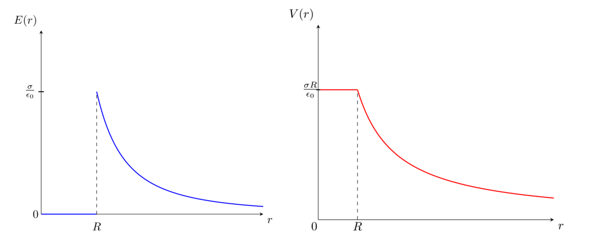
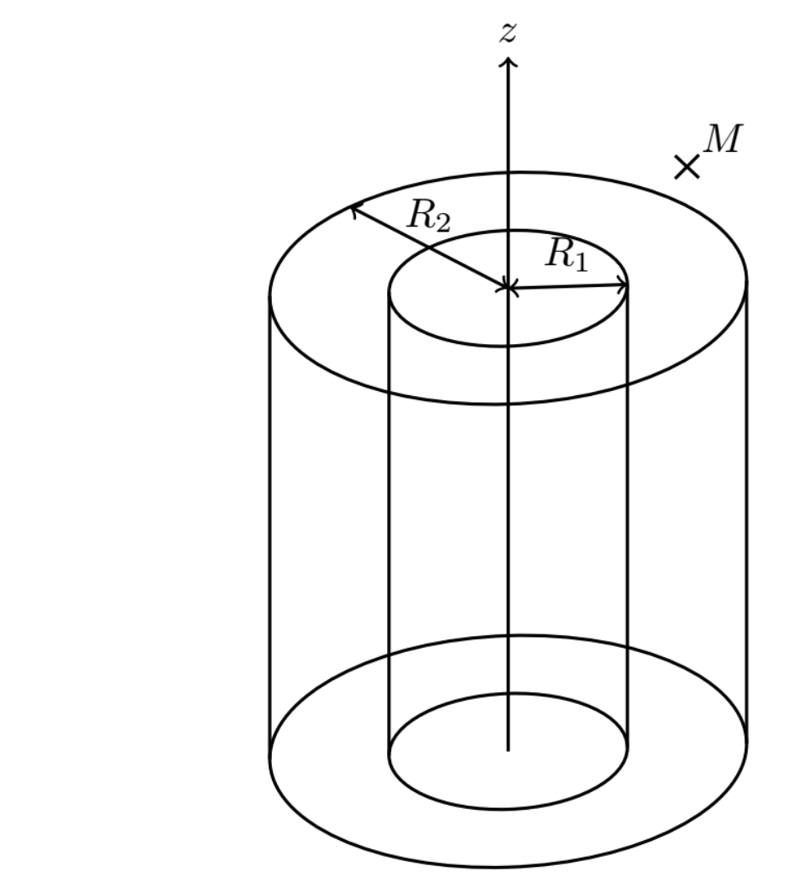
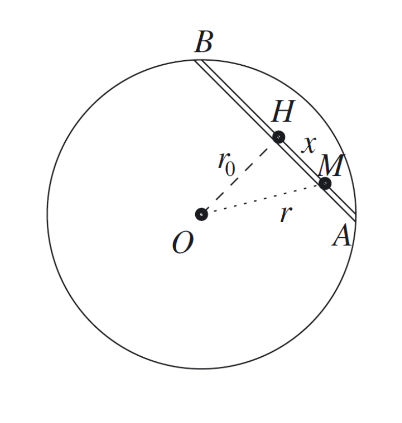

# TD2 详细解答　高斯定理

Correction détaillée du TD2 — Théorème de Gauss

CORRIGÉ DÉTAILLÉ · 详细解答

中法对照讲义 · 静电学部分

!!! info "阅读说明"

    本页是 TD2 的详细解答版（教师讲义版）：五道练习逐题给出完整推理、公式与示意图。法语原文与中文翻译逐段对照；每道练习末尾附重点词汇。「读者注」为讲义原文中的批注，指出个别笔误但不改动结论。

## Exercice 1 : Vrai ou faux 练习 1：判断正误

1. On peut utiliser n'importe quelle surface pour appliquer le théorème de Gauss.

    可以用任意曲面来应用高斯定理。
    {: .zh }

    **Faux.** Il faut que la surface soit fermée.

    <strong>错。</strong>曲面必须是闭合的。
    {: .zh }

2. Dans le théorème de Gauss, le champ \(\vec{E}\) est uniquement celui créé par les charges situées à l'intérieur de la surface de Gauss.

    在高斯定理中，\(\vec{E}\) 仅仅是位于高斯面内部的电荷所产生的那部分场。
    {: .zh }

    **Faux.** On doit considérer le champ total créé par toutes les charges.

    <strong>错。</strong>必须考虑由全部电荷产生的总场。
    {: .zh }

3. Pour une plaque infinie chargée uniformément, le champ électrostatique dépend de la distance à la plaque et de la surface de Gauss choisie.

    对于均匀带电的无限大平板，静电场取决于到平板的距离以及所选的高斯面。
    {: .zh }

    **Faux.** Il est constant de valeur \(\dfrac{\sigma}{\varepsilon_0}\). C'est d'ailleurs la meilleure méthode pour créer un champ uniforme.

    <strong>错。</strong>它是常量，值为 \(\dfrac{\sigma}{\varepsilon_0}\)。这其实正是产生均匀场的最佳方法。
    {: .zh }

4. Le flux sortant d'une surface fermée est toujours positif.

    闭合曲面的向外通量总是正的。
    {: .zh }

    **Faux.** Si le champ sur la surface « rentre » vers la surface alors le flux est négatif. Par contre le vecteur normal est toujours orienté comme sortant de la surface.

    <strong>错。</strong>若场在曲面上「指向面内」，则通量为负。不过法向量始终取为从曲面指向外部。
    {: .zh }

5. Pour obtenir la valeur du champ électrique en un point \(P\) à l'aide du théorème de Gauss, on doit calculer le flux électrique à travers une surface passant par le point \(P\).

    要用高斯定理求出某点 \(P\) 处的电场值，必须计算穿过一条经过 \(P\) 点的曲面的电通量。
    {: .zh }

    **Vrai.** La surface de Gauss doit toujours passer par le point \(P\).

    <strong>对。</strong>高斯面必须经过 \(P\) 点。
    {: .zh }

!!! warning "Vocabulaire clé &nbsp;&nbsp; 重点词汇 练习 1 核心术语"

    - <strong>surface fermée</strong>：闭合曲面
    - <strong>champ total</strong>：总场
    - <strong>plaque infinie</strong>：无限大平板
    - <strong>champ uniforme</strong>：均匀场
    - <strong>flux sortant</strong>：向外通量
    - <strong>vecteur normal</strong>：法向量
    - <strong>surface de Gauss</strong>：高斯面

## Exercice 2 : Sphère chargée en surface 练习 2：表面带电的球面

On considère une sphère de rayon \(R\) uniformément chargée en surface (charge surfacique \(\sigma\)).

考虑一个半径为 \(R\)、表面均匀带电（面电荷密度为 \(\sigma\)）的球面。
{: .zh }

**1.** Déterminer l'expression du champ \(\vec{E}\) en tout point \(M\) de l'espace.

**1.** 求空间任一点 \(M\) 处电场 \(\vec{E}\) 的表达式。
{: .zh }

On repère le point \(M\) en coordonnées sphériques et on étudie les symétries et invariances de la distribution de charge.

用球坐标标定点 \(M\)，并研究电荷分布的对称性与不变性。
{: .zh }

— **Symétries :**

— **对称性：**
{: .zh }

Tout plan contenant le vecteur \(\overrightarrow{OM}\) est un plan de symétrie de la distribution de charges, donc le champ électrique est selon \(\vec{e}_r\).

任何包含矢量 \(\overrightarrow{OM}\) 的平面都是电荷分布的对称面，因此电场沿 \(\vec{e}_r\) 方向。
{: .zh }

\[
\vec{E}(M)=E(r,\theta,\varphi)\,\vec{e}_r
\]

— **Invariances :**

— **不变性：**
{: .zh }

La distribution de charge est invariante par rotation d'angle \(\theta\) autour de \(\vec{e}_\varphi\) et par rotation d'angle \(\varphi\) autour de \(\vec{e}_z\), donc \(E\) ne dépend ni de \(\theta\) ni de \(\varphi\).

电荷分布在绕 \(\vec{e}_\varphi\) 转 \(\theta\) 角、绕 \(\vec{e}_z\) 转 \(\varphi\) 角的旋转下不变，故 \(E\) 既不依赖于 \(\theta\)，也不依赖于 \(\varphi\)。
{: .zh }

\[
\vec{E}(M)=E(r)\,\vec{e}_r
\]

On applique le théorème de Gauss à la sphère \(S\) de centre \(O\) et de rayon \(r\) :

对以 \(O\) 为心、半径为 \(r\) 的球面 \(S\) 应用高斯定理：
{: .zh }

\[
\Phi=\oint_{M\in S}\vec{E}(M)\cdot\mathrm{d}\vec{S}(M)=\frac{Q_{int}}{\varepsilon_0}
\]

On a

有
{: .zh }

\[
\oint_{M\in S}\vec{E}(M)\cdot\mathrm{d}\vec{S}(M)
=\oint_{M\in S}E(r)\,\vec{e}_r\cdot\mathrm{d}S\,\vec{e}_r
=E(r)\oint_{M\in S}\mathrm{d}S
=E(r)\,4\pi r^2
\]

Pour exprimer \(Q_{int}\), on doit distinguer 2 cas :

为表示 \(Q_{int}\)，需区分两种情况：
{: .zh }

— \(r<R\) :

— \(r<R\)：
{: .zh }

\[
Q_{int}=0
\]

Donc,

因此
{: .zh }

\[
\vec{E}(M)=\vec{0}
\]

— \(r>R\) :

— \(r>R\)：
{: .zh }

\[
Q_{int}=\sigma\,4\pi R^2
\]

Donc,

因此
{: .zh }

\[
\vec{E}(M)=\frac{\sigma R^2}{\varepsilon_0 r^2}\,\vec{e}_r
\]

\[
\vec{E}(M)=\frac{Q}{4\pi\varepsilon_0 r^2}\,\vec{e}_r
\]

On remarque que le champ hors de la sphère est le même que celui qui serait créé si toute la charge était concentrée au centre de la sphère.

可以看到，球外电场与把全部电荷集中在球心时所产生的一样。
{: .zh }

**2.** En déduire l'expression du potentiel électrostatique \(V\) créé par la distribution en tout point de l'espace.

**2.** 由此推出该电荷分布在空间任一点产生的静电势 \(V\) 的表达式。
{: .zh }

En général on a :

一般有：
{: .zh }

\[
\vec{E}\cdot\mathrm{d}\vec{l}=-\mathrm{d}V
\]

\[
E(r)\,\vec{e}_r\cdot\left(\mathrm{d}r\,\vec{e}_r+r\,\mathrm{d}\theta\,\vec{e}_\theta+r\sin(\theta)\,\mathrm{d}\varphi\,\vec{e}_\varphi\right)=-\mathrm{d}V
\]

\[
E(r)=-\frac{\mathrm{d}V}{\mathrm{d}r}
\]

— Pour \(r<R\) :

— 当 \(r<R\) 时：
{: .zh }

\[
E(r)=0
\]

Donc \(V(r)=A\), avec \(A\) une constante.

因此 \(V(r)=A\)，其中 \(A\) 为常数。
{: .zh }

— Pour \(r>R\) :

— 当 \(r>R\) 时：
{: .zh }

\[
E(r)=\frac{\sigma R^2}{\varepsilon_0 r^2}
\]

Donc \(V(r)=\dfrac{\sigma R^2}{\varepsilon_0 r}+B\), avec \(B\) une constante.

因此 \(V(r)=\dfrac{\sigma R^2}{\varepsilon_0 r}+B\)，其中 \(B\) 为常数。
{: .zh }

Vu que \(V\) tend vers 0 quand \(r\) tend vers l'infini, on trouve \(B=0\).

由于 \(r\) 趋于无穷时 \(V\) 趋于 0，得 \(B=0\)。
{: .zh }

Par continuité de \(V\) en \(R\), on trouve \(A=\dfrac{\sigma R}{\varepsilon_0}\).

由 \(V\) 在 \(R\) 处的连续性，得 \(A=\dfrac{\sigma R}{\varepsilon_0}\)。
{: .zh }

— En résumé :

— 归纳：
{: .zh }

\[
\text{Pour } r<R:\quad V(r)=\frac{\sigma R}{\varepsilon_0}
\qquad\qquad
\text{Pour } r>R:\quad V(r)=\frac{\sigma R^2}{\varepsilon_0 r}
\]

**3.** Tracer \(E(r)\) et \(V(r)\).

**3.** 画出 \(E(r)\) 与 \(V(r)\)。
{: .zh }

<em>Figure 1</em> — Allure de \(E(r)\) (en bleu) et de \(V(r)\) (en rouge). 图 1：\(E(r)\)（蓝）与 \(V(r)\)（红）的形态。

!!! warning "Vocabulaire clé &nbsp;&nbsp; 重点词汇 练习 2 核心术语"

    - <strong>coordonnées sphériques</strong>：球坐标
    - <strong>symétrie / invariance</strong>：对称性 / 不变性
    - <strong>plan de symétrie</strong>：对称平面
    - <strong>théorème de Gauss</strong>：高斯定理
    - <strong>charge surfacique</strong>：面电荷
    - <strong>potentiel électrostatique</strong>：静电势
    - <strong>continuité</strong>：连续性
    - <strong>à l'infini</strong>：在无穷远处

## Exercice 3 : Condensateur cylindrique 练习 3：圆柱形电容器

On considère deux cylindres de même axe \(\vec{e}_z\) et de même hauteur \(H\), de rayon \(R_1\) et \(R_2>R_1\), chargés uniformément en surface (charge \(+q\) pour le cylindre extérieur et \(-q\) pour le cylindre intérieur).

考虑两个同轴（轴为 \(\vec{e}_z\)）、同高 \(H\) 的圆柱面，半径分别为 \(R_1\) 和 \(R_2>R_1\)，表面均匀带电（外侧圆柱面带电荷 \(+q\)，内侧圆柱面带电荷 \(-q\)）。
{: .zh }

<em>Figure 2</em> — Les deux cylindres coaxiaux et le point \(M\). 图 2：两个同轴圆柱面与点 \(M\)。

**1.** Déterminer l'expression du champ \(\vec{E}\) en tout point \(M\) de l'espace.

**1.** 求空间任一点 \(M\) 处电场 \(\vec{E}\) 的表达式。
{: .zh }

On repère le point \(M\) en coordonnées cylindriques et on étudie les symétries et invariances de la distribution de charge.

用柱坐标标定点 \(M\)，并研究电荷分布的对称性与不变性。
{: .zh }

— **Symétries :**

— **对称性：**
{: .zh }

On suppose le point \(M\) suffisamment éloigné des bords du cylindre pour pouvoir les considérer infinis selon \(\vec{e}_z\).

假设 \(M\) 点离圆柱边缘足够远，从而可把它们视为沿 \(\vec{e}_z\) 无限长。
{: .zh }

Les plans \((M,\vec{e}_r,\vec{e}_\theta)\) et \((M,\vec{e}_r,\vec{e}_z)\) sont des plans de symétrie de la distribution de charges, donc le champ électrique est selon \(\vec{e}_r\).

平面 \((M,\vec{e}_r,\vec{e}_\theta)\) 与 \((M,\vec{e}_r,\vec{e}_z)\) 都是电荷分布的对称面，因此电场沿 \(\vec{e}_r\) 方向。
{: .zh }

\[
\vec{E}(M)=E(r,\theta,z)\,\vec{e}_r
\]

— **Invariances :**

— **不变性：**
{: .zh }

La distribution de charge est invariante par rotation d'angle \(\theta\) autour de \(\vec{e}_z\) et par translation selon \(\vec{e}_z\), donc \(\vec{E}\) ne dépend ni de \(\theta\) ni de \(z\).

电荷分布在绕 \(\vec{e}_z\) 转 \(\theta\) 角的旋转下、以及沿 \(\vec{e}_z\) 的平移下不变，故 \(\vec{E}\) 既不依赖于 \(\theta\)，也不依赖于 \(z\)。
{: .zh }

\[
\vec{E}(M)=E(r)\,\vec{e}_r
\]

On applique le théorème de Gauss au cylindre de rayon \(r\), de hauteur \(h\) et de même axe que les deux cylindres, en choisissant \(h\ll H\) pour pouvoir négliger les effets de bord :

对与两圆柱同轴、半径为 \(r\)、高为 \(h\) 的圆柱面应用高斯定理，取 \(h\ll H\) 以忽略边缘效应：
{: .zh }

\[
\Phi=\oint_{M\in S}\vec{E}(M)\cdot\mathrm{d}\vec{S}(M)=\frac{Q_{int}}{\varepsilon_0}
\]

\[
\oint_{M\in S}\vec{E}(M)\cdot\mathrm{d}\vec{S}(M)
=\oint_{M\in S}E(r)\,\vec{e}_r\cdot\mathrm{d}S\,\vec{e}_r
=E(r)\oint_{M\in S}\mathrm{d}S
=E(r)\,2\pi r h
\]

Pour exprimer \(Q_{int}\), on doit distinguer 3 cas :

为表示 \(Q_{int}\)，需区分三种情况：
{: .zh }

— \(r<R_1\) :

— \(r<R_1\)：
{: .zh }

\[
Q_{int}=0
\]

Donc

因此
{: .zh }

\[
\vec{E}(M)=\vec{0}
\]

— \(R_1<r<R_2\) :

— \(R_1<r<R_2\)：
{: .zh }

\[
Q_{int}=\frac{-q}{2\pi r H\varepsilon_0}\,2\pi h R_1=\frac{-qh}{H}
\]

Donc

因此
{: .zh }

\[
\vec{E}(M)=-\frac{q}{2\pi r H\varepsilon_0}\,\vec{e}_r
\]

— \(r>R_2\) :

— \(r>R_2\)：
{: .zh }

\[
Q_{int}=0
\]

Donc

故
{: .zh }

\[
\vec{E}(M)=\vec{0}
\]

!!! note "Note de lecture &nbsp;&nbsp; 读者注"

    Le facteur intermédiaire écrit ci-dessus, \(\frac{-q}{2\pi rH\varepsilon_0}\,2\pi hR_1\), doit se lire \(\sigma_1\,2\pi R_1h\) avec la densité de l'armature interne \(\sigma_1=\frac{-q}{2\pi R_1H}\) : le \(\varepsilon_0\) et le \(r\) qui y figurent sont une coquille. Le résultat final, \(Q_{int}=-\frac{qh}{H}\), est correct.

    上面这个中间因子 \(\frac{-q}{2\pi rH\varepsilon_0}\,2\pi hR_1\) 应理解为 \(\sigma_1\,2\pi R_1h\)，其中内圆柱面的面电荷密度为 \(\sigma_1=\frac{-q}{2\pi R_1H}\)：式中的 \(\varepsilon_0\) 与 \(r\) 系笔误。最终结果 \(Q_{int}=-\frac{qh}{H}\) 是正确的。
    {: .zh }

**2.** En déduire la capacité du condensateur ainsi réalisé.

**2.** 由此推出这样构成的电容器的电容。
{: .zh }

Comme le champ électrique est orienté selon \(-\vec{e}_r\), le potentiel \(V\) augmente avec \(r\).

由于电场沿 \(-\vec{e}_r\) 方向，电势 \(V\) 随 \(r\) 增大。
{: .zh }

\[
U=V(R_2)-V(R_1)=-\int_{R_1}^{R_2}\vec{E}\cdot\mathrm{d}r\,\vec{e}_r
=\frac{q}{2\pi H\varepsilon_0}\int_{R_1}^{R_2}\frac{\mathrm{d}r}{r}
\]

\[
U=\frac{q}{2\pi H\varepsilon_0}\,[\ln(r)]_{R_1}^{R_2}
=\frac{q}{2\pi H\varepsilon_0}\ln\!\left(\frac{R_2}{R_1}\right)
\]

Or par définition de la capacité \(C\) d'un condensateur dont les armatures portent les charges \(q\) et \(-q\) :

而按电容 \(C\) 的定义（其两臂分别带电荷 \(q\) 与 \(-q\)）：
{: .zh }

\[
q=CU
\]

Soit :

即
{: .zh }

\[
C=\frac{2\pi H\varepsilon_0}{\ln\!\left(\frac{R_2}{R_1}\right)}
\]

!!! warning "Vocabulaire clé &nbsp;&nbsp; 重点词汇 练习 3 核心术语"

    - <strong>cylindres coaxiaux</strong>：同轴圆柱面
    - <strong>coordonnées cylindriques</strong>：柱坐标
    - <strong>effets de bord</strong>：边缘效应
    - <strong>surface latérale</strong>：侧面
    - <strong>capacité</strong>：电容
    - <strong>armature</strong>：（电容器的）极板
    - <strong>par définition</strong>：按定义

## Exercice 4 : Cavité dans un astre 练习 4：星体中的空腔

On considère un astre à géométrie sphérique de centre \(O_1\) et de rayon \(R_1\), de répartition de masse homogène avec une masse volumique \(\rho\).

考虑一个几何上为球形、中心为 \(O_1\)、半径为 \(R_1\) 的星体，其质量分布均匀，质量体密度为 \(\rho\)。
{: .zh }

**1.** Quelle est l'expression du champ gravitationnel \(\vec{A}\) à l'extérieur de l'astre ? Commenter ce résultat.

**1.** 星体外部的引力场 \(\vec{A}\) 的表达式是什么？对该结果作评论。
{: .zh }

On repère le point \(M\) en coordonnées sphériques.

用球坐标标定点 \(M\)。
{: .zh }

— **Symétries :**

— **对称性：**
{: .zh }

Tout plan contenant \(\overrightarrow{OM}\) est un plan de symétrie de la distribution de masse :

任何包含 \(\overrightarrow{OM}\) 的平面都是质量分布的对称面：
{: .zh }

\[
\vec{A}(M)=A(r,\theta,\varphi)\,\vec{e}_r
\]

— **Invariances :**

— **不变性：**
{: .zh }

La distribution de masse est invariante par rotation d'angle \(\theta\) autour de \(\vec{e}_\varphi\) et par rotation d'angle \(\varphi\) autour de \(\vec{e}_z\), donc \(A\) ne dépend ni de \(\theta\) ni de \(\varphi\).

质量分布在绕 \(\vec{e}_\varphi\) 转 \(\theta\) 角、绕 \(\vec{e}_z\) 转 \(\varphi\) 角的旋转下不变，故 \(A\) 既不依赖于 \(\theta\)，也不依赖于 \(\varphi\)。
{: .zh }

\[
\vec{A}(M)=A(r)\,\vec{e}_r
\]

On applique le théorème de Gauss gravitationnel à la sphère \(S\) de centre \(O\) et de rayon \(r\) :

对以 \(O\) 为心、半径为 \(r\) 的球面 \(S\) 应用引力高斯定理：
{: .zh }

\[
\Phi=\oint_{M\in S}\vec{A}(M)\cdot\mathrm{d}\vec{S}(M)=-4\pi G M_{int}
\]

\[
\oint_{M\in S}\vec{A}(M)\cdot\mathrm{d}\vec{S}(M)
=\oint_{M\in S}A(r)\,\vec{e}_r\cdot\mathrm{d}S\,\vec{e}_r
=A(r)\oint_{M\in S}\mathrm{d}S
=A(r)\,4\pi r^2
\]

— À l'extérieur de l'astre (\(r>R_1\)) :

— 星体外部（\(r>R_1\)）：
{: .zh }

\[
M_{int}=\rho\,\frac{4}{3}\pi (R_1)^3
\]

Donc

因此
{: .zh }

\[
\vec{A}=-\frac{4(R_1)^3}{3r^2}\,\pi G\rho\,\vec{e}_r
\]

**2.** Quelle est l'expression du champ gravitationnel à l'intérieur de l'astre ?

**2.** 星体内部的引力场的表达式是什么？
{: .zh }

— À l'intérieur de l'astre (\(r<R_1\)) :

— 星体内部（\(r<R_1\)）：
{: .zh }

\[
M_{int}=\rho\,\frac{4}{3}\pi r^3
\]

Donc

因此
{: .zh }

\[
\vec{A}=-\frac{4}{3}\pi G\rho\, r\,\vec{e}_r
\]

**3.** À l'intérieur de cet astre se trouve une plus petite cavité de centre \(O_2\) et de rayon \(R_2\) considérée comme vide. Déterminer le champ gravitationnel à l'intérieur de la cavité.

**3.** 该星体内部有一个更小的空腔，中心为 \(O_2\)、半径为 \(R_2\)，可视为真空。求空腔内部的引力场。
{: .zh }

En notant \(\overrightarrow{O_2M}=r_2\,\vec{e}_{r_2}\), la boule \(B_2\) centrée sur \(O_2\), de rayon \(R_2\), de même masse volumique que la boule \(B_1\) centrée sur \(O_1\), créerait en un point \(M\) à l'intérieur de \(B_2\) le champ gravitationnel :

记 \(\overrightarrow{O_2M}=r_2\,\vec{e}_{r_2}\)。与以 \(O_1\) 为心的球 \(B_1\) 具有相同密度的、以 \(O_2\) 为心、半径为 \(R_2\) 的球 \(B_2\)，在 \(B_2\) 内任一点 \(M\) 处产生的引力场为：
{: .zh }

\[
\vec{A}_2=-\frac{4}{3}\pi G\rho\, r_2\,\vec{e}_{r_2}
\]

On pose \(\vec{A'}\) le champ créé par l'astre ayant une cavité.

记 \(\vec{A'}\) 为带空腔的星体所产生的场。
{: .zh }

Par le théorème de superposition :

由叠加原理：
{: .zh }

\[
\vec{A}=\vec{A'}+\vec{A}_2
\]

Soit :

即
{: .zh }

\[
\vec{A'}=\vec{A}-\vec{A}_2
=-\frac{4}{3}\pi G\rho\, r\,\vec{e}_{r}+\frac{4}{3}\pi G\rho\, r_2\,\vec{e}_{r_2}
=-\frac{4}{3}\pi G\rho\left(r\,\vec{e}_{r}-r_2\,\vec{e}_{r_2}\right)
\]

\[
\vec{A'}=-\frac{4}{3}\pi G\rho\left(\overrightarrow{O_1M}-\overrightarrow{O_2M}\right)
=\frac{4}{3}\pi G\rho\left(\overrightarrow{MO_1}+\overrightarrow{O_2M}\right)
\]

\[
\vec{A'}=\frac{4}{3}\pi G\rho\,\overrightarrow{O_2O_1}
\]

!!! warning "Vocabulaire clé &nbsp;&nbsp; 重点词汇 练习 4 核心术语"

    - <strong>champ gravitationnel</strong>：引力场
    - <strong>théorème de Gauss gravitationnel</strong>：引力高斯定理
    - <strong>masse volumique</strong>：体质量密度
    - <strong>à l'extérieur / à l'intérieur</strong>：在外部 / 在内部
    - <strong>ligne de champ</strong>：场线
    - <strong>superposition</strong>：叠加
    - <strong>cavité vide</strong>：真空空腔

## Exercice 5 : Tunnel gravitationnel 练习 5：引力隧道

Un tunnel est creusé en ligne droite entre deux points \(A\) et \(B\) de la surface d'une planète sphérique de centre \(O\), de rayon \(R\), de masse \(M\) et de masse volumique \(\mu\) uniforme. On fait le vide dans ce tunnel et on considère un train de masse \(m\) glissant sans frottement dans ce tunnel. Sa position est repérée par son abscisse \(x=HM\), où \(H\) est le point le plus proche du centre de la planète ; on pose \(r_0=OH\),

在一个球形行星的表面取两点 \(A\)、\(B\)，沿直线凿出一条隧道。行星中心为 \(O\)、半径为 \(R\)、质量为 \(M\)，体质量密度 \(\mu\) 均匀。隧道内抽成真空，一列质量为 \(m\) 的列车在隧道中无摩擦滑行。其位置由横坐标 \(x=HM\) 标定，其中 \(H\) 是隧道上离行星中心最近的点，记 \(r_0=OH\)，
{: .zh }

\[
a=x_a=\overline{HA}\qquad\text{et}\qquad r=OM.
\]

<em>Figure 3</em> — Géométrie du tunnel : \(r_0=OH\), \(x=HM\), \(r=OM\). 图 3：隧道几何：\(r_0=OH\)，\(x=HM\)，\(r=OM\)。

**1.** Déterminer le champ gravitationnel en \(M\) en fonction de \(r\), en déduire la force de gravitation subie par le train.

**1.** 求 \(M\) 处引力场作为 \(r\) 的函数，并由此推出列车所受的引力。
{: .zh }

On considère le tunnel infiniment petit devant la taille de la Terre, donc on néglige son impact sur la force de gravitation. Ainsi, de la même façon que dans l'exercice « cavité dans un astre », on peut montrer que :

隧道相对行星尺度可视为无限小，故忽略它本身对引力的影响。于是与「星体中的空腔」一题同理，可证：
{: .zh }

\[
\vec{A}=-\frac{4}{3}\pi G\mu\, r\,\vec{e}_r=-\frac{GM}{R^3}\,r\,\vec{e}_r
\]

Donc :

因此
{: .zh }

\[
\vec{F}=-m\frac{GM}{R^3}\,r\,\vec{e}_r
\]

**2.** En déduire l'énergie potentielle gravitationnelle du train et l'exprimer en fonction de \(x\).

**2.** 由此推出列车的引力势能，并表示为 \(x\) 的函数。
{: .zh }

L'interaction gravitationnelle est une force conservative qui dérive de l'énergie potentielle \(E_p\) telle que :

引力相互作用是保守力，可由势能 \(E_p\) 导出：
{: .zh }

\[
\mathrm{d}E_p=-\vec{F}\cdot\mathrm{d}\vec{l}=m\frac{GM}{R^3}\,r\,\mathrm{d}r
\]

\[
\frac{\mathrm{d}E_p}{\mathrm{d}r}=m\frac{GM}{R^3}\,r
\]

\[
E_p=m\frac{GM}{2R^3}\,r^2
\]

en choisissant \(E_p(r=0)=0\). Le fait que l'énergie potentielle d'interaction gravitationnelle ne tende pas vers 0 à l'infini pourrait surprendre le lecteur, mais il faut se rappeler que l'expression obtenue n'est correcte que pour \(r<R\) et donc on ne peut pas faire tendre \(r\) vers l'infini dans l'expression.

取 \(E_p(r=0)=0\)。引力相互作用势能在无穷远处不趋于 0 或许会让读者意外，但应记住所得表达式仅在 \(r<R\) 时成立，因此不能在其中令 \(r\) 趋于无穷。
{: .zh }

\[
E_p=m\frac{GM}{2R^3}\,(r_0+x)^2
\]

!!! note "Note de lecture &nbsp;&nbsp; 读者注"

    Dans le repère du tunnel, \(r^2=OM^2=r_0^2+x^2\) (triangle rectangle en \(H\)). L'expression exacte est donc \(E_p=m\frac{GM}{2R^3}(r_0^2+x^2)\) ; comme \(r_0^2\) est une constante, le terme quadratique en \(x\) — et donc toute la discussion qui suit — reste inchangé.

    在隧道坐标系中，\(r^2=OM^2=r_0^2+x^2\)（在 \(H\) 处为直角）。因此严格写法是 \(E_p=m\frac{GM}{2R^3}(r_0^2+x^2)\)；由于 \(r_0^2\) 是常数，含 \(x\) 的二次项——以及随之而来的全部讨论——都不变。
    {: .zh }

**3.** Pour quelle valeur de \(x\) la vitesse du train est-elle maximale ? Que peut-on dire de la stabilité de cette position ?

**3.** 当 \(x\) 取何值时列车速度最大？关于该位置的稳定性可以说些什么？
{: .zh }

Étant donné que l'on ne considère que la force gravitationnelle, qui est conservative, l'énergie mécanique \(E_m=E_p+E_c\) est conservée. Vu que \(E_p=m\frac{GM}{2R^3}(r_0+x)^2\), on voit que l'énergie potentielle de gravitation possède un minimum en \(x=0\). Donc l'énergie cinétique possède un maximum en \(x=0\). Vu que \(E_c=\frac{1}{2}mv^2\), la vitesse est aussi maximale en \(x=0\).

由于只考虑保守的引力，机械能 \(E_m=E_p+E_c\) 守恒。由 \(E_p=m\frac{GM}{2R^3}(r_0+x)^2\) 可见，引力势能在 \(x=0\) 处取极小值，因此动能也在 \(x=0\) 处取极大值。又因 \(E_c=\frac{1}{2}mv^2\)，速度同样在 \(x=0\) 处最大。
{: .zh }

Un état stable correspond à un état d'énergie potentielle minimale (on peut utiliser l'analogie de la colline pour l'expliquer), donc \(x=0\) est un état stable.

稳定状态对应于势能极小状态（可用「山坡」类比解释），因此 \(x=0\) 是稳定状态。
{: .zh }

**4.** Le référentiel terrestre est supposé galiléen. Soit \(\omega_0=\sqrt{\dfrac{GM}{R^3}}\). Établir une équation reliant \(x(t)\), \(\dfrac{\mathrm{d}^2x}{\mathrm{d}t^2}(t)\) et \(\omega_0\).

**4.** 设地面参考系为伽利略系。设 \(\omega_0=\sqrt{\dfrac{GM}{R^3}}\)。建立联系 \(x(t)\)、\(\dfrac{\mathrm{d}^2x}{\mathrm{d}t^2}(t)\) 与 \(\omega_0\) 的方程。
{: .zh }

On écrit le principe fondamental de la dynamique (PFD) :

写出动力学基本方程（PFD）：
{: .zh }

\[
m\vec{a}=\sum\vec{F}_{ext}=-m\frac{GM}{R^3}\,r\,\vec{e}_r
\]

\[
m\frac{\mathrm{d}^2x}{\mathrm{d}t^2}=-m\frac{GM}{R^3}\,r\,\vec{e}_r\cdot\vec{e}_x
\]

\[
\frac{\mathrm{d}^2x}{\mathrm{d}t^2}=-\frac{GM}{R^3}\,r\,\frac{x}{r}
\]

\[
\frac{\mathrm{d}^2x}{\mathrm{d}t^2}=-\frac{GM}{R^3}\,x
\]

\[
\frac{\mathrm{d}^2x}{\mathrm{d}t^2}+\omega_0^2 x=0
\]

**5.** Soit deux fonctions \(f\) et \(g\) telles que :

**5.** 设两个函数 \(f\) 和 \(g\) 满足：
{: .zh }

\[
\begin{cases}
f(t)=\cos(\omega_0 t)\\[2pt]
g(t)=\sin(\omega_0 t)
\end{cases}
\]

Montrer que les fonctions \(f\) et \(g\) sont solutions de l'équation trouvée à la question précédente.

证明函数 \(f\) 和 \(g\) 是上一问题所得方程的解。
{: .zh }

\[
\frac{\mathrm{d}f}{\mathrm{d}t}=-\omega_0\sin(\omega_0 t)
\]

Donc

因此
{: .zh }

\[
\frac{\mathrm{d}^2f}{\mathrm{d}t^2}=-\omega_0^2\cos(\omega_0 t)=-\omega_0^2 f
\]

\[
\frac{\mathrm{d}g}{\mathrm{d}t}=\omega_0\cos(\omega_0 t)
\]

Donc

因此
{: .zh }

\[
\frac{\mathrm{d}^2g}{\mathrm{d}t^2}=-\omega_0^2\sin(\omega_0 t)=-\omega_0^2 g
\]

Donc \(f\) et \(g\) sont bien solutions de cette équation différentielle.

所以 \(f\) 与 \(g\) 确实是该微分方程的解。
{: .zh }

**6.** On considère \(K_1\) et \(K_2\) deux constantes réelles. On donne la forme générale de la solution de l'équation précédente :

**6.** 设 \(K_1\)、\(K_2\) 为两个实常数。上一方程的解的一般形式为：
{: .zh }

\[
h=K_1 f+K_2 g
\]

Vérifier que \(h\) est bien solution de cette équation.

验证 \(h\) 确是此方程的解。
{: .zh }

\[
\frac{\mathrm{d}^2h}{\mathrm{d}t^2}=K_1\frac{\mathrm{d}^2f}{\mathrm{d}t^2}+K_2\frac{\mathrm{d}^2g}{\mathrm{d}t^2}
\]

\[
\frac{\mathrm{d}^2h}{\mathrm{d}t^2}=K_1(-\omega_0^2 f)+K_2(-\omega_0^2 g)
\]

\[
\frac{\mathrm{d}^2h}{\mathrm{d}t^2}=-\omega_0^2(K_1 f+K_2 g)=-\omega_0^2 g
\]

Donc \(h\) est bien solution de cette équation différentielle.

因此 \(h\) 确实是该微分方程的解。
{: .zh }

!!! note "Note de lecture &nbsp;&nbsp; 读者注"

    La dernière égalité doit se lire \(-\omega_0^2(K_1f+K_2g)=-\omega_0^2 h\) : le « \(g\) » final est une coquille. La conclusion reste valable.

    最后一个等号应读作 \(-\omega_0^2(K_1f+K_2g)=-\omega_0^2 h\)：末尾的「\(g\)」是笔误。结论仍然成立。
    {: .zh }

**!!!!!!!!!!! Il faut bien mentionner que ceci ne constitue pas une démonstration de la forme générale des solutions !!!!!!!!!!!**

**!!!!!!!!!!! 必须指出：这并不构成「解的一般形式」的证明 !!!!!!!!!!!**
{: .zh }

**7.** Le train est abandonné sans vitesse initiale en \(A\). Établir l'expression de \(x(t)\) et en déduire la durée du voyage de \(A\) à \(B\).

**7.** 列车在 \(A\) 点由静止释放。求 \(x(t)\) 的表达式，并由此推出从 \(A\) 到 \(B\) 的旅行时间。
{: .zh }

Puisque \(x\) est solution de l'équation différentielle \(\dfrac{\mathrm{d}^2x}{\mathrm{d}t^2}+\omega_0^2x=0\), on sait que \(x(t)\) s'écrit sous la forme :

由于 \(x\) 是微分方程 \(\dfrac{\mathrm{d}^2x}{\mathrm{d}t^2}+\omega_0^2x=0\) 的解，故 \(x(t)\) 可写成：
{: .zh }

\[
x(t)=K_1\cos(\omega_0 t)+K_2\sin(\omega_0 t)
\]

Donc \(\dfrac{\mathrm{d}x}{\mathrm{d}t}=\omega_0\left(-K_1\sin(\omega_0 t)+K_2\cos(\omega_0 t)\right)\).

因此 \(\dfrac{\mathrm{d}x}{\mathrm{d}t}=\omega_0\left(-K_1\sin(\omega_0 t)+K_2\cos(\omega_0 t)\right)\)。
{: .zh }

Les conditions initiales s'écrivent :

初始条件为：
{: .zh }

\[
\begin{cases}
x(t=0)=a\\[2pt]
\dfrac{\mathrm{d}x}{\mathrm{d}t}(t=0)=0
\end{cases}
\]

Soit :

即
{: .zh }

\[
\begin{cases}
K_1=a\\[2pt]
\omega_0 K_2=0
\end{cases}
\]

Donc on a :

因此
{: .zh }

\[
x(t)=a\cos(\omega_0 t)
\]

En notant \(\Delta t\) la durée du voyage de \(A\) vers \(B\) et \(T\) la période, on a :

记 \(\Delta t\) 为从 \(A\) 到 \(B\) 的旅行时间，\(T\) 为周期，则
{: .zh }

\[
\Delta t=\frac{T}{2}=\frac{2\pi}{2\omega_0}
\]

\[
\Delta t=\pi\sqrt{\frac{R^3}{GM}}
\]

!!! warning "Vocabulaire clé &nbsp;&nbsp; 重点词汇 练习 5 核心术语"

    - <strong>masse volumique uniforme</strong>：均匀体密度
    - <strong>force conservative</strong>：保守力
    - <strong>énergie potentielle / cinétique</strong>：势能 / 动能
    - <strong>énergie mécanique</strong>：机械能
    - <strong>état stable</strong>：稳定状态
    - <strong>principe fondamental de la dynamique</strong>：动力学基本方程
    - <strong>conditions initiales</strong>：初始条件
    - <strong>équation différentielle</strong>：微分方程
    - <strong>par superposition</strong>：由叠加原理
