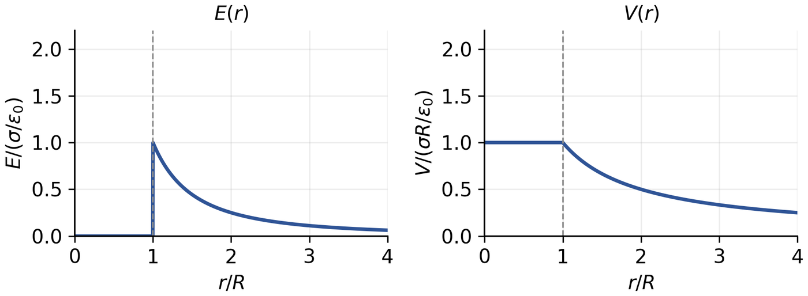
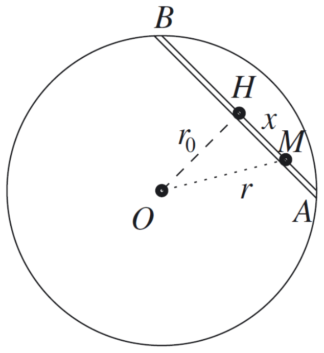

# TD 2　高斯定理

TD n°2 — Théorème de Gauss

CORRIGÉ · 参考解答

中法对照讲义 · 静电学部分

!!! info "阅读说明"

    每段先列法语原文；其下缩进、带深蓝竖条的小字号段落为中文翻译。本题课包含全部练习的参考解答。

## Exercice 1 : Vrai ou faux 练习 1：判断正误

1. On peut utiliser n'importe quelle surface pour appliquer le théorème de Gauss.

    可以使用任意曲面来应用高斯定理。
    {: .zh }

1. Dans le théorème de Gauss, le champ \(\vec{E}\) est uniquement celui créé par les charges situées à l'intérieur de la surface de Gauss.

    在高斯定理中，\(\vec{E}\) 仅仅是位于高斯面内部的电荷所产生的那部分场。
    {: .zh }

1. Pour une plaque infinie chargée uniformément, le champ électrostatique dépend de la distance à la plaque et de la surface de Gauss choisie.

    对于均匀带电的无限大平板，静电场取决于到平板的距离以及所选取的高斯面。
    {: .zh }

1. Le flux sortant d'une surface fermée est toujours positif.

    闭合曲面的向外通量总是正的。
    {: .zh }

1. Pour obtenir la valeur du champ électrique en un point \(P\) à l'aide du théorème de Gauss, on doit calculer le flux électrique à travers une surface passant par \(P\).

    为了用高斯定理求出某点 \(P\) 处的电场值，必须计算穿过一个经过 \(P\) 点的曲面的电通量。
    {: .zh }

!!! sol ""

    **(a) Faux** (en toute rigueur). Le théorème de Gauss est vrai pour toute surface <em>fermée</em>, mais on ne peut en déduire \(\vec{E}\) que si la surface est adaptée aux symétries du problème : il faut que \(\vec{E}\) soit normal à la surface et de norme constante sur celle-ci.

    **(a) 错**（严格说来）。高斯定理对任意<em>闭合</em>曲面都成立，但只有选取与问题对称性相适应的曲面——使 \(\vec{E}\) 在该曲面上处处法向且大小恒定——才能由此求出 \(\vec{E}\)。
    {: .zh }

    **(b) Faux.** Le champ \(\vec{E}\) qui figure dans le théorème de Gauss est le champ <em>total</em>, créé par toutes les charges, intérieures comme extérieures à la surface. Les charges extérieures ne contribuent pas au flux total, mais elles contribuent bien au champ.

    **(b) 错**。高斯定理中的 \(\vec{E}\) 是<em>总</em>场，由曲面内、外的全部电荷共同产生。外部电荷对总通量没有贡献，但对场本身有贡献。
    {: .zh }

    **(c) Faux.** Pour une plaque infinie uniformément chargée, le champ vaut \(\vec{E}=\pm\dfrac{\sigma}{2\varepsilon_0}\vec{e}_x\) : il est uniforme, indépendant de la distance à la plaque et du choix de la surface de Gauss.

    **(c) 错**。对于均匀带电的无限大平板，电场为 \(\vec{E}=\pm\dfrac{\sigma}{2\varepsilon_0}\vec{e}_x\)：它是均匀的，既不依赖于到平板的距离，也不依赖于高斯面的选取。
    {: .zh }

    **(d) Faux.** Le flux sortant vaut \(\Phi=\dfrac{Q_{int}}{\varepsilon_0}\) : il est négatif si la charge intérieure est négative, et nul si elle est nulle.

    **(d) 错**。向外通量为 \(\Phi=\dfrac{Q_{int}}{\varepsilon_0}\)：若内部电荷为负，通量为负；若内部电荷为零，通量为零。
    {: .zh }

    **(e) Vrai.** Pour faire apparaître \(\vec{E}(P)\) dans le flux, il faut que la surface de Gauss passe par \(P\).

    **(e) 对**。要让 \(\vec{E}(P)\) 出现在通量中，高斯面必须经过 \(P\)。
    {: .zh }

## Exercice 2 : Sphère chargée en surface 练习 2：表面带电的球面

On considère une sphère de rayon \(R\) uniformément chargée en surface (charge surfacique \(\sigma\)).

考虑一个半径为 \(R\)、表面均匀带电（面电荷密度为 \(\sigma\)）的球面。
{: .zh }

1. Déterminer l'expression du champ \(\vec{E}\) en tout point \(M\) de l'espace.

    求空间任一点 \(M\) 处电场 \(\vec{E}\) 的表达式。
    {: .zh }

1. En déduire l'expression du potentiel électrostatique \(V\) créé par la distribution en tout point de l'espace.

    由此推出该电荷分布在空间任一点产生的静电势 \(V\) 的表达式。
    {: .zh }

1. Tracer \(E(r)\) et \(V(r)\).

    画出 \(E(r)\) 与 \(V(r)\)。
    {: .zh }

!!! sol ""

    **1. Champ.** La distribution est invariante par toutes les rotations autour de \(O\) et par symétrie par rapport à tout plan passant par \(O\) : le champ est radial, \(\vec{E}(M)=E(r)\,\vec{u}_r\), avec \(r=OM\). On choisit comme surface de Gauss la sphère de centre \(O\) et de rayon \(r\), sur laquelle \(\vec{E}\) est normal et de norme constante :

    **1. 场。**该电荷分布对绕 \(O\) 的一切旋转、对过 \(O\) 的一切平面反射都不变：场为径向场，\(\vec{E}(M)=E(r)\,\vec{u}_r\)，\(r=OM\)。取以 \(O\) 为心、半径为 \(r\) 的球面为高斯面，在其上 \(\vec{E}\) 处处法向且大小恒定：
    {: .zh }

    \[
    \Phi=\oint\vec{E}\cdot\mathrm{d}\vec{S}=E(r)\,4\pi r^2=\frac{Q_{int}}{\varepsilon_0}.
    \]

    Pour \(r<R\) : la sphère de Gauss n'enferme aucune charge, \(Q_{int}=0\), donc \(E(r)=0\).

    当 \(r<R\) 时：高斯面内没有电荷，\(Q_{int}=0\)，故 \(E(r)=0\)。
    {: .zh }

    Pour \(r>R\) : la sphère de Gauss enferme toute la charge, \(Q_{int}=\sigma\,4\pi R^2=Q\), d'où

    当 \(r>R\) 时：高斯面包住全部电荷，\(Q_{int}=\sigma\,4\pi R^2=Q\)，故
    {: .zh }

    \[
    E(r)=\frac{Q}{4\pi\varepsilon_0r^2}=\frac{\sigma R^2}{\varepsilon_0r^2}\qquad(r>R).
    \]

    **2. Potentiel.** On choisit \(V(\infty)=0\) et on intègre \(\vec{E}=-\vec{\nabla}V\), soit \(E_r=-\dfrac{\mathrm{d}V}{\mathrm{d}r}\). Pour \(r>R\) :

    **2. 电势。**取 \(V(\infty)=0\)，积分 \(\vec{E}=-\vec{\nabla}V\)，即 \(E_r=-\dfrac{\mathrm{d}V}{\mathrm{d}r}\)。当 \(r>R\) 时：
    {: .zh }

    \[
    V(r)=\frac{Q}{4\pi\varepsilon_0r}=\frac{\sigma R^2}{\varepsilon_0r}\qquad(r>R).
    \]

    Pour \(r<R\), \(\vec{E}=0\) : le potentiel est constant et vaut, par continuité en \(r=R\),

    当 \(r<R\) 时，\(\vec{E}=0\)：电势为常数，由 \(r=R\) 处的连续性，其值为
    {: .zh }

    \[
    V(r)=V(R)=\frac{Q}{4\pi\varepsilon_0R}=\frac{\sigma R}{\varepsilon_0}\qquad(r<R).
    \]

    **3. Allure.** Le champ est nul à l'intérieur, discontinu en \(r=R\) (saut \(\sigma/\varepsilon_0\)), puis décroît en \(1/r^2\). Le potentiel est constant à l'intérieur puis décroît en \(1/r\) ; il est continu en \(r=R\).

    **3. 形态。**场在内部为零，在 \(r=R\) 处不连续（跃变 \(\sigma/\varepsilon_0\)），随后按 \(1/r^2\) 衰减。电势在内部为常数，随后按 \(1/r\) 衰减；它在 \(r=R\) 处连续。
    {: .zh }

    

    
Figure — \(E/(\sigma/\varepsilon_0)\) et \(V/(\sigma R/\varepsilon_0)\) en fonction de \(r/R\). 图：\(E/(\sigma/\varepsilon_0)\) 与 \(V/(\sigma R/\varepsilon_0)\) 随 \(r/R\) 的变化。

## Exercice 3 : Condensateur cylindrique 练习 3：圆柱形电容器

On considère deux cylindres de même axe \(\vec{e}_z\) et de même hauteur \(H\), de rayons \(R_1\) et \(R_2>R_1\), chargés uniformément en surface (charge \(+q\) pour le cylindre extérieur et \(-q\) pour le cylindre intérieur).

考虑两个同轴（轴为 \(\vec{e}_z\)）、同高 \(H\) 的圆柱面，半径分别为 \(R_1\) 和 \(R_2>R_1\)，表面均匀带电（外侧圆柱面带电荷 \(+q\)，内侧圆柱面带电荷 \(-q\)）。
{: .zh }

1. Déterminer l'expression du champ \(\vec{E}\) en tout point \(M\) de l'espace.

    求空间任一点 \(M\) 处电场 \(\vec{E}\) 的表达式。
    {: .zh }

1. En déduire la capacité du condensateur ainsi réalisé.

    由此推出这样构成的电容器的电容。
    {: .zh }

!!! sol ""

    **1. Champ.** La distribution est invariante par translation selon \(Oz\) et par rotation autour de \(Oz\) (en négligeant les effets de bord, valable si \(H\gg R_2\)) : \(\vec{E}(M)=E(r)\,\vec{u}_r\). On prend pour surface de Gauss un cylindre coaxial de rayon \(r\) et de hauteur \(h\) : le flux ne traverse que la surface latérale, donc

    **1. 场。**该分布沿 \(Oz\) 平移不变、绕 \(Oz\) 旋转不变（忽略边缘效应，当 \(H\gg R_2\) 时成立）：\(\vec{E}(M)=E(r)\,\vec{u}_r\)。取半径为 \(r\)、高为 \(h\) 的同轴圆柱面为高斯面：通量只穿过侧面，故
    {: .zh }

    \[
    \Phi=E(r)\,2\pi r h=\frac{Q_{int}}{\varepsilon_0}.
    \]

    La charge linéique de l'armature intérieure est \(\lambda_1=-q/H\), celle de l'armature extérieure \(\lambda_2=+q/H\). Pour \(r<R_1\) : \(Q_{int}=0\), donc \(E(r)=0\).

    内圆柱面的线电荷密度为 \(\lambda_1=-q/H\)，外圆柱面为 \(\lambda_2=+q/H\)。当 \(r<R_1\) 时：\(Q_{int}=0\)，故 \(E(r)=0\)。
    {: .zh }

    Pour \(R_1<r<R_2\) : \(Q_{int}=\lambda_1h=-\dfrac{qh}{H}\), d'où

    当 \(R_1<r<R_2\) 时：\(Q_{int}=\lambda_1h=-\dfrac{qh}{H}\)，故
    {: .zh }

    \[
    \vec{E}(M)=-\frac{q}{2\pi\varepsilon_0Hr}\,\vec{u}_r.
    \]

    Le champ pointe vers l'axe (vers l'armature négative). Pour \(r>R_2\) : \(Q_{int}=(-q+q)\dfrac{h}{H}=0\), donc \(E(r)=0\). Le champ est confiné entre les deux armatures : c'est le propre d'un condensateur.

    场指向轴线（指向带负电的内圆柱面）。当 \(r>R_2\) 时：\(Q_{int}=(-q+q)\dfrac{h}{H}=0\)，故 \(E(r)=0\)。因此场被限制在两极板之间：这正是电容器的特征。
    {: .zh }

    **2. Capacité.** La tension entre les armatures est

    **2. 电容。**两极板之间的电压为
    {: .zh }

    \[
    U=-\int_{R_1}^{R_2}E_r\,\mathrm{d}r
    =\frac{q}{2\pi\varepsilon_0H}\ln\frac{R_2}{R_1}.
    \]

    Par définition \(C=\dfrac{q}{U}\), d'où

    按电容的定义 \(C=\dfrac{q}{U}\)，得
    {: .zh }

    \[
    C=\frac{2\pi\varepsilon_0H}{\ln(R_2/R_1)}.
    \]

## Exercice 4 : Cavité dans un astre 练习 4：星体中的空腔

On considère un astre à géométrie sphérique de centre \(O_1\), de rayon \(R_1\), de répartition de masse homogène avec une masse volumique \(\rho\).

考虑一个几何上为球形、中心为 \(O_1\)、半径为 \(R_1\) 的星体，其质量分布均匀，质量体密度为 \(\rho\)。
{: .zh }

1. En utilisant le théorème de Gauss, donner l'expression du champ gravitationnel \(\vec{A}\) à l'extérieur de l'astre. Commenter.

    利用高斯定理，给出星体外部引力场 \(\vec{A}\) 的表达式，并评论。
    {: .zh }

1. En utilisant le théorème de Gauss, donner l'expression du champ gravitationnel \(\vec{A}\) à l'intérieur de l'astre.

    利用高斯定理，给出星体内部引力场 \(\vec{A}\) 的表达式。
    {: .zh }

1. À l'intérieur de cet astre se trouve une plus petite cavité de centre \(O_2\) et de rayon \(R_2\), considérée comme vide. Déterminer le champ gravitationnel à l'intérieur de la cavité.

    该星体内部有一个更小的空腔，中心为 \(O_2\)、半径为 \(R_2\)，可视为真空。求空腔内部的引力场。
    {: .zh }

!!! sol ""

    Le théorème de Gauss pour le champ gravitationnel s'écrit, pour une surface fermée \(\Sigma\),

    对任意闭合曲面 \(\Sigma\)，引力场的高斯定理写作：
    {: .zh }

    \[
    \oint_\Sigma\vec{A}\cdot\mathrm{d}\vec{S}=-4\pi G\,M_{int},
    \]

    le signe \(-\) traduisant le caractère attractif de la gravitation. La distribution étant sphérique, \(\vec{A}(M)=A(r)\,\vec{u}_r\) et l'on prend une sphère de Gauss de rayon \(r\).

    其中负号反映了引力的吸引性质。由于质量分布为球形，\(\vec{A}(M)=A(r)\,\vec{u}_r\)，取半径为 \(r\) 的球面为高斯面。
    {: .zh }

    **1. À l'extérieur** (\(r>R_1\)) : \(M_{int}=\rho\frac{4}{3}\pi R_1^3=M\), d'où

    **1. 外部**（\(r>R_1\)）：\(M_{int}=\rho\frac{4}{3}\pi R_1^3=M\)，故
    {: .zh }

    \[
    \vec{A}(M)=-\frac{GM}{r^2}\,\vec{u}_r.
    \]

    On retrouve le champ d'une masse ponctuelle \(M\) placée en \(O_1\) : toute distribution sphérique se comporte, à l'extérieur, comme si toute sa masse était concentrée en son centre (théorème de Newton).

    这正是位于 \(O_1\)、质量为 \(M\) 的质点的场：任何球对称分布在外部都等价于全部质量集中于球心的质点（牛顿定理）。
    {: .zh }

    **2. À l'intérieur** (\(r<R_1\)) : seule la masse contenue dans la sphère de rayon \(r\) compte, \(M_{int}=\rho\frac{4}{3}\pi r^3\), d'où

    **2. 内部**（\(r<R_1\)）：只有半径为 \(r\) 的球面内所包含的质量起作用，\(M_{int}=\rho\frac{4}{3}\pi r^3\)，故
    {: .zh }

    \[
    \vec{A}(M)=-\frac{4}{3}\pi G\rho\,\overrightarrow{O_1M}.
    \]

    Le champ croît linéairement avec la distance au centre et s'annule en \(O_1\).

    场随到球心的距离线性增大，并在 \(O_1\) 处为零。
    {: .zh }

    **3. Cavité.** On applique le principe de superposition : la distribution est la somme d'une sphère pleine de densité \(\rho\) centrée en \(O_1\) et d'une sphère de densité \(-\rho\) centrée en \(O_2\). En un point \(M\) de la cavité :

    **3. 空腔。**应用叠加原理：该分布等于以 \(O_1\) 为心、密度为 \(\rho\) 的实心球，加上以 \(O_2\) 为心、密度为 \(-\rho\) 的球。在空腔内的任一点 \(M\) 处：
    {: .zh }

    \[
    \vec{A}(M)=-\frac{4}{3}\pi G\rho\,\overrightarrow{O_1M}
    -\left(-\frac{4}{3}\pi G\rho\,\overrightarrow{O_2M}\right)
    =-\frac{4}{3}\pi G\rho\,\overrightarrow{O_1O_2}.
    \]

    Le champ est donc <strong>uniforme</strong> dans la cavité, dirigé de \(O_2\) vers \(O_1\), et indépendant de la position de \(M\).

    因此空腔内的场是<strong>均匀</strong>的，方向由 \(O_2\) 指向 \(O_1\)，且与 \(M\) 的位置无关。
    {: .zh }

## Exercice 5 : Tunnel gravitationnel 练习 5：引力隧道

Un tunnel est creusé en ligne droite entre deux points \(A\) et \(B\) de la surface d'une planète sphérique de centre \(O\), de rayon \(R\), de masse \(M\) et de masse volumique \(\mu\) uniforme. On fait le vide dans ce tunnel et on considère un train de masse \(m\) glissant sans frottement. Sa position est repérée par \(x=HM\), où \(H\) est le point le plus proche du centre, et on pose \(r_0=OH\), \(a=x_A=\overline{HA}\), \(r=OM\).

在一个球形行星的表面上取两点 \(A\) 和 \(B\)，沿直线凿出一条隧道。行星中心为 \(O\)、半径为 \(R\)、质量为 \(M\)，且质量体密度 \(\mu\) 均匀。隧道内抽成真空，并考虑一列质量为 \(m\) 的列车在隧道中无摩擦地滑行。其位置由 \(x=HM\) 标定，其中 \(H\) 是隧道上离行星中心最近的点，并记 \(r_0=OH\)、\(a=x_A=\overline{HA}\)、\(r=OM\)。
{: .zh }

1. Déterminer le champ gravitationnel en \(M\) en fonction de \(r\), en déduire la force subie par le train.

    求 \(M\) 处引力场作为 \(r\) 的函数的表达式，并由此推出列车所受的引力。
    {: .zh }

1. En déduire l'énergie potentielle gravitationnelle du train et l'exprimer en fonction de \(x\).

    由此推出列车的引力势能，并将其表示为 \(x\) 的函数。
    {: .zh }

1. Pour quelle valeur de \(x\) la vitesse du train est-elle maximale ? Que peut-on dire de la stabilité de cette position ?

    当 \(x\) 取何值时列车速度最大？关于该位置的稳定性可以说些什么？
    {: .zh }

1. Soit \(\omega_0=\sqrt{\dfrac{GM}{R^3}}\). Établir une équation reliant \(x(t)\), \(\dfrac{\mathrm{d}^2x}{\mathrm{d}t^2}(t)\) et \(\omega_0\).

    设 \(\omega_0=\sqrt{\dfrac{GM}{R^3}}\)。建立联系 \(x(t)\)、\(\dfrac{\mathrm{d}^2x}{\mathrm{d}t^2}(t)\) 与 \(\omega_0\) 的方程。
    {: .zh }

1. Soit \(f(t)=\cos(\omega_0t)\) et \(g(t)=\sin(\omega_0t)\). Montrer que \(f\) et \(g\) sont solutions de l'équation trouvée.

    设 \(f(t)=\cos(\omega_0t)\)、\(g(t)=\sin(\omega_0t)\)。证明 \(f\) 与 \(g\) 是上一问题所得方程的解。
    {: .zh }

1. Soit \(K_1,K_2\) deux constantes réelles et \(h=K_1f+K_2g\). Vérifier que \(h\) est solution.

    设 \(K_1,K_2\) 为两个实常数，\(h=K_1f+K_2g\)。验证 \(h\) 是解。
    {: .zh }

1. Le train est abandonné sans vitesse initiale en \(A\). Établir \(x(t)\) et en déduire la durée du voyage de \(A\) à \(B\).

    列车在 \(A\) 点由静止释放。求 \(x(t)\)，并由此推出从 \(A\) 到 \(B\) 的旅行时间。
    {: .zh }

!!! sol ""

    **1.** À l'intérieur de la planète (\(r<R\)), le théorème de Gauss donne (masse intérieure \(\mu\frac{4}{3}\pi r^3\)) :

    **1.** 在行星内部（\(r<R\)），由高斯定理（内部质量 \(\mu\frac{4}{3}\pi r^3\)）得：
    {: .zh }

    \[
    \vec{A}(M)=-\frac{GM}{R^3}\,\vec{r}=-\omega_0^2\,\vec{r},
    \qquad \omega_0=\sqrt{\frac{GM}{R^3}}.
    \]

    La force subie par le train est donc \(\vec{F}=m\vec{A}=-m\omega_0^2\vec{r}\). En projetant sur l'axe du tunnel, la composante perpendiculaire est compensée par la réaction du tunnel ; il reste \(F_x=-m\omega_0^2x\).

    列车所受的力为 \(\vec{F}=m\vec{A}=-m\omega_0^2\vec{r}\)。投影到隧道轴上，垂直分量由隧道的支持力平衡，只剩下 \(F_x=-m\omega_0^2x\)。
    {: .zh }

    **2.** La force dérive d'une énergie potentielle : \(F_x=-\dfrac{\mathrm{d}E_p}{\mathrm{d}x}\), d'où, en choisissant \(E_p=0\) en \(H\) (\(x=0\)),

    **2.** 该力可由势能导出：\(F_x=-\dfrac{\mathrm{d}E_p}{\mathrm{d}x}\)；取 \(H\) 处（\(x=0\)）\(E_p=0\)，得
    {: .zh }

    \[
    E_p(x)=\frac12 m\omega_0^2x^2.
    \]

    **3.** La vitesse est maximale lorsque \(E_p\) est minimale, donc en \(x=0\) (point \(H\)). Cette position est un équilibre <strong>stable</strong> : pour \(x\neq0\), la force \(F_x=-m\omega_0^2x\) est une force de rappel dirigée vers \(H\).

    **3.** 当 \(E_p\) 最小时速度最大，即在 \(x=0\)（点 \(H\)）处。该位置是<strong>稳定</strong>平衡：当 \(x\neq0\) 时，力 \(F_x=-m\omega_0^2x\) 是指向 \(H\) 的回复力。
    {: .zh }

    **4.** La deuxième loi de Newton selon l'axe du tunnel s'écrit \(m\dfrac{\mathrm{d}^2x}{\mathrm{d}t^2}=-m\omega_0^2x\), soit

    **4.** 对列车沿隧道轴应用牛顿第二定律：\(m\dfrac{\mathrm{d}^2x}{\mathrm{d}t^2}=-m\omega_0^2x\)，即
    {: .zh }

    \[
    \frac{\mathrm{d}^2x}{\mathrm{d}t^2}+\omega_0^2x=0.
    \]

    **5.** On dérive deux fois : \(f''=-\omega_0^2f\) et \(g''=-\omega_0^2g\). Les fonctions \(f\) et \(g\) vérifient donc bien l'équation.

    **5.** 求导两次：\(f''=-\omega_0^2f\)、\(g''=-\omega_0^2g\)。所以 \(f\) 与 \(g\) 确实满足方程。
    {: .zh }

    **6.** Par linéarité : \(h''=K_1f''+K_2g''=-\omega_0^2(K_1f+K_2g)=-\omega_0^2h\). Donc \(h\) est solution : c'est la solution générale.

    **6.** 由线性性：\(h''=-\omega_0^2h\)。因此 \(h\) 是解：它就是通解。
    {: .zh }

    **7.** Le train est lâché en \(A\) sans vitesse initiale : \(x(0)=a\), \(x'(0)=0\). La solution \(h=K_1\cos(\omega_0t)+K_2\sin(\omega_0t)\) donne \(K_1=a\), \(K_2=0\), d'où \(x(t)=a\cos(\omega_0t)\). Le train atteint \(B\) (\(x=-a\)) lorsque \(\omega_0t=\pi\), soit

    **7.** 列车在 \(A\) 处无初速释放：\(x(0)=a\)、\(x'(0)=0\)。解得 \(K_1=a\)、\(K_2=0\)，故 \(x(t)=a\cos(\omega_0t)\)。列车到达 \(B\)（\(x=-a\)）时 \(\omega_0t=\pi\)，故
    {: .zh }

    \[
    \Delta t=\frac{\pi}{\omega_0}=\pi\sqrt{\frac{R^3}{GM}}.
    \]

    Pour la Terre, \(\Delta t\approx42\) min : l'aller-retour dure \(\approx84\) min, soit la période d'un satellite en orbite rasante.

    对地球作数值估算：\(\Delta t\approx42\) 分钟——往返一次约 84 分钟，正好等于贴地卫星的周期。
    {: .zh }
