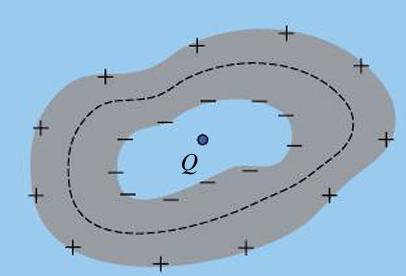
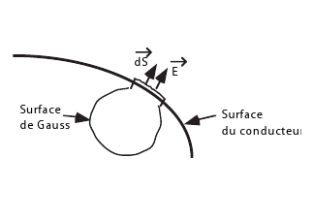

# TD3 详细解答　导体与电容器

Correction détaillée du TD3 — Conducteurs et condensateur (version professeur)

CORRIGÉ OFFICIEL · 官方参考解答

中法对照讲义 · 静电学部分

!!! info "阅读说明"

    本页是 TD3 的官方参考解答（教授版，version professeur）：四道练习逐题给出完整推理、公式与示意图，每道练习末尾附重点词汇。法语原文与中文翻译逐段对照。练习 1 第 2 小题的法语原句在源文件中中断，译文按原文标注。

## Exercice 1 : Vrai ou faux 练习 1：判断正误

1. L'air est un conducteur électrique.

    空气是电导体。
    {: .zh }

2. Le champ électrique à l'intérieur d'un conducteur électrique est toujours nul.

    导体内部的电场总是为零。
    {: .zh }

3. Dans un conducteur en équilibre, les charges en excès se répartissent uniformément en surface du matériau.

    在平衡的导体中，多余电荷均匀地分布在材料表面。
    {: .zh }

4. Lorsque l'on relie deux matériaux conducteurs par un fil conducteur, les deux matériaux se mettent au même potentiel électrostatique.

    当用导线把两种导体材料连接起来时，两种材料达到相同的静电势。
    {: .zh }

5. Si on veut protéger un appareil électrique des perturbations électriques extérieures, il vaut mieux l'entourer d'un matériau isolant.

    若想保护电器设备免受外界电扰动，最好用绝缘材料把它包起来。
    {: .zh }

!!! sol ""

    1. **Faux.** L'air ne contient pas de charges mobiles mais des atomes. Cependant il peut s'ioniser quand il y a un champ électrique très fort (cas des éclairs).

        <strong>错。</strong>空气不含可移动电荷，而只含原子。不过当存在很强的电场时它可以电离（如闪电的情形）。
        {: .zh }

    2. **Faux.** Il n'est pas <strong>TOUJOURS</strong> nul. Il est seulement nul à l'équilibre. Cependant le temps de relaxation des charges est très court donc si on regarde à l'échelle de la seconde un conducteur

        <strong>错。</strong>它并非<em>总是</em>为零，而只是在平衡时为零。然而电荷的弛豫时间非常短，因此若以秒为尺度观察，导体……（原文在此中断）
        {: .zh }

    3. **Faux.** Elles se répartissent bien en surface mais pas de manière uniforme (par exemple pour l'effet de pointe).

        <strong>错。</strong>它们确实分布在表面，但并非均匀分布（例如尖端效应）。
        {: .zh }

    4. **Vrai.** On peut considérer l'ensemble comme un seul matériau conducteur dans lequel le champ est nul. Vu que

        <strong>对。</strong>可以把整体看作单一导体材料，其内部场为零。由于
        {: .zh }

        \[
        V(A)-V(B)=-\int_{B}^{A}\vec{E}(M)\cdot\mathrm{d}\vec{l},
        \]

        le potentiel est le même en tout point du système.

        系统中各点的电势相同。
        {: .zh }

    5. **Faux.** L'effet « cage de Faraday » marche avec un conducteur car les charges mobiles sont responsables de la compensation du champ électrique interne. Pour un isolant les charges sont extrêmement peu mobiles.

        <strong>错。</strong>法拉第笼（cage de Faraday）效应之所以有效，是因为导体中的可移动电荷负责补偿内部电场。对绝缘体而言，电荷的移动性极差。
        {: .zh }

!!! warning "Vocabulaire clé &nbsp;&nbsp; 重点词汇 练习 1 核心术语"

    - <strong>conducteur / isolant</strong>：导体 / 绝缘体
    - <strong>charges mobiles</strong>：可移动电荷
    - <strong>s'ioniser</strong>：电离
    - <strong>équilibre électrostatique</strong>：静电平衡
    - <strong>temps de relaxation</strong>：弛豫时间
    - <strong>charges en excès</strong>：多余电荷
    - <strong>répartition uniforme</strong>：均匀分布
    - <strong>effet de pointe</strong>：尖端效应
    - <strong>cage de Faraday</strong>：法拉第笼
    - <strong>potentiel électrostatique</strong>：静电势

## Exercice 2 : Effet d'une charge dans une cavité 练习 2：空腔中电荷的影响

On place une charge \(Q\) dans la cavité d'un conducteur de charge initialement nulle et on attend quelques secondes. On appelle la surface interne du conducteur \(S_1\) et la surface externe du conducteur \(S_2\).

把电荷 \(Q\) 放入一个初始不带电的导体的空腔中，等待几秒钟。将导体内表面记为 \(S_1\)，导体外表面记为 \(S_2\)。
{: .zh }

1. En utilisant le théorème de Gauss, en déduire la charge portée par \(S_1\).

    利用高斯定理，推出 \(S_1\) 所带电荷。
    {: .zh }

2. Quelle est la charge portée par \(S_2\) ?

    \(S_2\) 所带电荷是多少？
    {: .zh }

<em>Figure 1</em> — Conducteur avec cavité : la charge \(Q\), la surface interne \(S_1\), la surface externe \(S_2\) et une surface de Gauss dans le métal. 图 1：导体与空腔——腔内电荷 \(Q\)、内表面 \(S_1\)、外表面 \(S_2\)，以及金属中的一个高斯面。

!!! sol ""

    <strong>1. Charge portée par \(S_1\).</strong> On considère une surface de Gauss passant dans le conducteur et entourant la surface \(S_1\) comme sur le schéma ci-dessous. La surface est représentée en pointillés.

    <strong>1. \(S_1\) 所带电荷。</strong>考虑一个位于导体内部、包围表面 \(S_1\) 的高斯面，如下图所示。该曲面用虚线表示。
    {: .zh }

    Cette surface est bien fermée donc on peut appliquer le théorème de Gauss. Vu que l'on a attendu quelques secondes, le système est à l'équilibre électrostatique donc le champ interne \(\vec{E}\) est nul. Le théorème de Gauss donne :

    该曲面是闭合的，因此可以应用高斯定理。由于已等待几秒钟，系统处于静电平衡，故内部电场 \(\vec{E}\) 为零。高斯定理给出：
    {: .zh }

    \[
    \Phi=\oint_{M\in S}\vec{E}(M)\cdot\mathrm{d}\vec{S}(M)=\frac{Q_{int}}{\varepsilon_0}
    \]

    \[
    \oint_{M\in S}\vec{0}\cdot\mathrm{d}\vec{S}(M)=\frac{Q_{int}}{\varepsilon_0}=0
    \]

    Cela implique que la charge totale dans la surface de Gauss est nulle, donc la partie du conducteur dans la surface de Gauss a une charge \(-Q\). Le matériau étant conducteur, les charges ne peuvent s'accumuler dans le volume et elles sont donc sur la surface \(S_1\). Donc \(S_1\) possède une charge \(-Q\).

    这意味着高斯面内的总电荷为零，因此高斯面内那部分导体带有电荷 \(-Q\)。由于材料是导体，电荷不能积累在体积内部，只能位于表面 \(S_1\) 上。所以 \(S_1\) 带电荷 \(-Q\)。
    {: .zh }

    <strong>2. Charge portée par \(S_2\).</strong> La charge du conducteur doit rester \(0\) car l'air est isolant. Vu que le volume du conducteur ne peut être chargé, \(S_2\) doit posséder une charge \(+Q\).

    <strong>2. \(S_2\) 所带电荷。</strong>导体的总电荷必须保持为 \(0\)，因为空气是绝缘体。由于导体内部不能带电，\(S_2\) 必须带电荷 \(+Q\)。
    {: .zh }

!!! warning "Vocabulaire clé &nbsp;&nbsp; 重点词汇 练习 2 核心术语"

    - <strong>cavité</strong>：空腔
    - <strong>surface de Gauss</strong>：高斯面
    - <strong>théorème de Gauss</strong>：高斯定理
    - <strong>surface interne / externe</strong>：内表面 / 外表面
    - <strong>champ interne</strong>：内部电场
    - <strong>s'accumuler dans le volume</strong>：在体积内积累
    - <strong>en pointillés</strong>：用虚线表示
    - <strong>charge portée par</strong>：……所带的电荷

## Exercice 3 : Modélisation de l'effet de pointe 练习 3：尖端效应的建模

On considère deux sphères conductrices très éloignées l'une de l'autre (pour négliger leur influence mutuelle), de rayons respectifs \(R_1=10\) cm et \(R_2=1\) mm (\(R_1\gg R_2\)).

考虑两个相距很远的导体球（以忽略它们的相互影响），半径分别为 \(R_1=10\) cm 和 \(R_2=1\) mm（\(R_1\gg R_2\)）。
{: .zh }

Elles sont reliées par un fil conducteur infiniment fin (dont on néglige la capacité). On place sur l'ensemble une charge totale telle que le potentiel électrique commun des deux sphères est \(V=10\,000\) V (potentiel pris nul à l'infini).

它们由一根无限细的导线（其电容忽略不计）相连。在整体上放置总电荷，使两球的共同电势为 \(V=10\,000\) V（取无穷远处电势为零）。
{: .zh }

<strong>Questions :</strong>　问题：

1. Exprimer, en fonction de \(V\), \(R_1\) et \(R_2\), les charges \(Q_1\) et \(Q_2\) portées par chaque sphère.

    用 \(V\)、\(R_1\) 和 \(R_2\) 表示每个球所带的电荷 \(Q_1\) 和 \(Q_2\)。
    {: .zh }

2. En déduire les densités surfaciques de charge \(\sigma_1\) et \(\sigma_2\) sur chaque sphère.

    推出每个球上的表面电荷密度 \(\sigma_1\) 和 \(\sigma_2\)。
    {: .zh }

3. Faire l'application numérique et conclure quant à l'effet de pointe.

    进行数值计算，并对尖端效应作出结论。
    {: .zh }

4. Démontrez la formule générale du champ électrostatique au voisinage immédiat d'un conducteur à l'équilibre.

    证明平衡导体表面附近紧邻处的静电场的一般公式。
    {: .zh }

5. Calculer le champ électrique \(E\) au voisinage immédiat de chaque surface. L'air est-il un isolant dans ces conditions ?

    计算每个表面附近紧邻处的电场 \(E\)。在这些条件下空气是绝缘体吗？
    {: .zh }

!!! sol ""

    <strong>1. Charges \(Q_1\) et \(Q_2\).</strong> On cherche le potentiel d'une sphère isolée au niveau de sa surface. On se place en coordonnées sphériques. On doit d'abord déterminer le champ électrique en \(r>R\) :

    <strong>1. 电荷 \(Q_1\) 与 \(Q_2\)。</strong>我们求孤立球在其表面处的电势。采用球坐标。首先确定 \(r>R\) 处的电场：
    {: .zh }

    — **Symétries :**

    — 对称性：
    {: .zh }

    Tout plan contenant le vecteur \(\overrightarrow{OM}\) est un plan de symétrie de la distribution de charges donc le champ électrique est selon \(\vec{e}_r\).

    任何包含矢量 \(\overrightarrow{OM}\) 的平面都是电荷分布的对称面，因此电场沿 \(\vec{e}_r\) 方向。
    {: .zh }

    \[
    \vec{E}(M)=E(r,\theta,\varphi)\,\vec{e}_r
    \]

    — **Invariances :**

    — 不变性：
    {: .zh }

    La distribution de charge est invariante par rotation d'angle \(\theta\) autour de \(\vec{e}_\varphi\) et par rotation d'angle \(\varphi\) autour de \(\vec{e}_z\) donc \(E\) ne dépend ni de \(\theta\) ni de \(\varphi\).

    电荷分布在绕 \(\vec{e}_\varphi\) 旋转 \(\theta\) 角以及绕 \(\vec{e}_z\) 旋转 \(\varphi\) 角下不变，因此 \(E\) 既不依赖于 \(\theta\) 也不依赖于 \(\varphi\)。
    {: .zh }

    \[
    \vec{E}(M)=E(r)\,\vec{e}_r
    \]

    On applique le théorème de Gauss à la sphère \(S\) de centre \(O\) et de rayon \(r\) :

    对以 \(O\) 为心、半径为 \(r\) 的球面 \(S\) 应用高斯定理：
    {: .zh }

    \[
    \Phi=\oint_{M\in S}\vec{E}(M)\cdot\mathrm{d}\vec{S}(M)=\frac{Q_{int}}{\varepsilon_0}
    \]

    On a

    有
    {: .zh }

    \[
    \oint_{M\in S}\vec{E}(M)\cdot\mathrm{d}\vec{S}(M)
    =\oint_{M\in S}E(r)\,\vec{e}_r\cdot\mathrm{d}S\,\vec{e}_r
    =E(r)\oint_{M\in S}\mathrm{d}S
    =E(r)\,4\pi r^2
    \]

    Donc

    因此
    {: .zh }

    \[
    \vec{E}(r>R)=\frac{Q}{\varepsilon_0\,4\pi r^2}\,\vec{e}_r
    \]

    On sait que

    已知
    {: .zh }

    \[
    \mathrm{d}V=-\vec{E}\cdot\mathrm{d}\vec{l}=-\frac{Q}{\varepsilon_0\,4\pi r^2}\,\mathrm{d}r
    \]

    <strong>Note de lecture.</strong> Dans le document source, le membre de droite de cette égalité est écrit \(\frac{Q}{\varepsilon_0\,4\pi r}\,\mathrm{d}r\) : il manque un facteur \(1/r\) et le signe est faux. Avec \(\vec{E}=\frac{Q}{\varepsilon_0\,4\pi r^2}\,\vec{e}_r\), on a bien \(\mathrm{d}V=-\frac{Q}{\varepsilon_0\,4\pi r^2}\,\mathrm{d}r\). Le résultat final \(V(r>R)=\frac{Q}{\varepsilon_0\,4\pi r}\) reste correct.

    <strong>读者注。</strong>源文件此处将右端写作 \(\frac{Q}{\varepsilon_0\,4\pi r}\,\mathrm{d}r\)：缺少 \(1/r\) 因子且符号有误。由 \(\vec{E}=\frac{Q}{\varepsilon_0\,4\pi r^2}\,\vec{e}_r\)，应为 \(\mathrm{d}V=-\frac{Q}{\varepsilon_0\,4\pi r^2}\,\mathrm{d}r\)。最终结果 \(V(r>R)=\frac{Q}{\varepsilon_0\,4\pi r}\) 仍然正确。
    {: .zh }

    Donc \(V(r>R)=\dfrac{Q}{\varepsilon_0\,4\pi r}+A\) avec \(A\) une constante. On prend le potentiel nul à l'infini donc \(A=0\).

    因此 \(V(r>R)=\dfrac{Q}{\varepsilon_0\,4\pi r}+A\)，其中 \(A\) 为常数。取无穷远处电势为零，故 \(A=0\)。
    {: .zh }

    Par continuité de \(V\) en \(R\) on a

    由 \(V\) 在 \(R\) 处的连续性，有
    {: .zh }

    \[
    V(R)=\frac{Q}{\varepsilon_0\,4\pi R}
    \]

    On considère maintenant le potentiel de chaque sphère. Au niveau de la surface de chaque sphère on peut négliger le champ électrique issu de l'autre sphère.

    现在考虑每个球的电势。在每个球的表面处，可以忽略另一球产生的电场。
    {: .zh }

    Puisque les deux sphères sont reliées, elles sont au même potentiel \(V\). Leurs potentiels respectifs par rapport à l'infini s'expriment par \(V=Q_1/(4\pi\varepsilon_0R_1)=Q_2/(4\pi\varepsilon_0R_2)\). On en déduit :

    由于两球相连，它们处于同一电势 \(V\)。它们相对无穷远的电势分别表示为 \(V=Q_1/(4\pi\varepsilon_0R_1)=Q_2/(4\pi\varepsilon_0R_2)\)。由此推得：
    {: .zh }

    \[
    Q_1=4\pi\varepsilon_0 R_1 V
    \qquad\text{et}\qquad
    Q_2=4\pi\varepsilon_0 R_2 V.
    \]

    Donc \(Q_1\gg Q_2\).

    因此 \(Q_1\gg Q_2\)。
    {: .zh }

    <strong>2. Densités surfaciques \(\sigma_1\) et \(\sigma_2\).</strong> \(\sigma_1=Q_1/(4\pi R_1^2)=\varepsilon_0 V/R_1\) et de même \(\sigma_2=\varepsilon_0 V/R_2\).

    <strong>2. 表面电荷密度 \(\sigma_1\) 与 \(\sigma_2\)。</strong>\(\sigma_1=Q_1/(4\pi R_1^2)=\varepsilon_0 V/R_1\)，同理 \(\sigma_2=\varepsilon_0 V/R_2\)。
    {: .zh }

    Donc \(\sigma_1\ll\sigma_2\).

    因此 \(\sigma_1\ll\sigma_2\)。
    {: .zh }

    <strong>3. Application numérique et effet de pointe.</strong> Applications numériques :

    <strong>3. 数值计算与尖端效应。</strong>数值计算：
    {: .zh }

    \[
    \sigma_1=\frac{8{,}85\times10^{-12}\times10^{4}}{0{,}1}
    =8{,}85\times10^{-7}\ \mathrm{C\cdot m^{-2}},
    \]

    \[
    \sigma_2=\frac{8{,}85\times10^{-12}\times10^{4}}{10^{-3}}
    =8{,}85\times10^{-5}\ \mathrm{C\cdot m^{-2}}.
    \]

    La densité de charge sur la petite sphère (la pointe) est 100 fois plus élevée que sur la grande sphère, illustrant l'effet de pointe.

    小球（尖端）上的电荷密度比大球高 100 倍，说明尖端效应。
    {: .zh }

    <strong>4. Champ au voisinage immédiat d'un conducteur.</strong> On applique la méthode du cours. On considère une surface élémentaire \(S\) d'un conducteur à l'équilibre comme sur le schéma. On considère cette surface telle que le champ ne varie pas lorsque l'on s'y déplace.

    <strong>4. 平衡导体表面附近紧邻处的电场。</strong>应用课程中的方法。考虑平衡导体上的一个面元 \(S\)，如示意图所示。选取该表面使得在其上移动时场不发生变化。
    {: .zh }

    

    
<em>Figure 2</em> — Surface élémentaire \(S\) d'un conducteur à l'équilibre et surface de Gauss utilisée. 图 2：平衡导体上的面元 \(S\) 与所用的高斯面。

    <strong>Étape 1 :</strong> On doit démontrer que \(\vec{E}\) est suivant \(\vec{n}\), le vecteur normal à la surface.

    <strong>步骤 1：</strong>必须证明 \(\vec{E}\) 沿表面法向量 \(\vec{n}\) 方向。
    {: .zh }

    <strong>Par l'absurde</strong> on suppose que \(\vec{E}\) a une composante tangentielle à la surface (\(\vec{E}\times\vec{n}\neq\vec{0}\)). On appelle \(\vec{x}\) le vecteur tangentiel à la surface tel que \(\vec{E}\cdot\vec{x}\neq0\).

    <strong>用反证法</strong>，假设 \(\vec{E}\) 有切于表面的分量（\(\vec{E}\times\vec{n}\neq\vec{0}\)）。令 \(\vec{x}\) 为切于表面、满足 \(\vec{E}\cdot\vec{x}\neq0\) 的矢量。
    {: .zh }

    On applique le PFD à une charge \(q\) sur la surface du conducteur :

    对导体表面上的电荷 \(q\) 应用牛顿第二定律（PFD）：
    {: .zh }

    \[
    m\vec{a}=q\vec{E}
    \]

    On projette cette équation sur le vecteur \(\vec{x}\) :

    将该方程投影到矢量 \(\vec{x}\) 上：
    {: .zh }

    \[
    m\ddot{x}=q\,\vec{E}\cdot\vec{x}
    \]

    Puisque \(\vec{E}\cdot\vec{x}\neq0\), la charge \(q\) subit une accélération selon \(\vec{x}\) et elle va se mettre en mouvement. Cela est **absurde** car le conducteur est à l'équilibre.

    由于 \(\vec{E}\cdot\vec{x}\neq0\)，电荷 \(q\) 沿 \(\vec{x}\) 方向获得加速度并将开始运动。这与导体处于平衡相矛盾（<strong>荒谬</strong>）。
    {: .zh }

    Donc notre hypothèse initiale est fausse et \(\vec{E}\) est orienté suivant \(\vec{n}\).

    因此初始假设错误，\(\vec{E}\) 沿 \(\vec{n}\) 方向。
    {: .zh }

    \[
    \vec{E}=E\vec{n}
    \]

    <strong>Étape 2 :</strong> On applique le théorème de Gauss à la surface de Gauss du schéma.

    <strong>步骤 2：</strong>对示意图中的高斯面应用高斯定理。
    {: .zh }

    \[
    \Phi=\oint_{M\in S}\vec{E}(M)\cdot\mathrm{d}\vec{S}(M)=\frac{Q_{int}}{\varepsilon_0}
    \]

    \[
    \begin{aligned}
    \oint_{M\in S}\vec{E}(M)\cdot\mathrm{d}\vec{S}(M)
    &=\iint_{\text{Intérieur}}\vec{E}(M)\cdot\mathrm{d}\vec{S}(M)
    +\iint_{\text{Surface latérale}}\vec{E}(M)\cdot\mathrm{d}\vec{S}(M)\\
    &\quad+\iint_{S}\vec{E}(M)\cdot\mathrm{d}\vec{S}(M)
    \end{aligned}
    \]

    Le champ à l'intérieur du conducteur à l'équilibre est nul donc \(\displaystyle\iint_{\text{Intérieur}}\vec{E}(M)\cdot\mathrm{d}\vec{S}(M)=\vec{0}\).

    平衡导体内部的场为零，因此 \(\displaystyle\iint_{\text{Intérieur}}\vec{E}(M)\cdot\mathrm{d}\vec{S}(M)=\vec{0}\)。
    {: .zh }

    La surface latérale est orientée perpendiculaire au champ donc \(\displaystyle\iint_{\text{Surface latérale}}\vec{E}(M)\cdot\mathrm{d}\vec{S}(M)=\vec{0}\).

    侧面的取向垂直于场，因此 \(\displaystyle\iint_{\text{Surface latérale}}\vec{E}(M)\cdot\mathrm{d}\vec{S}(M)=\vec{0}\)。
    {: .zh }

    \[
    \Phi=\iint_{S}\vec{E}(M)\cdot\mathrm{d}\vec{S}(M)
    =\iint_{S}E\vec{n}\cdot\mathrm{d}S\,\vec{n}
    =\iint_{S}E\,\mathrm{d}S
    \]

    On a considéré que le champ ne variait pas sur la surface \(S\) donc on peut sortir \(E\) de l'intégrale :

    我们已认为场在曲面 \(S\) 上不变，因此可以把 \(E\) 提出积分号：
    {: .zh }

    \[
    \Phi=E\iint_{S}\mathrm{d}S=ES
    \]

    Or \(Q_{int}=\sigma S\).

    而 \(Q_{int}=\sigma S\)。
    {: .zh }

    Donc par le théorème de Gauss \(E=\dfrac{\sigma}{\varepsilon_0}\) et \(\vec{E}=\dfrac{\sigma}{\varepsilon_0}\,\vec{n}\).

    因此由高斯定理 \(E=\dfrac{\sigma}{\varepsilon_0}\)，且 \(\vec{E}=\dfrac{\sigma}{\varepsilon_0}\,\vec{n}\)。
    {: .zh }

    <strong>5. Champ au voisinage de chaque surface.</strong> Le champ au voisinage immédiat est \(E=\sigma/\varepsilon_0=V/R\).

    <strong>5. 每个表面附近紧邻处的电场。</strong>紧邻处的场为 \(E=\sigma/\varepsilon_0=V/R\)。
    {: .zh }

    Pour la sphère 1 :

    对球 1：
    {: .zh }

    \[
    E_1=\frac{10^{4}}{0{,}1}=10^{5}\ \mathrm{V\cdot m^{-1}}.
    \]

    Pour la sphère 2 (la pointe) :

    对球 2（尖端）：
    {: .zh }

    \[
    E_2=\frac{10^{4}}{10^{-3}}=10^{7}\ \mathrm{V\cdot m^{-1}}.
    \]

    Le champ de claquage (rigidité diélectrique) de l'air étant d'environ \(3\times10^{6}\) V·m\(^{-1}\), l'air devient conducteur au voisinage de la pointe (claquage, décharges, amorçage d'éclairs), tandis qu'il reste isolant autour de la grande sphère.

    空气的击穿场强（介电强度）约为 \(3\times10^{6}\) V·m\(^{-1}\)，因此在尖端附近空气变成导体（击穿、放电、闪电的引发），而在大球周围空气仍保持绝缘。
    {: .zh }

!!! warning "Vocabulaire clé &nbsp;&nbsp; 重点词汇 练习 3 核心术语"

    - <strong>sphère conductrice</strong>：导体球
    - <strong>fil conducteur</strong>：导线
    - <strong>influence mutuelle</strong>：相互影响
    - <strong>symétries / invariances</strong>：对称性 / 不变性
    - <strong>densité surfacique de charge</strong>：表面电荷密度
    - <strong>application numérique</strong>：数值计算
    - <strong>effet de pointe</strong>：尖端效应
    - <strong>voisinage immédiat</strong>：紧邻处
    - <strong>par l'absurde</strong>：用反证法
    - <strong>PFD (principe fondamental de la dynamique)</strong>：牛顿第二定律
    - <strong>champ de claquage</strong>：击穿场强
    - <strong>rigidité diélectrique</strong>：介电强度

## Exercice 4 : Levée de la discontinuité — Du modèle macroscopique à la réalité microscopique 练习 4：消除不连续性——从宏观模型到微观现实

<strong>Contexte physique :</strong>　物理背景：

En électrostatique macroscopique, on modélise la surface d'un conducteur chargé comme une couche de charges d'épaisseur nulle. Le champ électrique y est discontinu : il passe brutalement de \(E_{int}=0\) à l'intérieur à \(E_{ext}=\sigma/\varepsilon_0\) à l'extérieur. Le potentiel, lui, est considéré comme continu (\(V_{int}=V_{surface}\)).

在宏观静电学中，把带电导体表面建模为厚度为零的电荷层。电场在该处不连续：从内部的 \(E_{int}=0\) 突变到外部的 \(E_{ext}=\sigma/\varepsilon_0\)。而电势被认为是连续的（\(V_{int}=V_{surface}\)）。
{: .zh }

En réalité, à l'échelle atomique, les électrons en excès ne sont pas parfaitement plaqués sur une surface mathématique. Ils s'étendent sur une fine couche d'épaisseur \(d\approx1\) Å (\(1\) Å \(=10^{-10}\) m), appelée longueur d'écran de Thomas-Fermi. Dans cette zone, le champ électrique décroît continûment de sa valeur externe jusqu'à \(0\).

实际上，在原子尺度上，多余电子并非完美地贴在一个数学表面上。它们分布在一个厚度为 \(d\approx1\) Å（\(1\) Å \(=10^{-10}\) m）的薄层中，称为托马斯–费米屏蔽长度（longueur d'écran de Thomas-Fermi）。在该区域内，电场从其外部值连续下降到 \(0\)。
{: .zh }

On considère une sphère conductrice de rayon \(R=1\) cm, portée à un potentiel macroscopique \(V_0=10\,000\) V par rapport à l'infini. On néglige les influences extérieures.

考虑一个半径为 \(R=1\) cm 的导体球，相对于无穷远被置于宏观电势 \(V_0=10\,000\) V。忽略外界影响。
{: .zh }

<strong>Données :</strong>　已知数据：

\[
R=10^{-2}\ \mathrm{m},\quad
V_0=10^{4}\ \mathrm{V},\quad
d=10^{-10}\ \mathrm{m},\quad
\varepsilon_0=8{,}85\times10^{-12}\ \mathrm{F\cdot m^{-1}}.
\]

### Partie A : Le modèle macroscopique idéal (la discontinuité) A 部分：理想宏观模型（不连续性）

1. Calculer la norme du champ électrique \(E_{ext}\) régnant à la surface extérieure de la sphère.

    计算球外表面处电场 \(E_{ext}\) 的大小。
    {: .zh }

2. En déduire la densité surfacique de charge \(\sigma\) sur la sphère.

    推出球面上的表面电荷密度 \(\sigma\)。
    {: .zh }

3. Quel est le champ électrique \(E_{int}\) à l'intérieur du métal (volume) ?

    金属内部（体积内）的电场 \(E_{int}\) 是多少？
    {: .zh }

4. Quelle est la différence de potentiel \(\Delta V_{\text{modèle}}=V_{surface}-V_{\text{intérieur}}\) prédite par le modèle idéal ?

    理想模型预言的电位差 \(\Delta V_{\text{modèle}}=V_{surface}-V_{\text{intérieur}}\) 是多少？
    {: .zh }

!!! sol ""

    <strong>A.1. Champ extérieur.</strong> Vu que la sphère est conductrice, sa charge est répartie sur sa surface. Le champ électrostatique hors de la sphère chargée en surface est le même que celui qui serait émis si toute sa charge était placée en son centre (démontré par le théorème de Gauss dans l'exercice 2 du TD2 et dans ce TD). Donc en posant \(Q\) la charge de la sphère :

    <strong>A.1. 外部电场。</strong>由于球是导体，其电荷分布在表面上。表面带电球体外的静电场，与把全部电荷集中在球心时发出的场相同（已在 TD2 的练习 2 和本题中由高斯定理证明）。因此设 \(Q\) 为球的电荷：
    {: .zh }

    \[
    \vec{E}(r)=\frac{Q}{4\pi\varepsilon_0 r^2}\,\vec{u}_r
    \]

    Comme dans le cours on obtient un potentiel de la forme :

    如同课程中那样，得到如下形式的电势：
    {: .zh }

    \[
    V=\frac{Q}{4\pi\varepsilon_0 r}
    \]

    Donc en \(R\) on a \(V_0=R\,E_{ext}\), soit \(E_{ext}=\dfrac{V_0}{R}=10^{6}\) V/m.

    于是在 \(R\) 处：\(V_0=R\,E_{ext}\)，即 \(E_{ext}=\dfrac{V_0}{R}=10^{6}\) V/m。
    {: .zh }

    <strong>A.2. Densité surfacique.</strong> Comme vu dans le cours, le champ à la surface d'un conducteur est :

    <strong>A.2. 表面电荷密度。</strong>如课程中所见，导体表面的场为：
    {: .zh }

    \[
    \vec{E}=\frac{\sigma}{\varepsilon_0}\,\vec{n}
    \]

    Ici \(\vec{n}\) est le vecteur normal à la surface donc c'est \(\vec{u}_r\).

    这里 \(\vec{n}\) 是表面法向量，即 \(\vec{u}_r\)。
    {: .zh }

    Donc \(\sigma=\varepsilon_0 E_{ext}=8{,}85\times10^{-6}\) C·m\(^{-2}\).

    因此 \(\sigma=\varepsilon_0 E_{ext}=8{,}85\times10^{-6}\) C·m\(^{-2}\)。
    {: .zh }

    <strong>A.3. Champ intérieur.</strong> C'est pareil que dans l'exercice 2 du TD2 :

    <strong>A.3. 内部电场。</strong>与 TD2 的练习 2 相同：
    {: .zh }

    — **Symétries :**

    — 对称性：
    {: .zh }

    Tout plan contenant le vecteur \(\overrightarrow{OM}\) est un plan de symétrie de la distribution de charges donc le champ électrique est selon \(\vec{e}_r\).

    任何包含矢量 \(\overrightarrow{OM}\) 的平面都是电荷分布的对称面，因此电场沿 \(\vec{e}_r\) 方向。
    {: .zh }

    \[
    \vec{E}(M)=E(r,\theta,\varphi)\,\vec{e}_r
    \]

    — **Invariances :**

    — 不变性：
    {: .zh }

    La distribution de charge est invariante par rotation d'angle \(\theta\) autour de \(\vec{e}_\varphi\) et par rotation d'angle \(\varphi\) autour de \(\vec{e}_z\) donc \(E\) ne dépend ni de \(\theta\) ni de \(\varphi\).

    电荷分布在绕 \(\vec{e}_\varphi\) 旋转 \(\theta\) 角以及绕 \(\vec{e}_z\) 旋转 \(\varphi\) 角下不变，因此 \(E\) 既不依赖于 \(\theta\) 也不依赖于 \(\varphi\)。
    {: .zh }

    \[
    \vec{E}(M)=E(r)\,\vec{e}_r
    \]

    On applique le théorème de Gauss à la sphère \(S\) de centre \(O\) et de rayon \(r\) :

    对以 \(O\) 为心、半径为 \(r\) 的球面 \(S\) 应用高斯定理：
    {: .zh }

    \[
    \Phi=\oint_{M\in S}\vec{E}(M)\cdot\mathrm{d}\vec{S}(M)=\frac{Q_{int}}{\varepsilon_0}
    \]

    On a

    有
    {: .zh }

    \[
    \oint_{M\in S}\vec{E}(M)\cdot\mathrm{d}\vec{S}(M)
    =\oint_{M\in S}E(r)\,\vec{e}_r\cdot\mathrm{d}S\,\vec{e}_r
    =E(r)\oint_{M\in S}\mathrm{d}S
    =E(r)\,4\pi r^2
    \]

    Or il n'y a pas de charge à l'intérieur de la surface de Gauss donc \(Q=0\) et \(E(r)=0\).

    但高斯面内没有电荷，因此 \(Q=0\)，\(E(r)=0\)。
    {: .zh }

    <strong>A.4. Différence de potentiel du modèle idéal.</strong> Dans le modèle idéal, seul le champ est discontinu entre les surfaces interne et externe du conducteur. Le potentiel est continu et supposé constant en traversant une surface infiniment fine. Autrement dit :

    <strong>A.4. 理想模型的电位差。</strong>在理想模型中，只有场在导体内外表面之间不连续。电势是连续的，并假定在穿过无限薄表面时保持常数。换言之：
    {: .zh }

    \[
    \Delta V_{\text{modèle}}=V_{surface}-V_{intérieur}=0.
    \]

### Partie B : Le modèle réel B 部分：真实模型

On s'intéresse maintenant à l'extrême surface. Soit \(x\) la coordonnée locale perpendiculaire à la surface, orientée de l'intérieur vers l'extérieur. On pose \(x=0\) à la limite « interne » du nuage d'électrons (où \(E=0\)) et \(x=d\) à la limite « externe » du nuage (où \(E=E_{ext}\)).

现在关注最外层表面。设 \(x\) 为垂直于表面的局部坐标，从内部指向外部。取 \(x=0\) 在电子云「内」边界（此处 \(E=0\)），\(x=d\) 在电子云「外」边界（此处 \(E=E_{ext}\)）。
{: .zh }

On suppose, pour simplifier le calcul, que le champ croît **linéairement** dans cette fine couche :

为简化计算，假设场在该薄层内<strong>线性</strong>增大：
{: .zh }

\[
E(x)=E_{ext}\left(\frac{x}{d}\right)
\]

5. Calculer la variation réelle du potentiel \(\Delta V_{\text{réel}}=V(d)-V(0)\) en traversant cette couche d'épaisseur \(d\).

    计算穿过厚度为 \(d\) 的该层时电势的真实变化 \(\Delta V_{\text{réel}}=V(d)-V(0)\)。
    {: .zh }

6. Faire l'application numérique. Comparer \(\Delta V_{\text{réel}}\) à \(V_0\).

    进行数值计算。将 \(\Delta V_{\text{réel}}\) 与 \(V_0\) 比较。
    {: .zh }

!!! sol ""

    <strong>B.5. Variation réelle du potentiel.</strong>

    <strong>B.5. 电势的真实变化。</strong>
    {: .zh }

    \[
    \Delta V_{\text{réel}}=\int_{0}^{d}\mathrm{d}V=\int_{0}^{d}-\vec{E}(M)\cdot\mathrm{d}\vec{l}
    \]

    \[
    \Delta V_{\text{réel}}=\int_{0}^{d}-E_{ext}\left(\frac{x}{d}\right)\mathrm{d}x
    \]

    \[
    \Delta V_{\text{réel}}=-E_{ext}\left[\frac{x^2}{2d}\right]_{0}^{d}
    \]

    \[
    \Delta V_{\text{réel}}=-E_{ext}\frac{d}{2}
    \]

    <strong>B.6. Application numérique.</strong>

    <strong>B.6. 数值计算。</strong>
    {: .zh }

    \[
    \frac{\Delta V_{\text{réel}}}{V_0}
    =\frac{-E_{ext}\dfrac{d}{2}}{R\,E_{ext}}
    =-\frac{d}{2R}
    =-5\times10^{-9}
    \]

    On peut donc aisément considérer le potentiel constant lors de la traversée d'une surface tant que la taille caractéristique du nuage d'électrons est négligeable par rapport à la taille du conducteur.

    因此，只要电子云的特征尺寸相对于导体尺寸可以忽略，就可以轻松地认为电势在穿过表面时保持不变。
    {: .zh }

!!! warning "Vocabulaire clé &nbsp;&nbsp; 重点词汇 练习 4 核心术语"

    - <strong>couche de charges</strong>：电荷层
    - <strong>discontinuité</strong>：不连续性
    - <strong>lever la discontinuité</strong>：消除不连续性
    - <strong>échelle atomique</strong>：原子尺度
    - <strong>longueur d'écran de Thomas-Fermi</strong>：托马斯–费米屏蔽长度
    - <strong>nuage d'électrons</strong>：电子云
    - <strong>coordonnée locale</strong>：局部坐标
    - <strong>croître linéairement</strong>：线性增大
    - <strong>variation du potentiel</strong>：电势变化
    - <strong>taille caractéristique</strong>：特征尺寸
